# MiCoalesceFreeLargePages

- RVA: `0x0037A7B4`–`0x0037AB45` (길이 `913` bytes)
- VA: `0x000000014037A7B4`
- 실행 섹션: `.text`
- PDB 이름 있음: `예`; PDB Function 태그: `아니요`
- unwind 정보 RVA: `0x0007B064`
- 디코드: `245`개 명령, `913/913` bytes 표시
- 미해석 바이트: `0` (있으면 어셈블리에 `.byte`로 보존)

> 이 문서는 커널 이미지의 기계어와 PDB 기호를 분석해 생성했습니다. 4번과 5번은 함수 원형과 자료형을 바이너리 사용 방식에서 추정한 C 해석이며 원본 소스 복구 결과는 아닙니다.

## 1. Dependencies

- 직접 호출 지점: **12**; 고유 호출 대상: **10**
- 직접 호출자로 확인된 함수: **1**
- RIP 상대 이미지 참조: **4**

### Outgoing calls
- `0x0037A850` → [MiPageToNode](../33/MiPageToNode_function_00338CD0.md) (function, `0x00338CD0`)
- `0x0037A898` → [MiLargePfnPromoteCandidate](MiLargePfnPromoteCandidate_function_0037AB4C.md) (function, `0x0037AB4C`)
- `0x0037A8A8` → [MiPageToNode](../33/MiPageToNode_function_00338CD0.md) (function, `0x00338CD0`)
- `0x0037A99B` → [MiLargePfnPromoteCandidate](MiLargePfnPromoteCandidate_function_0037AB4C.md) (function, `0x0037AB4C`)
- `0x0037AA0A` → [KiLowerIrqlProcessIrqlFlags](../4F/KiLowerIrqlProcessIrqlFlags_function_004F5698.md) (function, `0x004F5698`)
- `0x0037AA2A` → [_security_check_cookie](../6A/_security_check_cookie_function_006AC640.md) (function, `0x006AC640`)
- `0x0037AA59` → [MiSafeLockPageAtDpc](../31/MiSafeLockPageAtDpc_function_0031C67C.md) (function, `0x0031C67C`)
- `0x0037AA6F` → [KiRaiseIrqlProcessIrqlFlags](../4F/KiRaiseIrqlProcessIrqlFlags_function_004F56FC.md) (function, `0x004F56FC`)
- `0x0037AA9D` → [MiChangePageAttributeLargeFreeZeroPage](../4A/MiChangePageAttributeLargeFreeZeroPage_function_004ACC10.md) (function, `0x004ACC10`)
- `0x0037AAFD` → [MiLargePagePromote](MiLargePagePromote_function_0037915C.md) (function, `0x0037915C`)
- `0x0037AB28` → [MiAddPageToHeatList](../44/MiAddPageToHeatList_function_0044603C.md) (function, `0x0044603C`)
- `0x0037AB3B` → [MiIssuePageHeatList](../44/MiIssuePageHeatList_function_0044615C.md) (function, `0x0044615C`)

### Direct callers
- [MiProcessLargeCoalesceBitmapCandidates](MiProcessLargeCoalesceBitmapCandidates_function_0037A3F0.md) at `0x0037A582`

### Static image references
- `0x0037A7D0` → RVA `0x00E0A740` (`.data`; read)
- `0x0037A7E8` → RVA `0x00000000` (`image boundary/outside`; read)
- `0x0037A956` → RVA `0x00FC6D20` (`ALMOSTRO`; read)
- `0x0037AAD8` → RVA `0x00E2ECF8` (`.data`; read)

## 2. Other-region calls and transfers

- 다른 실행 섹션으로 향하는 call: **0**
- 별도 외부 분기/꼬리 이동을 확인하지 못했습니다.

## 3. Assembly (complete function range)

```asm
0037A7B4  48 89 5C 24 08                  mov qword ptr [rsp + 8], rbx
0037A7B9  55                              push rbp
0037A7BA  56                              push rsi
0037A7BB  57                              push rdi
0037A7BC  41 54                           push r12
0037A7BE  41 55                           push r13
0037A7C0  41 56                           push r14
0037A7C2  41 57                           push r15
0037A7C4  48 8D 6C 24 D9                  lea rbp, [rsp - 0x27]
0037A7C9  48 81 EC A0 00 00 00            sub rsp, 0xa0
0037A7D0  48 8B 05 69 FF A8 00            mov rax, qword ptr [rip + 0xa8ff69]
0037A7D7  48 33 C4                        xor rax, rsp
0037A7DA  48 89 45 1F                     mov qword ptr [rbp + 0x1f], rax
0037A7DE  33 C0                           xor eax, eax
0037A7E0  44 88 4D B7                     mov byte ptr [rbp - 0x49], r9b
0037A7E4  48 89 45 07                     mov qword ptr [rbp + 7], rax
0037A7E8  4C 8D 2D 11 58 C8 FF            lea r13, [rip - 0x37a7ef]
0037A7EF  41 8B C0                        mov eax, r8d
0037A7F2  4C 8D 3C 52                     lea r15, [rdx + rdx*2]
0037A7F6  0F 57 C0                        xorps xmm0, xmm0
0037A7F9  44 89 45 C3                     mov dword ptr [rbp - 0x3d], r8d
0037A7FD  0F 57 C9                        xorps xmm1, xmm1
0037A800  48 89 55 C7                     mov qword ptr [rbp - 0x39], rdx
0037A804  41 8A F1                        mov sil, r9b
0037A807  48 89 4D E7                     mov qword ptr [rbp - 0x19], rcx
0037A80B  4D 8B B4 C5 60 1C 01 00         mov r14, qword ptr [r13 + rax*8 + 0x11c60]
0037A813  48 8B FA                        mov rdi, rdx
0037A816  41 8B 84 85 E8 35 01 00         mov eax, dword ptr [r13 + rax*4 + 0x135e8]
0037A81E  89 45 CF                        mov dword ptr [rbp - 0x31], eax
0037A821  41 8D 40 FF                     lea eax, [r8 - 1]
0037A825  0F 11 45 0F                     movups xmmword ptr [rbp + 0xf], xmm0
0037A829  89 45 BB                        mov dword ptr [rbp - 0x45], eax
0037A82C  4D 8B AC C5 60 1C 01 00         mov r13, qword ptr [r13 + rax*8 + 0x11c60]
0037A834  0F 11 4D F7                     movups xmmword ptr [rbp - 9], xmm1
0037A838  49 C1 E7 04                     shl r15, 4
0037A83C  48 B9 00 00 00 00 00 DE FF FF   movabs rcx, 0xffffde0000000000
0037A846  4C 03 F9                        add r15, rcx
0037A849  48 8B CA                        mov rcx, rdx
0037A84C  4C 89 7D EF                     mov qword ptr [rbp - 0x11], r15
0037A850  E8 7B E4 FB FF                  call 0x140338cd0
0037A855  8B 4D CF                        mov ecx, dword ptr [rbp - 0x31]
0037A858  45 33 E4                        xor r12d, r12d
0037A85B  83 65 D3 00                     and dword ptr [rbp - 0x2d], 0
0037A85F  8B D8                           mov ebx, eax
0037A861  83 65 BF 00                     and dword ptr [rbp - 0x41], 0
0037A865  49 D3 ED                        shr r13, cl
0037A868  48 89 7D D7                     mov qword ptr [rbp - 0x29], rdi
0037A86C  41 8D 44 24 01                  lea eax, [r12 + 1]
0037A871  4C 89 6D DF                     mov qword ptr [rbp - 0x21], r13
0037A875  4D 85 ED                        test r13, r13
0037A878  74 6B                           je 0x14037a8e5
0037A87A  48 8B 75 D7                     mov rsi, qword ptr [rbp - 0x29]
0037A87E  4F 8D 2C 76                     lea r13, [r14 + r14*2]
0037A882  49 8B FF                        mov rdi, r15
0037A885  49 C1 E5 04                     shl r13, 4
0037A889  4C 8B 7D DF                     mov r15, qword ptr [rbp - 0x21]
0037A88D  44 8B 45 C3                     mov r8d, dword ptr [rbp - 0x3d]
0037A891  48 8B D7                        mov rdx, rdi
0037A894  48 8B 4D E7                     mov rcx, qword ptr [rbp - 0x19]
0037A898  E8 AF 02 00 00                  call 0x14037ab4c
0037A89D  85 C0                           test eax, eax
0037A89F  0F 84 D4 01 00 00               je 0x14037aa79
0037A8A5  48 8B CE                        mov rcx, rsi
0037A8A8  E8 23 E4 FB FF                  call 0x140338cd0
0037A8AD  3B D8                           cmp ebx, eax
0037A8AF  0F 85 C4 01 00 00               jne 0x14037aa79
0037A8B5  8B 47 20                        mov eax, dword ptr [rdi + 0x20]
0037A8B8  49 03 F6                        add rsi, r14
0037A8BB  C1 E8 10                        shr eax, 0x10
0037A8BE  49 03 FD                        add rdi, r13
0037A8C1  0F B6 C8                        movzx ecx, al
0037A8C4  B8 01 00 00 00                  mov eax, 1
0037A8C9  48 C1 E9 06                     shr rcx, 6
0037A8CD  4C 03 E0                        add r12, rax
0037A8D0  01 44 8D 0F                     add dword ptr [rbp + rcx*4 + 0xf], eax
0037A8D4  4D 3B E7                        cmp r12, r15
0037A8D7  72 B4                           jb 0x14037a88d
0037A8D9  40 8A 75 B7                     mov sil, byte ptr [rbp - 0x49]
0037A8DD  4C 8B 7D EF                     mov r15, qword ptr [rbp - 0x11]
0037A8E1  4C 8B 6D DF                     mov r13, qword ptr [rbp - 0x21]
0037A8E5  4D 3B E5                        cmp r12, r13
0037A8E8  0F 85 7D 01 00 00               jne 0x14037aa6b
0037A8EE  45 33 C0                        xor r8d, r8d
0037A8F1  4C 8D 55 0F                     lea r10, [rbp + 0xf]
0037A8F5  33 D2                           xor edx, edx
0037A8F7  44 8B D8                        mov r11d, eax
0037A8FA  45 33 C9                        xor r9d, r9d
0037A8FD  41 8B 0A                        mov ecx, dword ptr [r10]
0037A900  85 C9                           test ecx, ecx
0037A902  0F 85 43 01 00 00               jne 0x14037aa4b
0037A908  44 3B C1                        cmp r8d, ecx
0037A90B  41 8B C1                        mov eax, r9d
0037A90E  41 0F 43 C3                     cmovae eax, r11d
0037A912  49 83 C2 04                     add r10, 4
0037A916  44 8B D8                        mov r11d, eax
0037A919  B8 01 00 00 00                  mov eax, 1
0037A91E  44 03 C8                        add r9d, eax
0037A921  44 3B C1                        cmp r8d, ecx
0037A924  41 0F 43 C8                     cmovae ecx, r8d
0037A928  44 8B C1                        mov r8d, ecx
0037A92B  41 83 F9 04                     cmp r9d, 4
0037A92F  72 CC                           jb 0x14037a8fd
0037A931  44 89 5D D7                     mov dword ptr [rbp - 0x29], r11d
0037A935  85 D2                           test edx, edx
0037A937  0F 85 46 01 00 00               jne 0x14037aa83
0037A93D  4C 8B 6D C7                     mov r13, qword ptr [rbp - 0x39]
0037A941  BA 02 00 00 00                  mov edx, 2
0037A946  49 8B FF                        mov rdi, r15
0037A949  40 3A F2                        cmp sil, dl
0037A94C  73 15                           jae 0x14037a963
0037A94E  44 0F 20 C1                     mov rcx, cr8
0037A952  44 0F 22 C2                     mov cr8, rdx
0037A956  83 3D C3 C3 C4 00 00            cmp dword ptr [rip + 0xc4c3c3], 0
0037A95D  0F 85 0C 01 00 00               jne 0x14037aa6f
0037A963  33 DB                           xor ebx, ebx
0037A965  4F 8D 24 76                     lea r12, [r14 + r14*2]
0037A969  49 C1 E4 04                     shl r12, 4
0037A96D  48 3B 5D DF                     cmp rbx, qword ptr [rbp - 0x21]
0037A971  0F 83 43 01 00 00               jae 0x14037aaba
0037A977  49 3B FF                        cmp rdi, r15
0037A97A  0F 84 D6 00 00 00               je 0x14037aa56
0037A980  F0 48 0F BA 6F 18 3F            lock bts qword ptr [rdi + 0x18], 0x3f
0037A987  0F 82 7D 01 00 00               jb 0x14037ab0a
0037A98D  44 8B 45 C3                     mov r8d, dword ptr [rbp - 0x3d]
0037A991  48 8B D7                        mov rdx, rdi
0037A994  48 8B 4D E7                     mov rcx, qword ptr [rbp - 0x19]
0037A998  48 FF C3                        inc rbx
0037A99B  E8 AC 01 00 00                  call 0x14037ab4c
0037A9A0  85 C0                           test eax, eax
0037A9A2  74 1D                           je 0x14037a9c1
0037A9A4  8B 47 20                        mov eax, dword ptr [rdi + 0x20]
0037A9A7  C1 E8 10                        shr eax, 0x10
0037A9AA  0F B6 C8                        movzx ecx, al
0037A9AD  C1 E9 06                        shr ecx, 6
0037A9B0  3B 4D D7                        cmp ecx, dword ptr [rbp - 0x29]
0037A9B3  0F 85 5B 01 00 00               jne 0x14037ab14
0037A9B9  49 03 FC                        add rdi, r12
0037A9BC  4D 03 EE                        add r13, r14
0037A9BF  EB AC                           jmp 0x14037a96d
0037A9C1  8B 7D BF                        mov edi, dword ptr [rbp - 0x41]
0037A9C4  4C 8B 75 C7                     mov r14, qword ptr [rbp - 0x39]
0037A9C8  44 8B 6D BB                     mov r13d, dword ptr [rbp - 0x45]
0037A9CC  8B 4D CF                        mov ecx, dword ptr [rbp - 0x31]
0037A9CF  48 D3 E3                        shl rbx, cl
0037A9D2  48 8D 04 5B                     lea rax, [rbx + rbx*2]
0037A9D6  48 C1 E0 04                     shl rax, 4
0037A9DA  49 03 C7                        add rax, r15
0037A9DD  49 2B C4                        sub rax, r12
0037A9E0  48 B9 FF FF FF FF FF FF FF 7F   movabs rcx, 0x7fffffffffffffff
0037A9EA  F0 48 21 48 18                  lock and qword ptr [rax + 0x18], rcx
0037A9EF  49 3B C7                        cmp rax, r15
0037A9F2  75 E9                           jne 0x14037a9dd
0037A9F4  40 80 FE 02                     cmp sil, 2
0037A9F8  73 1D                           jae 0x14037aa17
0037A9FA  83 3D 1F C3 C4 00 00            cmp dword ptr [rip + 0xc4c31f], 0
0037AA01  74 0C                           je 0x14037aa0f
0037AA03  44 0F 20 C1                     mov rcx, cr8
0037AA07  40 8A D6                        mov dl, sil
0037AA0A  E8 89 AC 17 00                  call 0x1404f5698
0037AA0F  40 0F B6 C6                     movzx eax, sil
0037AA13  44 0F 22 C0                     mov cr8, rax
0037AA17  83 7D D3 00                     cmp dword ptr [rbp - 0x2d], 0
0037AA1B  0F 85 FD 00 00 00               jne 0x14037ab1e
0037AA21  8B C7                           mov eax, edi
0037AA23  48 8B 4D 1F                     mov rcx, qword ptr [rbp + 0x1f]
0037AA27  48 33 CC                        xor rcx, rsp
0037AA2A  E8 11 1C 33 00                  call 0x1406ac640
0037AA2F  48 8B 9C 24 E0 00 00 00         mov rbx, qword ptr [rsp + 0xe0]
0037AA37  48 81 C4 A0 00 00 00            add rsp, 0xa0
0037AA3E  41 5F                           pop r15
0037AA40  41 5E                           pop r14
0037AA42  41 5D                           pop r13
0037AA44  41 5C                           pop r12
0037AA46  5F                              pop rdi
0037AA47  5E                              pop rsi
0037AA48  5D                              pop rbp
0037AA49  C3                              ret
0037AA4A  CC                              int3
0037AA4B  45 85 C0                        test r8d, r8d
0037AA4E  0F 45 D0                        cmovne edx, eax
0037AA51  E9 B2 FE FF FF                  jmp 0x14037a908
0037AA56  49 8B CD                        mov rcx, r13
0037AA59  E8 1E 1C FA FF                  call 0x14031c67c
0037AA5E  3C 11                           cmp al, 0x11
0037AA60  0F 85 27 FF FF FF               jne 0x14037a98d
0037AA66  E9 56 FF FF FF                  jmp 0x14037a9c1
0037AA6B  33 C0                           xor eax, eax
0037AA6D  EB B4                           jmp 0x14037aa23
0037AA6F  E8 88 AC 17 00                  call 0x1404f56fc
0037AA74  E9 EA FE FF FF                  jmp 0x14037a963
0037AA79  B8 01 00 00 00                  mov eax, 1
0037AA7E  E9 56 FE FF FF                  jmp 0x14037a8d9
0037AA83  49 8B FF                        mov rdi, r15
0037AA86  33 DB                           xor ebx, ebx
0037AA88  49 3B DD                        cmp rbx, r13
0037AA8B  0F 83 AC FE FF FF               jae 0x14037a93d
0037AA91  8B 55 C3                        mov edx, dword ptr [rbp - 0x3d]
0037AA94  44 8A CE                        mov r9b, sil
0037AA97  45 8B C3                        mov r8d, r11d
0037AA9A  48 8B CF                        mov rcx, rdi
0037AA9D  E8 6E 21 13 00                  call 0x1404acc10
0037AAA2  85 C0                           test eax, eax
0037AAA4  74 C5                           je 0x14037aa6b
0037AAA6  44 8B 5D D7                     mov r11d, dword ptr [rbp - 0x29]
0037AAAA  4B 8D 04 76                     lea rax, [r14 + r14*2]
0037AAAE  48 C1 E0 04                     shl rax, 4
0037AAB2  48 03 F8                        add rdi, rax
0037AAB5  48 FF C3                        inc rbx
0037AAB8  EB CE                           jmp 0x14037aa88
0037AABA  BA 02 00 00 00                  mov edx, 2
0037AABF  0F 57 C0                        xorps xmm0, xmm0
0037AAC2  40 3A F2                        cmp sil, dl
0037AAC5  0F 11 45 F7                     movups xmmword ptr [rbp - 9], xmm0
0037AAC9  1B C0                           sbb eax, eax
0037AACB  23 C2                           and eax, edx
0037AACD  83 C0 08                        add eax, 8
0037AAD0  89 45 F7                        mov dword ptr [rbp - 9], eax
0037AAD3  40 3A F2                        cmp sil, dl
0037AAD6  73 0B                           jae 0x14037aae3
0037AAD8  48 8B 05 19 42 AB 00            mov rax, qword ptr [rip + 0xab4219]
0037AADF  48 89 45 FF                     mov qword ptr [rbp - 1], rax
0037AAE3  4C 8B 75 C7                     mov r14, qword ptr [rbp - 0x39]
0037AAE7  48 8D 45 D3                     lea rax, [rbp - 0x2d]
0037AAEB  44 8B 6D BB                     mov r13d, dword ptr [rbp - 0x45]
0037AAEF  49 8B CE                        mov rcx, r14
0037AAF2  45 33 C9                        xor r9d, r9d
0037AAF5  48 89 44 24 20                  mov qword ptr [rsp + 0x20], rax
0037AAFA  41 8B D5                        mov edx, r13d
0037AAFD  E8 5A E6 FF FF                  call 0x14037915c
0037AB02  8B 7D BF                        mov edi, dword ptr [rbp - 0x41]
0037AB05  E9 C2 FE FF FF                  jmp 0x14037a9cc
0037AB0A  BF 01 00 00 00                  mov edi, 1
0037AB0F  E9 B0 FE FF FF                  jmp 0x14037a9c4
0037AB14  4C 8B 75 C7                     mov r14, qword ptr [rbp - 0x39]
0037AB18  44 8B 6D BB                     mov r13d, dword ptr [rbp - 0x45]
0037AB1C  EB E4                           jmp 0x14037ab02
0037AB1E  45 8B C5                        mov r8d, r13d
0037AB21  48 8D 4D F7                     lea rcx, [rbp - 9]
0037AB25  49 8B D6                        mov rdx, r14
0037AB28  E8 0F B5 0C 00                  call 0x14044603c
0037AB2D  83 7D FB 00                     cmp dword ptr [rbp - 5], 0
0037AB31  0F 84 EA FE FF FF               je 0x14037aa21
0037AB37  48 8D 4D F7                     lea rcx, [rbp - 9]
0037AB3B  E8 1C B6 0C 00                  call 0x14044615c
0037AB40  E9 DC FE FF FF                  jmp 0x14037aa21
```

## 4. C-style interpretation (structured pseudocode)

```c
__int64 __fastcall MiCoalesceFreeLargePages(__int64 a1, __int64 a2, __int64 a3, int a4)
{
    __int64 result;
    __int64 v_r10;
    __int64 v_r12;
    __int64 v_r13;
    __int64 v_r15;
    __int64 v_rbx;
    __int64 v_rdi;
    __int64 v_rsi;
    __int64 v_rsp;
    unsigned __int64 v_stack_m40;
    unsigned __int64 v_stack_m50;
    unsigned __int64 v_stack_m58;
    unsigned __int64 v_stack_m5F;
    unsigned __int64 v_stack_m60;
    unsigned int v_stack_m64;
    unsigned __int64 v_stack_m68;
    unsigned __int64 v_stack_m70;
    unsigned __int64 v_stack_m78;
    unsigned __int64 v_stack_m80;
    unsigned __int64 v_stack_m88;
    unsigned int v_stack_m8C;
    unsigned int v_stack_m90;
    unsigned __int64 v_stack_m98;
    unsigned int v_stack_m9C;
    unsigned int v_stack_mA0;
    unsigned int v_stack_mA4;
    unsigned __int8 v_stack_mA8;
    unsigned __int64 v_stack_p20;
    unsigned __int64 v_stack_p8;

    v_stack_p8 = v_rbx;
    v_rsp = (v_rsp) - (160);
    result = (*(unsigned __int64 *)(v_rip + 11075433)) ^ (v_rsp);
    v_stack_m40 = result;
    result = 0;
    v_stack_mA8 = (unsigned __int8)(a4);
    v_stack_m58 = 0;
    v_stack_m9C = (unsigned int)(a3);
    v_stack_m98 = a2;
    v_stack_m78 = a1;
    v_stack_m90 = (unsigned int)((unsigned int)(*(unsigned int *)(v_rip - 3647471 + (unsigned int)((unsigned int)(a3)) * 4 + 79336)));
    v_stack_m50 = v_xmm0;
    v_stack_mA4 = (unsigned int)(a3 - 1);
    v_stack_m68 = v_xmm1;
    v_r15 = (a2 + a2 * 2) << (4);
    v_r15 = (v_r15) + (a1);
    v_stack_m70 = v_r15;
    result = MiPageToNode(a2, a2, a3, a4);
    v_r12 = 0;
    v_r13 = (*(unsigned __int64 *)(v_rip - 3647471 + a3 - 1 * 8 + 72800)) >> ((unsigned __int8)((unsigned int)(v_stack_m90)));
    v_stack_m88 = a2;
    v_stack_m80 = v_r13;
    if (v_r13 == 0) goto loc_0037A8E5;
    v_r13 = (*(unsigned __int64 *)(v_rip - 3647471 + (unsigned int)((unsigned int)(a3)) * 8 + 72800) + *(unsigned __int64 *)(v_rip - 3647471 + (unsigned int)((unsigned int)(a3)) * 8 + 72800) * 2) << (4);
loc_0037A88D:
    result = MiLargePfnPromoteCandidate(v_stack_m78, v_r15, (unsigned int)(v_stack_m9C), a4);
    if ((unsigned int)(result) == 0) goto loc_0037AA79;
    result = MiPageToNode(v_stack_m88, v_r15, (unsigned int)(v_stack_m9C), a4);
    if (((unsigned int)((unsigned int)((unsigned int)(result)))) != ((unsigned int)(result))) goto loc_0037AA79;
    v_rsi = (v_stack_m88) + (*(unsigned __int64 *)(v_rip - 3647471 + (unsigned int)((unsigned int)(a3)) * 8 + 72800));
    result = (unsigned int)(((unsigned int)(*(unsigned int *)(v_r15 + 32))) >> (16));
    v_rdi = (v_r15) + (v_r13);
    a1 = ((unsigned __int8)(result)) >> (6);
    v_r12 = (v_r12) + (1);
    if (v_r12 < v_stack_m80) goto loc_0037A88D;
loc_0037A8D9:
loc_0037A8E5:
    if (v_r12 != v_stack_m80) goto loc_0037AA6B;
    a3 = 0;
    a2 = 0;
    a4 = 0;
loc_0037A8FD:
    if ((unsigned int)((unsigned int)(*(unsigned int *)(v_stack_m50))) != 0) goto loc_0037AA4B;
loc_0037A908:
    result = 0;
    if (0 >= ((unsigned int)((unsigned int)(*(unsigned int *)(v_stack_m50))))) { result = 1; }
    v_r10 = (v_stack_m50) + (4);
    a4 = (unsigned int)((a4) + (1));
    a1 = (unsigned int)(*(unsigned int *)(v_stack_m50));
    if (0 >= ((unsigned int)((unsigned int)(*(unsigned int *)(v_stack_m50))))) { a1 = 0; }
    if (a4 < 4) goto loc_0037A8FD;
    v_stack_m88 = (unsigned int)((unsigned int)((unsigned int)(result)));
    if (0 != 0) goto loc_0037AA83;
loc_0037A93D:
    if (((unsigned __int8)(v_stack_mA8)) >= 2) goto loc_0037A963;
    if ((*(unsigned int *)(v_rip + 12895171)) != 0) goto loc_0037AA6F;
loc_0037A963:
    v_rbx = 0;
    v_r12 = (*(unsigned __int64 *)(v_rip - 3647471 + (unsigned int)((unsigned int)(a3)) * 8 + 72800) + *(unsigned __int64 *)(v_rip - 3647471 + (unsigned int)((unsigned int)(a3)) * 8 + 72800) * 2) << (4);
loc_0037A96D:
    if (0 >= v_stack_m80) goto loc_0037AABA;
    if (v_stack_m70 == v_stack_m70) goto loc_0037AA56;
    if (v_stack_m70 < v_stack_m70) goto loc_0037AB0A;
loc_0037A98D:
    v_rbx = (v_rbx) + 1;
    result = MiLargePfnPromoteCandidate(v_stack_m78, v_stack_m70, (unsigned int)(v_stack_m9C), a4);
    if ((unsigned int)(result) == 0) goto loc_0037A9C1;
    result = (unsigned int)(((unsigned int)(*(unsigned int *)(v_stack_m70 + 32))) >> (16));
    a1 = (unsigned int)(((unsigned __int8)(result)) >> (6));
    if (((unsigned int)(a1)) != v_stack_m88) goto loc_0037AB14;
    v_rdi = (v_stack_m70) + (v_r12);
    v_r13 = (v_stack_m98) + (*(unsigned __int64 *)(v_rip - 3647471 + (unsigned int)((unsigned int)(a3)) * 8 + 72800));
    goto loc_0037A96D;
loc_0037A9C1:
loc_0037A9C4:
loc_0037A9CC:
    v_rbx = (v_rbx) << ((unsigned __int8)((unsigned int)(v_stack_m90)));
    result = (v_rbx + v_rbx * 2) << (4);
    result = (result) + (v_stack_m70);
loc_0037A9DD:
    result = (result) - (v_r12);
    if (result != v_stack_m70) goto loc_0037A9DD;
    if (((unsigned __int8)(v_stack_mA8)) >= 2) goto loc_0037AA17;
    if ((*(unsigned int *)(v_rip + 12895007)) != 0) {
        a1 = 2;
        a2 = (unsigned __int8)(v_stack_mA8);
        result = KiLowerIrqlProcessIrqlFlags(a1, a2, (unsigned int)(v_stack_m9C), a4);
    }
loc_0037AA17:
    if (v_stack_m8C != 0) goto loc_0037AB1E;
loc_0037AA21:
loc_0037AA23:
    a1 = (v_stack_m40) ^ (v_rsp);
    result = _security_check_cookie(a1, a2, (unsigned int)(v_stack_m9C), a4);
    v_rsp = (v_rsp) + (160);
    return result;
loc_0037AA4B:
    if ((unsigned int)((unsigned int)(v_stack_m9C)) != 0) { a2 = (unsigned int)(result); }
    goto loc_0037A908;
loc_0037AA56:
    result = MiSafeLockPageAtDpc((unsigned int)(v_stack_mA4), a2, (unsigned int)(v_stack_m9C), a4);
    if (((unsigned __int8)(result)) != 17) goto loc_0037A98D;
    goto loc_0037A9C1;
loc_0037AA6B:
    result = 0;
    goto loc_0037AA23;
loc_0037AA6F:
    result = KiRaiseIrqlProcessIrqlFlags((unsigned int)(v_stack_mA4), a2, (unsigned int)(v_stack_m9C), a4);
    goto loc_0037A963;
loc_0037AA79:
    goto loc_0037A8D9;
loc_0037AA83:
    v_rbx = 0;
loc_0037AA88:
    if (0 >= ((unsigned int)(v_stack_mA4))) goto loc_0037A93D;
    result = MiChangePageAttributeLargeFreeZeroPage(v_stack_m70, (unsigned int)(v_stack_m9C), (unsigned int)((unsigned int)((unsigned int)((unsigned int)(result)))), (unsigned __int8)(v_stack_mA8));
    if ((unsigned int)(result) == 0) goto loc_0037AA6B;
    result = (v_stack_m98 + v_stack_m98 * 2) << (4);
    v_rdi = (v_stack_m70) + (result);
    v_rbx = (v_rbx) + 1;
    goto loc_0037AA88;
loc_0037AABA:
    v_stack_m68 = v_xmm0;
    result = (unsigned int)((result) & (2));
    result = (unsigned int)((result) + (8));
    v_stack_m68 = (unsigned int)(result);
    if (((unsigned __int8)(v_stack_mA8)) < 2) {
        result = *(unsigned __int64 *)(v_rip + 11223577);
        v_stack_m60 = result;
    }
    a4 = 0;
    v_stack_p20 = v_stack_m8C;
    result = MiLargePagePromote(v_stack_m98, (unsigned int)((unsigned int)((unsigned int)(v_stack_mA4))), (unsigned int)((unsigned int)((unsigned int)((unsigned int)(result)))), a4);
loc_0037AB02:
    goto loc_0037A9CC;
loc_0037AB0A:
    goto loc_0037A9C4;
loc_0037AB14:
    goto loc_0037AB02;
loc_0037AB1E:
    result = MiAddPageToHeatList(v_stack_m68, v_stack_m98, (unsigned int)((unsigned int)((unsigned int)(v_stack_mA4))), a4);
    if (v_stack_m64 == 0) goto loc_0037AA21;
    result = MiIssuePageHeatList(v_stack_m68, v_stack_m98, (unsigned int)((unsigned int)((unsigned int)(v_stack_mA4))), a4);
    goto loc_0037AA21;
}
```

## 5. (Beta) C Style

```c
int64_t MiCoalesceFreeLargePages(int64_t Arg1, void *Arg2, void *Arg3, int32_t Arg4)
{
    uint8_t *arg2 = (uint8_t *)Arg2;
    uint8_t *arg3 = (uint8_t *)Arg3;

    int64_t result;
    int64_t local_r10;
    int64_t local_r12;
    int64_t local_r13;
    int64_t local_r15;
    int64_t local_rbx;
    int64_t local_rdi;
    int64_t local_rsi;
    int64_t local_rsp;
    uint64_t v_stack_m40;
    uint64_t v_stack_m50;
    uint64_t v_stack_m58;
    uint64_t v_stack_m5F;
    uint64_t v_stack_m60;
    uint32_t v_stack_m64;
    uint64_t v_stack_m68;
    uint64_t v_stack_m70;
    uint64_t v_stack_m78;
    uint64_t v_stack_m80;
    uint64_t v_stack_m88;
    uint32_t v_stack_m8C;
    uint32_t v_stack_m90;
    uint64_t v_stack_m98;
    uint32_t v_stack_m9C;
    uint32_t v_stack_mA0;
    uint32_t v_stack_mA4;
    uint8_t v_stack_mA8;
    uint64_t v_stack_p20;
    uint64_t v_stack_p8;

    v_stack_p8 = local_rbx;
    local_rsp = (local_rsp) - (160);
    result = (*(uint64_t *)(v_rip + 0xA8FF69)) ^ (local_rsp);
    v_stack_m40 = result;
    result = 0;
    v_stack_mA8 = (uint8_t)(Arg4);
    v_stack_m58 = 0;
    v_stack_m9C = (uint32_t)(Arg3);
    v_stack_m98 = Arg2;
    v_stack_m78 = Arg1;
    v_stack_m90 = (uint32_t)((uint32_t)(*(uint32_t *)(v_rip - 0x37A7EF + (uint32_t)((uint32_t)(arg3)) * 4 + 0x135E8)));
    v_stack_m50 = v_xmm0;
    v_stack_mA4 = (uint32_t)(Arg3 - 1);
    v_stack_m68 = v_xmm1;
    local_r15 = (Arg2 + Arg2 * 2) << (4);
    local_r15 = (local_r15) + (Arg1);
    v_stack_m70 = local_r15;
    result = MiPageToNode(Arg2, Arg2, Arg3, Arg4);
    local_r12 = 0;
    local_r13 = (*(uint64_t *)(v_rip - 0x37A7EF + arg3 - 0x1 * 8 + 0x11C60)) >> ((uint8_t)((uint32_t)(v_stack_m90)));
    v_stack_m88 = Arg2;
    v_stack_m80 = local_r13;
    if (local_r13 == 0) goto loc_0037A8E5;
    local_r13 = (*(uint64_t *)(v_rip - 0x37A7EF + (uint32_t)((uint32_t)(arg3)) * 8 + 0x11C60) + *(uint64_t *)(v_rip - 0x37A7EF + (uint32_t)((uint32_t)(arg3)) * 8 + 0x11C60) * 2) << (4);
loc_0037A88D:
    result = MiLargePfnPromoteCandidate(v_stack_m78, local_r15, (uint32_t)(v_stack_m9C), Arg4);
    if ((uint32_t)(result) == 0) goto loc_0037AA79;
    result = MiPageToNode(v_stack_m88, local_r15, (uint32_t)(v_stack_m9C), Arg4);
    if (((uint32_t)((uint32_t)((uint32_t)(result)))) != ((uint32_t)(result))) goto loc_0037AA79;
    local_rsi = (v_stack_m88) + (*(uint64_t *)(v_rip - 0x37A7EF + (uint32_t)((uint32_t)(arg3)) * 8 + 0x11C60));
    result = (uint32_t)(((uint32_t)(*(uint32_t *)(local_r15 + 0x20))) >> (16));
    local_rdi = (local_r15) + (local_r13);
    Arg1 = ((uint8_t)(result)) >> (6);
    local_r12 = (local_r12) + (1);
    if (local_r12 < v_stack_m80) goto loc_0037A88D;
loc_0037A8D9:
loc_0037A8E5:
    if (local_r12 != v_stack_m80) goto loc_0037AA6B;
    Arg3 = 0;
    Arg2 = 0;
    Arg4 = 0;
loc_0037A8FD:
    if ((uint32_t)((uint32_t)(*(uint32_t *)(v_stack_m50))) != 0) goto loc_0037AA4B;
loc_0037A908:
    result = 0;
    if (0 >= ((uint32_t)((uint32_t)(*(uint32_t *)(v_stack_m50))))) { result = 1; }
    local_r10 = (v_stack_m50) + (4);
    Arg4 = (uint32_t)((Arg4) + (1));
    Arg1 = (uint32_t)(*(uint32_t *)(v_stack_m50));
    if (0 >= ((uint32_t)((uint32_t)(*(uint32_t *)(v_stack_m50))))) { Arg1 = 0; }
    if (Arg4 < 4) goto loc_0037A8FD;
    v_stack_m88 = (uint32_t)((uint32_t)((uint32_t)(result)));
    if (0 != 0) goto loc_0037AA83;
loc_0037A93D:
    if (((uint8_t)(v_stack_mA8)) >= 2) goto loc_0037A963;
    if ((*(uint32_t *)(v_rip + 0xC4C3C3)) != 0) goto loc_0037AA6F;
loc_0037A963:
    local_rbx = 0;
    local_r12 = (*(uint64_t *)(v_rip - 0x37A7EF + (uint32_t)((uint32_t)(arg3)) * 8 + 0x11C60) + *(uint64_t *)(v_rip - 0x37A7EF + (uint32_t)((uint32_t)(arg3)) * 8 + 0x11C60) * 2) << (4);
loc_0037A96D:
    if (0 >= v_stack_m80) goto loc_0037AABA;
    if (v_stack_m70 == v_stack_m70) goto loc_0037AA56;
    if (v_stack_m70 < v_stack_m70) goto loc_0037AB0A;
loc_0037A98D:
    local_rbx = (local_rbx) + 1;
    result = MiLargePfnPromoteCandidate(v_stack_m78, v_stack_m70, (uint32_t)(v_stack_m9C), Arg4);
    if ((uint32_t)(result) == 0) goto loc_0037A9C1;
    result = (uint32_t)(((uint32_t)(*(uint32_t *)(v_stack_m70 + 0x20))) >> (16));
    Arg1 = (uint32_t)(((uint8_t)(result)) >> (6));
    if (((uint32_t)(Arg1)) != v_stack_m88) goto loc_0037AB14;
    local_rdi = (v_stack_m70) + (local_r12);
    local_r13 = (v_stack_m98) + (*(uint64_t *)(v_rip - 0x37A7EF + (uint32_t)((uint32_t)(arg3)) * 8 + 0x11C60));
    goto loc_0037A96D;
loc_0037A9C1:
loc_0037A9C4:
loc_0037A9CC:
    local_rbx = (local_rbx) << ((uint8_t)((uint32_t)(v_stack_m90)));
    result = (local_rbx + local_rbx * 2) << (4);
    result = (result) + (v_stack_m70);
loc_0037A9DD:
    result = (result) - (local_r12);
    if (result != v_stack_m70) goto loc_0037A9DD;
    if (((uint8_t)(v_stack_mA8)) >= 2) goto loc_0037AA17;
    if ((*(uint32_t *)(v_rip + 0xC4C31F)) != 0) {
        Arg1 = 2;
        Arg2 = (uint8_t)(v_stack_mA8);
        result = KiLowerIrqlProcessIrqlFlags(Arg1, Arg2, (uint32_t)(v_stack_m9C), Arg4);
    }
loc_0037AA17:
    if (v_stack_m8C != 0) goto loc_0037AB1E;
loc_0037AA21:
loc_0037AA23:
    Arg1 = (v_stack_m40) ^ (local_rsp);
    result = _security_check_cookie(Arg1, Arg2, (uint32_t)(v_stack_m9C), Arg4);
    local_rsp = (local_rsp) + (160);
    return result;
loc_0037AA4B:
    if ((uint32_t)((uint32_t)(v_stack_m9C)) != 0) { Arg2 = (uint32_t)(result); }
    goto loc_0037A908;
loc_0037AA56:
    result = MiSafeLockPageAtDpc((uint32_t)(v_stack_mA4), Arg2, (uint32_t)(v_stack_m9C), Arg4);
    if (((uint8_t)(result)) != 17) goto loc_0037A98D;
    goto loc_0037A9C1;
loc_0037AA6B:
    result = 0;
    goto loc_0037AA23;
loc_0037AA6F:
    result = KiRaiseIrqlProcessIrqlFlags((uint32_t)(v_stack_mA4), Arg2, (uint32_t)(v_stack_m9C), Arg4);
    goto loc_0037A963;
loc_0037AA79:
    goto loc_0037A8D9;
loc_0037AA83:
    local_rbx = 0;
loc_0037AA88:
    if (0 >= ((uint32_t)(v_stack_mA4))) goto loc_0037A93D;
    result = MiChangePageAttributeLargeFreeZeroPage(v_stack_m70, (uint32_t)(v_stack_m9C), (uint32_t)((uint32_t)((uint32_t)((uint32_t)(result)))), (uint8_t)(v_stack_mA8));
    if ((uint32_t)(result) == 0) goto loc_0037AA6B;
    result = (v_stack_m98 + v_stack_m98 * 2) << (4);
    local_rdi = (v_stack_m70) + (result);
    local_rbx = (local_rbx) + 1;
    goto loc_0037AA88;
loc_0037AABA:
    v_stack_m68 = v_xmm0;
    result = (uint32_t)((result) & (2));
    result = (uint32_t)((result) + (8));
    v_stack_m68 = (uint32_t)(result);
    if (((uint8_t)(v_stack_mA8)) < 2) {
        result = *(uint64_t *)(v_rip + 0xAB4219);
        v_stack_m60 = result;
    }
    Arg4 = 0;
    v_stack_p20 = v_stack_m8C;
    result = MiLargePagePromote(v_stack_m98, (uint32_t)((uint32_t)((uint32_t)(v_stack_mA4))), (uint32_t)((uint32_t)((uint32_t)((uint32_t)(result)))), Arg4);
loc_0037AB02:
    goto loc_0037A9CC;
loc_0037AB0A:
    goto loc_0037A9C4;
loc_0037AB14:
    goto loc_0037AB02;
loc_0037AB1E:
    result = MiAddPageToHeatList(v_stack_m68, v_stack_m98, (uint32_t)((uint32_t)((uint32_t)(v_stack_mA4))), Arg4);
    if (v_stack_m64 == 0) goto loc_0037AA21;
    result = MiIssuePageHeatList(v_stack_m68, v_stack_m98, (uint32_t)((uint32_t)((uint32_t)(v_stack_mA4))), Arg4);
    goto loc_0037AA21;
}
```

### 관측된 메모리 오프셋

구조체 형식이 확인되지 않은 접근은 인자 기준의 오프셋으로만 기록했습니다.

| 기준 인자 | 오프셋 표현 | 폭 (bit) | 접근 |
|---|---:|---:|---|
| `Arg2` | `+ 0x0 + rdx*2` | `64` | `R` |
| `Arg3` | `- 0x1` | `32` | `R` |

## 6. Execution-region graph

[열기: 2D/3D 그래프와 함수 탐색 컨트롤 패널](../../../control-panel.html?section=text&rva=0x0037A7B4&view=graph)

- 2D 그래프는 위에서 아래로 흐르고, 3D 그래프는 빈 공간을 드래그해 회전합니다. Shift+드래그는 이동, 휠은 확대·축소, 함수 노드 선택은 대상 보고서 이동입니다.

### Static fallback

```mermaid
flowchart TD
  bb_0037A7B4[BB_0037A7B4]
  bb_0037A87A[BB_0037A87A]
  bb_0037A88D[BB_0037A88D]
  bb_0037A8A5[BB_0037A8A5]
  bb_0037A8B5[BB_0037A8B5]
  bb_0037A8D9[BB_0037A8D9]
  bb_0037A8E5[BB_0037A8E5]
  bb_0037A8EE[BB_0037A8EE]
  bb_0037A8FD[BB_0037A8FD]
  bb_0037A908[BB_0037A908]
  bb_0037A931[BB_0037A931]
  bb_0037A93D[BB_0037A93D]
  bb_0037A94E[BB_0037A94E]
  bb_0037A963[BB_0037A963]
  bb_0037A96D[BB_0037A96D]
  bb_0037A977[BB_0037A977]
  bb_0037A980[BB_0037A980]
  bb_0037A98D[BB_0037A98D]
  bb_0037A9A4[BB_0037A9A4]
  bb_0037A9B9[BB_0037A9B9]
  bb_0037A9C1[BB_0037A9C1]
  bb_0037A9C4[BB_0037A9C4]
  bb_0037A9CC[BB_0037A9CC]
  bb_0037A9DD[BB_0037A9DD]
  bb_0037A9F4[BB_0037A9F4]
  bb_0037A9FA[BB_0037A9FA]
  bb_0037AA03[BB_0037AA03]
  bb_0037AA0F[BB_0037AA0F]
  bb_0037AA17[BB_0037AA17]
  bb_0037AA21[BB_0037AA21]
  bb_0037AA23[BB_0037AA23]
  bb_0037AA4A[BB_0037AA4A]
  bb_0037AA4B[BB_0037AA4B]
  bb_0037AA56[BB_0037AA56]
  bb_0037AA66[BB_0037AA66]
  bb_0037AA6B[BB_0037AA6B]
  bb_0037AA6F[BB_0037AA6F]
  bb_0037AA79[BB_0037AA79]
  bb_0037AA83[BB_0037AA83]
  bb_0037AA88[BB_0037AA88]
  bb_0037AA91[BB_0037AA91]
  bb_0037AAA6[BB_0037AAA6]
  bb_0037AABA[BB_0037AABA]
  bb_0037AAD8[BB_0037AAD8]
  bb_0037AAE3[BB_0037AAE3]
  bb_0037AB02[BB_0037AB02]
  bb_0037AB0A[BB_0037AB0A]
  bb_0037AB14[BB_0037AB14]
  bb_0037AB1E[BB_0037AB1E]
  bb_0037AB37[BB_0037AB37]
  bb_0037A7B4 -->|branch| bb_0037A8E5
  bb_0037A7B4 -->|fallthrough| bb_0037A87A
  bb_0037A87A -->|flow| bb_0037A88D
  bb_0037A88D -->|branch| bb_0037AA79
  bb_0037A88D -->|fallthrough| bb_0037A8A5
  bb_0037A8A5 -->|branch| bb_0037AA79
  bb_0037A8A5 -->|fallthrough| bb_0037A8B5
  bb_0037A8B5 -->|branch| bb_0037A88D
  bb_0037A8B5 -->|fallthrough| bb_0037A8D9
  bb_0037A8D9 -->|flow| bb_0037A8E5
  bb_0037A8E5 -->|branch| bb_0037AA6B
  bb_0037A8E5 -->|fallthrough| bb_0037A8EE
  bb_0037A8EE -->|flow| bb_0037A8FD
  bb_0037A8FD -->|branch| bb_0037AA4B
  bb_0037A8FD -->|fallthrough| bb_0037A908
  bb_0037A908 -->|branch| bb_0037A8FD
  bb_0037A908 -->|fallthrough| bb_0037A931
  bb_0037A931 -->|branch| bb_0037AA83
  bb_0037A931 -->|fallthrough| bb_0037A93D
  bb_0037A93D -->|branch| bb_0037A963
  bb_0037A93D -->|fallthrough| bb_0037A94E
  bb_0037A94E -->|branch| bb_0037AA6F
  bb_0037A94E -->|fallthrough| bb_0037A963
  bb_0037A963 -->|flow| bb_0037A96D
  bb_0037A96D -->|branch| bb_0037AABA
  bb_0037A96D -->|fallthrough| bb_0037A977
  bb_0037A977 -->|branch| bb_0037AA56
  bb_0037A977 -->|fallthrough| bb_0037A980
  bb_0037A980 -->|branch| bb_0037AB0A
  bb_0037A980 -->|fallthrough| bb_0037A98D
  bb_0037A98D -->|branch| bb_0037A9C1
  bb_0037A98D -->|fallthrough| bb_0037A9A4
  bb_0037A9A4 -->|branch| bb_0037AB14
  bb_0037A9A4 -->|fallthrough| bb_0037A9B9
  bb_0037A9B9 -->|branch| bb_0037A96D
  bb_0037A9C1 -->|flow| bb_0037A9C4
  bb_0037A9C4 -->|flow| bb_0037A9CC
  bb_0037A9CC -->|flow| bb_0037A9DD
  bb_0037A9DD -->|branch| bb_0037A9DD
  bb_0037A9DD -->|fallthrough| bb_0037A9F4
  bb_0037A9F4 -->|branch| bb_0037AA17
  bb_0037A9F4 -->|fallthrough| bb_0037A9FA
  bb_0037A9FA -->|branch| bb_0037AA0F
  bb_0037A9FA -->|fallthrough| bb_0037AA03
  bb_0037AA03 -->|flow| bb_0037AA0F
  bb_0037AA0F -->|flow| bb_0037AA17
  bb_0037AA17 -->|branch| bb_0037AB1E
  bb_0037AA17 -->|fallthrough| bb_0037AA21
  bb_0037AA21 -->|flow| bb_0037AA23
  bb_0037AA4A -->|flow| bb_0037AA4B
  bb_0037AA4B -->|branch| bb_0037A908
  bb_0037AA56 -->|branch| bb_0037A98D
  bb_0037AA56 -->|fallthrough| bb_0037AA66
  bb_0037AA66 -->|branch| bb_0037A9C1
  bb_0037AA6B -->|branch| bb_0037AA23
  bb_0037AA6F -->|branch| bb_0037A963
  bb_0037AA79 -->|branch| bb_0037A8D9
  bb_0037AA83 -->|flow| bb_0037AA88
  bb_0037AA88 -->|branch| bb_0037A93D
  bb_0037AA88 -->|fallthrough| bb_0037AA91
  bb_0037AA91 -->|branch| bb_0037AA6B
  bb_0037AA91 -->|fallthrough| bb_0037AAA6
  bb_0037AAA6 -->|branch| bb_0037AA88
  bb_0037AABA -->|branch| bb_0037AAE3
  bb_0037AABA -->|fallthrough| bb_0037AAD8
  bb_0037AAD8 -->|flow| bb_0037AAE3
  bb_0037AAE3 -->|flow| bb_0037AB02
  bb_0037AB02 -->|branch| bb_0037A9CC
  bb_0037AB0A -->|branch| bb_0037A9C4
  bb_0037AB14 -->|branch| bb_0037AB02
  bb_0037AB1E -->|branch| bb_0037AA21
  bb_0037AB1E -->|fallthrough| bb_0037AB37
  bb_0037AB37 -->|branch| bb_0037AA21
```


