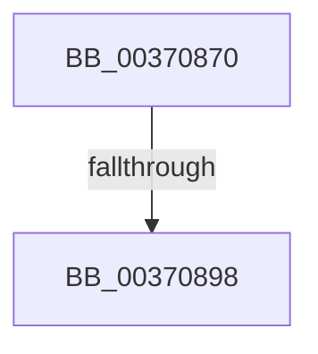

# MiDecommitFreePage

- RVA: `0x00370870`–`0x003708A6` (길이 `54` bytes)
- VA: `0x0000000140370870`
- 실행 섹션: `.text`
- PDB 이름 있음: `예`; PDB Function 태그: `아니요`
- unwind 정보 RVA: `0x0007A6F4`
- 디코드: `16`개 명령, `54/54` bytes 표시
- 미해석 바이트: `0` (있으면 어셈블리에 `.byte`로 보존)

> 이 문서는 커널 이미지의 기계어와 PDB 기호를 분석해 생성했습니다. 4번과 5번은 함수 원형과 자료형을 바이너리 사용 방식에서 추정한 C 해석이며 원본 소스 복구 결과는 아닙니다.

## 1. Dependencies

- 직접 호출 지점: **0**; 고유 호출 대상: **0**
- 직접 호출자로 확인된 함수: **2**
- RIP 상대 이미지 참조: **0**

### Outgoing calls
- 직접 디코드된 call 명령이 없습니다.

### Direct callers
- [MiDecommitPrivatePageTail](../36/MiDecommitPrivatePageTail_function_0036F564.md) at `0x0036F691`
- [MiDecommitSharedPageTail](MiDecommitSharedPageTail_function_00370240.md) at `0x003704B8`

### Static image references
- 디코드된 RIP-relative 메모리 참조가 없습니다.

## 2. Other-region calls and transfers

- 다른 실행 섹션으로 향하는 call: **0**
- call이 아닌 외부 분기/꼬리 이동: **1**
  - `0x00370892` → [sub_00370DA5](Unknown_function_00370DA5.md) (`tail-transfer`)

## 3. Assembly (complete function range)

```asm
00370870  4C 8B DC                        mov r11, rsp
00370873  53                              push rbx
00370874  55                              push rbp
00370875  56                              push rsi
00370876  41 54                           push r12
00370878  48 83 EC 68                     sub rsp, 0x68
0037087C  41 0F B6 40 22                  movzx eax, byte ptr [r8 + 0x22]
00370881  49 8B D8                        mov rbx, r8
00370884  4C 8B 61 78                     mov r12, qword ptr [rcx + 0x78]
00370888  24 07                           and al, 7
0037088A  48 8B EA                        mov rbp, rdx
0037088D  48 8B F1                        mov rsi, rcx
00370890  3C 06                           cmp al, 6
00370892  0F 85 0D 05 00 00               jne 0x140370da5
00370898  49 8B 40 18                     mov rax, qword ptr [r8 + 0x18]
0037089C  48 B9 FF FF FF FF FF FF FF 3F   movabs rcx, 0x3fffffffffffffff
```

## 4. C-style interpretation (structured pseudocode)

```c
__int64 __fastcall MiDecommitFreePage(__int64 a1, __int64 a2, __int64 a3)
{
    __int64 result;
    __int64 v_rsp;

    v_rsp = (v_rsp) - (104);
    result = (unsigned __int8)((*(unsigned __int8 *)(a3 + 34)) & (7));
    return *(unsigned __int64 *)(a3 + 24);
}
```

## 5. (Beta) C Style

```c
int64_t MiDecommitFreePage(void *Arg1, int64_t Arg2, void *Arg3)
{
    uint8_t *arg1 = (uint8_t *)Arg1;
    uint8_t *arg3 = (uint8_t *)Arg3;

    int64_t result;
    int64_t local_rsp;

    local_rsp = (local_rsp) - (104);
    result = (uint8_t)((*(uint8_t *)(arg3 + 0x22)) & (7));
    return *(uint64_t *)(arg3 + 0x18);
}
```

### 관측된 메모리 오프셋

구조체 형식이 확인되지 않은 접근은 인자 기준의 오프셋으로만 기록했습니다.

| 기준 인자 | 오프셋 표현 | 폭 (bit) | 접근 |
|---|---:|---:|---|
| `Arg1` | `+ 0x78` | `64` | `R` |
| `Arg3` | `+ 0x18` | `64` | `R` |
| `Arg3` | `+ 0x22` | `8` | `R` |

## 6. Execution-region graph

[열기: 2D/3D 그래프와 함수 탐색 컨트롤 패널](../../../control-panel.html?section=text&rva=0x00370870&view=graph)

- 2D 그래프는 위에서 아래로 흐르고, 3D 그래프는 빈 공간을 드래그해 회전합니다. Shift+드래그는 이동, 휠은 확대·축소, 함수 노드 선택은 대상 보고서 이동입니다.

### Static fallback


