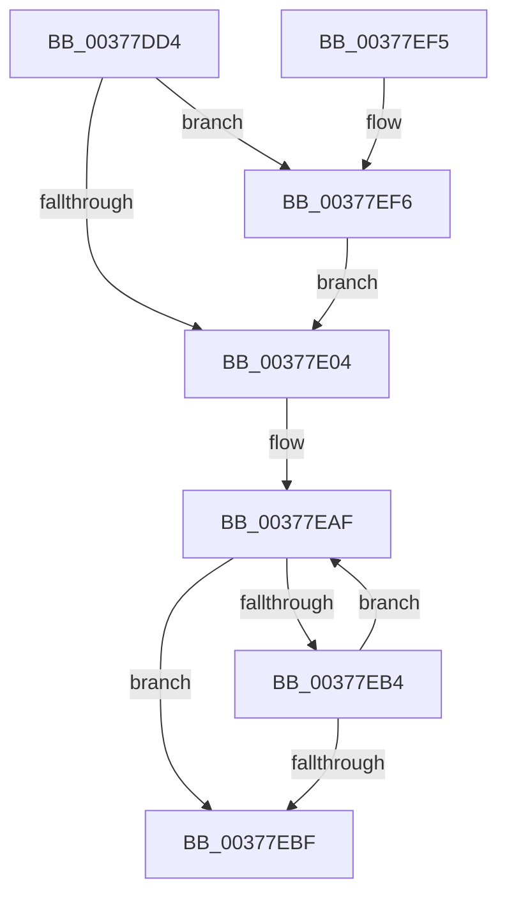

# MiDecommitLargePoolVa

- RVA: `0x00377DD4`–`0x00377F09` (길이 `309` bytes)
- VA: `0x0000000140377DD4`
- 실행 섹션: `.text`
- PDB 이름 있음: `예`; PDB Function 태그: `아니요`
- unwind 정보 RVA: `0x0005C70C`
- 디코드: `76`개 명령, `309/309` bytes 표시
- 미해석 바이트: `0` (있으면 어셈블리에 `.byte`로 보존)

> 이 문서는 커널 이미지의 기계어와 PDB 기호를 분석해 생성했습니다. 4번과 5번은 함수 원형과 자료형을 바이너리 사용 방식에서 추정한 C 해석이며 원본 소스 복구 결과는 아닙니다.

## 1. Dependencies

- 직접 호출 지점: **8**; 고유 호출 대상: **8**
- 직접 호출자로 확인된 함수: **1**
- RIP 상대 이미지 참조: **5**

### Outgoing calls
- `0x00377E35` → [MiGetContainingPageTable](../34/MiGetContainingPageTable_function_003467F0.md) (function, `0x003467F0`)
- `0x00377E4B` → [MiLockAndDecrementShareCount](../2A/MiLockAndDecrementShareCount_function_002A2854.md) (function, `0x002A2854`)
- `0x00377E63` → [MiRewritePteWithLockBit](../32/MiRewritePteWithLockBit_function_00322FEC.md) (function, `0x00322FEC`)
- `0x00377E8D` → [MiDecreaseUsedPtes](MiDecreaseUsedPtes_function_00378080.md) (function, `0x00378080`)
- `0x00377E9B` → [MiInsertLargeTbFlushEntry](MiInsertLargeTbFlushEntry_function_0037827C.md) (function, `0x0037827C`)
- `0x00377EA3` → [MiFlushTbList](../31/MiFlushTbList_function_00311FC0.md) (function, `0x00311FC0`)
- `0x00377ECA` → [MiFreeLargePageMemory](MiFreeLargePageMemory_function_00377938.md) (function, `0x00377938`)
- `0x00377EFF` → [MiLogPerfMemoryRangeEvent](../4D/MiLogPerfMemoryRangeEvent_function_004D9D7C.md) (function, `0x004D9D7C`)

### Direct callers
- [sub_002C1E57](../2C/Unknown_function_002C1E57.md) at `0x002C1EBC`

### Static image references
- `0x00377DED` → RVA `0x00FC6B04` (`ALMOSTRO`; read)
- `0x00377E50` → RVA `0x00010880` (`.rdata`; read)
- `0x00377E57` → RVA `0x00E38480` (`.data`; read)
- `0x00377EA8` → RVA `0x00011C60` (`.rdata`; read)
- `0x00377ED2` → RVA `0x00E376C8` (`.data`; read/write)

## 2. Other-region calls and transfers

- 다른 실행 섹션으로 향하는 call: **0**
- 별도 외부 분기/꼬리 이동을 확인하지 못했습니다.

## 3. Assembly (complete function range)

```asm
00377DD4  48 8B C4                        mov rax, rsp
00377DD7  48 89 58 08                     mov qword ptr [rax + 8], rbx
00377DDB  48 89 68 10                     mov qword ptr [rax + 0x10], rbp
00377DDF  48 89 70 18                     mov qword ptr [rax + 0x18], rsi
00377DE3  48 89 78 20                     mov qword ptr [rax + 0x20], rdi
00377DE7  41 56                           push r14
00377DE9  48 83 EC 20                     sub rsp, 0x20
00377DED  8B 05 11 ED C4 00               mov eax, dword ptr [rip + 0xc4ed11]
00377DF3  49 8B E9                        mov rbp, r9
00377DF6  49 8B D8                        mov rbx, r8
00377DF9  4C 8B F2                        mov r14, rdx
00377DFC  A8 01                           test al, 1
00377DFE  0F 85 F2 00 00 00               jne 0x140377ef6
00377E04  49 8B 36                        mov rsi, qword ptr [r14]
00377E07  48 B8 FF FF FF FF FF 00 00 00   movabs rax, 0xffffffffff
00377E11  48 C1 EE 0C                     shr rsi, 0xc
00377E15  48 23 F0                        and rsi, rax
00377E18  49 BA 00 00 00 00 00 DE FF FF   movabs r10, 0xffffde0000000000
00377E22  48 8D 0C 76                     lea rcx, [rsi + rsi*2]
00377E26  48 03 C9                        add rcx, rcx
00377E29  49 8B C2                        mov rax, r10
00377E2C  33 FF                           xor edi, edi
00377E2E  48 89 3C C8                     mov qword ptr [rax + rcx*8], rdi
00377E32  49 8B CE                        mov rcx, r14
00377E35  E8 B6 E9 FC FF                  call 0x1403467f0
00377E3A  48 8D 0C 40                     lea rcx, [rax + rax*2]
00377E3E  48 C1 E1 04                     shl rcx, 4
00377E42  49 8B C2                        mov rax, r10
00377E45  48 03 C8                        add rcx, rax
00377E48  8D 57 02                        lea edx, [rdi + 2]
00377E4B  E8 04 AA F2 FF                  call 0x1402a2854
00377E50  4C 8B 0D 29 8A C9 FF            mov r9, qword ptr [rip - 0x3675d7]
00377E57  48 8D 0D 22 06 AC 00            lea rcx, [rip + 0xac0622]
00377E5E  4D 8B C6                        mov r8, r14
00377E61  33 D2                           xor edx, edx
00377E63  E8 84 B1 FA FF                  call 0x140322fec
00377E68  49 8B D6                        mov rdx, r14
00377E6B  48 B8 F8 FF FF FF 7F 00 00 00   movabs rax, 0x7ffffffff8
00377E75  48 C1 EA 09                     shr rdx, 9
00377E79  48 23 D0                        and rdx, rax
00377E7C  48 B8 00 00 00 00 80 F6 FF FF   movabs rax, 0xfffff68000000000
00377E86  48 03 D0                        add rdx, rax
00377E89  44 8D 47 01                     lea r8d, [rdi + 1]
00377E8D  E8 EE 01 00 00                  call 0x140378080
00377E92  4D 8B C6                        mov r8, r14
00377E95  8D 57 01                        lea edx, [rdi + 1]
00377E98  48 8B CD                        mov rcx, rbp
00377E9B  E8 DC 03 00 00                  call 0x14037827c
00377EA0  48 8B CD                        mov rcx, rbp
00377EA3  E8 18 A1 F9 FF                  call 0x140311fc0
00377EA8  48 8D 05 B1 9D C9 FF            lea rax, [rip - 0x36624f]
00377EAF  48 39 18                        cmp qword ptr [rax], rbx
00377EB2  74 0B                           je 0x140377ebf
00377EB4  FF C7                           inc edi
00377EB6  48 83 C0 08                     add rax, 8
00377EBA  83 FF 03                        cmp edi, 3
00377EBD  72 F0                           jb 0x140377eaf
00377EBF  41 B8 14 00 00 00               mov r8d, 0x14
00377EC5  8B D7                           mov edx, edi
00377EC7  48 8B CE                        mov rcx, rsi
00377ECA  E8 69 FA FF FF                  call 0x140377938
00377ECF  48 F7 DB                        neg rbx
00377ED2  F0 48 01 1D EE F7 AB 00         lock add qword ptr [rip + 0xabf7ee], rbx
00377EDA  48 8B 5C 24 30                  mov rbx, qword ptr [rsp + 0x30]
00377EDF  48 8B 6C 24 38                  mov rbp, qword ptr [rsp + 0x38]
00377EE4  48 8B 74 24 40                  mov rsi, qword ptr [rsp + 0x40]
00377EE9  48 8B 7C 24 48                  mov rdi, qword ptr [rsp + 0x48]
00377EEE  48 83 C4 20                     add rsp, 0x20
00377EF2  41 5E                           pop r14
00377EF4  C3                              ret
00377EF5  CC                              int3
00377EF6  33 D2                           xor edx, edx
00377EF8  4C 8B CB                        mov r9, rbx
00377EFB  44 8D 42 0A                     lea r8d, [rdx + 0xa]
00377EFF  E8 78 1E 16 00                  call 0x1404d9d7c
00377F04  E9 FB FE FF FF                  jmp 0x140377e04
```

## 4. C-style interpretation (structured pseudocode)

```c
__int64 __fastcall MiDecommitLargePoolVa(__int64 a1, __int64 a2, __int64 a3, __int64 a4)
{
    __int64 result;
    __int64 v_rbx;
    __int64 v_rdi;
    __int64 v_rsi;
    __int64 v_rsp;
    unsigned __int64 v_stack_p10;
    unsigned __int64 v_stack_p18;
    unsigned __int64 v_stack_p20;
    unsigned __int64 v_stack_p8;

    *(unsigned __int64 *)(v_rsp + 8) = v_rbx;
    *(unsigned __int64 *)(v_rsp + 16) = v_rbp;
    *(unsigned __int64 *)(v_rsp + 24) = v_rsi;
    *(unsigned __int64 *)(v_rsp + 32) = v_rdi;
    v_rsp = (v_rsp) - (32);
    if ((((unsigned __int8)((unsigned int)(*(unsigned int *)(v_rip + 12905745)))) & (1)) != 0) goto loc_00377EF6;
loc_00377E04:
    v_rsi = (*(unsigned __int64 *)(a2)) >> (12);
    v_rsi = (v_rsi) & ((unsigned int)(*(unsigned int *)(v_rip + 12905745)));
    a1 = (v_rsi + v_rsi * 2) + (v_rsi + v_rsi * 2);
    v_rdi = 0;
    *(unsigned __int64 *)(v_r10 + a1 * 8) = 0;
    result = MiGetContainingPageTable(a2, a2, a3, a4);
    a1 = (result + result * 2) << (4);
    a1 = (a1) + (v_r10);
    result = MiLockAndDecrementShareCount(a1, v_rdi + 2, a3, a4);
    a2 = 0;
    result = MiRewritePteWithLockBit(v_rip + 11273762, a2, a2, *(unsigned __int64 *)(v_rip - 3569111));
    a2 = (0) >> (9);
    a2 = (a2) & (result);
    a2 = (a2) + (result);
    result = MiDecreaseUsedPtes(v_rip + 11273762, a2, v_rdi + 1, *(unsigned __int64 *)(v_rip - 3569111));
    result = MiInsertLargeTbFlushEntry(a4, v_rdi + 1, a2, *(unsigned __int64 *)(v_rip - 3569111));
    result = MiFlushTbList(a4, v_rdi + 1, a2, *(unsigned __int64 *)(v_rip - 3569111));
loc_00377EAF:
    if ((*(unsigned __int64 *)(v_rip - 3564111)) == a3) goto loc_00377EBF;
    v_rdi = (unsigned int)((v_rdi) + 1);
    result = (v_rip - 3564111) + (8);
    if (((unsigned int)(v_rdi)) < 3) goto loc_00377EAF;
loc_00377EBF:
    result = MiFreeLargePageMemory(v_rsi, (unsigned int)((unsigned int)(v_rdi)), 20, *(unsigned __int64 *)(v_rip - 3569111));
    v_rbx = -(a3);
    v_rsp = (v_rsp) + (32);
    return result;
loc_00377EF6:
    a2 = 0;
    result = MiLogPerfMemoryRangeEvent(v_rsi, a2, a2 + 10, v_stack_p8);
    goto loc_00377E04;
}
```

## 5. (Beta) C Style

```c
int64_t MiDecommitLargePoolVa(int64_t Arg1, void *Arg2, int64_t Arg3, int64_t Arg4)
{
    uint8_t *arg2 = (uint8_t *)Arg2;

    int64_t result;
    int64_t local_rbx;
    int64_t local_rdi;
    int64_t local_rsi;
    int64_t local_rsp;
    uint64_t v_stack_p10;
    uint64_t v_stack_p18;
    uint64_t v_stack_p20;
    uint64_t v_stack_p8;

    *(uint64_t *)(local_rsp + 0x8) = local_rbx;
    *(uint64_t *)(local_rsp + 0x10) = local_rbp;
    *(uint64_t *)(local_rsp + 0x18) = local_rsi;
    *(uint64_t *)(local_rsp + 0x20) = local_rdi;
    local_rsp = (local_rsp) - (32);
    if ((((uint8_t)((uint32_t)(*(uint32_t *)(v_rip + 0xC4ED11)))) & (1)) != 0) goto loc_00377EF6;
loc_00377E04:
    local_rsi = (*(uint64_t *)(arg2)) >> (12);
    local_rsi = (local_rsi) & ((uint32_t)(*(uint32_t *)(v_rip + 0xC4ED11)));
    Arg1 = (local_rsi + local_rsi * 2) + (local_rsi + local_rsi * 2);
    local_rdi = 0;
    *(uint64_t *)(local_r10 + Arg1 * 8) = 0;
    result = MiGetContainingPageTable(Arg2, Arg2, Arg3, Arg4);
    Arg1 = (result + result * 2) << (4);
    Arg1 = (Arg1) + (local_r10);
    result = MiLockAndDecrementShareCount(Arg1, local_rdi + 2, Arg3, Arg4);
    Arg2 = 0;
    result = MiRewritePteWithLockBit(v_rip + 11273762, Arg2, Arg2, *(uint64_t *)(v_rip - 0x3675D7));
    Arg2 = (0) >> (9);
    Arg2 = (Arg2) & (result);
    Arg2 = (Arg2) + (result);
    result = MiDecreaseUsedPtes(v_rip + 11273762, Arg2, local_rdi + 1, *(uint64_t *)(v_rip - 0x3675D7));
    result = MiInsertLargeTbFlushEntry(Arg4, local_rdi + 1, Arg2, *(uint64_t *)(v_rip - 0x3675D7));
    result = MiFlushTbList(Arg4, local_rdi + 1, Arg2, *(uint64_t *)(v_rip - 0x3675D7));
loc_00377EAF:
    if ((*(uint64_t *)(v_rip - 0x36624F)) == Arg3) goto loc_00377EBF;
    local_rdi = (uint32_t)((local_rdi) + 1);
    result = (v_rip - 3564111) + (8);
    if (((uint32_t)(local_rdi)) < 3) goto loc_00377EAF;
loc_00377EBF:
    result = MiFreeLargePageMemory(local_rsi, (uint32_t)((uint32_t)(local_rdi)), 20, *(uint64_t *)(v_rip - 0x3675D7));
    local_rbx = -(Arg3);
    local_rsp = (local_rsp) + (32);
    return result;
loc_00377EF6:
    Arg2 = 0;
    result = MiLogPerfMemoryRangeEvent(local_rsi, Arg2, Arg2 + 10, v_stack_p8);
    goto loc_00377E04;
}
```

### 관측된 메모리 오프셋

구조체 형식이 확인되지 않은 접근은 인자 기준의 오프셋으로만 기록했습니다.

| 기준 인자 | 오프셋 표현 | 폭 (bit) | 접근 |
|---|---:|---:|---|
| `Arg2` | `+ 0x0` | `64` | `R` |

## 6. Execution-region graph

[열기: 2D/3D 그래프와 함수 탐색 컨트롤 패널](../../../control-panel.html?section=text&rva=0x00377DD4&view=graph)

- 2D 그래프는 위에서 아래로 흐르고, 3D 그래프는 빈 공간을 드래그해 회전합니다. Shift+드래그는 이동, 휠은 확대·축소, 함수 노드 선택은 대상 보고서 이동입니다.

### Static fallback


