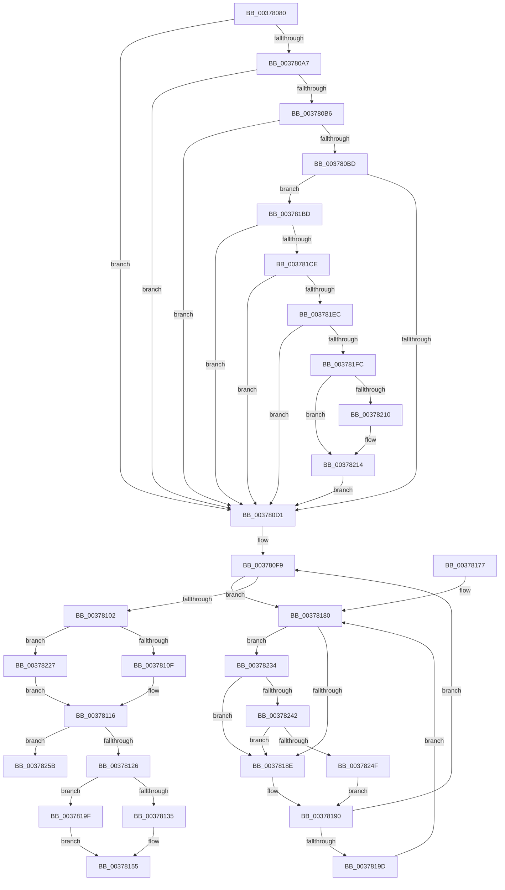

# MiDecreaseUsedPtes

- RVA: `0x00378080`–`0x00378276` (길이 `502` bytes)
- VA: `0x0000000140378080`
- 실행 섹션: `.text`
- PDB 이름 있음: `예`; PDB Function 태그: `아니요`
- unwind 정보 RVA: `0x0007AE14`
- 디코드: `118`개 명령, `502/502` bytes 표시
- 미해석 바이트: `0` (있으면 어셈블리에 `.byte`로 보존)

> 이 문서는 커널 이미지의 기계어와 PDB 기호를 분석해 생성했습니다. 4번과 5번은 함수 원형과 자료형을 바이너리 사용 방식에서 추정한 C 해석이며 원본 소스 복구 결과는 아닙니다.

## 1. Dependencies

- 직접 호출 지점: **3**; 고유 호출 대상: **3**
- 직접 호출자로 확인된 함수: **11**
- RIP 상대 이미지 참조: **3**

### Outgoing calls
- `0x00378242` → [KiCheckVpBackingLongSpinWaitHypercall](../30/KiCheckVpBackingLongSpinWaitHypercall_function_0030F490.md) (function, `0x0030F490`)
- `0x00378251` → [HvlNotifyLongSpinWait](../30/HvlNotifyLongSpinWait_function_0030F460.md) (function, `0x0030F460`)
- `0x00378270` → [KeBugCheckEx](../4F/KeBugCheckEx_function_004FD660.md) (function, `0x004FD660`)

### Direct callers
- [sub_002C3A7C](../2C/Unknown_function_002C3A7C.md) at `0x002C4360`
- [sub_00344F15](../34/Unknown_function_00344F15.md) at `0x003450A7`
- [sub_0034512B](../34/Unknown_function_0034512B.md) at `0x0034517E`
- [sub_0034512B](../34/Unknown_function_0034512B.md) at `0x0034519D`
- [MiUpdateAwePageTable](../36/MiUpdateAwePageTable_function_00368730.md) at `0x00368898`
- [MiDecommitLargePoolVa](MiDecommitLargePoolVa_function_00377DD4.md) at `0x00377E8D`
- [MiUnmapMdlCommon](../3E/MiUnmapMdlCommon_function_003E7DF0.md) at `0x003E7FB7`
- [MiUnmapMdlCommon](../3E/MiUnmapMdlCommon_function_003E7DF0.md) at `0x003E81D9`
- [MiDeleteSystemPageTable](../49/MiDeleteSystemPageTable_function_004916B0.md) at `0x00491802`
- [MiDeleteSystemPageTable](../49/MiDeleteSystemPageTable_function_004916B0.md) at `0x00491897`
- [MiDeleteShadowStackPtes](../49/MiDeleteShadowStackPtes_function_00493AE4.md) at `0x00493C1C`
- [MiDeleteShadowStackPtes](../49/MiDeleteShadowStackPtes_function_00493AE4.md) at `0x00493E14`
- [MiUnmapKernelScp](../4A/MiUnmapKernelScp_function_004A82E8.md) at `0x004A849A`
- [MiMarkBootGuardPage](../68/MiMarkBootGuardPage_function_0068643C.md) at `0x0068651B`
- [MiInitializeBootShadowStackPage](../../init/C6/MiInitializeBootShadowStackPage_function_00C67D8C.md) at `0x00C67EDC`

### Static image references
- `0x00378182` → RVA `0x00FC52AC` (`ALMOSTRO`; reference)
- `0x003781BD` → RVA `0x00FC6A88` (`ALMOSTRO`; read)
- `0x00378234` → RVA `0x00FC6AB8` (`ALMOSTRO`; read)

## 2. Other-region calls and transfers

- 다른 실행 섹션으로 향하는 call: **0**
- 별도 외부 분기/꼬리 이동을 확인하지 못했습니다.

## 3. Assembly (complete function range)

```asm
00378080  48 89 5C 24 08                  mov qword ptr [rsp + 8], rbx
00378085  48 89 74 24 10                  mov qword ptr [rsp + 0x10], rsi
0037808A  57                              push rdi
0037808B  48 83 EC 30                     sub rsp, 0x30
0037808F  48 8B 02                        mov rax, qword ptr [rdx]
00378092  4C 8B CA                        mov r9, rdx
00378095  41 8B F0                        mov esi, r8d
00378098  48 B9 00 D0 BE 7D FB F6 FF FF   movabs rcx, 0xfffff6fb7dbed000
003780A2  48 3B D1                        cmp rdx, rcx
003780A5  72 2A                           jb 0x1403780d1
003780A7  48 B9 F8 D7 BE 7D FB F6 FF FF   movabs rcx, 0xfffff6fb7dbed7f8
003780B1  48 3B D1                        cmp rdx, rcx
003780B4  77 1B                           ja 0x1403780d1
003780B6  48 8B C8                        mov rcx, rax
003780B9  A8 01                           test al, 1
003780BB  74 14                           je 0x1403780d1
003780BD  A8 42                           test al, 0x42
003780BF  41 0F 95 C0                     setne r8b
003780C3  A8 20                           test al, 0x20
003780C5  0F 95 C2                        setne dl
003780C8  44 84 C2                        test dl, r8b
003780CB  0F 84 EC 00 00 00               je 0x1403781bd
003780D1  48 C1 E8 0C                     shr rax, 0xc
003780D5  48 B9 FF FF FF FF FF 00 00 00   movabs rcx, 0xffffffffff
003780DF  48 23 C1                        and rax, rcx
003780E2  48 8D 1C 40                     lea rbx, [rax + rax*2]
003780E6  48 C1 E3 04                     shl rbx, 4
003780EA  48 B8 00 00 00 00 00 DE FF FF   movabs rax, 0xffffde0000000000
003780F4  48 03 D8                        add rbx, rax
003780F7  33 FF                           xor edi, edi
003780F9  F0 48 0F BA 6B 18 3F            lock bts qword ptr [rbx + 0x18], 0x3f
00378100  72 7E                           jb 0x140378180
00378102  8B 43 24                        mov eax, dword ptr [rbx + 0x24]
00378105  0F BA E0 1A                     bt eax, 0x1a
00378109  0F 83 18 01 00 00               jae 0x140378227
0037810F  4C 8B 03                        mov r8, qword ptr [rbx]
00378112  49 C1 E8 20                     shr r8, 0x20
00378116  41 81 E0 FF 03 00 00            and r8d, 0x3ff
0037811D  44 3B C6                        cmp r8d, esi
00378120  0F 82 35 01 00 00               jb 0x14037825b
00378126  8B 43 24                        mov eax, dword ptr [rbx + 0x24]
00378129  44 2B C6                        sub r8d, esi
0037812C  45 8B C8                        mov r9d, r8d
0037812F  0F BA E0 1A                     bt eax, 0x1a
00378133  73 6A                           jae 0x14037819f
00378135  48 8B 03                        mov rax, qword ptr [rbx]
00378138  49 C1 E1 20                     shl r9, 0x20
0037813C  49 8B C9                        mov rcx, r9
0037813F  48 33 C8                        xor rcx, rax
00378142  48 B8 FF FF FF FF 00 FC FF FF   movabs rax, 0xfffffc00ffffffff
0037814C  48 23 C8                        and rcx, rax
0037814F  49 33 C9                        xor rcx, r9
00378152  48 89 0B                        mov qword ptr [rbx], rcx
00378155  48 B8 FF FF FF FF FF FF FF 7F   movabs rax, 0x7fffffffffffffff
0037815F  F0 48 21 43 18                  lock and qword ptr [rbx + 0x18], rax
00378164  48 8B 5C 24 40                  mov rbx, qword ptr [rsp + 0x40]
00378169  41 8B C0                        mov eax, r8d
0037816C  48 8B 74 24 48                  mov rsi, qword ptr [rsp + 0x48]
00378171  48 83 C4 30                     add rsp, 0x30
00378175  5F                              pop rdi
00378176  C3                              ret
00378177  CC                              int3
00378178  0F 1F 84 00 00 00 00 00         nop dword ptr [rax + rax]
00378180  FF C7                           inc edi
00378182  85 3D 24 D1 C4 00               test dword ptr [rip + 0xc4d124], edi
00378188  0F 84 A6 00 00 00               je 0x140378234
0037818E  F3 90                           pause
00378190  48 8B 43 18                     mov rax, qword ptr [rbx + 0x18]
00378194  48 85 C0                        test rax, rax
00378197  0F 89 5C FF FF FF               jns 0x1403780f9
0037819D  EB E1                           jmp 0x140378180
0037819F  48 8B 4B 10                     mov rcx, qword ptr [rbx + 0x10]
003781A3  49 C1 E1 10                     shl r9, 0x10
003781A7  49 8B D1                        mov rdx, r9
003781AA  48 33 D1                        xor rdx, rcx
003781AD  48 81 E2 FF FF 00 FC            and rdx, 0xfffffffffc00ffff
003781B4  49 33 D1                        xor rdx, r9
003781B7  48 89 53 10                     mov qword ptr [rbx + 0x10], rdx
003781BB  EB 98                           jmp 0x140378155
003781BD  48 F7 05 C0 E8 C4 00 00 00 60 00  test qword ptr [rip + 0xc4e8c0], 0x600000
003781C8  0F 84 03 FF FF FF               je 0x1403780d1
003781CE  65 48 8B 14 25 88 01 00 00      mov rdx, qword ptr gs:[0x188]
003781D7  4C 8B 82 B8 00 00 00            mov r8, qword ptr [rdx + 0xb8]
003781DE  41 80 B8 60 01 00 00 01         cmp byte ptr [r8 + 0x160], 1
003781E6  0F 84 E5 FE FF FF               je 0x1403780d1
003781EC  49 8B 90 08 05 00 00            mov rdx, qword ptr [r8 + 0x508]
003781F3  48 85 D2                        test rdx, rdx
003781F6  0F 84 D5 FE FF FF               je 0x1403780d1
003781FC  49 C1 E9 03                     shr r9, 3
00378200  41 81 E1 FF 01 00 00            and r9d, 0x1ff
00378207  4A 8B 14 CA                     mov rdx, qword ptr [rdx + r9*8]
0037820B  F6 C2 20                        test dl, 0x20
0037820E  74 04                           je 0x140378214
00378210  48 83 C9 20                     or rcx, 0x20
00378214  48 8B C1                        mov rax, rcx
00378217  48 83 C8 42                     or rax, 0x42
0037821B  F6 C2 42                        test dl, 0x42
0037821E  48 0F 44 C1                     cmove rax, rcx
00378222  E9 AA FE FF FF                  jmp 0x1403780d1
00378227  4C 8B 43 10                     mov r8, qword ptr [rbx + 0x10]
0037822B  49 C1 E8 10                     shr r8, 0x10
0037822F  E9 E2 FE FF FF                  jmp 0x140378116
00378234  8B 05 7E E8 C4 00               mov eax, dword ptr [rip + 0xc4e87e]
0037823A  A8 40                           test al, 0x40
0037823C  0F 84 4C FF FF FF               je 0x14037818e
00378242  E8 49 72 F9 FF                  call 0x14030f490
00378247  84 C0                           test al, al
00378249  0F 84 3F FF FF FF               je 0x14037818e
0037824F  8B CF                           mov ecx, edi
00378251  E8 0A 72 F9 FF                  call 0x14030f460
00378256  E9 35 FF FF FF                  jmp 0x140378190
0037825B  45 8B C8                        mov r9d, r8d
0037825E  BA 90 17 04 00                  mov edx, 0x41790
00378263  4C 8B C3                        mov r8, rbx
00378266  48 89 74 24 20                  mov qword ptr [rsp + 0x20], rsi
0037826B  B9 1A 00 00 00                  mov ecx, 0x1a
00378270  E8 EB 53 18 00                  call 0x1404fd660
00378275  CC                              int3
```

## 4. C-style interpretation (structured pseudocode)

```c
__int64 __fastcall MiDecreaseUsedPtes(__int64 a1, __int64 a2, int a3)
{
    __int64 result;
    __int64 v_rbx;
    __int64 v_rdi;
    __int64 v_rsp;
    unsigned __int64 v_stack_p10;
    unsigned __int64 v_stack_p20;
    unsigned __int64 v_stack_p8;

    v_stack_p8 = v_rbx;
    v_stack_p10 = v_rsi;
    v_rsp = (v_rsp) - (48);
    if (a2 < a1) goto loc_003780D1;
    if (a2 > a1) goto loc_003780D1;
    if ((((unsigned __int8)(*(unsigned __int64 *)(a2))) & (1)) == 0) goto loc_003780D1;
    a3 = ((((unsigned __int8)(*(unsigned __int64 *)(a2))) & (66)) != 0) ? 1 : 0;
    a2 = ((((unsigned __int8)(*(unsigned __int64 *)(a2))) & (32)) != 0) ? 1 : 0;
    if ((((unsigned __int8)(a2)) & ((unsigned __int8)(a3))) == 0) goto loc_003781BD;
loc_003780D1:
    result = (*(unsigned __int64 *)(a2)) >> (12);
    result = (result) & (*(unsigned __int64 *)(a2));
    v_rbx = (result + result * 2) << (4);
    v_rbx = (v_rbx) + (result);
    v_rdi = 0;
loc_003780F9:
    if (condition_is_below) goto loc_00378180;
    if (condition_is_above_or_equal) goto loc_00378227;
    a3 = (*(unsigned __int64 *)(v_rbx)) >> (32);
loc_00378116:
    a3 = (unsigned int)((a3) & (0x3FFULL));
    if (a3 < ((unsigned int)((unsigned int)(a3)))) goto loc_0037825B;
    a3 = (unsigned int)((a3) - ((unsigned int)((unsigned int)(a3))));
    if (condition_is_above_or_equal) goto loc_0037819F;
    a4 = ((unsigned int)(a3)) << (32);
    a1 = (a4) ^ (*(unsigned __int64 *)(v_rbx));
    a1 = (a1) & (*(unsigned __int64 *)(v_rbx));
    a1 = (a1) ^ (a4);
    *(unsigned __int64 *)(v_rbx) = a1;
loc_00378155:
    v_rsp = (v_rsp) + (48);
    return (unsigned int)(a3);
loc_00378180:
    v_rdi = (unsigned int)((v_rdi) + 1);
    if (((*(unsigned int *)(v_rip + 12898596)) & ((unsigned int)(v_rdi))) == 0) goto loc_00378234;
loc_0037818E:
loc_00378190:
    if (!sign_flag) goto loc_003780F9;
    goto loc_00378180;
loc_0037819F:
    a4 = (a4) << (16);
    a2 = (a4) ^ (*(unsigned __int64 *)(v_stack_p8 + 16));
    a2 = (a2) & (0xFFFFFFFFFC00FFFFULL);
    a2 = (a2) ^ (a4);
    *(unsigned __int64 *)(v_stack_p8 + 16) = a2;
    goto loc_00378155;
loc_003781BD:
    if (((*(unsigned __int64 *)(v_rip + 12904640)) & (0x600000ULL)) == 0) goto loc_003780D1;
    if ((*(unsigned __int8 *)(*(unsigned __int64 *)(*(unsigned __int64 *)(gs_base + (0 + 392)) + 184) + 352)) == 1) goto loc_003780D1;
    if (*(unsigned __int64 *)(*(unsigned __int64 *)(*(unsigned __int64 *)(gs_base + (0 + 392)) + 184) + 1288) == 0) goto loc_003780D1;
    a4 = (a4) >> (3);
    a4 = (unsigned int)((a4) & (511));
    if ((((unsigned __int8)(*(unsigned __int64 *)(*(unsigned __int64 *)(*(unsigned __int64 *)(*(unsigned __int64 *)(gs_base + (0 + 392)) + 184) + 1288) + a4 * 8))) & (32)) != 0) {
        a1 = (*(unsigned __int64 *)(v_stack_p8 + 16)) | (32);
    }
    result = (a1) | (66);
    if ((((unsigned __int8)(*(unsigned __int64 *)(*(unsigned __int64 *)(*(unsigned __int64 *)(*(unsigned __int64 *)(gs_base + (0 + 392)) + 184) + 1288) + a4 * 8))) & (66)) == 0) { result = a1; }
    goto loc_003780D1;
loc_00378227:
    a3 = (*(unsigned __int64 *)(v_stack_p8 + 16)) >> (16);
    goto loc_00378116;
loc_00378234:
    if ((((unsigned __int8)((unsigned int)(*(unsigned int *)(v_rip + 12904574)))) & (64)) == 0) goto loc_0037818E;
    result = KiCheckVpBackingLongSpinWaitHypercall(a1, *(unsigned __int64 *)(*(unsigned __int64 *)(*(unsigned __int64 *)(*(unsigned __int64 *)(gs_base + (0 + 392)) + 184) + 1288) + a4 * 8), a3, a4);
    if ((unsigned __int8)(result) == 0) goto loc_0037818E;
    result = HvlNotifyLongSpinWait((unsigned int)((unsigned int)(v_rdi)), *(unsigned __int64 *)(*(unsigned __int64 *)(*(unsigned __int64 *)(*(unsigned __int64 *)(gs_base + (0 + 392)) + 184) + 1288) + a4 * 8), a3, a4);
    goto loc_00378190;
loc_0037825B:
    v_stack_p20 = v_stack_p10;
    result = KeBugCheckEx(26, (unsigned int)(0x41790ULL), v_stack_p8, (unsigned int)(a3));
    return result;
}
```

## 5. (Beta) C Style

```c
int64_t MiDecreaseUsedPtes(int64_t Arg1, void *Arg2, int32_t Arg3)
{
    uint8_t *arg2 = (uint8_t *)Arg2;

    int64_t result;
    int64_t local_rbx;
    int64_t local_rdi;
    int64_t local_rsp;
    uint64_t v_stack_p10;
    uint64_t v_stack_p20;
    uint64_t v_stack_p8;

    v_stack_p8 = local_rbx;
    v_stack_p10 = local_rsi;
    local_rsp = (local_rsp) - (48);
    if (Arg2 < Arg1) goto loc_003780D1;
    if (Arg2 > Arg1) goto loc_003780D1;
    if ((((uint8_t)(*(uint64_t *)(arg2))) & (1)) == 0) goto loc_003780D1;
    Arg3 = ((((uint8_t)(*(uint64_t *)(arg2))) & (66)) != 0) ? 1 : 0;
    Arg2 = ((((uint8_t)(*(uint64_t *)(arg2))) & (32)) != 0) ? 1 : 0;
    if ((((uint8_t)(Arg2)) & ((uint8_t)(Arg3))) == 0) goto loc_003781BD;
loc_003780D1:
    result = (*(uint64_t *)(arg2)) >> (12);
    result = (result) & (*(uint64_t *)(arg2));
    local_rbx = (result + result * 2) << (4);
    local_rbx = (local_rbx) + (result);
    local_rdi = 0;
loc_003780F9:
    if (condition_is_below) goto loc_00378180;
    if (condition_is_above_or_equal) goto loc_00378227;
    Arg3 = (*(uint64_t *)(local_rbx)) >> (32);
loc_00378116:
    Arg3 = (uint32_t)((Arg3) & (0x3FFULL));
    if (Arg3 < ((uint32_t)((uint32_t)(Arg3)))) goto loc_0037825B;
    Arg3 = (uint32_t)((Arg3) - ((uint32_t)((uint32_t)(Arg3))));
    if (condition_is_above_or_equal) goto loc_0037819F;
    a4 = ((uint32_t)(Arg3)) << (32);
    Arg1 = (a4) ^ (*(uint64_t *)(local_rbx));
    Arg1 = (Arg1) & (*(uint64_t *)(local_rbx));
    Arg1 = (Arg1) ^ (a4);
    *(uint64_t *)(local_rbx) = Arg1;
loc_00378155:
    local_rsp = (local_rsp) + (48);
    return (uint32_t)(Arg3);
loc_00378180:
    local_rdi = (uint32_t)((local_rdi) + 1);
    if (((*(uint32_t *)(v_rip + 0xC4D124)) & ((uint32_t)(local_rdi))) == 0) goto loc_00378234;
loc_0037818E:
loc_00378190:
    if (!sign_flag) goto loc_003780F9;
    goto loc_00378180;
loc_0037819F:
    a4 = (a4) << (16);
    Arg2 = (a4) ^ (*(uint64_t *)(v_stack_p8 + 0x10));
    Arg2 = (Arg2) & (0xFFFFFFFFFC00FFFFULL);
    Arg2 = (Arg2) ^ (a4);
    *(void **)(v_stack_p8 + 0x10) = Arg2;
    goto loc_00378155;
loc_003781BD:
    if (((*(uint64_t *)(v_rip + 0xC4E8C0)) & (0x600000ULL)) == 0) goto loc_003780D1;
    if ((*(uint8_t *)(*(uint64_t *)(*(uint64_t *)(gs_base + (0 + 0x188)) + 0xB8) + 0x160)) == 1) goto loc_003780D1;
    if (*(uint64_t *)(*(uint64_t *)(*(uint64_t *)(gs_base + (0 + 0x188)) + 0xB8) + 0x508) == 0) goto loc_003780D1;
    a4 = (a4) >> (3);
    a4 = (uint32_t)((a4) & (511));
    if ((((uint8_t)(*(uint64_t *)(*(uint64_t *)(*(uint64_t *)(*(uint64_t *)(gs_base + (0 + 0x188)) + 0xB8) + 0x508) + a4 * 8))) & (32)) != 0) {
        Arg1 = (*(uint64_t *)(v_stack_p8 + 0x10)) | (32);
    }
    result = (Arg1) | (66);
    if ((((uint8_t)(*(uint64_t *)(*(uint64_t *)(*(uint64_t *)(*(uint64_t *)(gs_base + (0 + 0x188)) + 0xB8) + 0x508) + a4 * 8))) & (66)) == 0) { result = Arg1; }
    goto loc_003780D1;
loc_00378227:
    Arg3 = (*(uint64_t *)(v_stack_p8 + 0x10)) >> (16);
    goto loc_00378116;
loc_00378234:
    if ((((uint8_t)((uint32_t)(*(uint32_t *)(v_rip + 0xC4E87E)))) & (64)) == 0) goto loc_0037818E;
    result = KiCheckVpBackingLongSpinWaitHypercall(Arg1, *(uint64_t *)(*(uint64_t *)(*(uint64_t *)(*(uint64_t *)(gs_base + (0 + 0x188)) + 0xB8) + 0x508) + a4 * 8), Arg3, a4);
    if ((uint8_t)(result) == 0) goto loc_0037818E;
    result = HvlNotifyLongSpinWait((uint32_t)((uint32_t)(local_rdi)), *(uint64_t *)(*(uint64_t *)(*(uint64_t *)(*(uint64_t *)(gs_base + (0 + 0x188)) + 0xB8) + 0x508) + a4 * 8), Arg3, a4);
    goto loc_00378190;
loc_0037825B:
    v_stack_p20 = v_stack_p10;
    result = KeBugCheckEx(26, (uint32_t)(0x41790ULL), v_stack_p8, (uint32_t)(Arg3));
    return result;
}
```

### 관측된 메모리 오프셋

구조체 형식이 확인되지 않은 접근은 인자 기준의 오프셋으로만 기록했습니다.

| 기준 인자 | 오프셋 표현 | 폭 (bit) | 접근 |
|---|---:|---:|---|
| `Arg2` | `+ 0x0` | `64` | `R` |

## 6. Execution-region graph

[열기: 2D/3D 그래프와 함수 탐색 컨트롤 패널](../../../control-panel.html?section=text&rva=0x00378080&view=graph)

- 2D 그래프는 위에서 아래로 흐르고, 3D 그래프는 빈 공간을 드래그해 회전합니다. Shift+드래그는 이동, 휠은 확대·축소, 함수 노드 선택은 대상 보고서 이동입니다.

### Static fallback


