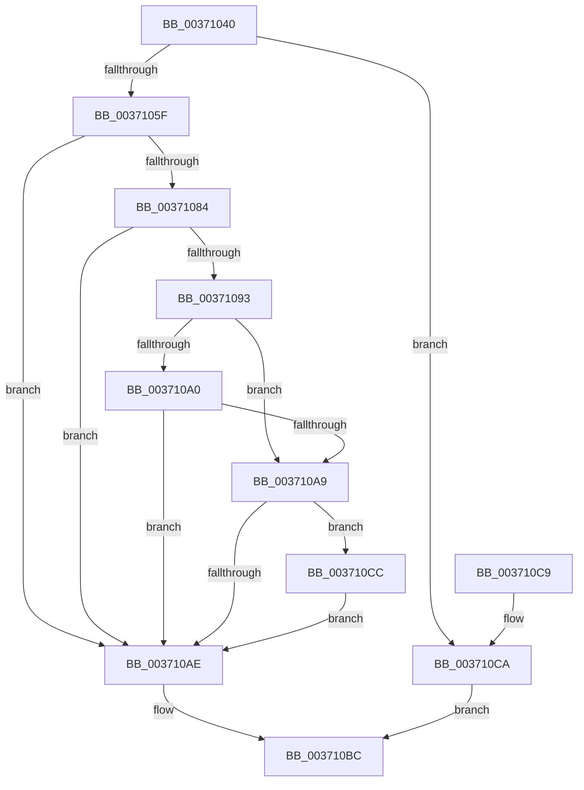

# MiDeleteMergedPte

- RVA: `0x00371040`–`0x003710D6` (길이 `150` bytes)
- VA: `0x0000000140371040`
- 실행 섹션: `.text`
- PDB 이름 있음: `예`; PDB Function 태그: `아니요`
- unwind 정보 RVA: `0x0007A7E0`
- 디코드: `50`개 명령, `150/150` bytes 표시
- 미해석 바이트: `0` (있으면 어셈블리에 `.byte`로 보존)

> 이 문서는 커널 이미지의 기계어와 PDB 기호를 분석해 생성했습니다. 4번과 5번은 함수 원형과 자료형을 바이너리 사용 방식에서 추정한 C 해석이며 원본 소스 복구 결과는 아닙니다.

## 1. Dependencies

- 직접 호출 지점: **4**; 고유 호출 대상: **4**
- 직접 호출자로 확인된 함수: **2**
- RIP 상대 이미지 참조: **0**

### Outgoing calls
- `0x00371067` → [MiLockProtoPoolPage](../2B/MiLockProtoPoolPage_function_002B8B80.md) (function, `0x002B8B80`)
- `0x00371072` → [MiTryDeleteTransitionPte](MiTryDeleteTransitionPte_function_003710DC.md) (function, `0x003710DC`)
- `0x003710B5` → [MiUnlockProtoPoolPage](../24/MiUnlockProtoPoolPage_function_00246090.md) (function, `0x00246090`)
- `0x003710CF` → [MiReleasePageFileInfo](../28/MiReleasePageFileInfo_function_00283FD0.md) (function, `0x00283FD0`)

### Direct callers
- [MiDecrementCloneBlock](../22/MiDecrementCloneBlock_function_0022BA8C.md) at `0x0022BB77`
- [MiDecommitSharedPageTail](MiDecommitSharedPageTail_function_00370240.md) at `0x003705E9`

### Static image references
- 디코드된 RIP-relative 메모리 참조가 없습니다.

## 2. Other-region calls and transfers

- 다른 실행 섹션으로 향하는 call: **0**
- 별도 외부 분기/꼬리 이동을 확인하지 못했습니다.

## 3. Assembly (complete function range)

```asm
00371040  48 89 5C 24 08                  mov qword ptr [rsp + 8], rbx
00371045  55                              push rbp
00371046  56                              push rsi
00371047  57                              push rdi
00371048  48 83 EC 20                     sub rsp, 0x20
0037104C  48 8B 02                        mov rax, qword ptr [rdx]
0037104F  48 8B DA                        mov rbx, rdx
00371052  C6 44 24 48 00                  mov byte ptr [rsp + 0x48], 0
00371057  48 8B F1                        mov rsi, rcx
0037105A  48 85 C0                        test rax, rax
0037105D  74 6B                           je 0x1403710ca
0037105F  48 8D 54 24 48                  lea rdx, [rsp + 0x48]
00371064  48 8B CB                        mov rcx, rbx
00371067  E8 14 7B F4 FF                  call 0x1402b8b80
0037106C  48 8B CB                        mov rcx, rbx
0037106F  48 8B E8                        mov rbp, rax
00371072  E8 65 00 00 00                  call 0x1403710dc
00371077  41 B8 01 00 00 00               mov r8d, 1
0037107D  8B F8                           mov edi, eax
0037107F  41 3B C0                        cmp eax, r8d
00371082  75 2A                           jne 0x1403710ae
00371084  48 8B 0B                        mov rcx, qword ptr [rbx]
00371087  48 89 4C 24 50                  mov qword ptr [rsp + 0x50], rcx
0037108C  48 0F BA E1 0A                  bt rcx, 0xa
00371091  72 1B                           jb 0x1403710ae
00371093  48 8B 54 24 50                  mov rdx, qword ptr [rsp + 0x50]
00371098  C0 E9 02                        shr cl, 2
0037109B  41 84 C8                        test r8b, cl
0037109E  75 09                           jne 0x1403710a9
003710A0  8A C2                           mov al, dl
003710A2  D0 E8                           shr al, 1
003710A4  41 84 C0                        test r8b, al
003710A7  74 05                           je 0x1403710ae
003710A9  48 85 D2                        test rdx, rdx
003710AC  75 1E                           jne 0x1403710cc
003710AE  8A 54 24 48                     mov dl, byte ptr [rsp + 0x48]
003710B2  48 8B CD                        mov rcx, rbp
003710B5  E8 D6 4F ED FF                  call 0x140246090
003710BA  8B C7                           mov eax, edi
003710BC  48 8B 5C 24 40                  mov rbx, qword ptr [rsp + 0x40]
003710C1  48 83 C4 20                     add rsp, 0x20
003710C5  5F                              pop rdi
003710C6  5E                              pop rsi
003710C7  5D                              pop rbp
003710C8  C3                              ret
003710C9  CC                              int3
003710CA  EB F0                           jmp 0x1403710bc
003710CC  48 8B CE                        mov rcx, rsi
003710CF  E8 FC 2E F1 FF                  call 0x140283fd0
003710D4  EB D8                           jmp 0x1403710ae
```

## 4. C-style interpretation (structured pseudocode)

```c
__int64 __fastcall MiDeleteMergedPte(__int64 a1, __int64 a2)
{
    __int64 result;
    __int64 v_rsp;
    unsigned __int8 v_stack_p10;
    unsigned __int64 v_stack_p18;
    unsigned __int64 v_stack_p8;

    v_stack_p8 = v_rbx;
    v_rsp = (v_rsp) - (32);
    v_stack_p10 = 0;
    if (*(unsigned __int64 *)(a2) == 0) goto loc_003710CA;
    result = MiLockProtoPoolPage(a2, v_stack_p10, a3, a4);
    result = MiTryDeleteTransitionPte(a2, v_stack_p10, a3, a4);
    if (((unsigned int)(result)) != 1) goto loc_003710AE;
    v_stack_p18 = *(unsigned __int64 *)(a2);
    if (((unsigned int)(result)) < 1) goto loc_003710AE;
    a1 = (unsigned __int8)((*(unsigned __int64 *)(a2)) >> (2));
    if (((1) & ((unsigned __int8)(a1))) != 0) goto loc_003710A9;
    result = (unsigned __int8)(((unsigned __int8)(v_stack_p18)) >> (1));
    if (((1) & ((unsigned __int8)(result))) == 0) goto loc_003710AE;
loc_003710A9:
    if (v_stack_p18 != 0) goto loc_003710CC;
loc_003710AE:
    result = MiUnlockProtoPoolPage(result, v_stack_p10, 1, a4);
loc_003710BC:
    v_rsp = (v_rsp) + (32);
    return (unsigned int)((unsigned int)((unsigned int)((unsigned int)(result))));
loc_003710CA:
    goto loc_003710BC;
loc_003710CC:
    result = MiReleasePageFileInfo(a1, v_stack_p10, 1, a4);
    goto loc_003710AE;
}
```

## 5. (Beta) C Style

```c
int64_t MiDeleteMergedPte(int64_t Arg1, void *Arg2)
{
    uint8_t *arg2 = (uint8_t *)Arg2;

    int64_t result;
    int64_t local_rsp;
    uint8_t v_stack_p10;
    uint64_t v_stack_p18;
    uint64_t v_stack_p8;

    v_stack_p8 = local_rbx;
    local_rsp = (local_rsp) - (32);
    v_stack_p10 = 0;
    if (*(uint64_t *)(arg2) == 0) goto loc_003710CA;
    result = MiLockProtoPoolPage(Arg2, v_stack_p10, a3, a4);
    result = MiTryDeleteTransitionPte(Arg2, v_stack_p10, a3, a4);
    if (((uint32_t)(result)) != 1) goto loc_003710AE;
    v_stack_p18 = *(uint64_t *)(arg2);
    if (((uint32_t)(result)) < 1) goto loc_003710AE;
    Arg1 = (uint8_t)((*(uint64_t *)(arg2)) >> (2));
    if (((1) & ((uint8_t)(Arg1))) != 0) goto loc_003710A9;
    result = (uint8_t)(((uint8_t)(v_stack_p18)) >> (1));
    if (((1) & ((uint8_t)(result))) == 0) goto loc_003710AE;
loc_003710A9:
    if (v_stack_p18 != 0) goto loc_003710CC;
loc_003710AE:
    result = MiUnlockProtoPoolPage(result, v_stack_p10, 1, a4);
loc_003710BC:
    local_rsp = (local_rsp) + (32);
    return (uint32_t)((uint32_t)((uint32_t)((uint32_t)(result))));
loc_003710CA:
    goto loc_003710BC;
loc_003710CC:
    result = MiReleasePageFileInfo(Arg1, v_stack_p10, 1, a4);
    goto loc_003710AE;
}
```

### 관측된 메모리 오프셋

구조체 형식이 확인되지 않은 접근은 인자 기준의 오프셋으로만 기록했습니다.

| 기준 인자 | 오프셋 표현 | 폭 (bit) | 접근 |
|---|---:|---:|---|
| `Arg2` | `+ 0x0` | `64` | `R` |

## 6. Execution-region graph

[열기: 2D/3D 그래프와 함수 탐색 컨트롤 패널](../../../control-panel.html?section=text&rva=0x00371040&view=graph)

- 2D 그래프는 위에서 아래로 흐르고, 3D 그래프는 빈 공간을 드래그해 회전합니다. Shift+드래그는 이동, 휠은 확대·축소, 함수 노드 선택은 대상 보고서 이동입니다.

### Static fallback


