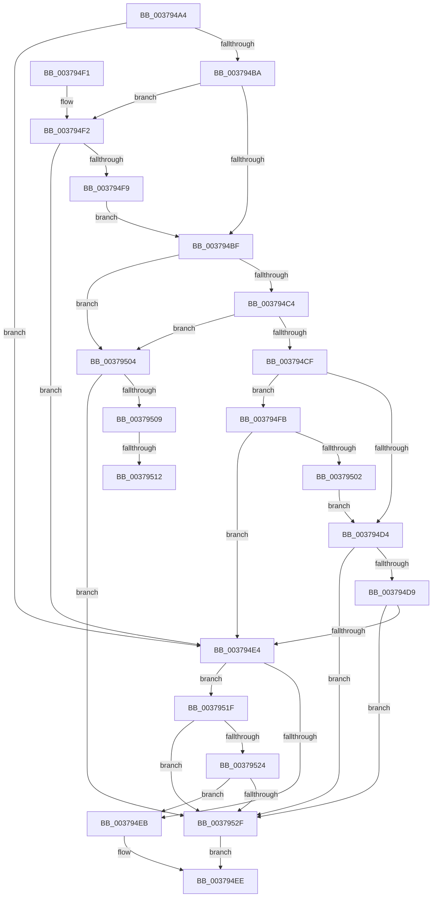

# MiDetermineCoalescedLargePageHeatState

- RVA: `0x003794A4`–`0x00379536` (길이 `146` bytes)
- VA: `0x00000001403794A4`
- 실행 섹션: `.text`
- PDB 이름 있음: `예`; PDB Function 태그: `예`
- unwind 정보 RVA: `0x000DB714`
- 디코드: `45`개 명령, `146/146` bytes 표시
- 미해석 바이트: `0` (있으면 어셈블리에 `.byte`로 보존)

> 이 문서는 커널 이미지의 기계어와 PDB 기호를 분석해 생성했습니다. 4번과 5번은 함수 원형과 자료형을 바이너리 사용 방식에서 추정한 C 해석이며 원본 소스 복구 결과는 아닙니다.

## 1. Dependencies

- 직접 호출 지점: **0**; 고유 호출 대상: **0**
- 직접 호출자로 확인된 함수: **1**
- RIP 상대 이미지 참조: **1**

### Outgoing calls
- 직접 디코드된 call 명령이 없습니다.

### Direct callers
- [MiLargePagePromote](MiLargePagePromote_function_0037915C.md) at `0x00379398`

### Static image references
- `0x003794A4` → RVA `0x00FC6AB8` (`ALMOSTRO`; read)

## 2. Other-region calls and transfers

- 다른 실행 섹션으로 향하는 call: **0**
- call이 아닌 외부 분기/꼬리 이동: **2**
  - `0x0037950C` → `0x006E43F4` (`tail-transfer`)
  - `0x0037951A` → `0x006E43F4` (`tail-transfer`)

## 3. Assembly (complete function range)

```asm
003794A4  44 8B 15 0D D6 C4 00            mov r10d, dword ptr [rip + 0xc4d60d]
003794AB  41 BB 01 00 00 00               mov r11d, 1
003794B1  41 F7 C2 00 00 40 08            test r10d, 0x8400000
003794B8  74 2A                           je 0x1403794e4
003794BA  41 3B CB                        cmp ecx, r11d
003794BD  77 33                           ja 0x1403794f2
003794BF  4D 85 C9                        test r9, r9
003794C2  74 40                           je 0x140379504
003794C4  41 8B 81 50 3B 00 00            mov eax, dword ptr [r9 + 0x3b50]
003794CB  A8 02                           test al, 2
003794CD  74 35                           je 0x140379504
003794CF  41 3B CB                        cmp ecx, r11d
003794D2  77 27                           ja 0x1403794fb
003794D4  4D 85 C9                        test r9, r9
003794D7  74 56                           je 0x14037952f
003794D9  41 8B 81 50 3B 00 00            mov eax, dword ptr [r9 + 0x3b50]
003794E0  A8 02                           test al, 2
003794E2  74 4B                           je 0x14037952f
003794E4  41 0F BA E2 15                  bt r10d, 0x15
003794E9  72 34                           jb 0x14037951f
003794EB  41 8B D3                        mov edx, r11d
003794EE  8B C2                           mov eax, edx
003794F0  C3                              ret
003794F1  CC                              int3
003794F2  41 0F BA E2 1B                  bt r10d, 0x1b
003794F7  72 EB                           jb 0x1403794e4
003794F9  EB C4                           jmp 0x1403794bf
003794FB  41 0F BA E2 1B                  bt r10d, 0x1b
00379500  72 E2                           jb 0x1403794e4
00379502  EB D0                           jmp 0x1403794d4
00379504  45 3B C3                        cmp r8d, r11d
00379507  74 26                           je 0x14037952f
00379509  F6 C2 02                        test dl, 2
0037950C  0F 84 E2 AE 36 00               je 0x1406e43f4
00379512  48 8B 44 24 28                  mov rax, qword ptr [rsp + 0x28]
00379517  44 89 18                        mov dword ptr [rax], r11d
0037951A  E9 D5 AE 36 00                  jmp 0x1406e43f4
0037951F  4D 85 C9                        test r9, r9
00379522  74 0B                           je 0x14037952f
00379524  41 8B 81 50 3B 00 00            mov eax, dword ptr [r9 + 0x3b50]
0037952B  A8 02                           test al, 2
0037952D  75 BC                           jne 0x1403794eb
0037952F  F7 D2                           not edx
00379531  41 23 D3                        and edx, r11d
00379534  EB B8                           jmp 0x1403794ee
```

## 4. C-style interpretation (structured pseudocode)

```c
__int64 __fastcall MiDetermineCoalescedLargePageHeatState(int a1, __int64 a2, int a3, __int64 a4, __int64 a5)
{
    if ((((unsigned int)((unsigned int)(*(unsigned int *)(v_rip + 12899853)))) & (0x8400000ULL)) == 0) goto loc_003794E4;
    if (a1 > 1) goto loc_003794F2;
loc_003794BF:
    if (a4 == 0) goto loc_00379504;
    if ((((unsigned __int8)((unsigned int)(*(unsigned int *)(a4 + 15184)))) & (2)) == 0) goto loc_00379504;
    if (a1 > 1) goto loc_003794FB;
loc_003794D4:
    if (a4 == 0) goto loc_0037952F;
    if ((((unsigned __int8)((unsigned int)(*(unsigned int *)(a4 + 15184)))) & (2)) == 0) goto loc_0037952F;
loc_003794E4:
    if (condition_is_below) goto loc_0037951F;
loc_003794EB:
loc_003794EE:
    return 1;
loc_003794F2:
    if (condition_is_below) goto loc_003794E4;
    goto loc_003794BF;
loc_003794FB:
    if (condition_is_below) goto loc_003794E4;
    goto loc_003794D4;
loc_00379504:
    if (a3 == 1) goto loc_0037952F;
    *(unsigned int *)(a5) = 1;
loc_0037951F:
    if (a4 == 0) goto loc_0037952F;
    if ((((unsigned __int8)((unsigned int)(*(unsigned int *)(a4 + 15184)))) & (2)) != 0) goto loc_003794EB;
loc_0037952F:
    a2 = (unsigned int)(~(1));
    a2 = (unsigned int)((a2) & (1));
    goto loc_003794EE;
}
```

## 5. (Beta) C Style

```c
int64_t MiDetermineCoalescedLargePageHeatState(int32_t Arg1, int64_t Arg2, int32_t Arg3, int64_t Arg4, void *Arg5)
{
    uint8_t *arg5 = (uint8_t *)Arg5;

    if ((((uint32_t)((uint32_t)(*(uint32_t *)(v_rip + 0xC4D60D)))) & (0x8400000ULL)) == 0) goto loc_003794E4;
    if (Arg1 > 1) goto loc_003794F2;
loc_003794BF:
    if (Arg4 == 0) goto loc_00379504;
    if ((((uint8_t)((uint32_t)(*(uint32_t *)(Arg4 + 0x3B50)))) & (2)) == 0) goto loc_00379504;
    if (Arg1 > 1) goto loc_003794FB;
loc_003794D4:
    if (Arg4 == 0) goto loc_0037952F;
    if ((((uint8_t)((uint32_t)(*(uint32_t *)(Arg4 + 0x3B50)))) & (2)) == 0) goto loc_0037952F;
loc_003794E4:
    if (condition_is_below) goto loc_0037951F;
loc_003794EB:
loc_003794EE:
    return 1;
loc_003794F2:
    if (condition_is_below) goto loc_003794E4;
    goto loc_003794BF;
loc_003794FB:
    if (condition_is_below) goto loc_003794E4;
    goto loc_003794D4;
loc_00379504:
    if (Arg3 == 1) goto loc_0037952F;
    *(uint32_t *)(arg5) = 1;
loc_0037951F:
    if (Arg4 == 0) goto loc_0037952F;
    if ((((uint8_t)((uint32_t)(*(uint32_t *)(Arg4 + 0x3B50)))) & (2)) != 0) goto loc_003794EB;
loc_0037952F:
    Arg2 = (uint32_t)(~(1));
    Arg2 = (uint32_t)((Arg2) & (1));
    goto loc_003794EE;
}
```

### 관측된 메모리 오프셋

구조체 형식이 확인되지 않은 접근은 인자 기준의 오프셋으로만 기록했습니다.

| 기준 인자 | 오프셋 표현 | 폭 (bit) | 접근 |
|---|---:|---:|---|
| `Arg5` | `+ 0x0` | `32` | `W` |

## 6. Execution-region graph

[열기: 2D/3D 그래프와 함수 탐색 컨트롤 패널](../../../control-panel.html?section=text&rva=0x003794A4&view=graph)

- 2D 그래프는 위에서 아래로 흐르고, 3D 그래프는 빈 공간을 드래그해 회전합니다. Shift+드래그는 이동, 휠은 확대·축소, 함수 노드 선택은 대상 보고서 이동입니다.

### Static fallback


