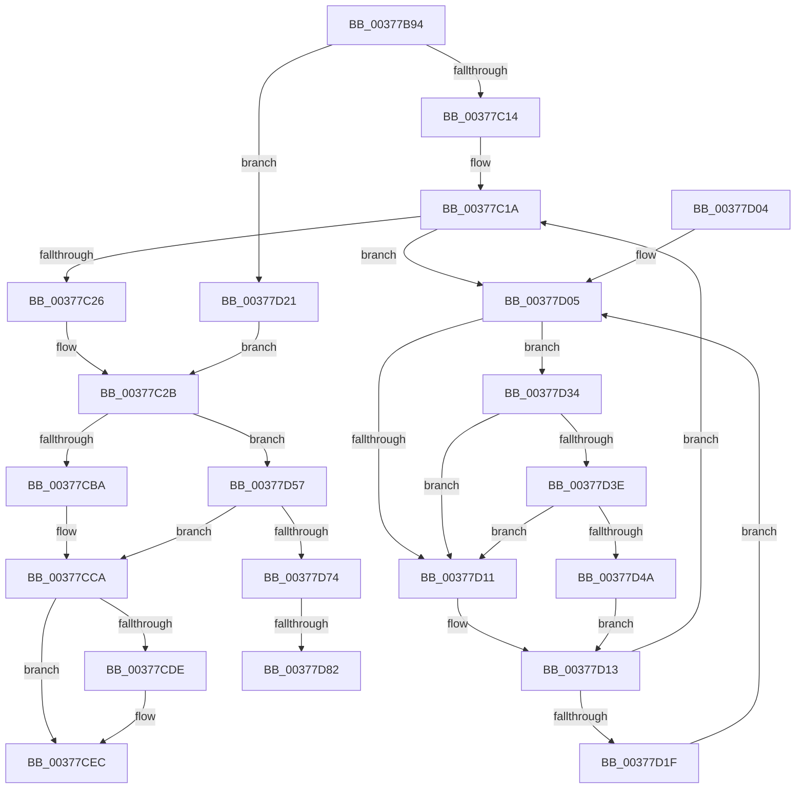

# MiFinishLargePageFree

- RVA: `0x00377B94`–`0x00377D94` (길이 `512` bytes)
- VA: `0x0000000140377B94`
- 실행 섹션: `.text`
- PDB 이름 있음: `예`; PDB Function 태그: `예`
- unwind 정보 RVA: `0x0007ADBC`
- 디코드: `140`개 명령, `512/512` bytes 표시
- 미해석 바이트: `0` (있으면 어셈블리에 `.byte`로 보존)

> 이 문서는 커널 이미지의 기계어와 PDB 기호를 분석해 생성했습니다. 4번과 5번은 함수 원형과 자료형을 바이너리 사용 방식에서 추정한 C 해석이며 원본 소스 복구 결과는 아닙니다.

## 1. Dependencies

- 직접 호출 지점: **10**; 고유 호출 대상: **10**
- 직접 호출자로 확인된 함수: **2**
- RIP 상대 이미지 참조: **5**

### Outgoing calls
- `0x00377BCD` → [MiGetPfnPageSizeIndex](../31/MiGetPfnPageSizeIndex_function_0031C710.md) (function, `0x0031C710`)
- `0x00377C58` → [MiSetFreeZeroPfnCold](MiSetFreeZeroPfnCold_function_00379428.md) (function, `0x00379428`)
- `0x00377CBA` → [MiInsertPageInFreeOrZeroedList](../33/MiInsertPageInFreeOrZeroedList_function_00334D20.md) (function, `0x00334D20`)
- `0x00377CC5` → [MiUnlockPage](../31/MiUnlockPage_function_0031A3E0.md) (function, `0x0031A3E0`)
- `0x00377CE7` → [MiFreeLargePageCharges](../3F/MiFreeLargePageCharges_function_003F7FF0.md) (function, `0x003F7FF0`)
- `0x00377D24` → [MiLockPageInline](../31/MiLockPageInline_function_0031A340.md) (function, `0x0031A340`)
- `0x00377D3E` → [KiCheckVpBackingLongSpinWaitHypercall](../30/KiCheckVpBackingLongSpinWaitHypercall_function_0030F490.md) (function, `0x0030F490`)
- `0x00377D4D` → [HvlNotifyLongSpinWait](../30/HvlNotifyLongSpinWait_function_0030F460.md) (function, `0x0030F460`)
- `0x00377D65` → [MiInsertPossiblyBadPage](../68/MiInsertPossiblyBadPage_function_00689DF0.md) (function, `0x00689DF0`)
- `0x00377D89` → [KiLowerIrqlProcessIrqlFlags](../4F/KiLowerIrqlProcessIrqlFlags_function_004F5698.md) (function, `0x004F5698`)

### Direct callers
- [MiProbeUnlockPage](../24/MiProbeUnlockPage_function_00243860.md) at `0x00243BB4`
- [MiFreeLargePageMemory](MiFreeLargePageMemory_function_00377938.md) at `0x00377A00`

### Static image references
- `0x00377BB4` → RVA `0x00E30088` (`.data`; read)
- `0x00377CCD` → RVA `0x00011C60` (`.rdata`; read)
- `0x00377D08` → RVA `0x00FC52AC` (`ALMOSTRO`; reference)
- `0x00377D34` → RVA `0x00FC6AB8` (`ALMOSTRO`; read)
- `0x00377D76` → RVA `0x00FC6D20` (`ALMOSTRO`; read)

## 2. Other-region calls and transfers

- 다른 실행 섹션으로 향하는 call: **0**
- call이 아닌 외부 분기/꼬리 이동: **2**
  - `0x00377D7C` → [sub_006E40B0](../6E/Unknown_function_006E40B0.md) (`tail-transfer`)
  - `0x00377D8F` → [sub_006E40B0](../6E/Unknown_function_006E40B0.md) (`tail-transfer`)

## 3. Assembly (complete function range)

```asm
00377B94  48 89 5C 24 08                  mov qword ptr [rsp + 8], rbx
00377B99  44 89 44 24 18                  mov dword ptr [rsp + 0x18], r8d
00377B9E  55                              push rbp
00377B9F  56                              push rsi
00377BA0  57                              push rdi
00377BA1  41 54                           push r12
00377BA3  41 55                           push r13
00377BA5  41 56                           push r14
00377BA7  41 57                           push r15
00377BA9  48 83 EC 20                     sub rsp, 0x20
00377BAD  48 8B 41 28                     mov rax, qword ptr [rcx + 0x28]
00377BB1  45 8B E1                        mov r12d, r9d
00377BB4  4C 8B 15 CD 84 AB 00            mov r10, qword ptr [rip + 0xab84cd]
00377BBB  8B DA                           mov ebx, edx
00377BBD  48 C1 E8 2B                     shr rax, 0x2b
00377BC1  48 8B F1                        mov rsi, rcx
00377BC4  25 FF 03 00 00                  and eax, 0x3ff
00377BC9  4D 8B 2C C2                     mov r13, qword ptr [r10 + rax*8]
00377BCD  E8 3E 4B FA FF                  call 0x14031c710
00377BD2  44 8B F0                        mov r14d, eax
00377BD5  89 44 24 68                     mov dword ptr [rsp + 0x68], eax
00377BD9  48 B8 00 00 00 00 00 DE FF FF   movabs rax, 0xffffde0000000000
00377BE3  48 8B EE                        mov rbp, rsi
00377BE6  48 2B E8                        sub rbp, rax
00377BE9  48 B8 AB AA AA AA AA AA AA AA   movabs rax, 0xaaaaaaaaaaaaaaab
00377BF3  48 C1 FD 04                     sar rbp, 4
00377BF7  48 0F AF E8                     imul rbp, rax
00377BFB  F7 DB                           neg ebx
00377BFD  48 8D 5E 18                     lea rbx, [rsi + 0x18]
00377C01  45 1B FF                        sbb r15d, r15d
00377C04  45 33 C0                        xor r8d, r8d
00377C07  41 F7 DF                        neg r15d
00377C0A  41 F6 C4 10                     test r12b, 0x10
00377C0E  0F 84 0D 01 00 00               je 0x140377d21
00377C14  40 B7 02                        mov dil, 2
00377C17  45 8B F0                        mov r14d, r8d
00377C1A  F0 48 0F BA 2B 3F               lock bts qword ptr [rbx], 0x3f
00377C20  0F 82 DF 00 00 00               jb 0x140377d05
00377C26  44 8B 74 24 68                  mov r14d, dword ptr [rsp + 0x68]
00377C2B  8B 4E 20                        mov ecx, dword ptr [rsi + 0x20]
00377C2E  41 8B D0                        mov edx, r8d
00377C31  44 8A 5E 22                     mov r11b, byte ptr [rsi + 0x22]
00377C35  89 4C 24 68                     mov dword ptr [rsp + 0x68], ecx
00377C39  C1 E9 10                        shr ecx, 0x10
00377C3C  80 E1 FD                        and cl, 0xfd
00377C3F  80 C9 05                        or cl, 5
00377C42  44 39 44 24 70                  cmp dword ptr [rsp + 0x70], r8d
00377C47  88 4C 24 6A                     mov byte ptr [rsp + 0x6a], cl
00377C4B  48 8B CE                        mov rcx, rsi
00377C4E  8B 44 24 68                     mov eax, dword ptr [rsp + 0x68]
00377C52  0F 94 C2                        sete dl
00377C55  89 46 20                        mov dword ptr [rsi + 0x20], eax
00377C58  E8 CB 17 00 00                  call 0x140379428
00377C5D  8B 4E 20                        mov ecx, dword ptr [rsi + 0x20]
00377C60  41 8D 57 01                     lea edx, [r15 + 1]
00377C64  89 4C 24 70                     mov dword ptr [rsp + 0x70], ecx
00377C68  C1 E9 10                        shr ecx, 0x10
00377C6B  8A C1                           mov al, cl
00377C6D  41 32 C3                        xor al, r11b
00377C70  24 07                           and al, 7
00377C72  32 C1                           xor al, cl
00377C74  48 B9 00 00 00 00 00 00 00 C0   movabs rcx, 0xc000000000000000
00377C7E  88 44 24 72                     mov byte ptr [rsp + 0x72], al
00377C82  8B 44 24 70                     mov eax, dword ptr [rsp + 0x70]
00377C86  89 46 20                        mov dword ptr [rsi + 0x20], eax
00377C89  48 8B 03                        mov rax, qword ptr [rbx]
00377C8C  48 23 C1                        and rax, rcx
00377C8F  48 8B CD                        mov rcx, rbp
00377C92  48 89 46 18                     mov qword ptr [rsi + 0x18], rax
00377C96  8B 46 20                        mov eax, dword ptr [rsi + 0x20]
00377C99  89 44 24 70                     mov dword ptr [rsp + 0x70], eax
00377C9D  33 C0                           xor eax, eax
00377C9F  66 89 44 24 70                  mov word ptr [rsp + 0x70], ax
00377CA4  8B 44 24 70                     mov eax, dword ptr [rsp + 0x70]
00377CA8  89 46 20                        mov dword ptr [rsi + 0x20], eax
00377CAB  48 8B 46 28                     mov rax, qword ptr [rsi + 0x28]
00377CAF  48 0F BA E0 29                  bt rax, 0x29
00377CB4  0F 82 9D 00 00 00               jb 0x140377d57
00377CBA  E8 61 D0 FB FF                  call 0x140334d20
00377CBF  40 8A D7                        mov dl, dil
00377CC2  48 8B CE                        mov rcx, rsi
00377CC5  E8 16 27 FA FF                  call 0x14031a3e0
00377CCA  41 8B C6                        mov eax, r14d
00377CCD  48 8D 1D 8C 9F C9 FF            lea rbx, [rip - 0x366074]
00377CD4  48 8B 1C C3                     mov rbx, qword ptr [rbx + rax*8]
00377CD8  41 F6 C4 08                     test r12b, 8
00377CDC  75 0E                           jne 0x140377cec
00377CDE  45 8B C4                        mov r8d, r12d
00377CE1  48 8B D3                        mov rdx, rbx
00377CE4  49 8B CD                        mov rcx, r13
00377CE7  E8 04 03 08 00                  call 0x1403f7ff0
00377CEC  48 8B C3                        mov rax, rbx
00377CEF  48 8B 5C 24 60                  mov rbx, qword ptr [rsp + 0x60]
00377CF4  48 83 C4 20                     add rsp, 0x20
00377CF8  41 5F                           pop r15
00377CFA  41 5E                           pop r14
00377CFC  41 5D                           pop r13
00377CFE  41 5C                           pop r12
00377D00  5F                              pop rdi
00377D01  5E                              pop rsi
00377D02  5D                              pop rbp
00377D03  C3                              ret
00377D04  CC                              int3
00377D05  41 FF C6                        inc r14d
00377D08  44 85 35 9D D5 C4 00            test dword ptr [rip + 0xc4d59d], r14d
00377D0F  74 23                           je 0x140377d34
00377D11  F3 90                           pause
00377D13  48 8B 03                        mov rax, qword ptr [rbx]
00377D16  48 85 C0                        test rax, rax
00377D19  0F 89 FB FE FF FF               jns 0x140377c1a
00377D1F  EB E4                           jmp 0x140377d05
00377D21  48 8B CE                        mov rcx, rsi
00377D24  E8 17 26 FA FF                  call 0x14031a340
00377D29  40 8A F8                        mov dil, al
00377D2C  45 33 C0                        xor r8d, r8d
00377D2F  E9 F7 FE FF FF                  jmp 0x140377c2b
00377D34  8B 05 7E ED C4 00               mov eax, dword ptr [rip + 0xc4ed7e]
00377D3A  A8 40                           test al, 0x40
00377D3C  74 D3                           je 0x140377d11
00377D3E  E8 4D 77 F9 FF                  call 0x14030f490
00377D43  45 33 C0                        xor r8d, r8d
00377D46  84 C0                           test al, al
00377D48  74 C7                           je 0x140377d11
00377D4A  41 8B CE                        mov ecx, r14d
00377D4D  E8 0E 77 F9 FF                  call 0x14030f460
00377D52  45 33 C0                        xor r8d, r8d
00377D55  EB BC                           jmp 0x140377d13
00377D57  48 B8 FF FF FF FF FF FF FF 7F   movabs rax, 0x7fffffffffffffff
00377D61  F0 48 21 03                     lock and qword ptr [rbx], rax
00377D65  E8 86 20 31 00                  call 0x140689df0
00377D6A  40 80 FF 02                     cmp dil, 2
00377D6E  0F 83 56 FF FF FF               jae 0x140377cca
00377D74  33 C0                           xor eax, eax
00377D76  39 05 A4 EF C4 00               cmp dword ptr [rip + 0xc4efa4], eax
00377D7C  0F 84 2E C3 36 00               je 0x1406e40b0
00377D82  44 0F 20 C1                     mov rcx, cr8
00377D86  40 8A D7                        mov dl, dil
00377D89  E8 0A D9 17 00                  call 0x1404f5698
00377D8E  90                              nop
00377D8F  E9 1C C3 36 00                  jmp 0x1406e40b0
```

## 4. C-style interpretation (structured pseudocode)

```c
__int64 __fastcall MiFinishLargePageFree(__int64 a1, int a2, int a3, int a4)
{
    __int64 result;
    __int64 v_r14;
    __int64 v_r15;
    __int64 v_rbp;
    __int64 v_rbx;
    __int64 v_rsp;
    unsigned int v_stack_p10;
    unsigned __int8 v_stack_p12;
    unsigned int v_stack_p18;
    unsigned __int8 v_stack_p1A;
    unsigned __int64 v_stack_p8;

    v_stack_p8 = v_rbx;
    v_stack_p18 = a3;
    v_rsp = (v_rsp) - (32);
    result = (*(unsigned __int64 *)(a1 + 40)) >> (43);
    result = (unsigned int)((result) & (0x3FFULL));
    result = MiGetPfnPageSizeIndex(a1, a2, a3, a4);
    v_stack_p10 = (unsigned int)(result);
    v_rbp = (a1) - (result);
    v_rbp = (v_rbp) >> (4);
    v_rbp = (v_rbp) * (result);
    v_rbx = (unsigned int)(-((unsigned int)(a2)));
    a3 = 0;
    v_r15 = (unsigned int)(-(v_r15));
    if ((((unsigned __int8)((unsigned int)(a4))) & (16)) == 0) goto loc_00377D21;
loc_00377C1A:
    if (condition_is_below) goto loc_00377D05;
loc_00377C2B:
    v_stack_p10 = (unsigned int)((unsigned int)(*(unsigned int *)(a1 + 32)));
    a1 = (unsigned int)(((unsigned int)(*(unsigned int *)(a1 + 32))) >> (16));
    a1 = (unsigned __int8)((a1) & (253));
    a1 = (unsigned __int8)((a1) | (5));
    v_stack_p12 = (unsigned __int8)(a1);
    a2 = (v_stack_p18 == 0) ? 1 : 0;
    *(unsigned int *)(a1 + 32) = (unsigned int)((unsigned int)(v_stack_p10));
    result = MiSetFreeZeroPfnCold(a1, a2, a3, a4);
    v_stack_p18 = (unsigned int)((unsigned int)(*(unsigned int *)(a1 + 32)));
    a1 = (unsigned int)(((unsigned int)(*(unsigned int *)(a1 + 32))) >> (16));
    result = (unsigned __int8)(((unsigned __int8)(a1)) ^ ((unsigned __int8)(*(unsigned __int8 *)(a1 + 34))));
    result = (unsigned __int8)((result) & (7));
    result = (unsigned __int8)((result) ^ ((unsigned __int8)(a1)));
    v_stack_p1A = (unsigned __int8)(result);
    *(unsigned int *)(a1 + 32) = (unsigned int)((unsigned int)(v_stack_p18));
    result = (*(unsigned __int64 *)(a1 + 24)) & (a1);
    *(unsigned __int64 *)(a1 + 24) = result;
    v_stack_p18 = (unsigned int)((unsigned int)(*(unsigned int *)(a1 + 32)));
    result = 0;
    v_stack_p18 = 0;
    *(unsigned int *)(a1 + 32) = (unsigned int)((unsigned int)(v_stack_p18));
    if (condition_is_below) goto loc_00377D57;
    result = MiInsertPageInFreeOrZeroedList(v_rbp, v_r15 + 1, a3, a4);
    result = MiUnlockPage(a1, 2, a3, a4);
loc_00377CCA:
    result = (unsigned int)((unsigned int)((unsigned int)(v_stack_p10)));
    if ((((unsigned __int8)((unsigned int)(a4))) & (8)) == 0) {
        a3 = (unsigned int)((unsigned int)(a4));
        a2 = *(unsigned __int64 *)(v_rip - 3563636 + (unsigned int)((unsigned int)((unsigned int)(v_stack_p10))) * 8);
        a1 = *(unsigned __int64 *)(*(unsigned __int64 *)(v_rip + 11240653) + result * 8);
        result = MiFreeLargePageCharges(a1, a2, a3, a4);
    }
    v_rsp = (v_rsp) + (32);
    return *(unsigned __int64 *)(v_rip - 3563636 + (unsigned int)((unsigned int)((unsigned int)(v_stack_p10))) * 8);
loc_00377D05:
    v_r14 = (unsigned int)(((unsigned int)(v_stack_p10)) + 1);
    if (((*(unsigned int *)(v_rip + 12899741)) & ((unsigned int)(v_r14))) == 0) goto loc_00377D34;
loc_00377D11:
loc_00377D13:
    if (!sign_flag) goto loc_00377C1A;
    goto loc_00377D05;
loc_00377D21:
    result = MiLockPageInline(a1, a2, a3, a4);
    a3 = 0;
    goto loc_00377C2B;
loc_00377D34:
    if ((((unsigned __int8)((unsigned int)(*(unsigned int *)(v_rip + 12905854)))) & (64)) == 0) goto loc_00377D11;
    result = KiCheckVpBackingLongSpinWaitHypercall(a1, a2, a3, a4);
    a3 = 0;
    if ((unsigned __int8)(result) == 0) goto loc_00377D11;
    result = HvlNotifyLongSpinWait((unsigned int)((unsigned int)(v_r14)), a2, a3, a4);
    a3 = 0;
    goto loc_00377D13;
loc_00377D57:
    result = MiInsertPossiblyBadPage((unsigned int)((unsigned int)(v_r14)), a2, a3, a4);
    if (((unsigned __int8)((unsigned __int8)(result))) >= 2) goto loc_00377CCA;
    result = 0;
    result = KiLowerIrqlProcessIrqlFlags(v_cr8, (unsigned __int8)((unsigned __int8)(result)), a3, a4);
}
```

## 5. (Beta) C Style

```c
int64_t MiFinishLargePageFree(void *Arg1, int32_t Arg2, int32_t Arg3, int32_t Arg4)
{
    uint8_t *arg1 = (uint8_t *)Arg1;

    int64_t result;
    int64_t local_r14;
    int64_t local_r15;
    int64_t local_rbp;
    int64_t local_rbx;
    int64_t local_rsp;
    uint32_t v_stack_p10;
    uint8_t v_stack_p12;
    uint32_t v_stack_p18;
    uint8_t v_stack_p1A;
    uint64_t v_stack_p8;

    v_stack_p8 = local_rbx;
    v_stack_p18 = Arg3;
    local_rsp = (local_rsp) - (32);
    result = (*(uint64_t *)(arg1 + 0x28)) >> (43);
    result = (uint32_t)((result) & (0x3FFULL));
    result = MiGetPfnPageSizeIndex(Arg1, Arg2, Arg3, Arg4);
    v_stack_p10 = (uint32_t)(result);
    local_rbp = (Arg1) - (result);
    local_rbp = (local_rbp) >> (4);
    local_rbp = (local_rbp) * (result);
    local_rbx = (uint32_t)(-((uint32_t)(Arg2)));
    Arg3 = 0;
    local_r15 = (uint32_t)(-(local_r15));
    if ((((uint8_t)((uint32_t)(Arg4))) & (16)) == 0) goto loc_00377D21;
loc_00377C1A:
    if (condition_is_below) goto loc_00377D05;
loc_00377C2B:
    v_stack_p10 = (uint32_t)((uint32_t)(*(uint32_t *)(arg1 + 0x20)));
    Arg1 = (uint32_t)(((uint32_t)(*(uint32_t *)(arg1 + 0x20))) >> (16));
    Arg1 = (uint8_t)((Arg1) & (253));
    Arg1 = (uint8_t)((Arg1) | (5));
    v_stack_p12 = (uint8_t)(Arg1);
    Arg2 = (v_stack_p18 == 0) ? 1 : 0;
    *(uint32_t *)(arg1 + 0x20) = (uint32_t)((uint32_t)(v_stack_p10));
    result = MiSetFreeZeroPfnCold(Arg1, Arg2, Arg3, Arg4);
    v_stack_p18 = (uint32_t)((uint32_t)(*(uint32_t *)(arg1 + 0x20)));
    Arg1 = (uint32_t)(((uint32_t)(*(uint32_t *)(arg1 + 0x20))) >> (16));
    result = (uint8_t)(((uint8_t)(Arg1)) ^ ((uint8_t)(*(uint8_t *)(arg1 + 0x22))));
    result = (uint8_t)((result) & (7));
    result = (uint8_t)((result) ^ ((uint8_t)(Arg1)));
    v_stack_p1A = (uint8_t)(result);
    *(uint32_t *)(arg1 + 0x20) = (uint32_t)((uint32_t)(v_stack_p18));
    result = (*(uint64_t *)(arg1 + 0x18)) & (Arg1);
    *(uint64_t *)(arg1 + 0x18) = result;
    v_stack_p18 = (uint32_t)((uint32_t)(*(uint32_t *)(arg1 + 0x20)));
    result = 0;
    v_stack_p18 = 0;
    *(uint32_t *)(arg1 + 0x20) = (uint32_t)((uint32_t)(v_stack_p18));
    if (condition_is_below) goto loc_00377D57;
    result = MiInsertPageInFreeOrZeroedList(local_rbp, local_r15 + 1, Arg3, Arg4);
    result = MiUnlockPage(Arg1, 2, Arg3, Arg4);
loc_00377CCA:
    result = (uint32_t)((uint32_t)((uint32_t)(v_stack_p10)));
    if ((((uint8_t)((uint32_t)(Arg4))) & (8)) == 0) {
        Arg3 = (uint32_t)((uint32_t)(Arg4));
        Arg2 = *(uint64_t *)(v_rip - 0x366074 + (uint32_t)((uint32_t)((uint32_t)(v_stack_p10))) * 8);
        Arg1 = *(uint64_t *)(*(uint64_t *)(v_rip + 0xAB84CD) + result * 8);
        result = MiFreeLargePageCharges(Arg1, Arg2, Arg3, Arg4);
    }
    local_rsp = (local_rsp) + (32);
    return *(uint64_t *)(v_rip - 0x366074 + (uint32_t)((uint32_t)((uint32_t)(v_stack_p10))) * 8);
loc_00377D05:
    local_r14 = (uint32_t)(((uint32_t)(v_stack_p10)) + 1);
    if (((*(uint32_t *)(v_rip + 0xC4D59D)) & ((uint32_t)(local_r14))) == 0) goto loc_00377D34;
loc_00377D11:
loc_00377D13:
    if (!sign_flag) goto loc_00377C1A;
    goto loc_00377D05;
loc_00377D21:
    result = MiLockPageInline(Arg1, Arg2, Arg3, Arg4);
    Arg3 = 0;
    goto loc_00377C2B;
loc_00377D34:
    if ((((uint8_t)((uint32_t)(*(uint32_t *)(v_rip + 0xC4ED7E)))) & (64)) == 0) goto loc_00377D11;
    result = KiCheckVpBackingLongSpinWaitHypercall(Arg1, Arg2, Arg3, Arg4);
    Arg3 = 0;
    if ((uint8_t)(result) == 0) goto loc_00377D11;
    result = HvlNotifyLongSpinWait((uint32_t)((uint32_t)(local_r14)), Arg2, Arg3, Arg4);
    Arg3 = 0;
    goto loc_00377D13;
loc_00377D57:
    result = MiInsertPossiblyBadPage((uint32_t)((uint32_t)(local_r14)), Arg2, Arg3, Arg4);
    if (((uint8_t)((uint8_t)(result))) >= 2) goto loc_00377CCA;
    result = 0;
    result = KiLowerIrqlProcessIrqlFlags(v_cr8, (uint8_t)((uint8_t)(result)), Arg3, Arg4);
}
```

### 관측된 메모리 오프셋

구조체 형식이 확인되지 않은 접근은 인자 기준의 오프셋으로만 기록했습니다.

| 기준 인자 | 오프셋 표현 | 폭 (bit) | 접근 |
|---|---:|---:|---|
| `Arg1` | `+ 0x0` | `64` | `R` |
| `Arg1` | `+ 0x0` | `64` | `R/W` |
| `Arg1` | `+ 0x18` | `64` | `R` |
| `Arg1` | `+ 0x18` | `64` | `W` |
| `Arg1` | `+ 0x20` | `32` | `R` |
| `Arg1` | `+ 0x20` | `32` | `W` |
| `Arg1` | `+ 0x22` | `8` | `R` |
| `Arg1` | `+ 0x28` | `64` | `R` |

## 6. Execution-region graph

[열기: 2D/3D 그래프와 함수 탐색 컨트롤 패널](../../../control-panel.html?section=text&rva=0x00377B94&view=graph)

- 2D 그래프는 위에서 아래로 흐르고, 3D 그래프는 빈 공간을 드래그해 회전합니다. Shift+드래그는 이동, 휠은 확대·축소, 함수 노드 선택은 대상 보고서 이동입니다.

### Static fallback


