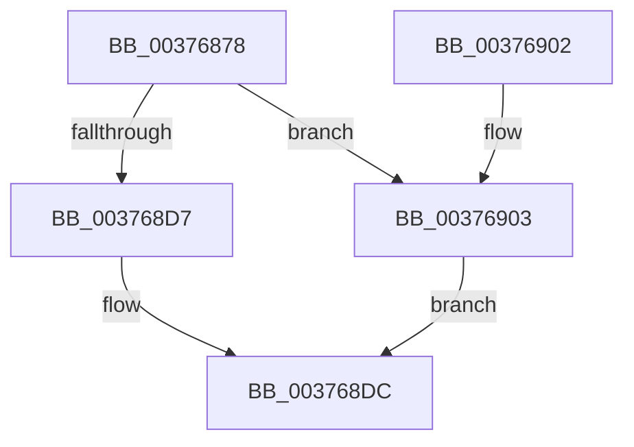

# MiFlushValidPteFromTb

- RVA: `0x00376878`–`0x0037690A` (길이 `146` bytes)
- VA: `0x0000000140376878`
- 실행 섹션: `.text`
- PDB 이름 있음: `예`; PDB Function 태그: `아니요`
- unwind 정보 RVA: `0x0007AC68`
- 디코드: `42`개 명령, `146/146` bytes 표시
- 미해석 바이트: `0` (있으면 어셈블리에 `.byte`로 보존)

> 이 문서는 커널 이미지의 기계어와 PDB 기호를 분석해 생성했습니다. 4번과 5번은 함수 원형과 자료형을 바이너리 사용 방식에서 추정한 C 해석이며 원본 소스 복구 결과는 아닙니다.

## 1. Dependencies

- 직접 호출 지점: **8**; 고유 호출 대상: **8**
- 직접 호출자로 확인된 함수: **1**
- RIP 상대 이미지 참조: **0**

### Outgoing calls
- `0x0037689C` → [MiGetLeafVa](../27/MiGetLeafVa_function_0027C0A0.md) (function, `0x0027C0A0`)
- `0x003768A4` → [MiVaToFlushVm](../31/MiVaToFlushVm_function_0031AD84.md) (function, `0x0031AD84`)
- `0x003768AC` → [MiGetProcessorFlushList](../24/MiGetProcessorFlushList_function_00242C90.md) (function, `0x00242C90`)
- `0x003768C8` → [MiInitializeTbFlushList](../29/MiInitializeTbFlushList_function_00294F00.md) (function, `0x00294F00`)
- `0x003768D7` → [MiInsertRecursiveTbFlushEntries](../2C/MiInsertRecursiveTbFlushEntries_function_002C1F38.md) (function, `0x002C1F38`)
- `0x003768DF` → [MiFlushTbList](../31/MiFlushTbList_function_00311FC0.md) (function, `0x00311FC0`)
- `0x003768E4` → [MiReleaseProcessorFlushList](../31/MiReleaseProcessorFlushList_function_00313C70.md) (function, `0x00313C70`)
- `0x00376903` → [MiInsertLargeTbFlushEntry](MiInsertLargeTbFlushEntry_function_0037827C.md) (function, `0x0037827C`)

### Direct callers
- [MiTransformValidPteUsingAccessedBit](MiTransformValidPteUsingAccessedBit_function_00376640.md) at `0x00376729`

### Static image references
- 디코드된 RIP-relative 메모리 참조가 없습니다.

## 2. Other-region calls and transfers

- 다른 실행 섹션으로 향하는 call: **0**
- 별도 외부 분기/꼬리 이동을 확인하지 못했습니다.

## 3. Assembly (complete function range)

```asm
00376878  48 89 5C 24 08                  mov qword ptr [rsp + 8], rbx
0037687D  48 89 6C 24 10                  mov qword ptr [rsp + 0x10], rbp
00376882  48 89 74 24 18                  mov qword ptr [rsp + 0x18], rsi
00376887  57                              push rdi
00376888  41 56                           push r14
0037688A  41 57                           push r15
0037688C  48 83 EC 30                     sub rsp, 0x30
00376890  45 8B F9                        mov r15d, r9d
00376893  41 8B F0                        mov esi, r8d
00376896  48 8B DA                        mov rbx, rdx
00376899  4C 8B F1                        mov r14, rcx
0037689C  E8 FF 57 F0 FF                  call 0x14027c0a0
003768A1  48 8B C8                        mov rcx, rax
003768A4  E8 DB 44 FA FF                  call 0x14031ad84
003768A9  48 8B F8                        mov rdi, rax
003768AC  E8 DF C3 EC FF                  call 0x140242c90
003768B1  41 B9 08 00 00 00               mov r9d, 8
003768B7  89 74 24 20                     mov dword ptr [rsp + 0x20], esi
003768BB  48 8B D7                        mov rdx, rdi
003768BE  48 8B C8                        mov rcx, rax
003768C1  48 8B E8                        mov rbp, rax
003768C4  44 8B 40 0C                     mov r8d, dword ptr [rax + 0xc]
003768C8  E8 33 E6 F1 FF                  call 0x140294f00
003768CD  4D 8B C6                        mov r8, r14
003768D0  41 8B D7                        mov edx, r15d
003768D3  84 DB                           test bl, bl
003768D5  78 2C                           js 0x140376903
003768D7  E8 5C B6 F4 FF                  call 0x1402c1f38
003768DC  48 8B CD                        mov rcx, rbp
003768DF  E8 DC B6 F9 FF                  call 0x140311fc0
003768E4  E8 87 D3 F9 FF                  call 0x140313c70
003768E9  48 8B 5C 24 50                  mov rbx, qword ptr [rsp + 0x50]
003768EE  48 8B 6C 24 58                  mov rbp, qword ptr [rsp + 0x58]
003768F3  48 8B 74 24 60                  mov rsi, qword ptr [rsp + 0x60]
003768F8  48 83 C4 30                     add rsp, 0x30
003768FC  41 5F                           pop r15
003768FE  41 5E                           pop r14
00376900  5F                              pop rdi
00376901  C3                              ret
00376902  CC                              int3
00376903  E8 74 19 00 00                  call 0x14037827c
00376908  EB D2                           jmp 0x1403768dc
```

## 4. C-style interpretation (structured pseudocode)

```c
__int64 __fastcall MiFlushValidPteFromTb(__int64 a1, __int64 a2, int a3, int a4)
{
    __int64 result;
    __int64 v_rsp;
    unsigned int v_stack_m28;
    unsigned __int64 v_stack_p10;
    unsigned __int64 v_stack_p18;
    unsigned __int64 v_stack_p8;

    v_stack_p8 = v_rbx;
    v_stack_p10 = v_rbp;
    v_stack_p18 = v_rsi;
    v_rsp = (v_rsp) - (48);
    result = MiGetLeafVa(a1, a2, a3, a4);
    result = MiVaToFlushVm(result, a2, a3, a4);
    result = MiGetProcessorFlushList(result, a2, a3, a4);
    v_stack_m28 = (unsigned int)((unsigned int)(a3));
    result = MiInitializeTbFlushList(result, result, (unsigned int)(*(unsigned int *)(result + 12)), 8);
    if (sign_flag) goto loc_00376903;
    result = MiInsertRecursiveTbFlushEntries(result, (unsigned int)((unsigned int)((unsigned int)(a4))), a1, 8);
loc_003768DC:
    result = MiFlushTbList(result, (unsigned int)((unsigned int)((unsigned int)(a4))), a1, 8);
    result = MiReleaseProcessorFlushList(result, (unsigned int)((unsigned int)((unsigned int)(a4))), a1, 8);
    v_rsp = (v_rsp) + (48);
    return result;
loc_00376903:
    result = MiInsertLargeTbFlushEntry(result, (unsigned int)((unsigned int)((unsigned int)(a4))), a1, 8);
    goto loc_003768DC;
}
```

## 5. (Beta) C Style

```c
int64_t MiFlushValidPteFromTb(int64_t Arg1, int64_t Arg2, int32_t Arg3, int32_t Arg4)
{
    int64_t result;
    int64_t local_rsp;
    uint32_t v_stack_m28;
    uint64_t v_stack_p10;
    uint64_t v_stack_p18;
    uint64_t v_stack_p8;

    v_stack_p8 = local_rbx;
    v_stack_p10 = local_rbp;
    v_stack_p18 = local_rsi;
    local_rsp = (local_rsp) - (48);
    result = MiGetLeafVa(Arg1, Arg2, Arg3, Arg4);
    result = MiVaToFlushVm(result, Arg2, Arg3, Arg4);
    result = MiGetProcessorFlushList(result, Arg2, Arg3, Arg4);
    v_stack_m28 = (uint32_t)((uint32_t)(Arg3));
    result = MiInitializeTbFlushList(result, result, (uint32_t)(*(uint32_t *)(result + 0xC)), 8);
    if (sign_flag) goto loc_00376903;
    result = MiInsertRecursiveTbFlushEntries(result, (uint32_t)((uint32_t)((uint32_t)(Arg4))), Arg1, 8);
loc_003768DC:
    result = MiFlushTbList(result, (uint32_t)((uint32_t)((uint32_t)(Arg4))), Arg1, 8);
    result = MiReleaseProcessorFlushList(result, (uint32_t)((uint32_t)((uint32_t)(Arg4))), Arg1, 8);
    local_rsp = (local_rsp) + (48);
    return result;
loc_00376903:
    result = MiInsertLargeTbFlushEntry(result, (uint32_t)((uint32_t)((uint32_t)(Arg4))), Arg1, 8);
    goto loc_003768DC;
}
```

## 6. Execution-region graph

[열기: 2D/3D 그래프와 함수 탐색 컨트롤 패널](../../../control-panel.html?section=text&rva=0x00376878&view=graph)

- 2D 그래프는 위에서 아래로 흐르고, 3D 그래프는 빈 공간을 드래그해 회전합니다. Shift+드래그는 이동, 휠은 확대·축소, 함수 노드 선택은 대상 보고서 이동입니다.

### Static fallback


