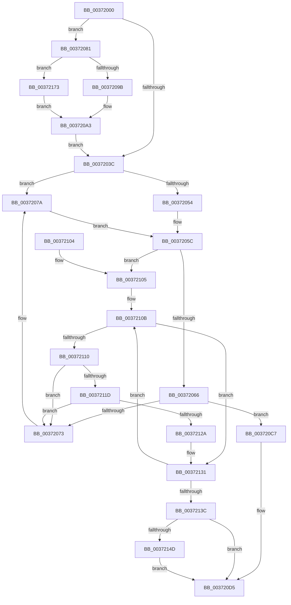

# MiFreeCombineBlock

- RVA: `0x00372000`–`0x00372180` (길이 `384` bytes)
- VA: `0x0000000140372000`
- 실행 섹션: `.text`
- PDB 이름 있음: `예`; PDB Function 태그: `아니요`
- unwind 정보 RVA: `0x0007A9C0`
- 디코드: `106`개 명령, `384/384` bytes 표시
- 미해석 바이트: `0` (있으면 어셈블리에 `.byte`로 보존)

> 이 문서는 커널 이미지의 기계어와 PDB 기호를 분석해 생성했습니다. 4번과 5번은 함수 원형과 자료형을 바이너리 사용 방식에서 추정한 C 해석이며 원본 소스 복구 결과는 아닙니다.

## 1. Dependencies

- 직접 호출 지점: **8**; 고유 호출 대상: **5**
- 직접 호출자로 확인된 함수: **3**
- RIP 상대 이미지 참조: **1**

### Outgoing calls
- `0x00372054` → [ExAcquireSpinLockExclusive](../24/ExAcquireSpinLockExclusive_function_00248690.md) (function, `0x00248690`)
- `0x0037207A` → [ExAcquireSpinLockExclusiveAtDpcLevel](../24/ExAcquireSpinLockExclusiveAtDpcLevel_function_00248E80.md) (function, `0x00248E80`)
- `0x0037209E` → [ExAcquireSpinLockExclusiveAtDpcLevel](../24/ExAcquireSpinLockExclusiveAtDpcLevel_function_00248E80.md) (function, `0x00248E80`)
- `0x003720AD` → [RtlAvlRemoveNode](../29/RtlAvlRemoveNode_function_00296650.md) (function, `0x00296650`)
- `0x003720B8` → [MiReleaseSpinLockExclusive](../24/MiReleaseSpinLockExclusive_function_002482C0.md) (function, `0x002482C0`)
- `0x003720DB` → [MiReleaseSpinLockExclusive](../24/MiReleaseSpinLockExclusive_function_002482C0.md) (function, `0x002482C0`)
- `0x00372169` → [ExQueueWorkItem](../2F/ExQueueWorkItem_function_002F9520.md) (function, `0x002F9520`)
- `0x00372173` → [ExAcquireSpinLockExclusive](../24/ExAcquireSpinLockExclusive_function_00248690.md) (function, `0x00248690`)

### Direct callers
- [MiDecrementCombinedPteEx](../22/MiDecrementCombinedPteEx_function_0022B940.md) at `0x0022B9B9`
- [MiSharePages](../31/MiSharePages_function_00315110.md) at `0x00315A3C`
- [MiDecommitSharedPageTail](MiDecommitSharedPageTail_function_00370240.md) at `0x00370626`

### Static image references
- `0x0037215A` → RVA `0x00492F60` (`MiFreeCombinePool`; read)

## 2. Other-region calls and transfers

- 다른 실행 섹션으로 향하는 call: **0**
- 별도 외부 분기/꼬리 이동을 확인하지 못했습니다.

## 3. Assembly (complete function range)

```asm
00372000  48 89 5C 24 08                  mov qword ptr [rsp + 8], rbx
00372005  48 89 6C 24 10                  mov qword ptr [rsp + 0x10], rbp
0037200A  48 89 74 24 18                  mov qword ptr [rsp + 0x18], rsi
0037200F  57                              push rdi
00372010  41 54                           push r12
00372012  41 55                           push r13
00372014  41 56                           push r14
00372016  41 57                           push r15
00372018  48 83 EC 20                     sub rsp, 0x20
0037201C  48 8B 69 18                     mov rbp, qword ptr [rcx + 0x18]
00372020  48 8B F1                        mov rsi, rcx
00372023  48 81 E6 00 F0 FF FF            and rsi, 0xfffffffffffff000
0037202A  44 8B E2                        mov r12d, edx
0037202D  48 8B D9                        mov rbx, rcx
00372030  41 B5 11                        mov r13b, 0x11
00372033  48 8B 7E 10                     mov rdi, qword ptr [rsi + 0x10]
00372037  48 85 ED                        test rbp, rbp
0037203A  75 45                           jne 0x140372081
0037203C  48 8B 43 30                     mov rax, qword ptr [rbx + 0x30]
00372040  48 8D 6F 58                     lea rbp, [rdi + 0x58]
00372044  48 83 E0 E0                     and rax, 0xffffffffffffffe0
00372048  48 8B CD                        mov rcx, rbp
0037204B  48 89 43 30                     mov qword ptr [rbx + 0x30], rax
0037204F  45 85 E4                        test r12d, r12d
00372052  75 26                           jne 0x14037207a
00372054  E8 37 66 ED FF                  call 0x140248690
00372059  44 8A E8                        mov r13b, al
0037205C  83 46 08 FF                     add dword ptr [rsi + 8], -1
00372060  0F 84 9F 00 00 00               je 0x140372105
00372066  48 8D 47 48                     lea rax, [rdi + 0x48]
0037206A  48 8B 08                        mov rcx, qword ptr [rax]
0037206D  48 39 41 08                     cmp qword ptr [rcx + 8], rax
00372071  74 54                           je 0x1403720c7
00372073  B9 03 00 00 00                  mov ecx, 3
00372078  CD 29                           int 0x29
0037207A  E8 01 6E ED FF                  call 0x140248e80
0037207F  EB DB                           jmp 0x14037205c
00372081  83 E5 0F                        and ebp, 0xf
00372084  48 C1 E5 04                     shl rbp, 4
00372088  4C 8D 75 68                     lea r14, [rbp + 0x68]
0037208C  4C 03 F7                        add r14, rdi
0037208F  49 8B CE                        mov rcx, r14
00372092  45 85 E4                        test r12d, r12d
00372095  0F 84 D8 00 00 00               je 0x140372173
0037209B  45 8A FD                        mov r15b, r13b
0037209E  E8 DD 6D ED FF                  call 0x140248e80
003720A3  48 8D 4D 60                     lea rcx, [rbp + 0x60]
003720A7  48 8B D3                        mov rdx, rbx
003720AA  48 03 CF                        add rcx, rdi
003720AD  E8 9E 45 F2 FF                  call 0x140296650
003720B2  41 8A D7                        mov dl, r15b
003720B5  49 8B CE                        mov rcx, r14
003720B8  E8 03 62 ED FF                  call 0x1402482c0
003720BD  48 83 63 18 00                  and qword ptr [rbx + 0x18], 0
003720C2  E9 75 FF FF FF                  jmp 0x14037203c
003720C7  48 89 0B                        mov qword ptr [rbx], rcx
003720CA  48 89 43 08                     mov qword ptr [rbx + 8], rax
003720CE  48 89 59 08                     mov qword ptr [rcx + 8], rbx
003720D2  48 89 18                        mov qword ptr [rax], rbx
003720D5  41 8A D5                        mov dl, r13b
003720D8  48 8B CD                        mov rcx, rbp
003720DB  E8 E0 61 ED FF                  call 0x1402482c0
003720E0  F0 FF 8F 84 01 00 00            lock dec dword ptr [rdi + 0x184]
003720E7  48 8B 5C 24 50                  mov rbx, qword ptr [rsp + 0x50]
003720EC  48 8B 6C 24 58                  mov rbp, qword ptr [rsp + 0x58]
003720F1  48 8B 74 24 60                  mov rsi, qword ptr [rsp + 0x60]
003720F6  48 83 C4 20                     add rsp, 0x20
003720FA  41 5F                           pop r15
003720FC  41 5E                           pop r14
003720FE  41 5D                           pop r13
00372100  41 5C                           pop r12
00372102  5F                              pop rdi
00372103  C3                              ret
00372104  CC                              int3
00372105  48 8D 4E 48                     lea rcx, [rsi + 0x48]
00372109  33 D2                           xor edx, edx
0037210B  48 3B CB                        cmp rcx, rbx
0037210E  74 21                           je 0x140372131
00372110  4C 8B 01                        mov r8, qword ptr [rcx]
00372113  49 39 48 08                     cmp qword ptr [r8 + 8], rcx
00372117  0F 85 56 FF FF FF               jne 0x140372073
0037211D  48 8B 41 08                     mov rax, qword ptr [rcx + 8]
00372121  48 39 08                        cmp qword ptr [rax], rcx
00372124  0F 85 49 FF FF FF               jne 0x140372073
0037212A  4C 89 00                        mov qword ptr [rax], r8
0037212D  49 89 40 08                     mov qword ptr [r8 + 8], rax
00372131  48 83 C1 48                     add rcx, 0x48
00372135  FF C2                           inc edx
00372137  83 FA 37                        cmp edx, 0x37
0037213A  72 CF                           jb 0x14037210b
0037213C  48 8B 47 18                     mov rax, qword ptr [rdi + 0x18]
00372140  48 89 06                        mov qword ptr [rsi], rax
00372143  48 89 77 18                     mov qword ptr [rdi + 0x18], rsi
00372147  48 83 3E 00                     cmp qword ptr [rsi], 0
0037214B  75 88                           jne 0x1403720d5
0037214D  48 8D 4F 20                     lea rcx, [rdi + 0x20]
00372151  BA 01 00 00 00                  mov edx, 1
00372156  48 83 21 00                     and qword ptr [rcx], 0
0037215A  48 8D 05 FF 0D 12 00            lea rax, [rip + 0x120dff]
00372161  48 89 41 10                     mov qword ptr [rcx + 0x10], rax
00372165  48 89 79 18                     mov qword ptr [rcx + 0x18], rdi
00372169  E8 B2 73 F8 FF                  call 0x1402f9520
0037216E  E9 62 FF FF FF                  jmp 0x1403720d5
00372173  E8 18 65 ED FF                  call 0x140248690
00372178  44 8A F8                        mov r15b, al
0037217B  E9 23 FF FF FF                  jmp 0x1403720a3
```

## 4. C-style interpretation (structured pseudocode)

```c
__int64 __fastcall MiFreeCombineBlock(__int64 a1, int a2)
{
    __int64 result;
    __int64 v_r14;
    __int64 v_rbp;
    __int64 v_rsi;
    __int64 v_rsp;
    unsigned __int64 v_stack_p10;
    unsigned __int64 v_stack_p18;
    unsigned __int64 v_stack_p8;

    v_stack_p8 = v_rbx;
    v_stack_p10 = v_rbp;
    v_stack_p18 = v_rsi;
    v_rsp = (v_rsp) - (32);
    v_rsi = (a1) & (0xFFFFFFFFFFFFF000ULL);
    if (*(unsigned __int64 *)(a1 + 24) != 0) goto loc_00372081;
loc_0037203C:
    result = (*(unsigned __int64 *)(a1 + 48)) & (-32);
    *(unsigned __int64 *)(a1 + 48) = result;
    if ((unsigned int)((unsigned int)(a2)) != 0) goto loc_0037207A;
    result = ExAcquireSpinLockExclusive(*(unsigned __int64 *)(v_rsi + 16) + 88, a2, a3, a4);
loc_0037205C:
    if ((unsigned int)((unsigned int)(a2)) == 0) goto loc_00372105;
    if ((*(unsigned __int64 *)(*(unsigned __int64 *)(*(unsigned __int64 *)(v_rsi + 16) + 72) + 8)) == (*(unsigned __int64 *)(v_rsi + 16) + 72)) goto loc_003720C7;
loc_00372073:
loc_0037207A:
    result = ExAcquireSpinLockExclusiveAtDpcLevel(3, a2, a3, a4);
    goto loc_0037205C;
loc_00372081:
    v_rbp = (unsigned int)((*(unsigned __int64 *)(v_rsi + 16) + 88) & (15));
    v_rbp = (v_rbp) << (4);
    v_r14 = (v_rbp + 104) + (*(unsigned __int64 *)(v_rsi + 16));
    if ((unsigned int)((unsigned int)(a2)) == 0) goto loc_00372173;
    result = ExAcquireSpinLockExclusiveAtDpcLevel(v_r14, a2, a3, a4);
loc_003720A3:
    a1 = (v_rbp + 96) + (*(unsigned __int64 *)(v_rsi + 16));
    result = RtlAvlRemoveNode(a1, a1, a3, a4);
    result = MiReleaseSpinLockExclusive(v_r14, (unsigned __int8)((unsigned __int8)((unsigned __int8)(result))), a3, a4);
    goto loc_0037203C;
loc_003720C7:
    *(unsigned __int64 *)(a1) = v_r14;
    *(unsigned __int64 *)(a1 + 8) = result;
    *(unsigned __int64 *)(v_r14 + 8) = a1;
    *(unsigned __int64 *)(result) = a1;
loc_003720D5:
    result = MiReleaseSpinLockExclusive(v_rbp, (unsigned __int8)((unsigned __int8)(result)), a3, a4);
    v_rsp = (v_rsp) + (32);
    return result;
loc_00372105:
    a2 = 0;
loc_0037210B:
    if ((v_stack_p18 + 72) == v_stack_p8) goto loc_00372131;
    if ((*(unsigned __int64 *)(*(unsigned __int64 *)(v_stack_p18 + 72) + 8)) != (v_stack_p18 + 72)) goto loc_00372073;
    if ((*(unsigned __int64 *)(*(unsigned __int64 *)(v_stack_p18 + 72 + 8))) != (v_stack_p18 + 72)) goto loc_00372073;
    *(unsigned __int64 *)(*(unsigned __int64 *)(v_stack_p18 + 72 + 8)) = *(unsigned __int64 *)(v_stack_p18 + 72);
    *(unsigned __int64 *)(*(unsigned __int64 *)(v_stack_p18 + 72) + 8) = *(unsigned __int64 *)(v_stack_p18 + 72 + 8);
loc_00372131:
    a1 = (v_stack_p18 + 72) + (72);
    a2 = (unsigned int)((a2) + 1);
    if (a2 < 55) goto loc_0037210B;
    *(unsigned __int64 *)(v_stack_p18) = *(unsigned __int64 *)(*(unsigned __int64 *)(v_rsi + 16) + 24);
    *(unsigned __int64 *)(*(unsigned __int64 *)(v_rsi + 16) + 24) = v_stack_p18;
    if ((*(unsigned __int64 *)(v_stack_p18)) != 0) goto loc_003720D5;
    *(unsigned __int64 *)(*(unsigned __int64 *)(v_rsi + 16) + 32 + 16) = v_rip + 1183231;
    *(unsigned __int64 *)(*(unsigned __int64 *)(v_rsi + 16) + 32 + 24) = *(unsigned __int64 *)(v_rsi + 16);
    result = ExQueueWorkItem(*(unsigned __int64 *)(v_rsi + 16) + 32, 1, *(unsigned __int64 *)(v_stack_p18 + 72), a4);
    goto loc_003720D5;
loc_00372173:
    result = ExAcquireSpinLockExclusive(*(unsigned __int64 *)(v_rsi + 16) + 32, 1, *(unsigned __int64 *)(v_stack_p18 + 72), a4);
    goto loc_003720A3;
}
```

## 5. (Beta) C Style

```c
int64_t MiFreeCombineBlock(void *Arg1, int32_t Arg2)
{
    uint8_t *arg1 = (uint8_t *)Arg1;

    int64_t result;
    int64_t local_r14;
    int64_t local_rbp;
    int64_t local_rsi;
    int64_t local_rsp;
    uint64_t v_stack_p10;
    uint64_t v_stack_p18;
    uint64_t v_stack_p8;

    v_stack_p8 = local_rbx;
    v_stack_p10 = local_rbp;
    v_stack_p18 = local_rsi;
    local_rsp = (local_rsp) - (32);
    local_rsi = (Arg1) & (0xFFFFFFFFFFFFF000ULL);
    if (*(uint64_t *)(arg1 + 0x18) != 0) goto loc_00372081;
loc_0037203C:
    result = (*(uint64_t *)(arg1 + 0x30)) & (-32);
    *(uint64_t *)(arg1 + 0x30) = result;
    if ((uint32_t)((uint32_t)(Arg2)) != 0) goto loc_0037207A;
    result = ExAcquireSpinLockExclusive(*(uint64_t *)(local_rsi + 0x10) + 88, Arg2, a3, a4);
loc_0037205C:
    if ((uint32_t)((uint32_t)(Arg2)) == 0) goto loc_00372105;
    if ((*(uint64_t *)(*(uint64_t *)(*(uint64_t *)(local_rsi + 0x10) + 0x48) + 0x8)) == (*(uint64_t *)(local_rsi + 0x10) + 72)) goto loc_003720C7;
loc_00372073:
loc_0037207A:
    result = ExAcquireSpinLockExclusiveAtDpcLevel(3, Arg2, a3, a4);
    goto loc_0037205C;
loc_00372081:
    local_rbp = (uint32_t)((*(uint64_t *)(local_rsi + 0x10) + 88) & (15));
    local_rbp = (local_rbp) << (4);
    local_r14 = (local_rbp + 104) + (*(uint64_t *)(local_rsi + 0x10));
    if ((uint32_t)((uint32_t)(Arg2)) == 0) goto loc_00372173;
    result = ExAcquireSpinLockExclusiveAtDpcLevel(local_r14, Arg2, a3, a4);
loc_003720A3:
    Arg1 = (local_rbp + 96) + (*(uint64_t *)(local_rsi + 0x10));
    result = RtlAvlRemoveNode(Arg1, Arg1, a3, a4);
    result = MiReleaseSpinLockExclusive(local_r14, (uint8_t)((uint8_t)((uint8_t)(result))), a3, a4);
    goto loc_0037203C;
loc_003720C7:
    *(uint64_t *)(arg1) = local_r14;
    *(uint64_t *)(arg1 + 0x8) = result;
    *(void **)(local_r14 + 0x8) = Arg1;
    *(void **)(result) = Arg1;
loc_003720D5:
    result = MiReleaseSpinLockExclusive(local_rbp, (uint8_t)((uint8_t)(result)), a3, a4);
    local_rsp = (local_rsp) + (32);
    return result;
loc_00372105:
    Arg2 = 0;
loc_0037210B:
    if ((v_stack_p18 + 72) == v_stack_p8) goto loc_00372131;
    if ((*(uint64_t *)(*(uint64_t *)(v_stack_p18 + 0x48) + 0x8)) != (v_stack_p18 + 72)) goto loc_00372073;
    if ((*(uint64_t *)(*(uint64_t *)(v_stack_p18 + 0x48 + 0x8))) != (v_stack_p18 + 72)) goto loc_00372073;
    *(uint64_t *)(*(uint64_t *)(v_stack_p18 + 0x48 + 0x8)) = *(uint64_t *)(v_stack_p18 + 0x48);
    *(uint64_t *)(*(uint64_t *)(v_stack_p18 + 0x48) + 0x8) = *(uint64_t *)(v_stack_p18 + 0x48 + 0x8);
loc_00372131:
    Arg1 = (v_stack_p18 + 72) + (72);
    Arg2 = (uint32_t)((Arg2) + 1);
    if (Arg2 < 55) goto loc_0037210B;
    *(uint64_t *)(v_stack_p18) = *(uint64_t *)(*(uint64_t *)(local_rsi + 0x10) + 0x18);
    *(uint64_t *)(*(uint64_t *)(local_rsi + 0x10) + 0x18) = v_stack_p18;
    if ((*(uint64_t *)(v_stack_p18)) != 0) goto loc_003720D5;
    *(uint64_t *)(*(uint64_t *)(local_rsi + 0x10) + 0x20 + 0x10) = v_rip + 1183231;
    *(uint64_t *)(*(uint64_t *)(local_rsi + 0x10) + 0x20 + 0x18) = *(uint64_t *)(local_rsi + 0x10);
    result = ExQueueWorkItem(*(uint64_t *)(local_rsi + 0x10) + 32, 1, *(uint64_t *)(v_stack_p18 + 0x48), a4);
    goto loc_003720D5;
loc_00372173:
    result = ExAcquireSpinLockExclusive(*(uint64_t *)(local_rsi + 0x10) + 32, 1, *(uint64_t *)(v_stack_p18 + 0x48), a4);
    goto loc_003720A3;
}
```

### 관측된 메모리 오프셋

구조체 형식이 확인되지 않은 접근은 인자 기준의 오프셋으로만 기록했습니다.

| 기준 인자 | 오프셋 표현 | 폭 (bit) | 접근 |
|---|---:|---:|---|
| `Arg1` | `+ 0x0` | `64` | `R` |
| `Arg1` | `+ 0x0` | `64` | `W` |
| `Arg1` | `+ 0x8` | `32` | `R/W` |
| `Arg1` | `+ 0x8` | `64` | `W` |
| `Arg1` | `+ 0x10` | `64` | `R` |
| `Arg1` | `+ 0x18` | `64` | `R` |
| `Arg1` | `+ 0x18` | `64` | `R/W` |
| `Arg1` | `+ 0x30` | `64` | `R` |
| `Arg1` | `+ 0x30` | `64` | `W` |
| `Arg1` | `+ 0x48` | `64` | `R` |

## 6. Execution-region graph

[열기: 2D/3D 그래프와 함수 탐색 컨트롤 패널](../../../control-panel.html?section=text&rva=0x00372000&view=graph)

- 2D 그래프는 위에서 아래로 흐르고, 3D 그래프는 빈 공간을 드래그해 회전합니다. Shift+드래그는 이동, 휠은 확대·축소, 함수 노드 선택은 대상 보고서 이동입니다.

### Static fallback


