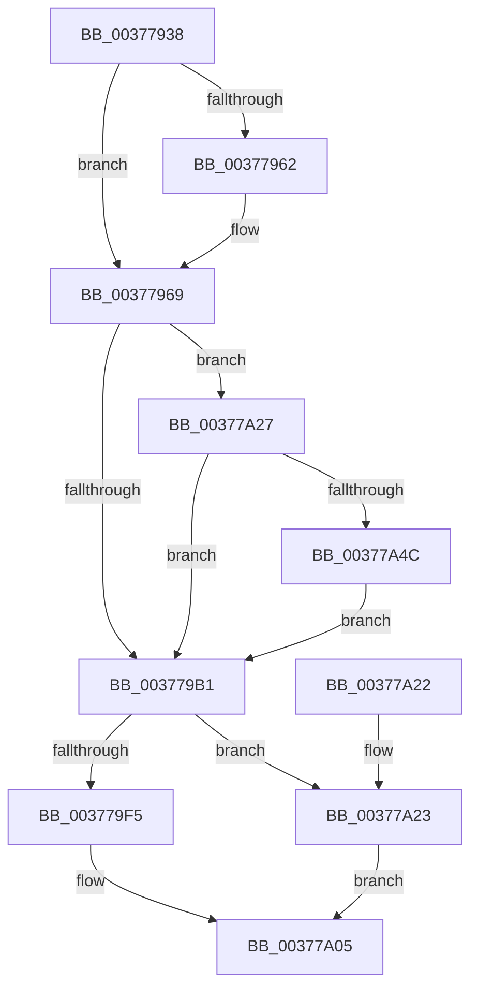

# MiFreeLargePageMemory

- RVA: `0x00377938`–`0x00377A61` (길이 `297` bytes)
- VA: `0x0000000140377938`
- 실행 섹션: `.text`
- PDB 이름 있음: `예`; PDB Function 태그: `아니요`
- unwind 정보 RVA: `0x0007AD6C`
- 디코드: `84`개 명령, `297/297` bytes 표시
- 미해석 바이트: `0` (있으면 어셈블리에 `.byte`로 보존)

> 이 문서는 커널 이미지의 기계어와 PDB 기호를 분석해 생성했습니다. 4번과 5번은 함수 원형과 자료형을 바이너리 사용 방식에서 추정한 C 해석이며 원본 소스 복구 결과는 아닙니다.

## 1. Dependencies

- 직접 호출 지점: **7**; 고유 호출 대상: **7**
- 직접 호출자로 확인된 함수: **8**
- RIP 상대 이미지 참조: **2**

### Outgoing calls
- `0x00377964` → [MiConvertSmallPageRangeToLarge](../34/MiConvertSmallPageRangeToLarge_function_003484DC.md) (function, `0x003484DC`)
- `0x003779DF` → [MiUpdateLargePageBitMap](MiUpdateLargePageBitMap_function_0037619C.md) (function, `0x0037619C`)
- `0x003779EC` → [MiReadyLargePageToFree](MiReadyLargePageToFree_function_00377A68.md) (function, `0x00377A68`)
- `0x00377A00` → [MiFinishLargePageFree](MiFinishLargePageFree_function_00377B94.md) (function, `0x00377B94`)
- `0x00377A2A` → [MiPageToNode](../33/MiPageToNode_function_00338CD0.md) (function, `0x00338CD0`)
- `0x00377A3F` → [MiColdPageSizeSupported](../45/MiColdPageSizeSupported_function_00454588.md) (function, `0x00454588`)
- `0x00377A57` → [MiChangePageHeatImmediate](../44/MiChangePageHeatImmediate_function_00445F5C.md) (function, `0x00445F5C`)

### Direct callers
- [MiFreeLargePages](../2A/MiFreeLargePages_function_002A99D0.md) at `0x002A9E8B`
- [MiFreeSlabEntry](../2D/MiFreeSlabEntry_function_002DC650.md) at `0x002DC865`
- [MiZeroAndReleasePages](MiZeroAndReleasePages_function_003748D0.md) at `0x00374C09`
- [MiCreateSlabEntry](MiCreateSlabEntry_function_00374DEC.md) at `0x0037555E`
- [MiFreeMdlPageRun](MiFreeMdlPageRun_function_00375A4C.md) at `0x00375BE1`
- [MiDecommitLargePoolVa](MiDecommitLargePoolVa_function_00377DD4.md) at `0x00377ECA`
- [MiFreeContiguousPages](../3F/MiFreeContiguousPages_function_003F7178.md) at `0x003F7374`
- [MiFreeBootDriverPages](../../init/C7/MiFreeBootDriverPages_function_00C7695C.md) at `0x00C76B6C`

### Static image references
- `0x0037796B` → RVA `0x00011C60` (`.rdata`; read)
- `0x00377998` → RVA `0x00E30088` (`.data`; read)

## 2. Other-region calls and transfers

- 다른 실행 섹션으로 향하는 call: **0**
- 별도 외부 분기/꼬리 이동을 확인하지 못했습니다.

## 3. Assembly (complete function range)

```asm
00377938  48 89 5C 24 08                  mov qword ptr [rsp + 8], rbx
0037793D  48 89 6C 24 10                  mov qword ptr [rsp + 0x10], rbp
00377942  48 89 74 24 18                  mov qword ptr [rsp + 0x18], rsi
00377947  57                              push rdi
00377948  41 54                           push r12
0037794A  41 55                           push r13
0037794C  41 56                           push r14
0037794E  41 57                           push r15
00377950  48 83 EC 20                     sub rsp, 0x20
00377954  8B FA                           mov edi, edx
00377956  41 8B F0                        mov esi, r8d
00377959  48 8B D9                        mov rbx, rcx
0037795C  41 F6 C0 02                     test r8b, 2
00377960  74 07                           je 0x140377969
00377962  8B D7                           mov edx, edi
00377964  E8 73 0B FD FF                  call 0x1403484dc
00377969  8B EE                           mov ebp, esi
0037796B  4C 8D 2D EE A2 C9 FF            lea r13, [rip - 0x365d12]
00377972  4D 8B 6C FD 00                  mov r13, qword ptr [r13 + rdi*8]
00377977  4C 8D 34 5B                     lea r14, [rbx + rbx*2]
0037797B  F7 D5                           not ebp
0037797D  49 C1 E6 04                     shl r14, 4
00377981  48 B8 00 00 00 00 00 DE FF FF   movabs rax, 0xffffde0000000000
0037798B  4C 03 F0                        add r14, rax
0037798E  41 BF 01 00 00 00               mov r15d, 1
00377994  49 8B 46 28                     mov rax, qword ptr [r14 + 0x28]
00377998  48 8B 0D E9 86 AB 00            mov rcx, qword ptr [rip + 0xab86e9]
0037799F  48 C1 E8 2B                     shr rax, 0x2b
003779A3  25 FF 03 00 00                  and eax, 0x3ff
003779A8  4C 8B 24 C1                     mov r12, qword ptr [rcx + rax*8]
003779AC  41 23 EF                        and ebp, r15d
003779AF  74 76                           je 0x140377a27
003779B1  44 8B CE                        mov r9d, esi
003779B4  41 B8 00 02 00 00               mov r8d, 0x200
003779BA  41 C1 E9 02                     shr r9d, 2
003779BE  48 8B C3                        mov rax, rbx
003779C1  41 83 E1 04                     and r9d, 4
003779C5  48 8B D3                        mov rdx, rbx
003779C8  83 FF 01                        cmp edi, 1
003779CB  49 8B CC                        mov rcx, r12
003779CE  4D 0F 46 C5                     cmovbe r8, r13
003779D2  48 25 00 FE FF FF               and rax, 0xfffffffffffffe00
003779D8  83 FF 01                        cmp edi, 1
003779DB  48 0F 47 D0                     cmova rdx, rax
003779DF  E8 B8 E7 FF FF                  call 0x14037619c
003779E4  44 8B C6                        mov r8d, esi
003779E7  8B D7                           mov edx, edi
003779E9  48 8B CB                        mov rcx, rbx
003779EC  E8 77 00 00 00                  call 0x140377a68
003779F1  85 C0                           test eax, eax
003779F3  74 2E                           je 0x140377a23
003779F5  44 8B CE                        mov r9d, esi
003779F8  45 8B C7                        mov r8d, r15d
003779FB  8B D5                           mov edx, ebp
003779FD  49 8B CE                        mov rcx, r14
00377A00  E8 8F 01 00 00                  call 0x140377b94
00377A05  48 8B 5C 24 50                  mov rbx, qword ptr [rsp + 0x50]
00377A0A  48 8B 6C 24 58                  mov rbp, qword ptr [rsp + 0x58]
00377A0F  48 8B 74 24 60                  mov rsi, qword ptr [rsp + 0x60]
00377A14  48 83 C4 20                     add rsp, 0x20
00377A18  41 5F                           pop r15
00377A1A  41 5E                           pop r14
00377A1C  41 5D                           pop r13
00377A1E  41 5C                           pop r12
00377A20  5F                              pop rdi
00377A21  C3                              ret
00377A22  CC                              int3
00377A23  33 C0                           xor eax, eax
00377A25  EB DE                           jmp 0x140377a05
00377A27  48 8B CB                        mov rcx, rbx
00377A2A  E8 A1 12 FC FF                  call 0x140338cd0
00377A2F  8B C8                           mov ecx, eax
00377A31  48 69 D1 80 DF 00 00            imul rdx, rcx, 0xdf80
00377A38  8B CF                           mov ecx, edi
00377A3A  49 03 54 24 10                  add rdx, qword ptr [r12 + 0x10]
00377A3F  E8 44 CB 0D 00                  call 0x140454588
00377A44  85 C0                           test eax, eax
00377A46  0F 84 65 FF FF FF               je 0x1403779b1
00377A4C  45 33 FF                        xor r15d, r15d
00377A4F  45 33 C0                        xor r8d, r8d
00377A52  8B D7                           mov edx, edi
00377A54  48 8B CB                        mov rcx, rbx
00377A57  E8 00 E5 0C 00                  call 0x140445f5c
00377A5C  E9 50 FF FF FF                  jmp 0x1403779b1
```

## 4. C-style interpretation (structured pseudocode)

```c
__int64 __fastcall MiFreeLargePageMemory(__int64 a1, int a2, int a3)
{
    __int64 result;
    __int64 v_r14;
    __int64 v_r15;
    __int64 v_rbp;
    __int64 v_rsp;
    unsigned __int64 v_stack_p10;
    unsigned __int64 v_stack_p18;
    unsigned __int64 v_stack_p8;

    v_stack_p8 = v_rbx;
    v_stack_p10 = v_rbp;
    v_stack_p18 = v_rsi;
    v_rsp = (v_rsp) - (32);
    if ((((unsigned __int8)(a3)) & (2)) != 0) {
        a2 = (unsigned int)((unsigned int)(a2));
        result = MiConvertSmallPageRangeToLarge(a1, a2, a3, a4);
    }
    v_rbp = (unsigned int)(~((unsigned int)((unsigned int)((unsigned int)(a3)))));
    v_r14 = (a1 + a1 * 2) << (4);
    v_r14 = (v_r14) + (result);
    result = (*(unsigned __int64 *)(v_r14 + 40)) >> (43);
    result = (unsigned int)((result) & (0x3FFULL));
    v_rbp = (unsigned int)((v_rbp) & (1));
    if (condition_is_equal) goto loc_00377A27;
loc_003779B1:
    a4 = (unsigned int)(((unsigned int)((unsigned int)((unsigned int)(a3)))) >> (2));
    a4 = (unsigned int)((a4) & (4));
    a3 = 512;
    if (((unsigned int)((unsigned int)(a2))) <= 1) { a3 = *(unsigned __int64 *)(v_rip - 3562770 + (unsigned int)(a2) * 8); }
    result = (a1) & (-512);
    if (((unsigned int)((unsigned int)(a2))) > 1) { a1 = result; }
    result = MiUpdateLargePageBitMap(*(unsigned __int64 *)(*(unsigned __int64 *)(v_rip + 11241193) + result * 8), a1, a3, a4);
    result = MiReadyLargePageToFree(a1, (unsigned int)((unsigned int)((unsigned int)(a2))), (unsigned int)((unsigned int)((unsigned int)(a3))), a4);
    if ((unsigned int)(result) == 0) goto loc_00377A23;
    result = MiFinishLargePageFree(v_r14, (unsigned int)((unsigned int)(v_rbp)), 1, (unsigned int)((unsigned int)((unsigned int)(a3))));
loc_00377A05:
    v_rsp = (v_rsp) + (32);
    return result;
loc_00377A23:
    result = 0;
    goto loc_00377A05;
loc_00377A27:
    result = MiPageToNode(v_stack_p8, (unsigned int)((unsigned int)(v_rbp)), 1, (unsigned int)((unsigned int)((unsigned int)(a3))));
    a2 = ((unsigned int)((unsigned int)(v_rbp))) * ((unsigned int)((unsigned int)(result)));
    a2 = (a2) + (*(unsigned __int64 *)(*(unsigned __int64 *)(*(unsigned __int64 *)(v_rip + 11241193) + result * 8) + 16));
    result = MiColdPageSizeSupported((unsigned int)((unsigned int)((unsigned int)(a2))), a2, 1, (unsigned int)((unsigned int)((unsigned int)(a3))));
    if ((unsigned int)(result) == 0) goto loc_003779B1;
    v_r15 = 0;
    a3 = 0;
    result = MiChangePageHeatImmediate(v_stack_p8, (unsigned int)((unsigned int)((unsigned int)(a2))), a3, (unsigned int)((unsigned int)((unsigned int)(a3))));
    goto loc_003779B1;
}
```

## 5. (Beta) C Style

```c
int64_t MiFreeLargePageMemory(void *Arg1, int32_t Arg2, int32_t Arg3)
{
    uint8_t *arg1 = (uint8_t *)Arg1;

    int64_t result;
    int64_t local_r14;
    int64_t local_r15;
    int64_t local_rbp;
    int64_t local_rsp;
    uint64_t v_stack_p10;
    uint64_t v_stack_p18;
    uint64_t v_stack_p8;

    v_stack_p8 = local_rbx;
    v_stack_p10 = local_rbp;
    v_stack_p18 = local_rsi;
    local_rsp = (local_rsp) - (32);
    if ((((uint8_t)(Arg3)) & (2)) != 0) {
        Arg2 = (uint32_t)((uint32_t)(Arg2));
        result = MiConvertSmallPageRangeToLarge(Arg1, Arg2, Arg3, a4);
    }
    local_rbp = (uint32_t)(~((uint32_t)((uint32_t)((uint32_t)(Arg3)))));
    local_r14 = (Arg1 + Arg1 * 2) << (4);
    local_r14 = (local_r14) + (result);
    result = (*(uint64_t *)(local_r14 + 0x28)) >> (43);
    result = (uint32_t)((result) & (0x3FFULL));
    local_rbp = (uint32_t)((local_rbp) & (1));
    if (condition_is_equal) goto loc_00377A27;
loc_003779B1:
    a4 = (uint32_t)(((uint32_t)((uint32_t)((uint32_t)(Arg3)))) >> (2));
    a4 = (uint32_t)((a4) & (4));
    Arg3 = 512;
    if (((uint32_t)((uint32_t)(Arg2))) <= 1) { Arg3 = *(uint64_t *)(v_rip - 0x365D12 + (uint32_t)(Arg2) * 8); }
    result = (Arg1) & (-512);
    if (((uint32_t)((uint32_t)(Arg2))) > 1) { Arg1 = result; }
    result = MiUpdateLargePageBitMap(*(uint64_t *)(*(uint64_t *)(v_rip + 0xAB86E9) + result * 8), Arg1, Arg3, a4);
    result = MiReadyLargePageToFree(Arg1, (uint32_t)((uint32_t)((uint32_t)(Arg2))), (uint32_t)((uint32_t)((uint32_t)(Arg3))), a4);
    if ((uint32_t)(result) == 0) goto loc_00377A23;
    result = MiFinishLargePageFree(local_r14, (uint32_t)((uint32_t)(local_rbp)), 1, (uint32_t)((uint32_t)((uint32_t)(Arg3))));
loc_00377A05:
    local_rsp = (local_rsp) + (32);
    return result;
loc_00377A23:
    result = 0;
    goto loc_00377A05;
loc_00377A27:
    result = MiPageToNode(v_stack_p8, (uint32_t)((uint32_t)(local_rbp)), 1, (uint32_t)((uint32_t)((uint32_t)(Arg3))));
    Arg2 = ((uint32_t)((uint32_t)(local_rbp))) * ((uint32_t)((uint32_t)(result)));
    Arg2 = (Arg2) + (*(uint64_t *)(*(uint64_t *)(*(uint64_t *)(v_rip + 0xAB86E9) + result * 8) + 0x10));
    result = MiColdPageSizeSupported((uint32_t)((uint32_t)((uint32_t)(Arg2))), Arg2, 1, (uint32_t)((uint32_t)((uint32_t)(Arg3))));
    if ((uint32_t)(result) == 0) goto loc_003779B1;
    local_r15 = 0;
    Arg3 = 0;
    result = MiChangePageHeatImmediate(v_stack_p8, (uint32_t)((uint32_t)((uint32_t)(Arg2))), Arg3, (uint32_t)((uint32_t)((uint32_t)(Arg3))));
    goto loc_003779B1;
}
```

### 관측된 메모리 오프셋

구조체 형식이 확인되지 않은 접근은 인자 기준의 오프셋으로만 기록했습니다.

| 기준 인자 | 오프셋 표현 | 폭 (bit) | 접근 |
|---|---:|---:|---|
| `Arg1` | `+ 0x0 + rbx*2` | `64` | `R` |

## 6. Execution-region graph

[열기: 2D/3D 그래프와 함수 탐색 컨트롤 패널](../../../control-panel.html?section=text&rva=0x00377938&view=graph)

- 2D 그래프는 위에서 아래로 흐르고, 3D 그래프는 빈 공간을 드래그해 회전합니다. Shift+드래그는 이동, 휠은 확대·축소, 함수 노드 선택은 대상 보고서 이동입니다.

### Static fallback


