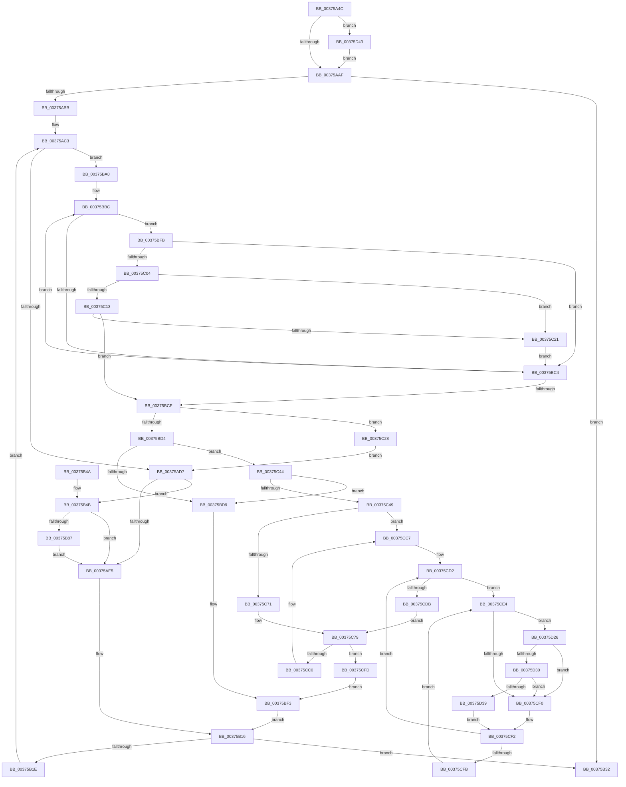

# MiFreeMdlPageRun

- RVA: `0x00375A4C`–`0x00375D4F` (길이 `771` bytes)
- VA: `0x0000000140375A4C`
- 실행 섹션: `.text`
- PDB 이름 있음: `예`; PDB Function 태그: `아니요`
- unwind 정보 RVA: `0x0007ABB4`
- 디코드: `205`개 명령, `771/771` bytes 표시
- 미해석 바이트: `0` (있으면 어셈블리에 `.byte`로 보존)

> 이 문서는 커널 이미지의 기계어와 PDB 기호를 분석해 생성했습니다. 4번과 5번은 함수 원형과 자료형을 바이너리 사용 방식에서 추정한 C 해석이며 원본 소스 복구 결과는 아닙니다.

## 1. Dependencies

- 직접 호출 지점: **11**; 고유 호출 대상: **11**
- 직접 호출자로 확인된 함수: **4**
- RIP 상대 이미지 참조: **5**

### Outgoing calls
- `0x00375AF6` → [MiFreeSmallPageFromMdl](MiFreeSmallPageFromMdl_function_00375D58.md) (function, `0x00375D58`)
- `0x00375B79` → [MiGetPfnSlabType](../28/MiGetPfnSlabType_function_0028E2D0.md) (function, `0x0028E2D0`)
- `0x00375B96` → [MiUpdateLargePageBitMap](MiUpdateLargePageBitMap_function_0037619C.md) (function, `0x0037619C`)
- `0x00375BE1` → [MiFreeLargePageMemory](MiFreeLargePageMemory_function_00377938.md) (function, `0x00377938`)
- `0x00375C0A` → [MiIsPfnRangeFromSlabAllocation](../49/MiIsPfnRangeFromSlabAllocation_function_004952AC.md) (function, `0x004952AC`)
- `0x00375C18` → [MiResidentPageDangleFree](../3F/MiResidentPageDangleFree_function_003F8018.md) (function, `0x003F8018`)
- `0x00375C4E` → [MiConvertSmallPageRangeToLarge](../34/MiConvertSmallPageRangeToLarge_function_003484DC.md) (function, `0x003484DC`)
- `0x00375C74` → [MiLockPageInline](../31/MiLockPageInline_function_0031A340.md) (function, `0x0031A340`)
- `0x00375CA2` → [MiUnlockPage](../31/MiUnlockPage_function_0031A3E0.md) (function, `0x0031A3E0`)
- `0x00375D30` → [KiCheckVpBackingLongSpinWaitHypercall](../30/KiCheckVpBackingLongSpinWaitHypercall_function_0030F490.md) (function, `0x0030F490`)
- `0x00375D3C` → [HvlNotifyLongSpinWait](../30/HvlNotifyLongSpinWait_function_0030F460.md) (function, `0x0030F460`)

### Direct callers
- [MiFreePagesFromMdl](../3F/MiFreePagesFromMdl_function_003F8300.md) at `0x003F8634`
- [MiFreePagesFromMdl](../3F/MiFreePagesFromMdl_function_003F8300.md) at `0x003F86FE`
- [MiFreePartitionPageRun](../69/MiFreePartitionPageRun_function_00690DA0.md) at `0x00690E05`
- [MiDeleteAweInfoPages](../../page/80/MiDeleteAweInfoPages_function_0080AA40.md) at `0x0080ABC9`
- [MiDeleteAweInfoPages](../../page/80/MiDeleteAweInfoPages_function_0080AA40.md) at `0x0080AC6C`
- [MiAllocatePartitionPhysicalPages](../../page/80/MiAllocatePartitionPhysicalPages_function_0080C9D4.md) at `0x0080CDF0`

### Static image references
- `0x00375B65` → RVA `0x00E30088` (`.data`; read)
- `0x00375BA0` → RVA `0x00FC6B30` (`ALMOSTRO`; read)
- `0x00375BA9` → RVA `0x00011C60` (`.rdata`; read)
- `0x00375CE7` → RVA `0x00FC52AC` (`ALMOSTRO`; reference)
- `0x00375D26` → RVA `0x00FC6AB8` (`ALMOSTRO`; read)

## 2. Other-region calls and transfers

- 다른 실행 섹션으로 향하는 call: **0**
- 별도 외부 분기/꼬리 이동을 확인하지 못했습니다.

## 3. Assembly (complete function range)

```asm
00375A4C  48 89 5C 24 08                  mov qword ptr [rsp + 8], rbx
00375A51  44 89 44 24 18                  mov dword ptr [rsp + 0x18], r8d
00375A56  55                              push rbp
00375A57  56                              push rsi
00375A58  57                              push rdi
00375A59  41 54                           push r12
00375A5B  41 55                           push r13
00375A5D  41 56                           push r14
00375A5F  41 57                           push r15
00375A61  48 83 EC 30                     sub rsp, 0x30
00375A65  48 83 CE FF                     or rsi, 0xffffffffffffffff
00375A69  4C 8B E2                        mov r12, rdx
00375A6C  45 8B D8                        mov r11d, r8d
00375A6F  48 89 74 24 28                  mov qword ptr [rsp + 0x28], rsi
00375A74  45 8B F8                        mov r15d, r8d
00375A77  48 8B F9                        mov rdi, rcx
00375A7A  8D 56 02                        lea edx, [rsi + 2]
00375A7D  44 23 DA                        and r11d, edx
00375A80  44 89 5C 24 78                  mov dword ptr [rsp + 0x78], r11d
00375A85  45 8D 53 06                     lea r10d, [r11 + 6]
00375A89  44 0F 20 C0                     mov rax, cr8
00375A8D  3C 02                           cmp al, 2
00375A8F  8D 4E 05                        lea ecx, [rsi + 5]
00375A92  44 8D 76 0D                     lea r14d, [rsi + 0xd]
00375A96  41 8B EA                        mov ebp, r10d
00375A99  44 0F 45 F1                     cmovne r14d, ecx
00375A9D  83 CD 10                        or ebp, 0x10
00375AA0  3C 02                           cmp al, 2
00375AA2  41 0F 45 EA                     cmovne ebp, r10d
00375AA6  44 84 CA                        test dl, r9b
00375AA9  0F 85 94 02 00 00               jne 0x140375d43
00375AAF  33 DB                           xor ebx, ebx
00375AB1  48 89 5C 24 20                  mov qword ptr [rsp + 0x20], rbx
00375AB6  4D 85 E4                        test r12, r12
00375AB9  74 77                           je 0x140375b32
00375ABB  4C 8B AC 24 90 00 00 00         mov r13, qword ptr [rsp + 0x90]
00375AC3  49 B8 00 00 00 00 00 DE FF FF   movabs r8, 0xffffde0000000000
00375ACD  40 F6 C7 0F                     test dil, 0xf
00375AD1  0F 84 C9 00 00 00               je 0x140375ba0
00375AD7  48 8B C7                        mov rax, rdi
00375ADA  48 25 00 FE FF FF               and rax, 0xfffffffffffffe00
00375AE0  48 3B F0                        cmp rsi, rax
00375AE3  75 66                           jne 0x140375b4b
00375AE5  4C 8B 8C 24 90 00 00 00         mov r9, qword ptr [rsp + 0x90]
00375AED  45 8B C6                        mov r8d, r14d
00375AF0  41 8B D7                        mov edx, r15d
00375AF3  48 8B CF                        mov rcx, rdi
00375AF6  E8 5D 02 00 00                  call 0x140375d58
00375AFB  4C 8B AC 24 90 00 00 00         mov r13, qword ptr [rsp + 0x90]
00375B03  48 03 D8                        add rbx, rax
00375B06  BA 01 00 00 00                  mov edx, 1
00375B0B  48 89 5C 24 20                  mov qword ptr [rsp + 0x20], rbx
00375B10  4C 2B E2                        sub r12, rdx
00375B13  44 8B FA                        mov r15d, edx
00375B16  49 03 FF                        add rdi, r15
00375B19  4D 85 E4                        test r12, r12
00375B1C  74 14                           je 0x140375b32
00375B1E  44 8B 5C 24 78                  mov r11d, dword ptr [rsp + 0x78]
00375B23  48 8B 74 24 28                  mov rsi, qword ptr [rsp + 0x28]
00375B28  44 8B BC 24 80 00 00 00         mov r15d, dword ptr [rsp + 0x80]
00375B30  EB 91                           jmp 0x140375ac3
00375B32  48 8B C3                        mov rax, rbx
00375B35  48 8B 5C 24 70                  mov rbx, qword ptr [rsp + 0x70]
00375B3A  48 83 C4 30                     add rsp, 0x30
00375B3E  41 5F                           pop r15
00375B40  41 5E                           pop r14
00375B42  41 5D                           pop r13
00375B44  41 5C                           pop r12
00375B46  5F                              pop rdi
00375B47  5E                              pop rsi
00375B48  5D                              pop rbp
00375B49  C3                              ret
00375B4A  CC                              int3
00375B4B  48 8D 0C 7F                     lea rcx, [rdi + rdi*2]
00375B4F  48 89 44 24 28                  mov qword ptr [rsp + 0x28], rax
00375B54  48 C1 E1 04                     shl rcx, 4
00375B58  48 8B F0                        mov rsi, rax
00375B5B  49 8B C0                        mov rax, r8
00375B5E  48 03 C8                        add rcx, rax
00375B61  48 8B 41 28                     mov rax, qword ptr [rcx + 0x28]
00375B65  48 8B 15 1C A5 AB 00            mov rdx, qword ptr [rip + 0xaba51c]
00375B6C  48 C1 E8 2B                     shr rax, 0x2b
00375B70  25 FF 03 00 00                  and eax, 0x3ff
00375B75  4C 8B 14 C2                     mov r10, qword ptr [rdx + rax*8]
00375B79  E8 52 87 F1 FF                  call 0x14028e2d0
00375B7E  83 F8 09                        cmp eax, 9
00375B81  0F 85 5E FF FF FF               jne 0x140375ae5
00375B87  45 33 C9                        xor r9d, r9d
00375B8A  41 B8 00 02 00 00               mov r8d, 0x200
00375B90  48 8B D6                        mov rdx, rsi
00375B93  49 8B CA                        mov rcx, r10
00375B96  E8 01 06 00 00                  call 0x14037619c
00375B9B  E9 45 FF FF FF                  jmp 0x140375ae5
00375BA0  48 0F BA 25 87 0F C5 00 25      bt qword ptr [rip + 0xc50f87], 0x25
00375BA9  48 8D 0D B0 C0 C9 FF            lea rcx, [rip - 0x363f50]
00375BB0  BE 00 00 00 00                  mov esi, 0
00375BB5  0F 43 F2                        cmovae esi, edx
00375BB8  4C 8D 14 F1                     lea r10, [rcx + rsi*8]
00375BBC  4D 8B 3A                        mov r15, qword ptr [r10]
00375BBF  4D 3B E7                        cmp r12, r15
00375BC2  73 37                           jae 0x140375bfb
00375BC4  03 F2                           add esi, edx
00375BC6  49 83 C2 08                     add r10, 8
00375BCA  83 FE 03                        cmp esi, 3
00375BCD  72 ED                           jb 0x140375bbc
00375BCF  83 FE 03                        cmp esi, 3
00375BD2  73 54                           jae 0x140375c28
00375BD4  45 85 DB                        test r11d, r11d
00375BD7  75 6B                           jne 0x140375c44
00375BD9  44 8B C5                        mov r8d, ebp
00375BDC  8B D6                           mov edx, esi
00375BDE  48 8B CF                        mov rcx, rdi
00375BE1  E8 52 1D 00 00                  call 0x140377938
00375BE6  48 03 D8                        add rbx, rax
00375BE9  BA 01 00 00 00                  mov edx, 1
00375BEE  48 89 5C 24 20                  mov qword ptr [rsp + 0x20], rbx
00375BF3  4D 2B E7                        sub r12, r15
00375BF6  E9 1B FF FF FF                  jmp 0x140375b16
00375BFB  49 8D 47 FF                     lea rax, [r15 - 1]
00375BFF  48 85 C7                        test rdi, rax
00375C02  75 C0                           jne 0x140375bc4
00375C04  49 8B D7                        mov rdx, r15
00375C07  48 8B CF                        mov rcx, rdi
00375C0A  E8 9D F6 11 00                  call 0x1404952ac
00375C0F  85 C0                           test eax, eax
00375C11  75 0E                           jne 0x140375c21
00375C13  8B D6                           mov edx, esi
00375C15  48 8B CF                        mov rcx, rdi
00375C18  E8 FB 23 08 00                  call 0x1403f8018
00375C1D  85 C0                           test eax, eax
00375C1F  75 AE                           jne 0x140375bcf
00375C21  BA 01 00 00 00                  mov edx, 1
00375C26  EB 9C                           jmp 0x140375bc4
00375C28  48 8B 74 24 28                  mov rsi, qword ptr [rsp + 0x28]
00375C2D  44 8B BC 24 80 00 00 00         mov r15d, dword ptr [rsp + 0x80]
00375C35  49 B8 00 00 00 00 00 DE FF FF   movabs r8, 0xffffde0000000000
00375C3F  E9 93 FE FF FF                  jmp 0x140375ad7
00375C44  4D 85 ED                        test r13, r13
00375C47  74 90                           je 0x140375bd9
00375C49  8B D6                           mov edx, esi
00375C4B  48 8B CF                        mov rcx, rdi
00375C4E  E8 89 28 FD FF                  call 0x1403484dc
00375C53  48 8D 1C 7F                     lea rbx, [rdi + rdi*2]
00375C57  48 B8 00 00 00 00 00 DE FF FF   movabs rax, 0xffffde0000000000
00375C61  48 C1 E3 04                     shl rbx, 4
00375C65  48 8B C0                        mov rax, rax
00375C68  48 03 D8                        add rbx, rax
00375C6B  41 F6 C6 08                     test r14b, 8
00375C6F  75 56                           jne 0x140375cc7
00375C71  48 8B CB                        mov rcx, rbx
00375C74  E8 C7 46 FA FF                  call 0x14031a340
00375C79  8B 4B 20                        mov ecx, dword ptr [rbx + 0x20]
00375C7C  8A D0                           mov dl, al
00375C7E  89 8C 24 88 00 00 00            mov dword ptr [rsp + 0x88], ecx
00375C85  C1 E9 10                        shr ecx, 0x10
00375C88  80 E1 FD                        and cl, 0xfd
00375C8B  80 C9 05                        or cl, 5
00375C8E  88 8C 24 8A 00 00 00            mov byte ptr [rsp + 0x8a], cl
00375C95  8B 8C 24 88 00 00 00            mov ecx, dword ptr [rsp + 0x88]
00375C9C  89 4B 20                        mov dword ptr [rbx + 0x20], ecx
00375C9F  48 8B CB                        mov rcx, rbx
00375CA2  E8 39 47 FA FF                  call 0x14031a3e0
00375CA7  48 8B 84 24 90 00 00 00         mov rax, qword ptr [rsp + 0x90]
00375CAF  48 8D 0C 76                     lea rcx, [rsi + rsi*2]
00375CB3  48 8D 04 C8                     lea rax, [rax + rcx*8]
00375CB7  48 8B 48 08                     mov rcx, qword ptr [rax + 8]
00375CBB  48 39 01                        cmp qword ptr [rcx], rax
00375CBE  74 3D                           je 0x140375cfd
00375CC0  B9 03 00 00 00                  mov ecx, 3
00375CC5  CD 29                           int 0x29
00375CC7  C6 84 24 88 00 00 00 11         mov byte ptr [rsp + 0x88], 0x11
00375CCF  45 33 ED                        xor r13d, r13d
00375CD2  F0 48 0F BA 6B 18 3F            lock bts qword ptr [rbx + 0x18], 0x3f
00375CD9  72 09                           jb 0x140375ce4
00375CDB  8A 84 24 88 00 00 00            mov al, byte ptr [rsp + 0x88]
00375CE2  EB 95                           jmp 0x140375c79
00375CE4  41 FF C5                        inc r13d
00375CE7  44 85 2D BE F5 C4 00            test dword ptr [rip + 0xc4f5be], r13d
00375CEE  74 36                           je 0x140375d26
00375CF0  F3 90                           pause
00375CF2  48 8B 43 18                     mov rax, qword ptr [rbx + 0x18]
00375CF6  48 85 C0                        test rax, rax
00375CF9  79 D7                           jns 0x140375cd2
00375CFB  EB E7                           jmp 0x140375ce4
00375CFD  4C 8B AC 24 90 00 00 00         mov r13, qword ptr [rsp + 0x90]
00375D05  BA 01 00 00 00                  mov edx, 1
00375D0A  48 89 03                        mov qword ptr [rbx], rax
00375D0D  48 89 4B 08                     mov qword ptr [rbx + 8], rcx
00375D11  48 89 19                        mov qword ptr [rcx], rbx
00375D14  48 89 58 08                     mov qword ptr [rax + 8], rbx
00375D18  48 01 50 10                     add qword ptr [rax + 0x10], rdx
00375D1C  48 8B 5C 24 20                  mov rbx, qword ptr [rsp + 0x20]
00375D21  E9 CD FE FF FF                  jmp 0x140375bf3
00375D26  8B 05 8C 0D C5 00               mov eax, dword ptr [rip + 0xc50d8c]
00375D2C  A8 40                           test al, 0x40
00375D2E  74 C0                           je 0x140375cf0
00375D30  E8 5B 97 F9 FF                  call 0x14030f490
00375D35  84 C0                           test al, al
00375D37  74 B7                           je 0x140375cf0
00375D39  41 8B CD                        mov ecx, r13d
00375D3C  E8 1F 97 F9 FF                  call 0x14030f460
00375D41  EB AF                           jmp 0x140375cf2
00375D43  83 CD 20                        or ebp, 0x20
00375D46  41 83 CE 10                     or r14d, 0x10
00375D4A  E9 60 FD FF FF                  jmp 0x140375aaf
```

## 4. C-style interpretation (structured pseudocode)

```c
__int64 __fastcall MiFreeMdlPageRun(__int64 a1, __int64 a2, int a3, unsigned __int8 a4, __int64 a5)
{
    __int64 result;
    __int64 v_r10;
    __int64 v_r11;
    __int64 v_r12;
    __int64 v_r13;
    __int64 v_r14;
    __int64 v_rbp;
    __int64 v_rbx;
    __int64 v_rdi;
    __int64 v_rsi;
    __int64 v_rsp;
    unsigned __int64 v_stack_m40;
    unsigned __int64 v_stack_m48;
    unsigned int v_stack_p10;
    unsigned int v_stack_p18;
    unsigned __int64 v_stack_p20;
    unsigned __int64 v_stack_p28;
    unsigned __int64 v_stack_p8;
    unsigned int v_stack_p80;
    unsigned int v_stack_p88;
    unsigned __int8 v_stack_p8A;

    v_stack_p8 = v_rbx;
    v_stack_p18 = a3;
    v_rsp = (v_rsp) - (48);
    v_rsi = (v_rsi) | (-1);
    v_stack_m40 = v_rsi;
    v_r11 = (unsigned int)(((unsigned int)(a3)) & ((unsigned int)(v_rsi + 2)));
    v_stack_p10 = (unsigned int)(v_r11);
    v_r14 = v_rsi + 13;
    if (((unsigned __int8)(v_cr8)) != 2) { v_r14 = (unsigned int)(v_rsi + 5); }
    v_rbp = (unsigned int)(((unsigned int)((unsigned int)(v_r11 + 6))) | (16));
    if (((unsigned __int8)(v_cr8)) != 2) { v_rbp = (unsigned int)(v_r11 + 6); }
    if ((((unsigned __int8)(v_rsi + 2)) & (a4)) != 0) goto loc_00375D43;
loc_00375AAF:
    v_rbx = 0;
    v_stack_m48 = 0;
    if (a2 == 0) goto loc_00375B32;
loc_00375AC3:
    if ((((unsigned __int8)(a1)) & (15)) == 0) goto loc_00375BA0;
loc_00375AD7:
    result = (a1) & (-512);
    if (v_rsi != result) goto loc_00375B4B;
loc_00375AE5:
    result = MiFreeSmallPageFromMdl(a1, (unsigned int)((unsigned int)((unsigned int)(a3))), (unsigned int)((unsigned int)(v_r14)), a5);
    v_rbx = (v_rbx) + (result);
    v_stack_m48 = v_rbx;
    v_r12 = (a2) - (1);
loc_00375B16:
    v_rdi = (a1) + (1);
    if (v_r12 == 0) goto loc_00375B32;
    goto loc_00375AC3;
loc_00375B32:
    v_rsp = (v_rsp) + (48);
    return v_rbx;
loc_00375B4B:
    v_stack_p28 = v_rbx;
    a1 = (v_rdi + v_rdi * 2) << (4);
    a1 = (a1) + ((unsigned int)((unsigned int)(v_r14)));
    result = (*(unsigned __int64 *)(a1 + 40)) >> (43);
    result = (unsigned int)((result) & (0x3FFULL));
    result = MiGetPfnSlabType(a1, *(unsigned __int64 *)(v_rip + 11248924), (unsigned int)((unsigned int)(v_r14)), a5);
    if (((unsigned int)(result)) != 9) goto loc_00375AE5;
    a4 = 0;
    result = MiUpdateLargePageBitMap(*(unsigned __int64 *)(*(unsigned __int64 *)(v_rip + 11248924) + result * 8), v_rbx, 512, a4);
    goto loc_00375AE5;
loc_00375BA0:
    v_rsi = 0;
    if (condition_is_above_or_equal) { v_rsi = (unsigned int)(v_rbx); }
loc_00375BBC:
    if (v_r12 >= (*(unsigned __int64 *)(v_rip - 3555152 + v_rsi * 8))) goto loc_00375BFB;
loc_00375BC4:
    v_rsi = (unsigned int)((v_rsi) + ((unsigned int)(v_rbx)));
    v_r10 = (v_rip - 3555152 + v_rsi * 8) + (8);
    if (((unsigned int)(v_rsi)) < 3) goto loc_00375BBC;
loc_00375BCF:
    if (((unsigned int)(v_rsi)) >= 3) goto loc_00375C28;
    if ((unsigned int)((unsigned int)(v_stack_p10)) != 0) goto loc_00375C44;
loc_00375BD9:
    result = MiFreeLargePageMemory(v_rdi, (unsigned int)((unsigned int)(v_rsi)), (unsigned int)((unsigned int)(v_rbp)), a4);
    v_rbx = (v_stack_p8) + (result);
    v_stack_p20 = v_rbx;
loc_00375BF3:
    v_r12 = (v_r12) - (*(unsigned __int64 *)(v_rip - 3555152 + v_rsi * 8));
    goto loc_00375B16;
loc_00375BFB:
    if (((v_rdi) & (*(unsigned __int64 *)(v_rip - 3555152 + v_rsi * 8) - 1)) != 0) goto loc_00375BC4;
    result = MiIsPfnRangeFromSlabAllocation(v_rdi, *(unsigned __int64 *)(v_rip - 3555152 + v_rsi * 8), (unsigned int)((unsigned int)(v_rbp)), a4);
    if ((unsigned int)(result) != 0) goto loc_00375C21;
    result = MiResidentPageDangleFree(v_rdi, (unsigned int)((unsigned int)(v_rsi)), (unsigned int)((unsigned int)(v_rbp)), a4);
    if ((unsigned int)(result) != 0) goto loc_00375BCF;
loc_00375C21:
    goto loc_00375BC4;
loc_00375C28:
    goto loc_00375AD7;
loc_00375C44:
    if (a5 == 0) goto loc_00375BD9;
    result = MiConvertSmallPageRangeToLarge(v_rdi, (unsigned int)((unsigned int)(v_stack_p28)), (unsigned int)((unsigned int)(v_rbp)), a4);
    v_rbx = (v_rdi + v_rdi * 2) << (4);
    v_rbx = (v_rbx) + (result);
    if ((((unsigned __int8)(v_r14)) & (8)) != 0) goto loc_00375CC7;
    result = MiLockPageInline(v_rbx, (unsigned int)((unsigned int)(v_stack_p28)), (unsigned int)((unsigned int)(v_rbp)), a4);
loc_00375C79:
    v_stack_p88 = (unsigned int)((unsigned int)(*(unsigned int *)(v_rbx + 32)));
    a1 = (unsigned int)(((unsigned int)(*(unsigned int *)(v_rbx + 32))) >> (16));
    a1 = (unsigned __int8)((a1) & (253));
    a1 = (unsigned __int8)((a1) | (5));
    v_stack_p8A = (unsigned __int8)(a1);
    *(unsigned int *)(v_rbx + 32) = (unsigned int)((unsigned int)(v_stack_p88));
    result = MiUnlockPage(v_rbx, (unsigned __int8)(result), (unsigned int)((unsigned int)(v_rbp)), a4);
    if ((*(unsigned __int64 *)(*(unsigned __int64 *)(a5 + v_stack_p28 + v_stack_p28 * 2 * 8 + 8))) == (a5 + v_stack_p28 + v_stack_p28 * 2 * 8)) goto loc_00375CFD;
loc_00375CC7:
    v_stack_p88 = 17;
    v_r13 = 0;
loc_00375CD2:
    if (condition_is_below) goto loc_00375CE4;
    goto loc_00375C79;
loc_00375CE4:
    v_r13 = (unsigned int)((v_r13) + 1);
    if (((*(unsigned int *)(v_rip + 12907966)) & ((unsigned int)(v_r13))) == 0) goto loc_00375D26;
loc_00375CF0:
loc_00375CF2:
    if (!sign_flag) goto loc_00375CD2;
    goto loc_00375CE4;
loc_00375CFD:
    *(unsigned __int64 *)(v_rbx) = *(unsigned __int64 *)(v_rbx + 24);
    *(unsigned __int64 *)(v_rbx + 8) = 3;
    *(unsigned __int64 *)(3) = v_rbx;
    *(unsigned __int64 *)(*(unsigned __int64 *)(v_rbx + 24) + 8) = v_rbx;
    goto loc_00375BF3;
loc_00375D26:
    if ((((unsigned __int8)((unsigned int)(*(unsigned int *)(v_rip + 12914060)))) & (64)) == 0) goto loc_00375CF0;
    result = KiCheckVpBackingLongSpinWaitHypercall(3, 1, (unsigned int)((unsigned int)(v_rbp)), a4);
    if ((unsigned __int8)(result) == 0) goto loc_00375CF0;
    result = HvlNotifyLongSpinWait((unsigned int)((unsigned int)(a5)), 1, (unsigned int)((unsigned int)(v_rbp)), a4);
    goto loc_00375CF2;
loc_00375D43:
    v_rbp = (unsigned int)((v_rbp) | (32));
    v_r14 = (unsigned int)((v_r14) | (16));
    goto loc_00375AAF;
}
```

## 5. (Beta) C Style

```c
int64_t MiFreeMdlPageRun(int64_t Arg1, int64_t Arg2, void *Arg3, uint8_t Arg4, void *Arg5)
{
    uint8_t *arg3 = (uint8_t *)Arg3;
    uint8_t *arg5 = (uint8_t *)Arg5;

    int64_t result;
    int64_t local_r10;
    int64_t local_r11;
    int64_t local_r12;
    int64_t local_r13;
    int64_t local_r14;
    int64_t local_rbp;
    int64_t local_rbx;
    int64_t local_rdi;
    int64_t local_rsi;
    int64_t local_rsp;
    uint64_t v_stack_m40;
    uint64_t v_stack_m48;
    uint32_t v_stack_p10;
    uint32_t v_stack_p18;
    uint64_t v_stack_p20;
    uint64_t v_stack_p28;
    uint64_t v_stack_p8;
    uint32_t v_stack_p80;
    uint32_t v_stack_p88;
    uint8_t v_stack_p8A;

    v_stack_p8 = local_rbx;
    v_stack_p18 = Arg3;
    local_rsp = (local_rsp) - (48);
    local_rsi = (local_rsi) | (-1);
    v_stack_m40 = local_rsi;
    local_r11 = (uint32_t)(((uint32_t)(Arg3)) & ((uint32_t)(local_rsi + 2)));
    v_stack_p10 = (uint32_t)(local_r11);
    local_r14 = local_rsi + 13;
    if (((uint8_t)(v_cr8)) != 2) { local_r14 = (uint32_t)(local_rsi + 5); }
    local_rbp = (uint32_t)(((uint32_t)((uint32_t)(local_r11 + 6))) | (16));
    if (((uint8_t)(v_cr8)) != 2) { local_rbp = (uint32_t)(local_r11 + 6); }
    if ((((uint8_t)(local_rsi + 2)) & (Arg4)) != 0) goto loc_00375D43;
loc_00375AAF:
    local_rbx = 0;
    v_stack_m48 = 0;
    if (Arg2 == 0) goto loc_00375B32;
loc_00375AC3:
    if ((((uint8_t)(Arg1)) & (15)) == 0) goto loc_00375BA0;
loc_00375AD7:
    result = (Arg1) & (-512);
    if (local_rsi != result) goto loc_00375B4B;
loc_00375AE5:
    result = MiFreeSmallPageFromMdl(Arg1, (uint32_t)((uint32_t)((uint32_t)(Arg3))), (uint32_t)((uint32_t)(local_r14)), Arg5);
    local_rbx = (local_rbx) + (result);
    v_stack_m48 = local_rbx;
    local_r12 = (Arg2) - (1);
loc_00375B16:
    local_rdi = (Arg1) + (1);
    if (local_r12 == 0) goto loc_00375B32;
    goto loc_00375AC3;
loc_00375B32:
    local_rsp = (local_rsp) + (48);
    return local_rbx;
loc_00375B4B:
    v_stack_p28 = local_rbx;
    Arg1 = (local_rdi + local_rdi * 2) << (4);
    Arg1 = (Arg1) + ((uint32_t)((uint32_t)(local_r14)));
    result = (*(uint64_t *)(Arg1 + 0x28)) >> (43);
    result = (uint32_t)((result) & (0x3FFULL));
    result = MiGetPfnSlabType(Arg1, *(uint64_t *)(v_rip + 0xABA51C), (uint32_t)((uint32_t)(local_r14)), Arg5);
    if (((uint32_t)(result)) != 9) goto loc_00375AE5;
    Arg4 = 0;
    result = MiUpdateLargePageBitMap(*(uint64_t *)(*(uint64_t *)(v_rip + 0xABA51C) + result * 8), local_rbx, 512, Arg4);
    goto loc_00375AE5;
loc_00375BA0:
    local_rsi = 0;
    if (condition_is_above_or_equal) { local_rsi = (uint32_t)(local_rbx); }
loc_00375BBC:
    if (local_r12 >= (*(uint64_t *)(v_rip - 0x363F50 + local_rsi * 8))) goto loc_00375BFB;
loc_00375BC4:
    local_rsi = (uint32_t)((local_rsi) + ((uint32_t)(local_rbx)));
    local_r10 = (v_rip - 3555152 + local_rsi * 8) + (8);
    if (((uint32_t)(local_rsi)) < 3) goto loc_00375BBC;
loc_00375BCF:
    if (((uint32_t)(local_rsi)) >= 3) goto loc_00375C28;
    if ((uint32_t)((uint32_t)(v_stack_p10)) != 0) goto loc_00375C44;
loc_00375BD9:
    result = MiFreeLargePageMemory(local_rdi, (uint32_t)((uint32_t)(local_rsi)), (uint32_t)((uint32_t)(local_rbp)), Arg4);
    local_rbx = (v_stack_p8) + (result);
    v_stack_p20 = local_rbx;
loc_00375BF3:
    local_r12 = (local_r12) - (*(uint64_t *)(v_rip - 0x363F50 + local_rsi * 8));
    goto loc_00375B16;
loc_00375BFB:
    if (((local_rdi) & (*(uint64_t *)(v_rip - 0x363F50 + local_rsi * 8) - 1)) != 0) goto loc_00375BC4;
    result = MiIsPfnRangeFromSlabAllocation(local_rdi, *(uint64_t *)(v_rip - 0x363F50 + local_rsi * 8), (uint32_t)((uint32_t)(local_rbp)), Arg4);
    if ((uint32_t)(result) != 0) goto loc_00375C21;
    result = MiResidentPageDangleFree(local_rdi, (uint32_t)((uint32_t)(local_rsi)), (uint32_t)((uint32_t)(local_rbp)), Arg4);
    if ((uint32_t)(result) != 0) goto loc_00375BCF;
loc_00375C21:
    goto loc_00375BC4;
loc_00375C28:
    goto loc_00375AD7;
loc_00375C44:
    if (Arg5 == NULL) goto loc_00375BD9;
    result = MiConvertSmallPageRangeToLarge(local_rdi, (uint32_t)((uint32_t)(v_stack_p28)), (uint32_t)((uint32_t)(local_rbp)), Arg4);
    local_rbx = (local_rdi + local_rdi * 2) << (4);
    local_rbx = (local_rbx) + (result);
    if ((((uint8_t)(local_r14)) & (8)) != 0) goto loc_00375CC7;
    result = MiLockPageInline(local_rbx, (uint32_t)((uint32_t)(v_stack_p28)), (uint32_t)((uint32_t)(local_rbp)), Arg4);
loc_00375C79:
    v_stack_p88 = (uint32_t)((uint32_t)(*(uint32_t *)(local_rbx + 0x20)));
    Arg1 = (uint32_t)(((uint32_t)(*(uint32_t *)(local_rbx + 0x20))) >> (16));
    Arg1 = (uint8_t)((Arg1) & (253));
    Arg1 = (uint8_t)((Arg1) | (5));
    v_stack_p8A = (uint8_t)(Arg1);
    *(uint32_t *)(local_rbx + 0x20) = (uint32_t)((uint32_t)(v_stack_p88));
    result = MiUnlockPage(local_rbx, (uint8_t)(result), (uint32_t)((uint32_t)(local_rbp)), Arg4);
    if ((*(uint64_t *)(*(uint64_t *)(arg5 + v_stack_p28 + v_stack_p28 * 2 * 8 + 0x8))) == (Arg5 + v_stack_p28 + v_stack_p28 * 2 * 8)) goto loc_00375CFD;
loc_00375CC7:
    v_stack_p88 = 17;
    local_r13 = 0;
loc_00375CD2:
    if (condition_is_below) goto loc_00375CE4;
    goto loc_00375C79;
loc_00375CE4:
    local_r13 = (uint32_t)((local_r13) + 1);
    if (((*(uint32_t *)(v_rip + 0xC4F5BE)) & ((uint32_t)(local_r13))) == 0) goto loc_00375D26;
loc_00375CF0:
loc_00375CF2:
    if (!sign_flag) goto loc_00375CD2;
    goto loc_00375CE4;
loc_00375CFD:
    *(uint64_t *)(local_rbx) = *(uint64_t *)(local_rbx + 0x18);
    *(uint64_t *)(local_rbx + 0x8) = 3;
    *(uint64_t *)(3) = local_rbx;
    *(uint64_t *)(*(uint64_t *)(local_rbx + 0x18) + 0x8) = local_rbx;
    goto loc_00375BF3;
loc_00375D26:
    if ((((uint8_t)((uint32_t)(*(uint32_t *)(v_rip + 0xC50D8C)))) & (64)) == 0) goto loc_00375CF0;
    result = KiCheckVpBackingLongSpinWaitHypercall(3, 1, (uint32_t)((uint32_t)(local_rbp)), Arg4);
    if ((uint8_t)(result) == 0) goto loc_00375CF0;
    result = HvlNotifyLongSpinWait((uint32_t)((uint32_t)(Arg5)), 1, (uint32_t)((uint32_t)(local_rbp)), Arg4);
    goto loc_00375CF2;
loc_00375D43:
    local_rbp = (uint32_t)((local_rbp) | (32));
    local_r14 = (uint32_t)((local_r14) | (16));
    goto loc_00375AAF;
}
```

### 관측된 메모리 오프셋

구조체 형식이 확인되지 않은 접근은 인자 기준의 오프셋으로만 기록했습니다.

| 기준 인자 | 오프셋 표현 | 폭 (bit) | 접근 |
|---|---:|---:|---|
| `Arg3` | `+ 0x6` | `32` | `R` |
| `Arg5` | `+ 0x0 + rcx*8` | `64` | `R` |
| `Arg5` | `+ 0x8` | `64` | `R` |
| `Arg5` | `+ 0x8` | `64` | `W` |
| `Arg5` | `+ 0x10` | `64` | `R/W` |

## 6. Execution-region graph

[열기: 2D/3D 그래프와 함수 탐색 컨트롤 패널](../../../control-panel.html?section=text&rva=0x00375A4C&view=graph)

- 2D 그래프는 위에서 아래로 흐르고, 3D 그래프는 빈 공간을 드래그해 회전합니다. Shift+드래그는 이동, 휠은 확대·축소, 함수 노드 선택은 대상 보고서 이동입니다.

### Static fallback


