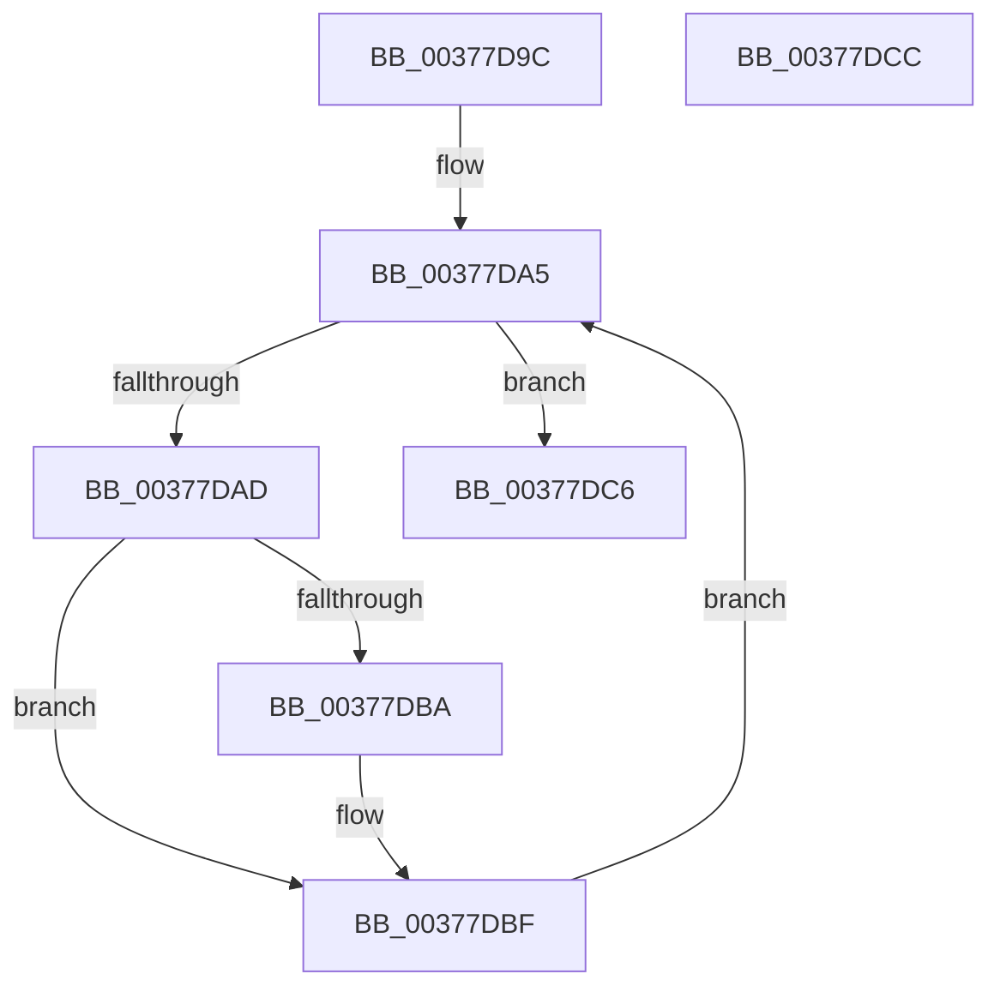

# MiFreePageChain

- RVA: `0x00377D9C`–`0x00377DCD` (길이 `49` bytes)
- VA: `0x0000000140377D9C`
- 실행 섹션: `.text`
- PDB 이름 있음: `예`; PDB Function 태그: `아니요`
- unwind 정보 RVA: `0x0005CF00`
- 디코드: `17`개 명령, `49/49` bytes 표시
- 미해석 바이트: `0` (있으면 어셈블리에 `.byte`로 보존)

> 이 문서는 커널 이미지의 기계어와 PDB 기호를 분석해 생성했습니다. 4번과 5번은 함수 원형과 자료형을 바이너리 사용 방식에서 추정한 C 해석이며 원본 소스 복구 결과는 아닙니다.

## 1. Dependencies

- 직접 호출 지점: **1**; 고유 호출 대상: **1**
- 직접 호출자로 확인된 함수: **4**
- RIP 상대 이미지 참조: **0**

### Outgoing calls
- `0x00377DBF` → [MiReleaseFreshPage](../33/MiReleaseFreshPage_function_00334AE0.md) (function, `0x00334AE0`)

### Direct callers
- [sub_0036CD3D](../36/Unknown_function_0036CD3D.md) at `0x0036CE3A`
- [MiGetPageTablePages](MiGetPageTablePages_function_00376C3C.md) at `0x00376E6A`
- [MiPrefetchReleasePreallocatedPages](../4B/MiPrefetchReleasePreallocatedPages_function_004BE374.md) at `0x004BE399`
- [MiMakeVaRangePhysicallyContiguous](../69/MiMakeVaRangePhysicallyContiguous_function_006936E0.md) at `0x00693992`

### Static image references
- 디코드된 RIP-relative 메모리 참조가 없습니다.

## 2. Other-region calls and transfers

- 다른 실행 섹션으로 향하는 call: **0**
- 별도 외부 분기/꼬리 이동을 확인하지 못했습니다.

## 3. Assembly (complete function range)

```asm
00377D9C  40 53                           push rbx
00377D9E  48 83 EC 20                     sub rsp, 0x20
00377DA2  48 8B D9                        mov rbx, rcx
00377DA5  48 8B 0B                        mov rcx, qword ptr [rbx]
00377DA8  48 85 C9                        test rcx, rcx
00377DAB  74 19                           je 0x140377dc6
00377DAD  48 8B 01                        mov rax, qword ptr [rcx]
00377DB0  48 83 6B 10 01                  sub qword ptr [rbx + 0x10], 1
00377DB5  48 89 03                        mov qword ptr [rbx], rax
00377DB8  75 05                           jne 0x140377dbf
00377DBA  48 83 63 08 00                  and qword ptr [rbx + 8], 0
00377DBF  E8 1C CD FB FF                  call 0x140334ae0
00377DC4  EB DF                           jmp 0x140377da5
00377DC6  48 83 C4 20                     add rsp, 0x20
00377DCA  5B                              pop rbx
00377DCB  C3                              ret
00377DCC  CC                              int3
```

## 4. C-style interpretation (structured pseudocode)

```c
__int64 __fastcall MiFreePageChain(__int64 a1)
{
    __int64 result;
    __int64 v_rsp;

    v_rsp = (v_rsp) - (32);
loc_00377DA5:
    if (*(unsigned __int64 *)(a1) == 0) goto loc_00377DC6;
    *(unsigned __int64 *)(a1) = *(unsigned __int64 *)(*(unsigned __int64 *)(a1));
    if (*(unsigned __int64 *)(a1) == 0) {
    }
    result = MiReleaseFreshPage(*(unsigned __int64 *)(a1), a2, a3, a4);
    goto loc_00377DA5;
loc_00377DC6:
    v_rsp = (v_rsp) + (32);
    return result;
}
```

## 5. (Beta) C Style

```c
int64_t MiFreePageChain(void *Arg1)
{
    uint8_t *arg1 = (uint8_t *)Arg1;

    int64_t result;
    int64_t local_rsp;

    local_rsp = (local_rsp) - (32);
loc_00377DA5:
    if (*(uint64_t *)(arg1) == 0) goto loc_00377DC6;
    *(uint64_t *)(arg1) = *(uint64_t *)(*(uint64_t *)(arg1));
    if (*(uint64_t *)(arg1) == 0) {
    }
    result = MiReleaseFreshPage(*(uint64_t *)(arg1), a2, a3, a4);
    goto loc_00377DA5;
loc_00377DC6:
    local_rsp = (local_rsp) + (32);
    return result;
}
```

### 관측된 메모리 오프셋

구조체 형식이 확인되지 않은 접근은 인자 기준의 오프셋으로만 기록했습니다.

| 기준 인자 | 오프셋 표현 | 폭 (bit) | 접근 |
|---|---:|---:|---|
| `Arg1` | `+ 0x0` | `64` | `R` |
| `Arg1` | `+ 0x0` | `64` | `W` |
| `Arg1` | `+ 0x8` | `64` | `R/W` |
| `Arg1` | `+ 0x10` | `64` | `R/W` |

## 6. Execution-region graph

[열기: 2D/3D 그래프와 함수 탐색 컨트롤 패널](../../../control-panel.html?section=text&rva=0x00377D9C&view=graph)

- 2D 그래프는 위에서 아래로 흐르고, 3D 그래프는 빈 공간을 드래그해 회전합니다. Shift+드래그는 이동, 휠은 확대·축소, 함수 노드 선택은 대상 보고서 이동입니다.

### Static fallback


