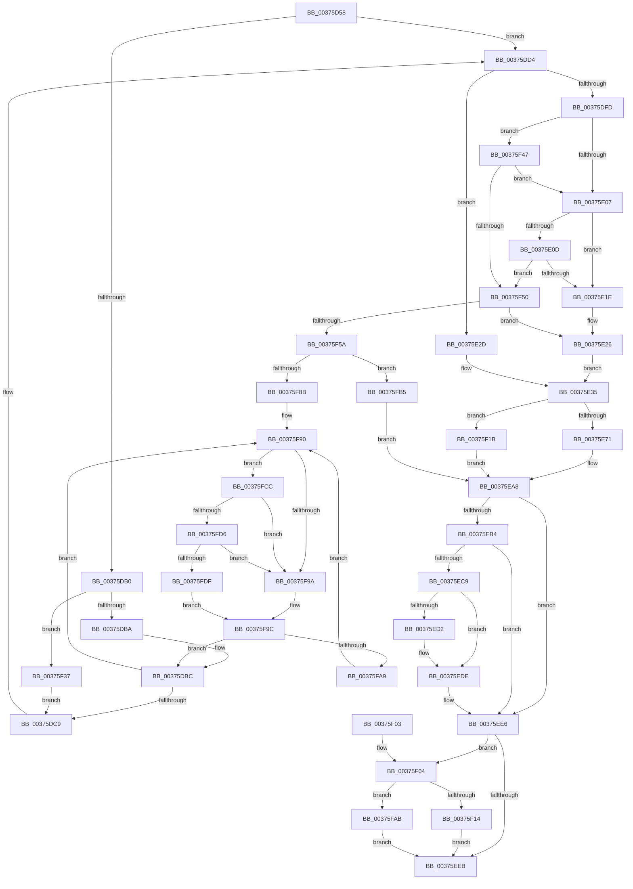

# MiFreeSmallPageFromMdl

- RVA: `0x00375D58`–`0x00375FE8` (길이 `656` bytes)
- VA: `0x0000000140375D58`
- 실행 섹션: `.text`
- PDB 이름 있음: `예`; PDB Function 태그: `아니요`
- unwind 정보 RVA: `0x0007ABD0`
- 디코드: `170`개 명령, `656/656` bytes 표시
- 미해석 바이트: `0` (있으면 어셈블리에 `.byte`로 보존)

> 이 문서는 커널 이미지의 기계어와 PDB 기호를 분석해 생성했습니다. 4번과 5번은 함수 원형과 자료형을 바이너리 사용 방식에서 추정한 C 해석이며 원본 소스 복구 결과는 아닙니다.

## 1. Dependencies

- 직접 호출 지점: **9**; 고유 호출 대상: **9**
- 직접 호출자로 확인된 함수: **3**
- RIP 상대 이미지 참조: **4**

### Outgoing calls
- `0x00375DF4` → [MiIsPfnEnclave](MiIsPfnEnclave_function_00375FF0.md) (function, `0x00375FF0`)
- `0x00375E10` → [MiGetPfnSlabType](../28/MiGetPfnSlabType_function_0028E2D0.md) (function, `0x0028E2D0`)
- `0x00375ED9` → [KiLowerIrqlProcessIrqlFlags](../4F/KiLowerIrqlProcessIrqlFlags_function_004F5698.md) (function, `0x004F5698`)
- `0x00375F14` → [MiReleaseNonPagedResources](../32/MiReleaseNonPagedResources_function_0032299C.md) (function, `0x0032299C`)
- `0x00375F20` → [MiInsertPageInFreeOrZeroedList](../33/MiInsertPageInFreeOrZeroedList_function_00334D20.md) (function, `0x00334D20`)
- `0x00375F3A` → [MiLockPageInline](../31/MiLockPageInline_function_0031A340.md) (function, `0x0031A340`)
- `0x00375FAB` → [MiReleaseNonPagedResourcesNotExposed](../3F/MiReleaseNonPagedResourcesNotExposed_function_003F8258.md) (function, `0x003F8258`)
- `0x00375FD6` → [KiCheckVpBackingLongSpinWaitHypercall](../30/KiCheckVpBackingLongSpinWaitHypercall_function_0030F490.md) (function, `0x0030F490`)
- `0x00375FE1` → [HvlNotifyLongSpinWait](../30/HvlNotifyLongSpinWait_function_0030F460.md) (function, `0x0030F460`)

### Direct callers
- [MiZeroAndReleasePages](MiZeroAndReleasePages_function_003748D0.md) at `0x00374AD5`
- [MiFreeMdlPageRun](MiFreeMdlPageRun_function_00375A4C.md) at `0x00375AF6`
- [MiFreeSecureKernelPage](../3E/MiFreeSecureKernelPage_function_003E9394.md) at `0x003E946C`
- [MiFreeSecureKernelPage](../3E/MiFreeSecureKernelPage_function_003E9394.md) at `0x003E94AC`

### Static image references
- `0x00375DDC` → RVA `0x00E30088` (`.data`; read)
- `0x00375EC9` → RVA `0x00FC6D20` (`ALMOSTRO`; read)
- `0x00375F92` → RVA `0x00FC52AC` (`ALMOSTRO`; reference)
- `0x00375FCC` → RVA `0x00FC6AB8` (`ALMOSTRO`; read)

## 2. Other-region calls and transfers

- 다른 실행 섹션으로 향하는 call: **0**
- 별도 외부 분기/꼬리 이동을 확인하지 못했습니다.

## 3. Assembly (complete function range)

```asm
00375D58  48 89 5C 24 10                  mov qword ptr [rsp + 0x10], rbx
00375D5D  48 89 4C 24 08                  mov qword ptr [rsp + 8], rcx
00375D62  55                              push rbp
00375D63  56                              push rsi
00375D64  57                              push rdi
00375D65  41 54                           push r12
00375D67  41 55                           push r13
00375D69  41 56                           push r14
00375D6B  41 57                           push r15
00375D6D  48 83 EC 30                     sub rsp, 0x30
00375D71  48 8D 1C 49                     lea rbx, [rcx + rcx*2]
00375D75  48 C7 44 24 28 01 00 00 00      mov qword ptr [rsp + 0x28], 1
00375D7E  48 C1 E3 04                     shl rbx, 4
00375D82  4D 8B E9                        mov r13, r9
00375D85  45 8B E0                        mov r12d, r8d
00375D88  44 8B FA                        mov r15d, edx
00375D8B  4C 8B D1                        mov r10, rcx
00375D8E  48 B9 00 00 00 00 00 DE FF FF   movabs rcx, 0xffffde0000000000
00375D98  33 F6                           xor esi, esi
00375D9A  48 03 D9                        add rbx, rcx
00375D9D  41 8B C0                        mov eax, r8d
00375DA0  40 B5 11                        mov bpl, 0x11
00375DA3  44 8D 5E 02                     lea r11d, [rsi + 2]
00375DA7  41 23 C3                        and eax, r11d
00375DAA  89 44 24 20                     mov dword ptr [rsp + 0x20], eax
00375DAE  75 24                           jne 0x140375dd4
00375DB0  41 F6 C4 08                     test r12b, 8
00375DB4  0F 84 7D 01 00 00               je 0x140375f37
00375DBA  33 FF                           xor edi, edi
00375DBC  F0 48 0F BA 6B 18 3F            lock bts qword ptr [rbx + 0x18], 0x3f
00375DC3  0F 82 C7 01 00 00               jb 0x140375f90
00375DC9  4C 8B 54 24 70                  mov r10, qword ptr [rsp + 0x70]
00375DCE  41 BB 02 00 00 00               mov r11d, 2
00375DD4  44 8B 4B 20                     mov r9d, dword ptr [rbx + 0x20]
00375DD8  48 8B 4B 28                     mov rcx, qword ptr [rbx + 0x28]
00375DDC  48 8B 15 A5 A2 AB 00            mov rdx, qword ptr [rip + 0xaba2a5]
00375DE3  48 C1 E9 2B                     shr rcx, 0x2b
00375DE7  81 E1 FF 03 00 00               and ecx, 0x3ff
00375DED  4C 8B 34 CA                     mov r14, qword ptr [rdx + rcx*8]
00375DF1  48 8B CB                        mov rcx, rbx
00375DF4  E8 F7 01 00 00                  call 0x140375ff0
00375DF9  85 C0                           test eax, eax
00375DFB  75 30                           jne 0x140375e2d
00375DFD  41 83 E7 01                     and r15d, 1
00375E01  0F 85 40 01 00 00               jne 0x140375f47
00375E07  41 F6 C4 04                     test r12b, 4
00375E0B  74 11                           je 0x140375e1e
00375E0D  48 8B CB                        mov rcx, rbx
00375E10  E8 BB 84 F1 FF                  call 0x14028e2d0
00375E15  83 F8 09                        cmp eax, 9
00375E18  0F 85 32 01 00 00               jne 0x140375f50
00375E1E  41 F7 DF                        neg r15d
00375E21  1B F6                           sbb esi, esi
00375E23  41 03 F3                        add esi, r11d
00375E26  4C 8B 7C 24 28                  mov r15, qword ptr [rsp + 0x28]
00375E2B  EB 08                           jmp 0x140375e35
00375E2D  45 33 FF                        xor r15d, r15d
00375E30  BE 00 01 00 00                  mov esi, 0x100
00375E35  48 8B 43 18                     mov rax, qword ptr [rbx + 0x18]
00375E39  48 B9 00 00 00 00 00 00 00 C0   movabs rcx, 0xc000000000000000
00375E43  48 23 C1                        and rax, rcx
00375E46  48 89 43 18                     mov qword ptr [rbx + 0x18], rax
00375E4A  8B 43 20                        mov eax, dword ptr [rbx + 0x20]
00375E4D  89 84 24 80 00 00 00            mov dword ptr [rsp + 0x80], eax
00375E54  B8 FE FF 00 00                  mov eax, 0xfffe
00375E59  66 01 84 24 80 00 00 00         add word ptr [rsp + 0x80], ax
00375E61  8B 84 24 80 00 00 00            mov eax, dword ptr [rsp + 0x80]
00375E68  89 43 20                        mov dword ptr [rbx + 0x20], eax
00375E6B  0F 84 AA 00 00 00               je 0x140375f1b
00375E71  8B 43 20                        mov eax, dword ptr [rbx + 0x20]
00375E74  48 B9 00 00 00 00 00 00 00 40   movabs rcx, 0x4000000000000000
00375E7E  89 84 24 80 00 00 00            mov dword ptr [rsp + 0x80], eax
00375E85  C1 E8 10                        shr eax, 0x10
00375E88  0C 07                           or al, 7
00375E8A  88 84 24 82 00 00 00            mov byte ptr [rsp + 0x82], al
00375E91  8B 84 24 80 00 00 00            mov eax, dword ptr [rsp + 0x80]
00375E98  89 43 20                        mov dword ptr [rbx + 0x20], eax
00375E9B  48 8B 43 18                     mov rax, qword ptr [rbx + 0x18]
00375E9F  48 0B C1                        or rax, rcx
00375EA2  48 89 43 18                     mov qword ptr [rbx + 0x18], rax
00375EA6  33 FF                           xor edi, edi
00375EA8  B8 18 00 00 00                  mov eax, 0x18
00375EAD  83 7C 24 20 00                  cmp dword ptr [rsp + 0x20], 0
00375EB2  75 32                           jne 0x140375ee6
00375EB4  48 B9 FF FF FF FF FF FF FF 7F   movabs rcx, 0x7fffffffffffffff
00375EBE  F0 48 21 0C 18                  lock and qword ptr [rax + rbx], rcx
00375EC3  40 80 FD 02                     cmp bpl, 2
00375EC7  73 1D                           jae 0x140375ee6
00375EC9  83 3D 50 0E C5 00 00            cmp dword ptr [rip + 0xc50e50], 0
00375ED0  74 0C                           je 0x140375ede
00375ED2  44 0F 20 C1                     mov rcx, cr8
00375ED6  40 8A D5                        mov dl, bpl
00375ED9  E8 BA F7 17 00                  call 0x1404f5698
00375EDE  40 0F B6 C5                     movzx eax, bpl
00375EE2  44 0F 22 C0                     mov cr8, rax
00375EE6  48 85 FF                        test rdi, rdi
00375EE9  75 19                           jne 0x140375f04
00375EEB  48 8B 5C 24 78                  mov rbx, qword ptr [rsp + 0x78]
00375EF0  48 8B C7                        mov rax, rdi
00375EF3  48 83 C4 30                     add rsp, 0x30
00375EF7  41 5F                           pop r15
00375EF9  41 5E                           pop r14
00375EFB  41 5D                           pop r13
00375EFD  41 5C                           pop r12
00375EFF  5F                              pop rdi
00375F00  5E                              pop rsi
00375F01  5D                              pop rbp
00375F02  C3                              ret
00375F03  CC                              int3
00375F04  48 8B D7                        mov rdx, rdi
00375F07  49 8B CE                        mov rcx, r14
00375F0A  41 F6 C4 10                     test r12b, 0x10
00375F0E  0F 85 97 00 00 00               jne 0x140375fab
00375F14  E8 83 CA FA FF                  call 0x14032299c
00375F19  EB D0                           jmp 0x140375eeb
00375F1B  8B D6                           mov edx, esi
00375F1D  49 8B CA                        mov rcx, r10
00375F20  E8 FB ED FB FF                  call 0x140334d20
00375F25  41 F6 C4 01                     test r12b, 1
00375F29  BF 00 00 00 00                  mov edi, 0
00375F2E  49 0F 44 FF                     cmove rdi, r15
00375F32  E9 71 FF FF FF                  jmp 0x140375ea8
00375F37  48 8B CB                        mov rcx, rbx
00375F3A  E8 01 44 FA FF                  call 0x14031a340
00375F3F  40 8A E8                        mov bpl, al
00375F42  E9 82 FE FF FF                  jmp 0x140375dc9
00375F47  4D 85 ED                        test r13, r13
00375F4A  0F 84 B7 FE FF FF               je 0x140375e07
00375F50  66 45 3B CB                     cmp r9w, r11w
00375F54  0F 85 CC FE FF FF               jne 0x140375e26
00375F5A  8B 43 20                        mov eax, dword ptr [rbx + 0x20]
00375F5D  33 FF                           xor edi, edi
00375F5F  89 84 24 80 00 00 00            mov dword ptr [rsp + 0x80], eax
00375F66  C1 E8 10                        shr eax, 0x10
00375F69  24 FD                           and al, 0xfd
00375F6B  0C 05                           or al, 5
00375F6D  88 84 24 82 00 00 00            mov byte ptr [rsp + 0x82], al
00375F74  8B 84 24 80 00 00 00            mov eax, dword ptr [rsp + 0x80]
00375F7B  89 43 20                        mov dword ptr [rbx + 0x20], eax
00375F7E  49 8D 45 48                     lea rax, [r13 + 0x48]
00375F82  48 8B 48 08                     mov rcx, qword ptr [rax + 8]
00375F86  48 39 01                        cmp qword ptr [rcx], rax
00375F89  74 2A                           je 0x140375fb5
00375F8B  8D 4F 03                        lea ecx, [rdi + 3]
00375F8E  CD 29                           int 0x29
00375F90  FF C7                           inc edi
00375F92  85 3D 14 F3 C4 00               test dword ptr [rip + 0xc4f314], edi
00375F98  74 32                           je 0x140375fcc
00375F9A  F3 90                           pause
00375F9C  48 8B 43 18                     mov rax, qword ptr [rbx + 0x18]
00375FA0  48 85 C0                        test rax, rax
00375FA3  0F 89 13 FE FF FF               jns 0x140375dbc
00375FA9  EB E5                           jmp 0x140375f90
00375FAB  E8 A8 22 08 00                  call 0x1403f8258
00375FB0  E9 36 FF FF FF                  jmp 0x140375eeb
00375FB5  48 89 03                        mov qword ptr [rbx], rax
00375FB8  48 89 4B 08                     mov qword ptr [rbx + 8], rcx
00375FBC  48 89 19                        mov qword ptr [rcx], rbx
00375FBF  48 89 58 08                     mov qword ptr [rax + 8], rbx
00375FC3  49 FF 45 58                     inc qword ptr [r13 + 0x58]
00375FC7  E9 DC FE FF FF                  jmp 0x140375ea8
00375FCC  8B 05 E6 0A C5 00               mov eax, dword ptr [rip + 0xc50ae6]
00375FD2  A8 40                           test al, 0x40
00375FD4  74 C4                           je 0x140375f9a
00375FD6  E8 B5 94 F9 FF                  call 0x14030f490
00375FDB  84 C0                           test al, al
00375FDD  74 BB                           je 0x140375f9a
00375FDF  8B CF                           mov ecx, edi
00375FE1  E8 7A 94 F9 FF                  call 0x14030f460
00375FE6  EB B4                           jmp 0x140375f9c
```

## 4. C-style interpretation (structured pseudocode)

```c
__int64 __fastcall MiFreeSmallPageFromMdl(__int64 a1, int a2, int a3, __int64 a4)
{
    __int64 result;
    __int64 v_r15;
    __int64 v_rbx;
    __int64 v_rdi;
    __int64 v_rsi;
    __int64 v_rsp;
    unsigned __int64 v_stack_m40;
    unsigned int v_stack_m48;
    unsigned __int64 v_stack_p10;
    unsigned int v_stack_p18;
    unsigned __int8 v_stack_p1A;
    unsigned __int64 v_stack_p8;
    unsigned int v_stack_p80;
    unsigned __int8 v_stack_p82;

    v_stack_p10 = v_rbx;
    v_stack_p8 = a1;
    v_rsp = (v_rsp) - (48);
    v_stack_m40 = 1;
    v_rbx = (a1 + a1 * 2) << (4);
    v_rsi = 0;
    v_rbx = (v_rbx) + (a1);
    result = (unsigned int)(((unsigned int)(a3)) & ((unsigned int)(v_rsi + 2)));
    v_stack_m48 = (unsigned int)(result);
    if (condition_is_not_equal) goto loc_00375DD4;
    if ((((unsigned __int8)((unsigned int)(a3))) & (8)) == 0) goto loc_00375F37;
    v_rdi = 0;
loc_00375DBC:
    if (condition_is_below) goto loc_00375F90;
loc_00375DC9:
loc_00375DD4:
    a1 = (*(unsigned __int64 *)(v_rbx + 40)) >> (43);
    a1 = (unsigned int)((a1) & (0x3FFULL));
    result = MiIsPfnEnclave(v_rbx, *(unsigned __int64 *)(v_rip + 11248293), a3, (unsigned int)(*(unsigned int *)(v_rbx + 32)));
    if ((unsigned int)(result) != 0) goto loc_00375E2D;
    v_r15 = (unsigned int)(((unsigned int)(a2)) & (1));
    if (condition_is_not_equal) goto loc_00375F47;
loc_00375E07:
    if ((((unsigned __int8)((unsigned int)(a3))) & (4)) == 0) goto loc_00375E1E;
    result = MiGetPfnSlabType(v_rbx, *(unsigned __int64 *)(v_rip + 11248293), a3, (unsigned int)(*(unsigned int *)(v_rbx + 32)));
    if (((unsigned int)(result)) != 9) goto loc_00375F50;
loc_00375E1E:
    v_r15 = (unsigned int)(-(v_r15));
    v_rsi = (unsigned int)((v_rsi) + (2));
loc_00375E26:
    goto loc_00375E35;
loc_00375E2D:
    v_r15 = 0;
loc_00375E35:
    result = (*(unsigned __int64 *)(v_rbx + 24)) & (v_rbx);
    *(unsigned __int64 *)(v_rbx + 24) = result;
    v_stack_p18 = (unsigned int)((unsigned int)(*(unsigned int *)(v_rbx + 32)));
    *(unsigned int *)(v_rbx + 32) = (unsigned int)((unsigned int)(v_stack_p18));
    if (condition_is_equal) goto loc_00375F1B;
    v_stack_p18 = (unsigned int)((unsigned int)(*(unsigned int *)(v_rbx + 32)));
    result = (unsigned int)(((unsigned int)(*(unsigned int *)(v_rbx + 32))) >> (16));
    result = (unsigned __int8)((result) | (7));
    v_stack_p1A = (unsigned __int8)(result);
    *(unsigned int *)(v_rbx + 32) = (unsigned int)((unsigned int)(v_stack_p18));
    result = (*(unsigned __int64 *)(v_rbx + 24)) | (v_rbx);
    *(unsigned __int64 *)(v_rbx + 24) = result;
    v_rdi = 0;
loc_00375EA8:
    if (v_stack_m48 != 0) goto loc_00375EE6;
    if (17 >= 2) goto loc_00375EE6;
    result = 24;
    if ((*(unsigned int *)(v_rip + 12914256)) != 0) {
        a1 = v_cr8;
        a2 = 17;
        result = KiLowerIrqlProcessIrqlFlags(a1, a2, a3, (unsigned int)(*(unsigned int *)(v_rbx + 32)));
    }
loc_00375EE6:
    if (0 != 0) goto loc_00375F04;
loc_00375EEB:
    v_rsp = (v_rsp) + (48);
    return 0;
loc_00375F04:
    if ((((unsigned __int8)((unsigned int)(a3))) & (16)) != 0) goto loc_00375FAB;
    result = MiReleaseNonPagedResources(*(unsigned __int64 *)(*(unsigned __int64 *)(v_rip + 11248293) + a1 * 8), 0, a3, (unsigned int)(*(unsigned int *)(v_rbx + 32)));
    goto loc_00375EEB;
loc_00375F1B:
    result = MiInsertPageInFreeOrZeroedList(v_stack_p8, 256, a3, (unsigned int)(*(unsigned int *)(v_rbx + 32)));
    v_rdi = 0;
    if ((((unsigned __int8)((unsigned int)(a3))) & (1)) == 0) { v_rdi = 0; }
    goto loc_00375EA8;
loc_00375F37:
    result = MiLockPageInline(v_stack_p10, 256, a3, (unsigned int)(*(unsigned int *)(v_rbx + 32)));
    goto loc_00375DC9;
loc_00375F47:
    if (a4 == 0) goto loc_00375E07;
loc_00375F50:
    if (((unsigned __int16)((unsigned int)(*(unsigned int *)(v_rbx + 32)))) != 2) goto loc_00375E26;
    v_rdi = 0;
    v_stack_p80 = (unsigned int)((unsigned int)(*(unsigned int *)(v_stack_p10 + 32)));
    result = (unsigned int)(((unsigned int)(*(unsigned int *)(v_stack_p10 + 32))) >> (16));
    result = (unsigned __int8)((result) & (253));
    result = (unsigned __int8)((result) | (5));
    v_stack_p82 = (unsigned __int8)(result);
    *(unsigned int *)(v_stack_p10 + 32) = (unsigned int)((unsigned int)(v_stack_p80));
    if ((*(unsigned __int64 *)(*(unsigned __int64 *)(a4 + 72 + 8))) == (a4 + 72)) goto loc_00375FB5;
loc_00375F90:
    v_rdi = (unsigned int)((v_rdi) + 1);
    if (((*(unsigned int *)(v_rip + 12907284)) & ((unsigned int)(v_rdi))) == 0) goto loc_00375FCC;
loc_00375F9A:
loc_00375F9C:
    if (!sign_flag) goto loc_00375DBC;
    goto loc_00375F90;
loc_00375FAB:
    result = MiReleaseNonPagedResourcesNotExposed(v_rdi + 3, 256, a3, (unsigned int)(*(unsigned int *)(v_rbx + 32)));
    goto loc_00375EEB;
loc_00375FB5:
    *(unsigned __int64 *)(v_stack_p10) = result;
    *(unsigned __int64 *)(v_stack_p10 + 8) = v_rdi + 3;
    *(unsigned __int64 *)(v_rdi + 3) = v_stack_p10;
    *(unsigned __int64 *)(result + 8) = v_stack_p10;
    goto loc_00375EA8;
loc_00375FCC:
    if ((((unsigned __int8)((unsigned int)(*(unsigned int *)(v_rip + 12913382)))) & (64)) == 0) goto loc_00375F9A;
    result = KiCheckVpBackingLongSpinWaitHypercall(v_rdi + 3, 256, a3, (unsigned int)(*(unsigned int *)(v_rbx + 32)));
    if ((unsigned __int8)(result) == 0) goto loc_00375F9A;
    result = HvlNotifyLongSpinWait((unsigned int)((unsigned int)(v_rdi)), 256, a3, (unsigned int)(*(unsigned int *)(v_rbx + 32)));
    goto loc_00375F9C;
}
```

## 5. (Beta) C Style

```c
int64_t MiFreeSmallPageFromMdl(void *Arg1, int32_t Arg2, int32_t Arg3, int64_t Arg4)
{
    uint8_t *arg1 = (uint8_t *)Arg1;

    int64_t result;
    int64_t local_r15;
    int64_t local_rbx;
    int64_t local_rdi;
    int64_t local_rsi;
    int64_t local_rsp;
    uint64_t v_stack_m40;
    uint32_t v_stack_m48;
    uint64_t v_stack_p10;
    uint32_t v_stack_p18;
    uint8_t v_stack_p1A;
    uint64_t v_stack_p8;
    uint32_t v_stack_p80;
    uint8_t v_stack_p82;

    v_stack_p10 = local_rbx;
    v_stack_p8 = Arg1;
    local_rsp = (local_rsp) - (48);
    v_stack_m40 = 1;
    local_rbx = (Arg1 + Arg1 * 2) << (4);
    local_rsi = 0;
    local_rbx = (local_rbx) + (Arg1);
    result = (uint32_t)(((uint32_t)(Arg3)) & ((uint32_t)(local_rsi + 2)));
    v_stack_m48 = (uint32_t)(result);
    if (condition_is_not_equal) goto loc_00375DD4;
    if ((((uint8_t)((uint32_t)(Arg3))) & (8)) == 0) goto loc_00375F37;
    local_rdi = 0;
loc_00375DBC:
    if (condition_is_below) goto loc_00375F90;
loc_00375DC9:
loc_00375DD4:
    Arg1 = (*(uint64_t *)(local_rbx + 0x28)) >> (43);
    Arg1 = (uint32_t)((Arg1) & (0x3FFULL));
    result = MiIsPfnEnclave(local_rbx, *(uint64_t *)(v_rip + 0xABA2A5), Arg3, (uint32_t)(*(uint32_t *)(local_rbx + 0x20)));
    if ((uint32_t)(result) != 0) goto loc_00375E2D;
    local_r15 = (uint32_t)(((uint32_t)(Arg2)) & (1));
    if (condition_is_not_equal) goto loc_00375F47;
loc_00375E07:
    if ((((uint8_t)((uint32_t)(Arg3))) & (4)) == 0) goto loc_00375E1E;
    result = MiGetPfnSlabType(local_rbx, *(uint64_t *)(v_rip + 0xABA2A5), Arg3, (uint32_t)(*(uint32_t *)(local_rbx + 0x20)));
    if (((uint32_t)(result)) != 9) goto loc_00375F50;
loc_00375E1E:
    local_r15 = (uint32_t)(-(local_r15));
    local_rsi = (uint32_t)((local_rsi) + (2));
loc_00375E26:
    goto loc_00375E35;
loc_00375E2D:
    local_r15 = 0;
loc_00375E35:
    result = (*(uint64_t *)(local_rbx + 0x18)) & (local_rbx);
    *(uint64_t *)(local_rbx + 0x18) = result;
    v_stack_p18 = (uint32_t)((uint32_t)(*(uint32_t *)(local_rbx + 0x20)));
    *(uint32_t *)(local_rbx + 0x20) = (uint32_t)((uint32_t)(v_stack_p18));
    if (condition_is_equal) goto loc_00375F1B;
    v_stack_p18 = (uint32_t)((uint32_t)(*(uint32_t *)(local_rbx + 0x20)));
    result = (uint32_t)(((uint32_t)(*(uint32_t *)(local_rbx + 0x20))) >> (16));
    result = (uint8_t)((result) | (7));
    v_stack_p1A = (uint8_t)(result);
    *(uint32_t *)(local_rbx + 0x20) = (uint32_t)((uint32_t)(v_stack_p18));
    result = (*(uint64_t *)(local_rbx + 0x18)) | (local_rbx);
    *(uint64_t *)(local_rbx + 0x18) = result;
    local_rdi = 0;
loc_00375EA8:
    if (v_stack_m48 != 0) goto loc_00375EE6;
    if (17 >= 2) goto loc_00375EE6;
    result = 24;
    if ((*(uint32_t *)(v_rip + 0xC50E50)) != 0) {
        Arg1 = v_cr8;
        Arg2 = 17;
        result = KiLowerIrqlProcessIrqlFlags(Arg1, Arg2, Arg3, (uint32_t)(*(uint32_t *)(local_rbx + 0x20)));
    }
loc_00375EE6:
    if (0 != 0) goto loc_00375F04;
loc_00375EEB:
    local_rsp = (local_rsp) + (48);
    return 0;
loc_00375F04:
    if ((((uint8_t)((uint32_t)(Arg3))) & (16)) != 0) goto loc_00375FAB;
    result = MiReleaseNonPagedResources(*(uint64_t *)(*(uint64_t *)(v_rip + 0xABA2A5) + arg1 * 8), 0, Arg3, (uint32_t)(*(uint32_t *)(local_rbx + 0x20)));
    goto loc_00375EEB;
loc_00375F1B:
    result = MiInsertPageInFreeOrZeroedList(v_stack_p8, 256, Arg3, (uint32_t)(*(uint32_t *)(local_rbx + 0x20)));
    local_rdi = 0;
    if ((((uint8_t)((uint32_t)(Arg3))) & (1)) == 0) { local_rdi = 0; }
    goto loc_00375EA8;
loc_00375F37:
    result = MiLockPageInline(v_stack_p10, 256, Arg3, (uint32_t)(*(uint32_t *)(local_rbx + 0x20)));
    goto loc_00375DC9;
loc_00375F47:
    if (Arg4 == 0) goto loc_00375E07;
loc_00375F50:
    if (((uint16_t)((uint32_t)(*(uint32_t *)(local_rbx + 0x20)))) != 2) goto loc_00375E26;
    local_rdi = 0;
    v_stack_p80 = (uint32_t)((uint32_t)(*(uint32_t *)(v_stack_p10 + 0x20)));
    result = (uint32_t)(((uint32_t)(*(uint32_t *)(v_stack_p10 + 0x20))) >> (16));
    result = (uint8_t)((result) & (253));
    result = (uint8_t)((result) | (5));
    v_stack_p82 = (uint8_t)(result);
    *(uint32_t *)(v_stack_p10 + 0x20) = (uint32_t)((uint32_t)(v_stack_p80));
    if ((*(uint64_t *)(*(uint64_t *)(Arg4 + 0x48 + 0x8))) == (Arg4 + 72)) goto loc_00375FB5;
loc_00375F90:
    local_rdi = (uint32_t)((local_rdi) + 1);
    if (((*(uint32_t *)(v_rip + 0xC4F314)) & ((uint32_t)(local_rdi))) == 0) goto loc_00375FCC;
loc_00375F9A:
loc_00375F9C:
    if (!sign_flag) goto loc_00375DBC;
    goto loc_00375F90;
loc_00375FAB:
    result = MiReleaseNonPagedResourcesNotExposed(local_rdi + 3, 256, Arg3, (uint32_t)(*(uint32_t *)(local_rbx + 0x20)));
    goto loc_00375EEB;
loc_00375FB5:
    *(uint64_t *)(v_stack_p10) = result;
    *(uint64_t *)(v_stack_p10 + 0x8) = local_rdi + 3;
    *(uint64_t *)(local_rdi + 0x3) = v_stack_p10;
    *(uint64_t *)(result + 0x8) = v_stack_p10;
    goto loc_00375EA8;
loc_00375FCC:
    if ((((uint8_t)((uint32_t)(*(uint32_t *)(v_rip + 0xC50AE6)))) & (64)) == 0) goto loc_00375F9A;
    result = KiCheckVpBackingLongSpinWaitHypercall(local_rdi + 3, 256, Arg3, (uint32_t)(*(uint32_t *)(local_rbx + 0x20)));
    if ((uint8_t)(result) == 0) goto loc_00375F9A;
    result = HvlNotifyLongSpinWait((uint32_t)((uint32_t)(local_rdi)), 256, Arg3, (uint32_t)(*(uint32_t *)(local_rbx + 0x20)));
    goto loc_00375F9C;
}
```

### 관측된 메모리 오프셋

구조체 형식이 확인되지 않은 접근은 인자 기준의 오프셋으로만 기록했습니다.

| 기준 인자 | 오프셋 표현 | 폭 (bit) | 접근 |
|---|---:|---:|---|
| `Arg1` | `+ 0x0 + rcx*2` | `64` | `R` |

## 6. Execution-region graph

[열기: 2D/3D 그래프와 함수 탐색 컨트롤 패널](../../../control-panel.html?section=text&rva=0x00375D58&view=graph)

- 2D 그래프는 위에서 아래로 흐르고, 3D 그래프는 빈 공간을 드래그해 회전합니다. Shift+드래그는 이동, 휠은 확대·축소, 함수 노드 선택은 대상 보고서 이동입니다.

### Static fallback


