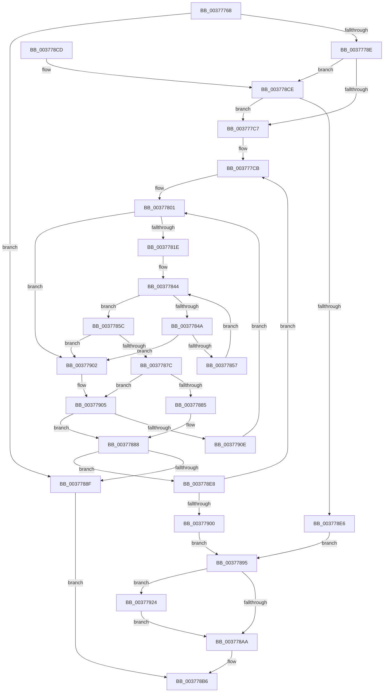

# MiGetPageFromSlabEntry

- RVA: `0x00377768`–`0x00377931` (길이 `457` bytes)
- VA: `0x0000000140377768`
- 실행 섹션: `.text`
- PDB 이름 있음: `예`; PDB Function 태그: `아니요`
- unwind 정보 RVA: `0x0007AD50`
- 디코드: `133`개 명령, `457/457` bytes 표시
- 미해석 바이트: `0` (있으면 어셈블리에 `.byte`로 보존)

> 이 문서는 커널 이미지의 기계어와 PDB 기호를 분석해 생성했습니다. 4번과 5번은 함수 원형과 자료형을 바이너리 사용 방식에서 추정한 C 해석이며 원본 소스 복구 결과는 아닙니다.

## 1. Dependencies

- 직접 호출 지점: **2**; 고유 호출 대상: **1**
- 직접 호출자로 확인된 함수: **4**
- RIP 상대 이미지 참조: **1**

### Outgoing calls
- `0x003778D9` → [RtlInterlockedSetClearRun](RtlInterlockedSetClearRun_function_00377F10.md) (function, `0x00377F10`)
- `0x003778F3` → [RtlInterlockedSetClearRun](RtlInterlockedSetClearRun_function_00377F10.md) (function, `0x00377F10`)

### Direct callers
- [MiGetPageFromSlabAllocator](MiGetPageFromSlabAllocator_function_00377294.md) at `0x0037732B`
- [MiGetPageFromSlabAllocator](MiGetPageFromSlabAllocator_function_00377294.md) at `0x00377399`
- [MiGetPageFromSlabAllocator](MiGetPageFromSlabAllocator_function_00377294.md) at `0x00377556`
- [MiGetPageFromSlabAllocator](MiGetPageFromSlabAllocator_function_00377294.md) at `0x00377749`
- [MiGetPageFromSlabAllocatorByIdentity](../4D/MiGetPageFromSlabAllocatorByIdentity_function_004D50A0.md) at `0x004D5127`
- [MiGetPageFromSlabAllocatorByIdentity](../4D/MiGetPageFromSlabAllocatorByIdentity_function_004D50A0.md) at `0x004D5150`
- [MiDefragmentSlabWorker](../68/MiDefragmentSlabWorker_function_0068D730.md) at `0x0068D88C`
- [sub_006E3F8C](../6E/Unknown_function_006E3F8C.md) at `0x006E4075`

### Static image references
- `0x00377794` → RVA `0x00011C60` (`.rdata`; read)

## 2. Other-region calls and transfers

- 다른 실행 섹션으로 향하는 call: **0**
- 별도 외부 분기/꼬리 이동을 확인하지 못했습니다.

## 3. Assembly (complete function range)

```asm
00377768  48 89 5C 24 10                  mov qword ptr [rsp + 0x10], rbx
0037776D  48 89 6C 24 18                  mov qword ptr [rsp + 0x18], rbp
00377772  56                              push rsi
00377773  57                              push rdi
00377774  41 55                           push r13
00377776  41 56                           push r14
00377778  41 57                           push r15
0037777A  48 83 EC 20                     sub rsp, 0x20
0037777E  83 79 54 00                     cmp dword ptr [rcx + 0x54], 0
00377782  48 8B EA                        mov rbp, rdx
00377785  48 8B F1                        mov rsi, rcx
00377788  0F 84 01 01 00 00               je 0x14037788f
0037778E  8B 82 88 00 00 00               mov eax, dword ptr [rdx + 0x88]
00377794  48 8D 0D C5 A4 C9 FF            lea rcx, [rip - 0x365b3b]
0037779B  48 C1 E8 04                     shr rax, 4
0037779F  4C 8D 76 40                     lea r14, [rsi + 0x40]
003777A3  83 E0 03                        and eax, 3
003777A6  8B 04 C1                        mov eax, dword ptr [rcx + rax*8]
003777A9  8B 4E 50                        mov ecx, dword ptr [rsi + 0x50]
003777AC  3B C8                           cmp ecx, eax
003777AE  1B C0                           sbb eax, eax
003777B0  23 C1                           and eax, ecx
003777B2  8B F8                           mov edi, eax
003777B4  48 8B 46 48                     mov rax, qword ptr [rsi + 0x48]
003777B8  48 0F A3 38                     bt qword ptr [rax], rdi
003777BC  0F 92 C0                        setb al
003777BF  84 C0                           test al, al
003777C1  0F 84 07 01 00 00               je 0x1403778ce
003777C7  41 83 CD FF                     or r13d, 0xffffffff
003777CB  45 8B 1E                        mov r11d, dword ptr [r14]
003777CE  44 8D 7F 01                     lea r15d, [rdi + 1]
003777D2  49 8B 7E 08                     mov rdi, qword ptr [r14 + 8]
003777D6  48 8B CF                        mov rcx, rdi
003777D9  83 E1 04                        and ecx, 4
003777DC  8B C1                           mov eax, ecx
003777DE  41 8D 53 FF                     lea edx, [r11 - 1]
003777E2  48 F7 D8                        neg rax
003777E5  45 1B C9                        sbb r9d, r9d
003777E8  41 83 E1 20                     and r9d, 0x20
003777EC  45 3B FB                        cmp r15d, r11d
003777EF  45 1B C0                        sbb r8d, r8d
003777F2  45 23 C7                        and r8d, r15d
003777F5  48 F7 D9                        neg rcx
003777F8  48 1B C0                        sbb rax, rax
003777FB  83 E0 04                        and eax, 4
003777FE  48 2B F8                        sub rdi, rax
00377801  83 64 24 50 00                  and dword ptr [rsp + 0x50], 0
00377806  45 8D 14 11                     lea r10d, [r9 + rdx]
0037780A  41 8B C2                        mov eax, r10d
0037780D  43 8D 0C 01                     lea ecx, [r9 + r8]
00377811  2B C1                           sub eax, ecx
00377813  FF C0                           inc eax
00377815  83 F8 01                        cmp eax, 1
00377818  0F 82 E4 00 00 00               jb 0x140377902
0037781E  41 8B C2                        mov eax, r10d
00377821  48 C1 E8 06                     shr rax, 6
00377825  48 8D 14 C7                     lea rdx, [rdi + rax*8]
00377829  8B C1                           mov eax, ecx
0037782B  48 C1 E8 06                     shr rax, 6
0037782F  80 E1 3F                        and cl, 0x3f
00377832  48 8D 1C C7                     lea rbx, [rdi + rax*8]
00377836  B8 01 00 00 00                  mov eax, 1
0037783B  48 D3 E0                        shl rax, cl
0037783E  48 FF C8                        dec rax
00377841  48 0B 03                        or rax, qword ptr [rbx]
00377844  48 83 F8 FF                     cmp rax, -1
00377848  75 12                           jne 0x14037785c
0037784A  48 83 C3 08                     add rbx, 8
0037784E  48 3B DA                        cmp rbx, rdx
00377851  0F 87 AB 00 00 00               ja 0x140377902
00377857  48 8B 03                        mov rax, qword ptr [rbx]
0037785A  EB E8                           jmp 0x140377844
0037785C  48 2B DF                        sub rbx, rdi
0037785F  48 F7 D0                        not rax
00377862  48 0F BC C0                     bsf rax, rax
00377866  48 C1 FB 03                     sar rbx, 3
0037786A  C1 E3 06                        shl ebx, 6
0037786D  03 D8                           add ebx, eax
0037786F  89 44 24 50                     mov dword ptr [rsp + 0x50], eax
00377873  41 3B DA                        cmp ebx, r10d
00377876  0F 87 86 00 00 00               ja 0x140377902
0037787C  41 3B DD                        cmp ebx, r13d
0037787F  0F 84 80 00 00 00               je 0x140377905
00377885  41 2B D9                        sub ebx, r9d
00377888  8B FB                           mov edi, ebx
0037788A  41 3B DD                        cmp ebx, r13d
0037788D  75 59                           jne 0x1403778e8
0037788F  48 83 C8 FF                     or rax, 0xffffffffffffffff
00377893  EB 21                           jmp 0x1403778b6
00377895  F0 FF 4E 54                     lock dec dword ptr [rsi + 0x54]
00377899  F0 FF 4D 60                     lock dec dword ptr [rbp + 0x60]
0037789D  83 BD 80 00 00 00 08            cmp dword ptr [rbp + 0x80], 8
003778A4  48 8B 45 18                     mov rax, qword ptr [rbp + 0x18]
003778A8  74 7A                           je 0x140377924
003778AA  8D 47 01                        lea eax, [rdi + 1]
003778AD  89 46 50                        mov dword ptr [rsi + 0x50], eax
003778B0  8B C7                           mov eax, edi
003778B2  48 03 46 28                     add rax, qword ptr [rsi + 0x28]
003778B6  48 8B 5C 24 58                  mov rbx, qword ptr [rsp + 0x58]
003778BB  48 8B 6C 24 60                  mov rbp, qword ptr [rsp + 0x60]
003778C0  48 83 C4 20                     add rsp, 0x20
003778C4  41 5F                           pop r15
003778C6  41 5E                           pop r14
003778C8  41 5D                           pop r13
003778CA  5F                              pop rdi
003778CB  5E                              pop rsi
003778CC  C3                              ret
003778CD  CC                              int3
003778CE  41 B8 01 00 00 00               mov r8d, 1
003778D4  8B D7                           mov edx, edi
003778D6  49 8B CE                        mov rcx, r14
003778D9  E8 32 06 00 00                  call 0x140377f10
003778DE  85 C0                           test eax, eax
003778E0  0F 84 E1 FE FF FF               je 0x1403777c7
003778E6  EB AD                           jmp 0x140377895
003778E8  41 B8 01 00 00 00               mov r8d, 1
003778EE  8B D3                           mov edx, ebx
003778F0  49 8B CE                        mov rcx, r14
003778F3  E8 18 06 00 00                  call 0x140377f10
003778F8  85 C0                           test eax, eax
003778FA  0F 84 CB FE FF FF               je 0x1403777cb
00377900  EB 93                           jmp 0x140377895
00377902  41 8B DD                        mov ebx, r13d
00377905  45 85 C0                        test r8d, r8d
00377908  0F 84 7A FF FF FF               je 0x140377888
0037790E  41 8D 57 01                     lea edx, [r15 + 1]
00377912  41 3B D3                        cmp edx, r11d
00377915  41 0F 47 D3                     cmova edx, r11d
00377919  41 03 D5                        add edx, r13d
0037791C  45 33 C0                        xor r8d, r8d
0037791F  E9 DD FE FF FF                  jmp 0x140377801
00377924  F0 48 FF 88 80 47 00 00         lock dec qword ptr [rax + 0x4780]
0037792C  E9 79 FF FF FF                  jmp 0x1403778aa
```

## 4. C-style interpretation (structured pseudocode)

```c
__int64 __fastcall MiGetPageFromSlabEntry(__int64 a1, __int64 a2, int a3, int a4)
{
    __int64 result;
    __int64 v_r13;
    __int64 v_rbx;
    __int64 v_rdi;
    __int64 v_rsp;
    unsigned __int64 v_stack_p10;
    unsigned __int64 v_stack_p18;
    unsigned int v_stack_p8;

    v_stack_p10 = v_rbx;
    v_stack_p18 = v_rbp;
    v_rsp = (v_rsp) - (32);
    if ((*(unsigned int *)(a1 + 84)) == 0) goto loc_0037788F;
    result = ((unsigned int)(*(unsigned int *)(a2 + 136))) >> (4);
    result = (unsigned int)((result) & (3));
    result = (unsigned int)(((unsigned int)(*(unsigned int *)(v_rip - 3562299 + result * 8))) & ((unsigned int)((unsigned int)(*(unsigned int *)(a1 + 80)))));
    result = (condition_is_below) ? 1 : 0;
    if ((unsigned __int8)(result) == 0) goto loc_003778CE;
loc_003777C7:
    v_r13 = (unsigned int)((v_r13) | (0xFFFFFFFFULL));
loc_003777CB:
    a1 = (unsigned int)((*(unsigned __int64 *)(a1 + 64 + 8)) & (4));
    result = -((unsigned int)((unsigned int)(a1)));
    a4 = (unsigned int)((a4) & (32));
    a3 = (unsigned int)((a3) & ((unsigned int)((unsigned int)((unsigned int)(result)) + 1)));
    a1 = -(a1);
    result = (unsigned int)((result) & (4));
    v_rdi = (*(unsigned __int64 *)(a1 + 64 + 8)) - (result);
loc_00377801:
    result = (unsigned int)(((unsigned int)((unsigned int)(a4 + (unsigned int)(*(unsigned int *)(a1 + 64)) - 1 * 1))) - ((unsigned int)(a4 + a3 * 1)));
    result = (unsigned int)((result) + 1);
    if (((unsigned int)(result)) < 1) goto loc_00377902;
    result = ((unsigned int)((unsigned int)(a4 + (unsigned int)(*(unsigned int *)(a1 + 64)) - 1 * 1))) >> (6);
    result = ((unsigned int)((unsigned int)(a4 + a3 * 1))) >> (6);
    a1 = (unsigned __int8)((a4 + a3 * 1) & (63));
    result = (1) << ((unsigned __int8)(a1));
    result = (result) - 1;
    result = (result) | (*(unsigned __int64 *)(v_rdi + result * 8));
loc_00377844:
    if (result != -1) goto loc_0037785C;
    v_rbx = (v_rdi + result * 8) + (8);
    if (v_rbx > (v_rdi + result * 8)) goto loc_00377902;
    goto loc_00377844;
loc_0037785C:
    v_rbx = (v_rbx) - (v_rdi);
    result = ~(*(unsigned __int64 *)(v_rbx));
    v_rbx = (v_rbx) >> (3);
    v_rbx = (unsigned int)((v_rbx) << (6));
    v_rbx = (unsigned int)((v_rbx) + ((unsigned int)(result)));
    v_stack_p8 = (unsigned int)(result);
    if (((unsigned int)(v_rbx)) > ((unsigned int)(a4 + (unsigned int)(*(unsigned int *)(a1 + 64)) - 1 * 1))) goto loc_00377902;
    if (((unsigned int)(v_rbx)) == ((unsigned int)(v_r13))) goto loc_00377905;
    v_rbx = (unsigned int)((v_rbx) - (a4));
loc_00377888:
    if (((unsigned int)(v_rbx)) != ((unsigned int)(v_r13))) goto loc_003778E8;
loc_0037788F:
    result = (result) | (-1);
    goto loc_003778B6;
loc_00377895:
    if ((*(unsigned int *)(a2 + 128)) == 8) goto loc_00377924;
loc_003778AA:
    *(unsigned int *)(a1 + 80) = (unsigned int)((unsigned int)((unsigned int)(v_rbx)) + 1);
    result = ((unsigned int)((unsigned int)((unsigned int)((unsigned int)(v_rbx))))) + (*(unsigned __int64 *)(a1 + 40));
loc_003778B6:
    v_rsp = (v_rsp) + (32);
    return result;
loc_003778CE:
    result = RtlInterlockedSetClearRun(a1 + 64, (unsigned int)((unsigned int)((unsigned int)((unsigned int)(v_rbx)))), 1, a4);
    if ((unsigned int)(result) == 0) goto loc_003777C7;
    goto loc_00377895;
loc_003778E8:
    result = RtlInterlockedSetClearRun(a1 + 64, (unsigned int)((unsigned int)(v_stack_p10)), 1, a4);
    if ((unsigned int)(result) == 0) goto loc_003777CB;
    goto loc_00377895;
loc_00377902:
loc_00377905:
    if (1 == 0) goto loc_00377888;
    a2 = (unsigned int)((unsigned int)(result)) + 1 + 1;
    if (((unsigned int)((unsigned int)((unsigned int)(result)) + 1 + 1)) > ((unsigned int)((unsigned int)(*(unsigned int *)(a1 + 64))))) { a2 = (unsigned int)((unsigned int)(*(unsigned int *)(a1 + 64))); }
    a2 = (unsigned int)((a2) + ((unsigned int)(v_r13)));
    a3 = 0;
    goto loc_00377801;
loc_00377924:
    goto loc_003778AA;
}
```

## 5. (Beta) C Style

```c
int64_t MiGetPageFromSlabEntry(void *Arg1, void *Arg2, int32_t Arg3, int32_t Arg4)
{
    uint8_t *arg1 = (uint8_t *)Arg1;
    uint8_t *arg2 = (uint8_t *)Arg2;

    int64_t result;
    int64_t local_r13;
    int64_t local_rbx;
    int64_t local_rdi;
    int64_t local_rsp;
    uint64_t v_stack_p10;
    uint64_t v_stack_p18;
    uint32_t v_stack_p8;

    v_stack_p10 = local_rbx;
    v_stack_p18 = local_rbp;
    local_rsp = (local_rsp) - (32);
    if ((*(uint32_t *)(arg1 + 0x54)) == 0) goto loc_0037788F;
    result = ((uint32_t)(*(uint32_t *)(arg2 + 0x88))) >> (4);
    result = (uint32_t)((result) & (3));
    result = (uint32_t)(((uint32_t)(*(uint32_t *)(v_rip - 0x365B3B + result * 8))) & ((uint32_t)((uint32_t)(*(uint32_t *)(arg1 + 0x50)))));
    result = (condition_is_below) ? 1 : 0;
    if ((uint8_t)(result) == 0) goto loc_003778CE;
loc_003777C7:
    local_r13 = (uint32_t)((local_r13) | (0xFFFFFFFFULL));
loc_003777CB:
    Arg1 = (uint32_t)((*(uint64_t *)(arg1 + 0x40 + 0x8)) & (4));
    result = -((uint32_t)((uint32_t)(Arg1)));
    Arg4 = (uint32_t)((Arg4) & (32));
    Arg3 = (uint32_t)((Arg3) & ((uint32_t)((uint32_t)((uint32_t)(result)) + 1)));
    Arg1 = -(Arg1);
    result = (uint32_t)((result) & (4));
    local_rdi = (*(uint64_t *)(arg1 + 0x40 + 0x8)) - (result);
loc_00377801:
    result = (uint32_t)(((uint32_t)((uint32_t)(Arg4 + (uint32_t)(*(uint32_t *)(arg1 + 0x40)) - 1 * 1))) - ((uint32_t)(Arg4 + Arg3 * 1)));
    result = (uint32_t)((result) + 1);
    if (((uint32_t)(result)) < 1) goto loc_00377902;
    result = ((uint32_t)((uint32_t)(Arg4 + (uint32_t)(*(uint32_t *)(arg1 + 0x40)) - 1 * 1))) >> (6);
    result = ((uint32_t)((uint32_t)(Arg4 + Arg3 * 1))) >> (6);
    Arg1 = (uint8_t)((Arg4 + Arg3 * 1) & (63));
    result = (1) << ((uint8_t)(Arg1));
    result = (result) - 1;
    result = (result) | (*(uint64_t *)(local_rdi + result * 8));
loc_00377844:
    if (result != -1) goto loc_0037785C;
    local_rbx = (local_rdi + result * 8) + (8);
    if (local_rbx > (local_rdi + result * 8)) goto loc_00377902;
    goto loc_00377844;
loc_0037785C:
    local_rbx = (local_rbx) - (local_rdi);
    result = ~(*(uint64_t *)(local_rbx));
    local_rbx = (local_rbx) >> (3);
    local_rbx = (uint32_t)((local_rbx) << (6));
    local_rbx = (uint32_t)((local_rbx) + ((uint32_t)(result)));
    v_stack_p8 = (uint32_t)(result);
    if (((uint32_t)(local_rbx)) > ((uint32_t)(Arg4 + (uint32_t)(*(uint32_t *)(arg1 + 0x40)) - 1 * 1))) goto loc_00377902;
    if (((uint32_t)(local_rbx)) == ((uint32_t)(local_r13))) goto loc_00377905;
    local_rbx = (uint32_t)((local_rbx) - (Arg4));
loc_00377888:
    if (((uint32_t)(local_rbx)) != ((uint32_t)(local_r13))) goto loc_003778E8;
loc_0037788F:
    result = (result) | (-1);
    goto loc_003778B6;
loc_00377895:
    if ((*(uint32_t *)(arg2 + 0x80)) == 8) goto loc_00377924;
loc_003778AA:
    *(uint32_t *)(arg1 + 0x50) = (uint32_t)((uint32_t)((uint32_t)(local_rbx)) + 1);
    result = ((uint32_t)((uint32_t)((uint32_t)((uint32_t)(local_rbx))))) + (*(uint64_t *)(arg1 + 0x28));
loc_003778B6:
    local_rsp = (local_rsp) + (32);
    return result;
loc_003778CE:
    result = RtlInterlockedSetClearRun(Arg1 + 64, (uint32_t)((uint32_t)((uint32_t)((uint32_t)(local_rbx)))), 1, Arg4);
    if ((uint32_t)(result) == 0) goto loc_003777C7;
    goto loc_00377895;
loc_003778E8:
    result = RtlInterlockedSetClearRun(Arg1 + 64, (uint32_t)((uint32_t)(v_stack_p10)), 1, Arg4);
    if ((uint32_t)(result) == 0) goto loc_003777CB;
    goto loc_00377895;
loc_00377902:
loc_00377905:
    if (1 == 0) goto loc_00377888;
    Arg2 = (uint32_t)((uint32_t)(result)) + 1 + 1;
    if (((uint32_t)((uint32_t)((uint32_t)(result)) + 1 + 1)) > ((uint32_t)((uint32_t)(*(uint32_t *)(arg1 + 0x40))))) { Arg2 = (uint32_t)((uint32_t)(*(uint32_t *)(arg1 + 0x40))); }
    Arg2 = (uint32_t)((Arg2) + ((uint32_t)(local_r13)));
    Arg3 = 0;
    goto loc_00377801;
loc_00377924:
    goto loc_003778AA;
}
```

### 관측된 메모리 오프셋

구조체 형식이 확인되지 않은 접근은 인자 기준의 오프셋으로만 기록했습니다.

| 기준 인자 | 오프셋 표현 | 폭 (bit) | 접근 |
|---|---:|---:|---|
| `Arg1` | `+ 0x0` | `32` | `R` |
| `Arg1` | `+ 0x8` | `64` | `R` |
| `Arg1` | `+ 0x28` | `64` | `R` |
| `Arg1` | `+ 0x40` | `64` | `R` |
| `Arg1` | `+ 0x48` | `64` | `R` |
| `Arg1` | `+ 0x50` | `32` | `R` |
| `Arg1` | `+ 0x50` | `32` | `W` |
| `Arg1` | `+ 0x54` | `32` | `R` |
| `Arg1` | `+ 0x54` | `32` | `R/W` |
| `Arg2` | `+ 0x18` | `64` | `R` |
| `Arg2` | `+ 0x60` | `32` | `R/W` |
| `Arg2` | `+ 0x80` | `32` | `R` |
| `Arg2` | `+ 0x88` | `32` | `R` |

## 6. Execution-region graph

[열기: 2D/3D 그래프와 함수 탐색 컨트롤 패널](../../../control-panel.html?section=text&rva=0x00377768&view=graph)

- 2D 그래프는 위에서 아래로 흐르고, 3D 그래프는 빈 공간을 드래그해 회전합니다. Shift+드래그는 이동, 휠은 확대·축소, 함수 노드 선택은 대상 보고서 이동입니다.

### Static fallback


