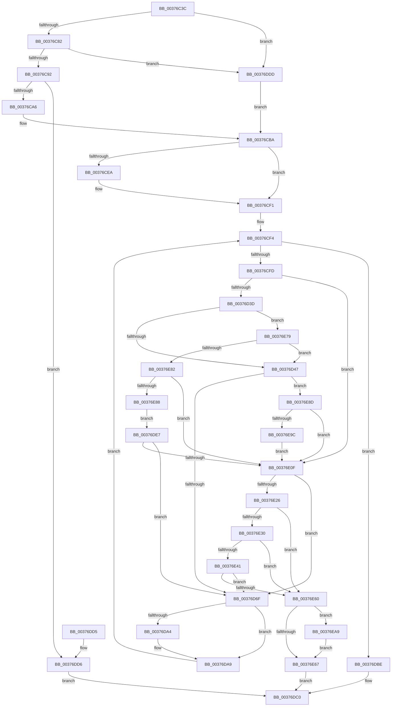

# MiGetPageTablePages

- RVA: `0x00376C3C`–`0x00376EC1` (길이 `645` bytes)
- VA: `0x0000000140376C3C`
- 실행 섹션: `.text`
- PDB 이름 있음: `예`; PDB Function 태그: `아니요`
- unwind 정보 RVA: `0x0007ACCC`
- 디코드: `164`개 명령, `645/645` bytes 표시
- 미해석 바이트: `0` (있으면 어셈블리에 `.byte`로 보존)

> 이 문서는 커널 이미지의 기계어와 PDB 기호를 분석해 생성했습니다. 4번과 5번은 함수 원형과 자료형을 바이너리 사용 방식에서 추정한 C 해석이며 원본 소스 복구 결과는 아닙니다.

## 1. Dependencies

- 직접 호출 지점: **9**; 고유 호출 대상: **7**
- 직접 호출자로 확인된 함수: **3**
- RIP 상대 이미지 참조: **2**

### Outgoing calls
- `0x00376C99` → [MiObtainSystemCharges](MiObtainSystemCharges_function_003771F4.md) (function, `0x003771F4`)
- `0x00376D60` → [MiGetSlabPage](MiGetSlabPage_function_00376FBC.md) (function, `0x00376FBC`)
- `0x00376D8C` → [MiSetPfnTbFlushStamp](../2B/MiSetPfnTbFlushStamp_function_002B7A70.md) (function, `0x002B7A70`)
- `0x00376E00` → [MiGetSlabPage](MiGetSlabPage_function_00376FBC.md) (function, `0x00376FBC`)
- `0x00376E17` → [MiGetPage](../28/MiGetPage_function_002884C0.md) (function, `0x002884C0`)
- `0x00376E38` → [MiSufficientAvailablePages](../36/MiSufficientAvailablePages_function_0036D0B0.md) (function, `0x0036D0B0`)
- `0x00376E4D` → [MiGetPage](../28/MiGetPage_function_002884C0.md) (function, `0x002884C0`)
- `0x00376E6A` → [MiFreePageChain](MiFreePageChain_function_00377D9C.md) (function, `0x00377D9C`)
- `0x00376EB6` → [MiReturnSystemCharges](../36/MiReturnSystemCharges_function_00367A48.md) (function, `0x00367A48`)

### Direct callers
- [MiCreateSystemPageTable](../45/MiCreateSystemPageTable_function_004518D0.md) at `0x004519DB`
- [MiDemoteValidLargePageOneLevel](../68/MiDemoteValidLargePageOneLevel_function_0068A3F4.md) at `0x0068A553`
- [MmCreateShadowMapping](../../page/80/MmCreateShadowMapping_function_00807AB0.md) at `0x00807B6A`

### Static image references
- `0x00376D15` → RVA `0x00E2DCC0` (`.data`; read)
- `0x00376E8D` → RVA `0x00FC6A88` (`ALMOSTRO`; read)

## 2. Other-region calls and transfers

- 다른 실행 섹션으로 향하는 call: **0**
- 별도 외부 분기/꼬리 이동을 확인하지 못했습니다.

## 3. Assembly (complete function range)

```asm
00376C3C  48 89 5C 24 10                  mov qword ptr [rsp + 0x10], rbx
00376C41  44 89 44 24 18                  mov dword ptr [rsp + 0x18], r8d
00376C46  55                              push rbp
00376C47  56                              push rsi
00376C48  57                              push rdi
00376C49  41 54                           push r12
00376C4B  41 55                           push r13
00376C4D  41 56                           push r14
00376C4F  41 57                           push r15
00376C51  48 83 EC 30                     sub rsp, 0x30
00376C55  4D 8B E1                        mov r12, r9
00376C58  33 C0                           xor eax, eax
00376C5A  0F 57 C0                        xorps xmm0, xmm0
00376C5D  45 8B C8                        mov r9d, r8d
00376C60  4C 8B FA                        mov r15, rdx
00376C63  48 8B F1                        mov rsi, rcx
00376C66  41 0F 11 04 24                  movups xmmword ptr [r12], xmm0
00376C6B  49 89 44 24 10                  mov qword ptr [r12 + 0x10], rax
00376C70  8B 81 80 00 00 00               mov eax, dword ptr [rcx + 0x80]
00376C76  48 8B 69 60                     mov rbp, qword ptr [rcx + 0x60]
00376C7A  A8 08                           test al, 8
00376C7C  0F 85 5B 01 00 00               jne 0x140376ddd
00376C82  48 8B 85 98 4C 00 00            mov rax, qword ptr [rbp + 0x4c98]
00376C89  48 85 C0                        test rax, rax
00376C8C  0F 84 4B 01 00 00               je 0x140376ddd
00376C92  44 8B 41 78                     mov r8d, dword ptr [rcx + 0x78]
00376C96  48 8B CD                        mov rcx, rbp
00376C99  E8 56 05 00 00                  call 0x1403771f4
00376C9E  85 C0                           test eax, eax
00376CA0  0F 84 30 01 00 00               je 0x140376dd6
00376CA6  4C 01 7E 68                     add qword ptr [rsi + 0x68], r15
00376CAA  44 8B 8C 24 80 00 00 00         mov r9d, dword ptr [rsp + 0x80]
00376CB2  C7 44 24 70 01 00 00 00         mov dword ptr [rsp + 0x70], 1
00376CBA  8B 8E 80 00 00 00               mov ecx, dword ptr [rsi + 0x80]
00376CC0  81 E1 00 04 00 00               and ecx, 0x400
00376CC6  8B C1                           mov eax, ecx
00376CC8  F7 D8                           neg eax
00376CCA  45 1B F6                        sbb r14d, r14d
00376CCD  41 F7 DE                        neg r14d
00376CD0  41 83 C6 0C                     add r14d, 0xc
00376CD4  F7 D9                           neg ecx
00376CD6  1B DB                           sbb ebx, ebx
00376CD8  81 E3 00 10 00 00               and ebx, 0x1000
00376CDE  81 C3 B0 00 00 00               add ebx, 0xb0
00376CE4  41 F6 C1 02                     test r9b, 2
00376CE8  74 07                           je 0x140376cf1
00376CEA  83 CB 01                        or ebx, 1
00376CED  41 83 CE 10                     or r14d, 0x10
00376CF1  45 33 ED                        xor r13d, r13d
00376CF4  4D 3B EF                        cmp r13, r15
00376CF7  0F 83 C1 00 00 00               jae 0x140376dbe
00376CFD  8B 8E A0 00 00 00               mov ecx, dword ptr [rsi + 0xa0]
00376D03  B8 01 00 00 00                  mov eax, 1
00376D08  48 8B 96 98 00 00 00            mov rdx, qword ptr [rsi + 0x98]
00376D0F  F0 0F C1 02                     lock xadd dword ptr [rdx], eax
00376D13  33 D2                           xor edx, edx
00376D15  4C 8D 15 A4 6F AB 00            lea r10, [rip + 0xab6fa4]
00376D1C  44 8B C1                        mov r8d, ecx
00376D1F  49 C1 E8 10                     shr r8, 0x10
00376D23  41 83 E0 03                     and r8d, 3
00376D27  43 F7 34 82                     div dword ptr [r10 + r8*4]
00376D2B  33 D1                           xor edx, ecx
00376D2D  0F B6 FA                        movzx edi, dl
00376D30  33 F9                           xor edi, ecx
00376D32  41 0F BA E1 0D                  bt r9d, 0xd
00376D37  0F 82 D2 00 00 00               jb 0x140376e0f
00376D3D  41 F6 C1 01                     test r9b, 1
00376D41  0F 85 32 01 00 00               jne 0x140376e79
00376D47  83 64 24 28 00                  and dword ptr [rsp + 0x28], 0
00376D4C  45 8B CE                        mov r9d, r14d
00376D4F  48 83 64 24 20 00               and qword ptr [rsp + 0x20], 0
00376D55  44 8B C7                        mov r8d, edi
00376D58  BA 07 00 00 00                  mov edx, 7
00376D5D  48 8B CD                        mov rcx, rbp
00376D60  E8 57 02 00 00                  call 0x140376fbc
00376D65  48 83 F8 FF                     cmp rax, -1
00376D69  0F 84 1E 01 00 00               je 0x140376e8d
00376D6F  48 8D 3C 40                     lea rdi, [rax + rax*2]
00376D73  48 C1 E7 04                     shl rdi, 4
00376D77  48 B8 00 00 00 00 00 DE FF FF   movabs rax, 0xffffde0000000000
00376D81  48 03 F8                        add rdi, rax
00376D84  45 33 C0                        xor r8d, r8d
00376D87  48 8B CF                        mov rcx, rdi
00376D8A  33 D2                           xor edx, edx
00376D8C  E8 DF 0C F4 FF                  call 0x1402b7a70
00376D91  49 8B 04 24                     mov rax, qword ptr [r12]
00376D95  48 89 07                        mov qword ptr [rdi], rax
00376D98  49 83 7C 24 08 00               cmp qword ptr [r12 + 8], 0
00376D9E  49 89 3C 24                     mov qword ptr [r12], rdi
00376DA2  75 05                           jne 0x140376da9
00376DA4  49 89 7C 24 08                  mov qword ptr [r12 + 8], rdi
00376DA9  49 FF 44 24 10                  inc qword ptr [r12 + 0x10]
00376DAE  44 8B 8C 24 80 00 00 00         mov r9d, dword ptr [rsp + 0x80]
00376DB6  49 FF C5                        inc r13
00376DB9  E9 36 FF FF FF                  jmp 0x140376cf4
00376DBE  33 C0                           xor eax, eax
00376DC0  48 8B 5C 24 78                  mov rbx, qword ptr [rsp + 0x78]
00376DC5  48 83 C4 30                     add rsp, 0x30
00376DC9  41 5F                           pop r15
00376DCB  41 5E                           pop r14
00376DCD  41 5D                           pop r13
00376DCF  41 5C                           pop r12
00376DD1  5F                              pop rdi
00376DD2  5E                              pop rsi
00376DD3  5D                              pop rbp
00376DD4  C3                              ret
00376DD5  CC                              int3
00376DD6  B8 2D 01 00 C0                  mov eax, 0xc000012d
00376DDB  EB E3                           jmp 0x140376dc0
00376DDD  83 64 24 70 00                  and dword ptr [rsp + 0x70], 0
00376DE2  E9 D3 FE FF FF                  jmp 0x140376cba
00376DE7  83 64 24 28 00                  and dword ptr [rsp + 0x28], 0
00376DEC  45 8B CE                        mov r9d, r14d
00376DEF  48 83 64 24 20 00               and qword ptr [rsp + 0x20], 0
00376DF5  44 8B C7                        mov r8d, edi
00376DF8  BA 07 00 00 00                  mov edx, 7
00376DFD  48 8B CD                        mov rcx, rbp
00376E00  E8 B7 01 00 00                  call 0x140376fbc
00376E05  48 83 F8 FF                     cmp rax, -1
00376E09  0F 85 60 FF FF FF               jne 0x140376d6f
00376E0F  44 8B C3                        mov r8d, ebx
00376E12  8B D7                           mov edx, edi
00376E14  48 8B CD                        mov rcx, rbp
00376E17  E8 A4 16 F1 FF                  call 0x1402884c0
00376E1C  48 83 F8 FF                     cmp rax, -1
00376E20  0F 85 49 FF FF FF               jne 0x140376d6f
00376E26  8B 86 80 00 00 00               mov eax, dword ptr [rsi + 0x80]
00376E2C  A8 10                           test al, 0x10
00376E2E  74 30                           je 0x140376e60
00376E30  BA 60 00 00 00                  mov edx, 0x60
00376E35  48 8B CD                        mov rcx, rbp
00376E38  E8 73 62 FF FF                  call 0x14036d0b0
00376E3D  85 C0                           test eax, eax
00376E3F  74 1F                           je 0x140376e60
00376E41  0F BA EB 09                     bts ebx, 9
00376E45  8B D7                           mov edx, edi
00376E47  44 8B C3                        mov r8d, ebx
00376E4A  48 8B CD                        mov rcx, rbp
00376E4D  E8 6E 16 F1 FF                  call 0x1402884c0
00376E52  0F BA F3 09                     btr ebx, 9
00376E56  48 83 F8 FF                     cmp rax, -1
00376E5A  0F 85 0F FF FF FF               jne 0x140376d6f
00376E60  83 7C 24 70 00                  cmp dword ptr [rsp + 0x70], 0
00376E65  75 42                           jne 0x140376ea9
00376E67  49 8B CC                        mov rcx, r12
00376E6A  E8 2D 0F 00 00                  call 0x140377d9c
00376E6F  B8 17 00 00 C0                  mov eax, 0xc0000017
00376E74  E9 47 FF FF FF                  jmp 0x140376dc0
00376E79  4D 85 ED                        test r13, r13
00376E7C  0F 85 C5 FE FF FF               jne 0x140376d47
00376E82  83 7E 78 03                     cmp dword ptr [rsi + 0x78], 3
00376E86  75 87                           jne 0x140376e0f
00376E88  E9 5A FF FF FF                  jmp 0x140376de7
00376E8D  48 0F BA 25 F2 FB C4 00 22      bt qword ptr [rip + 0xc4fbf2], 0x22
00376E96  0F 83 73 FF FF FF               jae 0x140376e0f
00376E9C  F0 48 FF 85 80 41 00 00         lock inc qword ptr [rbp + 0x4180]
00376EA4  E9 66 FF FF FF                  jmp 0x140376e0f
00376EA9  44 8B 4E 78                     mov r9d, dword ptr [rsi + 0x78]
00376EAD  4D 8B C7                        mov r8, r15
00376EB0  49 8B D7                        mov rdx, r15
00376EB3  48 8B CD                        mov rcx, rbp
00376EB6  E8 8D 0B FF FF                  call 0x140367a48
00376EBB  4C 29 7E 68                     sub qword ptr [rsi + 0x68], r15
00376EBF  EB A6                           jmp 0x140376e67
```

## 4. C-style interpretation (structured pseudocode)

```c
__int64 __fastcall MiGetPageTablePages(__int64 a1, __int64 a2, int a3, __int64 a4)
{
    __int64 result;
    __int64 v_r13;
    __int64 v_r14;
    __int64 v_rbx;
    __int64 v_rdi;
    __int64 v_rsp;
    unsigned int v_stack_m40;
    unsigned __int64 v_stack_m48;
    unsigned __int64 v_stack_p10;
    unsigned int v_stack_p18;
    unsigned __int64 v_stack_p20;
    unsigned int v_stack_p28;
    unsigned int v_stack_p70;
    unsigned int v_stack_p8;

    v_stack_p10 = v_rbx;
    v_stack_p18 = a3;
    v_rsp = (v_rsp) - (48);
    result = 0;
    *(unsigned __int64 *)(a4) = v_xmm0;
    *(unsigned __int64 *)(a4 + 16) = 0;
    if ((((unsigned __int8)((unsigned int)(*(unsigned int *)(a1 + 128)))) & (8)) != 0) goto loc_00376DDD;
    if (*(unsigned __int64 *)(*(unsigned __int64 *)(a1 + 96) + 19608) == 0) goto loc_00376DDD;
    result = MiObtainSystemCharges(*(unsigned __int64 *)(a1 + 96), a2, (unsigned int)(*(unsigned int *)(a1 + 120)), (unsigned int)(a3));
    if ((unsigned int)(result) == 0) goto loc_00376DD6;
    v_stack_p8 = 1;
loc_00376CBA:
    a1 = (unsigned int)(((unsigned int)(*(unsigned int *)(a1 + 128))) & (0x400ULL));
    result = (unsigned int)(-((unsigned int)((unsigned int)(a1))));
    v_r14 = (unsigned int)(-(v_r14));
    v_r14 = (unsigned int)((v_r14) + (12));
    a1 = (unsigned int)(-(a1));
    v_rbx = (unsigned int)((v_rbx) & (0x1000ULL));
    v_rbx = (unsigned int)((v_rbx) + (176));
    if ((((unsigned __int8)((unsigned int)(v_stack_p18))) & (2)) != 0) {
        v_rbx = (unsigned int)((v_rbx) | (1));
        v_r14 = (unsigned int)((v_r14) | (16));
    }
    v_r13 = 0;
loc_00376CF4:
    if (0 >= a2) goto loc_00376DBE;
    a2 = 0;
    a3 = ((unsigned int)((unsigned int)((unsigned int)(*(unsigned int *)(a1 + 160))))) >> (16);
    a3 = (unsigned int)((a3) & (3));
    a2 = (unsigned int)((a2) ^ ((unsigned int)((unsigned int)(*(unsigned int *)(a1 + 160)))));
    v_rdi = (unsigned int)(((unsigned __int8)(a2)) ^ ((unsigned int)((unsigned int)(*(unsigned int *)(a1 + 160)))));
    if (condition_is_below) goto loc_00376E0F;
    if ((((unsigned __int8)((unsigned int)(v_stack_p18))) & (1)) != 0) goto loc_00376E79;
loc_00376D47:
    result = MiGetSlabPage(*(unsigned __int64 *)(a1 + 96), 7, (unsigned int)((unsigned int)(v_rdi)), (unsigned int)((unsigned int)(v_r14)));
    if (result == -1) goto loc_00376E8D;
loc_00376D6F:
    v_rdi = (result + result * 2) << (4);
    v_rdi = (v_rdi) + (result);
    a3 = 0;
    a2 = 0;
    result = MiSetPfnTbFlushStamp(v_rdi, a2, a3, (unsigned int)((unsigned int)(v_r14)));
    *(unsigned __int64 *)(v_rdi) = *(unsigned __int64 *)(a4);
    *(unsigned __int64 *)(a4) = v_rdi;
    if ((*(unsigned __int64 *)(a4 + 8)) == 0) {
        *(unsigned __int64 *)(a4 + 8) = v_rdi;
    }
    v_r13 = (v_r13) + 1;
    goto loc_00376CF4;
loc_00376DBE:
    result = 0;
loc_00376DC0:
    v_rsp = (v_rsp) + (48);
    return result;
loc_00376DD6:
    goto loc_00376DC0;
loc_00376DDD:
    goto loc_00376CBA;
loc_00376DE7:
    result = MiGetSlabPage(*(unsigned __int64 *)(a1 + 96), 7, (unsigned int)((unsigned int)(v_rdi)), (unsigned int)((unsigned int)(v_r14)));
    if (result != -1) goto loc_00376D6F;
loc_00376E0F:
    result = MiGetPage(*(unsigned __int64 *)(a1 + 96), (unsigned int)((unsigned int)(v_rdi)), (unsigned int)((unsigned int)(v_stack_p10)), (unsigned int)((unsigned int)(v_r14)));
    if (result != -1) goto loc_00376D6F;
    if ((((unsigned __int8)((unsigned int)(*(unsigned int *)(a1 + 128)))) & (16)) == 0) goto loc_00376E60;
    result = MiSufficientAvailablePages(*(unsigned __int64 *)(a1 + 96), 96, (unsigned int)((unsigned int)(v_stack_p10)), (unsigned int)((unsigned int)(v_r14)));
    if ((unsigned int)(result) == 0) goto loc_00376E60;
    result = MiGetPage(*(unsigned __int64 *)(a1 + 96), (unsigned int)((unsigned int)(v_rdi)), (unsigned int)((unsigned int)(v_stack_p10)), (unsigned int)((unsigned int)(v_r14)));
    if (result != -1) goto loc_00376D6F;
loc_00376E60:
    if (v_stack_p70 != 0) goto loc_00376EA9;
loc_00376E67:
    result = MiFreePageChain(a4, (unsigned int)((unsigned int)(v_rdi)), (unsigned int)((unsigned int)(v_stack_p10)), (unsigned int)((unsigned int)(v_r14)));
    goto loc_00376DC0;
loc_00376E79:
    if (v_r13 != 0) goto loc_00376D47;
    if ((*(unsigned int *)(a1 + 120)) != 3) goto loc_00376E0F;
    goto loc_00376DE7;
loc_00376E8D:
    if ((*(unsigned int *)(a1 + 120)) >= 3) goto loc_00376E0F;
    goto loc_00376E0F;
loc_00376EA9:
    result = MiReturnSystemCharges(*(unsigned __int64 *)(a1 + 96), 0, 0, (unsigned int)(*(unsigned int *)(a1 + 120)));
    goto loc_00376E67;
}
```

## 5. (Beta) C Style

```c
int64_t MiGetPageTablePages(void *Arg1, int64_t Arg2, int32_t Arg3, void *Arg4)
{
    uint8_t *arg1 = (uint8_t *)Arg1;
    uint8_t *arg4 = (uint8_t *)Arg4;

    int64_t result;
    int64_t local_r13;
    int64_t local_r14;
    int64_t local_rbx;
    int64_t local_rdi;
    int64_t local_rsp;
    uint32_t v_stack_m40;
    uint64_t v_stack_m48;
    uint64_t v_stack_p10;
    uint32_t v_stack_p18;
    uint64_t v_stack_p20;
    uint32_t v_stack_p28;
    uint32_t v_stack_p70;
    uint32_t v_stack_p8;

    v_stack_p10 = local_rbx;
    v_stack_p18 = Arg3;
    local_rsp = (local_rsp) - (48);
    result = 0;
    *(uint64_t *)(arg4) = v_xmm0;
    *(uint64_t *)(arg4 + 0x10) = 0;
    if ((((uint8_t)((uint32_t)(*(uint32_t *)(arg1 + 0x80)))) & (8)) != 0) goto loc_00376DDD;
    if (*(uint64_t *)(*(uint64_t *)(arg1 + 0x60) + 0x4C98) == 0) goto loc_00376DDD;
    result = MiObtainSystemCharges(*(uint64_t *)(arg1 + 0x60), Arg2, (uint32_t)(*(uint32_t *)(arg1 + 0x78)), (uint32_t)(Arg3));
    if ((uint32_t)(result) == 0) goto loc_00376DD6;
    v_stack_p8 = 1;
loc_00376CBA:
    Arg1 = (uint32_t)(((uint32_t)(*(uint32_t *)(arg1 + 0x80))) & (0x400ULL));
    result = (uint32_t)(-((uint32_t)((uint32_t)(Arg1))));
    local_r14 = (uint32_t)(-(local_r14));
    local_r14 = (uint32_t)((local_r14) + (12));
    Arg1 = (uint32_t)(-(Arg1));
    local_rbx = (uint32_t)((local_rbx) & (0x1000ULL));
    local_rbx = (uint32_t)((local_rbx) + (176));
    if ((((uint8_t)((uint32_t)(v_stack_p18))) & (2)) != 0) {
        local_rbx = (uint32_t)((local_rbx) | (1));
        local_r14 = (uint32_t)((local_r14) | (16));
    }
    local_r13 = 0;
loc_00376CF4:
    if (0 >= Arg2) goto loc_00376DBE;
    Arg2 = 0;
    Arg3 = ((uint32_t)((uint32_t)((uint32_t)(*(uint32_t *)(arg1 + 0xA0))))) >> (16);
    Arg3 = (uint32_t)((Arg3) & (3));
    Arg2 = (uint32_t)((Arg2) ^ ((uint32_t)((uint32_t)(*(uint32_t *)(arg1 + 0xA0)))));
    local_rdi = (uint32_t)(((uint8_t)(Arg2)) ^ ((uint32_t)((uint32_t)(*(uint32_t *)(arg1 + 0xA0)))));
    if (condition_is_below) goto loc_00376E0F;
    if ((((uint8_t)((uint32_t)(v_stack_p18))) & (1)) != 0) goto loc_00376E79;
loc_00376D47:
    result = MiGetSlabPage(*(uint64_t *)(arg1 + 0x60), 7, (uint32_t)((uint32_t)(local_rdi)), (uint32_t)((uint32_t)(local_r14)));
    if (result == -1) goto loc_00376E8D;
loc_00376D6F:
    local_rdi = (result + result * 2) << (4);
    local_rdi = (local_rdi) + (result);
    Arg3 = 0;
    Arg2 = 0;
    result = MiSetPfnTbFlushStamp(local_rdi, Arg2, Arg3, (uint32_t)((uint32_t)(local_r14)));
    *(uint64_t *)(local_rdi) = *(uint64_t *)(arg4);
    *(uint64_t *)(arg4) = local_rdi;
    if ((*(uint64_t *)(arg4 + 0x8)) == 0) {
        *(uint64_t *)(arg4 + 0x8) = local_rdi;
    }
    local_r13 = (local_r13) + 1;
    goto loc_00376CF4;
loc_00376DBE:
    result = 0;
loc_00376DC0:
    local_rsp = (local_rsp) + (48);
    return result;
loc_00376DD6:
    goto loc_00376DC0;
loc_00376DDD:
    goto loc_00376CBA;
loc_00376DE7:
    result = MiGetSlabPage(*(uint64_t *)(arg1 + 0x60), 7, (uint32_t)((uint32_t)(local_rdi)), (uint32_t)((uint32_t)(local_r14)));
    if (result != -1) goto loc_00376D6F;
loc_00376E0F:
    result = MiGetPage(*(uint64_t *)(arg1 + 0x60), (uint32_t)((uint32_t)(local_rdi)), (uint32_t)((uint32_t)(v_stack_p10)), (uint32_t)((uint32_t)(local_r14)));
    if (result != -1) goto loc_00376D6F;
    if ((((uint8_t)((uint32_t)(*(uint32_t *)(arg1 + 0x80)))) & (16)) == 0) goto loc_00376E60;
    result = MiSufficientAvailablePages(*(uint64_t *)(arg1 + 0x60), 96, (uint32_t)((uint32_t)(v_stack_p10)), (uint32_t)((uint32_t)(local_r14)));
    if ((uint32_t)(result) == 0) goto loc_00376E60;
    result = MiGetPage(*(uint64_t *)(arg1 + 0x60), (uint32_t)((uint32_t)(local_rdi)), (uint32_t)((uint32_t)(v_stack_p10)), (uint32_t)((uint32_t)(local_r14)));
    if (result != -1) goto loc_00376D6F;
loc_00376E60:
    if (v_stack_p70 != 0) goto loc_00376EA9;
loc_00376E67:
    result = MiFreePageChain(Arg4, (uint32_t)((uint32_t)(local_rdi)), (uint32_t)((uint32_t)(v_stack_p10)), (uint32_t)((uint32_t)(local_r14)));
    goto loc_00376DC0;
loc_00376E79:
    if (local_r13 != 0) goto loc_00376D47;
    if ((*(uint32_t *)(arg1 + 0x78)) != 3) goto loc_00376E0F;
    goto loc_00376DE7;
loc_00376E8D:
    if ((*(uint32_t *)(arg1 + 0x78)) >= 3) goto loc_00376E0F;
    goto loc_00376E0F;
loc_00376EA9:
    result = MiReturnSystemCharges(*(uint64_t *)(arg1 + 0x60), 0, 0, (uint32_t)(*(uint32_t *)(arg1 + 0x78)));
    goto loc_00376E67;
}
```

### 관측된 메모리 오프셋

구조체 형식이 확인되지 않은 접근은 인자 기준의 오프셋으로만 기록했습니다.

| 기준 인자 | 오프셋 표현 | 폭 (bit) | 접근 |
|---|---:|---:|---|
| `Arg1` | `+ 0x60` | `64` | `R` |
| `Arg1` | `+ 0x68` | `64` | `R/W` |
| `Arg1` | `+ 0x78` | `32` | `R` |
| `Arg1` | `+ 0x80` | `32` | `R` |
| `Arg1` | `+ 0x98` | `64` | `R` |
| `Arg1` | `+ 0xA0` | `32` | `R` |
| `Arg4` | `+ 0x0` | `64` | `R` |
| `Arg4` | `+ 0x0` | `64` | `W` |
| `Arg4` | `+ 0x0` | `128` | `R` |
| `Arg4` | `+ 0x8` | `64` | `R` |
| `Arg4` | `+ 0x8` | `64` | `W` |
| `Arg4` | `+ 0x10` | `64` | `R/W` |
| `Arg4` | `+ 0x10` | `64` | `W` |

## 6. Execution-region graph

[열기: 2D/3D 그래프와 함수 탐색 컨트롤 패널](../../../control-panel.html?section=text&rva=0x00376C3C&view=graph)

- 2D 그래프는 위에서 아래로 흐르고, 3D 그래프는 빈 공간을 드래그해 회전합니다. Shift+드래그는 이동, 휠은 확대·축소, 함수 노드 선택은 대상 보고서 이동입니다.

### Static fallback


