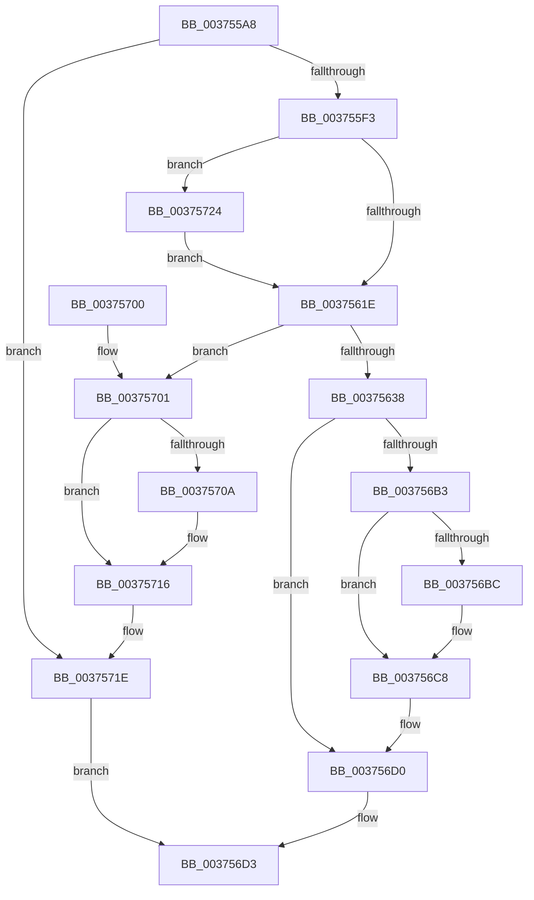

# MiGetRepurposedSlabStandbyPage

- RVA: `0x003755A8`–`0x00375734` (길이 `396` bytes)
- VA: `0x00000001403755A8`
- 실행 섹션: `.text`
- PDB 이름 있음: `예`; PDB Function 태그: `아니요`
- unwind 정보 RVA: `0x0007AB6C`
- 디코드: `97`개 명령, `396/396` bytes 표시
- 미해석 바이트: `0` (있으면 어셈블리에 `.byte`로 보존)

> 이 문서는 커널 이미지의 기계어와 PDB 기호를 분석해 생성했습니다. 4번과 5번은 함수 원형과 자료형을 바이너리 사용 방식에서 추정한 C 해석이며 원본 소스 복구 결과는 아닙니다.

## 1. Dependencies

- 직접 호출 지점: **10**; 고유 호출 대상: **9**
- 직접 호출자로 확인된 함수: **1**
- RIP 상대 이미지 참조: **2**

### Outgoing calls
- `0x003755FE` → [memset](../6C/memset_function_006C6C40.md) (function, `0x006C6C40`)
- `0x00375626` → [MiLockPageListAndFirstPage](MiLockPageListAndFirstPage_function_0037573C.md) (function, `0x0037573C`)
- `0x0037565C` → [MiUnlinkPageFromListEx](../28/MiUnlinkPageFromListEx_function_00287590.md) (function, `0x00287590`)
- `0x00375669` → [MiReleasePageListLock](../2B/MiReleasePageListLock_function_002B1050.md) (function, `0x002B1050`)
- `0x00375676` → [MiDiscardTransitionPteEx](MiDiscardTransitionPteEx_function_00375954.md) (function, `0x00375954`)
- `0x0037569A` → [MiReInitializeFreeSlabPfn](MiReInitializeFreeSlabPfn_function_003758D8.md) (function, `0x003758D8`)
- `0x003756C3` → [KiLowerIrqlProcessIrqlFlags](../4F/KiLowerIrqlProcessIrqlFlags_function_004F5698.md) (function, `0x004F5698`)
- `0x003756DE` → [_security_check_cookie](../6A/_security_check_cookie_function_006AC640.md) (function, `0x006AC640`)
- `0x00375711` → [KiLowerIrqlProcessIrqlFlags](../4F/KiLowerIrqlProcessIrqlFlags_function_004F5698.md) (function, `0x004F5698`)
- `0x0037572A` → [KiRaiseIrqlProcessIrqlFlags](../4F/KiRaiseIrqlProcessIrqlFlags_function_004F56FC.md) (function, `0x004F56FC`)

### Direct callers
- [MiGetPageFromSlabAllocator](MiGetPageFromSlabAllocator_function_00377294.md) at `0x00377447`

### Static image references
- `0x003755C3` → RVA `0x00E0A740` (`.data`; read)
- `0x00375611` → RVA `0x00FC6D20` (`ALMOSTRO`; read)

## 2. Other-region calls and transfers

- 다른 실행 섹션으로 향하는 call: **0**
- 별도 외부 분기/꼬리 이동을 확인하지 못했습니다.

## 3. Assembly (complete function range)

```asm
003755A8  48 89 5C 24 10                  mov qword ptr [rsp + 0x10], rbx
003755AD  48 89 6C 24 18                  mov qword ptr [rsp + 0x18], rbp
003755B2  48 89 74 24 20                  mov qword ptr [rsp + 0x20], rsi
003755B7  57                              push rdi
003755B8  41 54                           push r12
003755BA  41 56                           push r14
003755BC  48 81 EC B0 00 00 00            sub rsp, 0xb0
003755C3  48 8B 05 76 51 A9 00            mov rax, qword ptr [rip + 0xa95176]
003755CA  48 33 C4                        xor rax, rsp
003755CD  48 89 84 24 A0 00 00 00         mov qword ptr [rsp + 0xa0], rax
003755D5  48 8B 69 50                     mov rbp, qword ptr [rcx + 0x50]
003755D9  4C 8B F1                        mov r14, rcx
003755DC  48 B9 FF FF FF FF 3F 00 00 00   movabs rcx, 0x3fffffffff
003755E6  48 8B 45 10                     mov rax, qword ptr [rbp + 0x10]
003755EA  48 3B C1                        cmp rax, rcx
003755ED  0F 84 2B 01 00 00               je 0x14037571e
003755F3  33 D2                           xor edx, edx
003755F5  48 8D 4C 24 30                  lea rcx, [rsp + 0x30]
003755FA  44 8D 42 68                     lea r8d, [rdx + 0x68]
003755FE  E8 3D 16 35 00                  call 0x1406c6c40
00375603  44 0F 20 C7                     mov rdi, cr8
00375607  41 BC 02 00 00 00               mov r12d, 2
0037560D  45 0F 22 C4                     mov cr8, r12
00375611  83 3D 08 17 C5 00 00            cmp dword ptr [rip + 0xc51708], 0
00375618  0F 85 06 01 00 00               jne 0x140375724
0037561E  48 8D 54 24 30                  lea rdx, [rsp + 0x30]
00375623  48 8B CD                        mov rcx, rbp
00375626  E8 11 01 00 00                  call 0x14037573c
0037562B  48 8B F0                        mov rsi, rax
0037562E  48 83 F8 FF                     cmp rax, -1
00375632  0F 84 C9 00 00 00               je 0x140375701
00375638  48 8D 1C 40                     lea rbx, [rax + rax*2]
0037563C  48 C1 E3 04                     shl rbx, 4
00375640  48 B8 00 00 00 00 00 DE FF FF   movabs rax, 0xffffde0000000000
0037564A  48 03 D8                        add rbx, rax
0037564D  8A 44 24 30                     mov al, byte ptr [rsp + 0x30]
00375651  F6 D8                           neg al
00375653  48 8B CB                        mov rcx, rbx
00375656  1B D2                           sbb edx, edx
00375658  F7 DA                           neg edx
0037565A  FF C2                           inc edx
0037565C  E8 2F 1F F1 FF                  call 0x140287590
00375661  48 8D 54 24 30                  lea rdx, [rsp + 0x30]
00375666  48 8B CD                        mov rcx, rbp
00375669  E8 E2 B9 F3 FF                  call 0x1402b1050
0037566E  BA 00 08 00 00                  mov edx, 0x800
00375673  48 8B CB                        mov rcx, rbx
00375676  E8 D9 02 00 00                  call 0x140375954
0037567B  8B 43 20                        mov eax, dword ptr [rbx + 0x20]
0037567E  49 8B D6                        mov rdx, r14
00375681  89 44 24 20                     mov dword ptr [rsp + 0x20], eax
00375685  48 8B CB                        mov rcx, rbx
00375688  C1 E8 10                        shr eax, 0x10
0037568B  24 F9                           and al, 0xf9
0037568D  0C 01                           or al, 1
0037568F  88 44 24 22                     mov byte ptr [rsp + 0x22], al
00375693  8B 44 24 20                     mov eax, dword ptr [rsp + 0x20]
00375697  89 43 20                        mov dword ptr [rbx + 0x20], eax
0037569A  E8 39 02 00 00                  call 0x1403758d8
0037569F  48 B8 FF FF FF FF FF FF FF 7F   movabs rax, 0x7fffffffffffffff
003756A9  F0 48 21 43 18                  lock and qword ptr [rbx + 0x18], rax
003756AE  41 3A FC                        cmp dil, r12b
003756B1  73 1D                           jae 0x1403756d0
003756B3  83 3D 66 16 C5 00 00            cmp dword ptr [rip + 0xc51666], 0
003756BA  74 0C                           je 0x1403756c8
003756BC  44 0F 20 C1                     mov rcx, cr8
003756C0  40 8A D7                        mov dl, dil
003756C3  E8 D0 FF 17 00                  call 0x1404f5698
003756C8  40 0F B6 C7                     movzx eax, dil
003756CC  44 0F 22 C0                     mov cr8, rax
003756D0  48 8B C6                        mov rax, rsi
003756D3  48 8B 8C 24 A0 00 00 00         mov rcx, qword ptr [rsp + 0xa0]
003756DB  48 33 CC                        xor rcx, rsp
003756DE  E8 5D 6F 33 00                  call 0x1406ac640
003756E3  4C 8D 9C 24 B0 00 00 00         lea r11, [rsp + 0xb0]
003756EB  49 8B 5B 28                     mov rbx, qword ptr [r11 + 0x28]
003756EF  49 8B 6B 30                     mov rbp, qword ptr [r11 + 0x30]
003756F3  49 8B 73 38                     mov rsi, qword ptr [r11 + 0x38]
003756F7  49 8B E3                        mov rsp, r11
003756FA  41 5E                           pop r14
003756FC  41 5C                           pop r12
003756FE  5F                              pop rdi
003756FF  C3                              ret
00375700  CC                              int3
00375701  83 3D 18 16 C5 00 00            cmp dword ptr [rip + 0xc51618], 0
00375708  74 0C                           je 0x140375716
0037570A  44 0F 20 C1                     mov rcx, cr8
0037570E  40 8A D7                        mov dl, dil
00375711  E8 82 FF 17 00                  call 0x1404f5698
00375716  40 0F B6 C7                     movzx eax, dil
0037571A  44 0F 22 C0                     mov cr8, rax
0037571E  48 83 C8 FF                     or rax, 0xffffffffffffffff
00375722  EB AF                           jmp 0x1403756d3
00375724  41 8A D4                        mov dl, r12b
00375727  40 8A CF                        mov cl, dil
0037572A  E8 CD FF 17 00                  call 0x1404f56fc
0037572F  E9 EA FE FF FF                  jmp 0x14037561e
```

## 4. C-style interpretation (structured pseudocode)

```c
__int64 __fastcall MiGetRepurposedSlabStandbyPage(__int64 a1, int a2)
{
    __int64 result;
    __int64 v_rbx;
    __int64 v_rsp;
    unsigned __int64 v_stack_m18;
    unsigned __int64 v_stack_m28;
    unsigned __int64 v_stack_m98;
    unsigned __int8 v_stack_mA6;
    unsigned int v_stack_mA8;
    unsigned __int64 v_stack_p10;
    unsigned __int64 v_stack_p18;
    unsigned __int64 v_stack_p20;

    v_stack_p10 = v_rbx;
    v_stack_p18 = v_rbp;
    v_stack_p20 = v_rsi;
    v_rsp = (v_rsp) - (176);
    result = (*(unsigned __int64 *)(v_rip + 11096438)) ^ (v_rsp);
    v_stack_m28 = result;
    if ((*(unsigned __int64 *)(*(unsigned __int64 *)(a1 + 80) + 16)) == a1) goto loc_0037571E;
    a2 = 0;
    result = memset(v_stack_m98, a2, a2 + 104, a4);
    if ((*(unsigned int *)(v_rip + 12916488)) != 0) goto loc_00375724;
loc_0037561E:
    result = MiLockPageListAndFirstPage(*(unsigned __int64 *)(a1 + 80), v_stack_m98, a2 + 104, a4);
    if (result == -1) goto loc_00375701;
    v_rbx = (result + result * 2) << (4);
    v_rbx = (v_rbx) + (result);
    result = (unsigned __int8)(-(v_stack_m98));
    a2 = (unsigned int)(-(v_stack_m98));
    a2 = (unsigned int)((a2) + 1);
    result = MiUnlinkPageFromListEx(v_rbx, a2, a2 + 104, a4);
    result = MiReleasePageListLock(*(unsigned __int64 *)(a1 + 80), v_stack_m98, a2 + 104, a4);
    result = MiDiscardTransitionPteEx(v_rbx, (unsigned int)(0x800ULL), a2 + 104, a4);
    v_stack_mA8 = (unsigned int)((unsigned int)(*(unsigned int *)(v_rbx + 32)));
    result = (unsigned int)(((unsigned int)(*(unsigned int *)(v_rbx + 32))) >> (16));
    result = (unsigned __int8)((result) & (249));
    result = (unsigned __int8)((result) | (1));
    v_stack_mA6 = (unsigned __int8)(result);
    *(unsigned int *)(v_rbx + 32) = (unsigned int)((unsigned int)(v_stack_mA8));
    result = MiReInitializeFreeSlabPfn(v_rbx, a1, a2 + 104, a4);
    if (((unsigned __int8)(v_cr8)) >= 2) goto loc_003756D0;
    if ((*(unsigned int *)(v_rip + 12916326)) != 0) {
        a1 = 2;
        a2 = (unsigned __int8)(v_cr8);
        result = KiLowerIrqlProcessIrqlFlags(a1, a2, a2 + 104, a4);
    }
loc_003756D0:
loc_003756D3:
    a1 = (v_stack_m28) ^ (v_rsp);
    result = _security_check_cookie(a1, a2, a2 + 104, a4);
    return result;
loc_00375701:
    if ((*(unsigned int *)(v_rip + 12916248)) != 0) {
        a1 = (unsigned __int8)(v_cr8);
        a2 = (unsigned __int8)(v_cr8);
        result = KiLowerIrqlProcessIrqlFlags(a1, a2, a2 + 104, a4);
    }
loc_0037571E:
    result = ((unsigned __int8)(v_cr8)) | (-1);
    goto loc_003756D3;
loc_00375724:
    result = KiRaiseIrqlProcessIrqlFlags((unsigned __int8)(v_cr8), 2, a2 + 104, a4);
    goto loc_0037561E;
}
```

## 5. (Beta) C Style

```c
int64_t MiGetRepurposedSlabStandbyPage(void *Arg1, int32_t Arg2)
{
    uint8_t *arg1 = (uint8_t *)Arg1;

    int64_t result;
    int64_t local_rbx;
    int64_t local_rsp;
    uint64_t v_stack_m18;
    uint64_t v_stack_m28;
    uint64_t v_stack_m98;
    uint8_t v_stack_mA6;
    uint32_t v_stack_mA8;
    uint64_t v_stack_p10;
    uint64_t v_stack_p18;
    uint64_t v_stack_p20;

    v_stack_p10 = local_rbx;
    v_stack_p18 = local_rbp;
    v_stack_p20 = local_rsi;
    local_rsp = (local_rsp) - (176);
    result = (*(uint64_t *)(v_rip + 0xA95176)) ^ (local_rsp);
    v_stack_m28 = result;
    if ((*(uint64_t *)(*(uint64_t *)(arg1 + 0x50) + 0x10)) == Arg1) goto loc_0037571E;
    Arg2 = 0;
    result = memset(v_stack_m98, Arg2, Arg2 + 104, a4);
    if ((*(uint32_t *)(v_rip + 0xC51708)) != 0) goto loc_00375724;
loc_0037561E:
    result = MiLockPageListAndFirstPage(*(uint64_t *)(arg1 + 0x50), v_stack_m98, Arg2 + 104, a4);
    if (result == -1) goto loc_00375701;
    local_rbx = (result + result * 2) << (4);
    local_rbx = (local_rbx) + (result);
    result = (uint8_t)(-(v_stack_m98));
    Arg2 = (uint32_t)(-(v_stack_m98));
    Arg2 = (uint32_t)((Arg2) + 1);
    result = MiUnlinkPageFromListEx(local_rbx, Arg2, Arg2 + 104, a4);
    result = MiReleasePageListLock(*(uint64_t *)(arg1 + 0x50), v_stack_m98, Arg2 + 104, a4);
    result = MiDiscardTransitionPteEx(local_rbx, (uint32_t)(0x800ULL), Arg2 + 104, a4);
    v_stack_mA8 = (uint32_t)((uint32_t)(*(uint32_t *)(local_rbx + 0x20)));
    result = (uint32_t)(((uint32_t)(*(uint32_t *)(local_rbx + 0x20))) >> (16));
    result = (uint8_t)((result) & (249));
    result = (uint8_t)((result) | (1));
    v_stack_mA6 = (uint8_t)(result);
    *(uint32_t *)(local_rbx + 0x20) = (uint32_t)((uint32_t)(v_stack_mA8));
    result = MiReInitializeFreeSlabPfn(local_rbx, Arg1, Arg2 + 104, a4);
    if (((uint8_t)(v_cr8)) >= 2) goto loc_003756D0;
    if ((*(uint32_t *)(v_rip + 0xC51666)) != 0) {
        Arg1 = 2;
        Arg2 = (uint8_t)(v_cr8);
        result = KiLowerIrqlProcessIrqlFlags(Arg1, Arg2, Arg2 + 104, a4);
    }
loc_003756D0:
loc_003756D3:
    Arg1 = (v_stack_m28) ^ (local_rsp);
    result = _security_check_cookie(Arg1, Arg2, Arg2 + 104, a4);
    return result;
loc_00375701:
    if ((*(uint32_t *)(v_rip + 0xC51618)) != 0) {
        Arg1 = (uint8_t)(v_cr8);
        Arg2 = (uint8_t)(v_cr8);
        result = KiLowerIrqlProcessIrqlFlags(Arg1, Arg2, Arg2 + 104, a4);
    }
loc_0037571E:
    result = ((uint8_t)(v_cr8)) | (-1);
    goto loc_003756D3;
loc_00375724:
    result = KiRaiseIrqlProcessIrqlFlags((uint8_t)(v_cr8), 2, Arg2 + 104, a4);
    goto loc_0037561E;
}
```

### 관측된 메모리 오프셋

구조체 형식이 확인되지 않은 접근은 인자 기준의 오프셋으로만 기록했습니다.

| 기준 인자 | 오프셋 표현 | 폭 (bit) | 접근 |
|---|---:|---:|---|
| `Arg1` | `+ 0x50` | `64` | `R` |

## 6. Execution-region graph

[열기: 2D/3D 그래프와 함수 탐색 컨트롤 패널](../../../control-panel.html?section=text&rva=0x003755A8&view=graph)

- 2D 그래프는 위에서 아래로 흐르고, 3D 그래프는 빈 공간을 드래그해 회전합니다. Shift+드래그는 이동, 휠은 확대·축소, 함수 노드 선택은 대상 보고서 이동입니다.

### Static fallback


