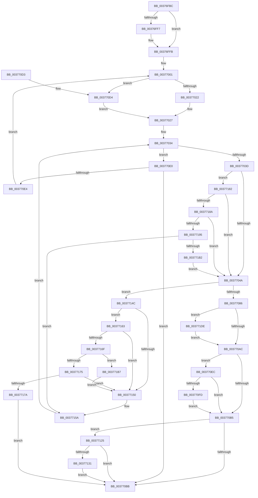

# MiGetSlabPage

- RVA: `0x00376FBC`–`0x003771EC` (길이 `560` bytes)
- VA: `0x0000000140376FBC`
- 실행 섹션: `.text`
- PDB 이름 있음: `예`; PDB Function 태그: `아니요`
- unwind 정보 RVA: `0x0007AD08`
- 디코드: `151`개 명령, `560/560` bytes 표시
- 미해석 바이트: `0` (있으면 어셈블리에 `.byte`로 보존)

> 이 문서는 커널 이미지의 기계어와 PDB 기호를 분석해 생성했습니다. 4번과 5번은 함수 원형과 자료형을 바이너리 사용 방식에서 추정한 C 해석이며 원본 소스 복구 결과는 아닙니다.

## 1. Dependencies

- 직접 호출 지점: **5**; 고유 호출 대상: **5**
- 직접 호출자로 확인된 함수: **21**
- RIP 상대 이미지 참조: **4**

### Outgoing calls
- `0x00377074` → [MiGetPageFromSlabAllocator](MiGetPageFromSlabAllocator_function_00377294.md) (function, `0x00377294`)
- `0x003770F4` → [MiPfnZeroingNeeded](../29/MiPfnZeroingNeeded_function_0029FA80.md) (function, `0x0029FA80`)
- `0x00377110` → [MiZeroPhysicalPage](../33/MiZeroPhysicalPage_function_00332590.md) (function, `0x00332590`)
- `0x00377142` → [MiChangePageAttribute](../33/MiChangePageAttribute_function_00332ECC.md) (function, `0x00332ECC`)
- `0x003771C7` → [MiReplenishSlabAllocator](MiReplenishSlabAllocator_function_003788E4.md) (function, `0x003788E4`)

### Direct callers
- [MiGetUltraPage](../28/MiGetUltraPage_function_002883D0.md) at `0x002884A3`
- [MiAllocateKernelStackPages](../2A/MiAllocateKernelStackPages_function_002A1BEC.md) at `0x002A2162`
- [MmAllocateNonChargedSecurePages](../2C/MmAllocateNonChargedSecurePages_function_002C886C.md) at `0x002C895C`
- [MiReplenishCombineResources](../31/MiReplenishCombineResources_function_00316140.md) at `0x003161F8`
- [MiGetPageChain](../33/MiGetPageChain_function_00330130.md) at `0x0033061E`
- [MiCopyOnWrite](../36/MiCopyOnWrite_function_00362A0C.md) at `0x003634C3`
- [MiWalkEntireImage](../36/MiWalkEntireImage_function_00365D70.md) at `0x00366CE0`
- [MiResolveMappedFileFault](../36/MiResolveMappedFileFault_function_0036B640.md) at `0x0036BB92`
- [MiGetPageTablePages](MiGetPageTablePages_function_00376C3C.md) at `0x00376D60`
- [MiGetPageTablePages](MiGetPageTablePages_function_00376C3C.md) at `0x00376E00`
- [MiAllocateSlabPageForMdl](MiAllocateSlabPageForMdl_function_00376EC8.md) at `0x00376F25`
- [MiCompleteSecureProcessFault](../46/MiCompleteSecureProcessFault_function_0046710C.md) at `0x004672A6`
- [MiProtectDriverSectionPte](../67/MiProtectDriverSectionPte_function_006706C0.md) at `0x006708F0`
- [MmAllocateSecureKernelPages](../68/MmAllocateSecureKernelPages_function_0068F394.md) at `0x0068F501`
- [sub_006E313A](../6E/Unknown_function_006E313A.md) at `0x006E3191`
- [sub_006F9D5A](../6F/Unknown_function_006F9D5A.md) at `0x006F9D9D`
- [MiPfPrepareReadList](../../page/93/MiPfPrepareReadList_function_0093CD5C.md) at `0x0093D410`
- [MiAllocateTopLevelPage](../../page/A5/MiAllocateTopLevelPage_function_00A5F2EC.md) at `0x00A5F432`
- [MiAllocateDriverPage](../../page/A8/MiAllocateDriverPage_function_00A80128.md) at `0x00A8019F`
- [MiAllocateDriverPage](../../page/A8/MiAllocateDriverPage_function_00A80128.md) at `0x00A801E0`
- [MmAllocateIndependentPagesEx](../../page/AA/MmAllocateIndependentPagesEx_function_00AA0CFC.md) at `0x00AA0E88`
- [sub_00B25214](../../page/B2/Unknown_function_00B25214.md) at `0x00B25264`
- [MmInitializeImageViewExtensionCfg](../../init/C6/MmInitializeImageViewExtensionCfg_function_00C64FC4.md) at `0x00C650E5`

### Static image references
- `0x00377001` → RVA `0x00FC5000` (`ALMOSTRO`; read)
- `0x00377008` → RVA `0x00E2DBD0` (`.data`; read)
- `0x0037703D` → RVA `0x00E2DBC8` (`.data`; read)
- `0x00377199` → RVA `0x00E2DBF8` (`.data`; read)

## 2. Other-region calls and transfers

- 다른 실행 섹션으로 향하는 call: **0**
- 별도 외부 분기/꼬리 이동을 확인하지 못했습니다.

## 3. Assembly (complete function range)

```asm
00376FBC  48 89 5C 24 18                  mov qword ptr [rsp + 0x18], rbx
00376FC1  89 54 24 10                     mov dword ptr [rsp + 0x10], edx
00376FC5  48 89 4C 24 08                  mov qword ptr [rsp + 8], rcx
00376FCA  55                              push rbp
00376FCB  56                              push rsi
00376FCC  57                              push rdi
00376FCD  41 54                           push r12
00376FCF  41 55                           push r13
00376FD1  41 56                           push r14
00376FD3  41 57                           push r15
00376FD5  48 83 EC 20                     sub rsp, 0x20
00376FD9  48 8B B4 24 80 00 00 00         mov rsi, qword ptr [rsp + 0x80]
00376FE1  41 8B F9                        mov edi, r9d
00376FE4  41 8B D8                        mov ebx, r8d
00376FE7  4C 8B C9                        mov r9, rcx
00376FEA  44 8B C2                        mov r8d, edx
00376FED  48 8D 46 FF                     lea rax, [rsi - 1]
00376FF1  48 83 F8 FD                     cmp rax, -3
00376FF5  77 04                           ja 0x140376ffb
00376FF7  48 83 26 00                     and qword ptr [rsi], 0
00376FFB  C1 EB 09                        shr ebx, 9
00376FFE  83 E3 3F                        and ebx, 0x3f
00377001  0F B7 15 F8 DF C4 00            movzx edx, word ptr [rip + 0xc4dff8]
00377008  48 8B 05 C1 6B AB 00            mov rax, qword ptr [rip + 0xab6bc1]
0037700F  8B CA                           mov ecx, edx
00377011  0F AF CB                        imul ecx, ebx
00377014  4C 8D 34 88                     lea r14, [rax + rcx*4]
00377018  40 F6 C7 01                     test dil, 1
0037701C  0F 84 B2 00 00 00               je 0x1403770d4
00377022  B8 04 00 00 00                  mov eax, 4
00377027  49 83 CF FF                     or r15, 0xffffffffffffffff
0037702B  4E 8D 24 30                     lea r12, [rax + r14]
0037702F  8B EF                           mov ebp, edi
00377031  83 E5 02                        and ebp, 2
00377034  4D 3B F4                        cmp r14, r12
00377037  0F 83 A3 00 00 00               jae 0x1403770e0
0037703D  80 3D 84 6B AB 00 00            cmp byte ptr [rip + 0xab6b84], 0
00377044  0F 85 38 01 00 00               jne 0x140377182
0037704A  41 8B 06                        mov eax, dword ptr [r14]
0037704D  4D 8B 69 10                     mov r13, qword ptr [r9 + 0x10]
00377051  48 69 D0 80 DF 00 00            imul rdx, rax, 0xdf80
00377058  49 63 C0                        movsxd rax, r8d
0037705B  49 81 C5 50 3D 00 00            add r13, 0x3d50
00377062  48 69 C8 E8 00 00 00            imul rcx, rax, 0xe8
00377069  48 03 D1                        add rdx, rcx
0037706C  4C 03 EA                        add r13, rdx
0037706F  8B D7                           mov edx, edi
00377071  49 8B CD                        mov rcx, r13
00377074  E8 1B 02 00 00                  call 0x140377294
00377079  4C 8B F8                        mov r15, rax
0037707C  48 83 F8 FF                     cmp rax, -1
00377080  0F 84 C6 00 00 00               je 0x14037714c
00377086  48 8D 1C 40                     lea rbx, [rax + rax*2]
0037708A  48 C1 E3 04                     shl rbx, 4
0037708E  48 B8 00 00 00 00 00 DE FF FF   movabs rax, 0xffffde0000000000
00377098  48 03 D8                        add rbx, rax
0037709B  33 C9                           xor ecx, ecx
0037709D  48 8B 43 28                     mov rax, qword ptr [rbx + 0x28]
003770A1  48 0F BA E0 28                  bt rax, 0x28
003770A6  0F 82 32 01 00 00               jb 0x1403771de
003770AC  89 4B 24                        mov dword ptr [rbx + 0x24], ecx
003770AF  40 F6 C7 08                     test dil, 8
003770B3  75 37                           jne 0x1403770ec
003770B5  40 F6 C7 04                     test dil, 4
003770B9  75 6A                           jne 0x140377125
003770BB  48 8B 5C 24 70                  mov rbx, qword ptr [rsp + 0x70]
003770C0  49 8B C7                        mov rax, r15
003770C3  48 83 C4 20                     add rsp, 0x20
003770C7  41 5F                           pop r15
003770C9  41 5E                           pop r14
003770CB  41 5D                           pop r13
003770CD  41 5C                           pop r12
003770CF  5F                              pop rdi
003770D0  5E                              pop rsi
003770D1  5D                              pop rbp
003770D2  C3                              ret
003770D3  CC                              int3
003770D4  48 8B C2                        mov rax, rdx
003770D7  48 C1 E0 02                     shl rax, 2
003770DB  E9 47 FF FF FF                  jmp 0x140377027
003770E0  85 ED                           test ebp, ebp
003770E2  74 D7                           je 0x1403770bb
003770E4  83 E7 FD                        and edi, 0xfffffffd
003770E7  E9 15 FF FF FF                  jmp 0x140377001
003770EC  BA 01 00 00 00                  mov edx, 1
003770F1  48 8B CB                        mov rcx, rbx
003770F4  E8 87 89 F2 FF                  call 0x14029fa80
003770F9  85 C0                           test eax, eax
003770FB  74 B8                           je 0x1403770b5
003770FD  44 8B C7                        mov r8d, edi
00377100  44 8B CA                        mov r9d, edx
00377103  41 C1 E8 03                     shr r8d, 3
00377107  49 8B D7                        mov rdx, r15
0037710A  41 83 E0 02                     and r8d, 2
0037710E  33 C9                           xor ecx, ecx
00377110  E8 7B B4 FB FF                  call 0x140332590
00377115  48 8B 43 10                     mov rax, qword ptr [rbx + 0x10]
00377119  48 25 1F FC FF FF               and rax, 0xfffffffffffffc1f
0037711F  48 89 43 10                     mov qword ptr [rbx + 0x10], rax
00377123  EB 90                           jmp 0x1403770b5
00377125  8B 43 20                        mov eax, dword ptr [rbx + 0x20]
00377128  C1 E8 10                        shr eax, 0x10
0037712B  24 C0                           and al, 0xc0
0037712D  3C 40                           cmp al, 0x40
0037712F  74 8A                           je 0x1403770bb
00377131  83 E7 10                        and edi, 0x10
00377134  BA 01 00 00 00                  mov edx, 1
00377139  83 CF 08                        or edi, 8
0037713C  48 8B CB                        mov rcx, rbx
0037713F  44 8B C7                        mov r8d, edi
00377142  E8 85 BD FB FF                  call 0x140332ecc
00377147  E9 6F FF FF FF                  jmp 0x1403770bb
0037714C  85 ED                           test ebp, ebp
0037714E  74 13                           je 0x140377163
00377150  4C 8B 4C 24 60                  mov r9, qword ptr [rsp + 0x60]
00377155  44 8B 44 24 68                  mov r8d, dword ptr [rsp + 0x68]
0037715A  49 83 C6 04                     add r14, 4
0037715E  E9 D1 FE FF FF                  jmp 0x140377034
00377163  49 8B 95 B0 00 00 00            mov rdx, qword ptr [r13 + 0xb0]
0037716A  48 85 D2                        test rdx, rdx
0037716D  75 E1                           jne 0x140377150
0037716F  48 83 FE FF                     cmp rsi, -1
00377173  74 42                           je 0x1403771b7
00377175  48 85 F6                        test rsi, rsi
00377178  74 D6                           je 0x140377150
0037717A  4C 89 2E                        mov qword ptr [rsi], r13
0037717D  E9 39 FF FF FF                  jmp 0x1403770bb
00377182  85 ED                           test ebp, ebp
00377184  0F 84 C0 FE FF FF               je 0x14037704a
0037718A  41 8B 06                        mov eax, dword ptr [r14]
0037718D  3B D8                           cmp ebx, eax
0037718F  0F 84 B5 FE FF FF               je 0x14037704a
00377195  48 8D 0C 40                     lea rcx, [rax + rax*2]
00377199  48 8B 05 58 6A AB 00            mov rax, qword ptr [rip + 0xab6a58]
003771A0  48 C1 E1 07                     shl rcx, 7
003771A4  48 8B 8C 01 78 01 00 00         mov rcx, qword ptr [rcx + rax + 0x178]
003771AC  F6 41 20 01                     test byte ptr [rcx + 0x20], 1
003771B0  75 A8                           jne 0x14037715a
003771B2  E9 93 FE FF FF                  jmp 0x14037704a
003771B7  44 8B 84 24 88 00 00 00         mov r8d, dword ptr [rsp + 0x88]
003771BF  BA 01 00 00 00                  mov edx, 1
003771C4  49 8B CD                        mov rcx, r13
003771C7  E8 18 17 00 00                  call 0x1403788e4
003771CC  49 8D 4E FC                     lea rcx, [r14 - 4]
003771D0  85 C0                           test eax, eax
003771D2  49 0F 44 CE                     cmove rcx, r14
003771D6  4C 8B F1                        mov r14, rcx
003771D9  E9 72 FF FF FF                  jmp 0x140377150
003771DE  8B 4B 24                        mov ecx, dword ptr [rbx + 0x24]
003771E1  81 E1 00 00 00 18               and ecx, 0x18000000
003771E7  E9 C0 FE FF FF                  jmp 0x1403770ac
```

## 4. C-style interpretation (structured pseudocode)

```c
__int64 __fastcall MiGetSlabPage(__int64 a1, int a2, int a3, int a4, __int64 a5, unsigned int a6)
{
    __int64 result;
    __int64 v_r13;
    __int64 v_r14;
    __int64 v_r15;
    __int64 v_rbp;
    __int64 v_rbx;
    __int64 v_rdi;
    __int64 v_rsp;
    unsigned int v_stack_p10;
    unsigned __int64 v_stack_p18;
    unsigned __int64 v_stack_p60;
    unsigned int v_stack_p68;
    unsigned __int64 v_stack_p8;

    v_stack_p18 = v_rbx;
    v_stack_p10 = a2;
    v_stack_p8 = a1;
    v_rsp = (v_rsp) - (32);
    if ((a5 - 1) <= -3) {
    }
    v_rbx = (unsigned int)(((unsigned int)(a3)) >> (9));
    v_rbx = (unsigned int)((v_rbx) & (63));
loc_00377001:
    a1 = (unsigned int)(((unsigned int)((unsigned int)(*(unsigned __int16 *)(v_rip + 12902392)))) * ((unsigned int)(v_rbx)));
    if ((((unsigned __int8)((unsigned int)(a4))) & (1)) == 0) goto loc_003770D4;
loc_00377027:
    v_r15 = (v_r15) | (-1);
    v_rbp = (unsigned int)(((unsigned int)((unsigned int)((unsigned int)(a4)))) & (2));
loc_00377034:
    if ((*(unsigned __int64 *)(v_rip + 11234241) + a1 * 4) >= (4 + *(unsigned __int64 *)(v_rip + 11234241) + a1 * 4 * 1)) goto loc_003770E0;
    if ((*(unsigned __int8 *)(v_rip + 11234180)) != 0) goto loc_00377182;
loc_0037704A:
    a2 = (*(unsigned __int16 *)(v_rip + 12902392)) * ((unsigned int)(*(unsigned int *)(*(unsigned __int64 *)(v_rip + 11234241) + a1 * 4)));
    v_r13 = (*(unsigned __int64 *)(a1 + 16)) + (0x3D50ULL);
    a1 = (a1) * ((int)((unsigned int)((unsigned int)(a2))));
    a2 = (a2) + (a1);
    v_r13 = (v_r13) + (a2);
    result = MiGetPageFromSlabAllocator(v_r13, (unsigned int)((unsigned int)((unsigned int)(a4))), (unsigned int)(a2), a1);
    if (result == -1) goto loc_0037714C;
    v_rbx = (result + result * 2) << (4);
    v_rbx = (v_rbx) + (result);
    a1 = 0;
    if (condition_is_below) goto loc_003771DE;
loc_003770AC:
    *(unsigned int *)(v_rbx + 36) = 0;
    if ((((unsigned __int8)((unsigned int)(a4))) & (8)) != 0) goto loc_003770EC;
loc_003770B5:
    if ((((unsigned __int8)((unsigned int)(a4))) & (4)) != 0) goto loc_00377125;
loc_003770BB:
    v_rsp = (v_rsp) + (32);
    return result;
loc_003770D4:
    result = ((unsigned int)((unsigned int)((unsigned int)(a4)))) << (2);
    goto loc_00377027;
loc_003770E0:
    if ((unsigned int)(v_rbp) == 0) goto loc_003770BB;
    v_rdi = (unsigned int)(((unsigned int)(a4)) & (0xFFFFFFFDULL));
    goto loc_00377001;
loc_003770EC:
    result = MiPfnZeroingNeeded(v_stack_p18, 1, (unsigned int)(a2), a1);
    if ((unsigned int)(result) == 0) goto loc_003770B5;
    a3 = (unsigned int)(((unsigned int)((unsigned int)(v_rdi))) >> (3));
    a3 = (unsigned int)((a3) & (2));
    a1 = 0;
    result = MiZeroPhysicalPage(a1, result, a3, 1);
    result = (*(unsigned __int64 *)(v_stack_p18 + 16)) & (-993);
    *(unsigned __int64 *)(v_stack_p18 + 16) = result;
    goto loc_003770B5;
loc_00377125:
    result = (unsigned int)(((unsigned int)(*(unsigned int *)(v_stack_p18 + 32))) >> (16));
    result = (unsigned __int8)((result) & (192));
    if (((unsigned __int8)(result)) == 64) goto loc_003770BB;
    v_rdi = (unsigned int)((v_rdi) & (16));
    v_rdi = (unsigned int)((v_rdi) | (8));
    result = MiChangePageAttribute(v_stack_p18, 1, (unsigned int)((unsigned int)(v_rdi)), 1);
    goto loc_003770BB;
loc_0037714C:
    if ((unsigned int)(v_rbp) == 0) goto loc_00377163;
loc_00377150:
loc_0037715A:
    v_r14 = (*(unsigned __int64 *)(v_rip + 11234241) + a1 * 4) + (4);
    goto loc_00377034;
loc_00377163:
    if (*(unsigned __int64 *)(v_r13 + 176) != 0) goto loc_00377150;
    if (a5 == -1) goto loc_003771B7;
    if (a5 == 0) goto loc_00377150;
    *(unsigned __int64 *)(a5) = v_r13;
    goto loc_003770BB;
loc_00377182:
    if ((unsigned int)(v_rbp) == 0) goto loc_0037704A;
    if (((unsigned int)(v_stack_p18)) == ((unsigned int)((unsigned int)(*(unsigned int *)(v_r14))))) goto loc_0037704A;
    a1 = ((unsigned int)(*(unsigned int *)(v_r14)) + (unsigned int)(*(unsigned int *)(v_r14)) * 2) << (7);
    if (((*(unsigned __int8 *)(*(unsigned __int64 *)(a1 + *(unsigned __int64 *)(v_rip + 11233880) * 1 + 376) + 32)) & (1)) != 0) goto loc_0037715A;
    goto loc_0037704A;
loc_003771B7:
    result = MiReplenishSlabAllocator(v_r13, 1, (unsigned int)(a6), v_stack_p60);
    a1 = v_r14 - 4;
    if ((unsigned int)(result) == 0) { a1 = v_r14; }
    goto loc_00377150;
loc_003771DE:
    a1 = (unsigned int)(((unsigned int)(*(unsigned int *)(v_stack_p18 + 36))) & (0x18000000ULL));
    goto loc_003770AC;
}
```

## 5. (Beta) C Style

```c
int64_t MiGetSlabPage(int64_t Arg1, int32_t Arg2, int32_t Arg3, int32_t Arg4, void *Arg5, uint32_t Arg6)
{
    uint8_t *arg5 = (uint8_t *)Arg5;

    int64_t result;
    int64_t local_r13;
    int64_t local_r14;
    int64_t local_r15;
    int64_t local_rbp;
    int64_t local_rbx;
    int64_t local_rdi;
    int64_t local_rsp;
    uint32_t v_stack_p10;
    uint64_t v_stack_p18;
    uint64_t v_stack_p60;
    uint32_t v_stack_p68;
    uint64_t v_stack_p8;

    v_stack_p18 = local_rbx;
    v_stack_p10 = Arg2;
    v_stack_p8 = Arg1;
    local_rsp = (local_rsp) - (32);
    if ((Arg5 - 1) <= -3) {
    }
    local_rbx = (uint32_t)(((uint32_t)(Arg3)) >> (9));
    local_rbx = (uint32_t)((local_rbx) & (63));
loc_00377001:
    Arg1 = (uint32_t)(((uint32_t)((uint32_t)(*(uint16_t *)(v_rip + 0xC4DFF8)))) * ((uint32_t)(local_rbx)));
    if ((((uint8_t)((uint32_t)(Arg4))) & (1)) == 0) goto loc_003770D4;
loc_00377027:
    local_r15 = (local_r15) | (-1);
    local_rbp = (uint32_t)(((uint32_t)((uint32_t)((uint32_t)(Arg4)))) & (2));
loc_00377034:
    if ((*(uint64_t *)(v_rip + 0xAB6BC1) + Arg1 * 4) >= (4 + *(uint64_t *)(v_rip + 0xAB6BC1) + Arg1 * 4 * 1)) goto loc_003770E0;
    if ((*(uint8_t *)(v_rip + 0xAB6B84)) != 0) goto loc_00377182;
loc_0037704A:
    Arg2 = (*(uint16_t *)(v_rip + 0xC4DFF8)) * ((uint32_t)(*(uint32_t *)(*(uint64_t *)(v_rip + 0xAB6BC1) + Arg1 * 4)));
    local_r13 = (*(uint64_t *)(Arg1 + 0x10)) + (0x3D50ULL);
    Arg1 = (Arg1) * ((int32_t)((uint32_t)((uint32_t)(Arg2))));
    Arg2 = (Arg2) + (Arg1);
    local_r13 = (local_r13) + (Arg2);
    result = MiGetPageFromSlabAllocator(local_r13, (uint32_t)((uint32_t)((uint32_t)(Arg4))), (uint32_t)(Arg2), Arg1);
    if (result == -1) goto loc_0037714C;
    local_rbx = (result + result * 2) << (4);
    local_rbx = (local_rbx) + (result);
    Arg1 = 0;
    if (condition_is_below) goto loc_003771DE;
loc_003770AC:
    *(uint32_t *)(local_rbx + 0x24) = 0;
    if ((((uint8_t)((uint32_t)(Arg4))) & (8)) != 0) goto loc_003770EC;
loc_003770B5:
    if ((((uint8_t)((uint32_t)(Arg4))) & (4)) != 0) goto loc_00377125;
loc_003770BB:
    local_rsp = (local_rsp) + (32);
    return result;
loc_003770D4:
    result = ((uint32_t)((uint32_t)((uint32_t)(Arg4)))) << (2);
    goto loc_00377027;
loc_003770E0:
    if ((uint32_t)(local_rbp) == 0) goto loc_003770BB;
    local_rdi = (uint32_t)(((uint32_t)(Arg4)) & (0xFFFFFFFDULL));
    goto loc_00377001;
loc_003770EC:
    result = MiPfnZeroingNeeded(v_stack_p18, 1, (uint32_t)(Arg2), Arg1);
    if ((uint32_t)(result) == 0) goto loc_003770B5;
    Arg3 = (uint32_t)(((uint32_t)((uint32_t)(local_rdi))) >> (3));
    Arg3 = (uint32_t)((Arg3) & (2));
    Arg1 = 0;
    result = MiZeroPhysicalPage(Arg1, result, Arg3, 1);
    result = (*(uint64_t *)(v_stack_p18 + 0x10)) & (-993);
    *(uint64_t *)(v_stack_p18 + 0x10) = result;
    goto loc_003770B5;
loc_00377125:
    result = (uint32_t)(((uint32_t)(*(uint32_t *)(v_stack_p18 + 0x20))) >> (16));
    result = (uint8_t)((result) & (192));
    if (((uint8_t)(result)) == 64) goto loc_003770BB;
    local_rdi = (uint32_t)((local_rdi) & (16));
    local_rdi = (uint32_t)((local_rdi) | (8));
    result = MiChangePageAttribute(v_stack_p18, 1, (uint32_t)((uint32_t)(local_rdi)), 1);
    goto loc_003770BB;
loc_0037714C:
    if ((uint32_t)(local_rbp) == 0) goto loc_00377163;
loc_00377150:
loc_0037715A:
    local_r14 = (*(uint64_t *)(v_rip + 0xAB6BC1) + Arg1 * 4) + (4);
    goto loc_00377034;
loc_00377163:
    if (*(uint64_t *)(local_r13 + 0xB0) != 0) goto loc_00377150;
    if (Arg5 == -1) goto loc_003771B7;
    if (Arg5 == NULL) goto loc_00377150;
    *(uint64_t *)(arg5) = local_r13;
    goto loc_003770BB;
loc_00377182:
    if ((uint32_t)(local_rbp) == 0) goto loc_0037704A;
    if (((uint32_t)(v_stack_p18)) == ((uint32_t)((uint32_t)(*(uint32_t *)(local_r14))))) goto loc_0037704A;
    Arg1 = ((uint32_t)(*(uint32_t *)(local_r14)) + (uint32_t)(*(uint32_t *)(local_r14)) * 2) << (7);
    if (((*(uint8_t *)(*(uint64_t *)(Arg1 + *(uint64_t *)(v_rip + 0xAB6A58) * 1 + 0x178) + 0x20)) & (1)) != 0) goto loc_0037715A;
    goto loc_0037704A;
loc_003771B7:
    result = MiReplenishSlabAllocator(local_r13, 1, (uint32_t)(Arg6), v_stack_p60);
    Arg1 = local_r14 - 4;
    if ((uint32_t)(result) == 0) { Arg1 = local_r14; }
    goto loc_00377150;
loc_003771DE:
    Arg1 = (uint32_t)(((uint32_t)(*(uint32_t *)(v_stack_p18 + 0x24))) & (0x18000000ULL));
    goto loc_003770AC;
}
```

### 관측된 메모리 오프셋

구조체 형식이 확인되지 않은 접근은 인자 기준의 오프셋으로만 기록했습니다.

| 기준 인자 | 오프셋 표현 | 폭 (bit) | 접근 |
|---|---:|---:|---|
| `Arg5` | `- 0x1` | `64` | `R` |
| `Arg5` | `+ 0x0` | `64` | `R/W` |

## 6. Execution-region graph

[열기: 2D/3D 그래프와 함수 탐색 컨트롤 패널](../../../control-panel.html?section=text&rva=0x00376FBC&view=graph)

- 2D 그래프는 위에서 아래로 흐르고, 3D 그래프는 빈 공간을 드래그해 회전합니다. Shift+드래그는 이동, 휠은 확대·축소, 함수 노드 선택은 대상 보고서 이동입니다.

### Static fallback


