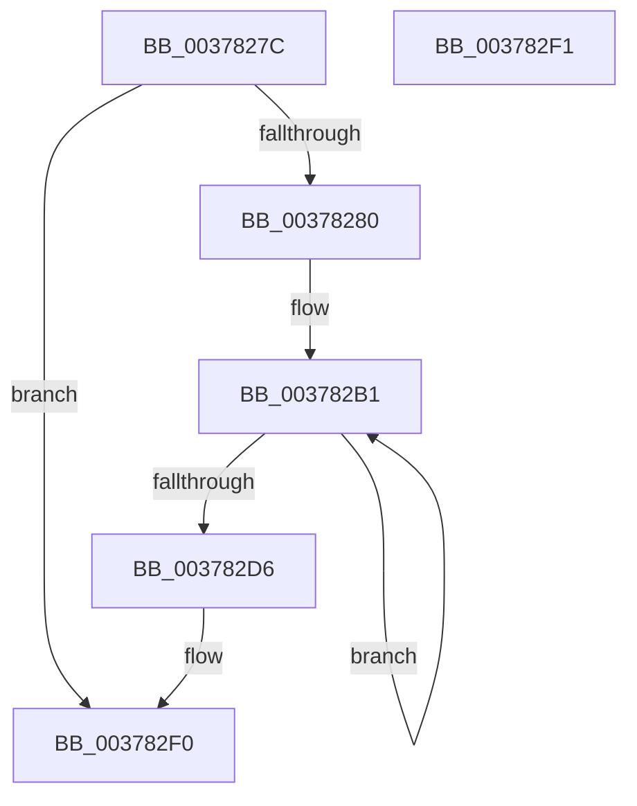

# MiInsertLargeTbFlushEntry

- RVA: `0x0037827C`–`0x003782F2` (길이 `118` bytes)
- VA: `0x000000014037827C`
- 실행 섹션: `.text`
- PDB 이름 있음: `예`; PDB Function 태그: `아니요`
- unwind 정보 RVA: `0x0006E820`
- 디코드: `34`개 명령, `118/118` bytes 표시
- 미해석 바이트: `0` (있으면 어셈블리에 `.byte`로 보존)

> 이 문서는 커널 이미지의 기계어와 PDB 기호를 분석해 생성했습니다. 4번과 5번은 함수 원형과 자료형을 바이너리 사용 방식에서 추정한 C 해석이며 원본 소스 복구 결과는 아닙니다.

## 1. Dependencies

- 직접 호출 지점: **1**; 고유 호출 대상: **1**
- 직접 호출자로 확인된 함수: **20**
- RIP 상대 이미지 참조: **0**

### Outgoing calls
- `0x003782CB` → [MiInsertTbFlushEntry](../29/MiInsertTbFlushEntry_function_00293670.md) (function, `0x00293670`)

### Direct callers
- [MiRevertValidPte](../2C/MiRevertValidPte_function_002C5160.md) at `0x002C5496`
- [MiFlushValidPteFromTb](MiFlushValidPteFromTb_function_00376878.md) at `0x00376903`
- [MiDecommitLargePoolVa](MiDecommitLargePoolVa_function_00377DD4.md) at `0x00377E9B`
- [MiUnmapMdlCommon](../3E/MiUnmapMdlCommon_function_003E7DF0.md) at `0x003E8076`
- [MiLargePageFault](../3F/MiLargePageFault_function_003F01C4.md) at `0x003F02ED`
- [MiUnmapContiguousMemory](../3F/MiUnmapContiguousMemory_function_003F7908.md) at `0x003F7A97`
- [sub_00436E60](../43/Unknown_function_00436E60.md) at `0x00436EC2`
- [MiDeleteSystemPageTable](../49/MiDeleteSystemPageTable_function_004916B0.md) at `0x00491840`
- [MiReleaseLargePdeMappings](../49/MiReleaseLargePdeMappings_function_0049D0B0.md) at `0x0049D39C`
- [MiProtectAweRegion](../4C/MiProtectAweRegion_function_004CE62C.md) at `0x004CEC9C`
- [MiDecommitAddTbFlushEntries](../4F/MiDecommitAddTbFlushEntries_function_004FB798.md) at `0x004FB835`
- [MiInsertAweFlushList](../68/MiInsertAweFlushList_function_00688FEC.md) at `0x00689054`
- [MiClearSystemAccessBits](../68/MiClearSystemAccessBits_function_0068A2A0.md) at `0x0068A3A6`
- [MiDemoteValidLargePageOneLevel](../68/MiDemoteValidLargePageOneLevel_function_0068A3F4.md) at `0x0068A80E`
- [MiWritePteHighLevel](../68/MiWritePteHighLevel_function_0068AA08.md) at `0x0068AAD2`
- [MiScrubLargeMappedPage](../69/MiScrubLargeMappedPage_function_00693E2C.md) at `0x006940C3`
- [sub_006DB1A0](../6D/Unknown_function_006DB1A0.md) at `0x006DB1D4`
- [sub_006F91FE](../6F/Unknown_function_006F91FE.md) at `0x006F9261`
- [MiProtectLargeKernelHalRange](../../page/7F/MiProtectLargeKernelHalRange_function_007F8D20.md) at `0x007F8E56`
- [MiFreeBootDriverPages](../../init/C7/MiFreeBootDriverPages_function_00C7695C.md) at `0x00C76AB4`

### Static image references
- 디코드된 RIP-relative 메모리 참조가 없습니다.

## 2. Other-region calls and transfers

- 다른 실행 섹션으로 향하는 call: **0**
- 별도 외부 분기/꼬리 이동을 확인하지 못했습니다.

## 3. Assembly (complete function range)

```asm
0037827C  85 D2                           test edx, edx
0037827E  78 70                           js 0x1403782f0
00378280  48 8B C4                        mov rax, rsp
00378283  48 89 58 08                     mov qword ptr [rax + 8], rbx
00378287  48 89 68 10                     mov qword ptr [rax + 0x10], rbp
0037828B  48 89 70 18                     mov qword ptr [rax + 0x18], rsi
0037828F  48 89 78 20                     mov qword ptr [rax + 0x20], rdi
00378293  41 56                           push r14
00378295  48 83 EC 20                     sub rsp, 0x20
00378299  49 8B D8                        mov rbx, r8
0037829C  8B EA                           mov ebp, edx
0037829E  4C 8B F1                        mov r14, rcx
003782A1  33 F6                           xor esi, esi
003782A3  48 BF 00 00 00 00 80 F6 FF FF   movabs rdi, 0xfffff68000000000
003782AD  48 C1 E7 19                     shl rdi, 0x19
003782B1  48 C1 E3 19                     shl rbx, 0x19
003782B5  44 8B CE                        mov r9d, esi
003782B8  48 2B DF                        sub rbx, rdi
003782BB  41 B8 01 00 00 00               mov r8d, 1
003782C1  48 C1 FB 10                     sar rbx, 0x10
003782C5  49 8B CE                        mov rcx, r14
003782C8  48 8B D3                        mov rdx, rbx
003782CB  E8 A0 B3 F1 FF                  call 0x140293670
003782D0  FF C6                           inc esi
003782D2  3B F5                           cmp esi, ebp
003782D4  7E DB                           jle 0x1403782b1
003782D6  48 8B 5C 24 30                  mov rbx, qword ptr [rsp + 0x30]
003782DB  48 8B 6C 24 38                  mov rbp, qword ptr [rsp + 0x38]
003782E0  48 8B 74 24 40                  mov rsi, qword ptr [rsp + 0x40]
003782E5  48 8B 7C 24 48                  mov rdi, qword ptr [rsp + 0x48]
003782EA  48 83 C4 20                     add rsp, 0x20
003782EE  41 5E                           pop r14
003782F0  C3                              ret
003782F1  CC                              int3
```

## 4. C-style interpretation (structured pseudocode)

```c
__int64 __fastcall MiInsertLargeTbFlushEntry(__int64 a1, int a2, __int64 a3)
{
    __int64 result;
    __int64 v_rbx;
    __int64 v_rdi;
    __int64 v_rsi;
    __int64 v_rsp;
    unsigned __int64 v_stack_p10;
    unsigned __int64 v_stack_p18;
    unsigned __int64 v_stack_p20;
    unsigned __int64 v_stack_p8;

    if (sign_flag) goto loc_003782F0;
    *(unsigned __int64 *)(v_rsp + 8) = v_rbx;
    *(unsigned __int64 *)(v_rsp + 16) = v_rbp;
    *(unsigned __int64 *)(v_rsp + 24) = v_rsi;
    *(unsigned __int64 *)(v_rsp + 32) = v_rdi;
    v_rsp = (v_rsp) - (32);
    v_rsi = 0;
    v_rdi = (v_rdi) << (25);
loc_003782B1:
    v_rbx = (a3) << (25);
    v_rbx = (v_rbx) - (v_rdi);
    v_rbx = (v_rbx) >> (16);
    result = MiInsertTbFlushEntry(a1, v_rbx, 1, 0);
    v_rsi = (unsigned int)((v_rsi) + 1);
    if (((unsigned int)(v_rsi)) <= ((unsigned int)((unsigned int)(a2)))) goto loc_003782B1;
    v_rsp = (v_rsp) + (32);
loc_003782F0:
    return result;
}
```

## 5. (Beta) C Style

```c
int64_t MiInsertLargeTbFlushEntry(int64_t Arg1, int32_t Arg2, int64_t Arg3)
{
    int64_t result;
    int64_t local_rbx;
    int64_t local_rdi;
    int64_t local_rsi;
    int64_t local_rsp;
    uint64_t v_stack_p10;
    uint64_t v_stack_p18;
    uint64_t v_stack_p20;
    uint64_t v_stack_p8;

    if (sign_flag) goto loc_003782F0;
    *(uint64_t *)(local_rsp + 0x8) = local_rbx;
    *(uint64_t *)(local_rsp + 0x10) = local_rbp;
    *(uint64_t *)(local_rsp + 0x18) = local_rsi;
    *(uint64_t *)(local_rsp + 0x20) = local_rdi;
    local_rsp = (local_rsp) - (32);
    local_rsi = 0;
    local_rdi = (local_rdi) << (25);
loc_003782B1:
    local_rbx = (Arg3) << (25);
    local_rbx = (local_rbx) - (local_rdi);
    local_rbx = (local_rbx) >> (16);
    result = MiInsertTbFlushEntry(Arg1, local_rbx, 1, 0);
    local_rsi = (uint32_t)((local_rsi) + 1);
    if (((uint32_t)(local_rsi)) <= ((uint32_t)((uint32_t)(Arg2)))) goto loc_003782B1;
    local_rsp = (local_rsp) + (32);
loc_003782F0:
    return result;
}
```

## 6. Execution-region graph

[열기: 2D/3D 그래프와 함수 탐색 컨트롤 패널](../../../control-panel.html?section=text&rva=0x0037827C&view=graph)

- 2D 그래프는 위에서 아래로 흐르고, 3D 그래프는 빈 공간을 드래그해 회전합니다. Shift+드래그는 이동, 휠은 확대·축소, 함수 노드 선택은 대상 보고서 이동입니다.

### Static fallback


