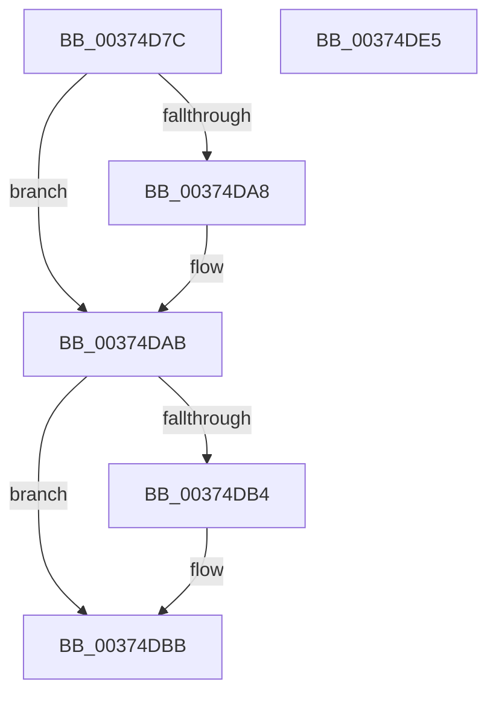

# MiInsertMdlPageNeedsZero

- RVA: `0x00374D7C`–`0x00374DE6` (길이 `106` bytes)
- VA: `0x0000000140374D7C`
- 실행 섹션: `.text`
- PDB 이름 있음: `예`; PDB Function 태그: `아니요`
- unwind 정보 RVA: `0x000DB714`
- 디코드: `31`개 명령, `106/106` bytes 표시
- 미해석 바이트: `0` (있으면 어셈블리에 `.byte`로 보존)

> 이 문서는 커널 이미지의 기계어와 PDB 기호를 분석해 생성했습니다. 4번과 5번은 함수 원형과 자료형을 바이너리 사용 방식에서 추정한 C 해석이며 원본 소스 복구 결과는 아닙니다.

## 1. Dependencies

- 직접 호출 지점: **0**; 고유 호출 대상: **0**
- 직접 호출자로 확인된 함수: **4**
- RIP 상대 이미지 참조: **0**

### Outgoing calls
- 직접 디코드된 call 명령이 없습니다.

### Direct callers
- [MiInitializeMdlOneNodeBatchPages](../2C/MiInitializeMdlOneNodeBatchPages_function_002C9480.md) at `0x002C95F9`
- [MiZeroAndReleasePages](MiZeroAndReleasePages_function_003748D0.md) at `0x003749D5`
- [sub_006E75BA](../6E/Unknown_function_006E75BA.md) at `0x006E75F9`
- [MiFindLargePageMemory](../../page/AA/MiFindLargePageMemory_function_00AA8334.md) at `0x00AA8559`

### Static image references
- 디코드된 RIP-relative 메모리 참조가 없습니다.

## 2. Other-region calls and transfers

- 다른 실행 섹션으로 향하는 call: **0**
- 별도 외부 분기/꼬리 이동을 확인하지 못했습니다.

## 3. Assembly (complete function range)

```asm
00374D7C  8B 41 24                        mov eax, dword ptr [rcx + 0x24]
00374D7F  4C 8B DA                        mov r11, rdx
00374D82  33 D2                           xor edx, edx
00374D84  4C 8B D1                        mov r10, rcx
00374D87  44 8D 48 01                     lea r9d, [rax + 1]
00374D8B  F7 71 18                        div dword ptr [rcx + 0x18]
00374D8E  44 89 49 24                     mov dword ptr [rcx + 0x24], r9d
00374D92  48 8D 81 18 01 00 00            lea rax, [rcx + 0x118]
00374D99  44 8B CA                        mov r9d, edx
00374D9C  49 C1 E1 07                     shl r9, 7
00374DA0  49 03 C1                        add rax, r9
00374DA3  48 39 00                        cmp qword ptr [rax], rax
00374DA6  75 03                           jne 0x140374dab
00374DA8  FF 41 28                        inc dword ptr [rcx + 0x28]
00374DAB  48 8B 48 08                     mov rcx, qword ptr [rax + 8]
00374DAF  48 39 01                        cmp qword ptr [rcx], rax
00374DB2  74 07                           je 0x140374dbb
00374DB4  B9 03 00 00 00                  mov ecx, 3
00374DB9  CD 29                           int 0x29
00374DBB  49 89 4B 08                     mov qword ptr [r11 + 8], rcx
00374DBF  49 89 03                        mov qword ptr [r11], rax
00374DC2  4C 89 19                        mov qword ptr [rcx], r11
00374DC5  4C 89 58 08                     mov qword ptr [rax + 8], r11
00374DC9  4F 01 84 11 10 01 00 00         add qword ptr [r9 + r10 + 0x110], r8
00374DD1  41 8B 43 20                     mov eax, dword ptr [r11 + 0x20]
00374DD5  C1 E8 10                        shr eax, 0x10
00374DD8  0F B6 C8                        movzx ecx, al
00374DDB  48 C1 E9 06                     shr rcx, 6
00374DDF  4D 01 44 CA 30                  add qword ptr [r10 + rcx*8 + 0x30], r8
00374DE4  C3                              ret
00374DE5  CC                              int3
```

## 4. C-style interpretation (structured pseudocode)

```c
__int64 __fastcall MiInsertMdlPageNeedsZero(__int64 a1, __int64 a2, __int64 a3)
{
    __int64 result;

    a2 = 0;
    *(unsigned int *)(a1 + 36) = (unsigned int)((unsigned int)(*(unsigned int *)(a1 + 36)) + 1);
    a4 = (0) << (7);
    result = (a1 + 280) + (a4);
    if ((*(unsigned __int64 *)(result)) == result) {
    }
    if ((*(unsigned __int64 *)(*(unsigned __int64 *)(result + 8))) != result) {
        a1 = 3;
    }
    *(unsigned __int64 *)(a2 + 8) = a1;
    *(unsigned __int64 *)(a2) = result;
    *(unsigned __int64 *)(a1) = 0;
    *(unsigned __int64 *)(result + 8) = 0;
    result = (unsigned int)(((unsigned int)(*(unsigned int *)(a2 + 32))) >> (16));
    a1 = ((unsigned __int8)(result)) >> (6);
    return result;
}
```

## 5. (Beta) C Style

```c
int64_t MiInsertMdlPageNeedsZero(void *Arg1, void *Arg2, int64_t Arg3)
{
    uint8_t *arg1 = (uint8_t *)Arg1;
    uint8_t *arg2 = (uint8_t *)Arg2;

    int64_t result;

    Arg2 = 0;
    *(uint32_t *)(arg1 + 0x24) = (uint32_t)((uint32_t)(*(uint32_t *)(arg1 + 0x24)) + 1);
    a4 = (0) << (7);
    result = (Arg1 + 280) + (a4);
    if ((*(uint64_t *)(result)) == result) {
    }
    if ((*(uint64_t *)(*(uint64_t *)(result + 0x8))) != result) {
        Arg1 = 3;
    }
    *(void **)(arg2 + 0x8) = Arg1;
    *(uint64_t *)(arg2) = result;
    *(uint64_t *)(arg1) = 0;
    *(uint64_t *)(result + 0x8) = 0;
    result = (uint32_t)(((uint32_t)(*(uint32_t *)(arg2 + 0x20))) >> (16));
    Arg1 = ((uint8_t)(result)) >> (6);
    return result;
}
```

### 관측된 메모리 오프셋

구조체 형식이 확인되지 않은 접근은 인자 기준의 오프셋으로만 기록했습니다.

| 기준 인자 | 오프셋 표현 | 폭 (bit) | 접근 |
|---|---:|---:|---|
| `Arg1` | `+ 0x0` | `64` | `R` |
| `Arg1` | `+ 0x8` | `64` | `R` |
| `Arg1` | `+ 0x8` | `64` | `W` |
| `Arg1` | `+ 0x18` | `32` | `R` |
| `Arg1` | `+ 0x24` | `32` | `R` |
| `Arg1` | `+ 0x24` | `32` | `W` |
| `Arg1` | `+ 0x28` | `32` | `R/W` |
| `Arg1` | `+ 0x30 + rcx*8` | `64` | `R/W` |
| `Arg1` | `+ 0x118` | `64` | `R` |
| `Arg2` | `+ 0x0` | `64` | `W` |
| `Arg2` | `+ 0x8` | `64` | `W` |
| `Arg2` | `+ 0x20` | `32` | `R` |

## 6. Execution-region graph

[열기: 2D/3D 그래프와 함수 탐색 컨트롤 패널](../../../control-panel.html?section=text&rva=0x00374D7C&view=graph)

- 2D 그래프는 위에서 아래로 흐르고, 3D 그래프는 빈 공간을 드래그해 회전합니다. Shift+드래그는 이동, 휠은 확대·축소, 함수 노드 선택은 대상 보고서 이동입니다.

### Static fallback


