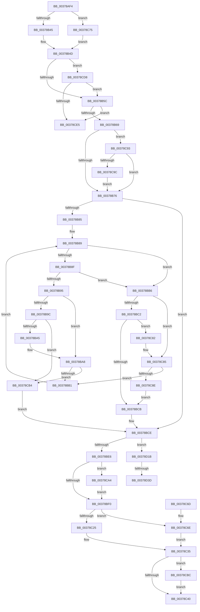

# MiInsertSlabEntry

- RVA: `0x00378AF4`–`0x00378D44` (길이 `592` bytes)
- VA: `0x0000000140378AF4`
- 실행 섹션: `.text`
- PDB 이름 있음: `예`; PDB Function 태그: `예`
- unwind 정보 RVA: `0x0007AED4`
- 디코드: `150`개 명령, `592/592` bytes 표시
- 미해석 바이트: `0` (있으면 어셈블리에 `.byte`로 보존)

> 이 문서는 커널 이미지의 기계어와 PDB 기호를 분석해 생성했습니다. 4번과 5번은 함수 원형과 자료형을 바이너리 사용 방식에서 추정한 C 해석이며 원본 소스 복구 결과는 아닙니다.

## 1. Dependencies

- 직접 호출 지점: **9**; 고유 호출 대상: **9**
- 직접 호출자로 확인된 함수: **3**
- RIP 상대 이미지 참조: **4**

### Outgoing calls
- `0x00378B45` → [ExAcquireSpinLockExclusive](../24/ExAcquireSpinLockExclusive_function_00248690.md) (function, `0x00248690`)
- `0x00378BD4` → [RtlRbInsertNodeEx](../2E/RtlRbInsertNodeEx_function_002E4570.md) (function, `0x002E4570`)
- `0x00378C0B` → [MiUpdateSlabTypeAvailablePages](MiUpdateSlabTypeAvailablePages_function_00378DC0.md) (function, `0x00378DC0`)
- `0x00378C47` → [MiReleaseSpinLockExclusive](../24/MiReleaseSpinLockExclusive_function_002482C0.md) (function, `0x002482C0`)
- `0x00378C78` → [ExAcquireSpinLockExclusiveAtDpcLevel](../24/ExAcquireSpinLockExclusiveAtDpcLevel_function_00248E80.md) (function, `0x00248E80`)
- `0x00378CAA` → [MiSlabEntryPageFreed](../2A/MiSlabEntryPageFreed_function_002A0CE4.md) (function, `0x002A0CE4`)
- `0x00378CBC` → [MiGetSlabCurrentTime](../3B/MiGetSlabCurrentTime_function_003BCBCC.md) (function, `0x003BCBCC`)
- `0x00378CCE` → [MiSlabEntryBecameEmpty](../4B/MiSlabEntryBecameEmpty_function_004B48F4.md) (function, `0x004B48F4`)
- `0x00378D08` → [ExAcquireSpinLockSharedAtDpcLevel](../24/ExAcquireSpinLockSharedAtDpcLevel_function_00248E30.md) (function, `0x00248E30`)

### Direct callers
- [MiReplenishSlabAllocator](MiReplenishSlabAllocator_function_003788E4.md) at `0x003789E6`
- [MiCreateBootSlabEntries](../../init/C6/MiCreateBootSlabEntries_function_00C69A50.md) at `0x00C69C18`
- [MmUpdateSlabRangeType](../../init/C6/MmUpdateSlabRangeType_function_00C6A10C.md) at `0x00C6A26E`

### Static image references
- `0x00378B17` → RVA `0x00011C60` (`.rdata`; read)
- `0x00378B5C` → RVA `0x00E2FFD8` (`.data`; read)
- `0x00378CD8` → RVA `0x00E2FFC0` (`.data`; read)
- `0x00378CFE` → RVA `0x00E2FFD0` (`.data`; read)

## 2. Other-region calls and transfers

- 다른 실행 섹션으로 향하는 call: **0**
- call이 아닌 외부 분기/꼬리 이동: **2**
  - `0x00378D16` → [sub_006E42AA](../6E/Unknown_function_006E42AA.md) (`tail-transfer`)
  - `0x00378D37` → [sub_006E42AA + 0xAF](../6E/Unknown_function_006E42AA.md) (`tail-transfer`)

## 3. Assembly (complete function range)

```asm
00378AF4  48 8B C4                        mov rax, rsp
00378AF7  48 89 58 08                     mov qword ptr [rax + 8], rbx
00378AFB  48 89 68 10                     mov qword ptr [rax + 0x10], rbp
00378AFF  48 89 70 18                     mov qword ptr [rax + 0x18], rsi
00378B03  48 89 78 20                     mov qword ptr [rax + 0x20], rdi
00378B07  41 54                           push r12
00378B09  41 56                           push r14
00378B0B  41 57                           push r15
00378B0D  48 83 EC 20                     sub rsp, 0x20
00378B11  8B 82 88 00 00 00               mov eax, dword ptr [rdx + 0x88]
00378B17  4C 8D 25 42 91 C9 FF            lea r12, [rip - 0x366ebe]
00378B1E  48 C1 E8 04                     shr rax, 4
00378B22  33 ED                           xor ebp, ebp
00378B24  83 E0 03                        and eax, 3
00378B27  4C 8B F9                        mov r15, rcx
00378B2A  48 8D 4A 10                     lea rcx, [rdx + 0x10]
00378B2E  41 8B F9                        mov edi, r9d
00378B31  49 8B F0                        mov rsi, r8
00378B34  48 8B DA                        mov rbx, rdx
00378B37  45 8B 24 C4                     mov r12d, dword ptr [r12 + rax*8]
00378B3B  41 F6 C1 02                     test r9b, 2
00378B3F  0F 85 30 01 00 00               jne 0x140378c75
00378B45  E8 46 FB EC FF                  call 0x140248690
00378B4A  44 8A F0                        mov r14b, al
00378B4D  41 B9 01 00 00 00               mov r9d, 1
00378B53  41 84 F9                        test r9b, dil
00378B56  0F 85 7C 01 00 00               jne 0x140378cd8
00378B5C  48 39 2D 75 74 AB 00            cmp qword ptr [rip + 0xab7475], rbp
00378B63  0F 85 7C 01 00 00               jne 0x140378ce5
00378B69  48 8B 13                        mov rdx, qword ptr [rbx]
00378B6C  44 84 4B 08                     test byte ptr [rbx + 8], r9b
00378B70  0F 85 1D 01 00 00               jne 0x140378c93
00378B76  0F B6 4B 08                     movzx ecx, byte ptr [rbx + 8]
00378B7A  45 32 C0                        xor r8b, r8b
00378B7D  41 23 C9                        and ecx, r9d
00378B80  48 85 D2                        test rdx, rdx
00378B83  74 49                           je 0x140378bce
00378B85  4C 8B 46 28                     mov r8, qword ptr [rsi + 0x28]
00378B89  4C 3B 42 30                     cmp r8, qword ptr [rdx + 0x30]
00378B8D  77 27                           ja 0x140378bb6
00378B8F  4C 3B 42 28                     cmp r8, qword ptr [rdx + 0x28]
00378B93  73 21                           jae 0x140378bb6
00378B95  48 8B 02                        mov rax, qword ptr [rdx]
00378B98  85 C9                           test ecx, ecx
00378B9A  74 0C                           je 0x140378ba8
00378B9C  48 85 C0                        test rax, rax
00378B9F  0F 84 0F 01 00 00               je 0x140378cb4
00378BA5  48 33 C2                        xor rax, rdx
00378BA8  48 85 C0                        test rax, rax
00378BAB  0F 84 03 01 00 00               je 0x140378cb4
00378BB1  48 8B D0                        mov rdx, rax
00378BB4  EB D3                           jmp 0x140378b89
00378BB6  48 8B 42 08                     mov rax, qword ptr [rdx + 8]
00378BBA  85 C9                           test ecx, ecx
00378BBC  0F 84 C3 00 00 00               je 0x140378c85
00378BC2  48 85 C0                        test rax, rax
00378BC5  0F 85 B7 00 00 00               jne 0x140378c82
00378BCB  45 8A C1                        mov r8b, r9b
00378BCE  4C 8B CE                        mov r9, rsi
00378BD1  48 8B CB                        mov rcx, rbx
00378BD4  E8 97 B9 F6 FF                  call 0x1402e4570
00378BD9  83 BB 80 00 00 00 08            cmp dword ptr [rbx + 0x80], 8
00378BE0  0F 84 35 01 00 00               je 0x140378d1b
00378BE6  83 7E 54 00                     cmp dword ptr [rsi + 0x54], 0
00378BEA  0F 85 B4 00 00 00               jne 0x140378ca4
00378BF0  48 8B 43 60                     mov rax, qword ptr [rbx + 0x60]
00378BF4  8B 4E 54                        mov ecx, dword ptr [rsi + 0x54]
00378BF7  48 03 C8                        add rcx, rax
00378BFA  48 89 4B 60                     mov qword ptr [rbx + 0x60], rcx
00378BFE  49 8B CF                        mov rcx, r15
00378C01  44 8B 46 54                     mov r8d, dword ptr [rsi + 0x54]
00378C05  8B 93 80 00 00 00               mov edx, dword ptr [rbx + 0x80]
00378C0B  E8 B0 01 00 00                  call 0x140378dc0
00378C10  48 8B 43 78                     mov rax, qword ptr [rbx + 0x78]
00378C14  49 8B D4                        mov rdx, r12
00378C17  48 FF C0                        inc rax
00378C1A  48 89 43 78                     mov qword ptr [rbx + 0x78], rax
00378C1E  8B 46 5C                        mov eax, dword ptr [rsi + 0x5c]
00378C21  A8 02                           test al, 2
00378C23  74 49                           je 0x140378c6e
00378C25  48 8B 4B 70                     mov rcx, qword ptr [rbx + 0x70]
00378C29  B8 D0 4C 00 00                  mov eax, 0x4cd0
00378C2E  48 03 CA                        add rcx, rdx
00378C31  48 89 4B 70                     mov qword ptr [rbx + 0x70], rcx
00378C35  F0 4A 01 14 38                  lock add qword ptr [rax + r15], rdx
00378C3A  44 39 66 54                     cmp dword ptr [rsi + 0x54], r12d
00378C3E  74 7C                           je 0x140378cbc
00378C40  48 8D 4B 10                     lea rcx, [rbx + 0x10]
00378C44  41 8A D6                        mov dl, r14b
00378C47  E8 74 F6 EC FF                  call 0x1402482c0
00378C4C  48 8B 5C 24 40                  mov rbx, qword ptr [rsp + 0x40]
00378C51  8B C5                           mov eax, ebp
00378C53  48 8B 6C 24 48                  mov rbp, qword ptr [rsp + 0x48]
00378C58  48 8B 74 24 50                  mov rsi, qword ptr [rsp + 0x50]
00378C5D  48 8B 7C 24 58                  mov rdi, qword ptr [rsp + 0x58]
00378C62  48 83 C4 20                     add rsp, 0x20
00378C66  41 5F                           pop r15
00378C68  41 5E                           pop r14
00378C6A  41 5C                           pop r12
00378C6C  C3                              ret
00378C6D  CC                              int3
00378C6E  B8 D8 4C 00 00                  mov eax, 0x4cd8
00378C73  EB C0                           jmp 0x140378c35
00378C75  41 B6 11                        mov r14b, 0x11
00378C78  E8 03 02 ED FF                  call 0x140248e80
00378C7D  E9 CB FE FF FF                  jmp 0x140378b4d
00378C82  48 33 C2                        xor rax, rdx
00378C85  48 85 C0                        test rax, rax
00378C88  0F 85 23 FF FF FF               jne 0x140378bb1
00378C8E  E9 38 FF FF FF                  jmp 0x140378bcb
00378C93  48 85 D2                        test rdx, rdx
00378C96  0F 84 DA FE FF FF               je 0x140378b76
00378C9C  48 33 D3                        xor rdx, rbx
00378C9F  E9 D2 FE FF FF                  jmp 0x140378b76
00378CA4  48 8B D6                        mov rdx, rsi
00378CA7  48 8B CB                        mov rcx, rbx
00378CAA  E8 35 80 F2 FF                  call 0x1402a0ce4
00378CAF  E9 3C FF FF FF                  jmp 0x140378bf0
00378CB4  45 32 C0                        xor r8b, r8b
00378CB7  E9 12 FF FF FF                  jmp 0x140378bce
00378CBC  E8 0B 3F 04 00                  call 0x1403bcbcc
00378CC1  48 8B D6                        mov rdx, rsi
00378CC4  48 89 83 A8 00 00 00            mov qword ptr [rbx + 0xa8], rax
00378CCB  48 8B CB                        mov rcx, rbx
00378CCE  E8 21 BC 13 00                  call 0x1404b48f4
00378CD3  E9 68 FF FF FF                  jmp 0x140378c40
00378CD8  48 39 2D E1 72 AB 00            cmp qword ptr [rip + 0xab72e1], rbp
00378CDF  0F 84 77 FE FF FF               je 0x140378b5c
00378CE5  48 8B 46 28                     mov rax, qword ptr [rsi + 0x28]
00378CE9  48 8D 3C 40                     lea rdi, [rax + rax*2]
00378CED  48 B8 00 00 00 00 00 DE FF FF   movabs rax, 0xffffde0000000000
00378CF7  48 C1 E7 04                     shl rdi, 4
00378CFB  48 8B C0                        mov rax, rax
00378CFE  48 8D 0D CB 72 AB 00            lea rcx, [rip + 0xab72cb]
00378D05  48 03 F8                        add rdi, rax
00378D08  E8 23 01 ED FF                  call 0x140248e30
00378D0D  48 8B 0D AC 72 AB 00            mov rcx, qword ptr [rip + 0xab72ac]
00378D14  33 D2                           xor edx, edx
00378D16  E9 8F B5 36 00                  jmp 0x1406e42aa
00378D1B  8B 46 5C                        mov eax, dword ptr [rsi + 0x5c]
00378D1E  48 8D 56 18                     lea rdx, [rsi + 0x18]
00378D22  C1 E8 03                        shr eax, 3
00378D25  83 E0 3F                        and eax, 0x3f
00378D28  48 C1 E0 04                     shl rax, 4
00378D2C  48 03 43 58                     add rax, qword ptr [rbx + 0x58]
00378D30  4C 8B 40 08                     mov r8, qword ptr [rax + 8]
00378D34  49 39 00                        cmp qword ptr [r8], rax
00378D37  0F 84 1C B6 36 00               je 0x1406e4359
00378D3D  B9 03 00 00 00                  mov ecx, 3
00378D42  CD 29                           int 0x29
```

## 4. C-style interpretation (structured pseudocode)

```c
__int64 __fastcall MiInsertSlabEntry(__int64 a1, __int64 a2, __int64 a3, int a4)
{
    __int64 result;
    __int64 v_rbp;
    __int64 v_rdi;
    __int64 v_rsp;
    unsigned __int64 v_stack_p10;
    unsigned __int64 v_stack_p18;
    unsigned __int64 v_stack_p20;
    unsigned __int64 v_stack_p8;

    *(unsigned __int64 *)(v_rsp + 8) = v_rbx;
    *(unsigned __int64 *)(v_rsp + 16) = v_rbp;
    *(unsigned __int64 *)(v_rsp + 24) = v_rsi;
    *(unsigned __int64 *)(v_rsp + 32) = v_rdi;
    v_rsp = (v_rsp) - (32);
    result = ((unsigned int)(*(unsigned int *)(a2 + 136))) >> (4);
    v_rbp = 0;
    result = (unsigned int)((result) & (3));
    if ((((unsigned __int8)(a4)) & (2)) != 0) goto loc_00378C75;
    result = ExAcquireSpinLockExclusive(a2 + 16, a2, a3, a4);
loc_00378B4D:
    if (((1) & ((unsigned __int8)((unsigned int)(a4)))) != 0) goto loc_00378CD8;
loc_00378B5C:
    if ((*(unsigned __int64 *)(v_rip + 11236469)) != 0) goto loc_00378CE5;
    if (((*(unsigned __int8 *)(a2 + 8)) & (1)) != 0) goto loc_00378C93;
loc_00378B76:
    a3 = 0;
    a1 = (unsigned int)((*(unsigned __int8 *)(a2 + 8)) & (1));
    if (*(unsigned __int64 *)(a2) == 0) goto loc_00378BCE;
loc_00378B89:
    if ((*(unsigned __int64 *)(a3 + 40)) > (*(unsigned __int64 *)(*(unsigned __int64 *)(a2) + 48))) goto loc_00378BB6;
    if ((*(unsigned __int64 *)(a3 + 40)) >= (*(unsigned __int64 *)(*(unsigned __int64 *)(a2) + 40))) goto loc_00378BB6;
    if ((unsigned int)(a1) == 0) goto loc_00378BA8;
    if (*(unsigned __int64 *)(*(unsigned __int64 *)(a2)) == 0) goto loc_00378CB4;
    result = (*(unsigned __int64 *)(*(unsigned __int64 *)(a2))) ^ (*(unsigned __int64 *)(a2));
loc_00378BA8:
    if (result == 0) goto loc_00378CB4;
loc_00378BB1:
    goto loc_00378B89;
loc_00378BB6:
    if ((unsigned int)(a1) == 0) goto loc_00378C85;
    if (*(unsigned __int64 *)(result + 8) != 0) goto loc_00378C82;
loc_00378BCB:
loc_00378BCE:
    result = RtlRbInsertNodeEx(a2, result, 1, 0);
    if ((*(unsigned int *)(a2 + 128)) == 8) goto loc_00378D1B;
    if ((*(unsigned int *)(a3 + 84)) != 0) goto loc_00378CA4;
loc_00378BF0:
    a1 = ((unsigned int)(*(unsigned int *)(a3 + 84))) + (*(unsigned __int64 *)(a2 + 96));
    *(unsigned __int64 *)(a2 + 96) = a1;
    result = MiUpdateSlabTypeAvailablePages(a1, (unsigned int)(*(unsigned int *)(a2 + 128)), (unsigned int)(*(unsigned int *)(a3 + 84)), 0);
    result = (*(unsigned __int64 *)(a2 + 120)) + 1;
    *(unsigned __int64 *)(a2 + 120) = result;
    if ((((unsigned __int8)((unsigned int)(*(unsigned int *)(a3 + 92)))) & (2)) == 0) goto loc_00378C6E;
    a1 = (*(unsigned __int64 *)(a2 + 112)) + ((unsigned int)(*(unsigned int *)(v_rip - 3567294 + result * 8)));
    *(unsigned __int64 *)(a2 + 112) = a1;
loc_00378C35:
    if ((*(unsigned int *)(a3 + 84)) == ((unsigned int)((unsigned int)(*(unsigned int *)(v_rip - 3567294 + result * 8))))) goto loc_00378CBC;
loc_00378C40:
    result = MiReleaseSpinLockExclusive(a2 + 16, (unsigned __int8)((unsigned __int8)(result)), (unsigned int)(*(unsigned int *)(a3 + 84)), 0);
    v_rsp = (v_rsp) + (32);
    return 0;
loc_00378C6E:
    goto loc_00378C35;
loc_00378C75:
    result = ExAcquireSpinLockExclusiveAtDpcLevel(a2 + 16, (unsigned __int8)((unsigned __int8)(result)), (unsigned int)(*(unsigned int *)(a3 + 84)), 0);
    goto loc_00378B4D;
loc_00378C82:
    result = (result) ^ ((unsigned __int8)((unsigned __int8)(result)));
loc_00378C85:
    if (result != 0) goto loc_00378BB1;
    goto loc_00378BCB;
loc_00378C93:
    if ((unsigned __int8)((unsigned __int8)(result)) == 0) goto loc_00378B76;
    a2 = ((unsigned __int8)((unsigned __int8)(result))) ^ (v_stack_p8);
    goto loc_00378B76;
loc_00378CA4:
    result = MiSlabEntryPageFreed(v_stack_p8, v_stack_p18, (unsigned int)(*(unsigned int *)(a3 + 84)), 0);
    goto loc_00378BF0;
loc_00378CB4:
    a3 = 0;
    goto loc_00378BCE;
loc_00378CBC:
    result = MiGetSlabCurrentTime(v_stack_p8, v_stack_p18, a3, 0);
    *(unsigned __int64 *)(v_stack_p8 + 168) = result;
    result = MiSlabEntryBecameEmpty(v_stack_p8, v_stack_p18, a3, 0);
    goto loc_00378C40;
loc_00378CD8:
    if ((*(unsigned __int64 *)(v_rip + 11236065)) == v_stack_p10) goto loc_00378B5C;
loc_00378CE5:
    v_rdi = (*(unsigned __int64 *)(v_stack_p18 + 40) + *(unsigned __int64 *)(v_stack_p18 + 40) * 2) << (4);
    v_rdi = (v_rdi) + (*(unsigned __int64 *)(v_stack_p18 + 40));
    result = ExAcquireSpinLockSharedAtDpcLevel(v_rip + 11236043, v_stack_p18, a3, 0);
    a2 = 0;
loc_00378D1B:
    result = (unsigned int)(((unsigned int)(*(unsigned int *)(v_stack_p18 + 92))) >> (3));
    result = (unsigned int)((result) & (63));
    result = (result) << (4);
    result = (result) + (*(unsigned __int64 *)(v_stack_p8 + 88));
    return result;
}
```

## 5. (Beta) C Style

```c
int64_t MiInsertSlabEntry(int64_t Arg1, void *Arg2, void *Arg3, int32_t Arg4)
{
    uint8_t *arg2 = (uint8_t *)Arg2;
    uint8_t *arg3 = (uint8_t *)Arg3;

    int64_t result;
    int64_t local_rbp;
    int64_t local_rdi;
    int64_t local_rsp;
    uint64_t v_stack_p10;
    uint64_t v_stack_p18;
    uint64_t v_stack_p20;
    uint64_t v_stack_p8;

    *(uint64_t *)(local_rsp + 0x8) = local_rbx;
    *(uint64_t *)(local_rsp + 0x10) = local_rbp;
    *(uint64_t *)(local_rsp + 0x18) = local_rsi;
    *(uint64_t *)(local_rsp + 0x20) = local_rdi;
    local_rsp = (local_rsp) - (32);
    result = ((uint32_t)(*(uint32_t *)(arg2 + 0x88))) >> (4);
    local_rbp = 0;
    result = (uint32_t)((result) & (3));
    if ((((uint8_t)(Arg4)) & (2)) != 0) goto loc_00378C75;
    result = ExAcquireSpinLockExclusive(Arg2 + 16, Arg2, Arg3, Arg4);
loc_00378B4D:
    if (((1) & ((uint8_t)((uint32_t)(Arg4)))) != 0) goto loc_00378CD8;
loc_00378B5C:
    if ((*(uint64_t *)(v_rip + 0xAB7475)) != 0) goto loc_00378CE5;
    if (((*(uint8_t *)(arg2 + 0x8)) & (1)) != 0) goto loc_00378C93;
loc_00378B76:
    Arg3 = 0;
    Arg1 = (uint32_t)((*(uint8_t *)(arg2 + 0x8)) & (1));
    if (*(uint64_t *)(arg2) == 0) goto loc_00378BCE;
loc_00378B89:
    if ((*(uint64_t *)(arg3 + 0x28)) > (*(uint64_t *)(*(uint64_t *)(arg2) + 0x30))) goto loc_00378BB6;
    if ((*(uint64_t *)(arg3 + 0x28)) >= (*(uint64_t *)(*(uint64_t *)(arg2) + 0x28))) goto loc_00378BB6;
    if ((uint32_t)(Arg1) == 0) goto loc_00378BA8;
    if (*(uint64_t *)(*(uint64_t *)(arg2)) == 0) goto loc_00378CB4;
    result = (*(uint64_t *)(*(uint64_t *)(arg2))) ^ (*(uint64_t *)(arg2));
loc_00378BA8:
    if (result == 0) goto loc_00378CB4;
loc_00378BB1:
    goto loc_00378B89;
loc_00378BB6:
    if ((uint32_t)(Arg1) == 0) goto loc_00378C85;
    if (*(uint64_t *)(result + 0x8) != 0) goto loc_00378C82;
loc_00378BCB:
loc_00378BCE:
    result = RtlRbInsertNodeEx(Arg2, result, 1, 0);
    if ((*(uint32_t *)(arg2 + 0x80)) == 8) goto loc_00378D1B;
    if ((*(uint32_t *)(arg3 + 0x54)) != 0) goto loc_00378CA4;
loc_00378BF0:
    Arg1 = ((uint32_t)(*(uint32_t *)(arg3 + 0x54))) + (*(uint64_t *)(arg2 + 0x60));
    *(uint64_t *)(arg2 + 0x60) = Arg1;
    result = MiUpdateSlabTypeAvailablePages(Arg1, (uint32_t)(*(uint32_t *)(arg2 + 0x80)), (uint32_t)(*(uint32_t *)(arg3 + 0x54)), 0);
    result = (*(uint64_t *)(arg2 + 0x78)) + 1;
    *(uint64_t *)(arg2 + 0x78) = result;
    if ((((uint8_t)((uint32_t)(*(uint32_t *)(arg3 + 0x5C)))) & (2)) == 0) goto loc_00378C6E;
    Arg1 = (*(uint64_t *)(arg2 + 0x70)) + ((uint32_t)(*(uint32_t *)(v_rip - 0x366EBE + result * 8)));
    *(uint64_t *)(arg2 + 0x70) = Arg1;
loc_00378C35:
    if ((*(uint32_t *)(arg3 + 0x54)) == ((uint32_t)((uint32_t)(*(uint32_t *)(v_rip - 0x366EBE + result * 8))))) goto loc_00378CBC;
loc_00378C40:
    result = MiReleaseSpinLockExclusive(Arg2 + 16, (uint8_t)((uint8_t)(result)), (uint32_t)(*(uint32_t *)(arg3 + 0x54)), 0);
    local_rsp = (local_rsp) + (32);
    return 0;
loc_00378C6E:
    goto loc_00378C35;
loc_00378C75:
    result = ExAcquireSpinLockExclusiveAtDpcLevel(Arg2 + 16, (uint8_t)((uint8_t)(result)), (uint32_t)(*(uint32_t *)(arg3 + 0x54)), 0);
    goto loc_00378B4D;
loc_00378C82:
    result = (result) ^ ((uint8_t)((uint8_t)(result)));
loc_00378C85:
    if (result != 0) goto loc_00378BB1;
    goto loc_00378BCB;
loc_00378C93:
    if ((uint8_t)((uint8_t)(result)) == 0) goto loc_00378B76;
    Arg2 = ((uint8_t)((uint8_t)(result))) ^ (v_stack_p8);
    goto loc_00378B76;
loc_00378CA4:
    result = MiSlabEntryPageFreed(v_stack_p8, v_stack_p18, (uint32_t)(*(uint32_t *)(arg3 + 0x54)), 0);
    goto loc_00378BF0;
loc_00378CB4:
    Arg3 = 0;
    goto loc_00378BCE;
loc_00378CBC:
    result = MiGetSlabCurrentTime(v_stack_p8, v_stack_p18, Arg3, 0);
    *(uint64_t *)(v_stack_p8 + 0xA8) = result;
    result = MiSlabEntryBecameEmpty(v_stack_p8, v_stack_p18, Arg3, 0);
    goto loc_00378C40;
loc_00378CD8:
    if ((*(uint64_t *)(v_rip + 0xAB72E1)) == v_stack_p10) goto loc_00378B5C;
loc_00378CE5:
    local_rdi = (*(uint64_t *)(v_stack_p18 + 0x28) + *(uint64_t *)(v_stack_p18 + 0x28) * 2) << (4);
    local_rdi = (local_rdi) + (*(uint64_t *)(v_stack_p18 + 0x28));
    result = ExAcquireSpinLockSharedAtDpcLevel(v_rip + 11236043, v_stack_p18, Arg3, 0);
    Arg2 = 0;
loc_00378D1B:
    result = (uint32_t)(((uint32_t)(*(uint32_t *)(v_stack_p18 + 0x5C))) >> (3));
    result = (uint32_t)((result) & (63));
    result = (result) << (4);
    result = (result) + (*(uint64_t *)(v_stack_p8 + 0x58));
    return result;
}
```

### 관측된 메모리 오프셋

구조체 형식이 확인되지 않은 접근은 인자 기준의 오프셋으로만 기록했습니다.

| 기준 인자 | 오프셋 표현 | 폭 (bit) | 접근 |
|---|---:|---:|---|
| `Arg2` | `+ 0x0` | `64` | `R` |
| `Arg2` | `+ 0x8` | `8` | `R` |
| `Arg2` | `+ 0x10` | `64` | `R` |
| `Arg2` | `+ 0x58` | `64` | `R` |
| `Arg2` | `+ 0x60` | `64` | `R` |
| `Arg2` | `+ 0x60` | `64` | `W` |
| `Arg2` | `+ 0x70` | `64` | `R` |
| `Arg2` | `+ 0x70` | `64` | `W` |
| `Arg2` | `+ 0x78` | `64` | `R` |
| `Arg2` | `+ 0x78` | `64` | `W` |
| `Arg2` | `+ 0x80` | `32` | `R` |
| `Arg2` | `+ 0x88` | `32` | `R` |
| `Arg2` | `+ 0xA8` | `64` | `W` |
| `Arg3` | `+ 0x18` | `64` | `R` |
| `Arg3` | `+ 0x28` | `64` | `R` |
| `Arg3` | `+ 0x54` | `32` | `R` |
| `Arg3` | `+ 0x5C` | `32` | `R` |

## 6. Execution-region graph

[열기: 2D/3D 그래프와 함수 탐색 컨트롤 패널](../../../control-panel.html?section=text&rva=0x00378AF4&view=graph)

- 2D 그래프는 위에서 아래로 흐르고, 3D 그래프는 빈 공간을 드래그해 회전합니다. Shift+드래그는 이동, 휠은 확대·축소, 함수 노드 선택은 대상 보고서 이동입니다.

### Static fallback


