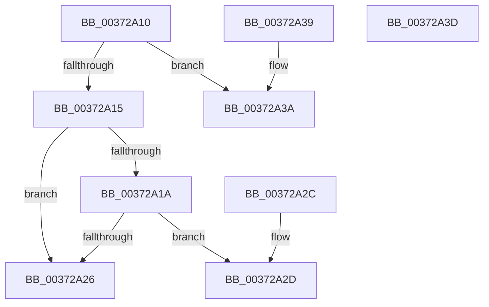

# MiInvalidPteConforms

- RVA: `0x00372A10`–`0x00372A3E` (길이 `46` bytes)
- VA: `0x0000000140372A10`
- 실행 섹션: `.text`
- PDB 이름 있음: `예`; PDB Function 태그: `아니요`
- unwind 정보 RVA: `0x000DB714`
- 디코드: `18`개 명령, `46/46` bytes 표시
- 미해석 바이트: `0` (있으면 어셈블리에 `.byte`로 보존)

> 이 문서는 커널 이미지의 기계어와 PDB 기호를 분석해 생성했습니다. 4번과 5번은 함수 원형과 자료형을 바이너리 사용 방식에서 추정한 C 해석이며 원본 소스 복구 결과는 아닙니다.

## 1. Dependencies

- 직접 호출 지점: **0**; 고유 호출 대상: **0**
- 직접 호출자로 확인된 함수: **18**
- RIP 상대 이미지 참조: **1**

### Outgoing calls
- 직접 디코드된 call 명령이 없습니다.

### Direct callers
- [MiHandleForkTransitionPte](../22/MiHandleForkTransitionPte_function_0022D34C.md) at `0x0022D44F`
- [MiDecommitHandleTransitionPte](../24/MiDecommitHandleTransitionPte_function_0024037C.md) at `0x002403DE`
- [MiActOnPte](../24/MiActOnPte_function_00244C90.md) at `0x002452E4`
- [MiTradePage](../28/MiTradePage_function_0028D160.md) at `0x0028D5CA`
- [MiGetWorkingSetInfoList](../2A/MiGetWorkingSetInfoList_function_002AF770.md) at `0x002AFFFA`
- [MiGetWorkingSetInfoList](../2A/MiGetWorkingSetInfoList_function_002AF770.md) at `0x002B05D6`
- [MiSetProtectionOnTransitionPte](../2C/MiSetProtectionOnTransitionPte_function_002C586C.md) at `0x002C58E2`
- [MiSharePages](../31/MiSharePages_function_00315110.md) at `0x00315DBD`
- [MiCombineCandidate](../31/MiCombineCandidate_function_00316290.md) at `0x003163BA`
- [MiCheckProtoPtePageState](../31/MiCheckProtoPtePageState_function_003183E0.md) at `0x00318623`
- [MiUpdatePfnForPrefetchByPte](../32/MiUpdatePfnForPrefetchByPte_function_00321210.md) at `0x003213EC`
- [MiValidFault](../32/MiValidFault_function_003280B4.md) at `0x0032823A`
- [sub_0032BD21](../32/Unknown_function_0032BD21.md) at `0x0032BE45`
- [MiOutSwapWorkingSetPte](MiOutSwapWorkingSetPte_function_00372190.md) at `0x00372422`
- [MiTryLockLeafPage](MiTryLockLeafPage_function_003728DC.md) at `0x00372919`
- [MiReservePageFileSpaceForPage](../38/MiReservePageFileSpaceForPage_function_0038377C.md) at `0x00383881`
- [MiReservePageFileSpaceForPage](../38/MiReservePageFileSpaceForPage_function_0038377C.md) at `0x00383929`
- [MiReservePageFileSpaceForPage](../38/MiReservePageFileSpaceForPage_function_0038377C.md) at `0x00383B95`
- [MiSetSystemCodeProtection](../38/MiSetSystemCodeProtection_function_00384420.md) at `0x00384921`
- [MiUpdatePrefetchPriority](../40/MiUpdatePrefetchPriority_function_00402CB0.md) at `0x00402E91`
- [MiTransferPartitionPageRun](../69/MiTransferPartitionPageRun_function_00691DCC.md) at `0x00691F16`

### Static image references
- `0x00372A1A` → RVA `0x00E2DC80` (`.data`; read)

## 2. Other-region calls and transfers

- 다른 실행 섹션으로 향하는 call: **0**
- 별도 외부 분기/꼬리 이동을 확인하지 못했습니다.

## 3. Assembly (complete function range)

```asm
00372A10  F6 C1 01                        test cl, 1
00372A13  75 25                           jne 0x140372a3a
00372A15  48 85 C9                        test rcx, rcx
00372A18  74 0C                           je 0x140372a26
00372A1A  48 8B 05 5F B2 AB 00            mov rax, qword ptr [rip + 0xabb25f]
00372A21  48 85 C0                        test rax, rax
00372A24  75 07                           jne 0x140372a2d
00372A26  B8 01 00 00 00                  mov eax, 1
00372A2B  C3                              ret
00372A2C  CC                              int3
00372A2D  48 85 C1                        test rcx, rax
00372A30  B8 00 00 00 00                  mov eax, 0
00372A35  0F 95 C0                        setne al
00372A38  C3                              ret
00372A39  CC                              int3
00372A3A  33 C0                           xor eax, eax
00372A3C  C3                              ret
00372A3D  CC                              int3
```

## 4. C-style interpretation (structured pseudocode)

```c
__int64 __fastcall MiInvalidPteConforms(__int64 a1)
{
    __int64 result;

    if ((((unsigned __int8)(a1)) & (1)) != 0) goto loc_00372A3A;
    if (a1 == 0) goto loc_00372A26;
    if (*(unsigned __int64 *)(v_rip + 11252319) != 0) goto loc_00372A2D;
loc_00372A26:
    return 1;
loc_00372A2D:
    result = (((a1) & (1)) != 0) ? 1 : 0;
    return result;
loc_00372A3A:
    result = 0;
    return result;
}
```

## 5. (Beta) C Style

```c
int64_t MiInvalidPteConforms(int64_t Arg1)
{
    int64_t result;

    if ((((uint8_t)(Arg1)) & (1)) != 0) goto loc_00372A3A;
    if (Arg1 == 0) goto loc_00372A26;
    if (*(uint64_t *)(v_rip + 0xABB25F) != 0) goto loc_00372A2D;
loc_00372A26:
    return 1;
loc_00372A2D:
    result = (((Arg1) & (1)) != 0) ? 1 : 0;
    return result;
loc_00372A3A:
    result = 0;
    return result;
}
```

## 6. Execution-region graph

[열기: 2D/3D 그래프와 함수 탐색 컨트롤 패널](../../../control-panel.html?section=text&rva=0x00372A10&view=graph)

- 2D 그래프는 위에서 아래로 흐르고, 3D 그래프는 빈 공간을 드래그해 회전합니다. Shift+드래그는 이동, 휠은 확대·축소, 함수 노드 선택은 대상 보고서 이동입니다.

### Static fallback


