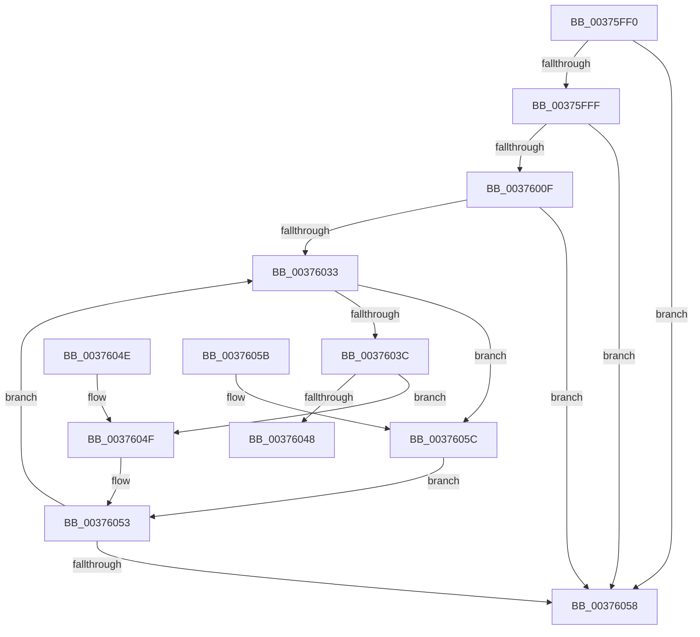

# MiIsPfnEnclave

- RVA: `0x00375FF0`–`0x00376061` (길이 `113` bytes)
- VA: `0x0000000140375FF0`
- 실행 섹션: `.text`
- PDB 이름 있음: `예`; PDB Function 태그: `아니요`
- unwind 정보 RVA: `0x000DB714`
- 디코드: `34`개 명령, `113/113` bytes 표시
- 미해석 바이트: `0` (있으면 어셈블리에 `.byte`로 보존)

> 이 문서는 커널 이미지의 기계어와 PDB 기호를 분석해 생성했습니다. 4번과 5번은 함수 원형과 자료형을 바이너리 사용 방식에서 추정한 C 해석이며 원본 소스 복구 결과는 아닙니다.

## 1. Dependencies

- 직접 호출 지점: **0**; 고유 호출 대상: **0**
- 직접 호출자로 확인된 함수: **3**
- RIP 상대 이미지 참조: **1**

### Outgoing calls
- 직접 디코드된 call 명령이 없습니다.

### Direct callers
- [MiGetWorkingSetInfoList](../2A/MiGetWorkingSetInfoList_function_002AF770.md) at `0x002B07AC`
- [MiFreeSmallPageFromMdl](MiFreeSmallPageFromMdl_function_00375D58.md) at `0x00375DF4`
- [MiFreePagesFromMdl](../3F/MiFreePagesFromMdl_function_003F8300.md) at `0x003F856B`
- [MiFreePagesFromMdl](../3F/MiFreePagesFromMdl_function_003F8300.md) at `0x003F859D`

### Static image references
- `0x00375FF0` → RVA `0x00E375B8` (`.data`; read)

## 2. Other-region calls and transfers

- 다른 실행 섹션으로 향하는 call: **0**
- 별도 외부 분기/꼬리 이동을 확인하지 못했습니다.

## 3. Assembly (complete function range)

```asm
00375FF0  48 8B 05 C1 15 AC 00            mov rax, qword ptr [rip + 0xac15c1]
00375FF7  4C 8B C1                        mov r8, rcx
00375FFA  48 85 C0                        test rax, rax
00375FFD  74 59                           je 0x140376058
00375FFF  48 8B 51 28                     mov rdx, qword ptr [rcx + 0x28]
00376003  48 C1 EA 3C                     shr rdx, 0x3c
00376007  80 E2 07                        and dl, 7
0037600A  80 FA 01                        cmp dl, 1
0037600D  75 49                           jne 0x140376058
0037600F  48 B9 00 00 00 00 00 DE FF FF   movabs rcx, 0xffffde0000000000
00376019  4C 2B C1                        sub r8, rcx
0037601C  48 B9 AB AA AA AA AA AA AA AA   movabs rcx, 0xaaaaaaaaaaaaaaab
00376026  49 C1 F8 04                     sar r8, 4
0037602A  4C 0F AF C1                     imul r8, rcx
0037602E  48 85 C0                        test rax, rax
00376031  74 25                           je 0x140376058
00376033  48 8B 50 18                     mov rdx, qword ptr [rax + 0x18]
00376037  4C 3B C2                        cmp r8, rdx
0037603A  72 20                           jb 0x14037605c
0037603C  49 8B C8                        mov rcx, r8
0037603F  48 2B CA                        sub rcx, rdx
00376042  48 3B 48 20                     cmp rcx, qword ptr [rax + 0x20]
00376046  73 07                           jae 0x14037604f
00376048  B8 01 00 00 00                  mov eax, 1
0037604D  C3                              ret
0037604E  CC                              int3
0037604F  48 8B 40 08                     mov rax, qword ptr [rax + 8]
00376053  48 85 C0                        test rax, rax
00376056  75 DB                           jne 0x140376033
00376058  33 C0                           xor eax, eax
0037605A  C3                              ret
0037605B  CC                              int3
0037605C  48 8B 00                        mov rax, qword ptr [rax]
0037605F  EB F2                           jmp 0x140376053
```

## 4. C-style interpretation (structured pseudocode)

```c
__int64 __fastcall MiIsPfnEnclave(__int64 a1)
{
    __int64 result;

    if (*(unsigned __int64 *)(v_rip + 11277761) == 0) goto loc_00376058;
    a2 = (*(unsigned __int64 *)(a1 + 40)) >> (60);
    a2 = (unsigned __int8)((a2) & (7));
    if (((unsigned __int8)(a2)) != 1) goto loc_00376058;
    a3 = (a1) - (a1);
    a3 = (a3) >> (4);
    a3 = (a3) * (a1);
    if (*(unsigned __int64 *)(v_rip + 11277761) == 0) goto loc_00376058;
loc_00376033:
    if (a3 < (*(unsigned __int64 *)(*(unsigned __int64 *)(v_rip + 11277761) + 24))) goto loc_0037605C;
    a1 = (a3) - (*(unsigned __int64 *)(*(unsigned __int64 *)(v_rip + 11277761) + 24));
    if (a1 >= (*(unsigned __int64 *)(*(unsigned __int64 *)(v_rip + 11277761) + 32))) goto loc_0037604F;
    return 1;
loc_0037604F:
loc_00376053:
    if (*(unsigned __int64 *)(1 + 8) != 0) goto loc_00376033;
loc_00376058:
    result = 0;
    return result;
loc_0037605C:
    goto loc_00376053;
}
```

## 5. (Beta) C Style

```c
int64_t MiIsPfnEnclave(void *Arg1)
{
    uint8_t *arg1 = (uint8_t *)Arg1;

    int64_t result;

    if (*(uint64_t *)(v_rip + 0xAC15C1) == 0) goto loc_00376058;
    a2 = (*(uint64_t *)(arg1 + 0x28)) >> (60);
    a2 = (uint8_t)((a2) & (7));
    if (((uint8_t)(a2)) != 1) goto loc_00376058;
    a3 = (Arg1) - (Arg1);
    a3 = (a3) >> (4);
    a3 = (a3) * (Arg1);
    if (*(uint64_t *)(v_rip + 0xAC15C1) == 0) goto loc_00376058;
loc_00376033:
    if (a3 < (*(uint64_t *)(*(uint64_t *)(v_rip + 0xAC15C1) + 0x18))) goto loc_0037605C;
    Arg1 = (a3) - (*(uint64_t *)(*(uint64_t *)(v_rip + 0xAC15C1) + 0x18));
    if (Arg1 >= (*(uint64_t *)(*(uint64_t *)(v_rip + 0xAC15C1) + 0x20))) goto loc_0037604F;
    return 1;
loc_0037604F:
loc_00376053:
    if (*(uint64_t *)(1 + 0x8) != 0) goto loc_00376033;
loc_00376058:
    result = 0;
    return result;
loc_0037605C:
    goto loc_00376053;
}
```

### 관측된 메모리 오프셋

구조체 형식이 확인되지 않은 접근은 인자 기준의 오프셋으로만 기록했습니다.

| 기준 인자 | 오프셋 표현 | 폭 (bit) | 접근 |
|---|---:|---:|---|
| `Arg1` | `+ 0x28` | `64` | `R` |

## 6. Execution-region graph

[열기: 2D/3D 그래프와 함수 탐색 컨트롤 패널](../../../control-panel.html?section=text&rva=0x00375FF0&view=graph)

- 2D 그래프는 위에서 아래로 흐르고, 3D 그래프는 빈 공간을 드래그해 회전합니다. Shift+드래그는 이동, 휠은 확대·축소, 함수 노드 선택은 대상 보고서 이동입니다.

### Static fallback


