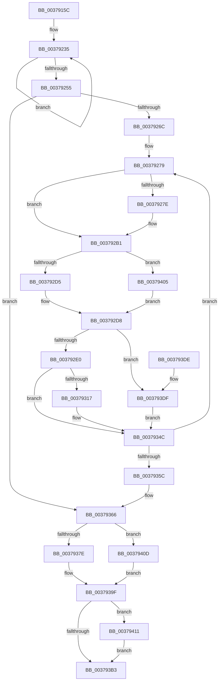

# MiLargePagePromote

- RVA: `0x0037915C`–`0x0037941F` (길이 `707` bytes)
- VA: `0x000000014037915C`
- 실행 섹션: `.text`
- PDB 이름 있음: `예`; PDB Function 태그: `아니요`
- unwind 정보 RVA: `0x0007AF44`
- 디코드: `181`개 명령, `707/707` bytes 표시
- 미해석 바이트: `0` (있으면 어셈블리에 `.byte`로 보존)

> 이 문서는 커널 이미지의 기계어와 PDB 기호를 분석해 생성했습니다. 4번과 5번은 함수 원형과 자료형을 바이너리 사용 방식에서 추정한 C 해석이며 원본 소스 복구 결과는 아닙니다.

## 1. Dependencies

- 직접 호출 지점: **8**; 고유 호출 대상: **8**
- 직접 호출자로 확인된 함수: **2**
- RIP 상대 이미지 참조: **2**

### Outgoing calls
- `0x003791B0` → [MiGetPfnPageSizeIndex](../31/MiGetPfnPageSizeIndex_function_0031C710.md) (function, `0x0031C710`)
- `0x00379208` → [MiPageToNode](../33/MiPageToNode_function_00338CD0.md) (function, `0x00338CD0`)
- `0x003792A8` → [MiUnlinkFreeOrZeroedPage](../33/MiUnlinkFreeOrZeroedPage_function_00336C40.md) (function, `0x00336C40`)
- `0x003792C8` → [MiIsFreeZeroPfnCold](../31/MiIsFreeZeroPfnCold_function_0031E5E4.md) (function, `0x0031E5E4`)
- `0x00379398` → [MiDetermineCoalescedLargePageHeatState](MiDetermineCoalescedLargePageHeatState_function_003794A4.md) (function, `0x003794A4`)
- `0x003793A9` → [MiSetFreeZeroPfnCold](MiSetFreeZeroPfnCold_function_00379428.md) (function, `0x00379428`)
- `0x003793C1` → [MiInsertPageInFreeOrZeroedList](../33/MiInsertPageInFreeOrZeroedList_function_00334D20.md) (function, `0x00334D20`)
- `0x00379418` → [MiConvertBaseLargePage](../46/MiConvertBaseLargePage_function_00462294.md) (function, `0x00462294`)

### Direct callers
- [MiCoalesceFreeLargePages](MiCoalesceFreeLargePages_function_0037A7B4.md) at `0x0037AAFD`
- [MiCoalesceActivePagesIntoFree](../69/MiCoalesceActivePagesIntoFree_function_00693558.md) at `0x00693685`

### Static image references
- `0x003791B7` → RVA `0x00000000` (`image boundary/outside`; read)
- `0x003791F0` → RVA `0x00E30088` (`.data`; read)

## 2. Other-region calls and transfers

- 다른 실행 섹션으로 향하는 call: **0**
- 별도 외부 분기/꼬리 이동을 확인하지 못했습니다.

## 3. Assembly (complete function range)

```asm
0037915C  48 8B C4                        mov rax, rsp
0037915F  48 89 58 20                     mov qword ptr [rax + 0x20], rbx
00379163  44 89 40 18                     mov dword ptr [rax + 0x18], r8d
00379167  89 50 10                        mov dword ptr [rax + 0x10], edx
0037916A  48 89 48 08                     mov qword ptr [rax + 8], rcx
0037916E  55                              push rbp
0037916F  56                              push rsi
00379170  57                              push rdi
00379171  41 54                           push r12
00379173  41 55                           push r13
00379175  41 56                           push r14
00379177  41 57                           push r15
00379179  48 83 EC 50                     sub rsp, 0x50
0037917D  48 8B C1                        mov rax, rcx
00379180  8B EA                           mov ebp, edx
00379182  48 8B 8C 24 B0 00 00 00         mov rcx, qword ptr [rsp + 0xb0]
0037918A  45 8B E9                        mov r13d, r9d
0037918D  48 8D 1C 40                     lea rbx, [rax + rax*2]
00379191  48 B8 00 00 00 00 00 DE FF FF   movabs rax, 0xffffde0000000000
0037919B  83 21 00                        and dword ptr [rcx], 0
0037919E  48 C1 E3 04                     shl rbx, 4
003791A2  48 8B C0                        mov rax, rax
003791A5  48 03 D8                        add rbx, rax
003791A8  48 8B CB                        mov rcx, rbx
003791AB  48 89 5C 24 48                  mov qword ptr [rsp + 0x48], rbx
003791B0  E8 5B 35 FA FF                  call 0x14031c710
003791B5  8B C0                           mov eax, eax
003791B7  4C 8D 25 42 6E C8 FF            lea r12, [rip - 0x3791be]
003791BE  48 8B FB                        mov rdi, rbx
003791C1  45 33 FF                        xor r15d, r15d
003791C4  33 F6                           xor esi, esi
003791C6  49 8B 8C C4 60 1C 01 00         mov rcx, qword ptr [r12 + rax*8 + 0x11c60]
003791CE  45 8B B4 84 E8 35 01 00         mov r14d, dword ptr [r12 + rax*4 + 0x135e8]
003791D6  48 8B 43 28                     mov rax, qword ptr [rbx + 0x28]
003791DA  4D 8B A4 EC 60 1C 01 00         mov r12, qword ptr [r12 + rbp*8 + 0x11c60]
003791E2  48 C1 E8 2B                     shr rax, 0x2b
003791E6  48 89 4C 24 30                  mov qword ptr [rsp + 0x30], rcx
003791EB  25 FF 03 00 00                  and eax, 0x3ff
003791F0  48 8B 0D 91 6E AB 00            mov rcx, qword ptr [rip + 0xab6e91]
003791F7  4C 89 64 24 38                  mov qword ptr [rsp + 0x38], r12
003791FC  48 8B 1C C1                     mov rbx, qword ptr [rcx + rax*8]
00379200  48 8B 8C 24 90 00 00 00         mov rcx, qword ptr [rsp + 0x90]
00379208  E8 C3 FA FB FF                  call 0x140338cd0
0037920D  8B C8                           mov ecx, eax
0037920F  45 8D 57 02                     lea r10d, [r15 + 2]
00379213  4C 69 C9 80 DF 00 00            imul r9, rcx, 0xdf80
0037921A  4C 03 4B 10                     add r9, qword ptr [rbx + 0x10]
0037921E  41 3B EA                        cmp ebp, r10d
00379221  4C 89 4C 24 40                  mov qword ptr [rsp + 0x40], r9
00379226  4D 1B C0                        sbb r8, r8
00379229  41 83 E0 08                     and r8d, 8
0037922D  4B 8B 84 08 58 3B 00 00         mov rax, qword ptr [r8 + r9 + 0x3b58]
00379235  48 8D 50 01                     lea rdx, [rax + 1]
00379239  48 8B CA                        mov rcx, rdx
0037923C  48 33 C8                        xor rcx, rax
0037923F  48 81 E1 00 00 FF FF            and rcx, 0xffffffffffff0000
00379246  48 33 CA                        xor rcx, rdx
00379249  F0 4B 0F B1 8C 08 58 3B 00 00   lock cmpxchg qword ptr [r8 + r9 + 0x3b58], rcx
00379253  75 E0                           jne 0x140379235
00379255  41 8B CE                        mov ecx, r14d
00379258  33 ED                           xor ebp, ebp
0037925A  4D 8B F4                        mov r14, r12
0037925D  49 D3 EE                        shr r14, cl
00379260  8D 5D 01                        lea ebx, [rbp + 1]
00379263  4D 85 F6                        test r14, r14
00379266  0F 84 FA 00 00 00               je 0x140379366
0037926C  48 8B 44 24 30                  mov rax, qword ptr [rsp + 0x30]
00379271  4C 8D 24 40                     lea r12, [rax + rax*2]
00379275  49 C1 E4 04                     shl r12, 4
00379279  45 85 ED                        test r13d, r13d
0037927C  75 33                           jne 0x1403792b1
0037927E  48 B8 00 00 00 00 00 DE FF FF   movabs rax, 0xffffde0000000000
00379288  48 8B C0                        mov rax, rax
0037928B  48 8B CF                        mov rcx, rdi
0037928E  45 33 C0                        xor r8d, r8d
00379291  48 2B C8                        sub rcx, rax
00379294  33 D2                           xor edx, edx
00379296  48 C1 F9 04                     sar rcx, 4
0037929A  48 B8 AB AA AA AA AA AA AA AA   movabs rax, 0xaaaaaaaaaaaaaaab
003792A4  48 0F AF C8                     imul rcx, rax
003792A8  E8 93 D9 FB FF                  call 0x140336c40
003792AD  45 8D 55 02                     lea r10d, [r13 + 2]
003792B1  48 8B 47 10                     mov rax, qword ptr [rdi + 0x10]
003792B5  25 E0 03 00 00                  and eax, 0x3e0
003792BA  48 F7 D8                        neg rax
003792BD  1B C9                           sbb ecx, ecx
003792BF  F7 D9                           neg ecx
003792C1  03 CB                           add ecx, ebx
003792C3  0B F1                           or esi, ecx
003792C5  48 8B CF                        mov rcx, rdi
003792C8  E8 17 53 FA FF                  call 0x14031e5e4
003792CD  85 C0                           test eax, eax
003792CF  0F 85 30 01 00 00               jne 0x140379405
003792D5  45 0B FA                        or r15d, r10d
003792D8  85 ED                           test ebp, ebp
003792DA  0F 84 FF 00 00 00               je 0x1403793df
003792E0  48 83 67 08 00                  and qword ptr [rdi + 8], 0
003792E5  8B 47 24                        mov eax, dword ptr [rdi + 0x24]
003792E8  25 FF FF FF E7                  and eax, 0xe7ffffff
003792ED  89 47 24                        mov dword ptr [rdi + 0x24], eax
003792F0  8B 47 20                        mov eax, dword ptr [rdi + 0x20]
003792F3  89 84 24 A0 00 00 00            mov dword ptr [rsp + 0xa0], eax
003792FA  C1 E8 10                        shr eax, 0x10
003792FD  24 FE                           and al, 0xfe
003792FF  0C 06                           or al, 6
00379301  88 84 24 A2 00 00 00            mov byte ptr [rsp + 0xa2], al
00379308  8B 84 24 A0 00 00 00            mov eax, dword ptr [rsp + 0xa0]
0037930F  89 47 20                        mov dword ptr [rdi + 0x20], eax
00379312  45 85 ED                        test r13d, r13d
00379315  75 35                           jne 0x14037934c
00379317  48 8B 47 18                     mov rax, qword ptr [rdi + 0x18]
0037931B  48 B9 01 00 00 00 00 00 00 C0   movabs rcx, 0xc000000000000001
00379325  48 23 C1                        and rax, rcx
00379328  48 0B C3                        or rax, rbx
0037932B  48 89 47 18                     mov qword ptr [rdi + 0x18], rax
0037932F  8B 47 20                        mov eax, dword ptr [rdi + 0x20]
00379332  89 84 24 A0 00 00 00            mov dword ptr [rsp + 0xa0], eax
00379339  66 44 89 94 24 A0 00 00 00      mov word ptr [rsp + 0xa0], r10w
00379342  8B 84 24 A0 00 00 00            mov eax, dword ptr [rsp + 0xa0]
00379349  89 47 20                        mov dword ptr [rdi + 0x20], eax
0037934C  03 EB                           add ebp, ebx
0037934E  49 03 FC                        add rdi, r12
00379351  8B C5                           mov eax, ebp
00379353  49 3B C6                        cmp rax, r14
00379356  0F 82 1D FF FF FF               jb 0x140379279
0037935C  4C 8B 64 24 38                  mov r12, qword ptr [rsp + 0x38]
00379361  4C 8B 4C 24 40                  mov r9, qword ptr [rsp + 0x40]
00379366  D1 EE                           shr esi, 1
00379368  4B 8D 04 64                     lea rax, [r12 + r12*2]
0037936C  48 C1 E0 04                     shl rax, 4
00379370  23 F3                           and esi, ebx
00379372  48 2B F8                        sub rdi, rax
00379375  45 85 ED                        test r13d, r13d
00379378  0F 85 8F 00 00 00               jne 0x14037940d
0037937E  48 8B 84 24 B0 00 00 00         mov rax, qword ptr [rsp + 0xb0]
00379386  44 8B C6                        mov r8d, esi
00379389  8B 8C 24 98 00 00 00            mov ecx, dword ptr [rsp + 0x98]
00379390  41 8B D7                        mov edx, r15d
00379393  48 89 44 24 20                  mov qword ptr [rsp + 0x20], rax
00379398  E8 07 01 00 00                  call 0x1403794a4
0037939D  8B DE                           mov ebx, esi
0037939F  33 D2                           xor edx, edx
003793A1  48 8B CF                        mov rcx, rdi
003793A4  85 C0                           test eax, eax
003793A6  0F 94 C2                        sete dl
003793A9  E8 7A 00 00 00                  call 0x140379428
003793AE  45 85 ED                        test r13d, r13d
003793B1  75 5E                           jne 0x140379411
003793B3  48 8B 8C 24 90 00 00 00         mov rcx, qword ptr [rsp + 0x90]
003793BB  8D 93 01 20 00 00               lea edx, [rbx + 0x2001]
003793C1  E8 5A B9 FB FF                  call 0x140334d20
003793C6  48 8B 9C 24 A8 00 00 00         mov rbx, qword ptr [rsp + 0xa8]
003793CE  48 83 C4 50                     add rsp, 0x50
003793D2  41 5F                           pop r15
003793D4  41 5E                           pop r14
003793D6  41 5D                           pop r13
003793D8  41 5C                           pop r12
003793DA  5F                              pop rdi
003793DB  5E                              pop rsi
003793DC  5D                              pop rbp
003793DD  C3                              ret
003793DE  CC                              int3
003793DF  8A 8C 24 98 00 00 00            mov cl, byte ptr [rsp + 0x98]
003793E6  8B 47 24                        mov eax, dword ptr [rdi + 0x24]
003793E9  F6 D1                           not cl
003793EB  0F B6 D1                        movzx edx, cl
003793EE  C1 E2 1B                        shl edx, 0x1b
003793F1  8B CA                           mov ecx, edx
003793F3  33 C8                           xor ecx, eax
003793F5  81 E1 FF FF FF E7               and ecx, 0xe7ffffff
003793FB  33 CA                           xor ecx, edx
003793FD  89 4F 24                        mov dword ptr [rdi + 0x24], ecx
00379400  E9 47 FF FF FF                  jmp 0x14037934c
00379405  44 0B FB                        or r15d, ebx
00379408  E9 CB FE FF FF                  jmp 0x1403792d8
0037940D  8B C3                           mov eax, ebx
0037940F  EB 8E                           jmp 0x14037939f
00379411  48 8B 4C 24 48                  mov rcx, qword ptr [rsp + 0x48]
00379416  33 D2                           xor edx, edx
00379418  E8 77 8E 0E 00                  call 0x140462294
0037941D  EB 94                           jmp 0x1403793b3
```

## 4. C-style interpretation (structured pseudocode)

```c
__int64 __fastcall MiLargePagePromote(__int64 a1, int a2, __int64 a3, int a4, __int64 a5)
{
    __int64 result;
    __int64 v_r10;
    __int64 v_r12;
    __int64 v_r14;
    __int64 v_r15;
    __int64 v_rbp;
    __int64 v_rbx;
    __int64 v_rdi;
    __int64 v_rsi;
    __int64 v_rsp;
    unsigned __int64 v_stack_m40;
    unsigned __int64 v_stack_m48;
    unsigned __int64 v_stack_m50;
    unsigned __int64 v_stack_m58;
    unsigned __int64 v_stack_m68;
    unsigned int v_stack_p10;
    unsigned int v_stack_p18;
    unsigned __int8 v_stack_p1A;
    unsigned __int64 v_stack_p20;
    unsigned __int64 v_stack_p48;
    unsigned __int64 v_stack_p8;
    unsigned __int8 v_stack_p98;

    *(unsigned __int64 *)(v_rsp + 32) = v_rbx;
    *(unsigned int *)(v_rsp + 24) = (unsigned int)(a3);
    *(unsigned int *)(v_rsp + 16) = a2;
    *(unsigned __int64 *)(v_rsp + 8) = a1;
    v_rsp = (v_rsp) - (80);
    v_rbx = (a1 + a1 * 2) << (4);
    v_rbx = (v_rbx) + (a1);
    v_stack_m40 = v_rbx;
    result = MiGetPfnPageSizeIndex(v_rbx, a2, a3, a4);
    v_r15 = 0;
    v_rsi = 0;
    result = (*(unsigned __int64 *)(v_rbx + 40)) >> (43);
    v_stack_m58 = *(unsigned __int64 *)(v_rip - 3641790 + (unsigned int)((unsigned int)(result)) * 8 + 72800);
    result = (unsigned int)((result) & (0x3FFULL));
    v_stack_m50 = *(unsigned __int64 *)(v_rip - 3641790 + (unsigned int)(a2) * 8 + 72800);
    result = MiPageToNode(v_stack_p8, a2, a3, a4);
    a4 = (a4) * ((unsigned int)((unsigned int)(result)));
    a4 = (a4) + (*(unsigned __int64 *)(*(unsigned __int64 *)(*(unsigned __int64 *)(v_rip + 11234961) + result * 8) + 16));
    v_stack_m48 = a4;
    a3 = (unsigned int)((a3) & (8));
loc_00379235:
    a1 = (*(unsigned __int64 *)(a3 + a4 * 1 + 15192) + 1) ^ (*(unsigned __int64 *)(a3 + a4 * 1 + 15192));
    a1 = (a1) & (0xFFFFFFFFFFFF0000ULL);
    a1 = (a1) ^ (*(unsigned __int64 *)(a3 + a4 * 1 + 15192) + 1);
    if (condition_is_not_equal) goto loc_00379235;
    v_rbp = 0;
    v_r14 = (*(unsigned __int64 *)(v_rip - 3641790 + (unsigned int)(a2) * 8 + 72800)) >> ((unsigned __int8)((unsigned int)((unsigned int)((unsigned int)(*(unsigned int *)(v_rip - 3641790 + (unsigned int)((unsigned int)(result)) * 4 + 79336))))));
    if (v_r14 == 0) goto loc_00379366;
    v_r12 = (v_stack_m58 + v_stack_m58 * 2) << (4);
loc_00379279:
    result = v_stack_m58;
    v_r10 = v_r15 + 2;
    if ((unsigned int)((unsigned int)(a4)) == 0) {
        result = v_stack_m58;
        a1 = v_rbx;
        a3 = 0;
        a1 = (a1) - (result);
        a2 = 0;
        a1 = (a1) >> (4);
        a1 = (a1) * (result);
        result = MiUnlinkFreeOrZeroedPage(a1, a2, a3, a4);
        v_r10 = (unsigned int)(a4) + 2;
    }
    result = (unsigned int)((*(unsigned __int64 *)(v_rbx + 16)) & (992));
    result = -(result);
    a1 = (unsigned int)(-(a1));
    a1 = (unsigned int)((a1) + ((unsigned int)(v_rbp + 1)));
    v_rsi = (unsigned int)((v_rsi) | ((unsigned int)(a1)));
    result = MiIsFreeZeroPfnCold(v_rbx, a2, a3, a4);
    if ((unsigned int)(result) != 0) goto loc_00379405;
    v_r15 = (unsigned int)((v_r15) | ((unsigned int)(v_r10)));
loc_003792D8:
    if (0 == 0) goto loc_003793DF;
    result = (unsigned int)(((unsigned int)(*(unsigned int *)(v_rbx + 36))) & (0xE7FFFFFFULL));
    *(unsigned int *)(v_rbx + 36) = (unsigned int)(result);
    v_stack_p18 = (unsigned int)((unsigned int)(*(unsigned int *)(v_rbx + 32)));
    result = (unsigned int)(((unsigned int)(*(unsigned int *)(v_rbx + 32))) >> (16));
    result = (unsigned __int8)((result) & (254));
    result = (unsigned __int8)((result) | (6));
    v_stack_p1A = (unsigned __int8)(result);
    *(unsigned int *)(v_rbx + 32) = (unsigned int)((unsigned int)(v_stack_p18));
    result = (unsigned int)(v_stack_p18);
    if ((unsigned int)((unsigned int)(a4)) == 0) {
        result = *(unsigned __int64 *)(v_rbx + 24);
        result = (result) & (v_rbx);
        result = (result) | (v_rbp + 1);
        *(unsigned __int64 *)(v_rbx + 24) = result;
        result = *(unsigned int *)(v_rbx + 32);
        v_stack_p18 = (unsigned int)(result);
        v_stack_p18 = (unsigned __int16)(v_r10);
        result = v_stack_p18;
        *(unsigned int *)(v_rbx + 32) = (unsigned int)(result);
    }
    v_rbp = (unsigned int)((v_rbp) + ((unsigned int)(v_rbp + 1)));
    v_rdi = (v_rbx) + (v_r12);
    if (((unsigned int)((unsigned int)(v_rbp))) < v_r14) goto loc_00379279;
loc_00379366:
    v_rsi = (unsigned int)((v_rsi) >> (1));
    result = (v_stack_m50 + v_stack_m50 * 2) << (4);
    v_rsi = (unsigned int)((v_rsi) & ((unsigned int)(v_rbp + 1)));
    v_rdi = (v_rdi) - (result);
    if ((unsigned int)((unsigned int)(a4)) != 0) goto loc_0037940D;
    v_stack_m68 = a5;
    result = MiDetermineCoalescedLargePageHeatState((unsigned int)(v_stack_p10), (unsigned int)((unsigned int)(v_r15)), (unsigned int)((unsigned int)(v_rsi)), v_stack_m48);
loc_0037939F:
    a2 = 0;
    a2 = ((unsigned int)(result) == 0) ? 1 : 0;
    result = MiSetFreeZeroPfnCold(v_rdi, a2, (unsigned int)((unsigned int)(v_rsi)), v_stack_m48);
    if ((unsigned int)((unsigned int)(a4)) != 0) goto loc_00379411;
loc_003793B3:
    result = MiInsertPageInFreeOrZeroedList(v_stack_p8, (unsigned int)((unsigned int)(v_rsi)) + 8193, (unsigned int)((unsigned int)(v_rsi)), v_stack_m48);
    v_rsp = (v_rsp) + (80);
    return result;
loc_003793DF:
    a1 = (unsigned __int8)(~(v_stack_p98));
    a2 = (unsigned int)(((unsigned __int8)(a1)) << (27));
    a1 = (unsigned int)(((unsigned int)(a2)) ^ ((unsigned int)((unsigned int)(*(unsigned int *)(v_rdi + 36)))));
    a1 = (unsigned int)((a1) & (0xE7FFFFFFULL));
    a1 = (unsigned int)((a1) ^ (a2));
    *(unsigned int *)(v_rdi + 36) = (unsigned int)(a1);
    goto loc_0037934C;
loc_00379405:
    v_r15 = (unsigned int)((v_r15) | ((unsigned int)(v_stack_p20)));
    goto loc_003792D8;
loc_0037940D:
    goto loc_0037939F;
loc_00379411:
    a2 = 0;
    result = MiConvertBaseLargePage(v_stack_p48, a2, (unsigned int)((unsigned int)(v_rsi)), v_stack_m48);
    goto loc_003793B3;
}
```

## 5. (Beta) C Style

```c
int64_t MiLargePagePromote(void *Arg1, int32_t Arg2, int64_t Arg3, int32_t Arg4, void *Arg5)
{
    uint8_t *arg1 = (uint8_t *)Arg1;
    uint8_t *arg5 = (uint8_t *)Arg5;

    int64_t result;
    int64_t local_r10;
    int64_t local_r12;
    int64_t local_r14;
    int64_t local_r15;
    int64_t local_rbp;
    int64_t local_rbx;
    int64_t local_rdi;
    int64_t local_rsi;
    int64_t local_rsp;
    uint64_t v_stack_m40;
    uint64_t v_stack_m48;
    uint64_t v_stack_m50;
    uint64_t v_stack_m58;
    uint64_t v_stack_m68;
    uint32_t v_stack_p10;
    uint32_t v_stack_p18;
    uint8_t v_stack_p1A;
    uint64_t v_stack_p20;
    uint64_t v_stack_p48;
    uint64_t v_stack_p8;
    uint8_t v_stack_p98;

    *(uint64_t *)(local_rsp + 0x20) = local_rbx;
    *(uint32_t *)(local_rsp + 0x18) = (uint32_t)(Arg3);
    *(uint32_t *)(local_rsp + 0x10) = Arg2;
    *(void **)(local_rsp + 0x8) = Arg1;
    local_rsp = (local_rsp) - (80);
    local_rbx = (Arg1 + Arg1 * 2) << (4);
    local_rbx = (local_rbx) + (Arg1);
    v_stack_m40 = local_rbx;
    result = MiGetPfnPageSizeIndex(local_rbx, Arg2, Arg3, Arg4);
    local_r15 = 0;
    local_rsi = 0;
    result = (*(uint64_t *)(local_rbx + 0x28)) >> (43);
    v_stack_m58 = *(uint64_t *)(v_rip - 0x3791BE + (uint32_t)((uint32_t)(result)) * 8 + 0x11C60);
    result = (uint32_t)((result) & (0x3FFULL));
    v_stack_m50 = *(uint64_t *)(v_rip - 0x3791BE + (uint32_t)(Arg2) * 8 + 0x11C60);
    result = MiPageToNode(v_stack_p8, Arg2, Arg3, Arg4);
    Arg4 = (Arg4) * ((uint32_t)((uint32_t)(result)));
    Arg4 = (Arg4) + (*(uint64_t *)(*(uint64_t *)(*(uint64_t *)(v_rip + 0xAB6E91) + result * 8) + 0x10));
    v_stack_m48 = Arg4;
    Arg3 = (uint32_t)((Arg3) & (8));
loc_00379235:
    Arg1 = (*(uint64_t *)(Arg3 + Arg4 * 1 + 0x3B58) + 1) ^ (*(uint64_t *)(Arg3 + Arg4 * 1 + 0x3B58));
    Arg1 = (Arg1) & (0xFFFFFFFFFFFF0000ULL);
    Arg1 = (Arg1) ^ (*(uint64_t *)(Arg3 + Arg4 * 1 + 0x3B58) + 1);
    if (condition_is_not_equal) goto loc_00379235;
    local_rbp = 0;
    local_r14 = (*(uint64_t *)(v_rip - 0x3791BE + (uint32_t)(Arg2) * 8 + 0x11C60)) >> ((uint8_t)((uint32_t)((uint32_t)((uint32_t)(*(uint32_t *)(v_rip - 0x3791BE + (uint32_t)((uint32_t)(result)) * 4 + 0x135E8))))));
    if (local_r14 == 0) goto loc_00379366;
    local_r12 = (v_stack_m58 + v_stack_m58 * 2) << (4);
loc_00379279:
    result = v_stack_m58;
    local_r10 = local_r15 + 2;
    if ((uint32_t)((uint32_t)(Arg4)) == 0) {
        result = v_stack_m58;
        Arg1 = local_rbx;
        Arg3 = 0;
        Arg1 = (Arg1) - (result);
        Arg2 = 0;
        Arg1 = (Arg1) >> (4);
        Arg1 = (Arg1) * (result);
        result = MiUnlinkFreeOrZeroedPage(Arg1, Arg2, Arg3, Arg4);
        local_r10 = (uint32_t)(Arg4) + 2;
    }
    result = (uint32_t)((*(uint64_t *)(local_rbx + 0x10)) & (992));
    result = -(result);
    Arg1 = (uint32_t)(-(Arg1));
    Arg1 = (uint32_t)((Arg1) + ((uint32_t)(local_rbp + 1)));
    local_rsi = (uint32_t)((local_rsi) | ((uint32_t)(Arg1)));
    result = MiIsFreeZeroPfnCold(local_rbx, Arg2, Arg3, Arg4);
    if ((uint32_t)(result) != 0) goto loc_00379405;
    local_r15 = (uint32_t)((local_r15) | ((uint32_t)(local_r10)));
loc_003792D8:
    if (0 == 0) goto loc_003793DF;
    result = (uint32_t)(((uint32_t)(*(uint32_t *)(local_rbx + 0x24))) & (0xE7FFFFFFULL));
    *(uint32_t *)(local_rbx + 0x24) = (uint32_t)(result);
    v_stack_p18 = (uint32_t)((uint32_t)(*(uint32_t *)(local_rbx + 0x20)));
    result = (uint32_t)(((uint32_t)(*(uint32_t *)(local_rbx + 0x20))) >> (16));
    result = (uint8_t)((result) & (254));
    result = (uint8_t)((result) | (6));
    v_stack_p1A = (uint8_t)(result);
    *(uint32_t *)(local_rbx + 0x20) = (uint32_t)((uint32_t)(v_stack_p18));
    result = (uint32_t)(v_stack_p18);
    if ((uint32_t)((uint32_t)(Arg4)) == 0) {
        result = *(uint64_t *)(local_rbx + 0x18);
        result = (result) & (local_rbx);
        result = (result) | (local_rbp + 1);
        *(uint64_t *)(local_rbx + 0x18) = result;
        result = *(uint32_t *)(local_rbx + 0x20);
        v_stack_p18 = (uint32_t)(result);
        v_stack_p18 = (uint16_t)(local_r10);
        result = v_stack_p18;
        *(uint32_t *)(local_rbx + 0x20) = (uint32_t)(result);
    }
    local_rbp = (uint32_t)((local_rbp) + ((uint32_t)(local_rbp + 1)));
    local_rdi = (local_rbx) + (local_r12);
    if (((uint32_t)((uint32_t)(local_rbp))) < local_r14) goto loc_00379279;
loc_00379366:
    local_rsi = (uint32_t)((local_rsi) >> (1));
    result = (v_stack_m50 + v_stack_m50 * 2) << (4);
    local_rsi = (uint32_t)((local_rsi) & ((uint32_t)(local_rbp + 1)));
    local_rdi = (local_rdi) - (result);
    if ((uint32_t)((uint32_t)(Arg4)) != 0) goto loc_0037940D;
    v_stack_m68 = Arg5;
    result = MiDetermineCoalescedLargePageHeatState((uint32_t)(v_stack_p10), (uint32_t)((uint32_t)(local_r15)), (uint32_t)((uint32_t)(local_rsi)), v_stack_m48);
loc_0037939F:
    Arg2 = 0;
    Arg2 = ((uint32_t)(result) == 0) ? 1 : 0;
    result = MiSetFreeZeroPfnCold(local_rdi, Arg2, (uint32_t)((uint32_t)(local_rsi)), v_stack_m48);
    if ((uint32_t)((uint32_t)(Arg4)) != 0) goto loc_00379411;
loc_003793B3:
    result = MiInsertPageInFreeOrZeroedList(v_stack_p8, (uint32_t)((uint32_t)(local_rsi)) + 8193, (uint32_t)((uint32_t)(local_rsi)), v_stack_m48);
    local_rsp = (local_rsp) + (80);
    return result;
loc_003793DF:
    Arg1 = (uint8_t)(~(v_stack_p98));
    Arg2 = (uint32_t)(((uint8_t)(Arg1)) << (27));
    Arg1 = (uint32_t)(((uint32_t)(Arg2)) ^ ((uint32_t)((uint32_t)(*(uint32_t *)(local_rdi + 0x24)))));
    Arg1 = (uint32_t)((Arg1) & (0xE7FFFFFFULL));
    Arg1 = (uint32_t)((Arg1) ^ (Arg2));
    *(uint32_t *)(local_rdi + 0x24) = (uint32_t)(Arg1);
    goto loc_0037934C;
loc_00379405:
    local_r15 = (uint32_t)((local_r15) | ((uint32_t)(v_stack_p20)));
    goto loc_003792D8;
loc_0037940D:
    goto loc_0037939F;
loc_00379411:
    Arg2 = 0;
    result = MiConvertBaseLargePage(v_stack_p48, Arg2, (uint32_t)((uint32_t)(local_rsi)), v_stack_m48);
    goto loc_003793B3;
}
```

### 관측된 메모리 오프셋

구조체 형식이 확인되지 않은 접근은 인자 기준의 오프셋으로만 기록했습니다.

| 기준 인자 | 오프셋 표현 | 폭 (bit) | 접근 |
|---|---:|---:|---|
| `Arg1` | `+ 0x0 + rax*2` | `64` | `R` |
| `Arg5` | `+ 0x0` | `32` | `R/W` |

## 6. Execution-region graph

[열기: 2D/3D 그래프와 함수 탐색 컨트롤 패널](../../../control-panel.html?section=text&rva=0x0037915C&view=graph)

- 2D 그래프는 위에서 아래로 흐르고, 3D 그래프는 빈 공간을 드래그해 회전합니다. Shift+드래그는 이동, 휠은 확대·축소, 함수 노드 선택은 대상 보고서 이동입니다.

### Static fallback


