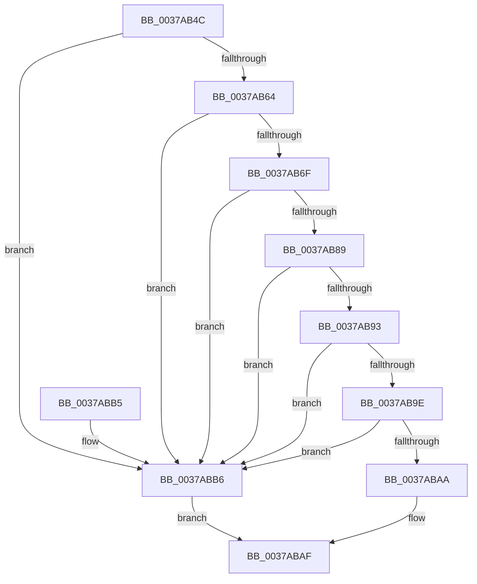

# MiLargePfnPromoteCandidate

- RVA: `0x0037AB4C`–`0x0037ABBA` (길이 `110` bytes)
- VA: `0x000000014037AB4C`
- 실행 섹션: `.text`
- PDB 이름 있음: `예`; PDB Function 태그: `아니요`
- unwind 정보 RVA: `0x00065BAC`
- 디코드: `36`개 명령, `110/110` bytes 표시
- 미해석 바이트: `0` (있으면 어셈블리에 `.byte`로 보존)

> 이 문서는 커널 이미지의 기계어와 PDB 기호를 분석해 생성했습니다. 4번과 5번은 함수 원형과 자료형을 바이너리 사용 방식에서 추정한 C 해석이며 원본 소스 복구 결과는 아닙니다.

## 1. Dependencies

- 직접 호출 지점: **1**; 고유 호출 대상: **1**
- 직접 호출자로 확인된 함수: **2**
- RIP 상대 이미지 참조: **1**

### Outgoing calls
- `0x0037ABA1` → [MiGetPfnPageSizeIndex](../31/MiGetPfnPageSizeIndex_function_0031C710.md) (function, `0x0031C710`)

### Direct callers
- [MiCoalesceFreeLargePages](MiCoalesceFreeLargePages_function_0037A7B4.md) at `0x0037A898`
- [MiCoalesceFreeLargePages](MiCoalesceFreeLargePages_function_0037A7B4.md) at `0x0037A99B`
- [MiChangePageAttributeLargeFreeZeroPage](../4A/MiChangePageAttributeLargeFreeZeroPage_function_004ACC10.md) at `0x004ACCA4`

### Static image references
- `0x0037AB73` → RVA `0x00E30088` (`.data`; read)

## 2. Other-region calls and transfers

- 다른 실행 섹션으로 향하는 call: **0**
- 별도 외부 분기/꼬리 이동을 확인하지 못했습니다.

## 3. Assembly (complete function range)

```asm
0037AB4C  40 53                           push rbx
0037AB4E  48 83 EC 20                     sub rsp, 0x20
0037AB52  8B 42 20                        mov eax, dword ptr [rdx + 0x20]
0037AB55  41 8B D8                        mov ebx, r8d
0037AB58  C1 E8 10                        shr eax, 0x10
0037AB5B  4C 8B C1                        mov r8, rcx
0037AB5E  24 07                           and al, 7
0037AB60  3C 01                           cmp al, 1
0037AB62  77 52                           ja 0x14037abb6
0037AB64  48 8B 42 28                     mov rax, qword ptr [rdx + 0x28]
0037AB68  48 0F BA E0 28                  bt rax, 0x28
0037AB6D  73 47                           jae 0x14037abb6
0037AB6F  48 8B 42 28                     mov rax, qword ptr [rdx + 0x28]
0037AB73  48 8B 0D 0E 55 AB 00            mov rcx, qword ptr [rip + 0xab550e]
0037AB7A  48 C1 E8 2B                     shr rax, 0x2b
0037AB7E  25 FF 03 00 00                  and eax, 0x3ff
0037AB83  4C 39 04 C1                     cmp qword ptr [rcx + rax*8], r8
0037AB87  75 2D                           jne 0x14037abb6
0037AB89  8B 42 20                        mov eax, dword ptr [rdx + 0x20]
0037AB8C  C1 E8 18                        shr eax, 0x18
0037AB8F  A8 40                           test al, 0x40
0037AB91  75 23                           jne 0x14037abb6
0037AB93  48 8B 4A 28                     mov rcx, qword ptr [rdx + 0x28]
0037AB97  48 0F BA E1 29                  bt rcx, 0x29
0037AB9C  72 18                           jb 0x14037abb6
0037AB9E  48 8B CA                        mov rcx, rdx
0037ABA1  E8 6A 1B FA FF                  call 0x14031c710
0037ABA6  3B C3                           cmp eax, ebx
0037ABA8  75 0C                           jne 0x14037abb6
0037ABAA  B8 01 00 00 00                  mov eax, 1
0037ABAF  48 83 C4 20                     add rsp, 0x20
0037ABB3  5B                              pop rbx
0037ABB4  C3                              ret
0037ABB5  CC                              int3
0037ABB6  33 C0                           xor eax, eax
0037ABB8  EB F5                           jmp 0x14037abaf
```

## 4. C-style interpretation (structured pseudocode)

```c
__int64 __fastcall MiLargePfnPromoteCandidate(__int64 a1, __int64 a2, int a3)
{
    __int64 result;
    __int64 v_rsp;

    v_rsp = (v_rsp) - (32);
    result = (unsigned int)(((unsigned int)(*(unsigned int *)(a2 + 32))) >> (16));
    result = (unsigned __int8)((result) & (7));
    if (((unsigned __int8)(result)) > 1) goto loc_0037ABB6;
    if (((unsigned __int8)(result)) >= 1) goto loc_0037ABB6;
    result = (*(unsigned __int64 *)(a2 + 40)) >> (43);
    result = (unsigned int)((result) & (0x3FFULL));
    if ((*(unsigned __int64 *)(*(unsigned __int64 *)(v_rip + 11228430) + result * 8)) != a1) goto loc_0037ABB6;
    result = (unsigned int)(((unsigned int)(*(unsigned int *)(a2 + 32))) >> (24));
    if ((((unsigned __int8)(result)) & (64)) != 0) goto loc_0037ABB6;
    if (condition_is_below) goto loc_0037ABB6;
    result = MiGetPfnPageSizeIndex(a2, a2, a1, a4);
    if (((unsigned int)(result)) != ((unsigned int)((unsigned int)(a3)))) goto loc_0037ABB6;
loc_0037ABAF:
    v_rsp = (v_rsp) + (32);
    return 1;
loc_0037ABB6:
    result = 0;
    goto loc_0037ABAF;
}
```

## 5. (Beta) C Style

```c
int64_t MiLargePfnPromoteCandidate(int64_t Arg1, void *Arg2, int32_t Arg3)
{
    uint8_t *arg2 = (uint8_t *)Arg2;

    int64_t result;
    int64_t local_rsp;

    local_rsp = (local_rsp) - (32);
    result = (uint32_t)(((uint32_t)(*(uint32_t *)(arg2 + 0x20))) >> (16));
    result = (uint8_t)((result) & (7));
    if (((uint8_t)(result)) > 1) goto loc_0037ABB6;
    if (((uint8_t)(result)) >= 1) goto loc_0037ABB6;
    result = (*(uint64_t *)(arg2 + 0x28)) >> (43);
    result = (uint32_t)((result) & (0x3FFULL));
    if ((*(uint64_t *)(*(uint64_t *)(v_rip + 0xAB550E) + result * 8)) != Arg1) goto loc_0037ABB6;
    result = (uint32_t)(((uint32_t)(*(uint32_t *)(arg2 + 0x20))) >> (24));
    if ((((uint8_t)(result)) & (64)) != 0) goto loc_0037ABB6;
    if (condition_is_below) goto loc_0037ABB6;
    result = MiGetPfnPageSizeIndex(Arg2, Arg2, Arg1, a4);
    if (((uint32_t)(result)) != ((uint32_t)((uint32_t)(Arg3)))) goto loc_0037ABB6;
loc_0037ABAF:
    local_rsp = (local_rsp) + (32);
    return 1;
loc_0037ABB6:
    result = 0;
    goto loc_0037ABAF;
}
```

### 관측된 메모리 오프셋

구조체 형식이 확인되지 않은 접근은 인자 기준의 오프셋으로만 기록했습니다.

| 기준 인자 | 오프셋 표현 | 폭 (bit) | 접근 |
|---|---:|---:|---|
| `Arg2` | `+ 0x20` | `32` | `R` |
| `Arg2` | `+ 0x28` | `64` | `R` |

## 6. Execution-region graph

[열기: 2D/3D 그래프와 함수 탐색 컨트롤 패널](../../../control-panel.html?section=text&rva=0x0037AB4C&view=graph)

- 2D 그래프는 위에서 아래로 흐르고, 3D 그래프는 빈 공간을 드래그해 회전합니다. Shift+드래그는 이동, 휠은 확대·축소, 함수 노드 선택은 대상 보고서 이동입니다.

### Static fallback


