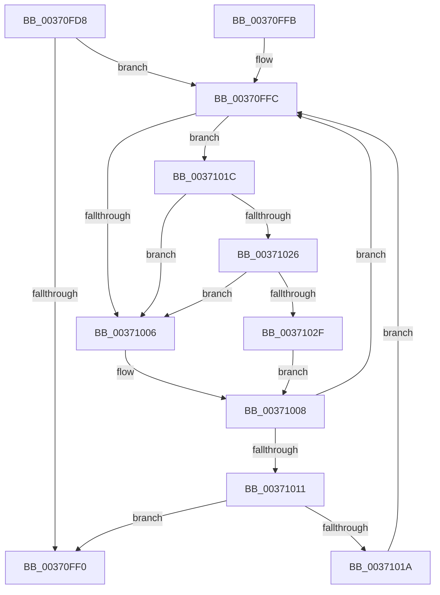

# MiLockCloneBlockAtDpc

- RVA: `0x00370FD8`–`0x00371038` (길이 `96` bytes)
- VA: `0x0000000140370FD8`
- 실행 섹션: `.text`
- PDB 이름 있음: `예`; PDB Function 태그: `아니요`
- unwind 정보 RVA: `0x0007A7D0`
- 디코드: `31`개 명령, `96/96` bytes 표시
- 미해석 바이트: `0` (있으면 어셈블리에 `.byte`로 보존)

> 이 문서는 커널 이미지의 기계어와 PDB 기호를 분석해 생성했습니다. 4번과 5번은 함수 원형과 자료형을 바이너리 사용 방식에서 추정한 C 해석이며 원본 소스 복구 결과는 아닙니다.

## 1. Dependencies

- 직접 호출 지점: **2**; 고유 호출 대상: **2**
- 직접 호출자로 확인된 함수: **4**
- RIP 상대 이미지 참조: **2**

### Outgoing calls
- `0x00371026` → [KiCheckVpBackingLongSpinWaitHypercall](../30/KiCheckVpBackingLongSpinWaitHypercall_function_0030F490.md) (function, `0x0030F490`)
- `0x00371031` → [HvlNotifyLongSpinWait](../30/HvlNotifyLongSpinWait_function_0030F460.md) (function, `0x0030F460`)

### Direct callers
- [MiReferenceCloneProto](../22/MiReferenceCloneProto_function_0022B2F8.md) at `0x0022B327`
- [MiDecrementCloneBlock](../22/MiDecrementCloneBlock_function_0022BA8C.md) at `0x0022BADB`
- [MiDecommitSharedPageTail](MiDecommitSharedPageTail_function_00370240.md) at `0x00370575`
- [MiDecommitSharedPageTail](MiDecommitSharedPageTail_function_00370240.md) at `0x0037073E`
- [MiWriteSharedDemandZeroPte](../4A/MiWriteSharedDemandZeroPte_function_004A8DDC.md) at `0x004A8DFA`

### Static image references
- `0x00370FFE` → RVA `0x00FC52AC` (`ALMOSTRO`; reference)
- `0x0037101C` → RVA `0x00FC6AB8` (`ALMOSTRO`; read)

## 2. Other-region calls and transfers

- 다른 실행 섹션으로 향하는 call: **0**
- 별도 외부 분기/꼬리 이동을 확인하지 못했습니다.

## 3. Assembly (complete function range)

```asm
00370FD8  48 89 5C 24 10                  mov qword ptr [rsp + 0x10], rbx
00370FDD  57                              push rdi
00370FDE  48 83 EC 20                     sub rsp, 0x20
00370FE2  33 DB                           xor ebx, ebx
00370FE4  48 8B F9                        mov rdi, rcx
00370FE7  F0 48 0F BA 69 10 3F            lock bts qword ptr [rcx + 0x10], 0x3f
00370FEE  72 0C                           jb 0x140370ffc
00370FF0  48 8B 5C 24 38                  mov rbx, qword ptr [rsp + 0x38]
00370FF5  48 83 C4 20                     add rsp, 0x20
00370FF9  5F                              pop rdi
00370FFA  C3                              ret
00370FFB  CC                              int3
00370FFC  FF C3                           inc ebx
00370FFE  85 1D A8 42 C5 00               test dword ptr [rip + 0xc542a8], ebx
00371004  74 16                           je 0x14037101c
00371006  F3 90                           pause
00371008  48 8B 47 10                     mov rax, qword ptr [rdi + 0x10]
0037100C  48 85 C0                        test rax, rax
0037100F  78 EB                           js 0x140370ffc
00371011  F0 48 0F BA 6F 10 3F            lock bts qword ptr [rdi + 0x10], 0x3f
00371018  73 D6                           jae 0x140370ff0
0037101A  EB E0                           jmp 0x140370ffc
0037101C  8B 05 96 5A C5 00               mov eax, dword ptr [rip + 0xc55a96]
00371022  A8 40                           test al, 0x40
00371024  74 E0                           je 0x140371006
00371026  E8 65 E4 F9 FF                  call 0x14030f490
0037102B  84 C0                           test al, al
0037102D  74 D7                           je 0x140371006
0037102F  8B CB                           mov ecx, ebx
00371031  E8 2A E4 F9 FF                  call 0x14030f460
00371036  EB D0                           jmp 0x140371008
```

## 4. C-style interpretation (structured pseudocode)

```c
__int64 __fastcall MiLockCloneBlockAtDpc(__int64 a1)
{
    __int64 result;
    __int64 v_rbx;
    __int64 v_rsp;
    unsigned __int64 v_stack_p10;

    v_stack_p10 = v_rbx;
    v_rsp = (v_rsp) - (32);
    v_rbx = 0;
    if (condition_is_below) goto loc_00370FFC;
loc_00370FF0:
    v_rsp = (v_rsp) + (32);
    return result;
loc_00370FFC:
    v_rbx = (unsigned int)((v_stack_p10) + 1);
    if (((*(unsigned int *)(v_rip + 12927656)) & ((unsigned int)(v_rbx))) == 0) goto loc_0037101C;
loc_00371006:
loc_00371008:
    if (sign_flag) goto loc_00370FFC;
    if (condition_is_above_or_equal) goto loc_00370FF0;
    goto loc_00370FFC;
loc_0037101C:
    if ((((unsigned __int8)((unsigned int)(*(unsigned int *)(v_rip + 12933782)))) & (64)) == 0) goto loc_00371006;
    result = KiCheckVpBackingLongSpinWaitHypercall(a1, a2, a3, a4);
    if ((unsigned __int8)(result) == 0) goto loc_00371006;
    result = HvlNotifyLongSpinWait((unsigned int)((unsigned int)(v_rbx)), a2, a3, a4);
    goto loc_00371008;
}
```

## 5. (Beta) C Style

```c
int64_t MiLockCloneBlockAtDpc(void *Arg1)
{
    uint8_t *arg1 = (uint8_t *)Arg1;

    int64_t result;
    int64_t local_rbx;
    int64_t local_rsp;
    uint64_t v_stack_p10;

    v_stack_p10 = local_rbx;
    local_rsp = (local_rsp) - (32);
    local_rbx = 0;
    if (condition_is_below) goto loc_00370FFC;
loc_00370FF0:
    local_rsp = (local_rsp) + (32);
    return result;
loc_00370FFC:
    local_rbx = (uint32_t)((v_stack_p10) + 1);
    if (((*(uint32_t *)(v_rip + 0xC542A8)) & ((uint32_t)(local_rbx))) == 0) goto loc_0037101C;
loc_00371006:
loc_00371008:
    if (sign_flag) goto loc_00370FFC;
    if (condition_is_above_or_equal) goto loc_00370FF0;
    goto loc_00370FFC;
loc_0037101C:
    if ((((uint8_t)((uint32_t)(*(uint32_t *)(v_rip + 0xC55A96)))) & (64)) == 0) goto loc_00371006;
    result = KiCheckVpBackingLongSpinWaitHypercall(Arg1, a2, a3, a4);
    if ((uint8_t)(result) == 0) goto loc_00371006;
    result = HvlNotifyLongSpinWait((uint32_t)((uint32_t)(local_rbx)), a2, a3, a4);
    goto loc_00371008;
}
```

### 관측된 메모리 오프셋

구조체 형식이 확인되지 않은 접근은 인자 기준의 오프셋으로만 기록했습니다.

| 기준 인자 | 오프셋 표현 | 폭 (bit) | 접근 |
|---|---:|---:|---|
| `Arg1` | `+ 0x10` | `64` | `R` |
| `Arg1` | `+ 0x10` | `64` | `R/W` |

## 6. Execution-region graph

[열기: 2D/3D 그래프와 함수 탐색 컨트롤 패널](../../../control-panel.html?section=text&rva=0x00370FD8&view=graph)

- 2D 그래프는 위에서 아래로 흐르고, 3D 그래프는 빈 공간을 드래그해 회전합니다. Shift+드래그는 이동, 휠은 확대·축소, 함수 노드 선택은 대상 보고서 이동입니다.

### Static fallback


