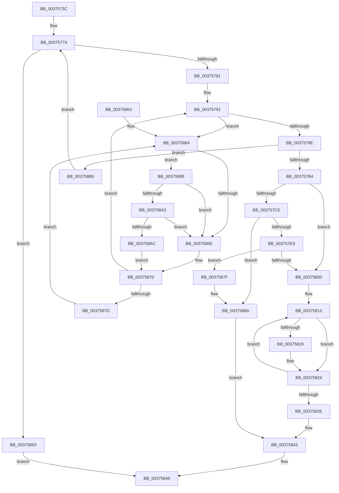

# MiLockPageListAndFirstPage

- RVA: `0x0037573C`–`0x003758D2` (길이 `406` bytes)
- VA: `0x000000014037573C`
- 실행 섹션: `.text`
- PDB 이름 있음: `예`; PDB Function 태그: `아니요`
- unwind 정보 RVA: `0x0007AB94`
- 디코드: `105`개 명령, `406/406` bytes 표시
- 미해석 바이트: `0` (있으면 어셈블리에 `.byte`로 보존)

> 이 문서는 커널 이미지의 기계어와 PDB 기호를 분석해 생성했습니다. 4번과 5번은 함수 원형과 자료형을 바이너리 사용 방식에서 추정한 C 해석이며 원본 소스 복구 결과는 아닙니다.

## 1. Dependencies

- 직접 호출 지점: **6**; 고유 호출 대상: **5**
- 직접 호출자로 확인된 함수: **1**
- RIP 상대 이미지 참조: **2**

### Outgoing calls
- `0x003757A2` → [ExAcquireSpinLockSharedAtDpcLevel](../24/ExAcquireSpinLockSharedAtDpcLevel_function_00248E30.md) (function, `0x00248E30`)
- `0x00375832` → [ExReleaseSpinLockSharedFromDpcLevel](../24/ExReleaseSpinLockSharedFromDpcLevel_function_0024A590.md) (function, `0x0024A590`)
- `0x0037583E` → [ExAcquireSpinLockExclusiveAtDpcLevel](../24/ExAcquireSpinLockExclusiveAtDpcLevel_function_00248E80.md) (function, `0x00248E80`)
- `0x003758A3` → [KiCheckVpBackingLongSpinWaitHypercall](../30/KiCheckVpBackingLongSpinWaitHypercall_function_0030F490.md) (function, `0x0030F490`)
- `0x003758AE` → [HvlNotifyLongSpinWait](../30/HvlNotifyLongSpinWait_function_0030F460.md) (function, `0x0030F460`)
- `0x003758B9` → [ExReleaseSpinLockSharedFromDpcLevel](../24/ExReleaseSpinLockSharedFromDpcLevel_function_0024A590.md) (function, `0x0024A590`)

### Direct callers
- [MiGetRepurposedSlabStandbyPage](MiGetRepurposedSlabStandbyPage_function_003755A8.md) at `0x00375626`

### Static image references
- `0x00375866` → RVA `0x00FC52AC` (`ALMOSTRO`; reference)
- `0x00375899` → RVA `0x00FC6AB8` (`ALMOSTRO`; read)

## 2. Other-region calls and transfers

- 다른 실행 섹션으로 향하는 call: **0**
- 별도 외부 분기/꼬리 이동을 확인하지 못했습니다.

## 3. Assembly (complete function range)

```asm
0037573C  48 89 5C 24 08                  mov qword ptr [rsp + 8], rbx
00375741  48 89 6C 24 10                  mov qword ptr [rsp + 0x10], rbp
00375746  48 89 74 24 18                  mov qword ptr [rsp + 0x18], rsi
0037574B  57                              push rdi
0037574C  41 54                           push r12
0037574E  41 55                           push r13
00375750  41 56                           push r14
00375752  41 57                           push r15
00375754  48 83 EC 20                     sub rsp, 0x20
00375758  48 8B DA                        mov rbx, rdx
0037575B  49 BD 00 00 00 00 00 DE FF FF   movabs r13, 0xffffde0000000000
00375765  4C 8B F9                        mov r15, rcx
00375768  49 BC FF FF FF FF 3F 00 00 00   movabs r12, 0x3fffffffff
00375772  33 FF                           xor edi, edi
00375774  4D 8B 77 10                     mov r14, qword ptr [r15 + 0x10]
00375778  4D 3B F4                        cmp r14, r12
0037577B  0F 84 12 01 00 00               je 0x140375893
00375781  4B 8D 34 76                     lea rsi, [r14 + r14*2]
00375785  48 C1 E6 04                     shl rsi, 4
00375789  49 8B C5                        mov rax, r13
0037578C  48 03 F0                        add rsi, rax
0037578F  8B EF                           mov ebp, edi
00375791  F0 48 0F BA 6E 18 3F            lock bts qword ptr [rsi + 0x18], 0x3f
00375798  0F 82 C6 00 00 00               jb 0x140375864
0037579E  49 8D 4F 20                     lea rcx, [r15 + 0x20]
003757A2  E8 89 36 ED FF                  call 0x140248e30
003757A7  49 8B 47 10                     mov rax, qword ptr [r15 + 0x10]
003757AB  4C 3B F0                        cmp r14, rax
003757AE  0F 85 01 01 00 00               jne 0x1403758b5
003757B4  49 8D 47 28                     lea rax, [r15 + 0x28]
003757B8  F0 48 0F BA 68 18 3F            lock bts qword ptr [rax + 0x18], 0x3f
003757BF  48 8D 53 18                     lea rdx, [rbx + 0x18]
003757C3  72 3B                           jb 0x140375800
003757C5  4C 8B 06                        mov r8, qword ptr [rsi]
003757C8  48 89 43 10                     mov qword ptr [rbx + 0x10], rax
003757CC  48 B8 FF FF FF FF FF 00 00 00   movabs rax, 0xffffffffff
003757D6  4C 23 C0                        and r8, rax
003757D9  4C 89 63 08                     mov qword ptr [rbx + 8], r12
003757DD  C6 02 01                        mov byte ptr [rdx], 1
003757E0  4D 3B C4                        cmp r8, r12
003757E3  0F 84 A1 00 00 00               je 0x14037588a
003757E9  4B 8D 0C 40                     lea rcx, [r8 + r8*2]
003757ED  48 C1 E1 04                     shl rcx, 4
003757F1  49 8B C5                        mov rax, r13
003757F4  48 03 C8                        add rcx, rax
003757F7  F0 48 0F BA 69 18 3F            lock bts qword ptr [rcx + 0x18], 0x3f
003757FE  73 7F                           jae 0x14037587f
00375800  C6 03 01                        mov byte ptr [rbx], 1
00375803  48 BD FF FF FF FF FF FF FF 7F   movabs rbp, 0x7fffffffffffffff
0037580D  41 B8 04 00 00 00               mov r8d, 4
00375813  40 38 3A                        cmp byte ptr [rdx], dil
00375816  74 0C                           je 0x140375824
00375818  48 8B 4A F8                     mov rcx, qword ptr [rdx - 8]
0037581C  F0 48 21 69 18                  lock and qword ptr [rcx + 0x18], rbp
00375821  40 88 3A                        mov byte ptr [rdx], dil
00375824  48 83 C2 18                     add rdx, 0x18
00375828  49 83 E8 01                     sub r8, 1
0037582C  75 E5                           jne 0x140375813
0037582E  49 8D 4F 20                     lea rcx, [r15 + 0x20]
00375832  E8 59 4D ED FF                  call 0x14024a590
00375837  49 8D 4F 20                     lea rcx, [r15 + 0x20]
0037583B  40 88 3B                        mov byte ptr [rbx], dil
0037583E  E8 3D 36 ED FF                  call 0x140248e80
00375843  49 8B C6                        mov rax, r14
00375846  48 8B 5C 24 50                  mov rbx, qword ptr [rsp + 0x50]
0037584B  48 8B 6C 24 58                  mov rbp, qword ptr [rsp + 0x58]
00375850  48 8B 74 24 60                  mov rsi, qword ptr [rsp + 0x60]
00375855  48 83 C4 20                     add rsp, 0x20
00375859  41 5F                           pop r15
0037585B  41 5E                           pop r14
0037585D  41 5D                           pop r13
0037585F  41 5C                           pop r12
00375861  5F                              pop rdi
00375862  C3                              ret
00375863  CC                              int3
00375864  FF C5                           inc ebp
00375866  85 2D 40 FA C4 00               test dword ptr [rip + 0xc4fa40], ebp
0037586C  74 2B                           je 0x140375899
0037586E  F3 90                           pause
00375870  48 8B 46 18                     mov rax, qword ptr [rsi + 0x18]
00375874  48 85 C0                        test rax, rax
00375877  0F 89 14 FF FF FF               jns 0x140375791
0037587D  EB E5                           jmp 0x140375864
0037587F  48 89 4B 28                     mov qword ptr [rbx + 0x28], rcx
00375883  40 B7 01                        mov dil, 1
00375886  4C 89 43 20                     mov qword ptr [rbx + 0x20], r8
0037588A  40 88 7B 30                     mov byte ptr [rbx + 0x30], dil
0037588E  C6 03 01                        mov byte ptr [rbx], 1
00375891  EB B0                           jmp 0x140375843
00375893  48 83 C8 FF                     or rax, 0xffffffffffffffff
00375897  EB AD                           jmp 0x140375846
00375899  8B 05 19 12 C5 00               mov eax, dword ptr [rip + 0xc51219]
0037589F  A8 40                           test al, 0x40
003758A1  74 CB                           je 0x14037586e
003758A3  E8 E8 9B F9 FF                  call 0x14030f490
003758A8  84 C0                           test al, al
003758AA  74 C2                           je 0x14037586e
003758AC  8B CD                           mov ecx, ebp
003758AE  E8 AD 9B F9 FF                  call 0x14030f460
003758B3  EB BB                           jmp 0x140375870
003758B5  49 8D 4F 20                     lea rcx, [r15 + 0x20]
003758B9  E8 D2 4C ED FF                  call 0x14024a590
003758BE  48 B8 FF FF FF FF FF FF FF 7F   movabs rax, 0x7fffffffffffffff
003758C8  F0 48 21 46 18                  lock and qword ptr [rsi + 0x18], rax
003758CD  E9 A2 FE FF FF                  jmp 0x140375774
```

## 4. C-style interpretation (structured pseudocode)

```c
__int64 __fastcall MiLockPageListAndFirstPage(__int64 a1, __int64 a2)
{
    __int64 result;
    __int64 v_rbp;
    __int64 v_rdi;
    __int64 v_rsi;
    __int64 v_rsp;
    unsigned __int64 v_stack_p10;
    unsigned __int64 v_stack_p18;
    unsigned __int64 v_stack_p8;

    v_stack_p8 = v_rbx;
    v_stack_p10 = v_rbp;
    v_stack_p18 = v_rsi;
    v_rsp = (v_rsp) - (32);
    v_rdi = 0;
loc_00375774:
    if ((*(unsigned __int64 *)(a1 + 16)) == v_r12) goto loc_00375893;
    v_rsi = (*(unsigned __int64 *)(a1 + 16) + *(unsigned __int64 *)(a1 + 16) * 2) << (4);
    v_rsi = (v_rsi) + (v_r13);
loc_00375791:
    if (condition_is_below) goto loc_00375864;
    result = ExAcquireSpinLockSharedAtDpcLevel(a1 + 32, a2, a3, a4);
    if ((*(unsigned __int64 *)(a1 + 16)) != (*(unsigned __int64 *)(a1 + 16))) goto loc_003758B5;
    if ((*(unsigned __int64 *)(a1 + 16)) < (*(unsigned __int64 *)(a1 + 16))) goto loc_00375800;
    *(unsigned __int64 *)(a2 + 16) = a1 + 40;
    a3 = (*(unsigned __int64 *)(v_rsi)) & (a1 + 40);
    *(unsigned __int64 *)(a2 + 8) = v_r12;
    *(unsigned __int8 *)(a2 + 24) = 1;
    if (a3 == v_r12) goto loc_0037588A;
    a1 = (a3 + a3 * 2) << (4);
    a1 = (a1) + (v_r13);
    if (condition_is_above_or_equal) goto loc_0037587F;
loc_00375800:
    *(unsigned __int8 *)(a2) = 1;
loc_00375813:
    if ((*(unsigned __int8 *)(a2 + 24)) != 0) {
        a1 = *(unsigned __int64 *)(a2 + 24 - 8);
        *(unsigned __int8 *)(a2 + 24) = 0;
    }
    a2 = (a2 + 24) + (24);
    a3 = (4) - (1);
    if (condition_is_not_equal) goto loc_00375813;
    result = ExReleaseSpinLockSharedFromDpcLevel(a1 + 32, a2, a3, a4);
    *(unsigned __int8 *)(a2) = 0;
    result = ExAcquireSpinLockExclusiveAtDpcLevel(a1 + 32, a2, a3, a4);
loc_00375843:
loc_00375846:
    v_rsp = (v_rsp) + (32);
    return *(unsigned __int64 *)(a1 + 16);
loc_00375864:
    v_rbp = (unsigned int)((v_stack_p10) + 1);
    if (((*(unsigned int *)(v_rip + 12909120)) & ((unsigned int)(v_rbp))) == 0) goto loc_00375899;
loc_0037586E:
loc_00375870:
    if (!sign_flag) goto loc_00375791;
    goto loc_00375864;
loc_0037587F:
    *(unsigned __int64 *)(v_stack_p8 + 40) = a1 + 32;
    *(unsigned __int64 *)(v_stack_p8 + 32) = a3;
loc_0037588A:
    *(unsigned __int8 *)(v_stack_p8 + 48) = 1;
    *(unsigned __int8 *)(v_stack_p8) = 1;
    goto loc_00375843;
loc_00375893:
    result = (*(unsigned __int64 *)(v_stack_p18 + 24)) | (-1);
    goto loc_00375846;
loc_00375899:
    if ((((unsigned __int8)((unsigned int)(*(unsigned int *)(v_rip + 12915225)))) & (64)) == 0) goto loc_0037586E;
    result = KiCheckVpBackingLongSpinWaitHypercall(a1 + 32, a2, a3, a4);
    if ((unsigned __int8)(result) == 0) goto loc_0037586E;
    result = HvlNotifyLongSpinWait((unsigned int)((unsigned int)(v_rbp)), a2, a3, a4);
    goto loc_00375870;
loc_003758B5:
    result = ExReleaseSpinLockSharedFromDpcLevel(a1 + 32, a2, a3, a4);
    goto loc_00375774;
}
```

## 5. (Beta) C Style

```c
int64_t MiLockPageListAndFirstPage(void *Arg1, void *Arg2)
{
    uint8_t *arg1 = (uint8_t *)Arg1;
    uint8_t *arg2 = (uint8_t *)Arg2;

    int64_t result;
    int64_t local_rbp;
    int64_t local_rdi;
    int64_t local_rsi;
    int64_t local_rsp;
    uint64_t v_stack_p10;
    uint64_t v_stack_p18;
    uint64_t v_stack_p8;

    v_stack_p8 = local_rbx;
    v_stack_p10 = local_rbp;
    v_stack_p18 = local_rsi;
    local_rsp = (local_rsp) - (32);
    local_rdi = 0;
loc_00375774:
    if ((*(uint64_t *)(arg1 + 0x10)) == local_r12) goto loc_00375893;
    local_rsi = (*(uint64_t *)(arg1 + 0x10) + *(uint64_t *)(arg1 + 0x10) * 2) << (4);
    local_rsi = (local_rsi) + (local_r13);
loc_00375791:
    if (condition_is_below) goto loc_00375864;
    result = ExAcquireSpinLockSharedAtDpcLevel(Arg1 + 32, Arg2, a3, a4);
    if ((*(uint64_t *)(arg1 + 0x10)) != (*(uint64_t *)(arg1 + 0x10))) goto loc_003758B5;
    if ((*(uint64_t *)(arg1 + 0x10)) < (*(uint64_t *)(arg1 + 0x10))) goto loc_00375800;
    *(void **)(arg2 + 0x10) = Arg1 + 40;
    a3 = (*(uint64_t *)(local_rsi)) & (Arg1 + 40);
    *(uint64_t *)(arg2 + 0x8) = local_r12;
    *(uint8_t *)(arg2 + 0x18) = 1;
    if (a3 == local_r12) goto loc_0037588A;
    Arg1 = (a3 + a3 * 2) << (4);
    Arg1 = (Arg1) + (local_r13);
    if (condition_is_above_or_equal) goto loc_0037587F;
loc_00375800:
    *(uint8_t *)(arg2) = 1;
loc_00375813:
    if ((*(uint8_t *)(arg2 + 0x18)) != 0) {
        Arg1 = *(uint64_t *)(arg2 + 0x18 - 0x8);
        *(uint8_t *)(arg2 + 0x18) = 0;
    }
    Arg2 = (Arg2 + 24) + (24);
    a3 = (4) - (1);
    if (condition_is_not_equal) goto loc_00375813;
    result = ExReleaseSpinLockSharedFromDpcLevel(Arg1 + 32, Arg2, a3, a4);
    *(uint8_t *)(arg2) = 0;
    result = ExAcquireSpinLockExclusiveAtDpcLevel(Arg1 + 32, Arg2, a3, a4);
loc_00375843:
loc_00375846:
    local_rsp = (local_rsp) + (32);
    return *(uint64_t *)(arg1 + 0x10);
loc_00375864:
    local_rbp = (uint32_t)((v_stack_p10) + 1);
    if (((*(uint32_t *)(v_rip + 0xC4FA40)) & ((uint32_t)(local_rbp))) == 0) goto loc_00375899;
loc_0037586E:
loc_00375870:
    if (!sign_flag) goto loc_00375791;
    goto loc_00375864;
loc_0037587F:
    *(void **)(v_stack_p8 + 0x28) = Arg1 + 32;
    *(uint64_t *)(v_stack_p8 + 0x20) = a3;
loc_0037588A:
    *(uint8_t *)(v_stack_p8 + 0x30) = 1;
    *(uint8_t *)(v_stack_p8) = 1;
    goto loc_00375843;
loc_00375893:
    result = (*(uint64_t *)(v_stack_p18 + 0x18)) | (-1);
    goto loc_00375846;
loc_00375899:
    if ((((uint8_t)((uint32_t)(*(uint32_t *)(v_rip + 0xC51219)))) & (64)) == 0) goto loc_0037586E;
    result = KiCheckVpBackingLongSpinWaitHypercall(Arg1 + 32, Arg2, a3, a4);
    if ((uint8_t)(result) == 0) goto loc_0037586E;
    result = HvlNotifyLongSpinWait((uint32_t)((uint32_t)(local_rbp)), Arg2, a3, a4);
    goto loc_00375870;
loc_003758B5:
    result = ExReleaseSpinLockSharedFromDpcLevel(Arg1 + 32, Arg2, a3, a4);
    goto loc_00375774;
}
```

### 관측된 메모리 오프셋

구조체 형식이 확인되지 않은 접근은 인자 기준의 오프셋으로만 기록했습니다.

| 기준 인자 | 오프셋 표현 | 폭 (bit) | 접근 |
|---|---:|---:|---|
| `Arg1` | `+ 0x10` | `64` | `R` |
| `Arg1` | `+ 0x18` | `64` | `R/W` |
| `Arg1` | `+ 0x20` | `64` | `R` |
| `Arg1` | `+ 0x28` | `64` | `R` |
| `Arg2` | `- 0x8` | `64` | `R` |
| `Arg2` | `+ 0x0` | `8` | `R` |
| `Arg2` | `+ 0x0` | `8` | `W` |
| `Arg2` | `+ 0x8` | `64` | `W` |
| `Arg2` | `+ 0x10` | `64` | `W` |
| `Arg2` | `+ 0x18` | `64` | `R` |
| `Arg2` | `+ 0x20` | `64` | `W` |
| `Arg2` | `+ 0x28` | `64` | `W` |
| `Arg2` | `+ 0x30` | `8` | `W` |

## 6. Execution-region graph

[열기: 2D/3D 그래프와 함수 탐색 컨트롤 패널](../../../control-panel.html?section=text&rva=0x0037573C&view=graph)

- 2D 그래프는 위에서 아래로 흐르고, 3D 그래프는 빈 공간을 드래그해 회전합니다. Shift+드래그는 이동, 휠은 확대·축소, 함수 노드 선택은 대상 보고서 이동입니다.

### Static fallback


