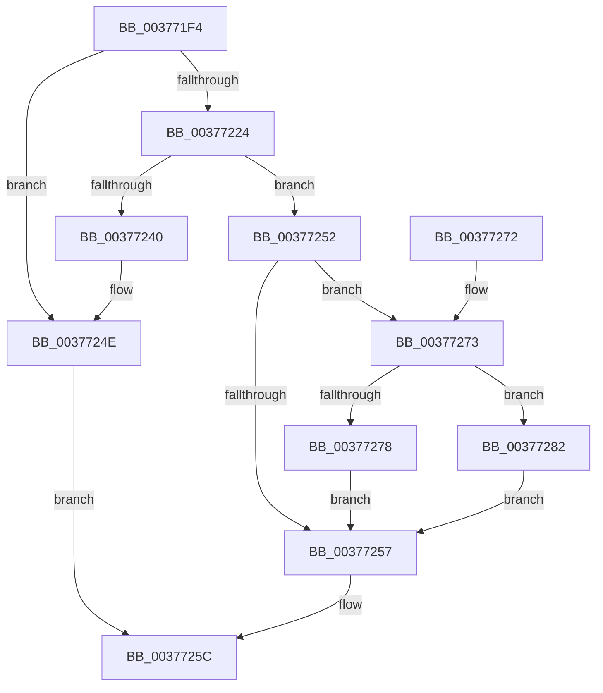

# MiObtainSystemCharges

- RVA: `0x003771F4`–`0x0037728C` (길이 `152` bytes)
- VA: `0x00000001403771F4`
- 실행 섹션: `.text`
- PDB 이름 있음: `예`; PDB Function 태그: `아니요`
- unwind 정보 RVA: `0x00064E68`
- 디코드: `43`개 명령, `152/152` bytes 표시
- 미해석 바이트: `0` (있으면 어셈블리에 `.byte`로 보존)

> 이 문서는 커널 이미지의 기계어와 PDB 기호를 분석해 생성했습니다. 4번과 5번은 함수 원형과 자료형을 바이너리 사용 방식에서 추정한 C 해석이며 원본 소스 복구 결과는 아닙니다.

## 1. Dependencies

- 직접 호출 지점: **3**; 고유 호출 대상: **3**
- 직접 호출자로 확인된 함수: **2**
- RIP 상대 이미지 참조: **2**

### Outgoing calls
- `0x00377218` → [MiChargeCommit](../28/MiChargeCommit_function_00286EB0.md) (function, `0x00286EB0`)
- `0x00377237` → [MiChargeResident](../28/MiChargeResident_function_0028A0F0.md) (function, `0x0028A0F0`)
- `0x00377249` → [MiReturnCommit](../24/MiReturnCommit_function_00248410.md) (function, `0x00248410`)

### Direct callers
- [MiGetPageTablePages](MiGetPageTablePages_function_00376C3C.md) at `0x00376C99`
- [MiGetLargePagesForSystemMapping](../../page/AC/MiGetLargePagesForSystemMapping_function_00AC5094.md) at `0x00AC5147`

### Static image references
- `0x00377278` → RVA `0x00E376E0` (`.data`; read/write)
- `0x00377282` → RVA `0x00E376F8` (`.data`; read/write)

## 2. Other-region calls and transfers

- 다른 실행 섹션으로 향하는 call: **0**
- 별도 외부 분기/꼬리 이동을 확인하지 못했습니다.

## 3. Assembly (complete function range)

```asm
003771F4  48 89 5C 24 08                  mov qword ptr [rsp + 8], rbx
003771F9  48 89 74 24 10                  mov qword ptr [rsp + 0x10], rsi
003771FE  48 89 7C 24 18                  mov qword ptr [rsp + 0x18], rdi
00377203  41 56                           push r14
00377205  48 83 EC 20                     sub rsp, 0x20
00377209  41 8B F8                        mov edi, r8d
0037720C  48 8B DA                        mov rbx, rdx
0037720F  41 B8 01 00 00 00               mov r8d, 1
00377215  48 8B F1                        mov rsi, rcx
00377218  E8 93 FC F0 FF                  call 0x140286eb0
0037721D  45 33 F6                        xor r14d, r14d
00377220  85 C0                           test eax, eax
00377222  74 2A                           je 0x14037724e
00377224  83 FF 01                        cmp edi, 1
00377227  41 B8 80 00 00 00               mov r8d, 0x80
0037722D  48 8B D3                        mov rdx, rbx
00377230  48 8B CE                        mov rcx, rsi
00377233  45 0F 45 C6                     cmovne r8d, r14d
00377237  E8 B4 2E F1 FF                  call 0x14028a0f0
0037723C  85 C0                           test eax, eax
0037723E  75 12                           jne 0x140377252
00377240  45 33 C0                        xor r8d, r8d
00377243  48 8B D3                        mov rdx, rbx
00377246  48 8B CE                        mov rcx, rsi
00377249  E8 C2 11 ED FF                  call 0x140248410
0037724E  33 C0                           xor eax, eax
00377250  EB 0A                           jmp 0x14037725c
00377252  83 FF 01                        cmp edi, 1
00377255  75 1C                           jne 0x140377273
00377257  B8 01 00 00 00                  mov eax, 1
0037725C  48 8B 5C 24 30                  mov rbx, qword ptr [rsp + 0x30]
00377261  48 8B 74 24 38                  mov rsi, qword ptr [rsp + 0x38]
00377266  48 8B 7C 24 40                  mov rdi, qword ptr [rsp + 0x40]
0037726B  48 83 C4 20                     add rsp, 0x20
0037726F  41 5E                           pop r14
00377271  C3                              ret
00377272  CC                              int3
00377273  83 FF 03                        cmp edi, 3
00377276  74 0A                           je 0x140377282
00377278  F0 48 01 1D 60 04 AC 00         lock add qword ptr [rip + 0xac0460], rbx
00377280  EB D5                           jmp 0x140377257
00377282  F0 48 01 1D 6E 04 AC 00         lock add qword ptr [rip + 0xac046e], rbx
0037728A  EB CB                           jmp 0x140377257
```

## 4. C-style interpretation (structured pseudocode)

```c
__int64 __fastcall MiObtainSystemCharges(__int64 a1, __int64 a2, int a3)
{
    __int64 result;
    __int64 v_r14;
    __int64 v_rsp;
    unsigned __int64 v_stack_p10;
    unsigned __int64 v_stack_p18;
    unsigned __int64 v_stack_p8;

    v_stack_p8 = v_rbx;
    v_stack_p10 = v_rsi;
    v_stack_p18 = v_rdi;
    v_rsp = (v_rsp) - (32);
    result = MiChargeCommit(a1, a2, 1, a4);
    v_r14 = 0;
    if ((unsigned int)(result) == 0) goto loc_0037724E;
    a3 = 128;
    if (((unsigned int)((unsigned int)(a3))) != 1) { a3 = 0; }
    result = MiChargeResident(a1, a2, a3, a4);
    if ((unsigned int)(result) != 0) goto loc_00377252;
    a3 = 0;
    result = MiReturnCommit(a1, a2, a3, a4);
loc_0037724E:
    result = 0;
    goto loc_0037725C;
loc_00377252:
    if (((unsigned int)((unsigned int)(a3))) != 1) goto loc_00377273;
loc_00377257:
loc_0037725C:
    v_rsp = (v_rsp) + (32);
    return 1;
loc_00377273:
    if (((unsigned int)(v_stack_p18)) == 3) goto loc_00377282;
    goto loc_00377257;
loc_00377282:
    goto loc_00377257;
}
```

## 5. (Beta) C Style

```c
int64_t MiObtainSystemCharges(int64_t Arg1, int64_t Arg2, int32_t Arg3)
{
    int64_t result;
    int64_t local_r14;
    int64_t local_rsp;
    uint64_t v_stack_p10;
    uint64_t v_stack_p18;
    uint64_t v_stack_p8;

    v_stack_p8 = local_rbx;
    v_stack_p10 = local_rsi;
    v_stack_p18 = local_rdi;
    local_rsp = (local_rsp) - (32);
    result = MiChargeCommit(Arg1, Arg2, 1, a4);
    local_r14 = 0;
    if ((uint32_t)(result) == 0) goto loc_0037724E;
    Arg3 = 128;
    if (((uint32_t)((uint32_t)(Arg3))) != 1) { Arg3 = 0; }
    result = MiChargeResident(Arg1, Arg2, Arg3, a4);
    if ((uint32_t)(result) != 0) goto loc_00377252;
    Arg3 = 0;
    result = MiReturnCommit(Arg1, Arg2, Arg3, a4);
loc_0037724E:
    result = 0;
    goto loc_0037725C;
loc_00377252:
    if (((uint32_t)((uint32_t)(Arg3))) != 1) goto loc_00377273;
loc_00377257:
loc_0037725C:
    local_rsp = (local_rsp) + (32);
    return 1;
loc_00377273:
    if (((uint32_t)(v_stack_p18)) == 3) goto loc_00377282;
    goto loc_00377257;
loc_00377282:
    goto loc_00377257;
}
```

## 6. Execution-region graph

[열기: 2D/3D 그래프와 함수 탐색 컨트롤 패널](../../../control-panel.html?section=text&rva=0x003771F4&view=graph)

- 2D 그래프는 위에서 아래로 흐르고, 3D 그래프는 빈 공간을 드래그해 회전합니다. Shift+드래그는 이동, 휠은 확대·축소, 함수 노드 선택은 대상 보고서 이동입니다.

### Static fallback


