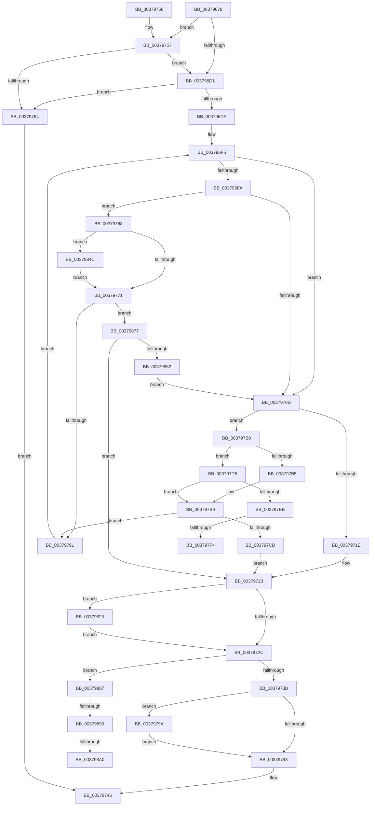

# MiPerformOnDemandLargePageCoalesce

- RVA: `0x00379678`–`0x003798B4` (길이 `572` bytes)
- VA: `0x0000000140379678`
- 실행 섹션: `.text`
- PDB 이름 있음: `예`; PDB Function 태그: `예`
- unwind 정보 RVA: `0x0007AF7C`
- 디코드: `146`개 명령, `572/572` bytes 표시
- 미해석 바이트: `0` (있으면 어셈블리에 `.byte`로 보존)

> 이 문서는 커널 이미지의 기계어와 PDB 기호를 분석해 생성했습니다. 4번과 5번은 함수 원형과 자료형을 바이너리 사용 방식에서 추정한 C 해석이며 원본 소스 복구 결과는 아닙니다.

## 1. Dependencies

- 직접 호출 지점: **7**; 고유 호출 대상: **5**
- 직접 호출자로 확인된 함수: **2**
- RIP 상대 이미지 참조: **1**

### Outgoing calls
- `0x00379701` → [MiLargeCoalesceCandidatesExist](../46/MiLargeCoalesceCandidatesExist_function_004624B8.md) (function, `0x004624B8`)
- `0x0037977B` → [MiProcessLargeCoalesceCandidates](MiProcessLargeCoalesceCandidates_function_00379DF4.md) (function, `0x00379DF4`)
- `0x003797BD` → [MiCheckLargePagesExist](MiCheckLargePagesExist_function_0037ABC0.md) (function, `0x0037ABC0`)
- `0x003797DC` → [MiLargeCoalesceCandidatesExist](../46/MiLargeCoalesceCandidatesExist_function_004624B8.md) (function, `0x004624B8`)
- `0x003797F8` → [KeQueryUnbiasedInterruptTimePrecise](KeQueryUnbiasedInterruptTimePrecise_function_0037AC20.md) (function, `0x0037AC20`)
- `0x00379830` → [MiAccumulateTimeBoundTime](../4D/MiAccumulateTimeBoundTime_function_004D5FAC.md) (function, `0x004D5FAC`)
- `0x00379850` → [KeQueryUnbiasedInterruptTimePrecise](KeQueryUnbiasedInterruptTimePrecise_function_0037AC20.md) (function, `0x0037AC20`)

### Direct callers
- [MiGetLargePage](../31/MiGetLargePage_function_0031E210.md) at `0x0031E517`
- [MiGetLargePageDemoteAsNeeded](../3B/MiGetLargePageDemoteAsNeeded_function_003B8440.md) at `0x003B8559`

### Static image references
- `0x00379757` → RVA `0x00FC6A88` (`ALMOSTRO`; read)

## 2. Other-region calls and transfers

- 다른 실행 섹션으로 향하는 call: **0**
- call이 아닌 외부 분기/꼬리 이동: **5**
  - `0x003797EE` → [sub_006E43FC](../6E/Unknown_function_006E43FC.md) (`tail-transfer`)
  - `0x0037981E` → [sub_006E43FC](../6E/Unknown_function_006E43FC.md) (`tail-transfer`)
  - `0x0037988A` → [sub_006E43FC + 0x30](../6E/Unknown_function_006E43FC.md) (`tail-transfer`)
  - `0x0037989A` → [sub_006E43FC + 0x30](../6E/Unknown_function_006E43FC.md) (`tail-transfer`)
  - `0x003798AF` → [sub_006E43FC + 0x3F](../6E/Unknown_function_006E43FC.md) (`tail-transfer`)

## 3. Assembly (complete function range)

```asm
00379678  40 55                           push rbp
0037967A  53                              push rbx
0037967B  56                              push rsi
0037967C  57                              push rdi
0037967D  41 54                           push r12
0037967F  41 55                           push r13
00379681  41 56                           push r14
00379683  41 57                           push r15
00379685  48 8B EC                        mov rbp, rsp
00379688  48 83 EC 58                     sub rsp, 0x58
0037968C  48 8B 7D 68                     mov rdi, qword ptr [rbp + 0x68]
00379690  33 DB                           xor ebx, ebx
00379692  41 8B C0                        mov eax, r8d
00379695  48 8B F1                        mov rsi, rcx
00379698  48 69 C0 80 DF 00 00            imul rax, rax, 0xdf80
0037969F  44 8B FA                        mov r15d, edx
003796A2  48 03 41 10                     add rax, qword ptr [rcx + 0x10]
003796A6  48 89 45 E8                     mov qword ptr [rbp - 0x18], rax
003796AA  89 5D E4                        mov dword ptr [rbp - 0x1c], ebx
003796AD  48 89 4D D0                     mov qword ptr [rbp - 0x30], rcx
003796B1  48 8B 80 80 3A 00 00            mov rax, qword ptr [rax + 0x3a80]
003796B8  44 89 7D D8                     mov dword ptr [rbp - 0x28], r15d
003796BC  44 89 45 DC                     mov dword ptr [rbp - 0x24], r8d
003796C0  44 89 4D E0                     mov dword ptr [rbp - 0x20], r9d
003796C4  48 89 7D F0                     mov qword ptr [rbp - 0x10], rdi
003796C8  48 85 C0                        test rax, rax
003796CB  0F 84 86 00 00 00               je 0x140379757
003796D1  48 8B 47 28                     mov rax, qword ptr [rdi + 0x28]
003796D5  48 39 47 30                     cmp qword ptr [rdi + 0x30], rax
003796D9  0F 83 85 00 00 00               jae 0x140379764
003796DF  41 BB 01 00 00 00               mov r11d, 1
003796E5  89 5D 58                        mov dword ptr [rbp + 0x58], ebx
003796E8  44 89 5D 50                     mov dword ptr [rbp + 0x50], r11d
003796EC  4C 8B EB                        mov r13, rbx
003796EF  44 8B E3                        mov r12d, ebx
003796F2  45 8B F7                        mov r14d, r15d
003796F5  45 85 DB                        test r11d, r11d
003796F8  74 13                           je 0x14037970d
003796FA  41 8B D7                        mov edx, r15d
003796FD  48 8D 4D D0                     lea rcx, [rbp - 0x30]
00379701  E8 B2 8D 0E 00                  call 0x1404624b8
00379706  89 45 50                        mov dword ptr [rbp + 0x50], eax
00379709  85 C0                           test eax, eax
0037970B  75 5B                           jne 0x140379768
0037970D  41 FF C6                        inc r14d
00379710  44 89 75 60                     mov dword ptr [rbp + 0x60], r14d
00379714  41 83 FE 03                     cmp r14d, 3
00379718  0F 85 92 00 00 00               jne 0x1403797b0
0037971E  BF 05 01 00 00                  mov edi, 0x105
00379723  45 85 E4                        test r12d, r12d
00379726  0F 85 F7 00 00 00               jne 0x140379823
0037972C  49 8B CF                        mov rcx, r15
0037972F  81 FF 02 01 00 00               cmp edi, 0x102
00379735  0F 84 4C 01 00 00               je 0x140379887
0037973B  81 FF FF 00 00 00               cmp edi, 0xff
00379741  74 57                           je 0x14037979a
00379743  8B C3                           mov eax, ebx
00379745  48 83 C4 58                     add rsp, 0x58
00379749  41 5F                           pop r15
0037974B  41 5E                           pop r14
0037974D  41 5D                           pop r13
0037974F  41 5C                           pop r12
00379751  5F                              pop rdi
00379752  5E                              pop rsi
00379753  5B                              pop rbx
00379754  5D                              pop rbp
00379755  C3                              ret
00379756  CC                              int3
00379757  F6 05 2A D3 C4 00 30            test byte ptr [rip + 0xc4d32a], 0x30
0037975E  0F 84 6D FF FF FF               je 0x1403796d1
00379764  33 C0                           xor eax, eax
00379766  EB DD                           jmp 0x140379745
00379768  45 85 E4                        test r12d, r12d
0037976B  0F 84 DB 00 00 00               je 0x14037984c
00379771  4C 8D 45 D0                     lea r8, [rbp - 0x30]
00379775  41 8B D7                        mov edx, r15d
00379778  48 8B CE                        mov rcx, rsi
0037977B  E8 74 06 00 00                  call 0x140379df4
00379780  44 8B 5D 50                     mov r11d, dword ptr [rbp + 0x50]
00379784  8B F8                           mov edi, eax
00379786  3D 2D 02 00 C0                  cmp eax, 0xc000022d
0037978B  0F 85 E6 00 00 00               jne 0x140379877
00379791  48 8B 7D 68                     mov rdi, qword ptr [rbp + 0x68]
00379795  E9 5B FF FF FF                  jmp 0x1403796f5
0037979A  48 8D 04 49                     lea rax, [rcx + rcx*2]
0037979E  48 03 C0                        add rax, rax
003797A1  F0 FF 84 C6 8C 40 00 00         lock inc dword ptr [rsi + rax*8 + 0x408c]
003797A9  BB 01 00 00 00                  mov ebx, 1
003797AE  EB 93                           jmp 0x140379743
003797B0  45 3B F7                        cmp r14d, r15d
003797B3  77 20                           ja 0x1403797d5
003797B5  44 8B 5D 50                     mov r11d, dword ptr [rbp + 0x50]
003797B9  48 8D 4D D0                     lea rcx, [rbp - 0x30]
003797BD  E8 FE 13 00 00                  call 0x14037abc0
003797C2  44 8B 75 60                     mov r14d, dword ptr [rbp + 0x60]
003797C6  83 F8 01                        cmp eax, 1
003797C9  7F C6                           jg 0x140379791
003797CB  BF FF 00 00 00                  mov edi, 0xff
003797D0  E9 4E FF FF FF                  jmp 0x140379723
003797D5  41 8B D6                        mov edx, r14d
003797D8  48 8D 4D D0                     lea rcx, [rbp - 0x30]
003797DC  E8 D7 8C 0E 00                  call 0x1404624b8
003797E1  89 45 50                        mov dword ptr [rbp + 0x50], eax
003797E4  44 8B D8                        mov r11d, eax
003797E7  85 C0                           test eax, eax
003797E9  74 CE                           je 0x1403797b9
003797EB  45 85 E4                        test r12d, r12d
003797EE  0F 85 08 AC 36 00               jne 0x1406e43fc
003797F4  48 8D 4D C8                     lea rcx, [rbp - 0x38]
003797F8  E8 23 14 00 00                  call 0x14037ac20
003797FD  48 8B 4D 68                     mov rcx, qword ptr [rbp + 0x68]
00379801  41 BC 01 00 00 00               mov r12d, 1
00379807  48 89 41 38                     mov qword ptr [rcx + 0x38], rax
0037980B  65 4C 8B 2C 25 88 01 00 00      mov r13, qword ptr gs:[0x188]
00379814  41 8B 85 54 01 00 00            mov eax, dword ptr [r13 + 0x154]
0037981B  89 45 58                        mov dword ptr [rbp + 0x58], eax
0037981E  E9 D9 AB 36 00                  jmp 0x1406e43fc
00379823  48 8B 4D 68                     mov rcx, qword ptr [rbp + 0x68]
00379827  BA 01 00 00 00                  mov edx, 1
0037982C  48 83 C1 28                     add rcx, 0x28
00379830  E8 77 C7 15 00                  call 0x1404d5fac
00379835  49 8D 87 58 01 00 00            lea rax, [r15 + 0x158]
0037983C  48 8D 04 40                     lea rax, [rax + rax*2]
00379840  48 03 C0                        add rax, rax
00379843  F0 FF 04 C6                     lock inc dword ptr [rsi + rax*8]
00379847  E9 E0 FE FF FF                  jmp 0x14037972c
0037984C  48 8D 4D 48                     lea rcx, [rbp + 0x48]
00379850  E8 CB 13 00 00                  call 0x14037ac20
00379855  48 89 47 38                     mov qword ptr [rdi + 0x38], rax
00379859  41 BC 01 00 00 00               mov r12d, 1
0037985F  65 4C 8B 2C 25 88 01 00 00      mov r13, qword ptr gs:[0x188]
00379868  41 8B 85 54 01 00 00            mov eax, dword ptr [r13 + 0x154]
0037986F  89 45 58                        mov dword ptr [rbp + 0x58], eax
00379872  E9 FA FE FF FF                  jmp 0x140379771
00379877  3D 05 01 00 00                  cmp eax, 0x105
0037987C  0F 85 A1 FE FF FF               jne 0x140379723
00379882  E9 86 FE FF FF                  jmp 0x14037970d
00379887  4D 85 ED                        test r13, r13
0037988A  0F 84 9C AB 36 00               je 0x1406e442c
00379890  8B 45 58                        mov eax, dword ptr [rbp + 0x58]
00379893  41 3B 85 54 01 00 00            cmp eax, dword ptr [r13 + 0x154]
0037989A  0F 84 8C AB 36 00               je 0x1406e442c
003798A0  48 8D 0C 49                     lea rcx, [rcx + rcx*2]
003798A4  48 C1 E1 04                     shl rcx, 4
003798A8  48 81 C1 88 40 00 00            add rcx, 0x4088
003798AF  E9 87 AB 36 00                  jmp 0x1406e443b
```

## 4. C-style interpretation (structured pseudocode)

```c
__int64 __fastcall MiPerformOnDemandLargePageCoalesce(__int64 a1, int a2, int a3, int a4, __int64 a5)
{
    __int64 result;
    __int64 v_r14;
    __int64 v_rbx;
    __int64 v_rsp;
    unsigned __int64 v_stack_m50;
    unsigned __int64 v_stack_m58;
    unsigned int v_stack_m5C;
    unsigned int v_stack_m60;
    unsigned int v_stack_m64;
    unsigned int v_stack_m68;
    unsigned __int64 v_stack_m70;
    unsigned __int64 v_stack_m78;
    unsigned int v_stack_p10;
    unsigned int v_stack_p18;
    unsigned int v_stack_p20;
    unsigned __int64 v_stack_p8;

    v_rsp = (v_rsp) - (88);
    v_rbx = 0;
    result = ((unsigned int)(a3)) * ((unsigned int)(a3));
    result = (result) + (*(unsigned __int64 *)(a1 + 16));
    v_stack_m58 = result;
    v_stack_m5C = 0;
    v_stack_m70 = a1;
    v_stack_m68 = (unsigned int)((unsigned int)(a2));
    v_stack_m64 = a3;
    v_stack_m60 = a4;
    v_stack_m50 = a5;
    if (*(unsigned __int64 *)(result + 14976) == 0) goto loc_00379757;
loc_003796D1:
    if ((*(unsigned __int64 *)(a5 + 48)) >= (*(unsigned __int64 *)(a5 + 40))) goto loc_00379764;
    v_stack_p18 = 0;
    v_stack_p10 = 1;
loc_003796F5:
    if (1 == 0) goto loc_0037970D;
    result = MiLargeCoalesceCandidatesExist(v_stack_m70, (unsigned int)((unsigned int)((unsigned int)(a2))), a3, a4);
    v_stack_p10 = (unsigned int)(result);
    if ((unsigned int)(result) != 0) goto loc_00379768;
loc_0037970D:
    v_r14 = (unsigned int)(((unsigned int)((unsigned int)((unsigned int)(a2)))) + 1);
    v_stack_p20 = (unsigned int)(v_r14);
    if (((unsigned int)(v_r14)) != 3) goto loc_003797B0;
loc_00379723:
    if (0 != 0) goto loc_00379823;
loc_0037972C:
    if (261 == 258) goto loc_00379887;
    if (261 == 255) goto loc_0037979A;
loc_00379743:
loc_00379745:
    v_rsp = (v_rsp) + (88);
    return 0;
loc_00379757:
    if (((*(unsigned __int8 *)(v_rip + 12899114)) & (48)) == 0) goto loc_003796D1;
loc_00379764:
    result = 0;
    goto loc_00379745;
loc_00379768:
    if (0 == 0) goto loc_0037984C;
loc_00379771:
    result = MiProcessLargeCoalesceCandidates(a1, (unsigned int)((unsigned int)((unsigned int)(a2))), v_stack_m70, a4);
    if (((unsigned int)(result)) != 0xC000022DULL) goto loc_00379877;
loc_00379791:
    goto loc_003796F5;
loc_0037979A:
    result = (a1 + a1 * 2) + (a1 + a1 * 2);
    goto loc_00379743;
loc_003797B0:
    if (((unsigned int)(v_r14)) > ((unsigned int)((unsigned int)(a2)))) goto loc_003797D5;
loc_003797B9:
    result = MiCheckLargePagesExist(v_stack_m70, (unsigned int)((unsigned int)((unsigned int)(a2))), v_stack_m70, a4);
    if (((unsigned int)(result)) > 1) goto loc_00379791;
    goto loc_00379723;
loc_003797D5:
    result = MiLargeCoalesceCandidatesExist(v_stack_m70, (unsigned int)((unsigned int)((unsigned int)(v_stack_p20))), v_stack_m70, a4);
    v_stack_p10 = (unsigned int)(result);
    if ((unsigned int)(result) == 0) goto loc_003797B9;
    result = KeQueryUnbiasedInterruptTimePrecise(v_stack_m78, (unsigned int)((unsigned int)((unsigned int)(v_stack_p20))), v_stack_m70, a4);
    *(unsigned __int64 *)(a5 + 56) = result;
    v_stack_p18 = (unsigned int)((unsigned int)(*(unsigned int *)(*(unsigned __int64 *)(gs_base + (0 + 392)) + 340)));
loc_00379823:
    a1 = (a5) + (40);
    result = MiAccumulateTimeBoundTime(a1, 1, v_stack_m70, a4);
    result = ((unsigned int)(a2) + 344 + (unsigned int)(a2) + 344 * 2) + ((unsigned int)(a2) + 344 + (unsigned int)(a2) + 344 * 2);
    goto loc_0037972C;
loc_0037984C:
    result = KeQueryUnbiasedInterruptTimePrecise(v_stack_p8, 1, v_stack_m70, a4);
    *(unsigned __int64 *)(255 + 56) = result;
    v_stack_p18 = (unsigned int)((unsigned int)(*(unsigned int *)(*(unsigned __int64 *)(gs_base + (0 + 392)) + 340)));
    goto loc_00379771;
loc_00379877:
    if (((unsigned int)((unsigned int)(*(unsigned int *)(*(unsigned __int64 *)(gs_base + (0 + 392)) + 340)))) != 261) goto loc_00379723;
    goto loc_0037970D;
loc_00379887:
    a1 = (v_stack_p8 + v_stack_p8 * 2) << (4);
    a1 = (a1) + (0x4088ULL);
}
```

## 5. (Beta) C Style

```c
int64_t MiPerformOnDemandLargePageCoalesce(void *Arg1, void *Arg2, void *Arg3, int32_t Arg4, void *Arg5)
{
    uint8_t *arg1 = (uint8_t *)Arg1;
    uint8_t *arg2 = (uint8_t *)Arg2;
    uint8_t *arg3 = (uint8_t *)Arg3;
    uint8_t *arg5 = (uint8_t *)Arg5;

    int64_t result;
    int64_t local_r14;
    int64_t local_rbx;
    int64_t local_rsp;
    uint64_t v_stack_m50;
    uint64_t v_stack_m58;
    uint32_t v_stack_m5C;
    uint32_t v_stack_m60;
    uint32_t v_stack_m64;
    uint32_t v_stack_m68;
    uint64_t v_stack_m70;
    uint64_t v_stack_m78;
    uint32_t v_stack_p10;
    uint32_t v_stack_p18;
    uint32_t v_stack_p20;
    uint64_t v_stack_p8;

    local_rsp = (local_rsp) - (88);
    local_rbx = 0;
    result = ((uint32_t)(Arg3)) * ((uint32_t)(Arg3));
    result = (result) + (*(uint64_t *)(arg1 + 0x10));
    v_stack_m58 = result;
    v_stack_m5C = 0;
    v_stack_m70 = Arg1;
    v_stack_m68 = (uint32_t)((uint32_t)(Arg2));
    v_stack_m64 = Arg3;
    v_stack_m60 = Arg4;
    v_stack_m50 = Arg5;
    if (*(uint64_t *)(result + 0x3A80) == 0) goto loc_00379757;
loc_003796D1:
    if ((*(uint64_t *)(arg5 + 0x30)) >= (*(uint64_t *)(arg5 + 0x28))) goto loc_00379764;
    v_stack_p18 = 0;
    v_stack_p10 = 1;
loc_003796F5:
    if (1 == 0) goto loc_0037970D;
    result = MiLargeCoalesceCandidatesExist(v_stack_m70, (uint32_t)((uint32_t)((uint32_t)(Arg2))), Arg3, Arg4);
    v_stack_p10 = (uint32_t)(result);
    if ((uint32_t)(result) != 0) goto loc_00379768;
loc_0037970D:
    local_r14 = (uint32_t)(((uint32_t)((uint32_t)((uint32_t)(Arg2)))) + 1);
    v_stack_p20 = (uint32_t)(local_r14);
    if (((uint32_t)(local_r14)) != 3) goto loc_003797B0;
loc_00379723:
    if (0 != 0) goto loc_00379823;
loc_0037972C:
    if (261 == 258) goto loc_00379887;
    if (261 == 255) goto loc_0037979A;
loc_00379743:
loc_00379745:
    local_rsp = (local_rsp) + (88);
    return 0;
loc_00379757:
    if (((*(uint8_t *)(v_rip + 0xC4D32A)) & (48)) == 0) goto loc_003796D1;
loc_00379764:
    result = 0;
    goto loc_00379745;
loc_00379768:
    if (0 == 0) goto loc_0037984C;
loc_00379771:
    result = MiProcessLargeCoalesceCandidates(Arg1, (uint32_t)((uint32_t)((uint32_t)(Arg2))), v_stack_m70, Arg4);
    if (((uint32_t)(result)) != 0xC000022DULL) goto loc_00379877;
loc_00379791:
    goto loc_003796F5;
loc_0037979A:
    result = (Arg1 + Arg1 * 2) + (Arg1 + Arg1 * 2);
    goto loc_00379743;
loc_003797B0:
    if (((uint32_t)(local_r14)) > ((uint32_t)((uint32_t)(Arg2)))) goto loc_003797D5;
loc_003797B9:
    result = MiCheckLargePagesExist(v_stack_m70, (uint32_t)((uint32_t)((uint32_t)(Arg2))), v_stack_m70, Arg4);
    if (((uint32_t)(result)) > 1) goto loc_00379791;
    goto loc_00379723;
loc_003797D5:
    result = MiLargeCoalesceCandidatesExist(v_stack_m70, (uint32_t)((uint32_t)((uint32_t)(v_stack_p20))), v_stack_m70, Arg4);
    v_stack_p10 = (uint32_t)(result);
    if ((uint32_t)(result) == 0) goto loc_003797B9;
    result = KeQueryUnbiasedInterruptTimePrecise(v_stack_m78, (uint32_t)((uint32_t)((uint32_t)(v_stack_p20))), v_stack_m70, Arg4);
    *(uint64_t *)(arg5 + 0x38) = result;
    v_stack_p18 = (uint32_t)((uint32_t)(*(uint32_t *)(*(uint64_t *)(gs_base + (0 + 0x188)) + 0x154)));
loc_00379823:
    Arg1 = (Arg5) + (40);
    result = MiAccumulateTimeBoundTime(Arg1, 1, v_stack_m70, Arg4);
    result = ((uint32_t)(Arg2) + 344 + (uint32_t)(Arg2) + 344 * 2) + ((uint32_t)(Arg2) + 344 + (uint32_t)(Arg2) + 344 * 2);
    goto loc_0037972C;
loc_0037984C:
    result = KeQueryUnbiasedInterruptTimePrecise(v_stack_p8, 1, v_stack_m70, Arg4);
    *(uint64_t *)(255 + 0x38) = result;
    v_stack_p18 = (uint32_t)((uint32_t)(*(uint32_t *)(*(uint64_t *)(gs_base + (0 + 0x188)) + 0x154)));
    goto loc_00379771;
loc_00379877:
    if (((uint32_t)((uint32_t)(*(uint32_t *)(*(uint64_t *)(gs_base + (0 + 0x188)) + 0x154)))) != 261) goto loc_00379723;
    goto loc_0037970D;
loc_00379887:
    Arg1 = (v_stack_p8 + v_stack_p8 * 2) << (4);
    Arg1 = (Arg1) + (0x4088ULL);
}
```

### 관측된 메모리 오프셋

구조체 형식이 확인되지 않은 접근은 인자 기준의 오프셋으로만 기록했습니다.

| 기준 인자 | 오프셋 표현 | 폭 (bit) | 접근 |
|---|---:|---:|---|
| `Arg1` | `+ 0x0 + rax*8` | `32` | `R/W` |
| `Arg1` | `+ 0x10` | `64` | `R` |
| `Arg1` | `+ 0x408C + rax*8` | `32` | `R/W` |
| `Arg2` | `+ 0x0 + rax*2` | `64` | `R` |
| `Arg2` | `+ 0x0 + rcx*2` | `64` | `R` |
| `Arg2` | `+ 0x158` | `64` | `R` |
| `Arg3` | `+ 0x3A80` | `64` | `R` |
| `Arg5` | `+ 0x28` | `64` | `R` |
| `Arg5` | `+ 0x30` | `64` | `R` |
| `Arg5` | `+ 0x38` | `64` | `W` |

## 6. Execution-region graph

[열기: 2D/3D 그래프와 함수 탐색 컨트롤 패널](../../../control-panel.html?section=text&rva=0x00379678&view=graph)

- 2D 그래프는 위에서 아래로 흐르고, 3D 그래프는 빈 공간을 드래그해 회전합니다. Shift+드래그는 이동, 휠은 확대·축소, 함수 노드 선택은 대상 보고서 이동입니다.

### Static fallback


