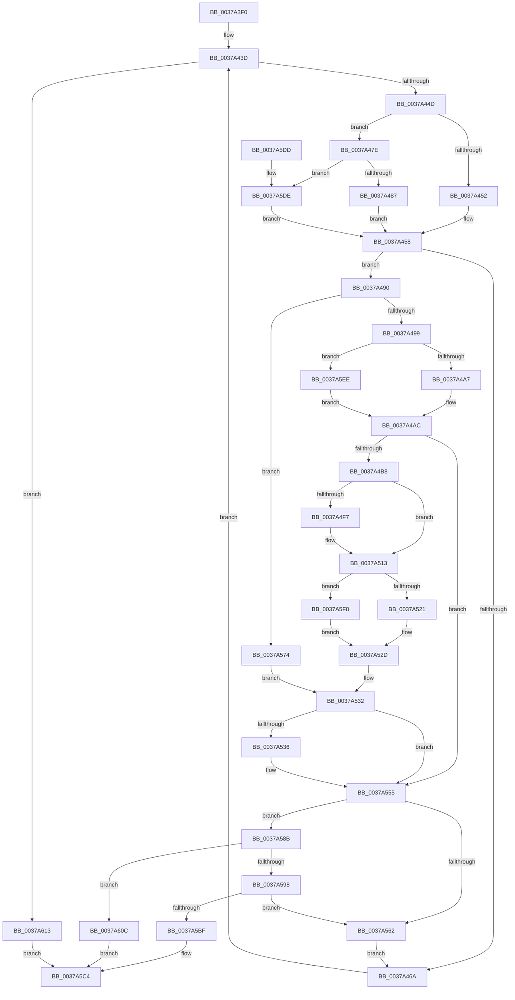

# MiProcessLargeCoalesceBitmapCandidates

- RVA: `0x0037A3F0`–`0x0037A61C` (길이 `556` bytes)
- VA: `0x000000014037A3F0`
- 실행 섹션: `.text`
- PDB 이름 있음: `예`; PDB Function 태그: `아니요`
- unwind 정보 RVA: `0x0007B02C`
- 디코드: `134`개 명령, `556/556` bytes 표시
- 미해석 바이트: `0` (있으면 어셈블리에 `.byte`로 보존)

> 이 문서는 커널 이미지의 기계어와 PDB 기호를 분석해 생성했습니다. 4번과 5번은 함수 원형과 자료형을 바이너리 사용 방식에서 추정한 C 해석이며 원본 소스 복구 결과는 아닙니다.

## 1. Dependencies

- 직접 호출 지점: **8**; 고유 호출 대상: **8**
- 직접 호출자로 확인된 함수: **2**
- RIP 상대 이미지 참조: **2**

### Outgoing calls
- `0x0037A4A7` → [MiSafeLockPage](../32/MiSafeLockPage_function_00321620.md) (function, `0x00321620`)
- `0x0037A4FC` → [MiCoalesceFreeSmallPages](../33/MiCoalesceFreeSmallPages_function_00336340.md) (function, `0x00336340`)
- `0x0037A528` → [MiUnlockPage](../31/MiUnlockPage_function_0031A3E0.md) (function, `0x0031A3E0`)
- `0x0037A545` → [MiRecordLargePageCandidate](MiRecordLargePageCandidate_function_0037A624.md) (function, `0x0037A624`)
- `0x0037A582` → [MiCoalesceFreeLargePages](MiCoalesceFreeLargePages_function_0037A7B4.md) (function, `0x0037A7B4`)
- `0x0037A58E` → [MiCheckLargePagesExist](MiCheckLargePagesExist_function_0037ABC0.md) (function, `0x0037ABC0`)
- `0x0037A5A1` → [KeQueryUnbiasedInterruptTimePrecise](KeQueryUnbiasedInterruptTimePrecise_function_0037AC20.md) (function, `0x0037AC20`)
- `0x0037A5EE` → [MiSafeLockPageAtDpc](../31/MiSafeLockPageAtDpc_function_0031C67C.md) (function, `0x0031C67C`)

### Direct callers
- [MiProcessLargeCoalesceCandidates](MiProcessLargeCoalesceCandidates_function_00379DF4.md) at `0x0037A1EB`
- [sub_006E4446](../6E/Unknown_function_006E4446.md) at `0x006E44CC`

### Static image references
- `0x0037A43D` → RVA `0x00000000` (`image boundary/outside`; read)
- `0x0037A4E1` → RVA `0x00E30088` (`.data`; read)

## 2. Other-region calls and transfers

- 다른 실행 섹션으로 향하는 call: **0**
- 별도 외부 분기/꼬리 이동을 확인하지 못했습니다.

## 3. Assembly (complete function range)

```asm
0037A3F0  48 89 4C 24 08                  mov qword ptr [rsp + 8], rcx
0037A3F5  55                              push rbp
0037A3F6  57                              push rdi
0037A3F7  41 54                           push r12
0037A3F9  41 55                           push r13
0037A3FB  41 56                           push r14
0037A3FD  41 57                           push r15
0037A3FF  48 83 EC 38                     sub rsp, 0x38
0037A403  4C 8B A4 24 98 00 00 00         mov r12, qword ptr [rsp + 0x98]
0037A40B  B8 05 01 00 00                  mov eax, 0x105
0037A410  4C 8B BC 24 90 00 00 00         mov r15, qword ptr [rsp + 0x90]
0037A418  4C 8B F2                        mov r14, rdx
0037A41B  0F B6 94 24 A0 00 00 00         movzx edx, byte ptr [rsp + 0xa0]
0037A423  49 8B F9                        mov rdi, r9
0037A426  48 89 5C 24 78                  mov qword ptr [rsp + 0x78], rbx
0037A42B  4C 8B E9                        mov r13, rcx
0037A42E  89 84 24 88 00 00 00            mov dword ptr [rsp + 0x88], eax
0037A435  41 8B E8                        mov ebp, r8d
0037A438  48 89 74 24 30                  mov qword ptr [rsp + 0x30], rsi
0037A43D  4C 8D 05 BC 5B C8 FF            lea r8, [rip - 0x37a444]
0037A444  49 3B FF                        cmp rdi, r15
0037A447  0F 87 C6 01 00 00               ja 0x14037a613
0037A44D  83 FD 02                        cmp ebp, 2
0037A450  75 2C                           jne 0x14037a47e
0037A452  0F B7 07                        movzx eax, word ptr [rdi]
0037A455  83 E0 1F                        and eax, 0x1f
0037A458  48 8D 34 ED 00 00 00 00         lea rsi, [rbp*8]
0037A460  4A 3B 84 06 78 AF 03 00         cmp rax, qword ptr [rsi + r8 + 0x3af78]
0037A468  74 26                           je 0x14037a490
0037A46A  48 8D 05 8F 5B C8 FF            lea rax, [rip - 0x37a471]
0037A471  4C 03 B4 06 60 1C 01 00         add r14, qword ptr [rsi + rax + 0x11c60]
0037A479  49 03 FC                        add rdi, r12
0037A47C  EB BF                           jmp 0x14037a43d
0037A47E  83 FD 01                        cmp ebp, 1
0037A481  0F 85 57 01 00 00               jne 0x14037a5de
0037A487  0F B7 07                        movzx eax, word ptr [rdi]
0037A48A  48 C1 E8 0A                     shr rax, 0xa
0037A48E  EB C8                           jmp 0x14037a458
0037A490  83 FD 01                        cmp ebp, 1
0037A493  0F 86 DB 00 00 00               jbe 0x14037a574
0037A499  33 DB                           xor ebx, ebx
0037A49B  49 8B CE                        mov rcx, r14
0037A49E  80 FA 02                        cmp dl, 2
0037A4A1  0F 84 47 01 00 00               je 0x14037a5ee
0037A4A7  E8 74 71 FA FF                  call 0x140321620
0037A4AC  44 0F B6 E8                     movzx r13d, al
0037A4B0  3C 11                           cmp al, 0x11
0037A4B2  0F 84 9D 00 00 00               je 0x14037a555
0037A4B8  4F 8D 04 76                     lea r8, [r14 + r14*2]
0037A4BC  48 B8 00 00 00 00 00 DE FF FF   movabs rax, 0xffffde0000000000
0037A4C6  49 C1 E0 04                     shl r8, 4
0037A4CA  48 8B C0                        mov rax, rax
0037A4CD  48 8B 54 24 70                  mov rdx, qword ptr [rsp + 0x70]
0037A4D2  4C 03 C0                        add r8, rax
0037A4D5  4C 89 84 24 90 00 00 00         mov qword ptr [rsp + 0x90], r8
0037A4DD  49 8B 40 28                     mov rax, qword ptr [r8 + 0x28]
0037A4E1  48 8B 0D A0 5B AB 00            mov rcx, qword ptr [rip + 0xab5ba0]
0037A4E8  48 C1 E8 2B                     shr rax, 0x2b
0037A4EC  25 FF 03 00 00                  and eax, 0x3ff
0037A4F1  48 39 14 C1                     cmp qword ptr [rcx + rax*8], rdx
0037A4F5  75 1C                           jne 0x14037a513
0037A4F7  33 D2                           xor edx, edx
0037A4F9  49 8B CE                        mov rcx, r14
0037A4FC  E8 3F BE FB FF                  call 0x140336340
0037A501  4C 8B 84 24 90 00 00 00         mov r8, qword ptr [rsp + 0x90]
0037A509  A8 02                           test al, 2
0037A50B  B8 01 00 00 00                  mov eax, 1
0037A510  0F 45 D8                        cmovne ebx, eax
0037A513  80 BC 24 A0 00 00 00 02         cmp byte ptr [rsp + 0xa0], 2
0037A51B  0F 84 D7 00 00 00               je 0x14037a5f8
0037A521  41 0F B6 D5                     movzx edx, r13b
0037A525  49 8B C8                        mov rcx, r8
0037A528  E8 B3 FE F9 FF                  call 0x14031a3e0
0037A52D  4C 8B 6C 24 70                  mov r13, qword ptr [rsp + 0x70]
0037A532  85 DB                           test ebx, ebx
0037A534  74 1F                           je 0x14037a555
0037A536  41 B9 02 00 00 00               mov r9d, 2
0037A53C  44 8B C5                        mov r8d, ebp
0037A53F  49 8B D6                        mov rdx, r14
0037A542  49 8B CD                        mov rcx, r13
0037A545  E8 DA 00 00 00                  call 0x14037a624
0037A54A  C7 84 24 88 00 00 00 2D 02 00 C0  mov dword ptr [rsp + 0x88], 0xc000022d
0037A555  4C 8B 9C 24 A8 00 00 00         mov r11, qword ptr [rsp + 0xa8]
0037A55D  4D 85 DB                        test r11, r11
0037A560  75 29                           jne 0x14037a58b
0037A562  4C 8B 6C 24 70                  mov r13, qword ptr [rsp + 0x70]
0037A567  0F B6 94 24 A0 00 00 00         movzx edx, byte ptr [rsp + 0xa0]
0037A56F  E9 F6 FE FF FF                  jmp 0x14037a46a
0037A574  44 0F B6 CA                     movzx r9d, dl
0037A578  44 8D 45 01                     lea r8d, [rbp + 1]
0037A57C  49 8B D6                        mov rdx, r14
0037A57F  49 8B CD                        mov rcx, r13
0037A582  E8 2D 02 00 00                  call 0x14037a7b4
0037A587  8B D8                           mov ebx, eax
0037A589  EB A7                           jmp 0x14037a532
0037A58B  49 8B CB                        mov rcx, r11
0037A58E  E8 2D 06 00 00                  call 0x14037abc0
0037A593  83 F8 01                        cmp eax, 1
0037A596  76 74                           jbe 0x14037a60c
0037A598  49 8B 5B 20                     mov rbx, qword ptr [r11 + 0x20]
0037A59C  48 8D 4C 24 20                  lea rcx, [rsp + 0x20]
0037A5A1  E8 7A 06 00 00                  call 0x14037ac20
0037A5A6  48 8B C8                        mov rcx, rax
0037A5A9  48 2B 43 38                     sub rax, qword ptr [rbx + 0x38]
0037A5AD  48 01 43 30                     add qword ptr [rbx + 0x30], rax
0037A5B1  48 8B 43 30                     mov rax, qword ptr [rbx + 0x30]
0037A5B5  48 89 4B 38                     mov qword ptr [rbx + 0x38], rcx
0037A5B9  48 3B 43 28                     cmp rax, qword ptr [rbx + 0x28]
0037A5BD  72 A3                           jb 0x14037a562
0037A5BF  B8 02 01 00 00                  mov eax, 0x102
0037A5C4  48 8B 74 24 30                  mov rsi, qword ptr [rsp + 0x30]
0037A5C9  48 8B 5C 24 78                  mov rbx, qword ptr [rsp + 0x78]
0037A5CE  48 83 C4 38                     add rsp, 0x38
0037A5D2  41 5F                           pop r15
0037A5D4  41 5E                           pop r14
0037A5D6  41 5D                           pop r13
0037A5D8  41 5C                           pop r12
0037A5DA  5F                              pop rdi
0037A5DB  5D                              pop rbp
0037A5DC  C3                              ret
0037A5DD  CC                              int3
0037A5DE  8B 07                           mov eax, dword ptr [rdi]
0037A5E0  48 C1 E8 13                     shr rax, 0x13
0037A5E4  25 FF 03 00 00                  and eax, 0x3ff
0037A5E9  E9 6A FE FF FF                  jmp 0x14037a458
0037A5EE  E8 89 20 FA FF                  call 0x14031c67c
0037A5F3  E9 B4 FE FF FF                  jmp 0x14037a4ac
0037A5F8  48 B8 FF FF FF FF FF FF FF 7F   movabs rax, 0x7fffffffffffffff
0037A602  F0 49 21 40 18                  lock and qword ptr [r8 + 0x18], rax
0037A607  E9 21 FF FF FF                  jmp 0x14037a52d
0037A60C  B8 FF 00 00 00                  mov eax, 0xff
0037A611  EB B1                           jmp 0x14037a5c4
0037A613  8B 84 24 88 00 00 00            mov eax, dword ptr [rsp + 0x88]
0037A61A  EB A8                           jmp 0x14037a5c4
```

## 4. C-style interpretation (structured pseudocode)

```c
__int64 __fastcall MiProcessLargeCoalesceBitmapCandidates(__int64 a1, __int64 a2, int a3, __int64 a4, __int64 a5, __int64 a6, unsigned __int8 a7, __int64 a8)
{
    __int64 result;
    __int64 v_r14;
    __int64 v_rbx;
    __int64 v_rdi;
    __int64 v_rsp;
    unsigned __int64 v_stack_m38;
    unsigned __int64 v_stack_m48;
    unsigned __int64 v_stack_p10;
    unsigned int v_stack_p20;
    unsigned __int64 v_stack_p28;
    unsigned __int64 v_stack_p8;
    unsigned int v_stack_p88;

    v_stack_p8 = a1;
    v_rsp = (v_rsp) - (56);
    v_stack_p10 = v_rbx;
    v_stack_p20 = 261;
    v_stack_m38 = v_rsi;
loc_0037A43D:
    if (a4 > a5) goto loc_0037A613;
    if (((unsigned int)((unsigned int)(a3))) != 2) goto loc_0037A47E;
    result = (unsigned int)((*(unsigned __int16 *)(a4)) & (31));
loc_0037A458:
    if (result == (*(unsigned __int64 *)((unsigned int)(a3) * 8 + v_rip - 3646532 * 1 + 241528))) goto loc_0037A490;
loc_0037A46A:
    v_r14 = (a2) + (*(unsigned __int64 *)((unsigned int)(a3) * 8 + v_rip - 3646577 * 1 + 72800));
    v_rdi = (a4) + (a6);
    goto loc_0037A43D;
loc_0037A47E:
    if (((unsigned int)((unsigned int)(a3))) != 1) goto loc_0037A5DE;
    result = (*(unsigned __int16 *)(v_rdi)) >> (10);
    goto loc_0037A458;
loc_0037A490:
    if (((unsigned int)((unsigned int)(a3))) <= 1) goto loc_0037A574;
    v_rbx = 0;
    if (a7 == 2) goto loc_0037A5EE;
    result = MiSafeLockPage(v_r14, a7, v_rip - 3646532, a4);
loc_0037A4AC:
    if (((unsigned __int8)(result)) == 17) goto loc_0037A555;
    a3 = (v_r14 + v_r14 * 2) << (4);
    a3 = (a3) + (result);
    v_stack_p28 = a3;
    result = (*(unsigned __int64 *)(a3 + 40)) >> (43);
    result = (unsigned int)((result) & (0x3FFULL));
    if ((*(unsigned __int64 *)(*(unsigned __int64 *)(v_rip + 11230112) + result * 8)) == v_stack_p8) {
        a2 = 0;
        a1 = v_r14;
        result = MiCoalesceFreeSmallPages(a1, a2, a3, a4);
        a3 = a5;
        result = 1;
        if ((((unsigned __int8)(result)) & (2)) != 0) { v_rbx = (unsigned int)(result); }
    }
    if (a7 == 2) goto loc_0037A5F8;
    result = MiUnlockPage(a3, (unsigned __int8)((unsigned __int8)(result)), a3, a4);
loc_0037A52D:
loc_0037A532:
    if ((unsigned int)(v_rbx) != 0) {
        a4 = 2;
        a3 = (unsigned int)((unsigned int)(a3));
        a2 = v_r14;
        a1 = v_stack_p8;
        result = MiRecordLargePageCandidate(a1, a2, a3, a4);
        v_stack_p20 = 0xC000022DULL;
    }
    if (a8 != 0) goto loc_0037A58B;
loc_0037A562:
    goto loc_0037A46A;
loc_0037A574:
    result = MiCoalesceFreeLargePages(v_stack_p8, v_r14, (unsigned int)(a3) + 1, a7);
    goto loc_0037A532;
loc_0037A58B:
    result = MiCheckLargePagesExist(a8, v_r14, (unsigned int)(a3) + 1, a7);
    if (((unsigned int)(result)) <= 1) goto loc_0037A60C;
    result = KeQueryUnbiasedInterruptTimePrecise(v_stack_m48, v_r14, (unsigned int)(a3) + 1, a7);
    result = (result) - (*(unsigned __int64 *)(*(unsigned __int64 *)(a8 + 32) + 56));
    *(unsigned __int64 *)(*(unsigned __int64 *)(a8 + 32) + 56) = result;
    if ((*(unsigned __int64 *)(*(unsigned __int64 *)(a8 + 32) + 48)) < (*(unsigned __int64 *)(*(unsigned __int64 *)(a8 + 32) + 40))) goto loc_0037A562;
loc_0037A5C4:
    v_rsp = (v_rsp) + (56);
    return 258;
loc_0037A5DE:
    result = ((unsigned int)(*(unsigned int *)(v_rdi))) >> (19);
    result = (unsigned int)((result) & (0x3FFULL));
    goto loc_0037A458;
loc_0037A5EE:
    result = MiSafeLockPageAtDpc(result, v_r14, (unsigned int)(a3) + 1, a7);
    goto loc_0037A4AC;
loc_0037A5F8:
    goto loc_0037A52D;
loc_0037A60C:
    goto loc_0037A5C4;
loc_0037A613:
    goto loc_0037A5C4;
}
```

## 5. (Beta) C Style

```c
int64_t MiProcessLargeCoalesceBitmapCandidates(int64_t Arg1, void *Arg2, int32_t Arg3, int64_t Arg4, int64_t Arg5, int64_t Arg6, uint8_t Arg7, int64_t Arg8)
{
    uint8_t *arg2 = (uint8_t *)Arg2;

    int64_t result;
    int64_t local_r14;
    int64_t local_rbx;
    int64_t local_rdi;
    int64_t local_rsp;
    uint64_t v_stack_m38;
    uint64_t v_stack_m48;
    uint64_t v_stack_p10;
    uint32_t v_stack_p20;
    uint64_t v_stack_p28;
    uint64_t v_stack_p8;
    uint32_t v_stack_p88;

    v_stack_p8 = Arg1;
    local_rsp = (local_rsp) - (56);
    v_stack_p10 = local_rbx;
    v_stack_p20 = 261;
    v_stack_m38 = local_rsi;
loc_0037A43D:
    if (Arg4 > Arg5) goto loc_0037A613;
    if (((uint32_t)((uint32_t)(Arg3))) != 2) goto loc_0037A47E;
    result = (uint32_t)((*(uint16_t *)(Arg4)) & (31));
loc_0037A458:
    if (result == (*(uint64_t *)((uint32_t)(Arg3) * 8 + v_rip - 0x37A444 * 1 + 0x3AF78))) goto loc_0037A490;
loc_0037A46A:
    local_r14 = (Arg2) + (*(uint64_t *)((uint32_t)(Arg3) * 8 + v_rip - 0x37A471 * 1 + 0x11C60));
    local_rdi = (Arg4) + (Arg6);
    goto loc_0037A43D;
loc_0037A47E:
    if (((uint32_t)((uint32_t)(Arg3))) != 1) goto loc_0037A5DE;
    result = (*(uint16_t *)(local_rdi)) >> (10);
    goto loc_0037A458;
loc_0037A490:
    if (((uint32_t)((uint32_t)(Arg3))) <= 1) goto loc_0037A574;
    local_rbx = 0;
    if (Arg7 == 2) goto loc_0037A5EE;
    result = MiSafeLockPage(local_r14, Arg7, v_rip - 3646532, Arg4);
loc_0037A4AC:
    if (((uint8_t)(result)) == 17) goto loc_0037A555;
    Arg3 = (local_r14 + local_r14 * 2) << (4);
    Arg3 = (Arg3) + (result);
    v_stack_p28 = Arg3;
    result = (*(uint64_t *)(Arg3 + 0x28)) >> (43);
    result = (uint32_t)((result) & (0x3FFULL));
    if ((*(uint64_t *)(*(uint64_t *)(v_rip + 0xAB5BA0) + result * 8)) == v_stack_p8) {
        Arg2 = 0;
        Arg1 = local_r14;
        result = MiCoalesceFreeSmallPages(Arg1, Arg2, Arg3, Arg4);
        Arg3 = Arg5;
        result = 1;
        if ((((uint8_t)(result)) & (2)) != 0) { local_rbx = (uint32_t)(result); }
    }
    if (Arg7 == 2) goto loc_0037A5F8;
    result = MiUnlockPage(Arg3, (uint8_t)((uint8_t)(result)), Arg3, Arg4);
loc_0037A52D:
loc_0037A532:
    if ((uint32_t)(local_rbx) != 0) {
        Arg4 = 2;
        Arg3 = (uint32_t)((uint32_t)(Arg3));
        Arg2 = local_r14;
        Arg1 = v_stack_p8;
        result = MiRecordLargePageCandidate(Arg1, Arg2, Arg3, Arg4);
        v_stack_p20 = 0xC000022DULL;
    }
    if (Arg8 != 0) goto loc_0037A58B;
loc_0037A562:
    goto loc_0037A46A;
loc_0037A574:
    result = MiCoalesceFreeLargePages(v_stack_p8, local_r14, (uint32_t)(Arg3) + 1, Arg7);
    goto loc_0037A532;
loc_0037A58B:
    result = MiCheckLargePagesExist(Arg8, local_r14, (uint32_t)(Arg3) + 1, Arg7);
    if (((uint32_t)(result)) <= 1) goto loc_0037A60C;
    result = KeQueryUnbiasedInterruptTimePrecise(v_stack_m48, local_r14, (uint32_t)(Arg3) + 1, Arg7);
    result = (result) - (*(uint64_t *)(*(uint64_t *)(Arg8 + 0x20) + 0x38));
    *(uint64_t *)(*(uint64_t *)(Arg8 + 0x20) + 0x38) = result;
    if ((*(uint64_t *)(*(uint64_t *)(Arg8 + 0x20) + 0x30)) < (*(uint64_t *)(*(uint64_t *)(Arg8 + 0x20) + 0x28))) goto loc_0037A562;
loc_0037A5C4:
    local_rsp = (local_rsp) + (56);
    return 258;
loc_0037A5DE:
    result = ((uint32_t)(*(uint32_t *)(local_rdi))) >> (19);
    result = (uint32_t)((result) & (0x3FFULL));
    goto loc_0037A458;
loc_0037A5EE:
    result = MiSafeLockPageAtDpc(result, local_r14, (uint32_t)(Arg3) + 1, Arg7);
    goto loc_0037A4AC;
loc_0037A5F8:
    goto loc_0037A52D;
loc_0037A60C:
    goto loc_0037A5C4;
loc_0037A613:
    goto loc_0037A5C4;
}
```

### 관측된 메모리 오프셋

구조체 형식이 확인되지 않은 접근은 인자 기준의 오프셋으로만 기록했습니다.

| 기준 인자 | 오프셋 표현 | 폭 (bit) | 접근 |
|---|---:|---:|---|
| `Arg2` | `+ 0x0 + r14*2` | `64` | `R` |

## 6. Execution-region graph

[열기: 2D/3D 그래프와 함수 탐색 컨트롤 패널](../../../control-panel.html?section=text&rva=0x0037A3F0&view=graph)

- 2D 그래프는 위에서 아래로 흐르고, 3D 그래프는 빈 공간을 드래그해 회전합니다. Shift+드래그는 이동, 휠은 확대·축소, 함수 노드 선택은 대상 보고서 이동입니다.

### Static fallback


