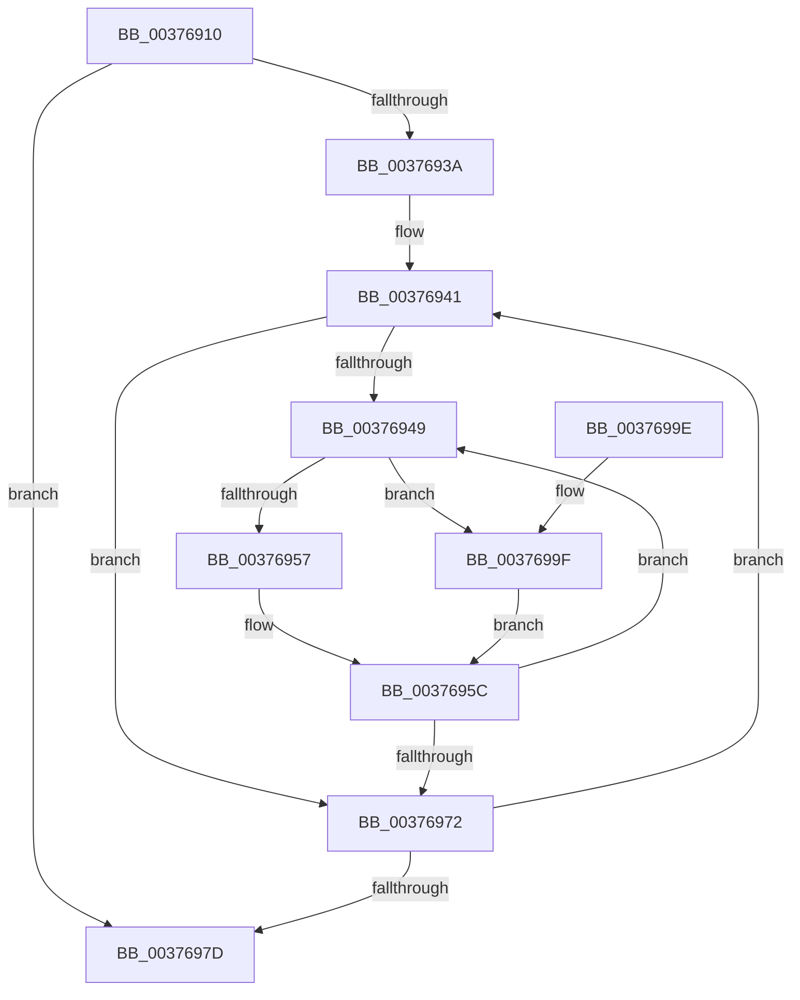

# MiProcessPageGroupInfo

- RVA: `0x00376910`–`0x003769A9` (길이 `153` bytes)
- VA: `0x0000000140376910`
- 실행 섹션: `.text`
- PDB 이름 있음: `예`; PDB Function 태그: `아니요`
- unwind 정보 RVA: `0x0007AC84`
- 디코드: `47`개 명령, `153/153` bytes 표시
- 미해석 바이트: `0` (있으면 어셈블리에 `.byte`로 보존)

> 이 문서는 커널 이미지의 기계어와 PDB 기호를 분석해 생성했습니다. 4번과 5번은 함수 원형과 자료형을 바이너리 사용 방식에서 추정한 C 해석이며 원본 소스 복구 결과는 아닙니다.

## 1. Dependencies

- 직접 호출 지점: **4**; 고유 호출 대상: **4**
- 직접 호출자로 확인된 함수: **2**
- RIP 상대 이미지 참조: **0**

### Outgoing calls
- `0x0037692E` → [MiZeroInParallel](../2C/MiZeroInParallel_function_002C9F78.md) (function, `0x002C9F78`)
- `0x00376965` → [MiAssemblePfnList](../47/MiAssemblePfnList_function_0047D1CC.md) (function, `0x0047D1CC`)
- `0x00376980` → [MiDereferencePageChains](../2C/MiDereferencePageChains_function_002C75E4.md) (function, `0x002C75E4`)
- `0x003769A2` → [MiGetPfnPageSizeIndex](../31/MiGetPfnPageSizeIndex_function_0031C710.md) (function, `0x0031C710`)

### Direct callers
- [MiZeroAndReleasePages](MiZeroAndReleasePages_function_003748D0.md) at `0x003749FD`
- [MiAllocateLargeZeroPages](../3B/MiAllocateLargeZeroPages_function_003B743C.md) at `0x003B76FB`

### Static image references
- 디코드된 RIP-relative 메모리 참조가 없습니다.

## 2. Other-region calls and transfers

- 다른 실행 섹션으로 향하는 call: **0**
- 별도 외부 분기/꼬리 이동을 확인하지 못했습니다.

## 3. Assembly (complete function range)

```asm
00376910  48 89 5C 24 08                  mov qword ptr [rsp + 8], rbx
00376915  48 89 6C 24 10                  mov qword ptr [rsp + 0x10], rbp
0037691A  48 89 74 24 18                  mov qword ptr [rsp + 0x18], rsi
0037691F  57                              push rdi
00376920  41 56                           push r14
00376922  41 57                           push r15
00376924  48 83 EC 20                     sub rsp, 0x20
00376928  4C 8B FA                        mov r15, rdx
0037692B  48 8B F1                        mov rsi, rcx
0037692E  E8 45 36 F5 FF                  call 0x1402c9f78
00376933  33 ED                           xor ebp, ebp
00376935  39 6E 18                        cmp dword ptr [rsi + 0x18], ebp
00376938  76 43                           jbe 0x14037697d
0037693A  48 8D 9E 18 01 00 00            lea rbx, [rsi + 0x118]
00376941  48 8B 3B                        mov rdi, qword ptr [rbx]
00376944  48 3B FB                        cmp rdi, rbx
00376947  74 29                           je 0x140376972
00376949  48 8B 47 28                     mov rax, qword ptr [rdi + 0x28]
0037694D  48 0F BA E0 28                  bt rax, 0x28
00376952  4C 8B 37                        mov r14, qword ptr [rdi]
00376955  72 48                           jb 0x14037699f
00376957  B8 03 00 00 00                  mov eax, 3
0037695C  44 8B C0                        mov r8d, eax
0037695F  48 8B D7                        mov rdx, rdi
00376962  49 8B CF                        mov rcx, r15
00376965  E8 62 68 10 00                  call 0x14047d1cc
0037696A  49 8B FE                        mov rdi, r14
0037696D  4C 3B F3                        cmp r14, rbx
00376970  75 D7                           jne 0x140376949
00376972  48 83 EB 80                     sub rbx, -0x80
00376976  FF C5                           inc ebp
00376978  3B 6E 18                        cmp ebp, dword ptr [rsi + 0x18]
0037697B  72 C4                           jb 0x140376941
0037697D  48 8B CE                        mov rcx, rsi
00376980  E8 5F 0C F5 FF                  call 0x1402c75e4
00376985  48 8B 5C 24 40                  mov rbx, qword ptr [rsp + 0x40]
0037698A  48 8B 6C 24 48                  mov rbp, qword ptr [rsp + 0x48]
0037698F  48 8B 74 24 50                  mov rsi, qword ptr [rsp + 0x50]
00376994  48 83 C4 20                     add rsp, 0x20
00376998  41 5F                           pop r15
0037699A  41 5E                           pop r14
0037699C  5F                              pop rdi
0037699D  C3                              ret
0037699E  CC                              int3
0037699F  48 8B CF                        mov rcx, rdi
003769A2  E8 69 5D FA FF                  call 0x14031c710
003769A7  EB B3                           jmp 0x14037695c
```

## 4. C-style interpretation (structured pseudocode)

```c
__int64 __fastcall MiProcessPageGroupInfo(__int64 a1, __int64 a2)
{
    __int64 result;
    __int64 v_rbp;
    __int64 v_rbx;
    __int64 v_rsp;
    unsigned __int64 v_stack_p10;
    unsigned __int64 v_stack_p18;
    unsigned __int64 v_stack_p8;

    v_stack_p8 = v_rbx;
    v_stack_p10 = v_rbp;
    v_stack_p18 = v_rsi;
    v_rsp = (v_rsp) - (32);
    result = MiZeroInParallel(a1, a2, a3, a4);
    v_rbp = 0;
    if ((*(unsigned int *)(a1 + 24)) <= 0) goto loc_0037697D;
loc_00376941:
    if ((*(unsigned __int64 *)(a1 + 280)) == (a1 + 280)) goto loc_00376972;
loc_00376949:
    if ((*(unsigned __int64 *)(a1 + 280)) < (a1 + 280)) goto loc_0037699F;
loc_0037695C:
    result = MiAssemblePfnList(a2, *(unsigned __int64 *)(a1 + 280), 3, a4);
    if ((*(unsigned __int64 *)(*(unsigned __int64 *)(a1 + 280))) != (a1 + 280)) goto loc_00376949;
loc_00376972:
    v_rbx = (a1 + 280) - (-128);
    v_rbp = (unsigned int)((v_rbp) + 1);
    if (((unsigned int)(v_rbp)) < (*(unsigned int *)(a1 + 24))) goto loc_00376941;
loc_0037697D:
    result = MiDereferencePageChains(a1, *(unsigned __int64 *)(a1 + 280), 3, a4);
    v_rsp = (v_rsp) + (32);
    return result;
loc_0037699F:
    result = MiGetPfnPageSizeIndex(*(unsigned __int64 *)(*(unsigned __int64 *)(a1 + 280)), *(unsigned __int64 *)(a1 + 280), 3, a4);
    goto loc_0037695C;
}
```

## 5. (Beta) C Style

```c
int64_t MiProcessPageGroupInfo(void *Arg1, int64_t Arg2)
{
    uint8_t *arg1 = (uint8_t *)Arg1;

    int64_t result;
    int64_t local_rbp;
    int64_t local_rbx;
    int64_t local_rsp;
    uint64_t v_stack_p10;
    uint64_t v_stack_p18;
    uint64_t v_stack_p8;

    v_stack_p8 = local_rbx;
    v_stack_p10 = local_rbp;
    v_stack_p18 = local_rsi;
    local_rsp = (local_rsp) - (32);
    result = MiZeroInParallel(Arg1, Arg2, a3, a4);
    local_rbp = 0;
    if ((*(uint32_t *)(arg1 + 0x18)) <= 0) goto loc_0037697D;
loc_00376941:
    if ((*(uint64_t *)(arg1 + 0x118)) == (Arg1 + 280)) goto loc_00376972;
loc_00376949:
    if ((*(uint64_t *)(arg1 + 0x118)) < (Arg1 + 280)) goto loc_0037699F;
loc_0037695C:
    result = MiAssemblePfnList(Arg2, *(uint64_t *)(arg1 + 0x118), 3, a4);
    if ((*(uint64_t *)(*(uint64_t *)(arg1 + 0x118))) != (Arg1 + 280)) goto loc_00376949;
loc_00376972:
    local_rbx = (Arg1 + 280) - (-128);
    local_rbp = (uint32_t)((local_rbp) + 1);
    if (((uint32_t)(local_rbp)) < (*(uint32_t *)(arg1 + 0x18))) goto loc_00376941;
loc_0037697D:
    result = MiDereferencePageChains(Arg1, *(uint64_t *)(arg1 + 0x118), 3, a4);
    local_rsp = (local_rsp) + (32);
    return result;
loc_0037699F:
    result = MiGetPfnPageSizeIndex(*(uint64_t *)(*(uint64_t *)(arg1 + 0x118)), *(uint64_t *)(arg1 + 0x118), 3, a4);
    goto loc_0037695C;
}
```

### 관측된 메모리 오프셋

구조체 형식이 확인되지 않은 접근은 인자 기준의 오프셋으로만 기록했습니다.

| 기준 인자 | 오프셋 표현 | 폭 (bit) | 접근 |
|---|---:|---:|---|
| `Arg1` | `+ 0x0` | `64` | `R` |
| `Arg1` | `+ 0x18` | `32` | `R` |
| `Arg1` | `+ 0x118` | `64` | `R` |

## 6. Execution-region graph

[열기: 2D/3D 그래프와 함수 탐색 컨트롤 패널](../../../control-panel.html?section=text&rva=0x00376910&view=graph)

- 2D 그래프는 위에서 아래로 흐르고, 3D 그래프는 빈 공간을 드래그해 회전합니다. Shift+드래그는 이동, 휠은 확대·축소, 함수 노드 선택은 대상 보고서 이동입니다.

### Static fallback


