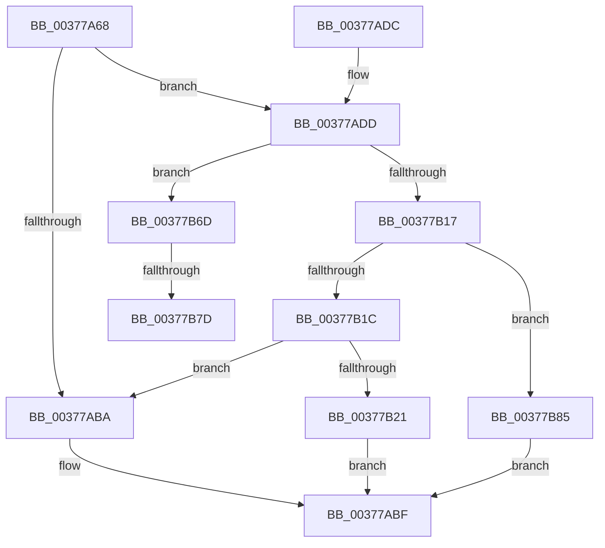

# MiReadyLargePageToFree

- RVA: `0x00377A68`–`0x00377B8C` (길이 `292` bytes)
- VA: `0x0000000140377A68`
- 실행 섹션: `.text`
- PDB 이름 있음: `예`; PDB Function 태그: `예`
- unwind 정보 RVA: `0x0007AD8C`
- 디코드: `82`개 명령, `292/292` bytes 표시
- 미해석 바이트: `0` (있으면 어셈블리에 `.byte`로 보존)

> 이 문서는 커널 이미지의 기계어와 PDB 기호를 분석해 생성했습니다. 4번과 5번은 함수 원형과 자료형을 바이너리 사용 방식에서 추정한 C 해석이며 원본 소스 복구 결과는 아닙니다.

## 1. Dependencies

- 직접 호출 지점: **6**; 고유 호출 대상: **4**
- 직접 호출자로 확인된 함수: **1**
- RIP 상대 이미지 참조: **1**

### Outgoing calls
- `0x00377AAF` → [MiLargePageHasNoDanglingReferences](../48/MiLargePageHasNoDanglingReferences_function_00485A24.md) (function, `0x00485A24`)
- `0x00377AE6` → [MiLockPageInline](../31/MiLockPageInline_function_0031A340.md) (function, `0x0031A340`)
- `0x00377B09` → [MiUnlockPage](../31/MiUnlockPage_function_0031A3E0.md) (function, `0x0031A3E0`)
- `0x00377B24` → [MiLockPageInline](../31/MiLockPageInline_function_0031A340.md) (function, `0x0031A340`)
- `0x00377B5A` → [MiUnlockPage](../31/MiUnlockPage_function_0031A3E0.md) (function, `0x0031A3E0`)
- `0x00377B70` → [MiPrepareLargePageSubPageForFree](../69/MiPrepareLargePageSubPageForFree_function_006994F0.md) (function, `0x006994F0`)

### Direct callers
- [MiFreeLargePageMemory](MiFreeLargePageMemory_function_00377938.md) at `0x003779EC`

### Static image references
- `0x00377A86` → RVA `0x00011C60` (`.rdata`; read)

## 2. Other-region calls and transfers

- 다른 실행 섹션으로 향하는 call: **0**
- call이 아닌 외부 분기/꼬리 이동: **2**
  - `0x00377B77` → [sub_006E4094](../6E/Unknown_function_006E4094.md) (`tail-transfer`)
  - `0x00377B80` → [sub_006E4094 + 0xF](../6E/Unknown_function_006E4094.md) (`tail-transfer`)

## 3. Assembly (complete function range)

```asm
00377A68  48 89 5C 24 08                  mov qword ptr [rsp + 8], rbx
00377A6D  48 89 6C 24 10                  mov qword ptr [rsp + 0x10], rbp
00377A72  48 89 74 24 18                  mov qword ptr [rsp + 0x18], rsi
00377A77  57                              push rdi
00377A78  41 54                           push r12
00377A7A  41 55                           push r13
00377A7C  41 56                           push r14
00377A7E  41 57                           push r15
00377A80  48 83 EC 20                     sub rsp, 0x20
00377A84  8B C2                           mov eax, edx
00377A86  4C 8D 3D D3 A1 C9 FF            lea r15, [rip - 0x365e2d]
00377A8D  48 8D 34 49                     lea rsi, [rcx + rcx*2]
00377A91  45 8B E8                        mov r13d, r8d
00377A94  4C 8B F1                        mov r14, rcx
00377A97  48 C1 E6 04                     shl rsi, 4
00377A9B  4D 8B 3C C7                     mov r15, qword ptr [r15 + rax*8]
00377A9F  48 B8 00 00 00 00 00 DE FF FF   movabs rax, 0xffffde0000000000
00377AA9  48 03 F0                        add rsi, rax
00377AAC  48 8B CE                        mov rcx, rsi
00377AAF  E8 70 DF 10 00                  call 0x140485a24
00377AB4  33 ED                           xor ebp, ebp
00377AB6  85 C0                           test eax, eax
00377AB8  74 23                           je 0x140377add
00377ABA  B8 01 00 00 00                  mov eax, 1
00377ABF  48 8B 5C 24 50                  mov rbx, qword ptr [rsp + 0x50]
00377AC4  48 8B 6C 24 58                  mov rbp, qword ptr [rsp + 0x58]
00377AC9  48 8B 74 24 60                  mov rsi, qword ptr [rsp + 0x60]
00377ACE  48 83 C4 20                     add rsp, 0x20
00377AD2  41 5F                           pop r15
00377AD4  41 5E                           pop r14
00377AD6  41 5D                           pop r13
00377AD8  41 5C                           pop r12
00377ADA  5F                              pop rdi
00377ADB  C3                              ret
00377ADC  CC                              int3
00377ADD  48 8B CE                        mov rcx, rsi
00377AE0  48 8B DE                        mov rbx, rsi
00377AE3  48 8B FD                        mov rdi, rbp
00377AE6  E8 55 28 FA FF                  call 0x14031a340
00377AEB  48 BA 00 00 00 00 00 FF FF FF   movabs rdx, 0xffffff0000000000
00377AF5  49 8B CF                        mov rcx, r15
00377AF8  48 33 0E                        xor rcx, qword ptr [rsi]
00377AFB  48 23 CA                        and rcx, rdx
00377AFE  8A D0                           mov dl, al
00377B00  49 33 CF                        xor rcx, r15
00377B03  48 89 0E                        mov qword ptr [rsi], rcx
00377B06  48 8B CE                        mov rcx, rsi
00377B09  E8 D2 28 FA FF                  call 0x14031a3e0
00377B0E  4F 8D 24 37                     lea r12, [r15 + r14]
00377B12  4D 3B F4                        cmp r14, r12
00377B15  72 56                           jb 0x140377b6d
00377B17  48 85 FF                        test rdi, rdi
00377B1A  74 69                           je 0x140377b85
00377B1C  49 3B FF                        cmp rdi, r15
00377B1F  74 99                           je 0x140377aba
00377B21  48 8B CE                        mov rcx, rsi
00377B24  E8 17 28 FA FF                  call 0x14031a340
00377B29  48 8B 16                        mov rdx, qword ptr [rsi]
00377B2C  48 B9 FF FF FF FF FF 00 00 00   movabs rcx, 0xffffffffff
00377B36  48 8B DA                        mov rbx, rdx
00377B39  48 23 D9                        and rbx, rcx
00377B3C  48 B9 00 00 00 00 00 FF FF FF   movabs rcx, 0xffffff0000000000
00377B46  48 2B DF                        sub rbx, rdi
00377B49  48 33 D3                        xor rdx, rbx
00377B4C  48 23 D1                        and rdx, rcx
00377B4F  48 8B CE                        mov rcx, rsi
00377B52  48 33 D3                        xor rdx, rbx
00377B55  48 89 16                        mov qword ptr [rsi], rdx
00377B58  8A D0                           mov dl, al
00377B5A  E8 81 28 FA FF                  call 0x14031a3e0
00377B5F  48 85 DB                        test rbx, rbx
00377B62  40 0F 94 C5                     sete bpl
00377B66  8B C5                           mov eax, ebp
00377B68  E9 52 FF FF FF                  jmp 0x140377abf
00377B6D  48 8B CB                        mov rcx, rbx
00377B70  E8 7B 19 32 00                  call 0x1406994f0
00377B75  85 C0                           test eax, eax
00377B77  0F 84 17 C5 36 00               je 0x1406e4094
00377B7D  48 FF C7                        inc rdi
00377B80  E9 1E C5 36 00                  jmp 0x1406e40a3
00377B85  33 C0                           xor eax, eax
00377B87  E9 33 FF FF FF                  jmp 0x140377abf
```

## 4. C-style interpretation (structured pseudocode)

```c
__int64 __fastcall MiReadyLargePageToFree(__int64 a1, int a2, int a3)
{
    __int64 result;
    __int64 v_rbp;
    __int64 v_rbx;
    __int64 v_rdi;
    __int64 v_rsi;
    __int64 v_rsp;
    unsigned __int64 v_stack_p10;
    unsigned __int64 v_stack_p18;
    unsigned __int64 v_stack_p8;

    v_stack_p8 = v_rbx;
    v_stack_p10 = v_rbp;
    v_stack_p18 = v_rsi;
    v_rsp = (v_rsp) - (32);
    v_rsi = (a1 + a1 * 2) << (4);
    v_rsi = (v_rsi) + ((unsigned int)(a2));
    result = MiLargePageHasNoDanglingReferences(v_rsi, a2, a3, a4);
    v_rbp = 0;
    if ((unsigned int)(result) == 0) goto loc_00377ADD;
loc_00377ABA:
loc_00377ABF:
    v_rsp = (v_rsp) + (32);
    return 1;
loc_00377ADD:
    result = MiLockPageInline(v_stack_p18, a2, a3, a4);
    a1 = (*(unsigned __int64 *)(v_rip - 3563053 + (unsigned int)(a2) * 8)) ^ (*(unsigned __int64 *)(v_stack_p18));
    a1 = (a1) & (a2);
    a1 = (a1) ^ (*(unsigned __int64 *)(v_rip - 3563053 + (unsigned int)(a2) * 8));
    *(unsigned __int64 *)(v_stack_p18) = a1;
    result = MiUnlockPage(v_stack_p18, (unsigned __int8)(result), a3, a4);
    if (a1 < (*(unsigned __int64 *)(v_rip - 3563053 + (unsigned int)(a2) * 8) + a1 * 1)) goto loc_00377B6D;
    if (v_stack_p10 == 0) goto loc_00377B85;
    if (v_stack_p10 == (*(unsigned __int64 *)(v_rip - 3563053 + (unsigned int)(a2) * 8))) goto loc_00377ABA;
    result = MiLockPageInline(v_stack_p18, (unsigned __int8)(result), a3, a4);
    v_rbx = (*(unsigned __int64 *)(v_stack_p18)) & (v_stack_p18);
    v_rbx = (v_rbx) - (v_stack_p10);
    a2 = (*(unsigned __int64 *)(v_stack_p18)) ^ (v_rbx);
    a2 = (a2) & (v_stack_p18);
    a2 = (a2) ^ (v_rbx);
    *(unsigned __int64 *)(v_stack_p18) = a2;
    result = MiUnlockPage(v_stack_p18, (unsigned __int8)(result), a3, a4);
    v_rbp = (v_rbx == 0) ? 1 : 0;
    goto loc_00377ABF;
loc_00377B6D:
    result = MiPrepareLargePageSubPageForFree(v_rbx, (unsigned __int8)(result), a3, a4);
    v_rdi = (v_stack_p10) + 1;
loc_00377B85:
    result = 0;
    goto loc_00377ABF;
}
```

## 5. (Beta) C Style

```c
int64_t MiReadyLargePageToFree(void *Arg1, int32_t Arg2, int32_t Arg3)
{
    uint8_t *arg1 = (uint8_t *)Arg1;

    int64_t result;
    int64_t local_rbp;
    int64_t local_rbx;
    int64_t local_rdi;
    int64_t local_rsi;
    int64_t local_rsp;
    uint64_t v_stack_p10;
    uint64_t v_stack_p18;
    uint64_t v_stack_p8;

    v_stack_p8 = local_rbx;
    v_stack_p10 = local_rbp;
    v_stack_p18 = local_rsi;
    local_rsp = (local_rsp) - (32);
    local_rsi = (Arg1 + Arg1 * 2) << (4);
    local_rsi = (local_rsi) + ((uint32_t)(Arg2));
    result = MiLargePageHasNoDanglingReferences(local_rsi, Arg2, Arg3, a4);
    local_rbp = 0;
    if ((uint32_t)(result) == 0) goto loc_00377ADD;
loc_00377ABA:
loc_00377ABF:
    local_rsp = (local_rsp) + (32);
    return 1;
loc_00377ADD:
    result = MiLockPageInline(v_stack_p18, Arg2, Arg3, a4);
    Arg1 = (*(uint64_t *)(v_rip - 0x365E2D + (uint32_t)(Arg2) * 8)) ^ (*(uint64_t *)(v_stack_p18));
    Arg1 = (Arg1) & (Arg2);
    Arg1 = (Arg1) ^ (*(uint64_t *)(v_rip - 0x365E2D + (uint32_t)(Arg2) * 8));
    *(void **)(v_stack_p18) = Arg1;
    result = MiUnlockPage(v_stack_p18, (uint8_t)(result), Arg3, a4);
    if (Arg1 < (*(uint64_t *)(v_rip - 0x365E2D + (uint32_t)(Arg2) * 8) + Arg1 * 1)) goto loc_00377B6D;
    if (v_stack_p10 == 0) goto loc_00377B85;
    if (v_stack_p10 == (*(uint64_t *)(v_rip - 0x365E2D + (uint32_t)(Arg2) * 8))) goto loc_00377ABA;
    result = MiLockPageInline(v_stack_p18, (uint8_t)(result), Arg3, a4);
    local_rbx = (*(uint64_t *)(v_stack_p18)) & (v_stack_p18);
    local_rbx = (local_rbx) - (v_stack_p10);
    Arg2 = (*(uint64_t *)(v_stack_p18)) ^ (local_rbx);
    Arg2 = (Arg2) & (v_stack_p18);
    Arg2 = (Arg2) ^ (local_rbx);
    *(uint64_t *)(v_stack_p18) = Arg2;
    result = MiUnlockPage(v_stack_p18, (uint8_t)(result), Arg3, a4);
    local_rbp = (local_rbx == 0) ? 1 : 0;
    goto loc_00377ABF;
loc_00377B6D:
    result = MiPrepareLargePageSubPageForFree(local_rbx, (uint8_t)(result), Arg3, a4);
    local_rdi = (v_stack_p10) + 1;
loc_00377B85:
    result = 0;
    goto loc_00377ABF;
}
```

### 관측된 메모리 오프셋

구조체 형식이 확인되지 않은 접근은 인자 기준의 오프셋으로만 기록했습니다.

| 기준 인자 | 오프셋 표현 | 폭 (bit) | 접근 |
|---|---:|---:|---|
| `Arg1` | `+ 0x0 + rcx*2` | `64` | `R` |

## 6. Execution-region graph

[열기: 2D/3D 그래프와 함수 탐색 컨트롤 패널](../../../control-panel.html?section=text&rva=0x00377A68&view=graph)

- 2D 그래프는 위에서 아래로 흐르고, 3D 그래프는 빈 공간을 드래그해 회전합니다. Shift+드래그는 이동, 휠은 확대·축소, 함수 노드 선택은 대상 보고서 이동입니다.

### Static fallback


