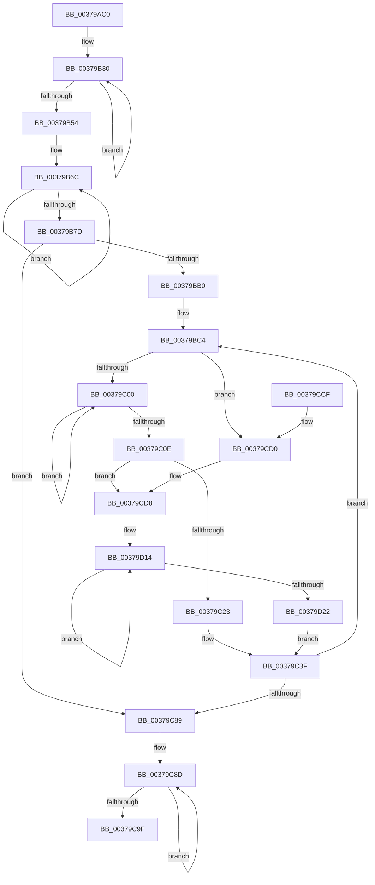

# MiRebuildLargePagesThread

- RVA: `0x00379AC0`–`0x00379D2F` (길이 `623` bytes)
- VA: `0x0000000140379AC0`
- 실행 섹션: `.text`
- PDB 이름 있음: `예`; PDB Function 태그: `아니요`
- unwind 정보 RVA: `0x0007AFC0`
- 디코드: `147`개 명령, `623/623` bytes 표시
- 미해석 바이트: `0` (있으면 어셈블리에 `.byte`로 보존)

> 이 문서는 커널 이미지의 기계어와 PDB 기호를 분석해 생성했습니다. 4번과 5번은 함수 원형과 자료형을 바이너리 사용 방식에서 추정한 C 해석이며 원본 소스 복구 결과는 아닙니다.

## 1. Dependencies

- 직접 호출 지점: **8**; 고유 호출 대상: **7**
- 직접 호출자로 확인된 함수: **0**
- RIP 상대 이미지 참조: **1**

### Outgoing calls
- `0x00379B22` → [KeSetPriorityThread](../2C/KeSetPriorityThread_function_002C76E0.md) (function, `0x002C76E0`)
- `0x00379BA3` → [KeWaitForMultipleObjects](../20/KeWaitForMultipleObjects_function_0020D110.md) (function, `0x0020D110`)
- `0x00379C35` → [KiSetTimerEx](../23/KiSetTimerEx_function_00232CB0.md) (function, `0x00232CB0`)
- `0x00379C68` → [KeWaitForMultipleObjects](../20/KeWaitForMultipleObjects_function_0020D110.md) (function, `0x0020D110`)
- `0x00379C90` → [KeCancelTimer](../23/KeCancelTimer_function_002327E0.md) (function, `0x002327E0`)
- `0x00379CA9` → [_security_check_cookie](../6A/_security_check_cookie_function_006AC640.md) (function, `0x006AC640`)
- `0x00379CE5` → [KeResetEvent](../24/KeResetEvent_function_00248350.md) (function, `0x00248350`)
- `0x00379CF3` → [MiProcessLargeCoalesceCandidates](MiProcessLargeCoalesceCandidates_function_00379DF4.md) (function, `0x00379DF4`)

### Direct callers
- 이 함수 시작 RVA로 연결되는 직접 call은 확인되지 않았습니다. 간접 호출은 완전히 역산할 수 없습니다.

### Static image references
- `0x00379AE6` → RVA `0x00E0A740` (`.data`; read)

## 2. Other-region calls and transfers

- 다른 실행 섹션으로 향하는 call: **0**
- 별도 외부 분기/꼬리 이동을 확인하지 못했습니다.

## 3. Assembly (complete function range)

```asm
00379AC0  48 8B C4                        mov rax, rsp
00379AC3  48 89 58 10                     mov qword ptr [rax + 0x10], rbx
00379AC7  48 89 70 18                     mov qword ptr [rax + 0x18], rsi
00379ACB  48 89 78 20                     mov qword ptr [rax + 0x20], rdi
00379ACF  55                              push rbp
00379AD0  41 54                           push r12
00379AD2  41 55                           push r13
00379AD4  41 56                           push r14
00379AD6  41 57                           push r15
00379AD8  48 8D A8 C8 FE FF FF            lea rbp, [rax - 0x138]
00379ADF  48 81 EC 10 02 00 00            sub rsp, 0x210
00379AE6  48 8B 05 53 0C A9 00            mov rax, qword ptr [rip + 0xa90c53]
00379AED  48 33 C4                        xor rax, rsp
00379AF0  48 89 85 00 01 00 00            mov qword ptr [rbp + 0x100], rax
00379AF7  33 DB                           xor ebx, ebx
00379AF9  0F 57 C0                        xorps xmm0, xmm0
00379AFC  4C 8B F9                        mov r15, rcx
00379AFF  48 89 5C 24 58                  mov qword ptr [rsp + 0x58], rbx
00379B04  65 48 8B 0C 25 88 01 00 00      mov rcx, qword ptr gs:[0x188]
00379B0D  33 C0                           xor eax, eax
00379B0F  F3 0F 7F 44 24 48               movdqu xmmword ptr [rsp + 0x48], xmm0
00379B15  8D 53 0C                        lea edx, [rbx + 0xc]
00379B18  48 89 44 24 70                  mov qword ptr [rsp + 0x70], rax
00379B1D  0F 11 44 24 60                  movups xmmword ptr [rsp + 0x60], xmm0
00379B22  E8 B9 DB F4 FF                  call 0x1402c76e0
00379B27  8D 7B 03                        lea edi, [rbx + 3]
00379B2A  8B CF                           mov ecx, edi
00379B2C  48 8D 45 88                     lea rax, [rbp - 0x78]
00379B30  48 89 58 F8                     mov qword ptr [rax - 8], rbx
00379B34  C6 40 F8 08                     mov byte ptr [rax - 8], 8
00379B38  48 89 40 08                     mov qword ptr [rax + 8], rax
00379B3C  48 89 00                        mov qword ptr [rax], rax
00379B3F  48 89 58 10                     mov qword ptr [rax + 0x10], rbx
00379B43  89 58 34                        mov dword ptr [rax + 0x34], ebx
00379B46  66 89 58 30                     mov word ptr [rax + 0x30], bx
00379B4A  48 83 C0 40                     add rax, 0x40
00379B4E  48 83 E9 01                     sub rcx, 1
00379B52  75 DC                           jne 0x140379b30
00379B54  49 8D 47 58                     lea rax, [r15 + 0x58]
00379B58  48 8B D7                        mov rdx, rdi
00379B5B  48 89 44 24 40                  mov qword ptr [rsp + 0x40], rax
00379B60  49 8D 8F 60 40 00 00            lea rcx, [r15 + 0x4060]
00379B67  48 8D 44 24 48                  lea rax, [rsp + 0x48]
00379B6C  48 89 08                        mov qword ptr [rax], rcx
00379B6F  48 83 C1 30                     add rcx, 0x30
00379B73  48 8D 40 08                     lea rax, [rax + 8]
00379B77  48 83 EA 01                     sub rdx, 1
00379B7B  75 EF                           jne 0x140379b6c
00379B7D  45 33 C9                        xor r9d, r9d
00379B80  48 8D 45 40                     lea rax, [rbp + 0x40]
00379B84  48 89 44 24 38                  mov qword ptr [rsp + 0x38], rax
00379B89  44 8D 42 01                     lea r8d, [rdx + 1]
00379B8D  48 89 5C 24 30                  mov qword ptr [rsp + 0x30], rbx
00379B92  48 8D 54 24 40                  lea rdx, [rsp + 0x40]
00379B97  88 5C 24 28                     mov byte ptr [rsp + 0x28], bl
00379B9B  41 8D 49 04                     lea ecx, [r9 + 4]
00379B9F  88 5C 24 20                     mov byte ptr [rsp + 0x20], bl
00379BA3  E8 68 35 E9 FF                  call 0x14020d110
00379BA8  85 C0                           test eax, eax
00379BAA  0F 84 D9 00 00 00               je 0x140379c89
00379BB0  49 B9 B0 03 00 00 80 F7 FF FF   movabs r9, 0xfffff780000003b0
00379BBA  49 BA 08 00 00 00 80 F7 FF FF   movabs r10, 0xfffff78000000008
00379BC4  44 8D 68 FF                     lea r13d, [rax - 1]
00379BC8  4C 63 F0                        movsxd r14, eax
00379BCB  4A 8D 1C 6D 00 00 00 00         lea rbx, [r13*2]
00379BD3  41 8B CD                        mov ecx, r13d
00379BD6  49 03 DD                        add rbx, r13
00379BD9  48 C1 E1 06                     shl rcx, 6
00379BDD  48 C1 E3 04                     shl rbx, 4
00379BE1  4C 8D 65 80                     lea r12, [rbp - 0x80]
00379BE5  48 81 C3 60 40 00 00            add rbx, 0x4060
00379BEC  4C 03 E1                        add r12, rcx
00379BEF  4A 8B 4C F4 40                  mov rcx, qword ptr [rsp + r14*8 + 0x40]
00379BF4  49 03 DF                        add rbx, r15
00379BF7  49 3B CC                        cmp rcx, r12
00379BFA  0F 84 D0 00 00 00               je 0x140379cd0
00379C00  4D 8B 01                        mov r8, qword ptr [r9]
00379C03  49 8B 12                        mov rdx, qword ptr [r10]
00379C06  49 8B 01                        mov rax, qword ptr [r9]
00379C09  4C 3B C0                        cmp r8, rax
00379C0C  75 F2                           jne 0x140379c00
00379C0E  4A 2B 54 EC 60                  sub rdx, qword ptr [rsp + r13*8 + 0x60]
00379C13  49 2B D0                        sub rdx, r8
00379C16  48 81 FA 40 42 0F 00            cmp rdx, 0xf4240
00379C1D  0F 83 B5 00 00 00               jae 0x140379cd8
00379C23  48 83 64 24 20 00               and qword ptr [rsp + 0x20], 0
00379C29  48 F7 DA                        neg rdx
00379C2C  45 33 C9                        xor r9d, r9d
00379C2F  45 33 C0                        xor r8d, r8d
00379C32  49 8B CC                        mov rcx, r12
00379C35  E8 76 90 EB FF                  call 0x140232cb0
00379C3A  4E 89 64 F4 40                  mov qword ptr [rsp + r14*8 + 0x40], r12
00379C3F  45 33 C9                        xor r9d, r9d
00379C42  48 8D 45 40                     lea rax, [rbp + 0x40]
00379C46  48 89 44 24 38                  mov qword ptr [rsp + 0x38], rax
00379C4B  48 8D 54 24 40                  lea rdx, [rsp + 0x40]
00379C50  48 83 64 24 30 00               and qword ptr [rsp + 0x30], 0
00379C56  C6 44 24 28 00                  mov byte ptr [rsp + 0x28], 0
00379C5B  45 8D 41 01                     lea r8d, [r9 + 1]
00379C5F  C6 44 24 20 00                  mov byte ptr [rsp + 0x20], 0
00379C64  41 8D 49 04                     lea ecx, [r9 + 4]
00379C68  E8 A3 34 E9 FF                  call 0x14020d110
00379C6D  49 B9 B0 03 00 00 80 F7 FF FF   movabs r9, 0xfffff780000003b0
00379C77  49 BA 08 00 00 00 80 F7 FF FF   movabs r10, 0xfffff78000000008
00379C81  85 C0                           test eax, eax
00379C83  0F 85 3B FF FF FF               jne 0x140379bc4
00379C89  48 8D 5D 80                     lea rbx, [rbp - 0x80]
00379C8D  48 8B CB                        mov rcx, rbx
00379C90  E8 4B 8B EB FF                  call 0x1402327e0
00379C95  48 83 C3 40                     add rbx, 0x40
00379C99  48 83 EF 01                     sub rdi, 1
00379C9D  75 EE                           jne 0x140379c8d
00379C9F  48 8B 8D 00 01 00 00            mov rcx, qword ptr [rbp + 0x100]
00379CA6  48 33 CC                        xor rcx, rsp
00379CA9  E8 92 29 33 00                  call 0x1406ac640
00379CAE  4C 8D 9C 24 10 02 00 00         lea r11, [rsp + 0x210]
00379CB6  49 8B 5B 38                     mov rbx, qword ptr [r11 + 0x38]
00379CBA  49 8B 73 40                     mov rsi, qword ptr [r11 + 0x40]
00379CBE  49 8B 7B 48                     mov rdi, qword ptr [r11 + 0x48]
00379CC2  49 8B E3                        mov rsp, r11
00379CC5  41 5F                           pop r15
00379CC7  41 5E                           pop r14
00379CC9  41 5D                           pop r13
00379CCB  41 5C                           pop r12
00379CCD  5D                              pop rbp
00379CCE  C3                              ret
00379CCF  CC                              int3
00379CD0  48 8B CB                        mov rcx, rbx
00379CD3  4A 89 5C F4 40                  mov qword ptr [rsp + r14*8 + 0x40], rbx
00379CD8  48 C7 43 18 FE FF FF FF         mov qword ptr [rbx + 0x18], 0xfffffffffffffffe
00379CE0  F0 83 0C 24 00                  lock or dword ptr [rsp], 0
00379CE5  E8 66 E6 EC FF                  call 0x140248350
00379CEA  45 33 C0                        xor r8d, r8d
00379CED  41 8B D5                        mov edx, r13d
00379CF0  49 8B CF                        mov rcx, r15
00379CF3  E8 FC 00 00 00                  call 0x140379df4
00379CF8  49 B8 B0 03 00 00 80 F7 FF FF   movabs r8, 0xfffff780000003b0
00379D02  48 C7 43 18 FF FF FF FF         mov qword ptr [rbx + 0x18], 0xffffffffffffffff
00379D0A  49 B9 08 00 00 00 80 F7 FF FF   movabs r9, 0xfffff78000000008
00379D14  49 8B 10                        mov rdx, qword ptr [r8]
00379D17  49 8B 09                        mov rcx, qword ptr [r9]
00379D1A  49 8B 00                        mov rax, qword ptr [r8]
00379D1D  48 3B D0                        cmp rdx, rax
00379D20  75 F2                           jne 0x140379d14
00379D22  48 2B CA                        sub rcx, rdx
00379D25  4A 89 4C EC 60                  mov qword ptr [rsp + r13*8 + 0x60], rcx
00379D2A  E9 10 FF FF FF                  jmp 0x140379c3f
```

## 4. C-style interpretation (structured pseudocode)

```c
__int64 __fastcall MiRebuildLargePagesThread(__int64 a1, __int64 a2, __int64 a3, int a4)
{
    __int64 result;
    __int64 v_r12;
    __int64 v_rbx;
    __int64 v_rdi;
    __int64 v_rsp;
    unsigned __int64 v_stack_m1C8;
    unsigned __int64 v_stack_m1D8;
    unsigned __int64 v_stack_m1E0;
    unsigned __int64 v_stack_m1F0;
    unsigned __int64 v_stack_m1F8;
    unsigned __int64 v_stack_m200;
    unsigned __int64 v_stack_m208;
    unsigned __int8 v_stack_m210;
    unsigned __int8 v_stack_m218;
    unsigned __int64 v_stack_m28;

    *(unsigned __int64 *)(v_rsp + 16) = v_rbx;
    *(unsigned __int64 *)(v_rsp + 24) = v_rsi;
    *(unsigned __int64 *)(v_rsp + 32) = v_rdi;
    v_rsp = (v_rsp) - (528);
    result = (*(unsigned __int64 *)(v_rip + 11078739)) ^ (v_rsp);
    *(unsigned __int64 *)(v_rsp - 312 + 256) = result;
    v_rbx = 0;
    v_stack_m1E0 = 0;
    result = 0;
    v_stack_m1F0 = v_xmm0;
    v_stack_m1C8 = 0;
    v_stack_m1D8 = v_xmm0;
    result = KeSetPriorityThread(*(unsigned __int64 *)(gs_base + (0 + 392)), v_rbx + 12, a3, a4);
loc_00379B30:
    *(unsigned __int64 *)(v_rsp - 312 - 120 - 8) = 0;
    *(unsigned __int8 *)(v_rsp - 312 - 120 - 8) = 8;
    *(unsigned __int64 *)(v_rsp - 312 - 120 + 8) = v_rsp - 312 - 120;
    *(unsigned __int64 *)(v_rsp - 312 - 120) = v_rsp - 312 - 120;
    *(unsigned __int64 *)(v_rsp - 312 - 120 + 16) = 0;
    *(unsigned int *)(v_rsp - 312 - 120 + 52) = 0;
    *(unsigned __int16 *)(v_rsp - 312 - 120 + 48) = 0;
    result = (v_rsp - 312 - 120) + (64);
    a1 = ((unsigned int)((unsigned int)(v_rbx + 3))) - (1);
    if (condition_is_not_equal) goto loc_00379B30;
    v_stack_m1F8 = a1 + 88;
loc_00379B6C:
    *(unsigned __int64 *)(v_stack_m1F0) = a1 + 16480;
    a1 = (a1 + 16480) + (48);
    a2 = (v_rbx + 3) - (1);
    if (condition_is_not_equal) goto loc_00379B6C;
    a4 = 0;
    v_stack_m200 = v_rsp - 312 + 64;
    v_stack_m208 = 0;
    v_stack_m210 = 0;
    v_stack_m218 = 0;
    result = KeWaitForMultipleObjects(a4 + 4, v_stack_m1F8, a2 + 1, a4);
    if ((unsigned int)(result) == 0) goto loc_00379C89;
loc_00379BC4:
    v_rbx = (result - 1 * 2) + (result - 1);
    a1 = ((unsigned int)((unsigned int)(result - 1))) << (6);
    v_rbx = (v_rbx) << (4);
    v_rbx = (v_rbx) + (0x4060ULL);
    v_r12 = (v_rsp - 312 - 128) + (a1);
    v_rbx = (v_rbx) + (a1);
    if ((*(unsigned __int64 *)(v_rsp + (int)((unsigned int)(result)) * 8 + 64)) == v_r12) goto loc_00379CD0;
loc_00379C00:
    if ((*(unsigned __int64 *)(a4)) != (*(unsigned __int64 *)(a4))) goto loc_00379C00;
    a2 = (*(unsigned __int64 *)(v_r10)) - (*(unsigned __int64 *)(v_rsp + result - 1 * 8 + 96));
    a2 = (a2) - (*(unsigned __int64 *)(a4));
    if (a2 >= 0xF4240ULL) goto loc_00379CD8;
    a2 = -(a2);
    a4 = 0;
    a3 = 0;
    result = KiSetTimerEx(v_r12, a2, a3, a4);
    *(unsigned __int64 *)(v_rsp + (int)((unsigned int)(result)) * 8 + 64) = v_r12;
loc_00379C3F:
    a4 = 0;
    v_stack_m200 = v_rsp - 312 + 64;
    v_stack_m210 = 0;
    v_stack_m218 = 0;
    result = KeWaitForMultipleObjects(a4 + 4, v_stack_m1F8, a4 + 1, a4);
    if ((unsigned int)(result) != 0) goto loc_00379BC4;
loc_00379C89:
loc_00379C8D:
    result = KeCancelTimer(v_rsp - 312 - 128, v_stack_m1F8, a4 + 1, a4);
    v_rbx = (v_rsp - 312 - 128) + (64);
    v_rdi = (v_rbx + 3) - (1);
    if (condition_is_not_equal) goto loc_00379C8D;
    a1 = (*(unsigned __int64 *)(v_rsp - 312 + 256)) ^ (v_rsp);
    result = _security_check_cookie(a1, v_stack_m1F8, a4 + 1, a4);
    return result;
loc_00379CD0:
    *(unsigned __int64 *)(v_stack_m28 + (int)((unsigned int)(result)) * 8 + 64) = *(unsigned __int64 *)(v_stack_m28 + 56);
loc_00379CD8:
    *(unsigned __int64 *)(*(unsigned __int64 *)(v_stack_m28 + 56) + 24) = -2;
    result = KeResetEvent(*(unsigned __int64 *)(v_stack_m28 + 56), v_stack_m1F8, a4 + 1, a4);
    a3 = 0;
    result = MiProcessLargeCoalesceCandidates(a1, (unsigned int)((unsigned int)(result - 1)), a3, a4);
    *(unsigned __int64 *)(*(unsigned __int64 *)(v_stack_m28 + 56) + 24) = -1;
loc_00379D14:
    if ((*(unsigned __int64 *)(a3)) != (*(unsigned __int64 *)(a3))) goto loc_00379D14;
    a1 = (*(unsigned __int64 *)(a4)) - (*(unsigned __int64 *)(a3));
    *(unsigned __int64 *)(v_stack_m28 + result - 1 * 8 + 96) = a1;
    goto loc_00379C3F;
}
```

## 5. (Beta) C Style

```c
int64_t MiRebuildLargePagesThread(void *Arg1, int64_t Arg2, int64_t Arg3, int32_t Arg4)
{
    uint8_t *arg1 = (uint8_t *)Arg1;

    int64_t result;
    int64_t local_r12;
    int64_t local_rbx;
    int64_t local_rdi;
    int64_t local_rsp;
    uint64_t v_stack_m1C8;
    uint64_t v_stack_m1D8;
    uint64_t v_stack_m1E0;
    uint64_t v_stack_m1F0;
    uint64_t v_stack_m1F8;
    uint64_t v_stack_m200;
    uint64_t v_stack_m208;
    uint8_t v_stack_m210;
    uint8_t v_stack_m218;
    uint64_t v_stack_m28;

    *(uint64_t *)(local_rsp + 0x10) = local_rbx;
    *(uint64_t *)(local_rsp + 0x18) = local_rsi;
    *(uint64_t *)(local_rsp + 0x20) = local_rdi;
    local_rsp = (local_rsp) - (528);
    result = (*(uint64_t *)(v_rip + 0xA90C53)) ^ (local_rsp);
    *(uint64_t *)(local_rsp - 0x138 + 0x100) = result;
    local_rbx = 0;
    v_stack_m1E0 = 0;
    result = 0;
    v_stack_m1F0 = v_xmm0;
    v_stack_m1C8 = 0;
    v_stack_m1D8 = v_xmm0;
    result = KeSetPriorityThread(*(uint64_t *)(gs_base + (0 + 0x188)), local_rbx + 12, Arg3, Arg4);
loc_00379B30:
    *(uint64_t *)(local_rsp - 0x138 - 0x78 - 0x8) = 0;
    *(uint8_t *)(local_rsp - 0x138 - 0x78 - 0x8) = 8;
    *(uint64_t *)(local_rsp - 0x138 - 0x78 + 0x8) = local_rsp - 312 - 120;
    *(uint64_t *)(local_rsp - 0x138 - 0x78) = local_rsp - 312 - 120;
    *(uint64_t *)(local_rsp - 0x138 - 0x78 + 0x10) = 0;
    *(uint32_t *)(local_rsp - 0x138 - 0x78 + 0x34) = 0;
    *(uint16_t *)(local_rsp - 0x138 - 0x78 + 0x30) = 0;
    result = (local_rsp - 312 - 120) + (64);
    Arg1 = ((uint32_t)((uint32_t)(local_rbx + 3))) - (1);
    if (condition_is_not_equal) goto loc_00379B30;
    v_stack_m1F8 = Arg1 + 88;
loc_00379B6C:
    *(void **)(v_stack_m1F0) = Arg1 + 16480;
    Arg1 = (Arg1 + 16480) + (48);
    Arg2 = (local_rbx + 3) - (1);
    if (condition_is_not_equal) goto loc_00379B6C;
    Arg4 = 0;
    v_stack_m200 = local_rsp - 312 + 64;
    v_stack_m208 = 0;
    v_stack_m210 = 0;
    v_stack_m218 = 0;
    result = KeWaitForMultipleObjects(Arg4 + 4, v_stack_m1F8, Arg2 + 1, Arg4);
    if ((uint32_t)(result) == 0) goto loc_00379C89;
loc_00379BC4:
    local_rbx = (result - 1 * 2) + (result - 1);
    Arg1 = ((uint32_t)((uint32_t)(result - 1))) << (6);
    local_rbx = (local_rbx) << (4);
    local_rbx = (local_rbx) + (0x4060ULL);
    local_r12 = (local_rsp - 312 - 128) + (Arg1);
    local_rbx = (local_rbx) + (Arg1);
    if ((*(uint64_t *)(local_rsp + (int32_t)((uint32_t)(result)) * 8 + 0x40)) == local_r12) goto loc_00379CD0;
loc_00379C00:
    if ((*(uint64_t *)(Arg4)) != (*(uint64_t *)(Arg4))) goto loc_00379C00;
    Arg2 = (*(uint64_t *)(local_r10)) - (*(uint64_t *)(local_rsp + result - 0x1 * 8 + 0x60));
    Arg2 = (Arg2) - (*(uint64_t *)(Arg4));
    if (Arg2 >= 0xF4240ULL) goto loc_00379CD8;
    Arg2 = -(Arg2);
    Arg4 = 0;
    Arg3 = 0;
    result = KiSetTimerEx(local_r12, Arg2, Arg3, Arg4);
    *(uint64_t *)(local_rsp + (int32_t)((uint32_t)(result)) * 8 + 0x40) = local_r12;
loc_00379C3F:
    Arg4 = 0;
    v_stack_m200 = local_rsp - 312 + 64;
    v_stack_m210 = 0;
    v_stack_m218 = 0;
    result = KeWaitForMultipleObjects(Arg4 + 4, v_stack_m1F8, Arg4 + 1, Arg4);
    if ((uint32_t)(result) != 0) goto loc_00379BC4;
loc_00379C89:
loc_00379C8D:
    result = KeCancelTimer(local_rsp - 312 - 128, v_stack_m1F8, Arg4 + 1, Arg4);
    local_rbx = (local_rsp - 312 - 128) + (64);
    local_rdi = (local_rbx + 3) - (1);
    if (condition_is_not_equal) goto loc_00379C8D;
    Arg1 = (*(uint64_t *)(local_rsp - 0x138 + 0x100)) ^ (local_rsp);
    result = _security_check_cookie(Arg1, v_stack_m1F8, Arg4 + 1, Arg4);
    return result;
loc_00379CD0:
    *(uint64_t *)(v_stack_m28 + (int32_t)((uint32_t)(result)) * 8 + 0x40) = *(uint64_t *)(v_stack_m28 + 0x38);
loc_00379CD8:
    *(uint64_t *)(*(uint64_t *)(v_stack_m28 + 0x38) + 0x18) = -2;
    result = KeResetEvent(*(uint64_t *)(v_stack_m28 + 0x38), v_stack_m1F8, Arg4 + 1, Arg4);
    Arg3 = 0;
    result = MiProcessLargeCoalesceCandidates(Arg1, (uint32_t)((uint32_t)(result - 1)), Arg3, Arg4);
    *(uint64_t *)(*(uint64_t *)(v_stack_m28 + 0x38) + 0x18) = -1;
loc_00379D14:
    if ((*(uint64_t *)(Arg3)) != (*(uint64_t *)(Arg3))) goto loc_00379D14;
    Arg1 = (*(uint64_t *)(Arg4)) - (*(uint64_t *)(Arg3));
    *(void **)(v_stack_m28 + result - 0x1 * 8 + 0x60) = Arg1;
    goto loc_00379C3F;
}
```

### 관측된 메모리 오프셋

구조체 형식이 확인되지 않은 접근은 인자 기준의 오프셋으로만 기록했습니다.

| 기준 인자 | 오프셋 표현 | 폭 (bit) | 접근 |
|---|---:|---:|---|
| `Arg1` | `+ 0x58` | `64` | `R` |
| `Arg1` | `+ 0x4060` | `64` | `R` |

## 6. Execution-region graph

[열기: 2D/3D 그래프와 함수 탐색 컨트롤 패널](../../../control-panel.html?section=text&rva=0x00379AC0&view=graph)

- 2D 그래프는 위에서 아래로 흐르고, 3D 그래프는 빈 공간을 드래그해 회전합니다. Shift+드래그는 이동, 휠은 확대·축소, 함수 노드 선택은 대상 보고서 이동입니다.

### Static fallback


