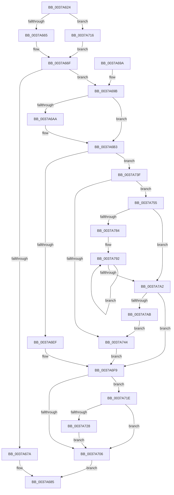

# MiRecordLargePageCandidate

- RVA: `0x0037A624`–`0x0037A7AD` (길이 `393` bytes)
- VA: `0x000000014037A624`
- 실행 섹션: `.text`
- PDB 이름 있음: `예`; PDB Function 태그: `아니요`
- unwind 정보 RVA: `0x0007B04C`
- 디코드: `105`개 명령, `393/393` bytes 표시
- 미해석 바이트: `0` (있으면 어셈블리에 `.byte`로 보존)

> 이 문서는 커널 이미지의 기계어와 PDB 기호를 분석해 생성했습니다. 4번과 5번은 함수 원형과 자료형을 바이너리 사용 방식에서 추정한 C 해석이며 원본 소스 복구 결과는 아닙니다.

## 1. Dependencies

- 직접 호출 지점: **2**; 고유 호출 대상: **2**
- 직접 호출자로 확인된 함수: **5**
- RIP 상대 이미지 참조: **2**

### Outgoing calls
- `0x0037A647` → [MiPageToNode](../33/MiPageToNode_function_00338CD0.md) (function, `0x00338CD0`)
- `0x0037A738` → [KeSetEvent](../33/KeSetEvent_function_0033F310.md) (function, `0x0033F310`)

### Direct callers
- [sub_003354FB](../33/Unknown_function_003354FB.md) at `0x00335F22`
- [MiUnlinkFreeOrZeroedPage](../33/MiUnlinkFreeOrZeroedPage_function_00336C40.md) at `0x00337357`
- [sub_0033F181](../33/Unknown_function_0033F181.md) at `0x0033F21E`
- [MiUpdateLargePageCandidates](MiUpdateLargePageCandidates_function_003798C0.md) at `0x00379A08`
- [MiUpdateLargePageCandidates](MiUpdateLargePageCandidates_function_003798C0.md) at `0x00379A5A`
- [MiUpdateLargePageCandidates](MiUpdateLargePageCandidates_function_003798C0.md) at `0x00379A74`
- [MiProcessLargeCoalesceBitmapCandidates](MiProcessLargeCoalesceBitmapCandidates_function_0037A3F0.md) at `0x0037A545`

### Static image references
- `0x0037A665` → RVA `0x00E38D10` (`.data`; read)
- `0x0037A6B3` → RVA `0x00011128` (`.rdata`; read)

## 2. Other-region calls and transfers

- 다른 실행 섹션으로 향하는 call: **0**
- 별도 외부 분기/꼬리 이동을 확인하지 못했습니다.

## 3. Assembly (complete function range)

```asm
0037A624  48 89 5C 24 08                  mov qword ptr [rsp + 8], rbx
0037A629  48 89 6C 24 10                  mov qword ptr [rsp + 0x10], rbp
0037A62E  48 89 74 24 18                  mov qword ptr [rsp + 0x18], rsi
0037A633  57                              push rdi
0037A634  48 83 EC 20                     sub rsp, 0x20
0037A638  48 8B E9                        mov rbp, rcx
0037A63B  41 8B F0                        mov esi, r8d
0037A63E  48 8B CA                        mov rcx, rdx
0037A641  41 8B F9                        mov edi, r9d
0037A644  48 8B DA                        mov rbx, rdx
0037A647  E8 84 E6 FB FF                  call 0x140338cd0
0037A64C  4C 8B 5D 10                     mov r11, qword ptr [rbp + 0x10]
0037A650  8B C0                           mov eax, eax
0037A652  48 69 D0 80 DF 00 00            imul rdx, rax, 0xdf80
0037A659  4C 03 DA                        add r11, rdx
0037A65C  83 FE 02                        cmp esi, 2
0037A65F  0F 85 B1 00 00 00               jne 0x14037a716
0037A665  4C 8B 15 A4 E6 AB 00            mov r10, qword ptr [rip + 0xabe6a4]
0037A66C  4C 03 D2                        add r10, rdx
0037A66F  41 B8 01 00 00 00               mov r8d, 1
0037A675  41 84 F8                        test r8b, dil
0037A678  74 21                           je 0x14037a69b
0037A67A  F0 49 FF 8C F2 18 DF 00 00      lock dec qword ptr [r10 + rsi*8 + 0xdf18]
0037A683  33 C0                           xor eax, eax
0037A685  48 8B 5C 24 30                  mov rbx, qword ptr [rsp + 0x30]
0037A68A  48 8B 6C 24 38                  mov rbp, qword ptr [rsp + 0x38]
0037A68F  48 8B 74 24 40                  mov rsi, qword ptr [rsp + 0x40]
0037A694  48 83 C4 20                     add rsp, 0x20
0037A698  5F                              pop rdi
0037A699  C3                              ret
0037A69A  CC                              int3
0037A69B  F0 4D 01 84 F3 30 DF 00 00      lock add qword ptr [r11 + rsi*8 + 0xdf30], r8
0037A6A4  40 F6 C7 02                     test dil, 2
0037A6A8  75 09                           jne 0x14037a6b3
0037A6AA  F0 4D 01 84 F2 18 DF 00 00      lock add qword ptr [r10 + rsi*8 + 0xdf18], r8
0037A6B3  48 8D 0D 6E 6A C9 FF            lea rcx, [rip - 0x369592]
0037A6BA  49 8B D0                        mov rdx, r8
0037A6BD  48 8B 0C F1                     mov rcx, qword ptr [rcx + rsi*8]
0037A6C1  48 8D 86 01 04 00 00            lea rax, [rsi + 0x401]
0037A6C8  48 D3 EB                        shr rbx, cl
0037A6CB  48 03 C0                        add rax, rax
0037A6CE  4C 8B DB                        mov r11, rbx
0037A6D1  48 8B CB                        mov rcx, rbx
0037A6D4  48 C1 E9 05                     shr rcx, 5
0037A6D8  41 83 E3 1F                     and r11d, 0x1f
0037A6DC  48 8B 44 C5 00                  mov rax, qword ptr [rbp + rax*8]
0037A6E1  4C 8D 14 88                     lea r10, [rax + rcx*4]
0037A6E5  49 8D 43 01                     lea rax, [r11 + 1]
0037A6E9  48 83 F8 20                     cmp rax, 0x20
0037A6ED  77 50                           ja 0x14037a73f
0037A6EF  41 8B CB                        mov ecx, r11d
0037A6F2  41 D3 E0                        shl r8d, cl
0037A6F5  F0 45 09 02                     lock or dword ptr [r10], r8d
0037A6F9  48 8D 1C 76                     lea rbx, [rsi + rsi*2]
0037A6FD  48 03 DB                        add rbx, rbx
0037A700  40 F6 C7 08                     test dil, 8
0037A704  74 18                           je 0x14037a71e
0037A706  48 8D 85 60 40 00 00            lea rax, [rbp + 0x4060]
0037A70D  48 8D 04 D8                     lea rax, [rax + rbx*8]
0037A711  E9 6F FF FF FF                  jmp 0x14037a685
0037A716  4D 8B D3                        mov r10, r11
0037A719  E9 51 FF FF FF                  jmp 0x14037a66f
0037A71E  83 BC DD 64 40 00 00 00         cmp dword ptr [rbp + rbx*8 + 0x4064], 0
0037A726  75 DE                           jne 0x14037a706
0037A728  48 8D 8D 60 40 00 00            lea rcx, [rbp + 0x4060]
0037A72F  45 33 C0                        xor r8d, r8d
0037A732  48 8D 0C D9                     lea rcx, [rcx + rbx*8]
0037A736  33 D2                           xor edx, edx
0037A738  E8 D3 4B FC FF                  call 0x14033f310
0037A73D  EB C7                           jmp 0x14037a706
0037A73F  4D 85 DB                        test r11, r11
0037A742  75 11                           jne 0x14037a755
0037A744  48 8B CA                        mov rcx, rdx
0037A747  41 8B C0                        mov eax, r8d
0037A74A  D3 E0                           shl eax, cl
0037A74C  41 2B C0                        sub eax, r8d
0037A74F  F0 41 09 02                     lock or dword ptr [r10], eax
0037A753  EB A4                           jmp 0x14037a6f9
0037A755  83 E3 1F                        and ebx, 0x1f
0037A758  BA 20 00 00 00                  mov edx, 0x20
0037A75D  2B D3                           sub edx, ebx
0037A75F  41 8B C0                        mov eax, r8d
0037A762  8B CA                           mov ecx, edx
0037A764  D3 E0                           shl eax, cl
0037A766  49 8B CB                        mov rcx, r11
0037A769  41 2B C0                        sub eax, r8d
0037A76C  D3 E0                           shl eax, cl
0037A76E  F0 41 09 02                     lock or dword ptr [r10], eax
0037A772  8B C2                           mov eax, edx
0037A774  49 83 C2 04                     add r10, 4
0037A778  49 8B D0                        mov rdx, r8
0037A77B  48 2B D0                        sub rdx, rax
0037A77E  48 83 FA 20                     cmp rdx, 0x20
0037A782  72 1E                           jb 0x14037a7a2
0037A784  48 8B CA                        mov rcx, rdx
0037A787  48 C1 E9 05                     shr rcx, 5
0037A78B  48 6B C1 E0                     imul rax, rcx, -0x20
0037A78F  48 03 D0                        add rdx, rax
0037A792  41 C7 02 FF FF FF FF            mov dword ptr [r10], 0xffffffff
0037A799  49 83 C2 04                     add r10, 4
0037A79D  49 2B C8                        sub rcx, r8
0037A7A0  75 F0                           jne 0x14037a792
0037A7A2  48 85 D2                        test rdx, rdx
0037A7A5  0F 84 4E FF FF FF               je 0x14037a6f9
0037A7AB  EB 97                           jmp 0x14037a744
```

## 4. C-style interpretation (structured pseudocode)

```c
__int64 __fastcall MiRecordLargePageCandidate(__int64 a1, __int64 a2, int a3, int a4)
{
    __int64 result;
    __int64 v_r10;
    __int64 v_r11;
    __int64 v_rbx;
    __int64 v_rsp;
    unsigned __int64 v_stack_p10;
    unsigned __int64 v_stack_p18;
    unsigned __int64 v_stack_p8;

    v_stack_p8 = v_rbx;
    v_stack_p10 = v_rbp;
    v_stack_p18 = v_rsi;
    v_rsp = (v_rsp) - (32);
    result = MiPageToNode(a2, a2, a3, a4);
    a2 = (a2) * ((unsigned int)((unsigned int)(result)));
    v_r11 = (*(unsigned __int64 *)(a1 + 16)) + (a2);
    if (((unsigned int)((unsigned int)(a3))) != 2) goto loc_0037A716;
    v_r10 = (*(unsigned __int64 *)(v_rip + 11265700)) + (a2);
loc_0037A66F:
    if (((1) & ((unsigned __int8)((unsigned int)(a4)))) == 0) goto loc_0037A69B;
    result = 0;
loc_0037A685:
    v_rsp = (v_rsp) + (32);
    return result;
loc_0037A69B:
    if ((((unsigned __int8)((unsigned int)(a4))) & (2)) == 0) {
    }
    v_rbx = (v_stack_p8) >> ((unsigned __int8)(*(unsigned __int64 *)(v_rip - 3577234 + v_stack_p18 * 8)));
    result = (v_stack_p18 + 1025) + (v_stack_p18 + 1025);
    a1 = (v_rbx) >> (5);
    v_r11 = (unsigned int)((v_rbx) & (31));
    if ((v_r11 + 1) > 32) goto loc_0037A73F;
    a3 = (unsigned int)((1) << ((unsigned __int8)((unsigned int)((unsigned int)(v_r11)))));
loc_0037A6F9:
    v_rbx = (v_stack_p18 + v_stack_p18 * 2) + (v_stack_p18 + v_stack_p18 * 2);
    if ((((unsigned __int8)((unsigned int)(a4))) & (8)) == 0) goto loc_0037A71E;
loc_0037A706:
    goto loc_0037A685;
loc_0037A716:
    goto loc_0037A66F;
loc_0037A71E:
    if ((*(unsigned int *)(v_stack_p10 + v_rbx * 8 + 16484)) != 0) goto loc_0037A706;
    a3 = 0;
    a2 = 0;
    result = KeSetEvent(v_stack_p10 + 16480 + v_rbx * 8, a2, a3, a4);
    goto loc_0037A706;
loc_0037A73F:
    if (v_r11 != 0) goto loc_0037A755;
loc_0037A744:
    result = (unsigned int)((0) << (0));
    result = (unsigned int)((result) - (0));
    goto loc_0037A6F9;
loc_0037A755:
    v_rbx = (unsigned int)((v_rbx) & (31));
    a2 = (unsigned int)((32) - ((unsigned int)(v_rbx)));
    result = (unsigned int)((0) << ((unsigned __int8)((unsigned int)((unsigned int)(a2)))));
    result = (unsigned int)((result) - (0));
    result = (unsigned int)((result) << ((unsigned __int8)(v_r11)));
    v_r10 = (v_r11) + (4);
    a2 = (0) - ((unsigned int)((unsigned int)(a2)));
    if (a2 < 32) goto loc_0037A7A2;
    a1 = (a2) >> (5);
    result = ((unsigned int)((unsigned int)(a2))) * (a1);
    a2 = (a2) + (result);
loc_0037A792:
    *(unsigned int *)(v_r10) = 0xFFFFFFFFULL;
    v_r10 = (v_r10) + (4);
    a1 = (a1) - (0);
    if (condition_is_not_equal) goto loc_0037A792;
loc_0037A7A2:
    if (a2 == 0) goto loc_0037A6F9;
    goto loc_0037A744;
}
```

## 5. (Beta) C Style

```c
int64_t MiRecordLargePageCandidate(void *Arg1, int64_t Arg2, int32_t Arg3, int32_t Arg4)
{
    uint8_t *arg1 = (uint8_t *)Arg1;

    int64_t result;
    int64_t local_r10;
    int64_t local_r11;
    int64_t local_rbx;
    int64_t local_rsp;
    uint64_t v_stack_p10;
    uint64_t v_stack_p18;
    uint64_t v_stack_p8;

    v_stack_p8 = local_rbx;
    v_stack_p10 = local_rbp;
    v_stack_p18 = local_rsi;
    local_rsp = (local_rsp) - (32);
    result = MiPageToNode(Arg2, Arg2, Arg3, Arg4);
    Arg2 = (Arg2) * ((uint32_t)((uint32_t)(result)));
    local_r11 = (*(uint64_t *)(arg1 + 0x10)) + (Arg2);
    if (((uint32_t)((uint32_t)(Arg3))) != 2) goto loc_0037A716;
    local_r10 = (*(uint64_t *)(v_rip + 0xABE6A4)) + (Arg2);
loc_0037A66F:
    if (((1) & ((uint8_t)((uint32_t)(Arg4)))) == 0) goto loc_0037A69B;
    result = 0;
loc_0037A685:
    local_rsp = (local_rsp) + (32);
    return result;
loc_0037A69B:
    if ((((uint8_t)((uint32_t)(Arg4))) & (2)) == 0) {
    }
    local_rbx = (v_stack_p8) >> ((uint8_t)(*(uint64_t *)(v_rip - 0x369592 + v_stack_p18 * 8)));
    result = (v_stack_p18 + 1025) + (v_stack_p18 + 1025);
    Arg1 = (local_rbx) >> (5);
    local_r11 = (uint32_t)((local_rbx) & (31));
    if ((local_r11 + 1) > 32) goto loc_0037A73F;
    Arg3 = (uint32_t)((1) << ((uint8_t)((uint32_t)((uint32_t)(local_r11)))));
loc_0037A6F9:
    local_rbx = (v_stack_p18 + v_stack_p18 * 2) + (v_stack_p18 + v_stack_p18 * 2);
    if ((((uint8_t)((uint32_t)(Arg4))) & (8)) == 0) goto loc_0037A71E;
loc_0037A706:
    goto loc_0037A685;
loc_0037A716:
    goto loc_0037A66F;
loc_0037A71E:
    if ((*(uint32_t *)(v_stack_p10 + local_rbx * 8 + 0x4064)) != 0) goto loc_0037A706;
    Arg3 = 0;
    Arg2 = 0;
    result = KeSetEvent(v_stack_p10 + 16480 + local_rbx * 8, Arg2, Arg3, Arg4);
    goto loc_0037A706;
loc_0037A73F:
    if (local_r11 != 0) goto loc_0037A755;
loc_0037A744:
    result = (uint32_t)((0) << (0));
    result = (uint32_t)((result) - (0));
    goto loc_0037A6F9;
loc_0037A755:
    local_rbx = (uint32_t)((local_rbx) & (31));
    Arg2 = (uint32_t)((32) - ((uint32_t)(local_rbx)));
    result = (uint32_t)((0) << ((uint8_t)((uint32_t)((uint32_t)(Arg2)))));
    result = (uint32_t)((result) - (0));
    result = (uint32_t)((result) << ((uint8_t)(local_r11)));
    local_r10 = (local_r11) + (4);
    Arg2 = (0) - ((uint32_t)((uint32_t)(Arg2)));
    if (Arg2 < 32) goto loc_0037A7A2;
    Arg1 = (Arg2) >> (5);
    result = ((uint32_t)((uint32_t)(Arg2))) * (Arg1);
    Arg2 = (Arg2) + (result);
loc_0037A792:
    *(uint32_t *)(local_r10) = 0xFFFFFFFFULL;
    local_r10 = (local_r10) + (4);
    Arg1 = (Arg1) - (0);
    if (condition_is_not_equal) goto loc_0037A792;
loc_0037A7A2:
    if (Arg2 == 0) goto loc_0037A6F9;
    goto loc_0037A744;
}
```

### 관측된 메모리 오프셋

구조체 형식이 확인되지 않은 접근은 인자 기준의 오프셋으로만 기록했습니다.

| 기준 인자 | 오프셋 표현 | 폭 (bit) | 접근 |
|---|---:|---:|---|
| `Arg1` | `+ 0x0 + rax*8` | `64` | `R` |
| `Arg1` | `+ 0x0 + rbx*8` | `64` | `R` |
| `Arg1` | `+ 0x10` | `64` | `R` |
| `Arg1` | `+ 0x4060` | `64` | `R` |
| `Arg1` | `+ 0x4064 + rbx*8` | `32` | `R` |

## 6. Execution-region graph

[열기: 2D/3D 그래프와 함수 탐색 컨트롤 패널](../../../control-panel.html?section=text&rva=0x0037A624&view=graph)

- 2D 그래프는 위에서 아래로 흐르고, 3D 그래프는 빈 공간을 드래그해 회전합니다. Shift+드래그는 이동, 휠은 확대·축소, 함수 노드 선택은 대상 보고서 이동입니다.

### Static fallback


