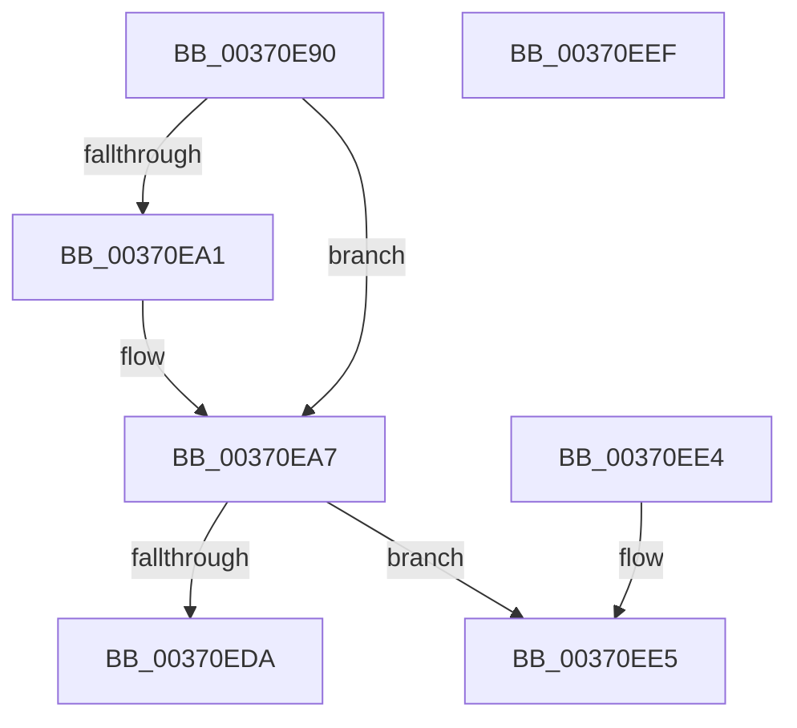

# MiReduceShareCount

- RVA: `0x00370E90`–`0x00370EF0` (길이 `96` bytes)
- VA: `0x0000000140370E90`
- 실행 섹션: `.text`
- PDB 이름 있음: `예`; PDB Function 태그: `아니요`
- unwind 정보 RVA: `0x000767E0`
- 디코드: `28`개 명령, `96/96` bytes 표시
- 미해석 바이트: `0` (있으면 어셈블리에 `.byte`로 보존)

> 이 문서는 커널 이미지의 기계어와 PDB 기호를 분석해 생성했습니다. 4번과 5번은 함수 원형과 자료형을 바이너리 사용 방식에서 추정한 C 해석이며 원본 소스 복구 결과는 아닙니다.

## 1. Dependencies

- 직접 호출 지점: **2**; 고유 호출 대상: **2**
- 직접 호출자로 확인된 함수: **5**
- RIP 상대 이미지 참조: **0**

### Outgoing calls
- `0x00370EA1` → [MiBadShareCount](MiBadShareCount_function_00370EF8.md) (function, `0x00370EF8`)
- `0x00370EE5` → [MiPfnShareCountIsZero](../33/MiPfnShareCountIsZero_function_00330930.md) (function, `0x00330930`)

### Direct callers
- [MiDeleteNonPagedPoolTail](../2C/MiDeleteNonPagedPoolTail_function_002C20F0.md) at `0x002C2152`
- [MiDeleteRotateVa](../2C/MiDeleteRotateVa_function_002C79D4.md) at `0x002C7AB4`
- [MiDecommitFreePagesTail](../41/MiDecommitFreePagesTail_function_0041ECE0.md) at `0x0041EEA1`
- [MiZeroAndFlushGoodCitizen](../4D/MiZeroAndFlushGoodCitizen_function_004D0828.md) at `0x004D08C2`
- [sub_006ED93C](../6E/Unknown_function_006ED93C.md) at `0x006ED94B`

### Static image references
- 디코드된 RIP-relative 메모리 참조가 없습니다.

## 2. Other-region calls and transfers

- 다른 실행 섹션으로 향하는 call: **0**
- 별도 외부 분기/꼬리 이동을 확인하지 못했습니다.

## 3. Assembly (complete function range)

```asm
00370E90  48 83 EC 28                     sub rsp, 0x28
00370E94  0F B6 41 22                     movzx eax, byte ptr [rcx + 0x22]
00370E98  4C 8B C2                        mov r8, rdx
00370E9B  24 07                           and al, 7
00370E9D  3C 06                           cmp al, 6
00370E9F  74 06                           je 0x140370ea7
00370EA1  E8 52 00 00 00                  call 0x140370ef8
00370EA6  CC                              int3
00370EA7  48 8B 41 18                     mov rax, qword ptr [rcx + 0x18]
00370EAB  49 B9 FF FF FF FF FF FF FF 3F   movabs r9, 0x3fffffffffffffff
00370EB5  48 8B D0                        mov rdx, rax
00370EB8  49 23 D1                        and rdx, r9
00370EBB  49 2B D0                        sub rdx, r8
00370EBE  49 B8 00 00 00 00 00 00 00 C0   movabs r8, 0xc000000000000000
00370EC8  48 33 C2                        xor rax, rdx
00370ECB  49 23 C0                        and rax, r8
00370ECE  48 33 C2                        xor rax, rdx
00370ED1  48 89 41 18                     mov qword ptr [rcx + 0x18], rax
00370ED5  48 85 D2                        test rdx, rdx
00370ED8  74 0B                           je 0x140370ee5
00370EDA  B8 02 00 00 00                  mov eax, 2
00370EDF  48 83 C4 28                     add rsp, 0x28
00370EE3  C3                              ret
00370EE4  CC                              int3
00370EE5  E8 46 FA FB FF                  call 0x140330930
00370EEA  48 83 C4 28                     add rsp, 0x28
00370EEE  C3                              ret
00370EEF  CC                              int3
```

## 4. C-style interpretation (structured pseudocode)

```c
__int64 __fastcall MiReduceShareCount(__int64 a1, __int64 a2)
{
    __int64 result;
    __int64 v_rsp;

    v_rsp = (v_rsp) - (40);
    result = (unsigned __int8)((*(unsigned __int8 *)(a1 + 34)) & (7));
    if (((unsigned __int8)(result)) != 6) {
        result = MiBadShareCount(a1, a2, a2, a4);
    }
    a2 = (*(unsigned __int64 *)(a1 + 24)) & (a4);
    a2 = (a2) - (a2);
    result = (*(unsigned __int64 *)(a1 + 24)) ^ (a2);
    result = (result) & (a2);
    result = (result) ^ (a2);
    *(unsigned __int64 *)(a1 + 24) = result;
    if (a2 == 0) goto loc_00370EE5;
    v_rsp = (v_rsp) + (40);
    return 2;
loc_00370EE5:
    result = MiPfnShareCountIsZero(a1, a2, a2, a4);
    v_rsp = (v_rsp) + (40);
    return result;
}
```

## 5. (Beta) C Style

```c
int64_t MiReduceShareCount(void *Arg1, int64_t Arg2)
{
    uint8_t *arg1 = (uint8_t *)Arg1;

    int64_t result;
    int64_t local_rsp;

    local_rsp = (local_rsp) - (40);
    result = (uint8_t)((*(uint8_t *)(arg1 + 0x22)) & (7));
    if (((uint8_t)(result)) != 6) {
        result = MiBadShareCount(Arg1, Arg2, Arg2, a4);
    }
    Arg2 = (*(uint64_t *)(arg1 + 0x18)) & (a4);
    Arg2 = (Arg2) - (Arg2);
    result = (*(uint64_t *)(arg1 + 0x18)) ^ (Arg2);
    result = (result) & (Arg2);
    result = (result) ^ (Arg2);
    *(uint64_t *)(arg1 + 0x18) = result;
    if (Arg2 == 0) goto loc_00370EE5;
    local_rsp = (local_rsp) + (40);
    return 2;
loc_00370EE5:
    result = MiPfnShareCountIsZero(Arg1, Arg2, Arg2, a4);
    local_rsp = (local_rsp) + (40);
    return result;
}
```

### 관측된 메모리 오프셋

구조체 형식이 확인되지 않은 접근은 인자 기준의 오프셋으로만 기록했습니다.

| 기준 인자 | 오프셋 표현 | 폭 (bit) | 접근 |
|---|---:|---:|---|
| `Arg1` | `+ 0x22` | `8` | `R` |

## 6. Execution-region graph

[열기: 2D/3D 그래프와 함수 탐색 컨트롤 패널](../../../control-panel.html?section=text&rva=0x00370E90&view=graph)

- 2D 그래프는 위에서 아래로 흐르고, 3D 그래프는 빈 공간을 드래그해 회전합니다. Shift+드래그는 이동, 휠은 확대·축소, 함수 노드 선택은 대상 보고서 이동입니다.

### Static fallback


