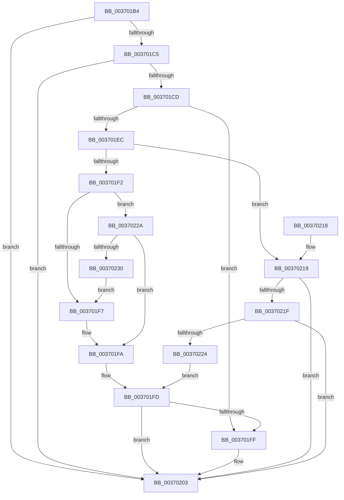

# MiReferenceDriverPage

- RVA: `0x003701B4`–`0x00370232` (길이 `126` bytes)
- VA: `0x00000001403701B4`
- 실행 섹션: `.text`
- PDB 이름 있음: `예`; PDB Function 태그: `아니요`
- unwind 정보 RVA: `0x000DB714`
- 디코드: `38`개 명령, `126/126` bytes 표시
- 미해석 바이트: `0` (있으면 어셈블리에 `.byte`로 보존)

> 이 문서는 커널 이미지의 기계어와 PDB 기호를 분석해 생성했습니다. 4번과 5번은 함수 원형과 자료형을 바이너리 사용 방식에서 추정한 C 해석이며 원본 소스 복구 결과는 아닙니다.

## 1. Dependencies

- 직접 호출 지점: **0**; 고유 호출 대상: **0**
- 직접 호출자로 확인된 함수: **3**
- RIP 상대 이미지 참조: **0**

### Outgoing calls
- 직접 디코드된 call 명령이 없습니다.

### Direct callers
- [MiLockCode](../36/MiLockCode_function_0036F91C.md) at `0x0036FB20`
- [MiUpdateImportRelocationsOnDriverPrivatePages](../44/MiUpdateImportRelocationsOnDriverPrivatePages_function_00449BCC.md) at `0x00449CC4`
- [MiLockDriverPageRange](../67/MiLockDriverPageRange_function_00670160.md) at `0x006703B3`

### Static image references
- 디코드된 RIP-relative 메모리 참조가 없습니다.

## 2. Other-region calls and transfers

- 다른 실행 섹션으로 향하는 call: **0**
- 별도 외부 분기/꼬리 이동을 확인하지 못했습니다.

## 3. Assembly (complete function range)

```asm
003701B4  48 8B 41 28                     mov rax, qword ptr [rcx + 0x28]
003701B8  41 BA 01 00 00 00               mov r10d, 1
003701BE  48 0F BA E0 28                  bt rax, 0x28
003701C3  72 3E                           jb 0x140370203
003701C5  48 0F BA 61 28 35               bt qword ptr [rcx + 0x28], 0x35
003701CB  72 36                           jb 0x140370203
003701CD  8B 41 20                        mov eax, dword ptr [rcx + 0x20]
003701D0  49 B8 FF FF FF FF FF FF FF 3F   movabs r8, 0x3fffffffffffffff
003701DA  48 8B 51 18                     mov rdx, qword ptr [rcx + 0x18]
003701DE  45 33 C9                        xor r9d, r9d
003701E1  49 23 D0                        and rdx, r8
003701E4  45 8B C1                        mov r8d, r9d
003701E7  66 85 C0                        test ax, ax
003701EA  74 13                           je 0x1403701ff
003701EC  66 41 3B C2                     cmp ax, r10w
003701F0  75 27                           jne 0x140370219
003701F2  48 85 D2                        test rdx, rdx
003701F5  74 33                           je 0x14037022a
003701F7  45 8B C2                        mov r8d, r10d
003701FA  45 85 C0                        test r8d, r8d
003701FD  74 04                           je 0x140370203
003701FF  80 49 23 20                     or byte ptr [rcx + 0x23], 0x20
00370203  8B 41 20                        mov eax, dword ptr [rcx + 0x20]
00370206  89 44 24 08                     mov dword ptr [rsp + 8], eax
0037020A  66 44 01 54 24 08               add word ptr [rsp + 8], r10w
00370210  8B 44 24 08                     mov eax, dword ptr [rsp + 8]
00370214  89 41 20                        mov dword ptr [rcx + 0x20], eax
00370217  C3                              ret
00370218  CC                              int3
00370219  66 83 F8 02                     cmp ax, 2
0037021D  75 E4                           jne 0x140370203
0037021F  48 85 D2                        test rdx, rdx
00370222  74 DF                           je 0x140370203
00370224  F6 41 22 08                     test byte ptr [rcx + 0x22], 8
00370228  EB D3                           jmp 0x1403701fd
0037022A  F6 41 22 08                     test byte ptr [rcx + 0x22], 8
0037022E  74 CA                           je 0x1403701fa
00370230  EB C5                           jmp 0x1403701f7
```

## 4. C-style interpretation (structured pseudocode)

```c
__int64 __fastcall MiReferenceDriverPage(__int64 a1, __int64 a2, __int64 a3, int a4)
{
    unsigned int v_stack_p8;

    if (condition_is_below) goto loc_00370203;
    if (condition_is_below) goto loc_00370203;
    a4 = 0;
    a2 = (*(unsigned __int64 *)(a1 + 24)) & (a3);
    if ((unsigned __int16)((unsigned int)(*(unsigned int *)(a1 + 32))) == 0) goto loc_003701FF;
    if (((unsigned __int16)((unsigned int)(*(unsigned int *)(a1 + 32)))) != 1) goto loc_00370219;
    if (a2 == 0) goto loc_0037022A;
loc_003701F7:
loc_003701FA:
loc_003701FD:
    if (1 != 0) {
    }
    v_stack_p8 = (unsigned int)((unsigned int)(*(unsigned int *)(a1 + 32)));
    *(unsigned int *)(a1 + 32) = (unsigned int)((unsigned int)(v_stack_p8));
    return (unsigned int)(v_stack_p8);
loc_00370219:
    if (((unsigned __int16)((unsigned int)(v_stack_p8))) != 2) goto loc_00370203;
    if (a2 == 0) goto loc_00370203;
    goto loc_003701FD;
loc_0037022A:
    if (((*(unsigned __int8 *)(a1 + 34)) & (8)) == 0) goto loc_003701FA;
    goto loc_003701F7;
}
```

## 5. (Beta) C Style

```c
int64_t MiReferenceDriverPage(void *Arg1, int64_t Arg2, int64_t Arg3, int32_t Arg4)
{
    uint8_t *arg1 = (uint8_t *)Arg1;

    uint32_t v_stack_p8;

    if (condition_is_below) goto loc_00370203;
    if (condition_is_below) goto loc_00370203;
    Arg4 = 0;
    Arg2 = (*(uint64_t *)(arg1 + 0x18)) & (Arg3);
    if ((uint16_t)((uint32_t)(*(uint32_t *)(arg1 + 0x20))) == 0) goto loc_003701FF;
    if (((uint16_t)((uint32_t)(*(uint32_t *)(arg1 + 0x20)))) != 1) goto loc_00370219;
    if (Arg2 == 0) goto loc_0037022A;
loc_003701F7:
loc_003701FA:
loc_003701FD:
    if (1 != 0) {
    }
    v_stack_p8 = (uint32_t)((uint32_t)(*(uint32_t *)(arg1 + 0x20)));
    *(uint32_t *)(arg1 + 0x20) = (uint32_t)((uint32_t)(v_stack_p8));
    return (uint32_t)(v_stack_p8);
loc_00370219:
    if (((uint16_t)((uint32_t)(v_stack_p8))) != 2) goto loc_00370203;
    if (Arg2 == 0) goto loc_00370203;
    goto loc_003701FD;
loc_0037022A:
    if (((*(uint8_t *)(arg1 + 0x22)) & (8)) == 0) goto loc_003701FA;
    goto loc_003701F7;
}
```

### 관측된 메모리 오프셋

구조체 형식이 확인되지 않은 접근은 인자 기준의 오프셋으로만 기록했습니다.

| 기준 인자 | 오프셋 표현 | 폭 (bit) | 접근 |
|---|---:|---:|---|
| `Arg1` | `+ 0x18` | `64` | `R` |
| `Arg1` | `+ 0x20` | `32` | `R` |
| `Arg1` | `+ 0x20` | `32` | `W` |
| `Arg1` | `+ 0x22` | `8` | `R` |
| `Arg1` | `+ 0x23` | `8` | `R/W` |
| `Arg1` | `+ 0x28` | `64` | `R` |

## 6. Execution-region graph

[열기: 2D/3D 그래프와 함수 탐색 컨트롤 패널](../../../control-panel.html?section=text&rva=0x003701B4&view=graph)

- 2D 그래프는 위에서 아래로 흐르고, 3D 그래프는 빈 공간을 드래그해 회전합니다. Shift+드래그는 이동, 휠은 확대·축소, 함수 노드 선택은 대상 보고서 이동입니다.

### Static fallback


