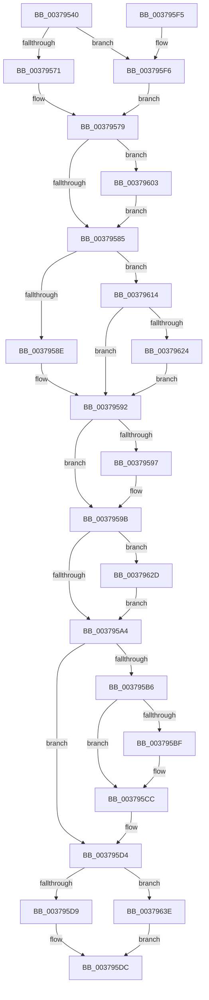

# MiReferencePageRuns

- RVA: `0x00379540`–`0x0037964B` (길이 `267` bytes)
- VA: `0x0000000140379540`
- 실행 섹션: `.text`
- PDB 이름 있음: `예`; PDB Function 태그: `아니요`
- unwind 정보 RVA: `0x0007AF60`
- 디코드: `67`개 명령, `267/267` bytes 표시
- 미해석 바이트: `0` (있으면 어셈블리에 `.byte`로 보존)

> 이 문서는 커널 이미지의 기계어와 PDB 기호를 분석해 생성했습니다. 4번과 5번은 함수 원형과 자료형을 바이너리 사용 방식에서 추정한 C 해석이며 원본 소스 복구 결과는 아닙니다.

## 1. Dependencies

- 직접 호출 지점: **7**; 고유 호출 대상: **5**
- 직접 호출자로 확인된 함수: **12**
- RIP 상대 이미지 참조: **4**

### Outgoing calls
- `0x00379571` → [ExAcquireSpinLockExclusive](../24/ExAcquireSpinLockExclusive_function_00248690.md) (function, `0x00248690`)
- `0x003795AB` → [ExReleaseSpinLockExclusiveFromDpcLevel](../24/ExReleaseSpinLockExclusiveFromDpcLevel_function_002497E0.md) (function, `0x002497E0`)
- `0x003795C7` → [KiLowerIrqlProcessIrqlFlags](../4F/KiLowerIrqlProcessIrqlFlags_function_004F5698.md) (function, `0x004F5698`)
- `0x003795F9` → [ExAcquireSpinLockExclusiveAtDpcLevel](../24/ExAcquireSpinLockExclusiveAtDpcLevel_function_00248E80.md) (function, `0x00248E80`)
- `0x0037960A` → [ExAcquireSpinLockExclusiveAtDpcLevel](../24/ExAcquireSpinLockExclusiveAtDpcLevel_function_00248E80.md) (function, `0x00248E80`)
- `0x00379634` → [ExReleaseSpinLockExclusiveFromDpcLevel](../24/ExReleaseSpinLockExclusiveFromDpcLevel_function_002497E0.md) (function, `0x002497E0`)
- `0x00379644` → [MiReferencePageRuns](MiReferencePageRuns_function_00379540.md) (function, `0x00379540`)

### Direct callers
- [MiFindContiguousPagesEx](../28/MiFindContiguousPagesEx_function_0028BDE0.md) at `0x0028C027`
- [MiReferencePageRuns](MiReferencePageRuns_function_00379540.md) at `0x00379644`
- [MiProcessLargeCoalesceCandidates](MiProcessLargeCoalesceCandidates_function_00379DF4.md) at `0x00379E64`
- [MiRebuildLargePage](../3B/MiRebuildLargePage_function_003BBAEC.md) at `0x003BBB3F`
- [MiComputeNodeMemory](../67/MiComputeNodeMemory_function_00671AA4.md) at `0x00671B45`
- [MiGetListOfPendingBadPages](../67/MiGetListOfPendingBadPages_function_006799D0.md) at `0x00679ACF`
- [MiScanPagefileSpace](../../page/80/MiScanPagefileSpace_function_00800440.md) at `0x00800466`
- [MmScrubMemory](../../page/80/MmScrubMemory_function_0080EFA0.md) at `0x0080F085`
- [MiCombineAllPhysicalMemory](../../page/9F/MiCombineAllPhysicalMemory_function_009F6B6C.md) at `0x009F6BC4`
- [MmGetNodeChannelRanges](../../page/A8/MmGetNodeChannelRanges_function_00A82784.md) at `0x00A827B3`
- [MmIdentifyPhysicalMemory](../../page/AA/MmIdentifyPhysicalMemory_function_00AAD05C.md) at `0x00AAD0CC`
- [MiGetPhysicalMemoryRanges](../../page/AC/MiGetPhysicalMemoryRanges_function_00ACAE08.md) at `0x00ACAE8E`

### Static image references
- `0x00379579` → RVA `0x00E38D00` (`.data`; read)
- `0x003795B6` → RVA `0x00FC6D20` (`ALMOSTRO`; read)
- `0x00379603` → RVA `0x00E38DC8` (`.data`; read)
- `0x00379614` → RVA `0x00FC6B88` (`ALMOSTRO`; read)

## 2. Other-region calls and transfers

- 다른 실행 섹션으로 향하는 call: **0**
- 별도 외부 분기/꼬리 이동을 확인하지 못했습니다.

## 3. Assembly (complete function range)

```asm
00379540  48 89 5C 24 08                  mov qword ptr [rsp + 8], rbx
00379545  48 89 6C 24 10                  mov qword ptr [rsp + 0x10], rbp
0037954A  48 89 74 24 18                  mov qword ptr [rsp + 0x18], rsi
0037954F  57                              push rdi
00379550  41 56                           push r14
00379552  41 57                           push r15
00379554  48 83 EC 20                     sub rsp, 0x20
00379558  44 8B F2                        mov r14d, edx
0037955B  48 8B F9                        mov rdi, rcx
0037955E  44 0F 20 C0                     mov rax, cr8
00379562  48 81 C1 C8 00 00 00            add rcx, 0xc8
00379569  3C 02                           cmp al, 2
0037956B  0F 84 85 00 00 00               je 0x1403795f6
00379571  E8 1A F1 EC FF                  call 0x140248690
00379576  0F B6 F0                        movzx esi, al
00379579  4C 8D 3D 80 F7 AB 00            lea r15, [rip + 0xabf780]
00379580  49 3B FF                        cmp rdi, r15
00379583  75 7E                           jne 0x140379603
00379585  45 85 F6                        test r14d, r14d
00379588  0F 84 86 00 00 00               je 0x140379614
0037958E  48 8B 5F 20                     mov rbx, qword ptr [rdi + 0x20]
00379592  48 85 DB                        test rbx, rbx
00379595  74 04                           je 0x14037959b
00379597  48 FF 43 F8                     inc qword ptr [rbx - 8]
0037959B  49 3B FF                        cmp rdi, r15
0037959E  0F 85 89 00 00 00               jne 0x14037962d
003795A4  48 8D 8F C8 00 00 00            lea rcx, [rdi + 0xc8]
003795AB  E8 30 02 ED FF                  call 0x1402497e0
003795B0  40 80 FE 11                     cmp sil, 0x11
003795B4  74 1E                           je 0x1403795d4
003795B6  83 3D 63 D7 C4 00 00            cmp dword ptr [rip + 0xc4d763], 0
003795BD  74 0D                           je 0x1403795cc
003795BF  44 0F 20 C1                     mov rcx, cr8
003795C3  40 0F B6 D6                     movzx edx, sil
003795C7  E8 CC C0 17 00                  call 0x1404f5698
003795CC  40 0F B6 C6                     movzx eax, sil
003795D0  44 0F 22 C0                     mov cr8, rax
003795D4  48 85 DB                        test rbx, rbx
003795D7  74 65                           je 0x14037963e
003795D9  48 8B C3                        mov rax, rbx
003795DC  48 8B 5C 24 40                  mov rbx, qword ptr [rsp + 0x40]
003795E1  48 8B 6C 24 48                  mov rbp, qword ptr [rsp + 0x48]
003795E6  48 8B 74 24 50                  mov rsi, qword ptr [rsp + 0x50]
003795EB  48 83 C4 20                     add rsp, 0x20
003795EF  41 5F                           pop r15
003795F1  41 5E                           pop r14
003795F3  5F                              pop rdi
003795F4  C3                              ret
003795F5  CC                              int3
003795F6  40 B6 11                        mov sil, 0x11
003795F9  E8 82 F8 EC FF                  call 0x140248e80
003795FE  E9 76 FF FF FF                  jmp 0x140379579
00379603  48 8D 0D BE F7 AB 00            lea rcx, [rip + 0xabf7be]
0037960A  E8 71 F8 EC FF                  call 0x140248e80
0037960F  E9 71 FF FF FF                  jmp 0x140379585
00379614  48 8B 1D 6D D5 C4 00            mov rbx, qword ptr [rip + 0xc4d56d]
0037961B  49 3B FF                        cmp rdi, r15
0037961E  0F 84 6E FF FF FF               je 0x140379592
00379624  48 8B 5F 50                     mov rbx, qword ptr [rdi + 0x50]
00379628  E9 65 FF FF FF                  jmp 0x140379592
0037962D  48 8D 0D 94 F7 AB 00            lea rcx, [rip + 0xabf794]
00379634  E8 A7 01 ED FF                  call 0x1402497e0
00379639  E9 66 FF FF FF                  jmp 0x1403795a4
0037963E  41 8B D6                        mov edx, r14d
00379641  49 8B CF                        mov rcx, r15
00379644  E8 F7 FE FF FF                  call 0x140379540
00379649  EB 91                           jmp 0x1403795dc
```

## 4. C-style interpretation (structured pseudocode)

```c
__int64 __fastcall MiReferencePageRuns(__int64 a1, int a2)
{
    __int64 result;
    __int64 v_rsp;
    unsigned __int64 v_stack_p10;
    unsigned __int64 v_stack_p18;
    unsigned __int64 v_stack_p8;

    v_stack_p8 = v_rbx;
    v_stack_p10 = v_rbp;
    v_stack_p18 = v_rsi;
    v_rsp = (v_rsp) - (32);
    a1 = (a1) + (200);
    if (((unsigned __int8)(v_cr8)) == 2) goto loc_003795F6;
    result = ExAcquireSpinLockExclusive(a1, a2, a3, a4);
loc_00379579:
    if (a1 != (v_rip + 11270016)) goto loc_00379603;
loc_00379585:
    if ((unsigned int)((unsigned int)(a2)) == 0) goto loc_00379614;
loc_00379592:
    if (*(unsigned __int64 *)(a1 + 32) != 0) {
    }
    if (a1 != (v_rip + 11270016)) goto loc_0037962D;
loc_003795A4:
    result = ExReleaseSpinLockExclusiveFromDpcLevel(a1 + 200, a2, a3, a4);
    if (((unsigned __int8)((unsigned __int8)(result))) == 17) goto loc_003795D4;
    if ((*(unsigned int *)(v_rip + 12900195)) != 0) {
        a1 = v_cr8;
        a2 = (unsigned __int8)((unsigned __int8)(result));
        result = KiLowerIrqlProcessIrqlFlags(a1, a2, a3, a4);
    }
loc_003795D4:
    if (*(unsigned __int64 *)(a1 + 32) == 0) goto loc_0037963E;
loc_003795DC:
    v_rsp = (v_rsp) + (32);
    return *(unsigned __int64 *)(a1 + 32);
loc_003795F6:
    result = ExAcquireSpinLockExclusiveAtDpcLevel(a1, a2, a3, a4);
    goto loc_00379579;
loc_00379603:
    result = ExAcquireSpinLockExclusiveAtDpcLevel(v_rip + 11270078, a2, a3, a4);
    goto loc_00379585;
loc_00379614:
    if (a1 == (v_rip + 11270016)) goto loc_00379592;
    goto loc_00379592;
loc_0037962D:
    result = ExReleaseSpinLockExclusiveFromDpcLevel(v_rip + 11270036, a2, a3, a4);
    goto loc_003795A4;
loc_0037963E:
    result = MiReferencePageRuns(v_rip + 11270016, (unsigned int)((unsigned int)((unsigned int)(a2))), a3, a4);
    goto loc_003795DC;
}
```

## 5. (Beta) C Style

```c
int64_t MiReferencePageRuns(int64_t Arg1, int32_t Arg2)
{
    int64_t result;
    int64_t local_rsp;
    uint64_t v_stack_p10;
    uint64_t v_stack_p18;
    uint64_t v_stack_p8;

    v_stack_p8 = local_rbx;
    v_stack_p10 = local_rbp;
    v_stack_p18 = local_rsi;
    local_rsp = (local_rsp) - (32);
    Arg1 = (Arg1) + (200);
    if (((uint8_t)(v_cr8)) == 2) goto loc_003795F6;
    result = ExAcquireSpinLockExclusive(Arg1, Arg2, a3, a4);
loc_00379579:
    if (Arg1 != (v_rip + 11270016)) goto loc_00379603;
loc_00379585:
    if ((uint32_t)((uint32_t)(Arg2)) == 0) goto loc_00379614;
loc_00379592:
    if (*(uint64_t *)(Arg1 + 0x20) != 0) {
    }
    if (Arg1 != (v_rip + 11270016)) goto loc_0037962D;
loc_003795A4:
    result = ExReleaseSpinLockExclusiveFromDpcLevel(Arg1 + 200, Arg2, a3, a4);
    if (((uint8_t)((uint8_t)(result))) == 17) goto loc_003795D4;
    if ((*(uint32_t *)(v_rip + 0xC4D763)) != 0) {
        Arg1 = v_cr8;
        Arg2 = (uint8_t)((uint8_t)(result));
        result = KiLowerIrqlProcessIrqlFlags(Arg1, Arg2, a3, a4);
    }
loc_003795D4:
    if (*(uint64_t *)(Arg1 + 0x20) == 0) goto loc_0037963E;
loc_003795DC:
    local_rsp = (local_rsp) + (32);
    return *(uint64_t *)(Arg1 + 0x20);
loc_003795F6:
    result = ExAcquireSpinLockExclusiveAtDpcLevel(Arg1, Arg2, a3, a4);
    goto loc_00379579;
loc_00379603:
    result = ExAcquireSpinLockExclusiveAtDpcLevel(v_rip + 11270078, Arg2, a3, a4);
    goto loc_00379585;
loc_00379614:
    if (Arg1 == (v_rip + 11270016)) goto loc_00379592;
    goto loc_00379592;
loc_0037962D:
    result = ExReleaseSpinLockExclusiveFromDpcLevel(v_rip + 11270036, Arg2, a3, a4);
    goto loc_003795A4;
loc_0037963E:
    result = MiReferencePageRuns(v_rip + 11270016, (uint32_t)((uint32_t)((uint32_t)(Arg2))), a3, a4);
    goto loc_003795DC;
}
```

## 6. Execution-region graph

[열기: 2D/3D 그래프와 함수 탐색 컨트롤 패널](../../../control-panel.html?section=text&rva=0x00379540&view=graph)

- 2D 그래프는 위에서 아래로 흐르고, 3D 그래프는 빈 공간을 드래그해 회전합니다. Shift+드래그는 이동, 휠은 확대·축소, 함수 노드 선택은 대상 보고서 이동입니다.

### Static fallback


