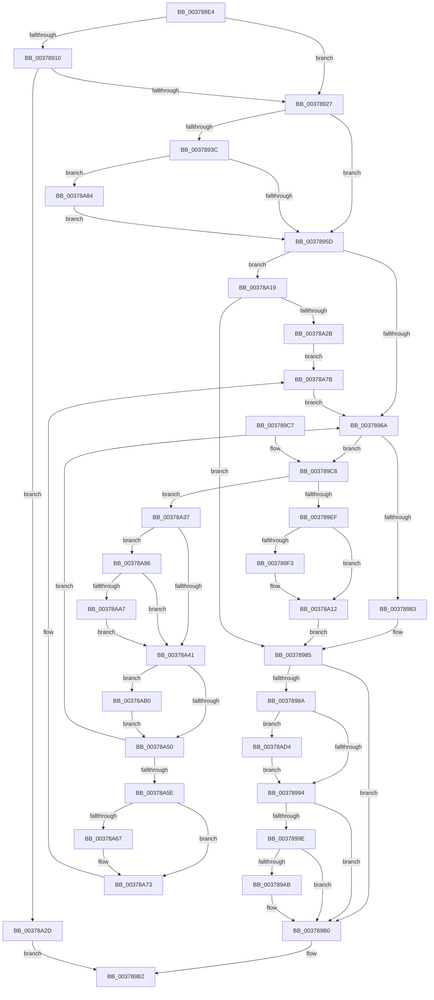

# MiReplenishSlabAllocator

- RVA: `0x003788E4`–`0x00378AEB` (길이 `519` bytes)
- VA: `0x00000001403788E4`
- 실행 섹션: `.text`
- PDB 이름 있음: `예`; PDB Function 태그: `아니요`
- unwind 정보 RVA: `0x0007AEB8`
- 디코드: `146`개 명령, `519/519` bytes 표시
- 미해석 바이트: `0` (있으면 어셈블리에 `.byte`로 보존)

> 이 문서는 커널 이미지의 기계어와 PDB 기호를 분석해 생성했습니다. 4번과 5번은 함수 원형과 자료형을 바이너리 사용 방식에서 추정한 C 해석이며 원본 소스 복구 결과는 아닙니다.

## 1. Dependencies

- 직접 호출 지점: **12**; 고유 호출 대상: **11**
- 직접 호출자로 확인된 함수: **12**
- RIP 상대 이미지 참조: **2**

### Outgoing calls
- `0x00378950` → [KeQueryPriorityThread](../38/KeQueryPriorityThread_function_0038F4F0.md) (function, `0x0038F4F0`)
- `0x00378976` → [MiCreateSlabEntry](MiCreateSlabEntry_function_00374DEC.md) (function, `0x00374DEC`)
- `0x003789AB` → [KiCheckForKernelApcDelivery](../2E/KiCheckForKernelApcDelivery_function_002E2C80.md) (function, `0x002E2C80`)
- `0x003789E6` → [MiInsertSlabEntry](MiInsertSlabEntry_function_00378AF4.md) (function, `0x00378AF4`)
- `0x00378A0D` → [MiReleaseNonPagedResources](../32/MiReleaseNonPagedResources_function_0032299C.md) (function, `0x0032299C`)
- `0x00378A1C` → [MiReplenishSlabAllocatorByIdentity](../3B/MiReplenishSlabAllocatorByIdentity_function_003BD8A8.md) (function, `0x003BD8A8`)
- `0x00378A47` → [MiFreeSlabEntry](../2D/MiFreeSlabEntry_function_002DC650.md) (function, `0x002DC650`)
- `0x00378A6E` → [KiLowerIrqlProcessIrqlFlags](../4F/KiLowerIrqlProcessIrqlFlags_function_004F5698.md) (function, `0x004F5698`)
- `0x00378A8C` → [KiSetSystemPriorityThread](../2D/KiSetSystemPriorityThread_function_002D9FF8.md) (function, `0x002D9FF8`)
- `0x00378AA9` → [KiRaiseIrqlProcessIrqlFlags](../4F/KiRaiseIrqlProcessIrqlFlags_function_004F56FC.md) (function, `0x004F56FC`)
- `0x00378ACA` → [MiReleaseNonPagedResources](../32/MiReleaseNonPagedResources_function_0032299C.md) (function, `0x0032299C`)
- `0x00378AE1` → [KiClearSystemPriority](../2C/KiClearSystemPriority_function_002C05A8.md) (function, `0x002C05A8`)

### Direct callers
- [sub_0027F1F2](../27/Unknown_function_0027F1F2.md) at `0x0027F218`
- [sub_0027F528](../27/Unknown_function_0027F528.md) at `0x0027F554`
- [MiCopyOnWriteCheckConditions](../2A/MiCopyOnWriteCheckConditions_function_002A750C.md) at `0x002A7584`
- [MiSharePages](../31/MiSharePages_function_00315110.md) at `0x00316014`
- [MiAllocateSlabPageForMdl](MiAllocateSlabPageForMdl_function_00376EC8.md) at `0x00376F72`
- [MiGetSlabPage](MiGetSlabPage_function_00376FBC.md) at `0x003771C7`
- [MiReplenishSlabAllocatorWorker](../4A/MiReplenishSlabAllocatorWorker_function_004A7A90.md) at `0x004A7ACF`
- [MiFastReplenishWithAsync](../4A/MiFastReplenishWithAsync_function_004AA500.md) at `0x004AA51B`
- [MiProtectDriverSectionPte](../67/MiProtectDriverSectionPte_function_006706C0.md) at `0x00670919`
- [MiInitialSlabPopulate](../68/MiInitialSlabPopulate_function_0068E830.md) at `0x0068E849`
- [MmAllocateSecureKernelPages](../68/MmAllocateSecureKernelPages_function_0068F394.md) at `0x0068F52F`
- [sub_006D7EC6](../6D/Unknown_function_006D7EC6.md) at `0x006D7F11`

### Static image references
- `0x003789F9` → RVA `0x00011C60` (`.rdata`; read)
- `0x00378A5E` → RVA `0x00FC6D20` (`ALMOSTRO`; read)

## 2. Other-region calls and transfers

- 다른 실행 섹션으로 향하는 call: **0**
- 별도 외부 분기/꼬리 이동을 확인하지 못했습니다.

## 3. Assembly (complete function range)

```asm
003788E4  48 89 5C 24 10                  mov qword ptr [rsp + 0x10], rbx
003788E9  44 89 44 24 18                  mov dword ptr [rsp + 0x18], r8d
003788EE  55                              push rbp
003788EF  56                              push rsi
003788F0  57                              push rdi
003788F1  41 54                           push r12
003788F3  41 55                           push r13
003788F5  41 56                           push r14
003788F7  41 57                           push r15
003788F9  48 83 EC 20                     sub rsp, 0x20
003788FD  83 B9 80 00 00 00 08            cmp dword ptr [rcx + 0x80], 8
00378904  41 8B E8                        mov ebp, r8d
00378907  4C 8B 61 18                     mov r12, qword ptr [rcx + 0x18]
0037890B  48 8B F9                        mov rdi, rcx
0037890E  74 17                           je 0x140378927
00378910  4C 8B 51 60                     mov r10, qword ptr [rcx + 0x60]
00378914  48 8B 41 50                     mov rax, qword ptr [rcx + 0x50]
00378918  48 8B 00                        mov rax, qword ptr [rax]
0037891B  49 03 C2                        add rax, r10
0037891E  48 3B C2                        cmp rax, rdx
00378921  0F 83 06 01 00 00               jae 0x140378a2d
00378927  33 DB                           xor ebx, ebx
00378929  44 8D 7B 20                     lea r15d, [rbx + 0x20]
0037892D  45 0F 20 C6                     mov r14, cr8
00378931  8D 43 02                        lea eax, [rbx + 2]
00378934  8D 73 01                        lea esi, [rbx + 1]
00378937  44 3A F0                        cmp r14b, al
0037893A  73 21                           jae 0x14037895d
0037893C  65 48 8B 1C 25 88 01 00 00      mov rbx, qword ptr gs:[0x188]
00378945  48 8B CB                        mov rcx, rbx
00378948  66 FF 8B E6 01 00 00            dec word ptr [rbx + 0x1e6]
0037894F  90                              nop
00378950  E8 9B 6B 01 00                  call 0x14038f4f0
00378955  85 C0                           test eax, eax
00378957  0F 84 27 01 00 00               je 0x140378a84
0037895D  83 BF 80 00 00 00 08            cmp dword ptr [rdi + 0x80], 8
00378964  0F 84 AF 00 00 00               je 0x140378a19
0037896A  45 8A CE                        mov r9b, r14b
0037896D  44 8B C5                        mov r8d, ebp
00378970  49 8B D4                        mov rdx, r12
00378973  48 8B CF                        mov rcx, rdi
00378976  E8 71 C4 FF FF                  call 0x140374dec
0037897B  4C 8B E8                        mov r13, rax
0037897E  48 85 C0                        test rax, rax
00378981  75 45                           jne 0x1403789c8
00378983  33 ED                           xor ebp, ebp
00378985  48 85 DB                        test rbx, rbx
00378988  74 26                           je 0x1403789b0
0037898A  41 83 FF 20                     cmp r15d, 0x20
0037898E  0F 85 40 01 00 00               jne 0x140378ad4
00378994  90                              nop
00378995  66 01 B3 E6 01 00 00            add word ptr [rbx + 0x1e6], si
0037899C  75 12                           jne 0x1403789b0
0037899E  48 8D 83 98 00 00 00            lea rax, [rbx + 0x98]
003789A5  90                              nop
003789A6  48 39 00                        cmp qword ptr [rax], rax
003789A9  74 05                           je 0x1403789b0
003789AB  E8 D0 A2 F6 FF                  call 0x1402e2c80
003789B0  8B C5                           mov eax, ebp
003789B2  48 8B 5C 24 68                  mov rbx, qword ptr [rsp + 0x68]
003789B7  48 83 C4 20                     add rsp, 0x20
003789BB  41 5F                           pop r15
003789BD  41 5E                           pop r14
003789BF  41 5D                           pop r13
003789C1  41 5C                           pop r12
003789C3  5F                              pop rdi
003789C4  5E                              pop rsi
003789C5  5D                              pop rbp
003789C6  C3                              ret
003789C7  CC                              int3
003789C8  8B 68 5C                        mov ebp, dword ptr [rax + 0x5c]
003789CB  4D 8B C5                        mov r8, r13
003789CE  B8 02 00 00 00                  mov eax, 2
003789D3  48 8B D7                        mov rdx, rdi
003789D6  23 E8                           and ebp, eax
003789D8  49 8B CC                        mov rcx, r12
003789DB  44 3A F0                        cmp r14b, al
003789DE  44 8D 48 01                     lea r9d, [rax + 1]
003789E2  44 0F 45 CE                     cmovne r9d, esi
003789E6  E8 09 01 00 00                  call 0x140378af4
003789EB  85 C0                           test eax, eax
003789ED  75 48                           jne 0x140378a37
003789EF  85 ED                           test ebp, ebp
003789F1  75 1F                           jne 0x140378a12
003789F3  8B 87 88 00 00 00               mov eax, dword ptr [rdi + 0x88]
003789F9  48 8D 0D 60 92 C9 FF            lea rcx, [rip - 0x366da0]
00378A00  48 C1 E8 04                     shr rax, 4
00378A04  83 E0 03                        and eax, 3
00378A07  8B 14 C1                        mov edx, dword ptr [rcx + rax*8]
00378A0A  49 8B CC                        mov rcx, r12
00378A0D  E8 8A 9F FA FF                  call 0x14032299c
00378A12  8B EE                           mov ebp, esi
00378A14  E9 6C FF FF FF                  jmp 0x140378985
00378A19  48 8B CF                        mov rcx, rdi
00378A1C  E8 87 4E 04 00                  call 0x1403bd8a8
00378A21  8B E8                           mov ebp, eax
00378A23  85 C0                           test eax, eax
00378A25  0F 85 5A FF FF FF               jne 0x140378985
00378A2B  EB 4E                           jmp 0x140378a7b
00378A2D  B8 01 00 00 00                  mov eax, 1
00378A32  E9 7B FF FF FF                  jmp 0x1403789b2
00378A37  B8 02 00 00 00                  mov eax, 2
00378A3C  44 3A F0                        cmp r14b, al
00378A3F  72 55                           jb 0x140378a96
00378A41  49 8B D5                        mov rdx, r13
00378A44  48 8B CF                        mov rcx, rdi
00378A47  E8 04 3C F6 FF                  call 0x1402dc650
00378A4C  85 ED                           test ebp, ebp
00378A4E  74 60                           je 0x140378ab0
00378A50  8B 6C 24 70                     mov ebp, dword ptr [rsp + 0x70]
00378A54  41 80 FE 02                     cmp r14b, 2
00378A58  0F 83 0C FF FF FF               jae 0x14037896a
00378A5E  83 3D BB E2 C4 00 00            cmp dword ptr [rip + 0xc4e2bb], 0
00378A65  74 0C                           je 0x140378a73
00378A67  44 0F 20 C1                     mov rcx, cr8
00378A6B  41 8A D6                        mov dl, r14b
00378A6E  E8 25 CC 17 00                  call 0x1404f5698
00378A73  41 0F B6 C6                     movzx eax, r14b
00378A77  44 0F 22 C0                     mov cr8, rax
00378A7B  8B 6C 24 70                     mov ebp, dword ptr [rsp + 0x70]
00378A7F  E9 E6 FE FF FF                  jmp 0x14037896a
00378A84  8B D6                           mov edx, esi
00378A86  48 8B CB                        mov rcx, rbx
00378A89  44 8B FE                        mov r15d, esi
00378A8C  E8 67 15 F6 FF                  call 0x1402d9ff8
00378A91  E9 C7 FE FF FF                  jmp 0x14037895d
00378A96  44 0F 20 C1                     mov rcx, cr8
00378A9A  44 0F 22 C0                     mov cr8, rax
00378A9E  83 3D 7B E2 C4 00 00            cmp dword ptr [rip + 0xc4e27b], 0
00378AA5  74 9A                           je 0x140378a41
00378AA7  8A D0                           mov dl, al
00378AA9  E8 4E CC 17 00                  call 0x1404f56fc
00378AAE  EB 91                           jmp 0x140378a41
00378AB0  8B 87 88 00 00 00               mov eax, dword ptr [rdi + 0x88]
00378AB6  48 8D 0D A3 91 C9 FF            lea rcx, [rip - 0x366e5d]
00378ABD  48 C1 E8 04                     shr rax, 4
00378AC1  83 E0 03                        and eax, 3
00378AC4  8B 14 C1                        mov edx, dword ptr [rcx + rax*8]
00378AC7  49 8B CC                        mov rcx, r12
00378ACA  E8 CD 9E FA FF                  call 0x14032299c
00378ACF  E9 7C FF FF FF                  jmp 0x140378a50
00378AD4  48 8D 54 24 60                  lea rdx, [rsp + 0x60]
00378AD9  44 89 7C 24 60                  mov dword ptr [rsp + 0x60], r15d
00378ADE  48 8B CB                        mov rcx, rbx
00378AE1  E8 C2 7A F4 FF                  call 0x1402c05a8
00378AE6  E9 A9 FE FF FF                  jmp 0x140378994
```

## 4. C-style interpretation (structured pseudocode)

```c
__int64 __fastcall MiReplenishSlabAllocator(__int64 a1, __int64 a2, int a3)
{
    __int64 result;
    __int64 v_rbp;
    __int64 v_rbx;
    __int64 v_rsp;
    unsigned __int64 v_stack_p10;
    unsigned int v_stack_p18;
    unsigned __int64 v_stack_p60;
    unsigned int v_stack_p70;

    v_stack_p10 = v_rbx;
    v_stack_p18 = a3;
    v_rsp = (v_rsp) - (32);
    if ((*(unsigned int *)(a1 + 128)) == 8) goto loc_00378927;
    result = (*(unsigned __int64 *)(*(unsigned __int64 *)(a1 + 80))) + (*(unsigned __int64 *)(a1 + 96));
    if (result >= a2) goto loc_00378A2D;
loc_00378927:
    v_rbx = 0;
    if (((unsigned __int8)(v_cr8)) >= ((unsigned __int8)(v_rbx + 2))) goto loc_0037895D;
    result = KeQueryPriorityThread(*(unsigned __int64 *)(gs_base + (0 + 392)), a2, a3, a4);
    if ((unsigned int)(result) == 0) goto loc_00378A84;
loc_0037895D:
    if ((*(unsigned int *)(a1 + 128)) == 8) goto loc_00378A19;
loc_0037896A:
    result = MiCreateSlabEntry(a1, *(unsigned __int64 *)(a1 + 24), (unsigned int)((unsigned int)((unsigned int)(a3))), (unsigned __int8)(v_cr8));
    if (result != 0) goto loc_003789C8;
    v_rbp = 0;
loc_00378985:
    if (*(unsigned __int64 *)(gs_base + (0 + 392)) == 0) goto loc_003789B0;
    if (((unsigned int)(v_rbx + 32)) != 32) goto loc_00378AD4;
loc_00378994:
    if (((unsigned int)(v_rbx + 32)) != 32) goto loc_003789B0;
    result = *(unsigned __int64 *)(gs_base + (0 + 392)) + 152;
    if ((*(unsigned __int64 *)(*(unsigned __int64 *)(gs_base + (0 + 392)) + 152)) != (*(unsigned __int64 *)(gs_base + (0 + 392)) + 152)) {
        result = KiCheckForKernelApcDelivery(a1, *(unsigned __int64 *)(a1 + 24), (unsigned int)((unsigned int)((unsigned int)(a3))), (unsigned __int8)(v_cr8));
    }
loc_003789B2:
    v_rsp = (v_rsp) + (32);
    return 0;
loc_003789C8:
    v_rbp = (unsigned int)(((unsigned int)(*(unsigned int *)(0 + 92))) & (2));
    a4 = 2 + 1;
    if (((unsigned __int8)(v_cr8)) != 2) { a4 = (unsigned int)(v_rbx + 1); }
    result = MiInsertSlabEntry(*(unsigned __int64 *)(a1 + 24), a1, result, a4);
    if ((unsigned int)(result) != 0) goto loc_00378A37;
    if ((unsigned int)(v_rbp) == 0) {
        result = *(unsigned int *)(a1 + 136);
        a1 = v_rip - 3567008;
        result = (result) >> (4);
        result = (unsigned int)((result) & (3));
        a2 = *(unsigned int *)(a1 + result * 8);
        a1 = *(unsigned __int64 *)(a1 + 24);
        result = MiReleaseNonPagedResources(a1, a2, result, a4);
    }
    goto loc_00378985;
loc_00378A19:
    result = MiReplenishSlabAllocatorByIdentity(a1, a2, result, a4);
    if ((unsigned int)(result) != 0) goto loc_00378985;
    goto loc_00378A7B;
loc_00378A2D:
    goto loc_003789B2;
loc_00378A37:
    if (((unsigned __int8)(v_cr8)) < 2) goto loc_00378A96;
loc_00378A41:
    result = MiFreeSlabEntry(a1, result, result, a4);
    if ((unsigned int)((unsigned int)((unsigned int)(result))) == 0) goto loc_00378AB0;
loc_00378A50:
    if (((unsigned __int8)(v_cr8)) >= 2) goto loc_0037896A;
    if ((*(unsigned int *)(v_rip + 12903099)) != 0) {
        a1 = v_cr8;
        a2 = (unsigned __int8)(v_cr8);
        result = KiLowerIrqlProcessIrqlFlags(a1, a2, result, a4);
    }
loc_00378A7B:
    goto loc_0037896A;
loc_00378A84:
    result = KiSetSystemPriorityThread(v_stack_p10, (unsigned int)((unsigned int)(v_rbx + 1)), result, a4);
    goto loc_0037895D;
loc_00378A96:
    if ((*(unsigned int *)(v_rip + 12903035)) == 0) goto loc_00378A41;
    result = KiRaiseIrqlProcessIrqlFlags((unsigned __int8)(v_cr8), (unsigned __int8)(result), result, a4);
    goto loc_00378A41;
loc_00378AB0:
    result = ((unsigned int)(*(unsigned int *)(a1 + 136))) >> (4);
    result = (unsigned int)((result) & (3));
    result = MiReleaseNonPagedResources(*(unsigned __int64 *)(a1 + 24), (unsigned int)(*(unsigned int *)(v_rip - 3567197 + result * 8)), result, a4);
    goto loc_00378A50;
loc_00378AD4:
    v_stack_p60 = (unsigned int)((unsigned int)((unsigned int)(v_rbx + 1)));
    result = KiClearSystemPriority(v_stack_p10, v_stack_p60, result, a4);
    goto loc_00378994;
}
```

## 5. (Beta) C Style

```c
int64_t MiReplenishSlabAllocator(void *Arg1, int64_t Arg2, int32_t Arg3)
{
    uint8_t *arg1 = (uint8_t *)Arg1;

    int64_t result;
    int64_t local_rbp;
    int64_t local_rbx;
    int64_t local_rsp;
    uint64_t v_stack_p10;
    uint32_t v_stack_p18;
    uint64_t v_stack_p60;
    uint32_t v_stack_p70;

    v_stack_p10 = local_rbx;
    v_stack_p18 = Arg3;
    local_rsp = (local_rsp) - (32);
    if ((*(uint32_t *)(arg1 + 0x80)) == 8) goto loc_00378927;
    result = (*(uint64_t *)(*(uint64_t *)(arg1 + 0x50))) + (*(uint64_t *)(arg1 + 0x60));
    if (result >= Arg2) goto loc_00378A2D;
loc_00378927:
    local_rbx = 0;
    if (((uint8_t)(v_cr8)) >= ((uint8_t)(local_rbx + 2))) goto loc_0037895D;
    result = KeQueryPriorityThread(*(uint64_t *)(gs_base + (0 + 0x188)), Arg2, Arg3, a4);
    if ((uint32_t)(result) == 0) goto loc_00378A84;
loc_0037895D:
    if ((*(uint32_t *)(arg1 + 0x80)) == 8) goto loc_00378A19;
loc_0037896A:
    result = MiCreateSlabEntry(Arg1, *(uint64_t *)(arg1 + 0x18), (uint32_t)((uint32_t)((uint32_t)(Arg3))), (uint8_t)(v_cr8));
    if (result != 0) goto loc_003789C8;
    local_rbp = 0;
loc_00378985:
    if (*(uint64_t *)(gs_base + (0 + 0x188)) == 0) goto loc_003789B0;
    if (((uint32_t)(local_rbx + 32)) != 32) goto loc_00378AD4;
loc_00378994:
    if (((uint32_t)(local_rbx + 32)) != 32) goto loc_003789B0;
    result = *(uint64_t *)(gs_base + (0 + 0x188)) + 152;
    if ((*(uint64_t *)(*(uint64_t *)(gs_base + (0 + 0x188)) + 0x98)) != (*(uint64_t *)(gs_base + (0 + 0x188)) + 152)) {
        result = KiCheckForKernelApcDelivery(Arg1, *(uint64_t *)(arg1 + 0x18), (uint32_t)((uint32_t)((uint32_t)(Arg3))), (uint8_t)(v_cr8));
    }
loc_003789B2:
    local_rsp = (local_rsp) + (32);
    return 0;
loc_003789C8:
    local_rbp = (uint32_t)(((uint32_t)(*(uint32_t *)(0 + 0x5C))) & (2));
    a4 = 2 + 1;
    if (((uint8_t)(v_cr8)) != 2) { a4 = (uint32_t)(local_rbx + 1); }
    result = MiInsertSlabEntry(*(uint64_t *)(arg1 + 0x18), Arg1, result, a4);
    if ((uint32_t)(result) != 0) goto loc_00378A37;
    if ((uint32_t)(local_rbp) == 0) {
        result = *(uint32_t *)(arg1 + 0x88);
        Arg1 = v_rip - 3567008;
        result = (result) >> (4);
        result = (uint32_t)((result) & (3));
        Arg2 = *(uint32_t *)(arg1 + result * 8);
        Arg1 = *(uint64_t *)(arg1 + 0x18);
        result = MiReleaseNonPagedResources(Arg1, Arg2, result, a4);
    }
    goto loc_00378985;
loc_00378A19:
    result = MiReplenishSlabAllocatorByIdentity(Arg1, Arg2, result, a4);
    if ((uint32_t)(result) != 0) goto loc_00378985;
    goto loc_00378A7B;
loc_00378A2D:
    goto loc_003789B2;
loc_00378A37:
    if (((uint8_t)(v_cr8)) < 2) goto loc_00378A96;
loc_00378A41:
    result = MiFreeSlabEntry(Arg1, result, result, a4);
    if ((uint32_t)((uint32_t)((uint32_t)(result))) == 0) goto loc_00378AB0;
loc_00378A50:
    if (((uint8_t)(v_cr8)) >= 2) goto loc_0037896A;
    if ((*(uint32_t *)(v_rip + 0xC4E2BB)) != 0) {
        Arg1 = v_cr8;
        Arg2 = (uint8_t)(v_cr8);
        result = KiLowerIrqlProcessIrqlFlags(Arg1, Arg2, result, a4);
    }
loc_00378A7B:
    goto loc_0037896A;
loc_00378A84:
    result = KiSetSystemPriorityThread(v_stack_p10, (uint32_t)((uint32_t)(local_rbx + 1)), result, a4);
    goto loc_0037895D;
loc_00378A96:
    if ((*(uint32_t *)(v_rip + 0xC4E27B)) == 0) goto loc_00378A41;
    result = KiRaiseIrqlProcessIrqlFlags((uint8_t)(v_cr8), (uint8_t)(result), result, a4);
    goto loc_00378A41;
loc_00378AB0:
    result = ((uint32_t)(*(uint32_t *)(arg1 + 0x88))) >> (4);
    result = (uint32_t)((result) & (3));
    result = MiReleaseNonPagedResources(*(uint64_t *)(arg1 + 0x18), (uint32_t)(*(uint32_t *)(v_rip - 0x366E5D + result * 8)), result, a4);
    goto loc_00378A50;
loc_00378AD4:
    v_stack_p60 = (uint32_t)((uint32_t)((uint32_t)(local_rbx + 1)));
    result = KiClearSystemPriority(v_stack_p10, v_stack_p60, result, a4);
    goto loc_00378994;
}
```

### 관측된 메모리 오프셋

구조체 형식이 확인되지 않은 접근은 인자 기준의 오프셋으로만 기록했습니다.

| 기준 인자 | 오프셋 표현 | 폭 (bit) | 접근 |
|---|---:|---:|---|
| `Arg1` | `+ 0x18` | `64` | `R` |
| `Arg1` | `+ 0x50` | `64` | `R` |
| `Arg1` | `+ 0x60` | `64` | `R` |
| `Arg1` | `+ 0x80` | `32` | `R` |
| `Arg1` | `+ 0x88` | `32` | `R` |

## 6. Execution-region graph

[열기: 2D/3D 그래프와 함수 탐색 컨트롤 패널](../../../control-panel.html?section=text&rva=0x003788E4&view=graph)

- 2D 그래프는 위에서 아래로 흐르고, 3D 그래프는 빈 공간을 드래그해 회전합니다. Shift+드래그는 이동, 휠은 확대·축소, 함수 노드 선택은 대상 보고서 이동입니다.

### Static fallback


