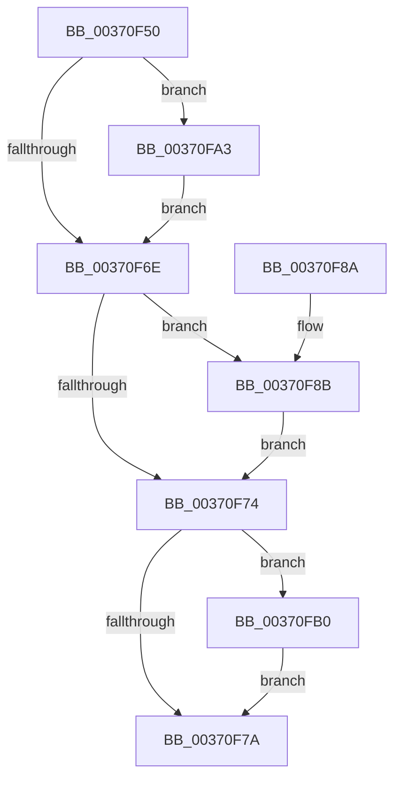

# MiReturnCloneCharges

- RVA: `0x00370F50`–`0x00370FCF` (길이 `127` bytes)
- VA: `0x0000000140370F50`
- 실행 섹션: `.text`
- PDB 이름 있음: `예`; PDB Function 태그: `아니요`
- unwind 정보 RVA: `0x0007A7BC`
- 디코드: `38`개 명령, `127/127` bytes 표시
- 미해석 바이트: `0` (있으면 어셈블리에 `.byte`로 보존)

> 이 문서는 커널 이미지의 기계어와 PDB 기호를 분석해 생성했습니다. 4번과 5번은 함수 원형과 자료형을 바이너리 사용 방식에서 추정한 C 해석이며 원본 소스 복구 결과는 아닙니다.

## 1. Dependencies

- 직접 호출 지점: **4**; 고유 호출 대상: **3**
- 직접 호출자로 확인된 함수: **4**
- RIP 상대 이미지 참조: **0**

### Outgoing calls
- `0x00370F94` → [MiReturnCommit](../24/MiReturnCommit_function_00248410.md) (function, `0x00248410`)
- `0x00370FA9` → [MiReturnCommit](../24/MiReturnCommit_function_00248410.md) (function, `0x00248410`)
- `0x00370FB6` → [MiReturnResident](../28/MiReturnResident_function_00286890.md) (function, `0x00286890`)
- `0x00370FC8` → [MiReturnCrossPartitionCharges](../28/MiReturnCrossPartitionCharges_function_002867D0.md) (function, `0x002867D0`)

### Direct callers
- [MiDecrementCloneBlock](../22/MiDecrementCloneBlock_function_0022BA8C.md) at `0x0022BB3F`
- [MiHandleForkTransitionPte](../22/MiHandleForkTransitionPte_function_0022D34C.md) at `0x0022D87D`
- [MiHandleForkTransitionPte](../22/MiHandleForkTransitionPte_function_0022D34C.md) at `0x0022D940`
- [MiBuildForkPte](../22/MiBuildForkPte_function_0022E32C.md) at `0x0022E566`
- [MiDecommitSharedPageTail](MiDecommitSharedPageTail_function_00370240.md) at `0x003705B4`
- [MiDecommitSharedPageTail](MiDecommitSharedPageTail_function_00370240.md) at `0x0037060A`

### Static image references
- 디코드된 RIP-relative 메모리 참조가 없습니다.

## 2. Other-region calls and transfers

- 다른 실행 섹션으로 향하는 call: **0**
- 별도 외부 분기/꼬리 이동을 확인하지 못했습니다.

## 3. Assembly (complete function range)

```asm
00370F50  48 89 5C 24 08                  mov qword ptr [rsp + 8], rbx
00370F55  48 89 74 24 10                  mov qword ptr [rsp + 0x10], rsi
00370F5A  57                              push rdi
00370F5B  48 83 EC 20                     sub rsp, 0x20
00370F5F  BE 01 00 00 00                  mov esi, 1
00370F64  8B FA                           mov edi, edx
00370F66  48 8B D9                        mov rbx, rcx
00370F69  40 84 D6                        test sil, dl
00370F6C  75 35                           jne 0x140370fa3
00370F6E  40 F6 C7 02                     test dil, 2
00370F72  75 17                           jne 0x140370f8b
00370F74  40 F6 C7 04                     test dil, 4
00370F78  75 36                           jne 0x140370fb0
00370F7A  48 8B 5C 24 30                  mov rbx, qword ptr [rsp + 0x30]
00370F7F  48 8B 74 24 38                  mov rsi, qword ptr [rsp + 0x38]
00370F84  48 83 C4 20                     add rsp, 0x20
00370F88  5F                              pop rdi
00370F89  C3                              ret
00370F8A  CC                              int3
00370F8B  45 33 C0                        xor r8d, r8d
00370F8E  48 8B D6                        mov rdx, rsi
00370F91  48 8B CB                        mov rcx, rbx
00370F94  E8 77 74 ED FF                  call 0x140248410
00370F99  F0 48 FF 8B B8 4C 00 00         lock dec qword ptr [rbx + 0x4cb8]
00370FA1  EB D1                           jmp 0x140370f74
00370FA3  45 33 C0                        xor r8d, r8d
00370FA6  48 8B D6                        mov rdx, rsi
00370FA9  E8 62 74 ED FF                  call 0x140248410
00370FAE  EB BE                           jmp 0x140370f6e
00370FB0  48 8B D6                        mov rdx, rsi
00370FB3  48 8B CB                        mov rcx, rbx
00370FB6  E8 D5 58 F1 FF                  call 0x140286890
00370FBB  45 33 C0                        xor r8d, r8d
00370FBE  4C 8B CE                        mov r9, rsi
00370FC1  48 8B CB                        mov rcx, rbx
00370FC4  41 8D 50 06                     lea edx, [r8 + 6]
00370FC8  E8 03 58 F1 FF                  call 0x1402867d0
00370FCD  EB AB                           jmp 0x140370f7a
```

## 4. C-style interpretation (structured pseudocode)

```c
__int64 __fastcall MiReturnCloneCharges(__int64 a1, int a2, int a3)
{
    __int64 result;
    __int64 v_rsp;
    unsigned __int64 v_stack_p10;
    unsigned __int64 v_stack_p8;

    v_stack_p8 = v_rbx;
    v_stack_p10 = v_rsi;
    v_rsp = (v_rsp) - (32);
    if (((1) & ((unsigned __int8)(a2))) != 0) goto loc_00370FA3;
loc_00370F6E:
    if ((((unsigned __int8)((unsigned int)(a2))) & (2)) != 0) goto loc_00370F8B;
loc_00370F74:
    if ((((unsigned __int8)((unsigned int)(a2))) & (4)) != 0) goto loc_00370FB0;
loc_00370F7A:
    v_rsp = (v_rsp) + (32);
    return result;
loc_00370F8B:
    a3 = 0;
    result = MiReturnCommit(v_stack_p8, v_stack_p10, a3, a4);
    goto loc_00370F74;
loc_00370FA3:
    a3 = 0;
    result = MiReturnCommit(v_stack_p8, v_stack_p10, a3, a4);
    goto loc_00370F6E;
loc_00370FB0:
    result = MiReturnResident(v_stack_p8, v_stack_p10, a3, a4);
    a3 = 0;
    result = MiReturnCrossPartitionCharges(v_stack_p8, a3 + 6, a3, v_stack_p10);
    goto loc_00370F7A;
}
```

## 5. (Beta) C Style

```c
int64_t MiReturnCloneCharges(void *Arg1, int32_t Arg2, int32_t Arg3)
{
    uint8_t *arg1 = (uint8_t *)Arg1;

    int64_t result;
    int64_t local_rsp;
    uint64_t v_stack_p10;
    uint64_t v_stack_p8;

    v_stack_p8 = local_rbx;
    v_stack_p10 = local_rsi;
    local_rsp = (local_rsp) - (32);
    if (((1) & ((uint8_t)(Arg2))) != 0) goto loc_00370FA3;
loc_00370F6E:
    if ((((uint8_t)((uint32_t)(Arg2))) & (2)) != 0) goto loc_00370F8B;
loc_00370F74:
    if ((((uint8_t)((uint32_t)(Arg2))) & (4)) != 0) goto loc_00370FB0;
loc_00370F7A:
    local_rsp = (local_rsp) + (32);
    return result;
loc_00370F8B:
    Arg3 = 0;
    result = MiReturnCommit(v_stack_p8, v_stack_p10, Arg3, a4);
    goto loc_00370F74;
loc_00370FA3:
    Arg3 = 0;
    result = MiReturnCommit(v_stack_p8, v_stack_p10, Arg3, a4);
    goto loc_00370F6E;
loc_00370FB0:
    result = MiReturnResident(v_stack_p8, v_stack_p10, Arg3, a4);
    Arg3 = 0;
    result = MiReturnCrossPartitionCharges(v_stack_p8, Arg3 + 6, Arg3, v_stack_p10);
    goto loc_00370F7A;
}
```

### 관측된 메모리 오프셋

구조체 형식이 확인되지 않은 접근은 인자 기준의 오프셋으로만 기록했습니다.

| 기준 인자 | 오프셋 표현 | 폭 (bit) | 접근 |
|---|---:|---:|---|
| `Arg1` | `+ 0x4CB8` | `64` | `R/W` |

## 6. Execution-region graph

[열기: 2D/3D 그래프와 함수 탐색 컨트롤 패널](../../../control-panel.html?section=text&rva=0x00370F50&view=graph)

- 2D 그래프는 위에서 아래로 흐르고, 3D 그래프는 빈 공간을 드래그해 회전합니다. Shift+드래그는 이동, 휠은 확대·축소, 함수 노드 선택은 대상 보고서 이동입니다.

### Static fallback


