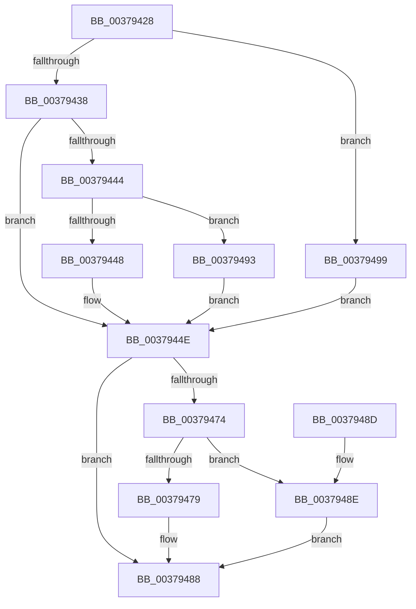

# MiSetFreeZeroPfnCold

- RVA: `0x00379428`–`0x0037949B` (길이 `115` bytes)
- VA: `0x0000000140379428`
- 실행 섹션: `.text`
- PDB 이름 있음: `예`; PDB Function 태그: `아니요`
- unwind 정보 RVA: `0x000DB714`
- 디코드: `37`개 명령, `115/115` bytes 표시
- 미해석 바이트: `0` (있으면 어셈블리에 `.byte`로 보존)

> 이 문서는 커널 이미지의 기계어와 PDB 기호를 분석해 생성했습니다. 4번과 5번은 함수 원형과 자료형을 바이너리 사용 방식에서 추정한 C 해석이며 원본 소스 복구 결과는 아닙니다.

## 1. Dependencies

- 직접 호출 지점: **0**; 고유 호출 대상: **0**
- 직접 호출자로 확인된 함수: **14**
- RIP 상대 이미지 참조: **1**

### Outgoing calls
- 직접 디코드된 call 명령이 없습니다.

### Direct callers
- [MiDemoteLocalLargePage](../28/MiDemoteLocalLargePage_function_0028A4F0.md) at `0x0028A92D`
- [MiConvertContiguousPages](../29/MiConvertContiguousPages_function_0029F894.md) at `0x0029FA59`
- [MiConvertContiguousPages](../29/MiConvertContiguousPages_function_0029F894.md) at `0x0029FA6E`
- [MiRemoveLowestPriorityStandbyPage](../33/MiRemoveLowestPriorityStandbyPage_function_00334600.md) at `0x00334AD0`
- [MiUnlinkFreeOrZeroedPage](../33/MiUnlinkFreeOrZeroedPage_function_00336C40.md) at `0x003376D1`
- [MiPageFreeToZero](../33/MiPageFreeToZero_function_00337A30.md) at `0x00337CA6`
- [MiFinishLargePageFree](MiFinishLargePageFree_function_00377B94.md) at `0x00377C58`
- [MiLargePagePromote](MiLargePagePromote_function_0037915C.md) at `0x003793A9`
- [MiAllocateLargeZeroPages](../3B/MiAllocateLargeZeroPages_function_003B743C.md) at `0x003B76A6`
- [MiInitializeAllResidentPageBasePfns](../46/MiInitializeAllResidentPageBasePfns_function_00462AF8.md) at `0x00462CDC`
- [MiEnableNewPfns](../67/MiEnableNewPfns_function_00671DD0.md) at `0x00671ECC`
- [sub_006E169E](../6E/Unknown_function_006E169E.md) at `0x006E16F2`
- [sub_006E7822](../6E/Unknown_function_006E7822.md) at `0x006E7899`
- [sub_006EDB06](../6E/Unknown_function_006EDB06.md) at `0x006EDB34`
- [MxInsertEnclaveBootPages](../../init/C6/MxInsertEnclaveBootPages_function_00C68CB0.md) at `0x00C68D51`

### Static image references
- `0x00379438` → RVA `0x00E2DC80` (`.data`; read)

## 2. Other-region calls and transfers

- 다른 실행 섹션으로 향하는 call: **0**
- 별도 외부 분기/꼬리 이동을 확인하지 못했습니다.

## 3. Assembly (complete function range)

```asm
00379428  48 8B 41 28                     mov rax, qword ptr [rcx + 0x28]
0037942C  4C 8B C1                        mov r8, rcx
0037942F  48 8B 41 10                     mov rax, qword ptr [rcx + 0x10]
00379433  48 85 C0                        test rax, rax
00379436  74 61                           je 0x140379499
00379438  48 8B 0D 41 48 AB 00            mov rcx, qword ptr [rip + 0xab4841]
0037943F  48 85 C9                        test rcx, rcx
00379442  74 0A                           je 0x14037944e
00379444  A8 10                           test al, 0x10
00379446  75 4B                           jne 0x140379493
00379448  48 F7 D1                        not rcx
0037944B  48 23 C1                        and rax, rcx
0037944E  48 8B 0D 2B 48 AB 00            mov rcx, qword ptr [rip + 0xab482b]
00379455  49 BA 00 00 00 00 FD FF FF FF   movabs r10, 0xfffffffd00000000
0037945F  44 8B C8                        mov r9d, eax
00379462  8B C2                           mov eax, edx
00379464  F7 D8                           neg eax
00379466  48 1B C0                        sbb rax, rax
00379469  49 23 C2                        and rax, r10
0037946C  49 0B C1                        or rax, r9
0037946F  48 85 C9                        test rcx, rcx
00379472  74 14                           je 0x140379488
00379474  48 85 C8                        test rax, rcx
00379477  74 15                           je 0x14037948e
00379479  F7 DA                           neg edx
0037947B  48 1B C0                        sbb rax, rax
0037947E  49 23 C2                        and rax, r10
00379481  48 83 C0 10                     add rax, 0x10
00379485  49 0B C1                        or rax, r9
00379488  49 89 40 10                     mov qword ptr [r8 + 0x10], rax
0037948C  C3                              ret
0037948D  CC                              int3
0037948E  48 0B C1                        or rax, rcx
00379491  EB F5                           jmp 0x140379488
00379493  48 83 E0 EF                     and rax, 0xffffffffffffffef
00379497  EB B5                           jmp 0x14037944e
00379499  EB B3                           jmp 0x14037944e
```

## 4. C-style interpretation (structured pseudocode)

```c
__int64 __fastcall MiSetFreeZeroPfnCold(__int64 a1, int a2)
{
    __int64 result;

    if (*(unsigned __int64 *)(a1 + 16) == 0) goto loc_00379499;
    if (*(unsigned __int64 *)(v_rip + 11225153) == 0) goto loc_0037944E;
    if ((((unsigned __int8)(*(unsigned __int64 *)(a1 + 16))) & (16)) != 0) goto loc_00379493;
    a1 = ~(*(unsigned __int64 *)(v_rip + 11225153));
    result = (*(unsigned __int64 *)(a1 + 16)) & (a1);
loc_0037944E:
    result = (unsigned int)(-((unsigned int)(a2)));
    result = (result) & (v_r10);
    result = (result) | ((unsigned int)((unsigned int)(result)));
    if (*(unsigned __int64 *)(v_rip + 11225131) == 0) goto loc_00379488;
    if (((result) & (*(unsigned __int64 *)(v_rip + 11225131))) == 0) goto loc_0037948E;
    a2 = (unsigned int)(-(a2));
    result = (result) & (v_r10);
    result = (result) + (16);
    result = (result) | ((unsigned int)((unsigned int)(result)));
loc_00379488:
    *(unsigned __int64 *)(a1 + 16) = result;
    return result;
loc_0037948E:
    result = (result) | (*(unsigned __int64 *)(v_rip + 11225131));
    goto loc_00379488;
loc_00379493:
    result = (result) & (-17);
    goto loc_0037944E;
loc_00379499:
    goto loc_0037944E;
}
```

## 5. (Beta) C Style

```c
int64_t MiSetFreeZeroPfnCold(void *Arg1, int32_t Arg2)
{
    uint8_t *arg1 = (uint8_t *)Arg1;

    int64_t result;

    if (*(uint64_t *)(arg1 + 0x10) == 0) goto loc_00379499;
    if (*(uint64_t *)(v_rip + 0xAB4841) == 0) goto loc_0037944E;
    if ((((uint8_t)(*(uint64_t *)(arg1 + 0x10))) & (16)) != 0) goto loc_00379493;
    Arg1 = ~(*(uint64_t *)(v_rip + 0xAB4841));
    result = (*(uint64_t *)(arg1 + 0x10)) & (Arg1);
loc_0037944E:
    result = (uint32_t)(-((uint32_t)(Arg2)));
    result = (result) & (local_r10);
    result = (result) | ((uint32_t)((uint32_t)(result)));
    if (*(uint64_t *)(v_rip + 0xAB482B) == 0) goto loc_00379488;
    if (((result) & (*(uint64_t *)(v_rip + 0xAB482B))) == 0) goto loc_0037948E;
    Arg2 = (uint32_t)(-(Arg2));
    result = (result) & (local_r10);
    result = (result) + (16);
    result = (result) | ((uint32_t)((uint32_t)(result)));
loc_00379488:
    *(uint64_t *)(arg1 + 0x10) = result;
    return result;
loc_0037948E:
    result = (result) | (*(uint64_t *)(v_rip + 0xAB482B));
    goto loc_00379488;
loc_00379493:
    result = (result) & (-17);
    goto loc_0037944E;
loc_00379499:
    goto loc_0037944E;
}
```

### 관측된 메모리 오프셋

구조체 형식이 확인되지 않은 접근은 인자 기준의 오프셋으로만 기록했습니다.

| 기준 인자 | 오프셋 표현 | 폭 (bit) | 접근 |
|---|---:|---:|---|
| `Arg1` | `+ 0x10` | `64` | `R` |
| `Arg1` | `+ 0x10` | `64` | `W` |
| `Arg1` | `+ 0x28` | `64` | `R` |

## 6. Execution-region graph

[열기: 2D/3D 그래프와 함수 탐색 컨트롤 패널](../../../control-panel.html?section=text&rva=0x00379428&view=graph)

- 2D 그래프는 위에서 아래로 흐르고, 3D 그래프는 빈 공간을 드래그해 회전합니다. Shift+드래그는 이동, 휠은 확대·축소, 함수 노드 선택은 대상 보고서 이동입니다.

### Static fallback


