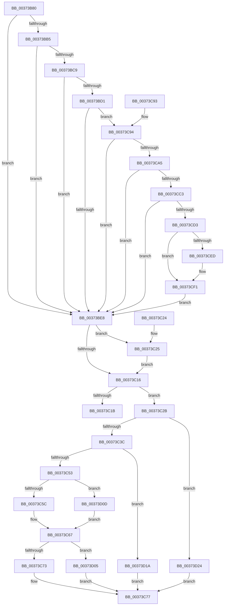

# MiSetStoreVirtualPagefileValue

- RVA: `0x00373B80`–`0x00373D34` (길이 `436` bytes)
- VA: `0x0000000140373B80`
- 실행 섹션: `.text`
- PDB 이름 있음: `예`; PDB Function 태그: `아니요`
- unwind 정보 RVA: `0x0007AAA8`
- 디코드: `104`개 명령, `436/436` bytes 표시
- 미해석 바이트: `0` (있으면 어셈블리에 `.byte`로 보존)

> 이 문서는 커널 이미지의 기계어와 PDB 기호를 분석해 생성했습니다. 4번과 5번은 함수 원형과 자료형을 바이너리 사용 방식에서 추정한 C 해석이며 원본 소스 복구 결과는 아닙니다.

## 1. Dependencies

- 직접 호출 지점: **1**; 고유 호출 대상: **1**
- 직접 호출자로 확인된 함수: **6**
- RIP 상대 이미지 참조: **2**

### Outgoing calls
- `0x00373D27` → [MiMakePageFilePte](../38/MiMakePageFilePte_function_003823C8.md) (function, `0x003823C8`)

### Direct callers
- [MiStoreWriteModifiedPages](../2B/MiStoreWriteModifiedPages_function_002B46C4.md) at `0x002B541E`
- [MiDetermineModifiedPageListHead](../2B/MiDetermineModifiedPageListHead_function_002BAB00.md) at `0x002BABC2`
- [MiOutSwapWorkingSetPte](MiOutSwapWorkingSetPte_function_00372190.md) at `0x00372311`
- [MiGatherPagefilePages](MiGatherPagefilePages_function_00372B08.md) at `0x00372D94`
- [MiWriteComplete](../40/MiWriteComplete_function_004069B0.md) at `0x00406CF9`
- [MiMoveModifiedPagesToCompressList](../69/MiMoveModifiedPagesToCompressList_function_006925D8.md) at `0x0069264E`

### Static image references
- `0x00373C3C` → RVA `0x00E2DC80` (`.data`; read)
- `0x00373C94` → RVA `0x00FC6A88` (`ALMOSTRO`; read)

## 2. Other-region calls and transfers

- 다른 실행 섹션으로 향하는 call: **0**
- 별도 외부 분기/꼬리 이동을 확인하지 못했습니다.

## 3. Assembly (complete function range)

```asm
00373B80  40 53                           push rbx
00373B82  48 83 EC 30                     sub rsp, 0x30
00373B86  8B 81 B4 04 00 00               mov eax, dword ptr [rcx + 0x4b4]
00373B8C  48 89 54 24 20                  mov qword ptr [rsp + 0x20], rdx
00373B91  41 8B D8                        mov ebx, r8d
00373B94  4C 8B 94 C1 60 48 00 00         mov r10, qword ptr [rcx + rax*8 + 0x4860]
00373B9C  48 8B 4C 24 20                  mov rcx, qword ptr [rsp + 0x20]
00373BA1  49 B8 00 D0 BE 7D FB F6 FF FF   movabs r8, 0xfffff6fb7dbed000
00373BAB  48 8D 44 24 20                  lea rax, [rsp + 0x20]
00373BB0  49 3B C0                        cmp rax, r8
00373BB3  72 33                           jb 0x140373be8
00373BB5  49 B8 F8 D7 BE 7D FB F6 FF FF   movabs r8, 0xfffff6fb7dbed7f8
00373BBF  48 8D 44 24 20                  lea rax, [rsp + 0x20]
00373BC4  49 3B C0                        cmp rax, r8
00373BC7  77 1F                           ja 0x140373be8
00373BC9  48 8B C1                        mov rax, rcx
00373BCC  F6 C1 01                        test cl, 1
00373BCF  74 17                           je 0x140373be8
00373BD1  F6 C1 42                        test cl, 0x42
00373BD4  41 0F 95 C1                     setne r9b
00373BD8  F6 C1 20                        test cl, 0x20
00373BDB  41 0F 95 C0                     setne r8b
00373BDF  45 84 C8                        test r8b, r9b
00373BE2  0F 84 AC 00 00 00               je 0x140373c94
00373BE8  48 0F BA E1 0A                  bt rcx, 0xa
00373BED  48 C7 C0 F7 FF FF FF            mov rax, 0xfffffffffffffff7
00373BF4  49 C7 C0 FF F7 FF FF            mov r8, 0xfffffffffffff7ff
00373BFB  49 0F 42 C0                     cmovb rax, r8
00373BFF  48 23 C1                        and rax, rcx
00373C02  48 8D 4C 24 20                  lea rcx, [rsp + 0x20]
00373C07  48 89 01                        mov qword ptr [rcx], rax
00373C0A  48 8B 4C 24 20                  mov rcx, qword ptr [rsp + 0x20]
00373C0F  48 0F BA E2 0A                  bt rdx, 0xa
00373C14  73 0F                           jae 0x140373c25
00373C16  4D 85 D2                        test r10, r10
00373C19  75 10                           jne 0x140373c2b
00373C1B  48 8B C1                        mov rax, rcx
00373C1E  48 83 C4 30                     add rsp, 0x30
00373C22  5B                              pop rbx
00373C23  C3                              ret
00373C24  CC                              int3
00373C25  48 83 E1 F9                     and rcx, 0xfffffffffffffff9
00373C29  EB EB                           jmp 0x140373c16
00373C2B  45 0F B7 8A AC 00 00 00         movzx r9d, word ptr [r10 + 0xac]
00373C33  48 85 C9                        test rcx, rcx
00373C36  0F 84 E8 00 00 00               je 0x140373d24
00373C3C  4C 8B 05 3D A0 AB 00            mov r8, qword ptr [rip + 0xaba03d]
00373C43  48 8B D3                        mov rdx, rbx
00373C46  48 C1 E2 20                     shl rdx, 0x20
00373C4A  4D 85 C0                        test r8, r8
00373C4D  0F 84 C7 00 00 00               je 0x140373d1a
00373C53  F6 C1 10                        test cl, 0x10
00373C56  0F 85 B1 00 00 00               jne 0x140373d0d
00373C5C  49 8B C0                        mov rax, r8
00373C5F  48 F7 D0                        not rax
00373C62  48 23 C8                        and rcx, rax
00373C65  8B C9                           mov ecx, ecx
00373C67  48 0B D1                        or rdx, rcx
00373C6A  4C 85 C2                        test rdx, r8
00373C6D  0F 84 92 00 00 00               je 0x140373d05
00373C73  48 83 CA 10                     or rdx, 0x10
00373C77  49 8B C9                        mov rcx, r9
00373C7A  48 C1 E1 0C                     shl rcx, 0xc
00373C7E  48 8B C1                        mov rax, rcx
00373C81  48 33 C2                        xor rax, rdx
00373C84  48 25 FF 0F FF FF               and rax, 0xffffffffffff0fff
00373C8A  48 33 C1                        xor rax, rcx
00373C8D  48 83 C4 30                     add rsp, 0x30
00373C91  5B                              pop rbx
00373C92  C3                              ret
00373C93  CC                              int3
00373C94  48 F7 05 E9 2D C5 00 00 00 60 00  test qword ptr [rip + 0xc52de9], 0x600000
00373C9F  0F 84 43 FF FF FF               je 0x140373be8
00373CA5  65 4C 8B 04 25 88 01 00 00      mov r8, qword ptr gs:[0x188]
00373CAE  4D 8B 88 B8 00 00 00            mov r9, qword ptr [r8 + 0xb8]
00373CB5  41 80 B9 60 01 00 00 01         cmp byte ptr [r9 + 0x160], 1
00373CBD  0F 84 25 FF FF FF               je 0x140373be8
00373CC3  4D 8B 99 08 05 00 00            mov r11, qword ptr [r9 + 0x508]
00373CCA  4D 85 DB                        test r11, r11
00373CCD  0F 84 15 FF FF FF               je 0x140373be8
00373CD3  4C 8D 44 24 20                  lea r8, [rsp + 0x20]
00373CD8  49 C1 E8 03                     shr r8, 3
00373CDC  41 81 E0 FF 01 00 00            and r8d, 0x1ff
00373CE3  4F 8B 04 C3                     mov r8, qword ptr [r11 + r8*8]
00373CE7  41 F6 C0 20                     test r8b, 0x20
00373CEB  74 04                           je 0x140373cf1
00373CED  48 83 C8 20                     or rax, 0x20
00373CF1  48 8B C8                        mov rcx, rax
00373CF4  48 83 C9 42                     or rcx, 0x42
00373CF8  41 F6 C0 42                     test r8b, 0x42
00373CFC  48 0F 44 C8                     cmove rcx, rax
00373D00  E9 E3 FE FF FF                  jmp 0x140373be8
00373D05  49 0B D0                        or rdx, r8
00373D08  E9 6A FF FF FF                  jmp 0x140373c77
00373D0D  B8 EF FF FF FF                  mov eax, 0xffffffef
00373D12  48 23 C8                        and rcx, rax
00373D15  E9 4D FF FF FF                  jmp 0x140373c67
00373D1A  8B C1                           mov eax, ecx
00373D1C  48 0B D0                        or rdx, rax
00373D1F  E9 53 FF FF FF                  jmp 0x140373c77
00373D24  48 8B CB                        mov rcx, rbx
00373D27  E8 9C E6 00 00                  call 0x1403823c8
00373D2C  48 8B D0                        mov rdx, rax
00373D2F  E9 43 FF FF FF                  jmp 0x140373c77
```

## 4. C-style interpretation (structured pseudocode)

```c
__int64 __fastcall MiSetStoreVirtualPagefileValue(__int64 a1, __int64 a2, int a3)
{
    __int64 result;
    __int64 v_rsp;
    unsigned __int64 v_stack_m18;
    unsigned __int64 v_stack_p58;

    v_rsp = (v_rsp) - (48);
    v_stack_m18 = a2;
    if (v_stack_m18 < a3) goto loc_00373BE8;
    if (v_stack_m18 > a3) goto loc_00373BE8;
    if ((((unsigned __int8)(v_stack_m18)) & (1)) == 0) goto loc_00373BE8;
    a4 = ((((unsigned __int8)(v_stack_m18)) & (66)) != 0) ? 1 : 0;
    a3 = ((((unsigned __int8)(v_stack_m18)) & (32)) != 0) ? 1 : 0;
    if ((((unsigned __int8)(a3)) & ((unsigned __int8)(a4))) == 0) goto loc_00373C94;
loc_00373BE8:
    result = -9;
    if (condition_is_below) { result = 0xFFFFFFFFFFFFF7FFULL; }
    result = (result) & (v_stack_m18);
    *(unsigned __int64 *)(v_stack_m18) = result;
    if (condition_is_above_or_equal) goto loc_00373C25;
loc_00373C16:
    if (*(unsigned __int64 *)(a1 + (unsigned int)(*(unsigned int *)(a1 + 1204)) * 8 + 18528) != 0) goto loc_00373C2B;
    v_rsp = (v_rsp) + (48);
    return v_stack_m18;
loc_00373C25:
    a1 = (v_stack_m18) & (-7);
    goto loc_00373C16;
loc_00373C2B:
    if (a1 == 0) goto loc_00373D24;
    a2 = ((unsigned int)(a3)) << (32);
    if (*(unsigned __int64 *)(v_rip + 11247677) == 0) goto loc_00373D1A;
    if ((((unsigned __int8)(a1)) & (16)) != 0) goto loc_00373D0D;
    result = ~(*(unsigned __int64 *)(v_rip + 11247677));
    a1 = (a1) & (result);
loc_00373C67:
    a2 = (a2) | ((unsigned int)((unsigned int)(a1)));
    if (((a2) & (*(unsigned __int64 *)(v_rip + 11247677))) == 0) goto loc_00373D05;
    a2 = (a2) | (16);
loc_00373C77:
    a1 = (*(unsigned __int16 *)(*(unsigned __int64 *)(a1 + (unsigned int)(*(unsigned int *)(a1 + 1204)) * 8 + 18528) + 172)) << (12);
    result = (a1) ^ (a2);
    result = (result) & (0xFFFFFFFFFFFF0FFFULL);
    result = (result) ^ (a1);
    v_rsp = (v_rsp) + (48);
    return result;
loc_00373C94:
    if (((*(unsigned __int64 *)(v_rip + 12922345)) & (0x600000ULL)) == 0) goto loc_00373BE8;
    if ((*(unsigned __int8 *)(*(unsigned __int64 *)(*(unsigned __int64 *)(gs_base + (0 + 392)) + 184) + 352)) == 1) goto loc_00373BE8;
    if (*(unsigned __int64 *)(*(unsigned __int64 *)(*(unsigned __int64 *)(gs_base + (0 + 392)) + 184) + 1288) == 0) goto loc_00373BE8;
    a3 = (v_stack_p58) >> (3);
    a3 = (unsigned int)((a3) & (511));
    if ((((unsigned __int8)(*(unsigned __int64 *)(*(unsigned __int64 *)(*(unsigned __int64 *)(*(unsigned __int64 *)(gs_base + (0 + 392)) + 184) + 1288) + a3 * 8))) & (32)) != 0) {
        result = (result) | (32);
    }
    a1 = (result) | (66);
    if ((((unsigned __int8)(*(unsigned __int64 *)(*(unsigned __int64 *)(*(unsigned __int64 *)(*(unsigned __int64 *)(gs_base + (0 + 392)) + 184) + 1288) + a3 * 8))) & (66)) == 0) { a1 = result; }
    goto loc_00373BE8;
loc_00373D05:
    a2 = (a2) | (*(unsigned __int64 *)(*(unsigned __int64 *)(*(unsigned __int64 *)(*(unsigned __int64 *)(gs_base + (0 + 392)) + 184) + 1288) + a3 * 8));
    goto loc_00373C77;
loc_00373D0D:
    a1 = (a1) & ((unsigned int)(0xFFFFFFEFULL));
    goto loc_00373C67;
loc_00373D1A:
    a2 = (a2) | ((unsigned int)((unsigned int)(a1)));
    goto loc_00373C77;
loc_00373D24:
    result = MiMakePageFilePte((unsigned int)(a3), a2, *(unsigned __int64 *)(*(unsigned __int64 *)(*(unsigned __int64 *)(*(unsigned __int64 *)(gs_base + (0 + 392)) + 184) + 1288) + a3 * 8), *(unsigned __int64 *)(*(unsigned __int64 *)(gs_base + (0 + 392)) + 184));
    goto loc_00373C77;
}
```

## 5. (Beta) C Style

```c
int64_t MiSetStoreVirtualPagefileValue(void *Arg1, int64_t Arg2, int32_t Arg3)
{
    uint8_t *arg1 = (uint8_t *)Arg1;

    int64_t result;
    int64_t local_rsp;
    uint64_t v_stack_m18;
    uint64_t v_stack_p58;

    local_rsp = (local_rsp) - (48);
    v_stack_m18 = Arg2;
    if (v_stack_m18 < Arg3) goto loc_00373BE8;
    if (v_stack_m18 > Arg3) goto loc_00373BE8;
    if ((((uint8_t)(v_stack_m18)) & (1)) == 0) goto loc_00373BE8;
    a4 = ((((uint8_t)(v_stack_m18)) & (66)) != 0) ? 1 : 0;
    Arg3 = ((((uint8_t)(v_stack_m18)) & (32)) != 0) ? 1 : 0;
    if ((((uint8_t)(Arg3)) & ((uint8_t)(a4))) == 0) goto loc_00373C94;
loc_00373BE8:
    result = -9;
    if (condition_is_below) { result = 0xFFFFFFFFFFFFF7FFULL; }
    result = (result) & (v_stack_m18);
    *(uint64_t *)(v_stack_m18) = result;
    if (condition_is_above_or_equal) goto loc_00373C25;
loc_00373C16:
    if (*(uint64_t *)(arg1 + (uint32_t)(*(uint32_t *)(arg1 + 0x4B4)) * 8 + 0x4860) != 0) goto loc_00373C2B;
    local_rsp = (local_rsp) + (48);
    return v_stack_m18;
loc_00373C25:
    Arg1 = (v_stack_m18) & (-7);
    goto loc_00373C16;
loc_00373C2B:
    if (Arg1 == NULL) goto loc_00373D24;
    Arg2 = ((uint32_t)(Arg3)) << (32);
    if (*(uint64_t *)(v_rip + 0xABA03D) == 0) goto loc_00373D1A;
    if ((((uint8_t)(Arg1)) & (16)) != 0) goto loc_00373D0D;
    result = ~(*(uint64_t *)(v_rip + 0xABA03D));
    Arg1 = (Arg1) & (result);
loc_00373C67:
    Arg2 = (Arg2) | ((uint32_t)((uint32_t)(Arg1)));
    if (((Arg2) & (*(uint64_t *)(v_rip + 0xABA03D))) == 0) goto loc_00373D05;
    Arg2 = (Arg2) | (16);
loc_00373C77:
    Arg1 = (*(uint16_t *)(*(uint64_t *)(arg1 + (uint32_t)(*(uint32_t *)(arg1 + 0x4B4)) * 8 + 0x4860) + 0xAC)) << (12);
    result = (Arg1) ^ (Arg2);
    result = (result) & (0xFFFFFFFFFFFF0FFFULL);
    result = (result) ^ (Arg1);
    local_rsp = (local_rsp) + (48);
    return result;
loc_00373C94:
    if (((*(uint64_t *)(v_rip + 0xC52DE9)) & (0x600000ULL)) == 0) goto loc_00373BE8;
    if ((*(uint8_t *)(*(uint64_t *)(*(uint64_t *)(gs_base + (0 + 0x188)) + 0xB8) + 0x160)) == 1) goto loc_00373BE8;
    if (*(uint64_t *)(*(uint64_t *)(*(uint64_t *)(gs_base + (0 + 0x188)) + 0xB8) + 0x508) == 0) goto loc_00373BE8;
    Arg3 = (v_stack_p58) >> (3);
    Arg3 = (uint32_t)((Arg3) & (511));
    if ((((uint8_t)(*(uint64_t *)(*(uint64_t *)(*(uint64_t *)(*(uint64_t *)(gs_base + (0 + 0x188)) + 0xB8) + 0x508) + Arg3 * 8))) & (32)) != 0) {
        result = (result) | (32);
    }
    Arg1 = (result) | (66);
    if ((((uint8_t)(*(uint64_t *)(*(uint64_t *)(*(uint64_t *)(*(uint64_t *)(gs_base + (0 + 0x188)) + 0xB8) + 0x508) + Arg3 * 8))) & (66)) == 0) { Arg1 = result; }
    goto loc_00373BE8;
loc_00373D05:
    Arg2 = (Arg2) | (*(uint64_t *)(*(uint64_t *)(*(uint64_t *)(*(uint64_t *)(gs_base + (0 + 0x188)) + 0xB8) + 0x508) + Arg3 * 8));
    goto loc_00373C77;
loc_00373D0D:
    Arg1 = (Arg1) & ((uint32_t)(0xFFFFFFEFULL));
    goto loc_00373C67;
loc_00373D1A:
    Arg2 = (Arg2) | ((uint32_t)((uint32_t)(Arg1)));
    goto loc_00373C77;
loc_00373D24:
    result = MiMakePageFilePte((uint32_t)(Arg3), Arg2, *(uint64_t *)(*(uint64_t *)(*(uint64_t *)(*(uint64_t *)(gs_base + (0 + 0x188)) + 0xB8) + 0x508) + Arg3 * 8), *(uint64_t *)(*(uint64_t *)(gs_base + (0 + 0x188)) + 0xB8));
    goto loc_00373C77;
}
```

### 관측된 메모리 오프셋

구조체 형식이 확인되지 않은 접근은 인자 기준의 오프셋으로만 기록했습니다.

| 기준 인자 | 오프셋 표현 | 폭 (bit) | 접근 |
|---|---:|---:|---|
| `Arg1` | `+ 0x4B4` | `32` | `R` |
| `Arg1` | `+ 0x4860 + rax*8` | `64` | `R` |

## 6. Execution-region graph

[열기: 2D/3D 그래프와 함수 탐색 컨트롤 패널](../../../control-panel.html?section=text&rva=0x00373B80&view=graph)

- 2D 그래프는 위에서 아래로 흐르고, 3D 그래프는 빈 공간을 드래그해 회전합니다. Shift+드래그는 이동, 휠은 확대·축소, 함수 노드 선택은 대상 보고서 이동입니다.

### Static fallback


