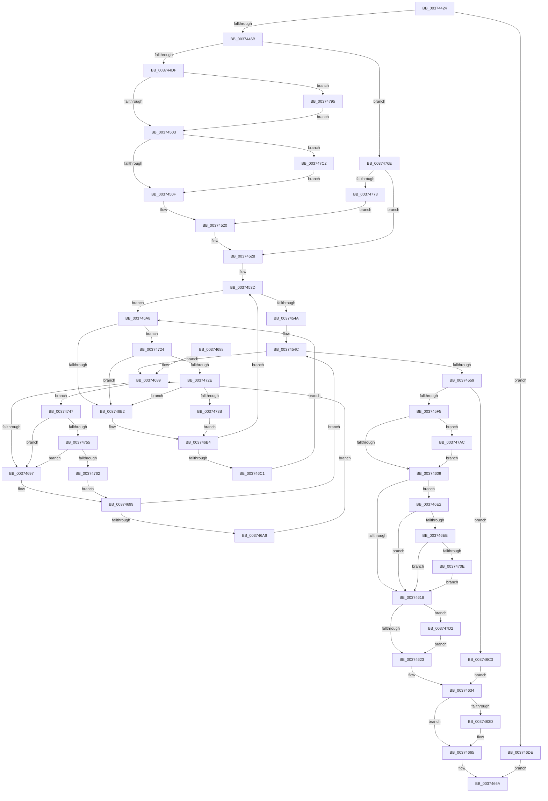

# MiTradeActivePage

- RVA: `0x00374424`–`0x003747E2` (길이 `958` bytes)
- VA: `0x0000000140374424`
- 실행 섹션: `.text`
- PDB 이름 있음: `예`; PDB Function 태그: `아니요`
- unwind 정보 RVA: `0x0007AAE4`
- 디코드: `230`개 명령, `958/958` bytes 표시
- 미해석 바이트: `0` (있으면 어셈블리에 `.byte`로 보존)

> 이 문서는 커널 이미지의 기계어와 PDB 기호를 분석해 생성했습니다. 4번과 5번은 함수 원형과 자료형을 바이너리 사용 방식에서 추정한 C 해석이며 원본 소스 복구 결과는 아닙니다.

## 1. Dependencies

- 직접 호출 지점: **22**; 고유 호출 대상: **16**
- 직접 호출자로 확인된 함수: **5**
- RIP 상대 이미지 참조: **3**

### Outgoing calls
- `0x0037445E` → [MiActivePageTradeable](MiActivePageTradeable_function_003747F0.md) (function, `0x003747F0`)
- `0x003744CD` → [MI_READ_PTE_LOCK_FREE](../28/MI_READ_PTE_LOCK_FREE_function_002828A0.md) (function, `0x002828A0`)
- `0x003744F6` → [MiPteInShadowRange](../23/MiPteInShadowRange_function_0023FB00.md) (function, `0x0023FB00`)
- `0x00374523` → [MiFlushSingleTbEntry](../28/MiFlushSingleTbEntry_function_0028E730.md) (function, `0x0028E730`)
- `0x00374569` → [MiFinalizePageAttribute](../33/MiFinalizePageAttribute_function_00332E30.md) (function, `0x00332E30`)
- `0x00374574` → [MiCopyPfnEntryEx](../2B/MiCopyPfnEntryEx_function_002B2670.md) (function, `0x002B2670`)
- `0x00374587` → [MiCopyPage](../2B/MiCopyPage_function_002B1B30.md) (function, `0x002B1B30`)
- `0x003745C4` → [MiClearPfnReuseFields](MiClearPfnReuseFields_function_003759F0.md) (function, `0x003759F0`)
- `0x003745FC` → [MiPteInShadowRange](../23/MiPteInShadowRange_function_0023FB00.md) (function, `0x0023FB00`)
- `0x0037462F` → [MiFlushSingleTbEntry](../28/MiFlushSingleTbEntry_function_0028E730.md) (function, `0x0028E730`)
- `0x00374660` → [MiWriteValidPteNewPage](MiWriteValidPteNewPage_function_00376068.md) (function, `0x00376068`)
- `0x003746D4` → [MiTransformValidPteInPlace](MiTransformValidPteInPlace_function_003765E0.md) (function, `0x003765E0`)
- `0x0037471A` → [MiCheckLinearProtectedPteAccessedBit](../29/MiCheckLinearProtectedPteAccessedBit_function_00292D80.md) (function, `0x00292D80`)
- `0x0037472E` → [KiCheckVpBackingLongSpinWaitHypercall](../30/KiCheckVpBackingLongSpinWaitHypercall_function_0030F490.md) (function, `0x0030F490`)
- `0x0037473D` → [HvlNotifyLongSpinWait](../30/HvlNotifyLongSpinWait_function_0030F460.md) (function, `0x0030F460`)
- `0x00374755` → [KiCheckVpBackingLongSpinWaitHypercall](../30/KiCheckVpBackingLongSpinWaitHypercall_function_0030F490.md) (function, `0x0030F490`)
- `0x00374764` → [HvlNotifyLongSpinWait](../30/HvlNotifyLongSpinWait_function_0030F460.md) (function, `0x0030F460`)
- `0x00374782` → [MiWriteValidPteNewProtection](../28/MiWriteValidPteNewProtection_function_00281810.md) (function, `0x00281810`)
- `0x0037479A` → [MiSanitizeShadowPxe](../29/MiSanitizeShadowPxe_function_00294B68.md) (function, `0x00294B68`)
- `0x003747B1` → [MiSanitizeShadowPxe](../29/MiSanitizeShadowPxe_function_00294B68.md) (function, `0x00294B68`)
- `0x003747C8` → [MiWritePteShadow](../29/MiWritePteShadow_function_00294EAC.md) (function, `0x00294EAC`)
- `0x003747D8` → [MiWritePteShadow](../29/MiWritePteShadow_function_00294EAC.md) (function, `0x00294EAC`)

### Direct callers
- [MiLockCode](../36/MiLockCode_function_0036F91C.md) at `0x0036FEAD`
- [MiReplaceLockedPage](../38/MiReplaceLockedPage_function_0038351C.md) at `0x00383683`
- [MiCompleteSecureProcessFault](../46/MiCompleteSecureProcessFault_function_0046710C.md) at `0x0046730E`
- [MiProtectDriverSectionPte](../67/MiProtectDriverSectionPte_function_006706C0.md) at `0x00670972`
- [MiMakeVaRangePhysicallyContiguous](../69/MiMakeVaRangePhysicallyContiguous_function_006936E0.md) at `0x00693881`

### Static image references
- `0x00374609` → RVA `0x00FC6A88` (`ALMOSTRO`; read)
- `0x0037468B` → RVA `0x00FC52AC` (`ALMOSTRO`; reference)
- `0x00374724` → RVA `0x00FC6AB8` (`ALMOSTRO`; read)

## 2. Other-region calls and transfers

- 다른 실행 섹션으로 향하는 call: **0**
- 별도 외부 분기/꼬리 이동을 확인하지 못했습니다.

## 3. Assembly (complete function range)

```asm
00374424  48 8B C4                        mov rax, rsp
00374427  48 89 58 08                     mov qword ptr [rax + 8], rbx
0037442B  48 89 68 10                     mov qword ptr [rax + 0x10], rbp
0037442F  48 89 70 18                     mov qword ptr [rax + 0x18], rsi
00374433  44 89 48 20                     mov dword ptr [rax + 0x20], r9d
00374437  57                              push rdi
00374438  41 54                           push r12
0037443A  41 55                           push r13
0037443C  41 56                           push r14
0037443E  41 57                           push r15
00374440  48 83 EC 40                     sub rsp, 0x40
00374444  45 8B E9                        mov r13d, r9d
00374447  4D 8B E0                        mov r12, r8
0037444A  44 8B 8C 24 90 00 00 00         mov r9d, dword ptr [rsp + 0x90]
00374452  4C 8B F2                        mov r14, rdx
00374455  45 8B C5                        mov r8d, r13d
00374458  49 8B D4                        mov rdx, r12
0037445B  48 8B E9                        mov rbp, rcx
0037445E  E8 8D 03 00 00                  call 0x1403747f0
00374463  85 C0                           test eax, eax
00374465  0F 84 73 02 00 00               je 0x1403746de
0037446B  48 B9 00 00 00 00 00 DE FF FF   movabs rcx, 0xffffde0000000000
00374475  48 8B C1                        mov rax, rcx
00374478  4D 8B FE                        mov r15, r14
0037447B  48 BA AB AA AA AA AA AA AA AA   movabs rdx, 0xaaaaaaaaaaaaaaab
00374485  4C 2B F8                        sub r15, rax
00374488  49 C1 FF 04                     sar r15, 4
0037448C  4C 0F AF FA                     imul r15, rdx
00374490  48 8B C1                        mov rax, rcx
00374493  48 8B CD                        mov rcx, rbp
00374496  49 8B F4                        mov rsi, r12
00374499  48 2B C8                        sub rcx, rax
0037449C  48 C1 EE 09                     shr rsi, 9
003744A0  48 B8 F8 FF FF FF 7F 00 00 00   movabs rax, 0x7ffffffff8
003744AA  48 C1 F9 04                     sar rcx, 4
003744AE  48 0F AF CA                     imul rcx, rdx
003744B2  48 23 F0                        and rsi, rax
003744B5  48 B8 00 00 00 00 80 F6 FF FF   movabs rax, 0xfffff68000000000
003744BF  48 89 4C 24 38                  mov qword ptr [rsp + 0x38], rcx
003744C4  48 8B C0                        mov rax, rax
003744C7  48 03 F0                        add rsi, rax
003744CA  48 8B CE                        mov rcx, rsi
003744CD  E8 CE E3 F0 FF                  call 0x1402828a0
003744D2  48 8B F8                        mov rdi, rax
003744D5  41 83 FD 02                     cmp r13d, 2
003744D9  0F 84 8F 02 00 00               je 0x14037476e
003744DF  48 8B D8                        mov rbx, rax
003744E2  48 8B CE                        mov rcx, rsi
003744E5  48 83 E3 FE                     and rbx, 0xfffffffffffffffe
003744E9  45 33 ED                        xor r13d, r13d
003744EC  48 0F BA EB 0A                  bts rbx, 0xa
003744F1  48 89 5C 24 30                  mov qword ptr [rsp + 0x30], rbx
003744F6  E8 05 B6 EC FF                  call 0x14023fb00
003744FB  85 C0                           test eax, eax
003744FD  0F 85 92 02 00 00               jne 0x140374795
00374503  48 89 1E                        mov qword ptr [rsi], rbx
00374506  45 85 ED                        test r13d, r13d
00374509  0F 85 B3 02 00 00               jne 0x1403747c2
0037450F  44 8B AC 24 88 00 00 00         mov r13d, dword ptr [rsp + 0x88]
00374517  41 B8 01 00 00 00               mov r8d, 1
0037451D  41 8B D5                        mov edx, r13d
00374520  49 8B CC                        mov rcx, r12
00374523  E8 08 A2 F1 FF                  call 0x14028e730
00374528  8B 45 20                        mov eax, dword ptr [rbp + 0x20]
0037452B  C1 E8 10                        shr eax, 0x10
0037452E  0F B6 C0                        movzx eax, al
00374531  C1 E8 06                        shr eax, 6
00374534  89 84 24 90 00 00 00            mov dword ptr [rsp + 0x90], eax
0037453B  33 DB                           xor ebx, ebx
0037453D  F0 48 0F BA 6D 18 3F            lock bts qword ptr [rbp + 0x18], 0x3f
00374544  0F 82 5E 01 00 00               jb 0x1403746a8
0037454A  33 DB                           xor ebx, ebx
0037454C  F0 49 0F BA 6E 18 3F            lock bts qword ptr [r14 + 0x18], 0x3f
00374553  0F 82 30 01 00 00               jb 0x140374689
00374559  8B 94 24 90 00 00 00            mov edx, dword ptr [rsp + 0x90]
00374560  41 B8 01 00 00 00               mov r8d, 1
00374566  49 8B CE                        mov rcx, r14
00374569  E8 C2 E8 FB FF                  call 0x140332e30
0037456E  48 8B D5                        mov rdx, rbp
00374571  49 8B CE                        mov rcx, r14
00374574  E8 F7 E0 F3 FF                  call 0x1402b2670
00374579  48 8B 54 24 38                  mov rdx, qword ptr [rsp + 0x38]
0037457E  41 B8 06 00 00 00               mov r8d, 6
00374584  49 8B CF                        mov rcx, r15
00374587  E8 A4 D5 F3 FF                  call 0x1402b1b30
0037458C  49 B9 FF FF FF FF FF FF FF 7F   movabs r9, 0x7fffffffffffffff
00374596  F0 4D 21 4E 18                  lock and qword ptr [r14 + 0x18], r9
0037459B  80 65 23 F7                     and byte ptr [rbp + 0x23], 0xf7
0037459F  48 8B CD                        mov rcx, rbp
003745A2  8B 45 20                        mov eax, dword ptr [rbp + 0x20]
003745A5  89 84 24 90 00 00 00            mov dword ptr [rsp + 0x90], eax
003745AC  C1 E8 10                        shr eax, 0x10
003745AF  24 FD                           and al, 0xfd
003745B1  0C 05                           or al, 5
003745B3  88 84 24 92 00 00 00            mov byte ptr [rsp + 0x92], al
003745BA  8B 84 24 90 00 00 00            mov eax, dword ptr [rsp + 0x90]
003745C1  89 45 20                        mov dword ptr [rbp + 0x20], eax
003745C4  E8 27 14 00 00                  call 0x1403759f0
003745C9  F0 4C 21 4D 18                  lock and qword ptr [rbp + 0x18], r9
003745CE  49 C1 E7 0C                     shl r15, 0xc
003745D2  48 BD FF 0F 00 00 00 00 F0 FF   movabs rbp, 0xfff0000000000fff
003745DC  49 8B DF                        mov rbx, r15
003745DF  48 8B CE                        mov rcx, rsi
003745E2  48 33 DF                        xor rbx, rdi
003745E5  48 23 DD                        and rbx, rbp
003745E8  49 33 DF                        xor rbx, r15
003745EB  41 83 FD 02                     cmp r13d, 2
003745EF  0F 84 CE 00 00 00               je 0x1403746c3
003745F5  48 89 5C 24 38                  mov qword ptr [rsp + 0x38], rbx
003745FA  33 FF                           xor edi, edi
003745FC  E8 FF B4 EC FF                  call 0x14023fb00
00374601  85 C0                           test eax, eax
00374603  0F 85 A3 01 00 00               jne 0x1403747ac
00374609  48 0F BA 25 76 24 C5 00 24      bt qword ptr [rip + 0xc52476], 0x24
00374612  0F 82 CA 00 00 00               jb 0x1403746e2
00374618  48 89 1E                        mov qword ptr [rsi], rbx
0037461B  85 FF                           test edi, edi
0037461D  0F 85 AF 01 00 00               jne 0x1403747d2
00374623  41 B8 40 00 00 00               mov r8d, 0x40
00374629  41 8B D5                        mov edx, r13d
0037462C  49 8B CC                        mov rcx, r12
0037462F  E8 FC A0 F1 FF                  call 0x14028e730
00374634  49 8B 46 28                     mov rax, qword ptr [r14 + 0x28]
00374638  48 85 C0                        test rax, rax
0037463B  79 28                           jns 0x140374665
0037463D  49 8B 4E 08                     mov rcx, qword ptr [r14 + 8]
00374641  48 B8 00 00 00 00 00 00 00 80   movabs rax, 0x8000000000000000
0037464B  48 0B C8                        or rcx, rax
0037464E  49 8B D7                        mov rdx, r15
00374651  4C 8B 01                        mov r8, qword ptr [rcx]
00374654  49 33 D0                        xor rdx, r8
00374657  45 33 C0                        xor r8d, r8d
0037465A  48 23 D5                        and rdx, rbp
0037465D  49 33 D7                        xor rdx, r15
00374660  E8 03 1A 00 00                  call 0x140376068
00374665  B8 01 00 00 00                  mov eax, 1
0037466A  4C 8D 5C 24 40                  lea r11, [rsp + 0x40]
0037466F  49 8B 5B 30                     mov rbx, qword ptr [r11 + 0x30]
00374673  49 8B 6B 38                     mov rbp, qword ptr [r11 + 0x38]
00374677  49 8B 73 40                     mov rsi, qword ptr [r11 + 0x40]
0037467B  49 8B E3                        mov rsp, r11
0037467E  41 5F                           pop r15
00374680  41 5E                           pop r14
00374682  41 5D                           pop r13
00374684  41 5C                           pop r12
00374686  5F                              pop rdi
00374687  C3                              ret
00374688  CC                              int3
00374689  FF C3                           inc ebx
0037468B  85 1D 1B 0C C5 00               test dword ptr [rip + 0xc50c1b], ebx
00374691  0F 84 B0 00 00 00               je 0x140374747
00374697  F3 90                           pause
00374699  49 8B 46 18                     mov rax, qword ptr [r14 + 0x18]
0037469D  48 85 C0                        test rax, rax
003746A0  0F 89 A6 FE FF FF               jns 0x14037454c
003746A6  EB E1                           jmp 0x140374689
003746A8  FF C3                           inc ebx
003746AA  85 1D FC 0B C5 00               test dword ptr [rip + 0xc50bfc], ebx
003746B0  74 72                           je 0x140374724
003746B2  F3 90                           pause
003746B4  48 8B 45 18                     mov rax, qword ptr [rbp + 0x18]
003746B8  48 85 C0                        test rax, rax
003746BB  0F 89 7C FE FF FF               jns 0x14037453d
003746C1  EB E5                           jmp 0x1403746a8
003746C3  83 64 24 20 00                  and dword ptr [rsp + 0x20], 0
003746C8  41 B9 40 00 00 00               mov r9d, 0x40
003746CE  4C 8B C3                        mov r8, rbx
003746D1  48 8B D6                        mov rdx, rsi
003746D4  E8 07 1F 00 00                  call 0x1403765e0
003746D9  E9 56 FF FF FF                  jmp 0x140374634
003746DE  33 C0                           xor eax, eax
003746E0  EB 88                           jmp 0x14037466a
003746E2  F6 C3 20                        test bl, 0x20
003746E5  0F 85 2D FF FF FF               jne 0x140374618
003746EB  48 B8 00 00 00 00 80 F6 FF FF   movabs rax, 0xfffff68000000000
003746F5  48 8B C8                        mov rcx, rax
003746F8  48 B8 00 00 00 00 40 00 00 00   movabs rax, 0x4000000000
00374702  48 03 C8                        add rcx, rax
00374705  48 3B F1                        cmp rsi, rcx
00374708  0F 82 0A FF FF FF               jb 0x140374618
0037470E  41 B8 80 00 00 00               mov r8d, 0x80
00374714  48 8B D3                        mov rdx, rbx
00374717  48 8B CE                        mov rcx, rsi
0037471A  E8 61 E6 F1 FF                  call 0x140292d80
0037471F  E9 F4 FE FF FF                  jmp 0x140374618
00374724  8B 05 8E 23 C5 00               mov eax, dword ptr [rip + 0xc5238e]
0037472A  A8 40                           test al, 0x40
0037472C  74 84                           je 0x1403746b2
0037472E  E8 5D AD F9 FF                  call 0x14030f490
00374733  84 C0                           test al, al
00374735  0F 84 77 FF FF FF               je 0x1403746b2
0037473B  8B CB                           mov ecx, ebx
0037473D  E8 1E AD F9 FF                  call 0x14030f460
00374742  E9 6D FF FF FF                  jmp 0x1403746b4
00374747  8B 05 6B 23 C5 00               mov eax, dword ptr [rip + 0xc5236b]
0037474D  A8 40                           test al, 0x40
0037474F  0F 84 42 FF FF FF               je 0x140374697
00374755  E8 36 AD F9 FF                  call 0x14030f490
0037475A  84 C0                           test al, al
0037475C  0F 84 35 FF FF FF               je 0x140374697
00374762  8B CB                           mov ecx, ebx
00374764  E8 F7 AC F9 FF                  call 0x14030f460
00374769  E9 2B FF FF FF                  jmp 0x140374699
0037476E  40 F6 C7 42                     test dil, 0x42
00374772  0F 84 B0 FD FF FF               je 0x140374528
00374778  48 8B D7                        mov rdx, rdi
0037477B  48 8B CE                        mov rcx, rsi
0037477E  48 83 E2 BD                     and rdx, 0xffffffffffffffbd
00374782  E8 89 D0 F0 FF                  call 0x140281810
00374787  BA 02 00 00 00                  mov edx, 2
0037478C  44 8D 42 08                     lea r8d, [rdx + 8]
00374790  E9 8B FD FF FF                  jmp 0x140374520
00374795  48 8D 54 24 30                  lea rdx, [rsp + 0x30]
0037479A  E8 C9 03 F2 FF                  call 0x140294b68
0037479F  48 8B 5C 24 30                  mov rbx, qword ptr [rsp + 0x30]
003747A4  44 8B E8                        mov r13d, eax
003747A7  E9 57 FD FF FF                  jmp 0x140374503
003747AC  48 8D 54 24 38                  lea rdx, [rsp + 0x38]
003747B1  E8 B2 03 F2 FF                  call 0x140294b68
003747B6  48 8B 5C 24 38                  mov rbx, qword ptr [rsp + 0x38]
003747BB  8B F8                           mov edi, eax
003747BD  E9 47 FE FF FF                  jmp 0x140374609
003747C2  48 8B D3                        mov rdx, rbx
003747C5  48 8B CE                        mov rcx, rsi
003747C8  E8 DF 06 F2 FF                  call 0x140294eac
003747CD  E9 3D FD FF FF                  jmp 0x14037450f
003747D2  48 8B D3                        mov rdx, rbx
003747D5  48 8B CE                        mov rcx, rsi
003747D8  E8 CF 06 F2 FF                  call 0x140294eac
003747DD  E9 41 FE FF FF                  jmp 0x140374623
```

## 4. C-style interpretation (structured pseudocode)

```c
__int64 __fastcall MiTradeActivePage(__int64 a1, __int64 a2, __int64 a3, int a4, unsigned int a5)
{
    __int64 result;
    __int64 v_r13;
    __int64 v_r15;
    __int64 v_rbx;
    __int64 v_rdi;
    __int64 v_rsi;
    __int64 v_rsp;
    unsigned __int64 v_stack_m10;
    unsigned int v_stack_m20;
    unsigned __int64 v_stack_m28;
    unsigned __int64 v_stack_m30;
    unsigned __int64 v_stack_m38;
    unsigned __int64 v_stack_m8;
    unsigned int v_stack_p20;
    unsigned int v_stack_p28;
    unsigned __int8 v_stack_p2A;

    *(unsigned __int64 *)(v_rsp + 8) = v_rbx;
    *(unsigned __int64 *)(v_rsp + 16) = v_rbp;
    *(unsigned __int64 *)(v_rsp + 24) = v_rsi;
    *(unsigned int *)(v_rsp + 32) = a4;
    v_rsp = (v_rsp) - (64);
    result = MiActivePageTradeable(a1, a3, (unsigned int)((unsigned int)((unsigned int)(a4))), (unsigned int)(a5));
    if ((unsigned int)(result) == 0) goto loc_003746DE;
    v_r15 = (a2) - (a1);
    v_r15 = (v_r15) >> (4);
    v_r15 = (v_r15) * (a3);
    a1 = (a1) - (a1);
    v_rsi = (a3) >> (9);
    a1 = (a1) >> (4);
    a1 = (a1) * (a3);
    v_rsi = (v_rsi) & (a1);
    v_stack_m30 = a1;
    v_rsi = (v_rsi) + (a1);
    result = MI_READ_PTE_LOCK_FREE(v_rsi, a3, (unsigned int)((unsigned int)((unsigned int)(a4))), (unsigned int)(a5));
    if (((unsigned int)((unsigned int)(a4))) == 2) goto loc_0037476E;
    v_rbx = (result) & (-2);
    v_r13 = 0;
    v_stack_m38 = v_rbx;
    result = MiPteInShadowRange(v_rsi, a3, (unsigned int)((unsigned int)((unsigned int)(a4))), (unsigned int)(a5));
    if ((unsigned int)(result) != 0) goto loc_00374795;
loc_00374503:
    *(unsigned __int64 *)(v_rsi) = v_rbx;
    if (0 != 0) goto loc_003747C2;
loc_0037450F:
loc_00374520:
    result = MiFlushSingleTbEntry(a3, (unsigned int)((unsigned int)((unsigned int)(v_stack_p20))), 1, (unsigned int)(a5));
loc_00374528:
    result = (unsigned int)(((unsigned int)(*(unsigned int *)(a1 + 32))) >> (16));
    result = (unsigned int)(((unsigned __int8)(result)) >> (6));
    v_stack_p28 = (unsigned int)(result);
    v_rbx = 0;
loc_0037453D:
    if (condition_is_below) goto loc_003746A8;
    v_rbx = 0;
loc_0037454C:
    if (condition_is_below) goto loc_00374689;
    result = MiFinalizePageAttribute(a2, (unsigned int)(a5), 1, (unsigned int)(a5));
    result = MiCopyPfnEntryEx(a2, a1, 1, (unsigned int)(a5));
    result = MiCopyPage(v_r15, v_stack_m30, 6, (unsigned int)(a5));
    v_stack_p28 = (unsigned int)((unsigned int)(*(unsigned int *)(a1 + 32)));
    result = (unsigned int)(((unsigned int)(*(unsigned int *)(a1 + 32))) >> (16));
    result = (unsigned __int8)((result) & (253));
    result = (unsigned __int8)((result) | (5));
    v_stack_p2A = (unsigned __int8)(result);
    *(unsigned int *)(a1 + 32) = (unsigned int)((unsigned int)(a5));
    result = MiClearPfnReuseFields(a1, v_stack_m30, 6, (unsigned int)(a5));
    v_r15 = (v_r15) << (12);
    v_rbx = (v_r15) ^ (result);
    v_rbx = (v_rbx) & (a1);
    v_rbx = (v_rbx) ^ (v_r15);
    if (((unsigned int)((unsigned int)(v_stack_p20))) == 2) goto loc_003746C3;
    v_stack_m30 = v_rbx;
    v_rdi = 0;
    result = MiPteInShadowRange(v_rsi, v_stack_m30, 6, (unsigned int)(a5));
    if ((unsigned int)(result) != 0) goto loc_003747AC;
loc_00374609:
    if (condition_is_below) goto loc_003746E2;
loc_00374618:
    *(unsigned __int64 *)(v_rsi) = v_rbx;
    if (0 != 0) goto loc_003747D2;
loc_00374623:
    result = MiFlushSingleTbEntry(a3, (unsigned int)((unsigned int)((unsigned int)(v_stack_p20))), 64, (unsigned int)(a5));
loc_00374634:
    result = *(unsigned __int64 *)(a2 + 40);
    if (sign_flag) {
        a1 = *(unsigned __int64 *)(a2 + 8);
        a1 = (a1) | (*(unsigned __int64 *)(a2 + 40));
        a2 = v_r15;
        a3 = *(unsigned __int64 *)(a1);
        a2 = (a2) ^ (a3);
        a3 = 0;
        a2 = (a2) & (a1);
        a2 = (a2) ^ (v_r15);
        result = MiWriteValidPteNewPage(a1, a2, a3, (unsigned int)(a5));
    }
loc_0037466A:
    return 1;
loc_00374689:
    v_rbx = (unsigned int)((*(unsigned __int64 *)(v_stack_m28 + 48)) + 1);
    if (((*(unsigned int *)(v_rip + 12913691)) & ((unsigned int)(v_rbx))) == 0) goto loc_00374747;
loc_00374697:
loc_00374699:
    if (!sign_flag) goto loc_0037454C;
    goto loc_00374689;
loc_003746A8:
    v_rbx = (unsigned int)((v_rbx) + 1);
    if (((*(unsigned int *)(v_rip + 12913660)) & ((unsigned int)(v_rbx))) == 0) goto loc_00374724;
loc_003746B2:
loc_003746B4:
    if (!sign_flag) goto loc_0037453D;
    goto loc_003746A8;
loc_003746C3:
    result = MiTransformValidPteInPlace(a1, *(unsigned __int64 *)(v_stack_m28 + 64), v_rbx, 64);
    goto loc_00374634;
loc_003746DE:
    result = 0;
    goto loc_0037466A;
loc_003746E2:
    if ((((unsigned __int8)(v_rbx)) & (32)) != 0) goto loc_00374618;
    a1 = (0) + (0);
    if ((*(unsigned __int64 *)(v_stack_m28 + 64)) < a1) goto loc_00374618;
    result = MiCheckLinearProtectedPteAccessedBit(*(unsigned __int64 *)(v_stack_m28 + 64), v_rbx, 128, 64);
    goto loc_00374618;
loc_00374724:
    if ((((unsigned __int8)((unsigned int)(*(unsigned int *)(v_rip + 12919694)))) & (64)) == 0) goto loc_003746B2;
    result = KiCheckVpBackingLongSpinWaitHypercall(*(unsigned __int64 *)(v_stack_m28 + 64), v_rbx, 128, 64);
    if ((unsigned __int8)(result) == 0) goto loc_003746B2;
    result = HvlNotifyLongSpinWait((unsigned int)((unsigned int)(v_rbx)), v_rbx, 128, 64);
    goto loc_003746B4;
loc_00374747:
    if ((((unsigned __int8)((unsigned int)(*(unsigned int *)(v_rip + 12919659)))) & (64)) == 0) goto loc_00374697;
    result = KiCheckVpBackingLongSpinWaitHypercall((unsigned int)((unsigned int)(v_rbx)), v_rbx, 128, 64);
    if ((unsigned __int8)(result) == 0) goto loc_00374697;
    result = HvlNotifyLongSpinWait((unsigned int)((unsigned int)(v_rbx)), v_rbx, 128, 64);
    goto loc_00374699;
loc_0037476E:
    if (((0) & (66)) == 0) goto loc_00374528;
    a2 = (0) & (-67);
    result = MiWriteValidPteNewProtection(*(unsigned __int64 *)(v_stack_m28 + 64), a2, 128, 64);
    goto loc_00374520;
loc_00374795:
    result = MiSanitizeShadowPxe(*(unsigned __int64 *)(v_stack_m28 + 64), v_stack_m10, 2 + 8, 64);
    goto loc_00374503;
loc_003747AC:
    result = MiSanitizeShadowPxe(*(unsigned __int64 *)(v_stack_m28 + 64), v_stack_m8, 2 + 8, 64);
    goto loc_00374609;
loc_003747C2:
    result = MiWritePteShadow(*(unsigned __int64 *)(v_stack_m28 + 64), v_stack_m8, 2 + 8, 64);
    goto loc_0037450F;
loc_003747D2:
    result = MiWritePteShadow(*(unsigned __int64 *)(v_stack_m28 + 64), v_stack_m8, 2 + 8, 64);
    goto loc_00374623;
}
```

## 5. (Beta) C Style

```c
int64_t MiTradeActivePage(void *Arg1, void *Arg2, int64_t Arg3, int32_t Arg4, uint32_t Arg5)
{
    uint8_t *arg1 = (uint8_t *)Arg1;
    uint8_t *arg2 = (uint8_t *)Arg2;

    int64_t result;
    int64_t local_r13;
    int64_t local_r15;
    int64_t local_rbx;
    int64_t local_rdi;
    int64_t local_rsi;
    int64_t local_rsp;
    uint64_t v_stack_m10;
    uint32_t v_stack_m20;
    uint64_t v_stack_m28;
    uint64_t v_stack_m30;
    uint64_t v_stack_m38;
    uint64_t v_stack_m8;
    uint32_t v_stack_p20;
    uint32_t v_stack_p28;
    uint8_t v_stack_p2A;

    *(uint64_t *)(local_rsp + 0x8) = local_rbx;
    *(uint64_t *)(local_rsp + 0x10) = local_rbp;
    *(uint64_t *)(local_rsp + 0x18) = local_rsi;
    *(uint32_t *)(local_rsp + 0x20) = Arg4;
    local_rsp = (local_rsp) - (64);
    result = MiActivePageTradeable(Arg1, Arg3, (uint32_t)((uint32_t)((uint32_t)(Arg4))), (uint32_t)(Arg5));
    if ((uint32_t)(result) == 0) goto loc_003746DE;
    local_r15 = (Arg2) - (Arg1);
    local_r15 = (local_r15) >> (4);
    local_r15 = (local_r15) * (Arg3);
    Arg1 = (Arg1) - (Arg1);
    local_rsi = (Arg3) >> (9);
    Arg1 = (Arg1) >> (4);
    Arg1 = (Arg1) * (Arg3);
    local_rsi = (local_rsi) & (Arg1);
    v_stack_m30 = Arg1;
    local_rsi = (local_rsi) + (Arg1);
    result = MI_READ_PTE_LOCK_FREE(local_rsi, Arg3, (uint32_t)((uint32_t)((uint32_t)(Arg4))), (uint32_t)(Arg5));
    if (((uint32_t)((uint32_t)(Arg4))) == 2) goto loc_0037476E;
    local_rbx = (result) & (-2);
    local_r13 = 0;
    v_stack_m38 = local_rbx;
    result = MiPteInShadowRange(local_rsi, Arg3, (uint32_t)((uint32_t)((uint32_t)(Arg4))), (uint32_t)(Arg5));
    if ((uint32_t)(result) != 0) goto loc_00374795;
loc_00374503:
    *(uint64_t *)(local_rsi) = local_rbx;
    if (0 != 0) goto loc_003747C2;
loc_0037450F:
loc_00374520:
    result = MiFlushSingleTbEntry(Arg3, (uint32_t)((uint32_t)((uint32_t)(v_stack_p20))), 1, (uint32_t)(Arg5));
loc_00374528:
    result = (uint32_t)(((uint32_t)(*(uint32_t *)(arg1 + 0x20))) >> (16));
    result = (uint32_t)(((uint8_t)(result)) >> (6));
    v_stack_p28 = (uint32_t)(result);
    local_rbx = 0;
loc_0037453D:
    if (condition_is_below) goto loc_003746A8;
    local_rbx = 0;
loc_0037454C:
    if (condition_is_below) goto loc_00374689;
    result = MiFinalizePageAttribute(Arg2, (uint32_t)(Arg5), 1, (uint32_t)(Arg5));
    result = MiCopyPfnEntryEx(Arg2, Arg1, 1, (uint32_t)(Arg5));
    result = MiCopyPage(local_r15, v_stack_m30, 6, (uint32_t)(Arg5));
    v_stack_p28 = (uint32_t)((uint32_t)(*(uint32_t *)(arg1 + 0x20)));
    result = (uint32_t)(((uint32_t)(*(uint32_t *)(arg1 + 0x20))) >> (16));
    result = (uint8_t)((result) & (253));
    result = (uint8_t)((result) | (5));
    v_stack_p2A = (uint8_t)(result);
    *(uint32_t *)(arg1 + 0x20) = (uint32_t)((uint32_t)(Arg5));
    result = MiClearPfnReuseFields(Arg1, v_stack_m30, 6, (uint32_t)(Arg5));
    local_r15 = (local_r15) << (12);
    local_rbx = (local_r15) ^ (result);
    local_rbx = (local_rbx) & (Arg1);
    local_rbx = (local_rbx) ^ (local_r15);
    if (((uint32_t)((uint32_t)(v_stack_p20))) == 2) goto loc_003746C3;
    v_stack_m30 = local_rbx;
    local_rdi = 0;
    result = MiPteInShadowRange(local_rsi, v_stack_m30, 6, (uint32_t)(Arg5));
    if ((uint32_t)(result) != 0) goto loc_003747AC;
loc_00374609:
    if (condition_is_below) goto loc_003746E2;
loc_00374618:
    *(uint64_t *)(local_rsi) = local_rbx;
    if (0 != 0) goto loc_003747D2;
loc_00374623:
    result = MiFlushSingleTbEntry(Arg3, (uint32_t)((uint32_t)((uint32_t)(v_stack_p20))), 64, (uint32_t)(Arg5));
loc_00374634:
    result = *(uint64_t *)(arg2 + 0x28);
    if (sign_flag) {
        Arg1 = *(uint64_t *)(arg2 + 0x8);
        Arg1 = (Arg1) | (*(uint64_t *)(arg2 + 0x28));
        Arg2 = local_r15;
        Arg3 = *(uint64_t *)(arg1);
        Arg2 = (Arg2) ^ (Arg3);
        Arg3 = 0;
        Arg2 = (Arg2) & (Arg1);
        Arg2 = (Arg2) ^ (local_r15);
        result = MiWriteValidPteNewPage(Arg1, Arg2, Arg3, (uint32_t)(Arg5));
    }
loc_0037466A:
    return 1;
loc_00374689:
    local_rbx = (uint32_t)((*(uint64_t *)(v_stack_m28 + 0x30)) + 1);
    if (((*(uint32_t *)(v_rip + 0xC50C1B)) & ((uint32_t)(local_rbx))) == 0) goto loc_00374747;
loc_00374697:
loc_00374699:
    if (!sign_flag) goto loc_0037454C;
    goto loc_00374689;
loc_003746A8:
    local_rbx = (uint32_t)((local_rbx) + 1);
    if (((*(uint32_t *)(v_rip + 0xC50BFC)) & ((uint32_t)(local_rbx))) == 0) goto loc_00374724;
loc_003746B2:
loc_003746B4:
    if (!sign_flag) goto loc_0037453D;
    goto loc_003746A8;
loc_003746C3:
    result = MiTransformValidPteInPlace(Arg1, *(uint64_t *)(v_stack_m28 + 0x40), local_rbx, 64);
    goto loc_00374634;
loc_003746DE:
    result = 0;
    goto loc_0037466A;
loc_003746E2:
    if ((((uint8_t)(local_rbx)) & (32)) != 0) goto loc_00374618;
    Arg1 = (0) + (0);
    if ((*(uint64_t *)(v_stack_m28 + 0x40)) < Arg1) goto loc_00374618;
    result = MiCheckLinearProtectedPteAccessedBit(*(uint64_t *)(v_stack_m28 + 0x40), local_rbx, 128, 64);
    goto loc_00374618;
loc_00374724:
    if ((((uint8_t)((uint32_t)(*(uint32_t *)(v_rip + 0xC5238E)))) & (64)) == 0) goto loc_003746B2;
    result = KiCheckVpBackingLongSpinWaitHypercall(*(uint64_t *)(v_stack_m28 + 0x40), local_rbx, 128, 64);
    if ((uint8_t)(result) == 0) goto loc_003746B2;
    result = HvlNotifyLongSpinWait((uint32_t)((uint32_t)(local_rbx)), local_rbx, 128, 64);
    goto loc_003746B4;
loc_00374747:
    if ((((uint8_t)((uint32_t)(*(uint32_t *)(v_rip + 0xC5236B)))) & (64)) == 0) goto loc_00374697;
    result = KiCheckVpBackingLongSpinWaitHypercall((uint32_t)((uint32_t)(local_rbx)), local_rbx, 128, 64);
    if ((uint8_t)(result) == 0) goto loc_00374697;
    result = HvlNotifyLongSpinWait((uint32_t)((uint32_t)(local_rbx)), local_rbx, 128, 64);
    goto loc_00374699;
loc_0037476E:
    if (((0) & (66)) == 0) goto loc_00374528;
    Arg2 = (0) & (-67);
    result = MiWriteValidPteNewProtection(*(uint64_t *)(v_stack_m28 + 0x40), Arg2, 128, 64);
    goto loc_00374520;
loc_00374795:
    result = MiSanitizeShadowPxe(*(uint64_t *)(v_stack_m28 + 0x40), v_stack_m10, 2 + 8, 64);
    goto loc_00374503;
loc_003747AC:
    result = MiSanitizeShadowPxe(*(uint64_t *)(v_stack_m28 + 0x40), v_stack_m8, 2 + 8, 64);
    goto loc_00374609;
loc_003747C2:
    result = MiWritePteShadow(*(uint64_t *)(v_stack_m28 + 0x40), v_stack_m8, 2 + 8, 64);
    goto loc_0037450F;
loc_003747D2:
    result = MiWritePteShadow(*(uint64_t *)(v_stack_m28 + 0x40), v_stack_m8, 2 + 8, 64);
    goto loc_00374623;
}
```

### 관측된 메모리 오프셋

구조체 형식이 확인되지 않은 접근은 인자 기준의 오프셋으로만 기록했습니다.

| 기준 인자 | 오프셋 표현 | 폭 (bit) | 접근 |
|---|---:|---:|---|
| `Arg1` | `+ 0x18` | `64` | `R` |
| `Arg1` | `+ 0x18` | `64` | `R/W` |
| `Arg1` | `+ 0x20` | `32` | `R` |
| `Arg1` | `+ 0x20` | `32` | `W` |
| `Arg1` | `+ 0x23` | `8` | `R/W` |
| `Arg2` | `+ 0x8` | `64` | `R` |
| `Arg2` | `+ 0x18` | `64` | `R` |
| `Arg2` | `+ 0x18` | `64` | `R/W` |
| `Arg2` | `+ 0x28` | `64` | `R` |

## 6. Execution-region graph

[열기: 2D/3D 그래프와 함수 탐색 컨트롤 패널](../../../control-panel.html?section=text&rva=0x00374424&view=graph)

- 2D 그래프는 위에서 아래로 흐르고, 3D 그래프는 빈 공간을 드래그해 회전합니다. Shift+드래그는 이동, 휠은 확대·축소, 함수 노드 선택은 대상 보고서 이동입니다.

### Static fallback


