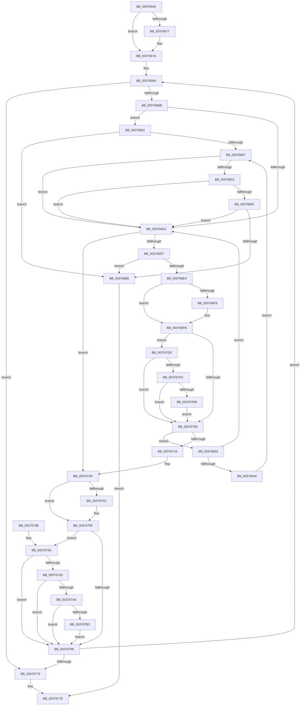

# MiTransformValidPteUsingAccessedBit

- RVA: `0x00376640`–`0x0037686F` (길이 `559` bytes)
- VA: `0x0000000140376640`
- 실행 섹션: `.text`
- PDB 이름 있음: `예`; PDB Function 태그: `아니요`
- unwind 정보 RVA: `0x0007AC48`
- 디코드: `124`개 명령, `559/559` bytes 표시
- 미해석 바이트: `0` (있으면 어셈블리에 `.byte`로 보존)

> 이 문서는 커널 이미지의 기계어와 PDB 기호를 분석해 생성했습니다. 4번과 5번은 함수 원형과 자료형을 바이너리 사용 방식에서 추정한 C 해석이며 원본 소스 복구 결과는 아닙니다.

## 1. Dependencies

- 직접 호출 지점: **3**; 고유 호출 대상: **2**
- 직접 호출자로 확인된 함수: **2**
- RIP 상대 이미지 참조: **1**

### Outgoing calls
- `0x00376729` → [MiFlushValidPteFromTb](MiFlushValidPteFromTb_function_00376878.md) (function, `0x00376878`)
- `0x003767BF` → [MiCheckLinearProtectedPteAccessedBit](../29/MiCheckLinearProtectedPteAccessedBit_function_00292D80.md) (function, `0x00292D80`)
- `0x003767F7` → [MiCheckLinearProtectedPteAccessedBit](../29/MiCheckLinearProtectedPteAccessedBit_function_00292D80.md) (function, `0x00292D80`)

### Direct callers
- [MiTransformValidPteInPlace](MiTransformValidPteInPlace_function_003765E0.md) at `0x00376608`
- [MiTradeBootImagePage](../../init/C6/MiTradeBootImagePage_function_00C6C554.md) at `0x00C6C692`

### Static image references
- `0x00376660` → RVA `0x00FC6A88` (`ALMOSTRO`; read)

## 2. Other-region calls and transfers

- 다른 실행 섹션으로 향하는 call: **0**
- 별도 외부 분기/꼬리 이동을 확인하지 못했습니다.

## 3. Assembly (complete function range)

```asm
00376640  48 8B C4                        mov rax, rsp
00376643  48 89 58 08                     mov qword ptr [rax + 8], rbx
00376647  48 89 68 10                     mov qword ptr [rax + 0x10], rbp
0037664B  48 89 70 18                     mov qword ptr [rax + 0x18], rsi
0037664F  44 89 48 20                     mov dword ptr [rax + 0x20], r9d
00376653  57                              push rdi
00376654  41 54                           push r12
00376656  41 55                           push r13
00376658  41 56                           push r14
0037665A  41 57                           push r15
0037665C  48 83 EC 20                     sub rsp, 0x20
00376660  4C 8B 25 21 04 C5 00            mov r12, qword ptr [rip + 0xc50421]
00376667  49 8B F0                        mov rsi, r8
0037666A  4C 8B FA                        mov r15, rdx
0037666D  4C 8B F1                        mov r14, rcx
00376670  49 0F BA E4 19                  bt r12, 0x19
00376675  73 03                           jae 0x14037667a
00376677  0F AE E8                        lfence
0037667A  48 8B 39                        mov rdi, qword ptr [rcx]
0037667D  45 33 ED                        xor r13d, r13d
00376680  49 B9 00 00 00 00 10 00 00 00   movabs r9, 0x1000000000
0037668A  49 BA 00 00 00 00 40 00 00 00   movabs r10, 0x4000000000
00376694  49 B8 00 00 00 00 80 F6 FF FF   movabs r8, 0xfffff68000000000
0037669E  48 BA FF FF FF 7F FB F6 FF FF   movabs rdx, 0xfffff6fb7fffffff
003766A8  48 B9 00 00 00 40 FB F6 FF FF   movabs rcx, 0xfffff6fb40000000
003766B2  48 3B FE                        cmp rdi, rsi
003766B5  0F 84 BE 00 00 00               je 0x140376779
003766BB  49 8B EC                        mov rbp, r12
003766BE  81 E5 00 00 00 0C               and ebp, 0xc000000
003766C4  48 81 FD 00 00 00 04            cmp rbp, 0x4000000
003766CB  0F 86 71 01 00 00               jbe 0x140376842
003766D1  40 F6 C7 20                     test dil, 0x20
003766D5  74 78                           je 0x14037674f
003766D7  41 FF C5                        inc r13d
003766DA  41 83 FD 10                     cmp r13d, 0x10
003766DE  0F 84 84 01 00 00               je 0x140376868
003766E4  48 8B DF                        mov rbx, rdi
003766E7  48 83 E3 DF                     and rbx, 0xffffffffffffffdf
003766EB  48 F7 05 92 03 C5 00 00 00 00 02  test qword ptr [rip + 0xc50392], 0x2000000
003766F6  74 03                           je 0x1403766fb
003766F8  0F AE E8                        lfence
003766FB  4C 85 0D 86 03 C5 00            test qword ptr [rip + 0xc50386], r9
00376702  0F 85 C8 00 00 00               jne 0x1403767d0
00376708  48 8B C7                        mov rax, rdi
0037670B  F0 49 0F B1 1E                  lock cmpxchg qword ptr [r14], rbx
00376710  48 8B F8                        mov rdi, rax
00376713  0F 85 1A 01 00 00               jne 0x140376833
00376719  44 8B 4C 24 70                  mov r9d, dword ptr [rsp + 0x70]
0037671E  48 8B D0                        mov rdx, rax
00376721  44 8B 44 24 68                  mov r8d, dword ptr [rsp + 0x68]
00376726  49 8B CF                        mov rcx, r15
00376729  E8 4A 01 00 00                  call 0x140376878
0037672E  49 B8 00 00 00 00 80 F6 FF FF   movabs r8, 0xfffff68000000000
00376738  49 B9 00 00 00 00 10 00 00 00   movabs r9, 0x1000000000
00376742  49 BA 00 00 00 00 40 00 00 00   movabs r10, 0x4000000000
0037674C  48 8B FB                        mov rdi, rbx
0037674F  48 F7 05 2E 03 C5 00 00 00 00 02  test qword ptr [rip + 0xc5032e], 0x2000000
0037675A  74 03                           je 0x14037675f
0037675C  0F AE E8                        lfence
0037675F  4C 85 0D 22 03 C5 00            test qword ptr [rip + 0xc50322], r9
00376766  75 34                           jne 0x14037679c
00376768  48 8B C7                        mov rax, rdi
0037676B  F0 49 0F B1 36                  lock cmpxchg qword ptr [r14], rsi
00376770  48 8B F8                        mov rdi, rax
00376773  0F 85 11 FF FF FF               jne 0x14037668a
00376779  B8 01 00 00 00                  mov eax, 1
0037677E  48 8B 5C 24 50                  mov rbx, qword ptr [rsp + 0x50]
00376783  48 8B 6C 24 58                  mov rbp, qword ptr [rsp + 0x58]
00376788  48 8B 74 24 60                  mov rsi, qword ptr [rsp + 0x60]
0037678D  48 83 C4 20                     add rsp, 0x20
00376791  41 5F                           pop r15
00376793  41 5E                           pop r14
00376795  41 5D                           pop r13
00376797  41 5C                           pop r12
00376799  5F                              pop rdi
0037679A  C3                              ret
0037679B  CC                              int3
0037679C  40 F6 C6 01                     test sil, 1
003767A0  74 C6                           je 0x140376768
003767A2  40 F6 C6 20                     test sil, 0x20
003767A6  75 C0                           jne 0x140376768
003767A8  49 8B C0                        mov rax, r8
003767AB  49 03 C2                        add rax, r10
003767AE  4C 3B F0                        cmp r14, rax
003767B1  72 B5                           jb 0x140376768
003767B3  41 B8 80 00 00 00               mov r8d, 0x80
003767B9  48 8B D6                        mov rdx, rsi
003767BC  49 8B CE                        mov rcx, r14
003767BF  E8 BC C5 F1 FF                  call 0x140292d80
003767C4  49 B9 00 00 00 00 10 00 00 00   movabs r9, 0x1000000000
003767CE  EB 98                           jmp 0x140376768
003767D0  8A C3                           mov al, bl
003767D2  24 21                           and al, 0x21
003767D4  3C 01                           cmp al, 1
003767D6  0F 85 2C FF FF FF               jne 0x140376708
003767DC  49 8B C0                        mov rax, r8
003767DF  49 03 C2                        add rax, r10
003767E2  4C 3B F0                        cmp r14, rax
003767E5  0F 82 1D FF FF FF               jb 0x140376708
003767EB  41 B8 80 00 00 00               mov r8d, 0x80
003767F1  48 8B D3                        mov rdx, rbx
003767F4  49 8B CE                        mov rcx, r14
003767F7  E8 84 C5 F1 FF                  call 0x140292d80
003767FC  48 B9 00 00 00 40 FB F6 FF FF   movabs rcx, 0xfffff6fb40000000
00376806  49 B9 00 00 00 00 10 00 00 00   movabs r9, 0x1000000000
00376810  48 BA FF FF FF 7F FB F6 FF FF   movabs rdx, 0xfffff6fb7fffffff
0037681A  49 BA 00 00 00 00 40 00 00 00   movabs r10, 0x4000000000
00376824  49 B8 00 00 00 00 80 F6 FF FF   movabs r8, 0xfffff68000000000
0037682E  E9 D5 FE FF FF                  jmp 0x140376708
00376833  48 81 FD 00 00 00 04            cmp rbp, 0x4000000
0037683A  0F 85 91 FE FF FF               jne 0x1403766d1
00376840  EB 05                           jmp 0x140376847
00376842  48 85 ED                        test rbp, rbp
00376845  74 21                           je 0x140376868
00376847  48 8B C1                        mov rax, rcx
0037684A  4C 3B F8                        cmp r15, rax
0037684D  0F 82 7E FE FF FF               jb 0x1403766d1
00376853  48 8B C2                        mov rax, rdx
00376856  4C 3B F8                        cmp r15, rax
00376859  0F 87 72 FE FF FF               ja 0x1403766d1
0037685F  40 84 FF                        test dil, dil
00376862  0F 88 69 FE FF FF               js 0x1403766d1
00376868  33 C0                           xor eax, eax
0037686A  E9 0F FF FF FF                  jmp 0x14037677e
```

## 4. C-style interpretation (structured pseudocode)

```c
__int64 __fastcall MiTransformValidPteUsingAccessedBit(__int64 a1, __int64 a2, __int64 a3, int a4, unsigned int a5)
{
    __int64 result;
    __int64 v_r13;
    __int64 v_rbp;
    __int64 v_rbx;
    __int64 v_rsp;
    unsigned __int64 v_stack_p10;
    unsigned __int64 v_stack_p18;
    unsigned int v_stack_p20;
    unsigned __int64 v_stack_p8;

    *(unsigned __int64 *)(v_rsp + 8) = v_rbx;
    *(unsigned __int64 *)(v_rsp + 16) = v_rbp;
    *(unsigned __int64 *)(v_rsp + 24) = v_rsi;
    *(unsigned int *)(v_rsp + 32) = a4;
    v_rsp = (v_rsp) - (32);
    if (!(condition_is_above_or_equal)) {
    }
    v_r13 = 0;
loc_0037668A:
    if ((*(unsigned __int64 *)(a1)) == a3) goto loc_00376779;
    v_rbp = (unsigned int)((*(unsigned __int64 *)(v_rip + 12911649)) & (0xC000000ULL));
    if (v_rbp <= 0x4000000ULL) goto loc_00376842;
loc_003766D1:
    if ((((unsigned __int8)(*(unsigned __int64 *)(a1))) & (32)) == 0) goto loc_0037674F;
    v_r13 = (unsigned int)((v_r13) + 1);
    if (((unsigned int)(v_r13)) == 16) goto loc_00376868;
    v_rbx = (*(unsigned __int64 *)(a1)) & (-33);
    if (((*(unsigned __int64 *)(v_rip + 12911506)) & (0x2000000ULL)) != 0) {
    }
    if (((*(unsigned __int64 *)(v_rip + 12911494)) & (a4)) != 0) goto loc_003767D0;
loc_00376708:
    if (((*(unsigned __int64 *)(v_rip + 12911494)) & (a4)) != 0) goto loc_00376833;
    result = MiFlushValidPteFromTb(a2, *(unsigned __int64 *)(a1), (unsigned int)(v_stack_p20), (unsigned int)(a5));
loc_0037674F:
    if (((*(unsigned __int64 *)(v_rip + 12911406)) & (0x2000000ULL)) != 0) {
    }
    if (((*(unsigned __int64 *)(v_rip + 12911394)) & ((unsigned int)(a5))) != 0) goto loc_0037679C;
loc_00376768:
    if (((*(unsigned __int64 *)(v_rip + 12911394)) & ((unsigned int)(a5))) != 0) goto loc_0037668A;
loc_00376779:
loc_0037677E:
    v_rsp = (v_rsp) + (32);
    return 1;
loc_0037679C:
    if ((((unsigned __int8)(v_stack_p18)) & (1)) == 0) goto loc_00376768;
    if ((((unsigned __int8)(v_stack_p18)) & (32)) != 0) goto loc_00376768;
    result = ((unsigned int)(v_stack_p20)) + (v_r10);
    if (a1 < result) goto loc_00376768;
    result = MiCheckLinearProtectedPteAccessedBit(a1, v_stack_p18, 128, (unsigned int)(a5));
    goto loc_00376768;
loc_003767D0:
    result = (unsigned __int8)(((unsigned __int8)(v_stack_p8)) & (33));
    if (((unsigned __int8)(result)) != 1) goto loc_00376708;
    result = (128) + (v_r10);
    if (a1 < result) goto loc_00376708;
    result = MiCheckLinearProtectedPteAccessedBit(a1, v_stack_p8, 128, (unsigned int)(a5));
    goto loc_00376708;
loc_00376833:
    if (v_stack_p10 != 0x4000000ULL) goto loc_003766D1;
    goto loc_00376847;
loc_00376842:
    if (v_stack_p10 == 0) goto loc_00376868;
loc_00376847:
    if (a2 < a1) goto loc_003766D1;
    if (a2 > v_stack_p8) goto loc_003766D1;
    if (sign_flag) goto loc_003766D1;
loc_00376868:
    result = 0;
    goto loc_0037677E;
}
```

## 5. (Beta) C Style

```c
int64_t MiTransformValidPteUsingAccessedBit(void *Arg1, int64_t Arg2, int64_t Arg3, int32_t Arg4, uint32_t Arg5)
{
    uint8_t *arg1 = (uint8_t *)Arg1;

    int64_t result;
    int64_t local_r13;
    int64_t local_rbp;
    int64_t local_rbx;
    int64_t local_rsp;
    uint64_t v_stack_p10;
    uint64_t v_stack_p18;
    uint32_t v_stack_p20;
    uint64_t v_stack_p8;

    *(uint64_t *)(local_rsp + 0x8) = local_rbx;
    *(uint64_t *)(local_rsp + 0x10) = local_rbp;
    *(uint64_t *)(local_rsp + 0x18) = local_rsi;
    *(uint32_t *)(local_rsp + 0x20) = Arg4;
    local_rsp = (local_rsp) - (32);
    if (!(condition_is_above_or_equal)) {
    }
    local_r13 = 0;
loc_0037668A:
    if ((*(uint64_t *)(arg1)) == Arg3) goto loc_00376779;
    local_rbp = (uint32_t)((*(uint64_t *)(v_rip + 0xC50421)) & (0xC000000ULL));
    if (local_rbp <= 0x4000000ULL) goto loc_00376842;
loc_003766D1:
    if ((((uint8_t)(*(uint64_t *)(arg1))) & (32)) == 0) goto loc_0037674F;
    local_r13 = (uint32_t)((local_r13) + 1);
    if (((uint32_t)(local_r13)) == 16) goto loc_00376868;
    local_rbx = (*(uint64_t *)(arg1)) & (-33);
    if (((*(uint64_t *)(v_rip + 0xC50392)) & (0x2000000ULL)) != 0) {
    }
    if (((*(uint64_t *)(v_rip + 0xC50386)) & (Arg4)) != 0) goto loc_003767D0;
loc_00376708:
    if (((*(uint64_t *)(v_rip + 0xC50386)) & (Arg4)) != 0) goto loc_00376833;
    result = MiFlushValidPteFromTb(Arg2, *(uint64_t *)(arg1), (uint32_t)(v_stack_p20), (uint32_t)(Arg5));
loc_0037674F:
    if (((*(uint64_t *)(v_rip + 0xC5032E)) & (0x2000000ULL)) != 0) {
    }
    if (((*(uint64_t *)(v_rip + 0xC50322)) & ((uint32_t)(Arg5))) != 0) goto loc_0037679C;
loc_00376768:
    if (((*(uint64_t *)(v_rip + 0xC50322)) & ((uint32_t)(Arg5))) != 0) goto loc_0037668A;
loc_00376779:
loc_0037677E:
    local_rsp = (local_rsp) + (32);
    return 1;
loc_0037679C:
    if ((((uint8_t)(v_stack_p18)) & (1)) == 0) goto loc_00376768;
    if ((((uint8_t)(v_stack_p18)) & (32)) != 0) goto loc_00376768;
    result = ((uint32_t)(v_stack_p20)) + (local_r10);
    if (Arg1 < result) goto loc_00376768;
    result = MiCheckLinearProtectedPteAccessedBit(Arg1, v_stack_p18, 128, (uint32_t)(Arg5));
    goto loc_00376768;
loc_003767D0:
    result = (uint8_t)(((uint8_t)(v_stack_p8)) & (33));
    if (((uint8_t)(result)) != 1) goto loc_00376708;
    result = (128) + (local_r10);
    if (Arg1 < result) goto loc_00376708;
    result = MiCheckLinearProtectedPteAccessedBit(Arg1, v_stack_p8, 128, (uint32_t)(Arg5));
    goto loc_00376708;
loc_00376833:
    if (v_stack_p10 != 0x4000000ULL) goto loc_003766D1;
    goto loc_00376847;
loc_00376842:
    if (v_stack_p10 == 0) goto loc_00376868;
loc_00376847:
    if (Arg2 < Arg1) goto loc_003766D1;
    if (Arg2 > v_stack_p8) goto loc_003766D1;
    if (sign_flag) goto loc_003766D1;
loc_00376868:
    result = 0;
    goto loc_0037677E;
}
```

### 관측된 메모리 오프셋

구조체 형식이 확인되지 않은 접근은 인자 기준의 오프셋으로만 기록했습니다.

| 기준 인자 | 오프셋 표현 | 폭 (bit) | 접근 |
|---|---:|---:|---|
| `Arg1` | `+ 0x0` | `64` | `R` |

## 6. Execution-region graph

[열기: 2D/3D 그래프와 함수 탐색 컨트롤 패널](../../../control-panel.html?section=text&rva=0x00376640&view=graph)

- 2D 그래프는 위에서 아래로 흐르고, 3D 그래프는 빈 공간을 드래그해 회전합니다. Shift+드래그는 이동, 휠은 확대·축소, 함수 노드 선택은 대상 보고서 이동입니다.

### Static fallback


