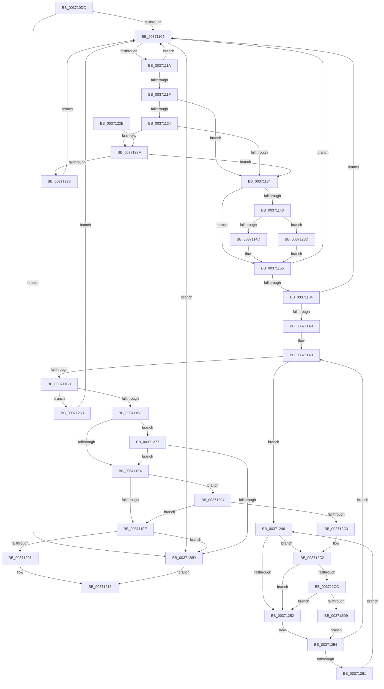

# MiTryDeleteTransitionPte

- RVA: `0x003710DC`–`0x003712E6` (길이 `522` bytes)
- VA: `0x00000001403710DC`
- 실행 섹션: `.text`
- PDB 이름 있음: `예`; PDB Function 태그: `아니요`
- unwind 정보 RVA: `0x0007A7F4`
- 디코드: `122`개 명령, `522/522` bytes 표시
- 미해석 바이트: `0` (있으면 어셈블리에 `.byte`로 보존)

> 이 문서는 커널 이미지의 기계어와 PDB 기호를 분석해 생성했습니다. 4번과 5번은 함수 원형과 자료형을 바이너리 사용 방식에서 추정한 C 해석이며 원본 소스 복구 결과는 아닙니다.

## 1. Dependencies

- 직접 호출 지점: **8**; 고유 호출 대상: **6**
- 직접 호출자로 확인된 함수: **2**
- RIP 상대 이미지 참조: **5**

### Outgoing calls
- `0x003710F4` → [MI_READ_PTE_LOCK_FREE](../28/MI_READ_PTE_LOCK_FREE_function_002828A0.md) (function, `0x002828A0`)
- `0x00371107` → [MI_READ_PTE_LOCK_FREE](../28/MI_READ_PTE_LOCK_FREE_function_002828A0.md) (function, `0x002828A0`)
- `0x003711B3` → [MI_READ_PTE_LOCK_FREE](../28/MI_READ_PTE_LOCK_FREE_function_002828A0.md) (function, `0x002828A0`)
- `0x00371213` → [MiDeleteTransitionPte](MiDeleteTransitionPte_function_00371B70.md) (function, `0x00371B70`)
- `0x0037127C` → [MiLockSpecialPurposeMemoryCachedPage](../40/MiLockSpecialPurposeMemoryCachedPage_function_004049F0.md) (function, `0x004049F0`)
- `0x003712BC` → [KeBugCheckEx](../4F/KeBugCheckEx_function_004FD660.md) (function, `0x004FD660`)
- `0x003712CC` → [KiCheckVpBackingLongSpinWaitHypercall](../30/KiCheckVpBackingLongSpinWaitHypercall_function_0030F490.md) (function, `0x0030F490`)
- `0x003712DC` → [HvlNotifyLongSpinWait](../30/HvlNotifyLongSpinWait_function_0030F460.md) (function, `0x0030F460`)

### Direct callers
- [sub_002C3A7C](../2C/Unknown_function_002C3A7C.md) at `0x002C42D6`
- [MiDeleteMergedPte](MiDeleteMergedPte_function_00371040.md) at `0x00371072`

### Static image references
- `0x00371124` → RVA `0x00E2DC80` (`.data`; read)
- `0x00371177` → RVA `0x00E2DCE0` (`.data`; read)
- `0x003711C5` → RVA `0x00E30088` (`.data`; read)
- `0x00371249` → RVA `0x00FC52AC` (`ALMOSTRO`; reference)
- `0x003712C2` → RVA `0x00FC6AB8` (`ALMOSTRO`; read)

## 2. Other-region calls and transfers

- 다른 실행 섹션으로 향하는 call: **0**
- 별도 외부 분기/꼬리 이동을 확인하지 못했습니다.

## 3. Assembly (complete function range)

```asm
003710DC  48 89 5C 24 08                  mov qword ptr [rsp + 8], rbx
003710E1  48 89 74 24 18                  mov qword ptr [rsp + 0x18], rsi
003710E6  48 89 7C 24 20                  mov qword ptr [rsp + 0x20], rdi
003710EB  41 56                           push r14
003710ED  48 83 EC 30                     sub rsp, 0x30
003710F1  48 8B F1                        mov rsi, rcx
003710F4  E8 A7 17 F1 FF                  call 0x1402828a0
003710F9  48 0F BA E0 0A                  bt rax, 0xa
003710FE  0F 82 89 01 00 00               jb 0x14037128d
00371104  48 8B CE                        mov rcx, rsi
00371107  E8 94 17 F1 FF                  call 0x1402828a0
0037110C  48 8B D8                        mov rbx, rax
0037110F  48 0F BA E0 0B                  bt rax, 0xb
00371114  0F 83 73 01 00 00               jae 0x14037128d
0037111A  F6 C3 01                        test bl, 1
0037111D  75 E5                           jne 0x140371104
0037111F  48 85 C0                        test rax, rax
00371122  74 10                           je 0x140371134
00371124  48 8B 05 55 CB AB 00            mov rax, qword ptr [rip + 0xabcb55]
0037112B  48 85 C0                        test rax, rax
0037112E  0F 85 FB 00 00 00               jne 0x14037122f
00371134  48 8B 0D 45 CB AB 00            mov rcx, qword ptr [rip + 0xabcb45]
0037113B  48 8B C3                        mov rax, rbx
0037113E  48 85 C9                        test rcx, rcx
00371141  74 12                           je 0x140371155
00371143  F6 C3 10                        test bl, 0x10
00371146  0F 85 F1 00 00 00               jne 0x14037123d
0037114C  48 8B C1                        mov rax, rcx
0037114F  48 F7 D0                        not rax
00371152  48 23 C3                        and rax, rbx
00371155  48 B9 FF FF FF FF FF 00 00 00   movabs rcx, 0xffffffffff
0037115F  48 C1 E8 0C                     shr rax, 0xc
00371163  48 23 C1                        and rax, rcx
00371166  48 8D 0C 40                     lea rcx, [rax + rax*2]
0037116A  48 03 C9                        add rcx, rcx
0037116D  48 BA 00 00 00 00 00 DE FF FF   movabs rdx, 0xffffde0000000000
00371177  48 3B 05 62 CB AB 00            cmp rax, qword ptr [rip + 0xabcb62]
0037117E  48 8D 3C CA                     lea rdi, [rdx + rcx*8]
00371182  77 80                           ja 0x140371104
00371184  48 B8 28 00 00 00 00 DE FF FF   movabs rax, 0xffffde0000000028
0037118E  48 8B 04 C8                     mov rax, qword ptr [rax + rcx*8]
00371192  48 C1 E8 36                     shr rax, 0x36
00371196  0F BA E0 00                     bt eax, 0
0037119A  0F 83 64 FF FF FF               jae 0x140371104
003711A0  45 33 F6                        xor r14d, r14d
003711A3  F0 48 0F BA 6F 18 3F            lock bts qword ptr [rdi + 0x18], 0x3f
003711AA  0F 82 96 00 00 00               jb 0x140371246
003711B0  48 8B CE                        mov rcx, rsi
003711B3  E8 E8 16 F1 FF                  call 0x1402828a0
003711B8  48 3B C3                        cmp rax, rbx
003711BB  0F 85 A2 00 00 00               jne 0x140371263
003711C1  48 8B 47 28                     mov rax, qword ptr [rdi + 0x28]
003711C5  48 8B 15 BC EE AB 00            mov rdx, qword ptr [rip + 0xabeebc]
003711CC  48 C1 E8 2B                     shr rax, 0x2b
003711D0  25 FF 03 00 00                  and eax, 0x3ff
003711D5  48 8B 04 C2                     mov rax, qword ptr [rdx + rax*8]
003711D9  8B 40 04                        mov eax, dword ptr [rax + 4]
003711DC  84 C0                           test al, al
003711DE  0F 88 93 00 00 00               js 0x140371277
003711E4  48 8B 47 08                     mov rax, qword ptr [rdi + 8]
003711E8  48 B9 00 00 00 00 00 00 00 80   movabs rcx, 0x8000000000000000
003711F2  48 0B C1                        or rax, rcx
003711F5  48 3B C6                        cmp rax, rsi
003711F8  0F 85 96 00 00 00               jne 0x140371294
003711FE  48 85 FF                        test rdi, rdi
00371201  0F 84 86 00 00 00               je 0x14037128d
00371207  45 33 C9                        xor r9d, r9d
0037120A  41 B0 11                        mov r8b, 0x11
0037120D  48 8B D7                        mov rdx, rdi
00371210  48 8B CE                        mov rcx, rsi
00371213  E8 58 09 00 00                  call 0x140371b70
00371218  48 8B 5C 24 40                  mov rbx, qword ptr [rsp + 0x40]
0037121D  48 8B 74 24 50                  mov rsi, qword ptr [rsp + 0x50]
00371222  48 8B 7C 24 58                  mov rdi, qword ptr [rsp + 0x58]
00371227  48 83 C4 30                     add rsp, 0x30
0037122B  41 5E                           pop r14
0037122D  C3                              ret
0037122E  CC                              int3
0037122F  48 85 C3                        test rbx, rax
00371232  0F 85 FC FE FF FF               jne 0x140371134
00371238  E9 C7 FE FF FF                  jmp 0x140371104
0037123D  48 83 E0 EF                     and rax, 0xffffffffffffffef
00371241  E9 0F FF FF FF                  jmp 0x140371155
00371246  41 FF C6                        inc r14d
00371249  44 85 35 5C 40 C5 00            test dword ptr [rip + 0xc5405c], r14d
00371250  74 70                           je 0x1403712c2
00371252  F3 90                           pause
00371254  48 8B 47 18                     mov rax, qword ptr [rdi + 0x18]
00371258  48 85 C0                        test rax, rax
0037125B  0F 89 42 FF FF FF               jns 0x1403711a3
00371261  EB E3                           jmp 0x140371246
00371263  48 B8 FF FF FF FF FF FF FF 7F   movabs rax, 0x7fffffffffffffff
0037126D  F0 48 21 47 18                  lock and qword ptr [rdi + 0x18], rax
00371272  E9 8D FE FF FF                  jmp 0x140371104
00371277  33 D2                           xor edx, edx
00371279  48 8B CF                        mov rcx, rdi
0037127C  E8 6F 37 09 00                  call 0x1404049f0
00371281  48 8B F8                        mov rdi, rax
00371284  48 85 C0                        test rax, rax
00371287  0F 85 57 FF FF FF               jne 0x1403711e4
0037128D  B8 01 00 00 00                  mov eax, 1
00371292  EB 84                           jmp 0x140371218
00371294  48 8B 47 28                     mov rax, qword ptr [rdi + 0x28]
00371298  48 0F BA E0 28                  bt rax, 0x28
0037129D  0F 82 5B FF FF FF               jb 0x1403711fe
003712A3  48 8B 47 08                     mov rax, qword ptr [rdi + 8]
003712A7  4C 8B CB                        mov r9, rbx
003712AA  4C 8B C6                        mov r8, rsi
003712AD  48 89 44 24 20                  mov qword ptr [rsp + 0x20], rax
003712B2  BA 11 04 00 00                  mov edx, 0x411
003712B7  B9 1A 00 00 00                  mov ecx, 0x1a
003712BC  E8 9F C3 18 00                  call 0x1404fd660
003712C1  CC                              int3
003712C2  8B 05 F0 57 C5 00               mov eax, dword ptr [rip + 0xc557f0]
003712C8  A8 40                           test al, 0x40
003712CA  74 86                           je 0x140371252
003712CC  E8 BF E1 F9 FF                  call 0x14030f490
003712D1  84 C0                           test al, al
003712D3  0F 84 79 FF FF FF               je 0x140371252
003712D9  41 8B CE                        mov ecx, r14d
003712DC  E8 7F E1 F9 FF                  call 0x14030f460
003712E1  E9 6E FF FF FF                  jmp 0x140371254
```

## 4. C-style interpretation (structured pseudocode)

```c
__int64 __fastcall MiTryDeleteTransitionPte(__int64 a1, __int64 a2, __int64 a3, int a4)
{
    __int64 result;
    __int64 v_r14;
    __int64 v_rsp;
    unsigned __int64 v_stack_p18;
    unsigned __int64 v_stack_p20;
    unsigned __int64 v_stack_p8;

    v_stack_p8 = v_rbx;
    v_stack_p18 = v_rsi;
    v_stack_p20 = v_rdi;
    v_rsp = (v_rsp) - (48);
    result = MI_READ_PTE_LOCK_FREE(a1, a2, a3, a4);
    if (condition_is_below) goto loc_0037128D;
loc_00371104:
    result = MI_READ_PTE_LOCK_FREE(a1, a2, a3, a4);
    if (condition_is_above_or_equal) goto loc_0037128D;
    if ((((unsigned __int8)(result)) & (1)) != 0) goto loc_00371104;
    if (result == 0) goto loc_00371134;
    if (*(unsigned __int64 *)(v_rip + 11258709) != 0) goto loc_0037122F;
loc_00371134:
    if (*(unsigned __int64 *)(v_rip + 11258693) == 0) goto loc_00371155;
    if ((((unsigned __int8)(result)) & (16)) != 0) goto loc_0037123D;
    result = ~(*(unsigned __int64 *)(v_rip + 11258693));
    result = (result) & (result);
loc_00371155:
    result = (result) >> (12);
    result = (result) & (*(unsigned __int64 *)(v_rip + 11258693));
    a1 = (result + result * 2) + (result + result * 2);
    if (result > (*(unsigned __int64 *)(v_rip + 11258722))) goto loc_00371104;
    result = (*(unsigned __int64 *)(result + a1 * 8)) >> (54);
    if (condition_is_above_or_equal) goto loc_00371104;
    v_r14 = 0;
loc_003711A3:
    if (condition_is_below) goto loc_00371246;
    result = MI_READ_PTE_LOCK_FREE(a1, a2, a3, a4);
    if (result != result) goto loc_00371263;
    result = (*(unsigned __int64 *)(a2 + a1 * 8 + 40)) >> (43);
    result = (unsigned int)((result) & (0x3FFULL));
    if (sign_flag) goto loc_00371277;
loc_003711E4:
    result = (*(unsigned __int64 *)(a2 + a1 * 8 + 8)) | (a1);
    if (result != a1) goto loc_00371294;
loc_003711FE:
    if (a2 + a1 * 8 == 0) goto loc_0037128D;
    a4 = 0;
    result = MiDeleteTransitionPte(a1, a2 + a1 * 8, 17, a4);
loc_00371218:
    v_rsp = (v_rsp) + (48);
    return result;
loc_0037122F:
    if (((v_stack_p8) & (result)) != 0) goto loc_00371134;
    goto loc_00371104;
loc_0037123D:
    result = (result) & (-17);
    goto loc_00371155;
loc_00371246:
    v_r14 = (unsigned int)((v_r14) + 1);
    if (((*(unsigned int *)(v_rip + 12927068)) & ((unsigned int)(v_r14))) == 0) goto loc_003712C2;
loc_00371252:
loc_00371254:
    if (!sign_flag) goto loc_003711A3;
    goto loc_00371246;
loc_00371263:
    goto loc_00371104;
loc_00371277:
    a2 = 0;
    result = MiLockSpecialPurposeMemoryCachedPage(v_stack_p20, a2, 17, a4);
    if (result != 0) goto loc_003711E4;
loc_0037128D:
    goto loc_00371218;
loc_00371294:
    if (condition_is_below) goto loc_003711FE;
    v_stack_p20 = *(unsigned __int64 *)(result + 8);
    result = KeBugCheckEx(26, (unsigned int)(0x411ULL), v_stack_p18, v_stack_p8);
loc_003712C2:
    if ((((unsigned __int8)((unsigned int)(*(unsigned int *)(v_rip + 12933104)))) & (64)) == 0) goto loc_00371252;
    result = KiCheckVpBackingLongSpinWaitHypercall(26, (unsigned int)(0x411ULL), v_stack_p18, v_stack_p8);
    if ((unsigned __int8)(result) == 0) goto loc_00371252;
    result = HvlNotifyLongSpinWait((unsigned int)((unsigned int)(v_r14)), (unsigned int)(0x411ULL), v_stack_p18, v_stack_p8);
    goto loc_00371254;
}
```

## 5. (Beta) C Style

```c
int64_t MiTryDeleteTransitionPte(int64_t Arg1, int64_t Arg2, int64_t Arg3, int32_t Arg4)
{
    int64_t result;
    int64_t local_r14;
    int64_t local_rsp;
    uint64_t v_stack_p18;
    uint64_t v_stack_p20;
    uint64_t v_stack_p8;

    v_stack_p8 = local_rbx;
    v_stack_p18 = local_rsi;
    v_stack_p20 = local_rdi;
    local_rsp = (local_rsp) - (48);
    result = MI_READ_PTE_LOCK_FREE(Arg1, Arg2, Arg3, Arg4);
    if (condition_is_below) goto loc_0037128D;
loc_00371104:
    result = MI_READ_PTE_LOCK_FREE(Arg1, Arg2, Arg3, Arg4);
    if (condition_is_above_or_equal) goto loc_0037128D;
    if ((((uint8_t)(result)) & (1)) != 0) goto loc_00371104;
    if (result == 0) goto loc_00371134;
    if (*(uint64_t *)(v_rip + 0xABCB55) != 0) goto loc_0037122F;
loc_00371134:
    if (*(uint64_t *)(v_rip + 0xABCB45) == 0) goto loc_00371155;
    if ((((uint8_t)(result)) & (16)) != 0) goto loc_0037123D;
    result = ~(*(uint64_t *)(v_rip + 0xABCB45));
    result = (result) & (result);
loc_00371155:
    result = (result) >> (12);
    result = (result) & (*(uint64_t *)(v_rip + 0xABCB45));
    Arg1 = (result + result * 2) + (result + result * 2);
    if (result > (*(uint64_t *)(v_rip + 0xABCB62))) goto loc_00371104;
    result = (*(uint64_t *)(result + Arg1 * 8)) >> (54);
    if (condition_is_above_or_equal) goto loc_00371104;
    local_r14 = 0;
loc_003711A3:
    if (condition_is_below) goto loc_00371246;
    result = MI_READ_PTE_LOCK_FREE(Arg1, Arg2, Arg3, Arg4);
    if (result != result) goto loc_00371263;
    result = (*(uint64_t *)(Arg2 + Arg1 * 8 + 0x28)) >> (43);
    result = (uint32_t)((result) & (0x3FFULL));
    if (sign_flag) goto loc_00371277;
loc_003711E4:
    result = (*(uint64_t *)(Arg2 + Arg1 * 8 + 0x8)) | (Arg1);
    if (result != Arg1) goto loc_00371294;
loc_003711FE:
    if (Arg2 + Arg1 * 8 == 0) goto loc_0037128D;
    Arg4 = 0;
    result = MiDeleteTransitionPte(Arg1, Arg2 + Arg1 * 8, 17, Arg4);
loc_00371218:
    local_rsp = (local_rsp) + (48);
    return result;
loc_0037122F:
    if (((v_stack_p8) & (result)) != 0) goto loc_00371134;
    goto loc_00371104;
loc_0037123D:
    result = (result) & (-17);
    goto loc_00371155;
loc_00371246:
    local_r14 = (uint32_t)((local_r14) + 1);
    if (((*(uint32_t *)(v_rip + 0xC5405C)) & ((uint32_t)(local_r14))) == 0) goto loc_003712C2;
loc_00371252:
loc_00371254:
    if (!sign_flag) goto loc_003711A3;
    goto loc_00371246;
loc_00371263:
    goto loc_00371104;
loc_00371277:
    Arg2 = 0;
    result = MiLockSpecialPurposeMemoryCachedPage(v_stack_p20, Arg2, 17, Arg4);
    if (result != 0) goto loc_003711E4;
loc_0037128D:
    goto loc_00371218;
loc_00371294:
    if (condition_is_below) goto loc_003711FE;
    v_stack_p20 = *(uint64_t *)(result + 0x8);
    result = KeBugCheckEx(26, (uint32_t)(0x411ULL), v_stack_p18, v_stack_p8);
loc_003712C2:
    if ((((uint8_t)((uint32_t)(*(uint32_t *)(v_rip + 0xC557F0)))) & (64)) == 0) goto loc_00371252;
    result = KiCheckVpBackingLongSpinWaitHypercall(26, (uint32_t)(0x411ULL), v_stack_p18, v_stack_p8);
    if ((uint8_t)(result) == 0) goto loc_00371252;
    result = HvlNotifyLongSpinWait((uint32_t)((uint32_t)(local_r14)), (uint32_t)(0x411ULL), v_stack_p18, v_stack_p8);
    goto loc_00371254;
}
```

## 6. Execution-region graph

[열기: 2D/3D 그래프와 함수 탐색 컨트롤 패널](../../../control-panel.html?section=text&rva=0x003710DC&view=graph)

- 2D 그래프는 위에서 아래로 흐르고, 3D 그래프는 빈 공간을 드래그해 회전합니다. Shift+드래그는 이동, 휠은 확대·축소, 함수 노드 선택은 대상 보고서 이동입니다.

### Static fallback


