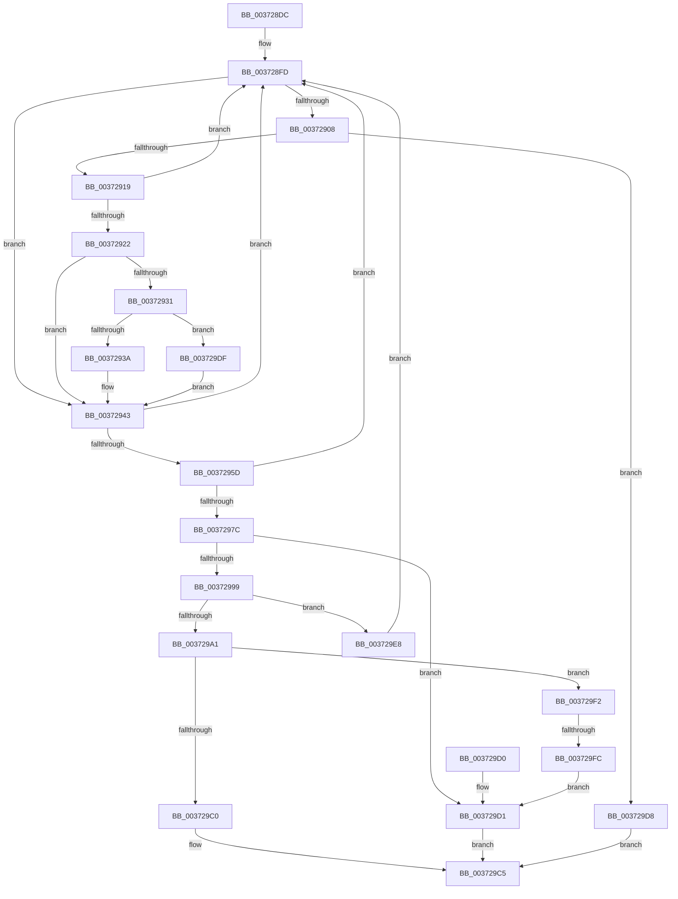

# MiTryLockLeafPage

- RVA: `0x003728DC`–`0x00372A03` (길이 `295` bytes)
- VA: `0x00000001403728DC`
- 실행 섹션: `.text`
- PDB 이름 있음: `예`; PDB Function 태그: `예`
- unwind 정보 RVA: `0x0007A9FC`
- 디코드: `75`개 명령, `295/295` bytes 표시
- 미해석 바이트: `0` (있으면 어셈블리에 `.byte`로 보존)

> 이 문서는 커널 이미지의 기계어와 PDB 기호를 분석해 생성했습니다. 4번과 5번은 함수 원형과 자료형을 바이너리 사용 방식에서 추정한 C 해석이며 원본 소스 복구 결과는 아닙니다.

## 1. Dependencies

- 직접 호출 지점: **1**; 고유 호출 대상: **1**
- 직접 호출자로 확인된 함수: **6**
- RIP 상대 이미지 참조: **3**

### Outgoing calls
- `0x00372919` → [MiInvalidPteConforms](MiInvalidPteConforms_function_00372A10.md) (function, `0x00372A10`)

### Direct callers
- [MiCombineWithStandbyExisting](../22/MiCombineWithStandbyExisting_function_00229E74.md) at `0x0022A01C`
- [MiTryLockProtoPoolPageAtDpc](../28/MiTryLockProtoPoolPageAtDpc_function_0028B3C8.md) at `0x0028B51A`
- [MiCopyDataPageToImagePage](../2A/MiCopyDataPageToImagePage_function_002AE818.md) at `0x002AED60`
- [MiCopyFileOnlyGlobalSubsectionPage](../36/MiCopyFileOnlyGlobalSubsectionPage_function_0036A9EC.md) at `0x0036ABA0`
- [MiDeleteSectionCluster](MiDeleteSectionCluster_function_00373DF0.md) at `0x00373E66`
- [MiMakeTransitionHeatBatch](../40/MiMakeTransitionHeatBatch_function_00409A94.md) at `0x00409D12`

### Static image references
- `0x00372922` → RVA `0x00E2DC80` (`.data`; read)
- `0x00372954` → RVA `0x00E2DCE0` (`.data`; read)
- `0x003729A5` → RVA `0x00E30088` (`.data`; read)

## 2. Other-region calls and transfers

- 다른 실행 섹션으로 향하는 call: **0**
- call이 아닌 외부 분기/꼬리 이동: **1**
  - `0x003729F6` → [sub_006E3DE4](../6E/Unknown_function_006E3DE4.md) (`tail-transfer`)

## 3. Assembly (complete function range)

```asm
003728DC  48 89 5C 24 10                  mov qword ptr [rsp + 0x10], rbx
003728E1  57                              push rdi
003728E2  48 83 EC 20                     sub rsp, 0x20
003728E6  49 8B F8                        mov rdi, r8
003728E9  44 8B CA                        mov r9d, edx
003728EC  4C 8B C1                        mov r8, rcx
003728EF  49 BA FF FF FF FF FF FF FF 7F   movabs r10, 0x7fffffffffffffff
003728F9  48 83 27 00                     and qword ptr [rdi], 0
003728FD  49 8B 08                        mov rcx, qword ptr [r8]
00372900  48 8B C1                        mov rax, rcx
00372903  F6 C1 01                        test cl, 1
00372906  75 3B                           jne 0x140372943
00372908  25 00 0C 00 00                  and eax, 0xc00
0037290D  48 3D 00 08 00 00               cmp rax, 0x800
00372913  0F 85 BF 00 00 00               jne 0x1403729d8
00372919  E8 F2 00 00 00                  call 0x140372a10
0037291E  85 C0                           test eax, eax
00372920  74 DB                           je 0x1403728fd
00372922  48 8B 15 57 B3 AB 00            mov rdx, qword ptr [rip + 0xabb357]
00372929  48 8B C1                        mov rax, rcx
0037292C  48 85 D2                        test rdx, rdx
0037292F  74 12                           je 0x140372943
00372931  F6 C1 10                        test cl, 0x10
00372934  0F 85 A5 00 00 00               jne 0x1403729df
0037293A  48 8B C2                        mov rax, rdx
0037293D  48 F7 D0                        not rax
00372940  48 23 C1                        and rax, rcx
00372943  48 C1 E8 0C                     shr rax, 0xc
00372947  48 BA FF FF FF FF FF 00 00 00   movabs rdx, 0xffffffffff
00372951  48 23 C2                        and rax, rdx
00372954  48 3B 05 85 B3 AB 00            cmp rax, qword ptr [rip + 0xabb385]
0037295B  77 A0                           ja 0x1403728fd
0037295D  48 8D 14 40                     lea rdx, [rax + rax*2]
00372961  48 03 D2                        add rdx, rdx
00372964  48 B8 28 00 00 00 00 DE FF FF   movabs rax, 0xffffde0000000028
0037296E  48 8B 04 D0                     mov rax, qword ptr [rax + rdx*8]
00372972  48 C1 E8 36                     shr rax, 0x36
00372976  0F BA E0 00                     bt eax, 0
0037297A  73 81                           jae 0x1403728fd
0037297C  48 B8 00 00 00 00 00 DE FF FF   movabs rax, 0xffffde0000000000
00372986  48 8D 1C D0                     lea rbx, [rax + rdx*8]
0037298A  41 8B D1                        mov edx, r9d
0037298D  83 E2 01                        and edx, 1
00372990  F0 48 0F BA 6B 18 3F            lock bts qword ptr [rbx + 0x18], 0x3f
00372997  72 38                           jb 0x1403729d1
00372999  49 8B 00                        mov rax, qword ptr [r8]
0037299C  48 3B C1                        cmp rax, rcx
0037299F  75 47                           jne 0x1403729e8
003729A1  48 8B 43 28                     mov rax, qword ptr [rbx + 0x28]
003729A5  48 8B 0D DC D6 AB 00            mov rcx, qword ptr [rip + 0xabd6dc]
003729AC  48 C1 E8 2B                     shr rax, 0x2b
003729B0  25 FF 03 00 00                  and eax, 0x3ff
003729B5  48 8B 04 C1                     mov rax, qword ptr [rcx + rax*8]
003729B9  8B 40 04                        mov eax, dword ptr [rax + 4]
003729BC  84 C0                           test al, al
003729BE  78 32                           js 0x1403729f2
003729C0  48 89 1F                        mov qword ptr [rdi], rbx
003729C3  33 C0                           xor eax, eax
003729C5  48 8B 5C 24 38                  mov rbx, qword ptr [rsp + 0x38]
003729CA  48 83 C4 20                     add rsp, 0x20
003729CE  5F                              pop rdi
003729CF  C3                              ret
003729D0  CC                              int3
003729D1  B8 55 00 00 C0                  mov eax, 0xc0000055
003729D6  EB ED                           jmp 0x1403729c5
003729D8  B8 34 04 00 C0                  mov eax, 0xc0000434
003729DD  EB E6                           jmp 0x1403729c5
003729DF  48 83 E0 EF                     and rax, 0xffffffffffffffef
003729E3  E9 5B FF FF FF                  jmp 0x140372943
003729E8  F0 4C 21 53 18                  lock and qword ptr [rbx + 0x18], r10
003729ED  E9 0B FF FF FF                  jmp 0x1403728fd
003729F2  41 F6 C1 02                     test r9b, 2
003729F6  0F 85 E8 13 37 00               jne 0x1406e3de4
003729FC  F0 4C 21 53 18                  lock and qword ptr [rbx + 0x18], r10
00372A01  EB CE                           jmp 0x1403729d1
```

## 4. C-style interpretation (structured pseudocode)

```c
__int64 __fastcall MiTryLockLeafPage(__int64 a1, int a2, __int64 a3)
{
    __int64 result;
    __int64 v_rsp;
    unsigned __int64 v_stack_p10;

    v_stack_p10 = v_rbx;
    v_rsp = (v_rsp) - (32);
loc_003728FD:
    if ((((unsigned __int8)(*(unsigned __int64 *)(a1))) & (1)) != 0) goto loc_00372943;
    result = (unsigned int)((*(unsigned __int64 *)(a1)) & (0xC00ULL));
    if (result != 0x800ULL) goto loc_003729D8;
    result = MiInvalidPteConforms(*(unsigned __int64 *)(a1), a2, a1, (unsigned int)(a2));
    if ((unsigned int)(result) == 0) goto loc_003728FD;
    if (*(unsigned __int64 *)(v_rip + 11252567) == 0) goto loc_00372943;
    if ((((unsigned __int8)(*(unsigned __int64 *)(a1))) & (16)) != 0) goto loc_003729DF;
    result = ~(*(unsigned __int64 *)(v_rip + 11252567));
    result = (result) & (*(unsigned __int64 *)(a1));
loc_00372943:
    result = (result) >> (12);
    result = (result) & (*(unsigned __int64 *)(v_rip + 11252567));
    if (result > (*(unsigned __int64 *)(v_rip + 11252613))) goto loc_003728FD;
    a2 = (result + result * 2) + (result + result * 2);
    result = (*(unsigned __int64 *)(result + a2 * 8)) >> (54);
    if (condition_is_above_or_equal) goto loc_003728FD;
    a2 = (unsigned int)(((unsigned int)((unsigned int)((unsigned int)(a2)))) & (1));
    if (condition_is_below) goto loc_003729D1;
    if ((*(unsigned __int64 *)(a1)) != (*(unsigned __int64 *)(a1))) goto loc_003729E8;
    result = (*(unsigned __int64 *)(result + a2 * 8 + 40)) >> (43);
    result = (unsigned int)((result) & (0x3FFULL));
    if (sign_flag) goto loc_003729F2;
    *(unsigned __int64 *)(a3) = result + a2 * 8;
    result = 0;
loc_003729C5:
    v_rsp = (v_rsp) + (32);
    return result;
loc_003729D1:
    goto loc_003729C5;
loc_003729D8:
    goto loc_003729C5;
loc_003729DF:
    result = ((unsigned int)(0xC0000434ULL)) & (-17);
    goto loc_00372943;
loc_003729E8:
    goto loc_003728FD;
loc_003729F2:
    goto loc_003729D1;
}
```

## 5. (Beta) C Style

```c
int64_t MiTryLockLeafPage(int64_t Arg1, int32_t Arg2, void *Arg3)
{
    uint8_t *arg3 = (uint8_t *)Arg3;

    int64_t result;
    int64_t local_rsp;
    uint64_t v_stack_p10;

    v_stack_p10 = local_rbx;
    local_rsp = (local_rsp) - (32);
loc_003728FD:
    if ((((uint8_t)(*(uint64_t *)(Arg1))) & (1)) != 0) goto loc_00372943;
    result = (uint32_t)((*(uint64_t *)(Arg1)) & (0xC00ULL));
    if (result != 0x800ULL) goto loc_003729D8;
    result = MiInvalidPteConforms(*(uint64_t *)(Arg1), Arg2, Arg1, (uint32_t)(Arg2));
    if ((uint32_t)(result) == 0) goto loc_003728FD;
    if (*(uint64_t *)(v_rip + 0xABB357) == 0) goto loc_00372943;
    if ((((uint8_t)(*(uint64_t *)(Arg1))) & (16)) != 0) goto loc_003729DF;
    result = ~(*(uint64_t *)(v_rip + 0xABB357));
    result = (result) & (*(uint64_t *)(Arg1));
loc_00372943:
    result = (result) >> (12);
    result = (result) & (*(uint64_t *)(v_rip + 0xABB357));
    if (result > (*(uint64_t *)(v_rip + 0xABB385))) goto loc_003728FD;
    Arg2 = (result + result * 2) + (result + result * 2);
    result = (*(uint64_t *)(result + Arg2 * 8)) >> (54);
    if (condition_is_above_or_equal) goto loc_003728FD;
    Arg2 = (uint32_t)(((uint32_t)((uint32_t)((uint32_t)(Arg2)))) & (1));
    if (condition_is_below) goto loc_003729D1;
    if ((*(uint64_t *)(Arg1)) != (*(uint64_t *)(Arg1))) goto loc_003729E8;
    result = (*(uint64_t *)(result + Arg2 * 8 + 0x28)) >> (43);
    result = (uint32_t)((result) & (0x3FFULL));
    if (sign_flag) goto loc_003729F2;
    *(uint64_t *)(arg3) = result + Arg2 * 8;
    result = 0;
loc_003729C5:
    local_rsp = (local_rsp) + (32);
    return result;
loc_003729D1:
    goto loc_003729C5;
loc_003729D8:
    goto loc_003729C5;
loc_003729DF:
    result = ((uint32_t)(0xC0000434ULL)) & (-17);
    goto loc_00372943;
loc_003729E8:
    goto loc_003728FD;
loc_003729F2:
    goto loc_003729D1;
}
```

### 관측된 메모리 오프셋

구조체 형식이 확인되지 않은 접근은 인자 기준의 오프셋으로만 기록했습니다.

| 기준 인자 | 오프셋 표현 | 폭 (bit) | 접근 |
|---|---:|---:|---|
| `Arg3` | `+ 0x0` | `64` | `R/W` |
| `Arg3` | `+ 0x0` | `64` | `W` |

## 6. Execution-region graph

[열기: 2D/3D 그래프와 함수 탐색 컨트롤 패널](../../../control-panel.html?section=text&rva=0x003728DC&view=graph)

- 2D 그래프는 위에서 아래로 흐르고, 3D 그래프는 빈 공간을 드래그해 회전합니다. Shift+드래그는 이동, 휠은 확대·축소, 함수 노드 선택은 대상 보고서 이동입니다.

### Static fallback


