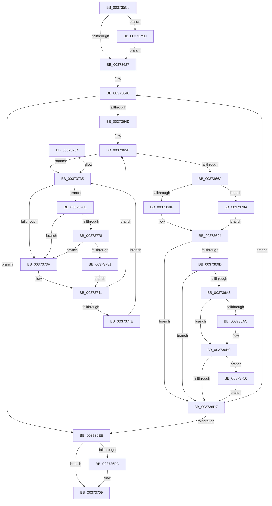

# MiUnlockStoreLockedPages

- RVA: `0x003735C0`–`0x003737BB` (길이 `507` bytes)
- VA: `0x00000001403735C0`
- 실행 섹션: `.text`
- PDB 이름 있음: `예`; PDB Function 태그: `아니요`
- unwind 정보 RVA: `0x0007AA60`
- 디코드: `126`개 명령, `507/507` bytes 표시
- 미해석 바이트: `0` (있으면 어셈블리에 `.byte`로 보존)

> 이 문서는 커널 이미지의 기계어와 PDB 기호를 분석해 생성했습니다. 4번과 5번은 함수 원형과 자료형을 바이너리 사용 방식에서 추정한 C 해석이며 원본 소스 복구 결과는 아닙니다.

## 1. Dependencies

- 직접 호출 지점: **8**; 고유 호출 대상: **6**
- 직접 호출자로 확인된 함수: **2**
- RIP 상대 이미지 참조: **4**

### Outgoing calls
- `0x00373681` → [MiWriteCompletePfn](MiWriteCompletePfn_function_003737C4.md) (function, `0x003737C4`)
- `0x003736B4` → [KiLowerIrqlProcessIrqlFlags](../4F/KiLowerIrqlProcessIrqlFlags_function_004F5698.md) (function, `0x004F5698`)
- `0x00373704` → [KiLowerIrqlProcessIrqlFlags](../4F/KiLowerIrqlProcessIrqlFlags_function_004F5698.md) (function, `0x004F5698`)
- `0x00373753` → [KiRaiseIrqlProcessIrqlFlags](../4F/KiRaiseIrqlProcessIrqlFlags_function_004F56FC.md) (function, `0x004F56FC`)
- `0x00373764` → [KiRaiseIrqlProcessIrqlFlags](../4F/KiRaiseIrqlProcessIrqlFlags_function_004F56FC.md) (function, `0x004F56FC`)
- `0x00373778` → [KiCheckVpBackingLongSpinWaitHypercall](../30/KiCheckVpBackingLongSpinWaitHypercall_function_0030F490.md) (function, `0x0030F490`)
- `0x00373783` → [HvlNotifyLongSpinWait](../30/HvlNotifyLongSpinWait_function_0030F460.md) (function, `0x0030F460`)
- `0x003737B1` → [MiReleasePageFileInfo](../28/MiReleasePageFileInfo_function_00283FD0.md) (function, `0x00283FD0`)

### Direct callers
- [MmStoreProbeAndLockPages](../23/MmStoreProbeAndLockPages_function_0023E570.md) at `0x0023E83E`
- [SmKmUnlockMdl](SmKmUnlockMdl_function_00372A44.md) at `0x00372A8F`

### Static image references
- `0x0037361A` → RVA `0x00FC6D20` (`ALMOSTRO`; read)
- `0x00373737` → RVA `0x00FC52AC` (`ALMOSTRO`; reference)
- `0x0037376E` → RVA `0x00FC6AB8` (`ALMOSTRO`; read)
- `0x0037378E` → RVA `0x00E30088` (`.data`; read)

## 2. Other-region calls and transfers

- 다른 실행 섹션으로 향하는 call: **0**
- 별도 외부 분기/꼬리 이동을 확인하지 못했습니다.

## 3. Assembly (complete function range)

```asm
003735C0  48 89 5C 24 10                  mov qword ptr [rsp + 0x10], rbx
003735C5  48 89 6C 24 18                  mov qword ptr [rsp + 0x18], rbp
003735CA  48 89 74 24 20                  mov qword ptr [rsp + 0x20], rsi
003735CF  48 89 4C 24 08                  mov qword ptr [rsp + 8], rcx
003735D4  57                              push rdi
003735D5  41 54                           push r12
003735D7  41 55                           push r13
003735D9  41 56                           push r14
003735DB  41 57                           push r15
003735DD  48 83 EC 20                     sub rsp, 0x20
003735E1  8B 51 2C                        mov edx, dword ptr [rcx + 0x2c]
003735E4  48 8D 71 30                     lea rsi, [rcx + 0x30]
003735E8  03 51 20                        add edx, dword ptr [rcx + 0x20]
003735EB  BB 10 00 00 00                  mov ebx, 0x10
003735F0  8B 41 28                        mov eax, dword ptr [rcx + 0x28]
003735F3  81 E2 FF 0F 00 00               and edx, 0xfff
003735F9  48 05 FF 0F 00 00               add rax, 0xfff
003735FF  48 03 D0                        add rdx, rax
00373602  48 C1 EA 0C                     shr rdx, 0xc
00373606  45 33 FF                        xor r15d, r15d
00373609  4C 8D 24 D6                     lea r12, [rsi + rdx*8]
0037360D  45 0F 20 C6                     mov r14, cr8
00373611  B8 02 00 00 00                  mov eax, 2
00373616  44 0F 22 C0                     mov cr8, rax
0037361A  44 39 3D FF 36 C5 00            cmp dword ptr [rip + 0xc536ff], r15d
00373621  0F 85 36 01 00 00               jne 0x14037375d
00373627  48 B9 00 00 00 00 00 DE FF FF   movabs rcx, 0xffffde0000000000
00373631  49 BD FF FF FF FF FF FF FF 7F   movabs r13, 0x7fffffffffffffff
0037363B  0F 1F 44 00 00                  nop dword ptr [rax + rax]
00373640  48 8B 06                        mov rax, qword ptr [rsi]
00373643  48 83 F8 FF                     cmp rax, -1
00373647  0F 84 A1 00 00 00               je 0x1403736ee
0037364D  48 8D 3C 40                     lea rdi, [rax + rax*2]
00373651  48 C1 E7 04                     shl rdi, 4
00373655  48 8B C1                        mov rax, rcx
00373658  48 03 F8                        add rdi, rax
0037365B  33 ED                           xor ebp, ebp
0037365D  F0 48 0F BA 6F 18 3F            lock bts qword ptr [rdi + 0x18], 0x3f
00373664  0F 82 CB 00 00 00               jb 0x140373735
0037366A  8B C3                           mov eax, ebx
0037366C  48 8B CF                        mov rcx, rdi
0037366F  83 E0 FD                        and eax, 0xfffffffd
00373672  83 CB 02                        or ebx, 2
00373675  F6 47 22 10                     test byte ptr [rdi + 0x22], 0x10
00373679  0F 44 D8                        cmove ebx, eax
0037367C  45 33 C0                        xor r8d, r8d
0037367F  8B D3                           mov edx, ebx
00373681  E8 3E 01 00 00                  call 0x1403737c4
00373686  48 85 C0                        test rax, rax
00373689  0F 85 FB 00 00 00               jne 0x14037378a
0037368F  F0 4C 21 6F 18                  lock and qword ptr [rdi + 0x18], r13
00373694  49 FF C7                        inc r15
00373697  41 80 FE 02                     cmp r14b, 2
0037369B  74 3A                           je 0x1403736d7
0037369D  41 F6 C7 0F                     test r15b, 0xf
003736A1  75 34                           jne 0x1403736d7
003736A3  83 3D 76 36 C5 00 00            cmp dword ptr [rip + 0xc53676], 0
003736AA  74 0D                           je 0x1403736b9
003736AC  44 0F 20 C1                     mov rcx, cr8
003736B0  41 0F B6 D6                     movzx edx, r14b
003736B4  E8 DF 1F 18 00                  call 0x1404f5698
003736B9  41 0F B6 C6                     movzx eax, r14b
003736BD  44 0F 22 C0                     mov cr8, rax
003736C1  44 0F 20 C1                     mov rcx, cr8
003736C5  B8 02 00 00 00                  mov eax, 2
003736CA  44 0F 22 C0                     mov cr8, rax
003736CE  83 3D 4B 36 C5 00 00            cmp dword ptr [rip + 0xc5364b], 0
003736D5  75 79                           jne 0x140373750
003736D7  48 83 C6 08                     add rsi, 8
003736DB  48 B9 00 00 00 00 00 DE FF FF   movabs rcx, 0xffffde0000000000
003736E5  49 3B F4                        cmp rsi, r12
003736E8  0F 82 52 FF FF FF               jb 0x140373640
003736EE  83 3D 2B 36 C5 00 00            cmp dword ptr [rip + 0xc5362b], 0
003736F5  4C 8B 6C 24 50                  mov r13, qword ptr [rsp + 0x50]
003736FA  74 0D                           je 0x140373709
003736FC  44 0F 20 C1                     mov rcx, cr8
00373700  41 0F B6 D6                     movzx edx, r14b
00373704  E8 8F 1F 18 00                  call 0x1404f5698
00373709  41 0F B6 C6                     movzx eax, r14b
0037370D  44 0F 22 C0                     mov cr8, rax
00373711  66 41 83 65 0A FD               and word ptr [r13 + 0xa], 0xfffd
00373717  48 8B 5C 24 58                  mov rbx, qword ptr [rsp + 0x58]
0037371C  48 8B 6C 24 60                  mov rbp, qword ptr [rsp + 0x60]
00373721  48 8B 74 24 68                  mov rsi, qword ptr [rsp + 0x68]
00373726  48 83 C4 20                     add rsp, 0x20
0037372A  41 5F                           pop r15
0037372C  41 5E                           pop r14
0037372E  41 5D                           pop r13
00373730  41 5C                           pop r12
00373732  5F                              pop rdi
00373733  C3                              ret
00373734  CC                              int3
00373735  FF C5                           inc ebp
00373737  85 2D 6F 1B C5 00               test dword ptr [rip + 0xc51b6f], ebp
0037373D  74 2F                           je 0x14037376e
0037373F  F3 90                           pause
00373741  48 8B 47 18                     mov rax, qword ptr [rdi + 0x18]
00373745  48 85 C0                        test rax, rax
00373748  0F 89 0F FF FF FF               jns 0x14037365d
0037374E  EB E5                           jmp 0x140373735
00373750  0F B6 D0                        movzx edx, al
00373753  E8 A4 1F 18 00                  call 0x1404f56fc
00373758  E9 7A FF FF FF                  jmp 0x1403736d7
0037375D  0F B6 D0                        movzx edx, al
00373760  41 0F B6 CE                     movzx ecx, r14b
00373764  E8 93 1F 18 00                  call 0x1404f56fc
00373769  E9 B9 FE FF FF                  jmp 0x140373627
0037376E  8B 05 44 33 C5 00               mov eax, dword ptr [rip + 0xc53344]
00373774  A8 40                           test al, 0x40
00373776  74 C7                           je 0x14037373f
00373778  E8 13 BD F9 FF                  call 0x14030f490
0037377D  84 C0                           test al, al
0037377F  74 BE                           je 0x14037373f
00373781  8B CD                           mov ecx, ebp
00373783  E8 D8 BC F9 FF                  call 0x14030f460
00373788  EB B7                           jmp 0x140373741
0037378A  48 8B 4F 28                     mov rcx, qword ptr [rdi + 0x28]
0037378E  48 8B 15 F3 C8 AB 00            mov rdx, qword ptr [rip + 0xabc8f3]
00373795  48 C1 E9 2B                     shr rcx, 0x2b
00373799  81 E1 FF 03 00 00               and ecx, 0x3ff
0037379F  48 8B 0C CA                     mov rcx, qword ptr [rdx + rcx*8]
003737A3  F0 4C 21 6F 18                  lock and qword ptr [rdi + 0x18], r13
003737A8  41 B8 01 00 00 00               mov r8d, 1
003737AE  48 8B D0                        mov rdx, rax
003737B1  E8 1A 08 F1 FF                  call 0x140283fd0
003737B6  E9 D9 FE FF FF                  jmp 0x140373694
```

## 4. C-style interpretation (structured pseudocode)

```c
__int64 __fastcall MiUnlockStoreLockedPages(__int64 a1, __int64 a2, int a3)
{
    __int64 result;
    __int64 v_r15;
    __int64 v_rbp;
    __int64 v_rbx;
    __int64 v_rdi;
    __int64 v_rsi;
    __int64 v_rsp;
    unsigned __int64 v_stack_p10;
    unsigned __int64 v_stack_p18;
    unsigned __int64 v_stack_p20;
    unsigned __int64 v_stack_p8;

    v_stack_p10 = v_rbx;
    v_stack_p18 = v_rbp;
    v_stack_p20 = v_rsi;
    v_stack_p8 = a1;
    v_rsp = (v_rsp) - (32);
    a2 = (unsigned int)(((unsigned int)(*(unsigned int *)(a1 + 44))) + (*(unsigned int *)(a1 + 32)));
    a2 = (unsigned int)((a2) & (0xFFFULL));
    result = ((unsigned int)(*(unsigned int *)(a1 + 40))) + (0xFFFULL);
    a2 = (a2) + (result);
    a2 = (a2) >> (12);
    v_r15 = 0;
    if ((*(unsigned int *)(v_rip + 12924671)) != 0) goto loc_0037375D;
loc_00373627:
loc_00373640:
    if ((*(unsigned __int64 *)(a1 + 48)) == -1) goto loc_003736EE;
    v_rdi = (*(unsigned __int64 *)(a1 + 48) + *(unsigned __int64 *)(a1 + 48) * 2) << (4);
    v_rdi = (v_rdi) + (a1);
    v_rbp = 0;
loc_0037365D:
    if (condition_is_below) goto loc_00373735;
    result = (unsigned int)((16) & (0xFFFFFFFDULL));
    v_rbx = (unsigned int)((16) | (2));
    if (((*(unsigned __int8 *)(v_rdi + 34)) & (16)) == 0) { v_rbx = (unsigned int)(result); }
    a3 = 0;
    result = MiWriteCompletePfn(v_rdi, (unsigned int)((unsigned int)(v_rbx)), a3, a4);
    if (result != 0) goto loc_0037378A;
loc_00373694:
    v_r15 = (v_r15) + 1;
    if (((unsigned __int8)(v_cr8)) == 2) goto loc_003736D7;
    if ((((unsigned __int8)(v_r15)) & (15)) != 0) goto loc_003736D7;
    if ((*(unsigned int *)(v_rip + 12924534)) != 0) {
        a1 = 2;
        a2 = (unsigned __int8)(v_cr8);
        result = KiLowerIrqlProcessIrqlFlags(a1, a2, a3, a4);
    }
    if ((*(unsigned int *)(v_rip + 12924491)) != 0) goto loc_00373750;
loc_003736D7:
    v_rsi = (a1 + 48) + (8);
    if (v_rsi < (a1 + 48 + a2 * 8)) goto loc_00373640;
loc_003736EE:
    result = 2;
    if ((*(unsigned int *)(v_rip + 12924459)) != 0) {
        a1 = 2;
        a2 = (unsigned __int8)(v_cr8);
        result = KiLowerIrqlProcessIrqlFlags(a1, a2, a3, a4);
    }
    v_rsp = (v_rsp) + (32);
    return (unsigned __int8)(v_cr8);
loc_00373735:
    v_rbp = (unsigned int)((v_stack_p18) + 1);
    if (((*(unsigned int *)(v_rip + 12917615)) & ((unsigned int)(v_rbp))) == 0) goto loc_0037376E;
loc_0037373F:
loc_00373741:
    if (!sign_flag) goto loc_0037365D;
    goto loc_00373735;
loc_00373750:
    result = KiRaiseIrqlProcessIrqlFlags(a1, (unsigned __int8)(*(unsigned __int64 *)(v_rdi + 24)), a3, a4);
    goto loc_003736D7;
loc_0037375D:
    result = KiRaiseIrqlProcessIrqlFlags((unsigned __int8)(v_cr8), (unsigned __int8)(result), a3, a4);
    goto loc_00373627;
loc_0037376E:
    if ((((unsigned __int8)((unsigned int)(*(unsigned int *)(v_rip + 12923716)))) & (64)) == 0) goto loc_0037373F;
    result = KiCheckVpBackingLongSpinWaitHypercall((unsigned __int8)(v_cr8), (unsigned __int8)(result), a3, a4);
    if ((unsigned __int8)(result) == 0) goto loc_0037373F;
    result = HvlNotifyLongSpinWait((unsigned int)((unsigned int)(v_rbp)), (unsigned __int8)(result), a3, a4);
    goto loc_00373741;
loc_0037378A:
    a1 = (*(unsigned __int64 *)(v_rdi + 40)) >> (43);
    a1 = (unsigned int)((a1) & (0x3FFULL));
    result = MiReleasePageFileInfo(*(unsigned __int64 *)(*(unsigned __int64 *)(v_rip + 11258099) + a1 * 8), result, 1, a4);
    goto loc_00373694;
}
```

## 5. (Beta) C Style

```c
int64_t MiUnlockStoreLockedPages(void *Arg1, int64_t Arg2, int32_t Arg3)
{
    uint8_t *arg1 = (uint8_t *)Arg1;

    int64_t result;
    int64_t local_r15;
    int64_t local_rbp;
    int64_t local_rbx;
    int64_t local_rdi;
    int64_t local_rsi;
    int64_t local_rsp;
    uint64_t v_stack_p10;
    uint64_t v_stack_p18;
    uint64_t v_stack_p20;
    uint64_t v_stack_p8;

    v_stack_p10 = local_rbx;
    v_stack_p18 = local_rbp;
    v_stack_p20 = local_rsi;
    v_stack_p8 = Arg1;
    local_rsp = (local_rsp) - (32);
    Arg2 = (uint32_t)(((uint32_t)(*(uint32_t *)(arg1 + 0x2C))) + (*(uint32_t *)(arg1 + 0x20)));
    Arg2 = (uint32_t)((Arg2) & (0xFFFULL));
    result = ((uint32_t)(*(uint32_t *)(arg1 + 0x28))) + (0xFFFULL);
    Arg2 = (Arg2) + (result);
    Arg2 = (Arg2) >> (12);
    local_r15 = 0;
    if ((*(uint32_t *)(v_rip + 0xC536FF)) != 0) goto loc_0037375D;
loc_00373627:
loc_00373640:
    if ((*(uint64_t *)(arg1 + 0x30)) == -1) goto loc_003736EE;
    local_rdi = (*(uint64_t *)(arg1 + 0x30) + *(uint64_t *)(arg1 + 0x30) * 2) << (4);
    local_rdi = (local_rdi) + (Arg1);
    local_rbp = 0;
loc_0037365D:
    if (condition_is_below) goto loc_00373735;
    result = (uint32_t)((16) & (0xFFFFFFFDULL));
    local_rbx = (uint32_t)((16) | (2));
    if (((*(uint8_t *)(local_rdi + 0x22)) & (16)) == 0) { local_rbx = (uint32_t)(result); }
    Arg3 = 0;
    result = MiWriteCompletePfn(local_rdi, (uint32_t)((uint32_t)(local_rbx)), Arg3, a4);
    if (result != 0) goto loc_0037378A;
loc_00373694:
    local_r15 = (local_r15) + 1;
    if (((uint8_t)(v_cr8)) == 2) goto loc_003736D7;
    if ((((uint8_t)(local_r15)) & (15)) != 0) goto loc_003736D7;
    if ((*(uint32_t *)(v_rip + 0xC53676)) != 0) {
        Arg1 = 2;
        Arg2 = (uint8_t)(v_cr8);
        result = KiLowerIrqlProcessIrqlFlags(Arg1, Arg2, Arg3, a4);
    }
    if ((*(uint32_t *)(v_rip + 0xC5364B)) != 0) goto loc_00373750;
loc_003736D7:
    local_rsi = (Arg1 + 48) + (8);
    if (local_rsi < (Arg1 + 48 + Arg2 * 8)) goto loc_00373640;
loc_003736EE:
    result = 2;
    if ((*(uint32_t *)(v_rip + 0xC5362B)) != 0) {
        Arg1 = 2;
        Arg2 = (uint8_t)(v_cr8);
        result = KiLowerIrqlProcessIrqlFlags(Arg1, Arg2, Arg3, a4);
    }
    local_rsp = (local_rsp) + (32);
    return (uint8_t)(v_cr8);
loc_00373735:
    local_rbp = (uint32_t)((v_stack_p18) + 1);
    if (((*(uint32_t *)(v_rip + 0xC51B6F)) & ((uint32_t)(local_rbp))) == 0) goto loc_0037376E;
loc_0037373F:
loc_00373741:
    if (!sign_flag) goto loc_0037365D;
    goto loc_00373735;
loc_00373750:
    result = KiRaiseIrqlProcessIrqlFlags(Arg1, (uint8_t)(*(uint64_t *)(local_rdi + 0x18)), Arg3, a4);
    goto loc_003736D7;
loc_0037375D:
    result = KiRaiseIrqlProcessIrqlFlags((uint8_t)(v_cr8), (uint8_t)(result), Arg3, a4);
    goto loc_00373627;
loc_0037376E:
    if ((((uint8_t)((uint32_t)(*(uint32_t *)(v_rip + 0xC53344)))) & (64)) == 0) goto loc_0037373F;
    result = KiCheckVpBackingLongSpinWaitHypercall((uint8_t)(v_cr8), (uint8_t)(result), Arg3, a4);
    if ((uint8_t)(result) == 0) goto loc_0037373F;
    result = HvlNotifyLongSpinWait((uint32_t)((uint32_t)(local_rbp)), (uint8_t)(result), Arg3, a4);
    goto loc_00373741;
loc_0037378A:
    Arg1 = (*(uint64_t *)(local_rdi + 0x28)) >> (43);
    Arg1 = (uint32_t)((Arg1) & (0x3FFULL));
    result = MiReleasePageFileInfo(*(uint64_t *)(*(uint64_t *)(v_rip + 0xABC8F3) + arg1 * 8), result, 1, a4);
    goto loc_00373694;
}
```

### 관측된 메모리 오프셋

구조체 형식이 확인되지 않은 접근은 인자 기준의 오프셋으로만 기록했습니다.

| 기준 인자 | 오프셋 표현 | 폭 (bit) | 접근 |
|---|---:|---:|---|
| `Arg1` | `+ 0x0 + rdx*8` | `64` | `R` |
| `Arg1` | `+ 0x20` | `32` | `R` |
| `Arg1` | `+ 0x28` | `32` | `R` |
| `Arg1` | `+ 0x2C` | `32` | `R` |
| `Arg1` | `+ 0x30` | `64` | `R` |

## 6. Execution-region graph

[열기: 2D/3D 그래프와 함수 탐색 컨트롤 패널](../../../control-panel.html?section=text&rva=0x003735C0&view=graph)

- 2D 그래프는 위에서 아래로 흐르고, 3D 그래프는 빈 공간을 드래그해 회전합니다. Shift+드래그는 이동, 휠은 확대·축소, 함수 노드 선택은 대상 보고서 이동입니다.

### Static fallback


