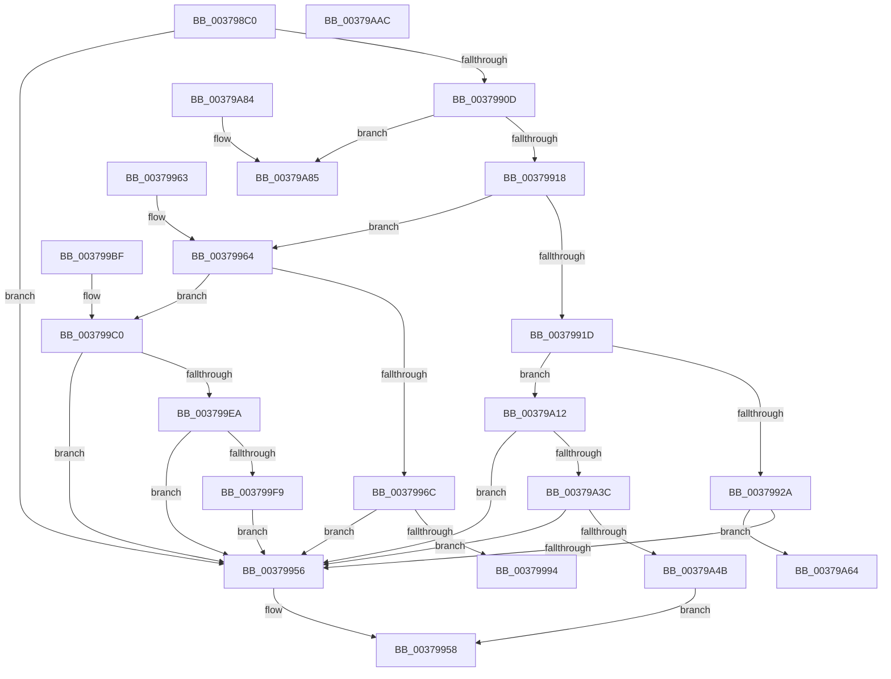

# MiUpdateLargePageCandidates

- RVA: `0x003798C0`–`0x00379AAD` (길이 `493` bytes)
- VA: `0x00000001403798C0`
- 실행 섹션: `.text`
- PDB 이름 있음: `예`; PDB Function 태그: `아니요`
- unwind 정보 RVA: `0x0007AFA8`
- 디코드: `121`개 명령, `493/493` bytes 표시
- 미해석 바이트: `0` (있으면 어셈블리에 `.byte`로 보존)

> 이 문서는 커널 이미지의 기계어와 PDB 기호를 분석해 생성했습니다. 4번과 5번은 함수 원형과 자료형을 바이너리 사용 방식에서 추정한 C 해석이며 원본 소스 복구 결과는 아닙니다.

## 1. Dependencies

- 직접 호출 지점: **9**; 고유 호출 대상: **3**
- 직접 호출자로 확인된 함수: **1**
- RIP 상대 이미지 참조: **2**

### Outgoing calls
- `0x0037993A` → [MiUpdateLargePageCandidateValue](../33/MiUpdateLargePageCandidateValue_function_0033EF80.md) (function, `0x0033EF80`)
- `0x0037997C` → [MiUpdateLargePageCandidateValue](../33/MiUpdateLargePageCandidateValue_function_0033EF80.md) (function, `0x0033EF80`)
- `0x00379997` → [MiPageToNode](../33/MiPageToNode_function_00338CD0.md) (function, `0x00338CD0`)
- `0x003799D0` → [MiUpdateLargePageCandidateValue](../33/MiUpdateLargePageCandidateValue_function_0033EF80.md) (function, `0x0033EF80`)
- `0x00379A08` → [MiRecordLargePageCandidate](MiRecordLargePageCandidate_function_0037A624.md) (function, `0x0037A624`)
- `0x00379A22` → [MiUpdateLargePageCandidateValue](../33/MiUpdateLargePageCandidateValue_function_0033EF80.md) (function, `0x0033EF80`)
- `0x00379A5A` → [MiRecordLargePageCandidate](MiRecordLargePageCandidate_function_0037A624.md) (function, `0x0037A624`)
- `0x00379A74` → [MiRecordLargePageCandidate](MiRecordLargePageCandidate_function_0037A624.md) (function, `0x0037A624`)
- `0x00379A9A` → [MiUpdateLargePageCandidateValue](../33/MiUpdateLargePageCandidateValue_function_0033EF80.md) (function, `0x0033EF80`)

### Direct callers
- [sub_006F3CFE](../6F/Unknown_function_006F3CFE.md) at `0x006F3D3A`

### Static image references
- `0x003798F0` → RVA `0x00E30088` (`.data`; read)
- `0x003799EA` → RVA `0x00FC6B30` (`ALMOSTRO`; read)

## 2. Other-region calls and transfers

- 다른 실행 섹션으로 향하는 call: **0**
- 별도 외부 분기/꼬리 이동을 확인하지 못했습니다.

## 3. Assembly (complete function range)

```asm
003798C0  48 89 5C 24 10                  mov qword ptr [rsp + 0x10], rbx
003798C5  57                              push rdi
003798C6  48 83 EC 30                     sub rsp, 0x30
003798CA  45 33 D2                        xor r10d, r10d
003798CD  48 8D 04 49                     lea rax, [rcx + rcx*2]
003798D1  66 44 89 54 24 40               mov word ptr [rsp + 0x40], r10w
003798D7  48 03 C0                        add rax, rax
003798DA  44 89 54 24 58                  mov dword ptr [rsp + 0x58], r10d
003798DF  48 8B D9                        mov rbx, rcx
003798E2  48 B9 28 00 00 00 00 DE FF FF   movabs rcx, 0xffffde0000000028
003798EC  48 8B 04 C1                     mov rax, qword ptr [rcx + rax*8]
003798F0  48 8B 0D 91 67 AB 00            mov rcx, qword ptr [rip + 0xab6791]
003798F7  48 C1 E8 2B                     shr rax, 0x2b
003798FB  25 FF 03 00 00                  and eax, 0x3ff
00379900  48 8B 3C C1                     mov rdi, qword ptr [rcx + rax*8]
00379904  44 38 97 E6 3E 00 00            cmp byte ptr [rdi + 0x3ee6], r10b
0037990B  74 49                           je 0x140379956
0037990D  48 8B CF                        mov rcx, rdi
00379910  85 D2                           test edx, edx
00379912  0F 84 6D 01 00 00               je 0x140379a85
00379918  4D 85 C0                        test r8, r8
0037991B  7E 47                           jle 0x140379964
0037991D  45 8D 4A 01                     lea r9d, [r10 + 1]
00379921  83 FA 02                        cmp edx, 2
00379924  0F 85 E8 00 00 00               jne 0x140379a12
0037992A  48 8D 44 24 40                  lea rax, [rsp + 0x40]
0037992F  44 8B C2                        mov r8d, edx
00379932  48 8B D3                        mov rdx, rbx
00379935  48 89 44 24 20                  mov qword ptr [rsp + 0x20], rax
0037993A  E8 41 56 FC FF                  call 0x14033ef80
0037993F  0F B7 44 24 40                  movzx eax, word ptr [rsp + 0x40]
00379944  48 25 00 FC FF FF               and rax, 0xfffffffffffffc00
0037994A  48 3D 00 80 00 00               cmp rax, 0x8000
00379950  0F 84 0E 01 00 00               je 0x140379a64
00379956  33 C0                           xor eax, eax
00379958  48 8B 5C 24 48                  mov rbx, qword ptr [rsp + 0x48]
0037995D  48 83 C4 30                     add rsp, 0x30
00379961  5F                              pop rdi
00379962  C3                              ret
00379963  CC                              int3
00379964  45 33 C9                        xor r9d, r9d
00379967  83 FA 02                        cmp edx, 2
0037996A  75 54                           jne 0x1403799c0
0037996C  48 8D 44 24 40                  lea rax, [rsp + 0x40]
00379971  44 8B C2                        mov r8d, edx
00379974  48 8B D3                        mov rdx, rbx
00379977  48 89 44 24 20                  mov qword ptr [rsp + 0x20], rax
0037997C  E8 FF 55 FC FF                  call 0x14033ef80
00379981  0F B7 44 24 40                  movzx eax, word ptr [rsp + 0x40]
00379986  48 25 00 FC FF FF               and rax, 0xfffffffffffffc00
0037998C  48 3D 00 7C 00 00               cmp rax, 0x7c00
00379992  75 C2                           jne 0x140379956
00379994  48 8B CB                        mov rcx, rbx
00379997  E8 34 F3 FB FF                  call 0x140338cd0
0037999C  8B C0                           mov eax, eax
0037999E  48 69 C8 80 DF 00 00            imul rcx, rax, 0xdf80
003799A5  48 8B 47 10                     mov rax, qword ptr [rdi + 0x10]
003799A9  F0 48 FF 8C 01 20 DF 00 00      lock dec qword ptr [rcx + rax + 0xdf20]
003799B2  33 C0                           xor eax, eax
003799B4  48 8B 5C 24 48                  mov rbx, qword ptr [rsp + 0x48]
003799B9  48 83 C4 30                     add rsp, 0x30
003799BD  5F                              pop rdi
003799BE  C3                              ret
003799BF  CC                              int3
003799C0  48 8D 44 24 58                  lea rax, [rsp + 0x58]
003799C5  44 8B C2                        mov r8d, edx
003799C8  48 8B D3                        mov rdx, rbx
003799CB  48 89 44 24 20                  mov qword ptr [rsp + 0x20], rax
003799D0  E8 AB 55 FC FF                  call 0x14033ef80
003799D5  8B 44 24 58                     mov eax, dword ptr [rsp + 0x58]
003799D9  25 00 00 F8 1F                  and eax, 0x1ff80000
003799DE  48 3D 00 00 F8 0F               cmp rax, 0xff80000
003799E4  0F 85 6C FF FF FF               jne 0x140379956
003799EA  48 0F BA 25 3D D1 C4 00 25      bt qword ptr [rip + 0xc4d13d], 0x25
003799F3  0F 83 5D FF FF FF               jae 0x140379956
003799F9  41 B9 01 00 00 00               mov r9d, 1
003799FF  45 33 C0                        xor r8d, r8d
00379A02  48 8B D3                        mov rdx, rbx
00379A05  48 8B CF                        mov rcx, rdi
00379A08  E8 17 0C 00 00                  call 0x14037a624
00379A0D  E9 44 FF FF FF                  jmp 0x140379956
00379A12  48 8D 44 24 58                  lea rax, [rsp + 0x58]
00379A17  44 8B C2                        mov r8d, edx
00379A1A  48 8B D3                        mov rdx, rbx
00379A1D  48 89 44 24 20                  mov qword ptr [rsp + 0x20], rax
00379A22  E8 59 55 FC FF                  call 0x14033ef80
00379A27  8B 44 24 58                     mov eax, dword ptr [rsp + 0x58]
00379A2B  25 00 00 F8 1F                  and eax, 0x1ff80000
00379A30  48 3D 00 00 00 10               cmp rax, 0x10000000
00379A36  0F 85 1A FF FF FF               jne 0x140379956
00379A3C  48 0F BA 25 EB D0 C4 00 25      bt qword ptr [rip + 0xc4d0eb], 0x25
00379A45  0F 83 0B FF FF FF               jae 0x140379956
00379A4B  41 B9 08 00 00 00               mov r9d, 8
00379A51  45 33 C0                        xor r8d, r8d
00379A54  48 8B D3                        mov rdx, rbx
00379A57  48 8B CF                        mov rcx, rdi
00379A5A  E8 C5 0B 00 00                  call 0x14037a624
00379A5F  E9 F4 FE FF FF                  jmp 0x140379958
00379A64  41 B9 08 00 00 00               mov r9d, 8
00379A6A  48 8B D3                        mov rdx, rbx
00379A6D  48 8B CF                        mov rcx, rdi
00379A70  45 8D 41 F9                     lea r8d, [r9 - 7]
00379A74  E8 AB 0B 00 00                  call 0x14037a624
00379A79  48 8B 5C 24 48                  mov rbx, qword ptr [rsp + 0x48]
00379A7E  48 83 C4 30                     add rsp, 0x30
00379A82  5F                              pop rdi
00379A83  C3                              ret
00379A84  CC                              int3
00379A85  4D 85 C0                        test r8, r8
00379A88  4C 89 54 24 20                  mov qword ptr [rsp + 0x20], r10
00379A8D  45 8B CA                        mov r9d, r10d
00379A90  48 8B D3                        mov rdx, rbx
00379A93  41 0F 9F C1                     setg r9b
00379A97  45 33 C0                        xor r8d, r8d
00379A9A  E8 E1 54 FC FF                  call 0x14033ef80
00379A9F  48 8B 5C 24 48                  mov rbx, qword ptr [rsp + 0x48]
00379AA4  33 C0                           xor eax, eax
00379AA6  48 83 C4 30                     add rsp, 0x30
00379AAA  5F                              pop rdi
00379AAB  C3                              ret
00379AAC  CC                              int3
```

## 4. C-style interpretation (structured pseudocode)

```c
__int64 __fastcall MiUpdateLargePageCandidates(__int64 a1, int a2, __int64 a3)
{
    __int64 result;
    __int64 v_r10;
    __int64 v_rsp;
    unsigned __int64 v_stack_m18;
    unsigned __int64 v_stack_p10;
    unsigned int v_stack_p20;
    unsigned __int64 v_stack_p40;
    unsigned __int64 v_stack_p48;
    unsigned __int64 v_stack_p58;
    unsigned __int16 v_stack_p8;
    unsigned __int64 v_stack_p80;
    unsigned __int64 v_stack_p90;
    unsigned __int64 v_stack_pB8;

    v_stack_p10 = v_rbx;
    v_rsp = (v_rsp) - (48);
    v_r10 = 0;
    v_stack_p8 = 0;
    result = (a1 + a1 * 2) + (a1 + a1 * 2);
    v_stack_p20 = 0;
    result = (*(unsigned __int64 *)(a1 + result * 8)) >> (43);
    result = (unsigned int)((result) & (0x3FFULL));
    if ((*(unsigned __int8 *)(*(unsigned __int64 *)(*(unsigned __int64 *)(v_rip + 11233169) + result * 8) + 16102)) == 0) goto loc_00379956;
    if (a2 == 0) goto loc_00379A85;
    if (condition_is_less_or_equal) goto loc_00379964;
    if (a2 != 2) goto loc_00379A12;
    v_stack_m18 = v_stack_p8;
    result = MiUpdateLargePageCandidateValue(*(unsigned __int64 *)(*(unsigned __int64 *)(v_rip + 11233169) + result * 8), a1, (unsigned int)(a2), v_r10 + 1);
    result = (v_stack_p8) & (0xFFFFFFFFFFFFFC00ULL);
    if (result == 0x8000ULL) goto loc_00379A64;
loc_00379956:
    result = 0;
loc_00379958:
    v_rsp = (v_rsp) + (48);
    return result;
loc_00379964:
    a4 = 0;
    if (((unsigned int)(a1)) != 2) goto loc_003799C0;
    v_stack_p20 = v_stack_p40;
    result = MiUpdateLargePageCandidateValue(*(unsigned __int64 *)(*(unsigned __int64 *)(v_rip + 11233169) + result * 8), v_stack_p10, (unsigned int)((unsigned int)(a1)), a4);
    result = (v_stack_p40) & (0xFFFFFFFFFFFFFC00ULL);
    if (result != 0x7C00ULL) goto loc_00379956;
    result = MiPageToNode(v_stack_p10, v_stack_p10, (unsigned int)((unsigned int)(a1)), a4);
    a1 = (v_stack_p10) * ((unsigned int)((unsigned int)(result)));
    result = 0;
    v_rsp = (v_rsp) + (48);
    return result;
loc_003799C0:
    v_stack_p58 = v_stack_p90;
    result = MiUpdateLargePageCandidateValue(a1, v_stack_p48, (unsigned int)((unsigned int)(v_stack_p10)), a4);
    result = (unsigned int)(((unsigned int)(v_stack_p90)) & (0x1FF80000ULL));
    if (result != 0xFF80000ULL) goto loc_00379956;
    if (result >= 0xFF80000ULL) goto loc_00379956;
    a3 = 0;
    result = MiRecordLargePageCandidate(*(unsigned __int64 *)(*(unsigned __int64 *)(v_rip + 11233169) + result * 8), v_stack_p48, a3, 1);
    goto loc_00379956;
loc_00379A12:
    v_stack_p58 = v_stack_p90;
    result = MiUpdateLargePageCandidateValue(*(unsigned __int64 *)(*(unsigned __int64 *)(v_rip + 11233169) + result * 8), v_stack_p48, (unsigned int)((unsigned int)(v_stack_p48)), 1);
    result = (unsigned int)(((unsigned int)(v_stack_p90)) & (0x1FF80000ULL));
    if (result != 0x10000000ULL) goto loc_00379956;
    if (result >= 0x10000000ULL) goto loc_00379956;
    a3 = 0;
    result = MiRecordLargePageCandidate(*(unsigned __int64 *)(*(unsigned __int64 *)(v_rip + 11233169) + result * 8), v_stack_p48, a3, 8);
    goto loc_00379958;
loc_00379A64:
    result = MiRecordLargePageCandidate(*(unsigned __int64 *)(*(unsigned __int64 *)(v_rip + 11233169) + result * 8), v_stack_p48, 8 - 7, 8);
    v_rsp = (v_rsp) + (48);
    return result;
loc_00379A85:
    v_stack_p90 = 0;
    a4 = (condition_is_greater) ? 1 : 0;
    a3 = 0;
    result = MiUpdateLargePageCandidateValue(*(unsigned __int64 *)(*(unsigned __int64 *)(v_rip + 11233169) + result * 8), v_stack_p80, a3, a4);
    result = 0;
    v_rsp = (v_rsp) + (48);
    return result;
}
```

## 5. (Beta) C Style

```c
int64_t MiUpdateLargePageCandidates(void *Arg1, int32_t Arg2, int64_t Arg3)
{
    uint8_t *arg1 = (uint8_t *)Arg1;

    int64_t result;
    int64_t local_r10;
    int64_t local_rsp;
    uint64_t v_stack_m18;
    uint64_t v_stack_p10;
    uint32_t v_stack_p20;
    uint64_t v_stack_p40;
    uint64_t v_stack_p48;
    uint64_t v_stack_p58;
    uint16_t v_stack_p8;
    uint64_t v_stack_p80;
    uint64_t v_stack_p90;
    uint64_t v_stack_pB8;

    v_stack_p10 = local_rbx;
    local_rsp = (local_rsp) - (48);
    local_r10 = 0;
    v_stack_p8 = 0;
    result = (Arg1 + Arg1 * 2) + (Arg1 + Arg1 * 2);
    v_stack_p20 = 0;
    result = (*(uint64_t *)(arg1 + result * 8)) >> (43);
    result = (uint32_t)((result) & (0x3FFULL));
    if ((*(uint8_t *)(*(uint64_t *)(*(uint64_t *)(v_rip + 0xAB6791) + result * 8) + 0x3EE6)) == 0) goto loc_00379956;
    if (Arg2 == 0) goto loc_00379A85;
    if (condition_is_less_or_equal) goto loc_00379964;
    if (Arg2 != 2) goto loc_00379A12;
    v_stack_m18 = v_stack_p8;
    result = MiUpdateLargePageCandidateValue(*(uint64_t *)(*(uint64_t *)(v_rip + 0xAB6791) + result * 8), Arg1, (uint32_t)(Arg2), local_r10 + 1);
    result = (v_stack_p8) & (0xFFFFFFFFFFFFFC00ULL);
    if (result == 0x8000ULL) goto loc_00379A64;
loc_00379956:
    result = 0;
loc_00379958:
    local_rsp = (local_rsp) + (48);
    return result;
loc_00379964:
    a4 = 0;
    if (((uint32_t)(Arg1)) != 2) goto loc_003799C0;
    v_stack_p20 = v_stack_p40;
    result = MiUpdateLargePageCandidateValue(*(uint64_t *)(*(uint64_t *)(v_rip + 0xAB6791) + result * 8), v_stack_p10, (uint32_t)((uint32_t)(Arg1)), a4);
    result = (v_stack_p40) & (0xFFFFFFFFFFFFFC00ULL);
    if (result != 0x7C00ULL) goto loc_00379956;
    result = MiPageToNode(v_stack_p10, v_stack_p10, (uint32_t)((uint32_t)(Arg1)), a4);
    Arg1 = (v_stack_p10) * ((uint32_t)((uint32_t)(result)));
    result = 0;
    local_rsp = (local_rsp) + (48);
    return result;
loc_003799C0:
    v_stack_p58 = v_stack_p90;
    result = MiUpdateLargePageCandidateValue(Arg1, v_stack_p48, (uint32_t)((uint32_t)(v_stack_p10)), a4);
    result = (uint32_t)(((uint32_t)(v_stack_p90)) & (0x1FF80000ULL));
    if (result != 0xFF80000ULL) goto loc_00379956;
    if (result >= 0xFF80000ULL) goto loc_00379956;
    Arg3 = 0;
    result = MiRecordLargePageCandidate(*(uint64_t *)(*(uint64_t *)(v_rip + 0xAB6791) + result * 8), v_stack_p48, Arg3, 1);
    goto loc_00379956;
loc_00379A12:
    v_stack_p58 = v_stack_p90;
    result = MiUpdateLargePageCandidateValue(*(uint64_t *)(*(uint64_t *)(v_rip + 0xAB6791) + result * 8), v_stack_p48, (uint32_t)((uint32_t)(v_stack_p48)), 1);
    result = (uint32_t)(((uint32_t)(v_stack_p90)) & (0x1FF80000ULL));
    if (result != 0x10000000ULL) goto loc_00379956;
    if (result >= 0x10000000ULL) goto loc_00379956;
    Arg3 = 0;
    result = MiRecordLargePageCandidate(*(uint64_t *)(*(uint64_t *)(v_rip + 0xAB6791) + result * 8), v_stack_p48, Arg3, 8);
    goto loc_00379958;
loc_00379A64:
    result = MiRecordLargePageCandidate(*(uint64_t *)(*(uint64_t *)(v_rip + 0xAB6791) + result * 8), v_stack_p48, 8 - 7, 8);
    local_rsp = (local_rsp) + (48);
    return result;
loc_00379A85:
    v_stack_p90 = 0;
    a4 = (condition_is_greater) ? 1 : 0;
    Arg3 = 0;
    result = MiUpdateLargePageCandidateValue(*(uint64_t *)(*(uint64_t *)(v_rip + 0xAB6791) + result * 8), v_stack_p80, Arg3, a4);
    result = 0;
    local_rsp = (local_rsp) + (48);
    return result;
}
```

### 관측된 메모리 오프셋

구조체 형식이 확인되지 않은 접근은 인자 기준의 오프셋으로만 기록했습니다.

| 기준 인자 | 오프셋 표현 | 폭 (bit) | 접근 |
|---|---:|---:|---|
| `Arg1` | `+ 0x0 + rcx*2` | `64` | `R` |

## 6. Execution-region graph

[열기: 2D/3D 그래프와 함수 탐색 컨트롤 패널](../../../control-panel.html?section=text&rva=0x003798C0&view=graph)

- 2D 그래프는 위에서 아래로 흐르고, 3D 그래프는 빈 공간을 드래그해 회전합니다. Shift+드래그는 이동, 휠은 확대·축소, 함수 노드 선택은 대상 보고서 이동입니다.

### Static fallback


