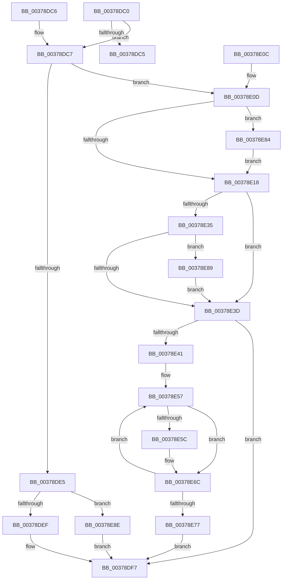

# MiUpdateSlabTypeAvailablePages

- RVA: `0x00378DC0`–`0x00378E9B` (길이 `219` bytes)
- VA: `0x0000000140378DC0`
- 실행 섹션: `.text`
- PDB 이름 있음: `예`; PDB Function 태그: `아니요`
- unwind 정보 RVA: `0x0007AF04`
- 디코드: `63`개 명령, `219/219` bytes 표시
- 미해석 바이트: `0` (있으면 어셈블리에 `.byte`로 보존)

> 이 문서는 커널 이미지의 기계어와 PDB 기호를 분석해 생성했습니다. 4번과 5번은 함수 원형과 자료형을 바이너리 사용 방식에서 추정한 C 해석이며 원본 소스 복구 결과는 아닙니다.

## 1. Dependencies

- 직접 호출 지점: **3**; 고유 호출 대상: **3**
- 직접 호출자로 확인된 함수: **2**
- RIP 상대 이미지 참조: **0**

### Outgoing calls
- `0x00378E4B` → [ExAcquireSpinLockExclusiveAtDpcLevel](../24/ExAcquireSpinLockExclusiveAtDpcLevel_function_00248E80.md) (function, `0x00248E80`)
- `0x00378E65` → [KeSetEvent](../33/KeSetEvent_function_0033F310.md) (function, `0x0033F310`)
- `0x00378E7A` → [ExReleaseSpinLockExclusiveFromDpcLevel](../24/ExReleaseSpinLockExclusiveFromDpcLevel_function_002497E0.md) (function, `0x002497E0`)

### Direct callers
- [MiInsertSlabEntry](MiInsertSlabEntry_function_00378AF4.md) at `0x00378C0B`
- [MiRemoveSlabEntry](../44/MiRemoveSlabEntry_function_0044CF08.md) at `0x0044CF7A`

### Static image references
- 디코드된 RIP-relative 메모리 참조가 없습니다.

## 2. Other-region calls and transfers

- 다른 실행 섹션으로 향하는 call: **0**
- 별도 외부 분기/꼬리 이동을 확인하지 못했습니다.

## 3. Assembly (complete function range)

```asm
00378DC0  83 FA 08                        cmp edx, 8
00378DC3  74 02                           je 0x140378dc7
00378DC5  C3                              ret
00378DC6  CC                              int3
00378DC7  48 89 5C 24 08                  mov qword ptr [rsp + 8], rbx
00378DCC  48 89 6C 24 10                  mov qword ptr [rsp + 0x10], rbp
00378DD1  48 89 74 24 18                  mov qword ptr [rsp + 0x18], rsi
00378DD6  57                              push rdi
00378DD7  48 83 EC 20                     sub rsp, 0x20
00378DDB  33 FF                           xor edi, edi
00378DDD  48 8B D9                        mov rbx, rcx
00378DE0  4D 85 C0                        test r8, r8
00378DE3  7F 28                           jg 0x140378e0d
00378DE5  49 83 F8 FF                     cmp r8, -1
00378DE9  0F 85 9F 00 00 00               jne 0x140378e8e
00378DEF  F0 48 FF 89 80 47 00 00         lock dec qword ptr [rcx + 0x4780]
00378DF7  48 8B 5C 24 30                  mov rbx, qword ptr [rsp + 0x30]
00378DFC  48 8B 6C 24 38                  mov rbp, qword ptr [rsp + 0x38]
00378E01  48 8B 74 24 40                  mov rsi, qword ptr [rsp + 0x40]
00378E06  48 83 C4 20                     add rsp, 0x20
00378E0A  5F                              pop rdi
00378E0B  C3                              ret
00378E0C  CC                              int3
00378E0D  B8 01 00 00 00                  mov eax, 1
00378E12  49 83 F8 01                     cmp r8, 1
00378E16  75 6C                           jne 0x140378e84
00378E18  F0 48 0F C1 81 80 47 00 00      lock xadd qword ptr [rcx + 0x4780], rax
00378E21  48 85 C0                        test rax, rax
00378E24  8B CF                           mov ecx, edi
00378E26  BA 20 04 00 00                  mov edx, 0x420
00378E2B  0F 94 C1                        sete cl
00378E2E  8B F1                           mov esi, ecx
00378E30  48 3B C2                        cmp rax, rdx
00378E33  7D 08                           jge 0x140378e3d
00378E35  49 03 C0                        add rax, r8
00378E38  48 3B C2                        cmp rax, rdx
00378E3B  7D 4C                           jge 0x140378e89
00378E3D  85 F6                           test esi, esi
00378E3F  74 B6                           je 0x140378df7
00378E41  48 8D AB 40 3F 00 00            lea rbp, [rbx + 0x3f40]
00378E48  48 8B CD                        mov rcx, rbp
00378E4B  E8 30 00 ED FF                  call 0x140248e80
00378E50  48 81 C3 A0 47 00 00            add rbx, 0x47a0
00378E57  0F A3 FE                        bt esi, edi
00378E5A  73 10                           jae 0x140378e6c
00378E5C  48 8D 4B E8                     lea rcx, [rbx - 0x18]
00378E60  45 33 C0                        xor r8d, r8d
00378E63  33 D2                           xor edx, edx
00378E65  E8 A6 64 FC FF                  call 0x14033f310
00378E6A  FF 03                           inc dword ptr [rbx]
00378E6C  FF C7                           inc edi
00378E6E  48 83 C3 20                     add rbx, 0x20
00378E72  83 FF 02                        cmp edi, 2
00378E75  72 E0                           jb 0x140378e57
00378E77  48 8B CD                        mov rcx, rbp
00378E7A  E8 61 09 ED FF                  call 0x1402497e0
00378E7F  E9 73 FF FF FF                  jmp 0x140378df7
00378E84  49 8B C0                        mov rax, r8
00378E87  EB 8F                           jmp 0x140378e18
00378E89  83 CE 02                        or esi, 2
00378E8C  EB AF                           jmp 0x140378e3d
00378E8E  F0 4C 01 81 80 47 00 00         lock add qword ptr [rcx + 0x4780], r8
00378E96  E9 5C FF FF FF                  jmp 0x140378df7
```

## 4. C-style interpretation (structured pseudocode)

```c
__int64 __fastcall MiUpdateSlabTypeAvailablePages(__int64 a1, int a2, __int64 a3)
{
    __int64 result;
    __int64 v_rbx;
    __int64 v_rdi;
    __int64 v_rsi;
    __int64 v_rsp;
    unsigned __int64 v_stack_p10;
    unsigned __int64 v_stack_p18;
    unsigned __int64 v_stack_p8;

    if (a2 == 8) goto loc_00378DC7;
    return result;
loc_00378DC7:
    v_stack_p8 = v_rbx;
    v_stack_p10 = v_rbp;
    v_stack_p18 = v_rsi;
    v_rsp = (v_rsp) - (32);
    v_rdi = 0;
    if (condition_is_greater) goto loc_00378E0D;
    if (a3 != -1) goto loc_00378E8E;
loc_00378DF7:
    v_rsp = (v_rsp) + (32);
    return result;
loc_00378E0D:
    if (a3 != 1) goto loc_00378E84;
loc_00378E18:
    a1 = (1 == 0) ? 1 : 0;
    if (1 >= ((unsigned int)(0x420ULL))) goto loc_00378E3D;
    result = (1) + (a3);
    if (result >= ((unsigned int)(0x420ULL))) goto loc_00378E89;
loc_00378E3D:
    if ((unsigned int)((unsigned int)((unsigned int)(a1))) == 0) goto loc_00378DF7;
    result = ExAcquireSpinLockExclusiveAtDpcLevel(v_stack_p8 + 16192, (unsigned int)(0x420ULL), a3, a4);
    v_rbx = (v_stack_p8) + (0x47A0ULL);
loc_00378E57:
    if (!(condition_is_above_or_equal)) {
        a1 = v_rbx - 24;
        a3 = 0;
        a2 = 0;
        result = KeSetEvent(a1, a2, a3, a4);
    }
    v_rdi = (unsigned int)((v_rdi) + 1);
    v_rbx = (v_rbx) + (32);
    if (((unsigned int)(v_rdi)) < 2) goto loc_00378E57;
    result = ExReleaseSpinLockExclusiveFromDpcLevel(v_stack_p8 + 16192, a2, a3, a4);
    goto loc_00378DF7;
loc_00378E84:
    goto loc_00378E18;
loc_00378E89:
    v_rsi = (unsigned int)(((unsigned int)((unsigned int)(a1))) | (2));
    goto loc_00378E3D;
loc_00378E8E:
    goto loc_00378DF7;
}
```

## 5. (Beta) C Style

```c
int64_t MiUpdateSlabTypeAvailablePages(void *Arg1, int32_t Arg2, int64_t Arg3)
{
    uint8_t *arg1 = (uint8_t *)Arg1;

    int64_t result;
    int64_t local_rbx;
    int64_t local_rdi;
    int64_t local_rsi;
    int64_t local_rsp;
    uint64_t v_stack_p10;
    uint64_t v_stack_p18;
    uint64_t v_stack_p8;

    if (Arg2 == 8) goto loc_00378DC7;
    return result;
loc_00378DC7:
    v_stack_p8 = local_rbx;
    v_stack_p10 = local_rbp;
    v_stack_p18 = local_rsi;
    local_rsp = (local_rsp) - (32);
    local_rdi = 0;
    if (condition_is_greater) goto loc_00378E0D;
    if (Arg3 != -1) goto loc_00378E8E;
loc_00378DF7:
    local_rsp = (local_rsp) + (32);
    return result;
loc_00378E0D:
    if (Arg3 != 1) goto loc_00378E84;
loc_00378E18:
    Arg1 = (1 == 0) ? 1 : 0;
    if (1 >= ((uint32_t)(0x420ULL))) goto loc_00378E3D;
    result = (1) + (Arg3);
    if (result >= ((uint32_t)(0x420ULL))) goto loc_00378E89;
loc_00378E3D:
    if ((uint32_t)((uint32_t)((uint32_t)(Arg1))) == 0) goto loc_00378DF7;
    result = ExAcquireSpinLockExclusiveAtDpcLevel(v_stack_p8 + 16192, (uint32_t)(0x420ULL), Arg3, a4);
    local_rbx = (v_stack_p8) + (0x47A0ULL);
loc_00378E57:
    if (!(condition_is_above_or_equal)) {
        Arg1 = local_rbx - 24;
        Arg3 = 0;
        Arg2 = 0;
        result = KeSetEvent(Arg1, Arg2, Arg3, a4);
    }
    local_rdi = (uint32_t)((local_rdi) + 1);
    local_rbx = (local_rbx) + (32);
    if (((uint32_t)(local_rdi)) < 2) goto loc_00378E57;
    result = ExReleaseSpinLockExclusiveFromDpcLevel(v_stack_p8 + 16192, Arg2, Arg3, a4);
    goto loc_00378DF7;
loc_00378E84:
    goto loc_00378E18;
loc_00378E89:
    local_rsi = (uint32_t)(((uint32_t)((uint32_t)(Arg1))) | (2));
    goto loc_00378E3D;
loc_00378E8E:
    goto loc_00378DF7;
}
```

### 관측된 메모리 오프셋

구조체 형식이 확인되지 않은 접근은 인자 기준의 오프셋으로만 기록했습니다.

| 기준 인자 | 오프셋 표현 | 폭 (bit) | 접근 |
|---|---:|---:|---|
| `Arg1` | `- 0x18` | `64` | `R` |
| `Arg1` | `+ 0x0` | `32` | `R/W` |
| `Arg1` | `+ 0x3F40` | `64` | `R` |
| `Arg1` | `+ 0x4780` | `64` | `R/W` |

## 6. Execution-region graph

[열기: 2D/3D 그래프와 함수 탐색 컨트롤 패널](../../../control-panel.html?section=text&rva=0x00378DC0&view=graph)

- 2D 그래프는 위에서 아래로 흐르고, 3D 그래프는 빈 공간을 드래그해 회전합니다. Shift+드래그는 이동, 휠은 확대·축소, 함수 노드 선택은 대상 보고서 이동입니다.

### Static fallback


