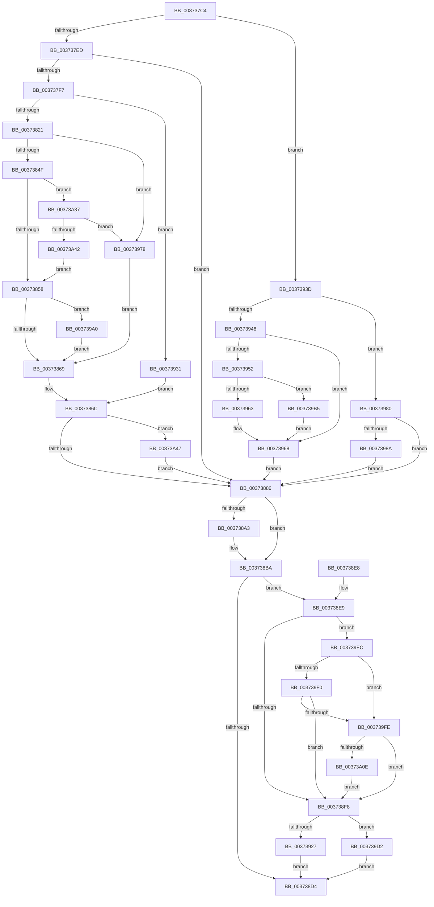

# MiWriteCompletePfn

- RVA: `0x003737C4`–`0x00373A57` (길이 `659` bytes)
- VA: `0x00000001403737C4`
- 실행 섹션: `.text`
- PDB 이름 있음: `예`; PDB Function 태그: `아니요`
- unwind 정보 RVA: `0x0007AA80`
- 디코드: `175`개 명령, `659/659` bytes 표시
- 미해석 바이트: `0` (있으면 어셈블리에 `.byte`로 보존)

> 이 문서는 커널 이미지의 기계어와 PDB 기호를 분석해 생성했습니다. 4번과 5번은 함수 원형과 자료형을 바이너리 사용 방식에서 추정한 C 해석이며 원본 소스 복구 결과는 아닙니다.

## 1. Dependencies

- 직접 호출 지점: **12**; 고유 호출 대상: **10**
- 직접 호출자로 확인된 함수: **4**
- RIP 상대 이미지 참조: **1**

### Outgoing calls
- `0x00373812` → [MiIsPfnOriginalPteLost](MiIsPfnOriginalPteLost_function_00373B5C.md) (function, `0x00373B5C`)
- `0x00373828` → [MI_READ_PTE_LOCK_FREE](../28/MI_READ_PTE_LOCK_FREE_function_002828A0.md) (function, `0x002828A0`)
- `0x00373875` → [MiCapturePageFileInfoInline](MiCapturePageFileInfoInline_function_00373A60.md) (function, `0x00373A60`)
- `0x0037392A` → [MiPfnReferenceCountIsZero](../2B/MiPfnReferenceCountIsZero_function_002B9E40.md) (function, `0x002B9E40`)
- `0x0037393D` → [MiIsPfnOriginalPteLost](MiIsPfnOriginalPteLost_function_00373B5C.md) (function, `0x00373B5C`)
- `0x0037396E` → [MiSetPfnModified](../36/MiSetPfnModified_function_00362960.md) (function, `0x00362960`)
- `0x00373993` → [MiCapturePageFileInfoInline](MiCapturePageFileInfoInline_function_00373A60.md) (function, `0x00373A60`)
- `0x003739C6` → [MiClearPageFileReservation](../32/MiClearPageFileReservation_function_0032B68C.md) (function, `0x0032B68C`)
- `0x003739D5` → [MiRestoreTransitionPte](../33/MiRestoreTransitionPte_function_0033DD90.md) (function, `0x0033DD90`)
- `0x003739E2` → [MiInsertPageInFreeOrZeroedList](../33/MiInsertPageInFreeOrZeroedList_function_00334D20.md) (function, `0x00334D20`)
- `0x00373A01` → [MiIsPfnCommitNotCharged](../31/MiIsPfnCommitNotCharged_function_00317370.md) (function, `0x00317370`)
- `0x00373A2D` → [MiReturnCommit](../24/MiReturnCommit_function_00248410.md) (function, `0x00248410`)

### Direct callers
- [MiUnlockStoreLockedPages](MiUnlockStoreLockedPages_function_003735C0.md) at `0x00373681`
- [MiWriteComplete](../40/MiWriteComplete_function_004069B0.md) at `0x00406B57`
- [sub_006E3DF6](../6E/Unknown_function_006E3DF6.md) at `0x006E3E1D`
- [sub_006EC446](../6E/Unknown_function_006EC446.md) at `0x006EC46D`
- [sub_006EC446](../6E/Unknown_function_006EC446.md) at `0x006EC548`

### Static image references
- `0x003737FB` → RVA `0x00E30088` (`.data`; read)

## 2. Other-region calls and transfers

- 다른 실행 섹션으로 향하는 call: **0**
- 별도 외부 분기/꼬리 이동을 확인하지 못했습니다.

## 3. Assembly (complete function range)

```asm
003737C4  48 89 5C 24 18                  mov qword ptr [rsp + 0x18], rbx
003737C9  55                              push rbp
003737CA  56                              push rsi
003737CB  57                              push rdi
003737CC  41 56                           push r14
003737CE  41 57                           push r15
003737D0  48 83 EC 20                     sub rsp, 0x20
003737D4  33 DB                           xor ebx, ebx
003737D6  33 ED                           xor ebp, ebp
003737D8  4D 8B F0                        mov r14, r8
003737DB  8B FA                           mov edi, edx
003737DD  48 8B F1                        mov rsi, rcx
003737E0  44 8D 7B 01                     lea r15d, [rbx + 1]
003737E4  41 84 D7                        test r15b, dl
003737E7  0F 85 50 01 00 00               jne 0x14037393d
003737ED  40 F6 C7 02                     test dil, 2
003737F1  0F 84 8F 00 00 00               je 0x140373886
003737F7  48 8B 41 28                     mov rax, qword ptr [rcx + 0x28]
003737FB  48 8B 0D 86 C8 AB 00            mov rcx, qword ptr [rip + 0xabc886]
00373802  48 C1 E8 2B                     shr rax, 0x2b
00373806  25 FF 03 00 00                  and eax, 0x3ff
0037380B  48 8B 1C C1                     mov rbx, qword ptr [rcx + rax*8]
0037380F  48 8B CE                        mov rcx, rsi
00373812  E8 45 03 00 00                  call 0x140373b5c
00373817  8B E8                           mov ebp, eax
00373819  85 C0                           test eax, eax
0037381B  0F 85 10 01 00 00               jne 0x140373931
00373821  4C 8D 76 10                     lea r14, [rsi + 0x10]
00373825  49 8B CE                        mov rcx, r14
00373828  E8 73 F0 F0 FF                  call 0x1402828a0
0037382D  48 8B C8                        mov rcx, rax
00373830  48 C1 E9 0C                     shr rcx, 0xc
00373834  83 E1 0F                        and ecx, 0xf
00373837  48 8B 8C CB 60 48 00 00         mov rcx, qword ptr [rbx + rcx*8 + 0x4860]
0037383F  0F B7 91 AC 00 00 00            movzx edx, word ptr [rcx + 0xac]
00373846  F6 C2 10                        test dl, 0x10
00373849  0F 85 29 01 00 00               jne 0x140373978
0037384F  F6 C2 20                        test dl, 0x20
00373852  0F 85 DF 01 00 00               jne 0x140373a37
00373858  41 8B 06                        mov eax, dword ptr [r14]
0037385B  45 33 D2                        xor r10d, r10d
0037385E  D0 E8                           shr al, 1
00373860  41 84 C7                        test r15b, al
00373863  0F 85 37 01 00 00               jne 0x1403739a0
00373869  4D 8B DE                        mov r11, r14
0037386C  45 8B C2                        mov r8d, r10d
0037386F  41 8B D7                        mov edx, r15d
00373872  49 8B CE                        mov rcx, r14
00373875  E8 E6 01 00 00                  call 0x140373a60
0037387A  48 8B D8                        mov rbx, rax
0037387D  45 85 D2                        test r10d, r10d
00373880  0F 85 C1 01 00 00               jne 0x140373a47
00373886  8B 46 20                        mov eax, dword ptr [rsi + 0x20]
00373889  89 44 24 58                     mov dword ptr [rsp + 0x58], eax
0037388D  C1 E8 10                        shr eax, 0x10
00373890  24 F7                           and al, 0xf7
00373892  88 44 24 5A                     mov byte ptr [rsp + 0x5a], al
00373896  8B 44 24 58                     mov eax, dword ptr [rsp + 0x58]
0037389A  89 46 20                        mov dword ptr [rsi + 0x20], eax
0037389D  40 F6 C7 08                     test dil, 8
003738A1  74 17                           je 0x1403738ba
003738A3  8B 46 20                        mov eax, dword ptr [rsi + 0x20]
003738A6  89 44 24 58                     mov dword ptr [rsp + 0x58], eax
003738AA  C1 E8 18                        shr eax, 0x18
003738AD  24 F8                           and al, 0xf8
003738AF  88 44 24 5B                     mov byte ptr [rsp + 0x5b], al
003738B3  8B 44 24 58                     mov eax, dword ptr [rsp + 0x58]
003738B7  89 46 20                        mov dword ptr [rsi + 0x20], eax
003738BA  8B 46 20                        mov eax, dword ptr [rsi + 0x20]
003738BD  89 44 24 58                     mov dword ptr [rsp + 0x58], eax
003738C1  B8 FF FF 00 00                  mov eax, 0xffff
003738C6  66 01 44 24 58                  add word ptr [rsp + 0x58], ax
003738CB  8B 44 24 58                     mov eax, dword ptr [rsp + 0x58]
003738CF  89 46 20                        mov dword ptr [rsi + 0x20], eax
003738D2  74 15                           je 0x1403738e9
003738D4  48 8B C3                        mov rax, rbx
003738D7  48 8B 5C 24 60                  mov rbx, qword ptr [rsp + 0x60]
003738DC  48 83 C4 20                     add rsp, 0x20
003738E0  41 5F                           pop r15
003738E2  41 5E                           pop r14
003738E4  5F                              pop rdi
003738E5  5E                              pop rsi
003738E6  5D                              pop rbp
003738E7  C3                              ret
003738E8  CC                              int3
003738E9  48 8B 46 18                     mov rax, qword ptr [rsi + 0x18]
003738ED  48 0F BA E0 3E                  bt rax, 0x3e
003738F2  0F 82 F4 00 00 00               jb 0x1403739ec
003738F8  48 B8 00 00 00 00 00 DE FF FF   movabs rax, 0xffffde0000000000
00373902  48 8B EE                        mov rbp, rsi
00373905  48 8B CE                        mov rcx, rsi
00373908  48 2B E8                        sub rbp, rax
0037390B  48 B8 AB AA AA AA AA AA AA AA   movabs rax, 0xaaaaaaaaaaaaaaab
00373915  48 C1 FD 04                     sar rbp, 4
00373919  48 0F AF E8                     imul rbp, rax
0037391D  40 F6 C7 04                     test dil, 4
00373921  0F 85 AB 00 00 00               jne 0x1403739d2
00373927  48 8B D5                        mov rdx, rbp
0037392A  E8 11 65 F4 FF                  call 0x1402b9e40
0037392F  EB A3                           jmp 0x1403738d4
00373931  45 33 D2                        xor r10d, r10d
00373934  4C 8D 5E 10                     lea r11, [rsi + 0x10]
00373938  E9 2F FF FF FF                  jmp 0x14037386c
0037393D  E8 1A 02 00 00                  call 0x140373b5c
00373942  8B E8                           mov ebp, eax
00373944  85 C0                           test eax, eax
00373946  75 38                           jne 0x140373980
00373948  8B 46 10                        mov eax, dword ptr [rsi + 0x10]
0037394B  48 0F BA E0 0A                  bt rax, 0xa
00373950  72 16                           jb 0x140373968
00373952  48 8B 46 10                     mov rax, qword ptr [rsi + 0x10]
00373956  48 89 44 24 50                  mov qword ptr [rsp + 0x50], rax
0037395B  C0 E8 02                        shr al, 2
0037395E  41 84 C7                        test r15b, al
00373961  75 52                           jne 0x1403739b5
00373963  48 89 5C 24 50                  mov qword ptr [rsp + 0x50], rbx
00373968  41 8B D7                        mov edx, r15d
0037396B  48 8B CE                        mov rcx, rsi
0037396E  E8 ED EF FE FF                  call 0x140362960
00373973  E9 0E FF FF FF                  jmp 0x140373886
00373978  45 8B D7                        mov r10d, r15d
0037397B  E9 E9 FE FF FF                  jmp 0x140373869
00373980  40 F6 C7 20                     test dil, 0x20
00373984  0F 85 FC FE FF FF               jne 0x140373886
0037398A  45 33 C0                        xor r8d, r8d
0037398D  41 8B D7                        mov edx, r15d
00373990  49 8B CE                        mov rcx, r14
00373993  E8 C8 00 00 00                  call 0x140373a60
00373998  48 8B D8                        mov rbx, rax
0037399B  E9 E6 FE FF FF                  jmp 0x140373886
003739A0  48 8B 46 28                     mov rax, qword ptr [rsi + 0x28]
003739A4  48 C1 E8 3C                     shr rax, 0x3c
003739A8  24 07                           and al, 7
003739AA  3C 02                           cmp al, 2
003739AC  45 0F 44 D7                     cmove r10d, r15d
003739B0  E9 B4 FE FF FF                  jmp 0x140373869
003739B5  48 8B 46 10                     mov rax, qword ptr [rsi + 0x10]
003739B9  48 8D 4C 24 50                  lea rcx, [rsp + 0x50]
003739BE  48 83 E0 FB                     and rax, 0xfffffffffffffffb
003739C2  48 89 46 10                     mov qword ptr [rsi + 0x10], rax
003739C6  E8 C1 7C FB FF                  call 0x14032b68c
003739CB  48 8B 5C 24 50                  mov rbx, qword ptr [rsp + 0x50]
003739D0  EB 96                           jmp 0x140373968
003739D2  41 8B D7                        mov edx, r15d
003739D5  E8 B6 A3 FC FF                  call 0x14033dd90
003739DA  BA 02 00 00 00                  mov edx, 2
003739DF  48 8B CD                        mov rcx, rbp
003739E2  E8 39 13 FC FF                  call 0x140334d20
003739E7  E9 E8 FE FF FF                  jmp 0x1403738d4
003739EC  85 ED                           test ebp, ebp
003739EE  75 0E                           jne 0x1403739fe
003739F0  8B 46 10                        mov eax, dword ptr [rsi + 0x10]
003739F3  48 0F BA E0 0A                  bt rax, 0xa
003739F8  0F 82 FA FE FF FF               jb 0x1403738f8
003739FE  48 8B CE                        mov rcx, rsi
00373A01  E8 6A 39 FA FF                  call 0x140317370
00373A06  85 C0                           test eax, eax
00373A08  0F 85 EA FE FF FF               jne 0x1403738f8
00373A0E  48 8B 4E 28                     mov rcx, qword ptr [rsi + 0x28]
00373A12  45 33 C0                        xor r8d, r8d
00373A15  48 8B 05 6C C6 AB 00            mov rax, qword ptr [rip + 0xabc66c]
00373A1C  49 8B D7                        mov rdx, r15
00373A1F  48 C1 E9 2B                     shr rcx, 0x2b
00373A23  81 E1 FF 03 00 00               and ecx, 0x3ff
00373A29  48 8B 0C C8                     mov rcx, qword ptr [rax + rcx*8]
00373A2D  E8 DE 49 ED FF                  call 0x140248410
00373A32  E9 C1 FE FF FF                  jmp 0x1403738f8
00373A37  D0 E8                           shr al, 1
00373A39  41 84 C7                        test r15b, al
00373A3C  0F 85 36 FF FF FF               jne 0x140373978
00373A42  E9 11 FE FF FF                  jmp 0x140373858
00373A47  49 8B 03                        mov rax, qword ptr [r11]
00373A4A  48 83 E0 FD                     and rax, 0xfffffffffffffffd
00373A4E  48 89 46 10                     mov qword ptr [rsi + 0x10], rax
00373A52  E9 2F FE FF FF                  jmp 0x140373886
```

## 4. C-style interpretation (structured pseudocode)

```c
__int64 __fastcall MiWriteCompletePfn(__int64 a1, int a2, __int64 a3)
{
    __int64 result;
    __int64 v_r10;
    __int64 v_rbp;
    __int64 v_rbx;
    __int64 v_rsp;
    unsigned int v_stack_p10;
    unsigned __int8 v_stack_p12;
    unsigned __int8 v_stack_p13;
    unsigned __int64 v_stack_p18;
    unsigned __int64 v_stack_p50;

    v_stack_p18 = v_rbx;
    v_rsp = (v_rsp) - (32);
    v_rbx = 0;
    v_rbp = 0;
    if ((((unsigned __int8)(v_rbx + 1)) & ((unsigned __int8)(a2))) != 0) goto loc_0037393D;
    if ((((unsigned __int8)((unsigned int)(a2))) & (2)) == 0) goto loc_00373886;
    result = (*(unsigned __int64 *)(a1 + 40)) >> (43);
    result = (unsigned int)((result) & (0x3FFULL));
    result = MiIsPfnOriginalPteLost(a1, a2, a3, a4);
    if ((unsigned int)(result) != 0) goto loc_00373931;
    result = MI_READ_PTE_LOCK_FREE(a1 + 16, a2, a3, a4);
    a1 = (result) >> (12);
    a1 = (unsigned int)((a1) & (15));
    if ((((unsigned __int8)(*(unsigned __int16 *)(*(unsigned __int64 *)(*(unsigned __int64 *)(*(unsigned __int64 *)(v_rip + 11257990) + result * 8) + a1 * 8 + 18528) + 172))) & (16)) != 0) goto loc_00373978;
    if ((((unsigned __int8)(*(unsigned __int16 *)(*(unsigned __int64 *)(*(unsigned __int64 *)(*(unsigned __int64 *)(v_rip + 11257990) + result * 8) + a1 * 8 + 18528) + 172))) & (32)) != 0) goto loc_00373A37;
loc_00373858:
    v_r10 = 0;
    result = (unsigned __int8)(((unsigned int)(*(unsigned int *)(a1 + 16))) >> (1));
    if ((((unsigned __int8)(v_rbx + 1)) & ((unsigned __int8)(result))) != 0) goto loc_003739A0;
loc_00373869:
loc_0037386C:
    result = MiCapturePageFileInfoInline(a1 + 16, (unsigned int)((unsigned int)(v_rbx + 1)), 0, a4);
    if (0 != 0) goto loc_00373A47;
loc_00373886:
    v_stack_p10 = (unsigned int)((unsigned int)(*(unsigned int *)(a1 + 32)));
    result = (unsigned int)(((unsigned int)(*(unsigned int *)(a1 + 32))) >> (16));
    result = (unsigned __int8)((result) & (247));
    v_stack_p12 = (unsigned __int8)(result);
    *(unsigned int *)(a1 + 32) = (unsigned int)((unsigned int)(v_stack_p10));
    result = (unsigned int)(v_stack_p10);
    if ((((unsigned __int8)((unsigned int)(a2))) & (8)) != 0) {
        result = *(unsigned int *)(a1 + 32);
        v_stack_p10 = (unsigned int)(result);
        result = (unsigned int)((result) >> (24));
        result = (unsigned __int8)((result) & (248));
        v_stack_p13 = (unsigned __int8)(result);
        result = v_stack_p10;
        *(unsigned int *)(a1 + 32) = (unsigned int)(result);
    }
    v_stack_p10 = (unsigned int)((unsigned int)(*(unsigned int *)(a1 + 32)));
    *(unsigned int *)(a1 + 32) = (unsigned int)((unsigned int)(v_stack_p10));
    if (condition_is_equal) goto loc_003738E9;
loc_003738D4:
    v_rsp = (v_rsp) + (32);
    return result;
loc_003738E9:
    if (condition_is_below) goto loc_003739EC;
loc_003738F8:
    v_rbp = (a1) - (*(unsigned __int64 *)(a1 + 24));
    v_rbp = (v_rbp) >> (4);
    v_rbp = (v_rbp) * (*(unsigned __int64 *)(a1 + 24));
    if ((((unsigned __int8)((unsigned int)(a2))) & (4)) != 0) goto loc_003739D2;
    result = MiPfnReferenceCountIsZero(a1, v_rbp, 0, a4);
    goto loc_003738D4;
loc_00373931:
    v_r10 = 0;
    goto loc_0037386C;
loc_0037393D:
    result = MiIsPfnOriginalPteLost(a1, v_rbp, 0, a4);
    if ((unsigned int)(result) != 0) goto loc_00373980;
    if (condition_is_below) goto loc_00373968;
    v_stack_p50 = *(unsigned __int64 *)(a1 + 16);
    result = (unsigned __int8)((*(unsigned __int64 *)(a1 + 16)) >> (2));
    if ((((unsigned __int8)(v_rbx + 1)) & ((unsigned __int8)(result))) != 0) goto loc_003739B5;
    v_stack_p50 = v_stack_p18;
loc_00373968:
    result = MiSetPfnModified(a1, (unsigned int)((unsigned int)(v_rbx + 1)), 0, a4);
    goto loc_00373886;
loc_00373978:
    goto loc_00373869;
loc_00373980:
    if ((((unsigned __int8)((unsigned int)(a2))) & (32)) != 0) goto loc_00373886;
    a3 = 0;
    result = MiCapturePageFileInfoInline(a1 + 16, (unsigned int)((unsigned int)(v_rbx + 1)), a3, a4);
    goto loc_00373886;
loc_003739A0:
    result = (*(unsigned __int64 *)(a1 + 40)) >> (60);
    result = (unsigned __int8)((result) & (7));
    v_r10 = (unsigned int)((unsigned int)(v_rbx + 1));
    if (((unsigned __int8)(result)) == 2) { v_r10 = (unsigned int)(v_rbx + 1); }
    goto loc_00373869;
loc_003739B5:
    result = (*(unsigned __int64 *)(a1 + 16)) & (-5);
    *(unsigned __int64 *)(a1 + 16) = result;
    result = MiClearPageFileReservation(v_stack_p50, (unsigned int)((unsigned int)(v_rbx + 1)), a3, a4);
    goto loc_00373968;
loc_003739D2:
    result = MiRestoreTransitionPte(v_stack_p50, (unsigned int)((unsigned int)(v_rbx + 1)), a3, a4);
    result = MiInsertPageInFreeOrZeroedList((unsigned int)((unsigned int)(result)), 2, a3, a4);
    goto loc_003738D4;
loc_003739EC:
    if ((unsigned int)((unsigned int)((unsigned int)(result))) != 0) goto loc_003739FE;
    if (condition_is_below) goto loc_003738F8;
loc_003739FE:
    result = MiIsPfnCommitNotCharged(a1, 2, a3, a4);
    if ((unsigned int)(result) != 0) goto loc_003738F8;
    a3 = 0;
    a1 = (*(unsigned __int64 *)(a1 + 40)) >> (43);
    a1 = (unsigned int)((a1) & (0x3FFULL));
    result = MiReturnCommit(*(unsigned __int64 *)(*(unsigned __int64 *)(v_rip + 11257452) + a1 * 8), v_rbx + 1, a3, a4);
    goto loc_003738F8;
loc_00373A37:
    result = (unsigned __int8)((result) >> (1));
    if ((((unsigned __int8)(v_rbx + 1)) & ((unsigned __int8)(result))) != 0) goto loc_00373978;
    goto loc_00373858;
loc_00373A47:
    result = (*(unsigned __int64 *)(a1 + 16)) & (-3);
    *(unsigned __int64 *)(a1 + 16) = result;
    goto loc_00373886;
}
```

## 5. (Beta) C Style

```c
int64_t MiWriteCompletePfn(void *Arg1, int32_t Arg2, int64_t Arg3)
{
    uint8_t *arg1 = (uint8_t *)Arg1;

    int64_t result;
    int64_t local_r10;
    int64_t local_rbp;
    int64_t local_rbx;
    int64_t local_rsp;
    uint32_t v_stack_p10;
    uint8_t v_stack_p12;
    uint8_t v_stack_p13;
    uint64_t v_stack_p18;
    uint64_t v_stack_p50;

    v_stack_p18 = local_rbx;
    local_rsp = (local_rsp) - (32);
    local_rbx = 0;
    local_rbp = 0;
    if ((((uint8_t)(local_rbx + 1)) & ((uint8_t)(Arg2))) != 0) goto loc_0037393D;
    if ((((uint8_t)((uint32_t)(Arg2))) & (2)) == 0) goto loc_00373886;
    result = (*(uint64_t *)(arg1 + 0x28)) >> (43);
    result = (uint32_t)((result) & (0x3FFULL));
    result = MiIsPfnOriginalPteLost(Arg1, Arg2, Arg3, a4);
    if ((uint32_t)(result) != 0) goto loc_00373931;
    result = MI_READ_PTE_LOCK_FREE(Arg1 + 16, Arg2, Arg3, a4);
    Arg1 = (result) >> (12);
    Arg1 = (uint32_t)((Arg1) & (15));
    if ((((uint8_t)(*(uint16_t *)(*(uint64_t *)(*(uint64_t *)(*(uint64_t *)(v_rip + 0xABC886) + result * 8) + arg1 * 8 + 0x4860) + 0xAC))) & (16)) != 0) goto loc_00373978;
    if ((((uint8_t)(*(uint16_t *)(*(uint64_t *)(*(uint64_t *)(*(uint64_t *)(v_rip + 0xABC886) + result * 8) + arg1 * 8 + 0x4860) + 0xAC))) & (32)) != 0) goto loc_00373A37;
loc_00373858:
    local_r10 = 0;
    result = (uint8_t)(((uint32_t)(*(uint32_t *)(arg1 + 0x10))) >> (1));
    if ((((uint8_t)(local_rbx + 1)) & ((uint8_t)(result))) != 0) goto loc_003739A0;
loc_00373869:
loc_0037386C:
    result = MiCapturePageFileInfoInline(Arg1 + 16, (uint32_t)((uint32_t)(local_rbx + 1)), 0, a4);
    if (0 != 0) goto loc_00373A47;
loc_00373886:
    v_stack_p10 = (uint32_t)((uint32_t)(*(uint32_t *)(arg1 + 0x20)));
    result = (uint32_t)(((uint32_t)(*(uint32_t *)(arg1 + 0x20))) >> (16));
    result = (uint8_t)((result) & (247));
    v_stack_p12 = (uint8_t)(result);
    *(uint32_t *)(arg1 + 0x20) = (uint32_t)((uint32_t)(v_stack_p10));
    result = (uint32_t)(v_stack_p10);
    if ((((uint8_t)((uint32_t)(Arg2))) & (8)) != 0) {
        result = *(uint32_t *)(arg1 + 0x20);
        v_stack_p10 = (uint32_t)(result);
        result = (uint32_t)((result) >> (24));
        result = (uint8_t)((result) & (248));
        v_stack_p13 = (uint8_t)(result);
        result = v_stack_p10;
        *(uint32_t *)(arg1 + 0x20) = (uint32_t)(result);
    }
    v_stack_p10 = (uint32_t)((uint32_t)(*(uint32_t *)(arg1 + 0x20)));
    *(uint32_t *)(arg1 + 0x20) = (uint32_t)((uint32_t)(v_stack_p10));
    if (condition_is_equal) goto loc_003738E9;
loc_003738D4:
    local_rsp = (local_rsp) + (32);
    return result;
loc_003738E9:
    if (condition_is_below) goto loc_003739EC;
loc_003738F8:
    local_rbp = (Arg1) - (*(uint64_t *)(arg1 + 0x18));
    local_rbp = (local_rbp) >> (4);
    local_rbp = (local_rbp) * (*(uint64_t *)(arg1 + 0x18));
    if ((((uint8_t)((uint32_t)(Arg2))) & (4)) != 0) goto loc_003739D2;
    result = MiPfnReferenceCountIsZero(Arg1, local_rbp, 0, a4);
    goto loc_003738D4;
loc_00373931:
    local_r10 = 0;
    goto loc_0037386C;
loc_0037393D:
    result = MiIsPfnOriginalPteLost(Arg1, local_rbp, 0, a4);
    if ((uint32_t)(result) != 0) goto loc_00373980;
    if (condition_is_below) goto loc_00373968;
    v_stack_p50 = *(uint64_t *)(arg1 + 0x10);
    result = (uint8_t)((*(uint64_t *)(arg1 + 0x10)) >> (2));
    if ((((uint8_t)(local_rbx + 1)) & ((uint8_t)(result))) != 0) goto loc_003739B5;
    v_stack_p50 = v_stack_p18;
loc_00373968:
    result = MiSetPfnModified(Arg1, (uint32_t)((uint32_t)(local_rbx + 1)), 0, a4);
    goto loc_00373886;
loc_00373978:
    goto loc_00373869;
loc_00373980:
    if ((((uint8_t)((uint32_t)(Arg2))) & (32)) != 0) goto loc_00373886;
    Arg3 = 0;
    result = MiCapturePageFileInfoInline(Arg1 + 16, (uint32_t)((uint32_t)(local_rbx + 1)), Arg3, a4);
    goto loc_00373886;
loc_003739A0:
    result = (*(uint64_t *)(arg1 + 0x28)) >> (60);
    result = (uint8_t)((result) & (7));
    local_r10 = (uint32_t)((uint32_t)(local_rbx + 1));
    if (((uint8_t)(result)) == 2) { local_r10 = (uint32_t)(local_rbx + 1); }
    goto loc_00373869;
loc_003739B5:
    result = (*(uint64_t *)(arg1 + 0x10)) & (-5);
    *(uint64_t *)(arg1 + 0x10) = result;
    result = MiClearPageFileReservation(v_stack_p50, (uint32_t)((uint32_t)(local_rbx + 1)), Arg3, a4);
    goto loc_00373968;
loc_003739D2:
    result = MiRestoreTransitionPte(v_stack_p50, (uint32_t)((uint32_t)(local_rbx + 1)), Arg3, a4);
    result = MiInsertPageInFreeOrZeroedList((uint32_t)((uint32_t)(result)), 2, Arg3, a4);
    goto loc_003738D4;
loc_003739EC:
    if ((uint32_t)((uint32_t)((uint32_t)(result))) != 0) goto loc_003739FE;
    if (condition_is_below) goto loc_003738F8;
loc_003739FE:
    result = MiIsPfnCommitNotCharged(Arg1, 2, Arg3, a4);
    if ((uint32_t)(result) != 0) goto loc_003738F8;
    Arg3 = 0;
    Arg1 = (*(uint64_t *)(arg1 + 0x28)) >> (43);
    Arg1 = (uint32_t)((Arg1) & (0x3FFULL));
    result = MiReturnCommit(*(uint64_t *)(*(uint64_t *)(v_rip + 0xABC66C) + arg1 * 8), local_rbx + 1, Arg3, a4);
    goto loc_003738F8;
loc_00373A37:
    result = (uint8_t)((result) >> (1));
    if ((((uint8_t)(local_rbx + 1)) & ((uint8_t)(result))) != 0) goto loc_00373978;
    goto loc_00373858;
loc_00373A47:
    result = (*(uint64_t *)(arg1 + 0x10)) & (-3);
    *(uint64_t *)(arg1 + 0x10) = result;
    goto loc_00373886;
}
```

### 관측된 메모리 오프셋

구조체 형식이 확인되지 않은 접근은 인자 기준의 오프셋으로만 기록했습니다.

| 기준 인자 | 오프셋 표현 | 폭 (bit) | 접근 |
|---|---:|---:|---|
| `Arg1` | `+ 0x0` | `32` | `R` |
| `Arg1` | `+ 0x10` | `32` | `R` |
| `Arg1` | `+ 0x10` | `64` | `R` |
| `Arg1` | `+ 0x10` | `64` | `W` |
| `Arg1` | `+ 0x18` | `64` | `R` |
| `Arg1` | `+ 0x20` | `32` | `R` |
| `Arg1` | `+ 0x20` | `32` | `W` |
| `Arg1` | `+ 0x28` | `64` | `R` |

## 6. Execution-region graph

[열기: 2D/3D 그래프와 함수 탐색 컨트롤 패널](../../../control-panel.html?section=text&rva=0x003737C4&view=graph)

- 2D 그래프는 위에서 아래로 흐르고, 3D 그래프는 빈 공간을 드래그해 회전합니다. Shift+드래그는 이동, 휠은 확대·축소, 함수 노드 선택은 대상 보고서 이동입니다.

### Static fallback


