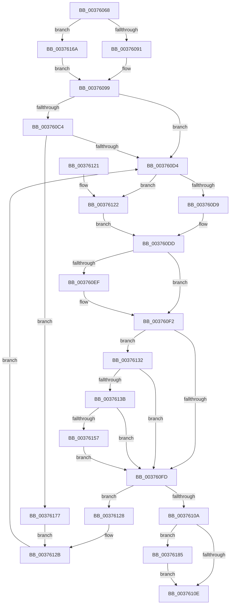

# MiWriteValidPteNewPage

- RVA: `0x00376068`–`0x00376195` (길이 `301` bytes)
- VA: `0x0000000140376068`
- 실행 섹션: `.text`
- PDB 이름 있음: `예`; PDB Function 태그: `아니요`
- unwind 정보 RVA: `0x0007ABEC`
- 디코드: `81`개 명령, `301/301` bytes 표시
- 미해석 바이트: `0` (있으면 어셈블리에 `.byte`로 보존)

> 이 문서는 커널 이미지의 기계어와 PDB 기호를 분석해 생성했습니다. 4번과 5번은 함수 원형과 자료형을 바이너리 사용 방식에서 추정한 C 해석이며 원본 소스 복구 결과는 아닙니다.

## 1. Dependencies

- 직접 호출 지점: **5**; 고유 호출 대상: **5**
- 직접 호출자로 확인된 함수: **6**
- RIP 상대 이미지 참조: **1**

### Outgoing calls
- `0x00376091` → [MI_READ_PTE_LOCK_FREE](../28/MI_READ_PTE_LOCK_FREE_function_002828A0.md) (function, `0x002828A0`)
- `0x003760C7` → [MiPteInShadowRange](../23/MiPteInShadowRange_function_0023FB00.md) (function, `0x0023FB00`)
- `0x00376163` → [MiCheckLinearProtectedPteAccessedBit](../29/MiCheckLinearProtectedPteAccessedBit_function_00292D80.md) (function, `0x00292D80`)
- `0x0037617C` → [MiSanitizeShadowPxe](../29/MiSanitizeShadowPxe_function_00294B68.md) (function, `0x00294B68`)
- `0x0037618B` → [MiWritePteShadow](../29/MiWritePteShadow_function_00294EAC.md) (function, `0x00294EAC`)

### Direct callers
- [MiCombineInitialInstance](../22/MiCombineInitialInstance_function_0022BC0C.md) at `0x0022C28A`
- [MiStealPage](../2B/MiStealPage_function_002B28D0.md) at `0x002B33C0`
- [MiTradeActivePage](MiTradeActivePage_function_00374424.md) at `0x00374660`
- [MiWritePteHighLevelIsr](../4C/MiWritePteHighLevelIsr_function_004C2FC0.md) at `0x004C312E`
- [MiWriteAweClusterPte](../4E/MiWriteAweClusterPte_function_004E16A8.md) at `0x004E1710`
- [sub_006E1950](../6E/Unknown_function_006E1950.md) at `0x006E1953`

### Static image references
- `0x003760DD` → RVA `0x00FC6A88` (`ALMOSTRO`; read)

## 2. Other-region calls and transfers

- 다른 실행 섹션으로 향하는 call: **0**
- 별도 외부 분기/꼬리 이동을 확인하지 못했습니다.

## 3. Assembly (complete function range)

```asm
00376068  48 89 5C 24 08                  mov qword ptr [rsp + 8], rbx
0037606D  48 89 6C 24 18                  mov qword ptr [rsp + 0x18], rbp
00376072  48 89 54 24 10                  mov qword ptr [rsp + 0x10], rdx
00376077  56                              push rsi
00376078  57                              push rdi
00376079  41 56                           push r14
0037607B  48 83 EC 20                     sub rsp, 0x20
0037607F  41 8B E8                        mov ebp, r8d
00376082  48 8B FA                        mov rdi, rdx
00376085  4C 8B F1                        mov r14, rcx
00376088  45 85 C0                        test r8d, r8d
0037608B  0F 85 D9 00 00 00               jne 0x14037616a
00376091  E8 0A C8 F0 FF                  call 0x1402828a0
00376096  48 8B D8                        mov rbx, rax
00376099  48 B8 00 00 00 00 00 00 00 7F   movabs rax, 0x7f00000000000000
003760A3  48 8B F3                        mov rsi, rbx
003760A6  48 23 F0                        and rsi, rax
003760A9  48 B8 FF FF FF FF FF FF FF 80   movabs rax, 0x80ffffffffffffff
003760B3  48 23 F8                        and rdi, rax
003760B6  48 0B F7                        or rsi, rdi
003760B9  33 FF                           xor edi, edi
003760BB  48 89 74 24 48                  mov qword ptr [rsp + 0x48], rsi
003760C0  85 ED                           test ebp, ebp
003760C2  75 10                           jne 0x1403760d4
003760C4  49 8B CE                        mov rcx, r14
003760C7  E8 34 9A EC FF                  call 0x14023fb00
003760CC  85 C0                           test eax, eax
003760CE  0F 85 A3 00 00 00               jne 0x140376177
003760D4  F6 C3 20                        test bl, 0x20
003760D7  74 49                           je 0x140376122
003760D9  48 83 CE 20                     or rsi, 0x20
003760DD  48 F7 05 A0 09 C5 00 00 00 00 02  test qword ptr [rip + 0xc509a0], 0x2000000
003760E8  48 89 74 24 48                  mov qword ptr [rsp + 0x48], rsi
003760ED  74 03                           je 0x1403760f2
003760EF  0F AE E8                        lfence
003760F2  48 0F BA 25 8D 09 C5 00 24      bt qword ptr [rip + 0xc5098d], 0x24
003760FB  72 35                           jb 0x140376132
003760FD  48 8B C3                        mov rax, rbx
00376100  F0 49 0F B1 36                  lock cmpxchg qword ptr [r14], rsi
00376105  48 3B D8                        cmp rbx, rax
00376108  75 1E                           jne 0x140376128
0037610A  85 FF                           test edi, edi
0037610C  75 77                           jne 0x140376185
0037610E  48 8B 5C 24 40                  mov rbx, qword ptr [rsp + 0x40]
00376113  48 8B 6C 24 50                  mov rbp, qword ptr [rsp + 0x50]
00376118  48 83 C4 20                     add rsp, 0x20
0037611C  41 5E                           pop r14
0037611E  5F                              pop rdi
0037611F  5E                              pop rsi
00376120  C3                              ret
00376121  CC                              int3
00376122  48 83 E6 DF                     and rsi, 0xffffffffffffffdf
00376126  EB B5                           jmp 0x1403760dd
00376128  48 8B D8                        mov rbx, rax
0037612B  48 8B 74 24 48                  mov rsi, qword ptr [rsp + 0x48]
00376130  EB A2                           jmp 0x1403760d4
00376132  40 8A C6                        mov al, sil
00376135  24 21                           and al, 0x21
00376137  3C 01                           cmp al, 1
00376139  75 C2                           jne 0x1403760fd
0037613B  48 B8 00 00 00 00 80 F6 FF FF   movabs rax, 0xfffff68000000000
00376145  48 B9 00 00 00 00 40 00 00 00   movabs rcx, 0x4000000000
0037614F  48 03 C1                        add rax, rcx
00376152  4C 3B F0                        cmp r14, rax
00376155  72 A6                           jb 0x1403760fd
00376157  41 B8 80 00 00 00               mov r8d, 0x80
0037615D  48 8B D6                        mov rdx, rsi
00376160  49 8B CE                        mov rcx, r14
00376163  E8 18 CC F1 FF                  call 0x140292d80
00376168  EB 93                           jmp 0x1403760fd
0037616A  48 8B 19                        mov rbx, qword ptr [rcx]
0037616D  48 8B 7C 24 48                  mov rdi, qword ptr [rsp + 0x48]
00376172  E9 22 FF FF FF                  jmp 0x140376099
00376177  48 8D 54 24 48                  lea rdx, [rsp + 0x48]
0037617C  E8 E7 E9 F1 FF                  call 0x140294b68
00376181  8B F8                           mov edi, eax
00376183  EB A6                           jmp 0x14037612b
00376185  48 8B D6                        mov rdx, rsi
00376188  49 8B CE                        mov rcx, r14
0037618B  E8 1C ED F1 FF                  call 0x140294eac
00376190  E9 79 FF FF FF                  jmp 0x14037610e
```

## 4. C-style interpretation (structured pseudocode)

```c
__int64 __fastcall MiWriteValidPteNewPage(__int64 a1, __int64 a2, int a3)
{
    __int64 result;
    __int64 v_rdi;
    __int64 v_rsi;
    __int64 v_rsp;
    unsigned __int64 v_stack_p10;
    unsigned __int64 v_stack_p18;
    unsigned __int64 v_stack_p48;
    unsigned __int64 v_stack_p8;

    v_stack_p8 = v_rbx;
    v_stack_p18 = v_rbp;
    v_stack_p10 = a2;
    v_rsp = (v_rsp) - (32);
    if (a3 != 0) goto loc_0037616A;
    result = MI_READ_PTE_LOCK_FREE(a1, a2, a3, a4);
loc_00376099:
    v_rsi = (result) & (result);
    v_rdi = (a2) & (result);
    v_rsi = (v_rsi) | (v_rdi);
    v_rdi = 0;
    v_stack_p10 = v_rsi;
    if ((unsigned int)((unsigned int)(a3)) != 0) goto loc_003760D4;
    result = MiPteInShadowRange(a1, a2, a3, a4);
    if ((unsigned int)(result) != 0) goto loc_00376177;
loc_003760D4:
    if ((((unsigned __int8)(result)) & (32)) == 0) goto loc_00376122;
    v_rsi = (v_rsi) | (32);
loc_003760DD:
    v_stack_p10 = v_rsi;
    if (((*(unsigned __int64 *)(v_rip + 12913056)) & (0x2000000ULL)) != 0) {
    }
    if (condition_is_below) goto loc_00376132;
loc_003760FD:
    if (result != result) goto loc_00376128;
    if (0 != 0) goto loc_00376185;
loc_0037610E:
    v_rsp = (v_rsp) + (32);
    return result;
loc_00376122:
    v_rsi = (v_rsi) & (-33);
    goto loc_003760DD;
loc_00376128:
loc_0037612B:
    goto loc_003760D4;
loc_00376132:
    result = (unsigned __int8)(((unsigned __int8)(v_stack_p48)) & (33));
    if (((unsigned __int8)(result)) != 1) goto loc_003760FD;
    result = (result) + (a1);
    if (a1 < result) goto loc_003760FD;
    result = MiCheckLinearProtectedPteAccessedBit(a1, v_stack_p48, 128, a4);
    goto loc_003760FD;
loc_0037616A:
    goto loc_00376099;
loc_00376177:
    result = MiSanitizeShadowPxe(a1, v_stack_p48, 128, a4);
    goto loc_0037612B;
loc_00376185:
    result = MiWritePteShadow(a1, v_stack_p48, 128, a4);
    goto loc_0037610E;
}
```

## 5. (Beta) C Style

```c
int64_t MiWriteValidPteNewPage(void *Arg1, int64_t Arg2, int32_t Arg3)
{
    uint8_t *arg1 = (uint8_t *)Arg1;

    int64_t result;
    int64_t local_rdi;
    int64_t local_rsi;
    int64_t local_rsp;
    uint64_t v_stack_p10;
    uint64_t v_stack_p18;
    uint64_t v_stack_p48;
    uint64_t v_stack_p8;

    v_stack_p8 = local_rbx;
    v_stack_p18 = local_rbp;
    v_stack_p10 = Arg2;
    local_rsp = (local_rsp) - (32);
    if (Arg3 != 0) goto loc_0037616A;
    result = MI_READ_PTE_LOCK_FREE(Arg1, Arg2, Arg3, a4);
loc_00376099:
    local_rsi = (result) & (result);
    local_rdi = (Arg2) & (result);
    local_rsi = (local_rsi) | (local_rdi);
    local_rdi = 0;
    v_stack_p10 = local_rsi;
    if ((uint32_t)((uint32_t)(Arg3)) != 0) goto loc_003760D4;
    result = MiPteInShadowRange(Arg1, Arg2, Arg3, a4);
    if ((uint32_t)(result) != 0) goto loc_00376177;
loc_003760D4:
    if ((((uint8_t)(result)) & (32)) == 0) goto loc_00376122;
    local_rsi = (local_rsi) | (32);
loc_003760DD:
    v_stack_p10 = local_rsi;
    if (((*(uint64_t *)(v_rip + 0xC509A0)) & (0x2000000ULL)) != 0) {
    }
    if (condition_is_below) goto loc_00376132;
loc_003760FD:
    if (result != result) goto loc_00376128;
    if (0 != 0) goto loc_00376185;
loc_0037610E:
    local_rsp = (local_rsp) + (32);
    return result;
loc_00376122:
    local_rsi = (local_rsi) & (-33);
    goto loc_003760DD;
loc_00376128:
loc_0037612B:
    goto loc_003760D4;
loc_00376132:
    result = (uint8_t)(((uint8_t)(v_stack_p48)) & (33));
    if (((uint8_t)(result)) != 1) goto loc_003760FD;
    result = (result) + (Arg1);
    if (Arg1 < result) goto loc_003760FD;
    result = MiCheckLinearProtectedPteAccessedBit(Arg1, v_stack_p48, 128, a4);
    goto loc_003760FD;
loc_0037616A:
    goto loc_00376099;
loc_00376177:
    result = MiSanitizeShadowPxe(Arg1, v_stack_p48, 128, a4);
    goto loc_0037612B;
loc_00376185:
    result = MiWritePteShadow(Arg1, v_stack_p48, 128, a4);
    goto loc_0037610E;
}
```

### 관측된 메모리 오프셋

구조체 형식이 확인되지 않은 접근은 인자 기준의 오프셋으로만 기록했습니다.

| 기준 인자 | 오프셋 표현 | 폭 (bit) | 접근 |
|---|---:|---:|---|
| `Arg1` | `+ 0x0` | `64` | `R` |

## 6. Execution-region graph

[열기: 2D/3D 그래프와 함수 탐색 컨트롤 패널](../../../control-panel.html?section=text&rva=0x00376068&view=graph)

- 2D 그래프는 위에서 아래로 흐르고, 3D 그래프는 빈 공간을 드래그해 회전합니다. Shift+드래그는 이동, 휠은 확대·축소, 함수 노드 선택은 대상 보고서 이동입니다.

### Static fallback


