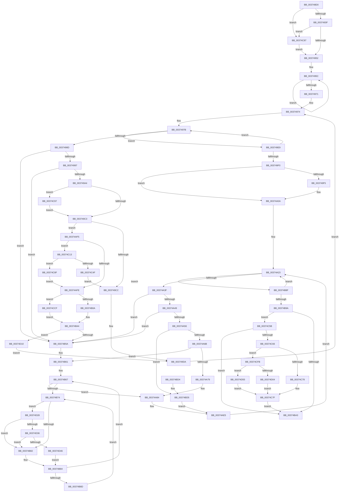

# MiZeroAndReleasePages

- RVA: `0x003748D0`–`0x00374D73` (길이 `1,187` bytes)
- VA: `0x00000001403748D0`
- 실행 섹션: `.text`
- PDB 이름 있음: `예`; PDB Function 태그: `아니요`
- unwind 정보 RVA: `0x0007AB1C`
- 디코드: `289`개 명령, `1,187/1,187` bytes 표시
- 미해석 바이트: `0` (있으면 어셈블리에 `.byte`로 보존)

> 이 문서는 커널 이미지의 기계어와 PDB 기호를 분석해 생성했습니다. 4번과 5번은 함수 원형과 자료형을 바이너리 사용 방식에서 추정한 C 해석이며 원본 소스 복구 결과는 아닙니다.

## 1. Dependencies

- 직접 호출 지점: **18**; 고유 호출 대상: **18**
- 직접 호출자로 확인된 함수: **1**
- RIP 상대 이미지 참조: **10**

### Outgoing calls
- `0x0037491B` → [memset](../6C/memset_function_006C6C40.md) (function, `0x006C6C40`)
- `0x003749D5` → [MiInsertMdlPageNeedsZero](MiInsertMdlPageNeedsZero_function_00374D7C.md) (function, `0x00374D7C`)
- `0x003749FD` → [MiProcessPageGroupInfo](MiProcessPageGroupInfo_function_00376910.md) (function, `0x00376910`)
- `0x00374A7C` → [MiLockPageInline](../31/MiLockPageInline_function_0031A340.md) (function, `0x0031A340`)
- `0x00374A87` → [MiClearPfnReuseFields](MiClearPfnReuseFields_function_003759F0.md) (function, `0x003759F0`)
- `0x00374AD5` → [MiFreeSmallPageFromMdl](MiFreeSmallPageFromMdl_function_00375D58.md) (function, `0x00375D58`)
- `0x00374AE0` → [MiUnlockPage](../31/MiUnlockPage_function_0031A3E0.md) (function, `0x0031A3E0`)
- `0x00374B3F` → [MiZeroPhysicalPage](../33/MiZeroPhysicalPage_function_00332590.md) (function, `0x00332590`)
- `0x00374BAE` → [_security_check_cookie](../6A/_security_check_cookie_function_006AC640.md) (function, `0x006AC640`)
- `0x00374C09` → [MiFreeLargePageMemory](MiFreeLargePageMemory_function_00377938.md) (function, `0x00377938`)
- `0x00374C2E` → [MI_NODE_FROM_PFN](../2B/MI_NODE_FROM_PFN_function_002B0F30.md) (function, `0x002B0F30`)
- `0x00374C3F` → [MiCreatePageChains](../49/MiCreatePageChains_function_0049ECD0.md) (function, `0x0049ECD0`)
- `0x00374C9B` → [MiSetOriginalPtePfnFromFreeList](../28/MiSetOriginalPtePfnFromFreeList_function_0028A99C.md) (function, `0x0028A99C`)
- `0x00374CB5` → [MiPfnBestZeroAttribute](../2C/MiPfnBestZeroAttribute_function_002C8600.md) (function, `0x002C8600`)
- `0x00374CC2` → [MiChangePageAttribute](../33/MiChangePageAttribute_function_00332ECC.md) (function, `0x00332ECC`)
- `0x00374CF1` → [MiZeroLargePage](../2C/MiZeroLargePage_function_002C6914.md) (function, `0x002C6914`)
- `0x00374D36` → [KiCheckVpBackingLongSpinWaitHypercall](../30/KiCheckVpBackingLongSpinWaitHypercall_function_0030F490.md) (function, `0x0030F490`)
- `0x00374D48` → [HvlNotifyLongSpinWait](../30/HvlNotifyLongSpinWait_function_0030F460.md) (function, `0x0030F460`)

### Direct callers
- [MiFreePagesFromMdl](../3F/MiFreePagesFromMdl_function_003F8300.md) at `0x003F8655`
- [MiFreePagesFromMdl](../3F/MiFreePagesFromMdl_function_003F8300.md) at `0x003F8712`

### Static image references
- `0x003748EF` → RVA `0x00E0A740` (`.data`; read)
- `0x00374974` → RVA `0x00011C60` (`.rdata`; read)
- `0x00374B76` → RVA `0x00FC52AC` (`ALMOSTRO`; reference)
- `0x00374C17` → RVA `0x00E30088` (`.data`; read)
- `0x00374C66` → RVA `0x00E3CE68` (`.data`; read/write)
- `0x00374C78` → RVA `0x00E3CE70` (`.data`; read)
- `0x00374D04` → RVA `0x00E3CE74` (`.data`; read)
- `0x00374D28` → RVA `0x00FC6AB8` (`ALMOSTRO`; read)
- `0x00374D5C` → RVA `0x00E3CE78` (`.data`; read)
- `0x00374D63` → RVA `0x00E3CE7C` (`.data`; read)

## 2. Other-region calls and transfers

- 다른 실행 섹션으로 향하는 call: **0**
- 별도 외부 분기/꼬리 이동을 확인하지 못했습니다.

## 3. Assembly (complete function range)

```asm
003748D0  48 89 5C 24 10                  mov qword ptr [rsp + 0x10], rbx
003748D5  48 89 6C 24 18                  mov qword ptr [rsp + 0x18], rbp
003748DA  48 89 74 24 20                  mov qword ptr [rsp + 0x20], rsi
003748DF  57                              push rdi
003748E0  41 54                           push r12
003748E2  41 55                           push r13
003748E4  41 56                           push r14
003748E6  41 57                           push r15
003748E8  48 81 EC C0 00 00 00            sub rsp, 0xc0
003748EF  48 8B 05 4A 5E A9 00            mov rax, qword ptr [rip + 0xa95e4a]
003748F6  48 33 C4                        xor rax, rsp
003748F9  48 89 84 24 B0 00 00 00         mov qword ptr [rsp + 0xb0], rax
00374901  89 54 24 40                     mov dword ptr [rsp + 0x40], edx
00374905  45 8B F0                        mov r14d, r8d
00374908  33 D2                           xor edx, edx
0037490A  48 89 4C 24 30                  mov qword ptr [rsp + 0x30], rcx
0037490F  48 8B D9                        mov rbx, rcx
00374912  48 8D 4C 24 50                  lea rcx, [rsp + 0x50]
00374917  44 8D 42 60                     lea r8d, [rdx + 0x60]
0037491B  E8 20 23 35 00                  call 0x1406c6c40
00374920  45 33 D2                        xor r10d, r10d
00374923  41 BC 01 00 00 00               mov r12d, 1
00374929  41 8B EA                        mov ebp, r10d
0037492C  45 0F 20 C1                     mov r9, cr8
00374930  4C 89 4C 24 38                  mov qword ptr [rsp + 0x38], r9
00374935  41 80 F9 02                     cmp r9b, 2
00374939  0F 84 48 03 00 00               je 0x140374c87
0037493F  65 8B 04 25 3C 3A 00 00         mov eax, dword ptr gs:[0x3a3c]
00374947  A9 01 00 01 00                  test eax, 0x10001
0037494C  0F 85 35 03 00 00               jne 0x140374c87
00374952  48 8D 44 24 50                  lea rax, [rsp + 0x50]
00374957  B9 04 00 00 00                  mov ecx, 4
0037495C  4C 89 50 10                     mov qword ptr [rax + 0x10], r10
00374960  48 89 40 08                     mov qword ptr [rax + 8], rax
00374964  48 89 00                        mov qword ptr [rax], rax
00374967  48 83 C0 18                     add rax, 0x18
0037496B  48 83 E9 01                     sub rcx, 1
0037496F  75 EB                           jne 0x14037495c
00374971  41 8B F2                        mov esi, r10d
00374974  4C 8D 05 E5 D2 C9 FF            lea r8, [rip - 0x362d1b]
0037497B  8B CE                           mov ecx, esi
0037497D  4C 8D 3C 49                     lea r15, [rcx + rcx*2]
00374981  4A 8D 04 FB                     lea rax, [rbx + r15*8]
00374985  48 8B 38                        mov rdi, qword ptr [rax]
00374988  48 3B F8                        cmp rdi, rax
0037498B  74 5C                           je 0x1403749e9
0037498D  48 39 47 08                     cmp qword ptr [rdi + 8], rax
00374991  0F 85 C3 01 00 00               jne 0x140374b5a
00374997  48 8B 17                        mov rdx, qword ptr [rdi]
0037499A  48 39 7A 08                     cmp qword ptr [rdx + 8], rdi
0037499E  0F 85 B6 01 00 00               jne 0x140374b5a
003749A4  4D 8B 2C C8                     mov r13, qword ptr [r8 + rcx*8]
003749A8  48 89 10                        mov qword ptr [rax], rdx
003749AB  48 89 42 08                     mov qword ptr [rdx + 8], rax
003749AF  48 FF 48 10                     dec qword ptr [rax + 0x10]
003749B3  8B 47 20                        mov eax, dword ptr [rdi + 0x20]
003749B6  C1 E8 10                        shr eax, 0x10
003749B9  24 C0                           and al, 0xc0
003749BB  3C C0                           cmp al, 0xc0
003749BD  0F 84 D4 02 00 00               je 0x140374c97
003749C3  48 85 ED                        test rbp, rbp
003749C6  0F 84 29 01 00 00               je 0x140374af5
003749CC  4D 8B C5                        mov r8, r13
003749CF  48 8B D7                        mov rdx, rdi
003749D2  48 8B CD                        mov rcx, rbp
003749D5  E8 A2 03 00 00                  call 0x140374d7c
003749DA  48 8B 5C 24 30                  mov rbx, qword ptr [rsp + 0x30]
003749DF  45 33 D2                        xor r10d, r10d
003749E2  4C 8B 4C 24 38                  mov r9, qword ptr [rsp + 0x38]
003749E7  EB 8B                           jmp 0x140374974
003749E9  FF C6                           inc esi
003749EB  83 FE 04                        cmp esi, 4
003749EE  72 8B                           jb 0x14037497b
003749F0  48 85 ED                        test rbp, rbp
003749F3  74 15                           je 0x140374a0a
003749F5  48 8D 54 24 50                  lea rdx, [rsp + 0x50]
003749FA  48 8B CD                        mov rcx, rbp
003749FD  E8 0E 1F 00 00                  call 0x140376910
00374A02  4C 8B 4C 24 38                  mov r9, qword ptr [rsp + 0x38]
00374A07  45 33 D2                        xor r10d, r10d
00374A0A  41 83 E6 01                     and r14d, 1
00374A0E  49 8B FA                        mov rdi, r10
00374A11  45 8B E6                        mov r12d, r14d
00374A14  41 8B F2                        mov esi, r10d
00374A17  41 C1 E4 05                     shl r12d, 5
00374A1B  41 C1 E6 04                     shl r14d, 4
00374A1F  45 8D 6E 02                     lea r13d, [r14 + 2]
00374A23  44 8B C6                        mov r8d, esi
00374A26  48 8D 44 24 50                  lea rax, [rsp + 0x50]
00374A2B  4B 8D 14 40                     lea rdx, [r8 + r8*2]
00374A2F  48 8D 04 D0                     lea rax, [rax + rdx*8]
00374A33  48 8B 18                        mov rbx, qword ptr [rax]
00374A36  48 3B D8                        cmp rbx, rax
00374A39  0F 84 50 01 00 00               je 0x140374b8f
00374A3F  48 39 43 08                     cmp qword ptr [rbx + 8], rax
00374A43  0F 85 11 01 00 00               jne 0x140374b5a
00374A49  48 8B 0B                        mov rcx, qword ptr [rbx]
00374A4C  48 39 59 08                     cmp qword ptr [rcx + 8], rbx
00374A50  0F 85 04 01 00 00               jne 0x140374b5a
00374A56  48 89 08                        mov qword ptr [rax], rcx
00374A59  48 89 41 08                     mov qword ptr [rcx + 8], rax
00374A5D  48 FF 4C D4 60                  dec qword ptr [rsp + rdx*8 + 0x60]
00374A62  83 FE 03                        cmp esi, 3
00374A65  0F 85 6A 01 00 00               jne 0x140374bd5
00374A6B  44 8D 76 FE                     lea r14d, [rsi - 2]
00374A6F  41 80 F9 02                     cmp r9b, 2
00374A73  0F 84 E8 00 00 00               je 0x140374b61
00374A79  48 8B CB                        mov rcx, rbx
00374A7C  E8 BF 58 FA FF                  call 0x14031a340
00374A81  44 8A F8                        mov r15b, al
00374A84  48 8B CB                        mov rcx, rbx
00374A87  E8 64 0F 00 00                  call 0x1403759f0
00374A8C  8B 4B 20                        mov ecx, dword ptr [rbx + 0x20]
00374A8F  89 4C 24 30                     mov dword ptr [rsp + 0x30], ecx
00374A93  C1 E9 10                        shr ecx, 0x10
00374A96  80 E1 FE                        and cl, 0xfe
00374A99  80 C9 06                        or cl, 6
00374A9C  88 4C 24 32                     mov byte ptr [rsp + 0x32], cl
00374AA0  8B 44 24 30                     mov eax, dword ptr [rsp + 0x30]
00374AA4  89 43 20                        mov dword ptr [rbx + 0x20], eax
00374AA7  48 B8 00 00 00 00 00 DE FF FF   movabs rax, 0xffffde0000000000
00374AB1  48 8B C0                        mov rax, rax
00374AB4  48 8B CB                        mov rcx, rbx
00374AB7  45 33 C9                        xor r9d, r9d
00374ABA  48 2B C8                        sub rcx, rax
00374ABD  45 8B C5                        mov r8d, r13d
00374AC0  48 C1 F9 04                     sar rcx, 4
00374AC4  48 B8 AB AA AA AA AA AA AA AA   movabs rax, 0xaaaaaaaaaaaaaaab
00374ACE  48 0F AF C8                     imul rcx, rax
00374AD2  41 8B D6                        mov edx, r14d
00374AD5  E8 7E 12 00 00                  call 0x140375d58
00374ADA  41 8A D7                        mov dl, r15b
00374ADD  48 8B CB                        mov rcx, rbx
00374AE0  E8 FB 58 FA FF                  call 0x14031a3e0
00374AE5  4C 8B 4C 24 38                  mov r9, qword ptr [rsp + 0x38]
00374AEA  49 03 FE                        add rdi, r14
00374AED  45 33 D2                        xor r10d, r10d
00374AF0  E9 2E FF FF FF                  jmp 0x140374a23
00374AF5  45 85 E4                        test r12d, r12d
00374AF8  0F 85 15 01 00 00               jne 0x140374c13
00374AFE  8B 47 20                        mov eax, dword ptr [rdi + 0x20]
00374B01  83 FE 03                        cmp esi, 3
00374B04  0F 85 C5 01 00 00               jne 0x140374ccf
00374B0A  C1 E8 10                        shr eax, 0x10
00374B0D  44 0F B6 C8                     movzx r9d, al
00374B11  41 C1 E9 06                     shr r9d, 6
00374B15  48 B8 00 00 00 00 00 DE FF FF   movabs rax, 0xffffde0000000000
00374B1F  48 8B C0                        mov rax, rax
00374B22  48 8B D7                        mov rdx, rdi
00374B25  45 33 C0                        xor r8d, r8d
00374B28  48 2B D0                        sub rdx, rax
00374B2B  33 C9                           xor ecx, ecx
00374B2D  48 C1 FA 04                     sar rdx, 4
00374B31  48 B8 AB AA AA AA AA AA AA AA   movabs rax, 0xaaaaaaaaaaaaaaab
00374B3B  48 0F AF D0                     imul rdx, rax
00374B3F  E8 4C DA FB FF                  call 0x140332590
00374B44  48 8D 44 24 50                  lea rax, [rsp + 0x50]
00374B49  4A 8D 04 F8                     lea rax, [rax + r15*8]
00374B4D  48 8B 48 08                     mov rcx, qword ptr [rax + 8]
00374B51  48 39 01                        cmp qword ptr [rcx], rax
00374B54  0F 84 B6 01 00 00               je 0x140374d10
00374B5A  B9 03 00 00 00                  mov ecx, 3
00374B5F  CD 29                           int 0x29
00374B61  41 B7 11                        mov r15b, 0x11
00374B64  41 8B EA                        mov ebp, r10d
00374B67  F0 48 0F BA 6B 18 3F            lock bts qword ptr [rbx + 0x18], 0x3f
00374B6E  0F 83 10 FF FF FF               jae 0x140374a84
00374B74  FF C5                           inc ebp
00374B76  85 2D 30 07 C5 00               test dword ptr [rip + 0xc50730], ebp
00374B7C  0F 84 A6 01 00 00               je 0x140374d28
00374B82  F3 90                           pause
00374B84  48 8B 43 18                     mov rax, qword ptr [rbx + 0x18]
00374B88  48 85 C0                        test rax, rax
00374B8B  79 DA                           jns 0x140374b67
00374B8D  EB E5                           jmp 0x140374b74
00374B8F  FF C6                           inc esi
00374B91  83 FE 04                        cmp esi, 4
00374B94  0F 82 89 FE FF FF               jb 0x140374a23
00374B9A  48 85 FF                        test rdi, rdi
00374B9D  0F 85 B8 00 00 00               jne 0x140374c5b
00374BA3  48 8B 8C 24 B0 00 00 00         mov rcx, qword ptr [rsp + 0xb0]
00374BAB  48 33 CC                        xor rcx, rsp
00374BAE  E8 8D 7A 33 00                  call 0x1406ac640
00374BB3  4C 8D 9C 24 C0 00 00 00         lea r11, [rsp + 0xc0]
00374BBB  49 8B 5B 38                     mov rbx, qword ptr [r11 + 0x38]
00374BBF  49 8B 6B 40                     mov rbp, qword ptr [r11 + 0x40]
00374BC3  49 8B 73 48                     mov rsi, qword ptr [r11 + 0x48]
00374BC7  49 8B E3                        mov rsp, r11
00374BCA  41 5F                           pop r15
00374BCC  41 5E                           pop r14
00374BCE  41 5D                           pop r13
00374BD0  41 5C                           pop r12
00374BD2  5F                              pop rdi
00374BD3  C3                              ret
00374BD4  CC                              int3
00374BD5  48 8D 05 84 D0 C9 FF            lea rax, [rip - 0x362f7c]
00374BDC  4E 8B 34 C0                     mov r14, qword ptr [rax + r8*8]
00374BE0  48 B8 00 00 00 00 00 DE FF FF   movabs rax, 0xffffde0000000000
00374BEA  48 8B C0                        mov rax, rax
00374BED  48 2B D8                        sub rbx, rax
00374BF0  45 8D 44 24 05                  lea r8d, [r12 + 5]
00374BF5  48 C1 FB 04                     sar rbx, 4
00374BF9  48 B9 AB AA AA AA AA AA AA AA   movabs rcx, 0xaaaaaaaaaaaaaaab
00374C03  48 0F AF CB                     imul rcx, rbx
00374C07  8B D6                           mov edx, esi
00374C09  E8 2A 2D 00 00                  call 0x140377938
00374C0E  E9 D2 FE FF FF                  jmp 0x140374ae5
00374C13  48 8B 47 28                     mov rax, qword ptr [rdi + 0x28]
00374C17  48 8B 0D 6A B4 AB 00            mov rcx, qword ptr [rip + 0xabb46a]
00374C1E  48 C1 E8 2B                     shr rax, 0x2b
00374C22  25 FF 03 00 00                  and eax, 0x3ff
00374C27  48 8B 1C C1                     mov rbx, qword ptr [rcx + rax*8]
00374C2B  48 8B CF                        mov rcx, rdi
00374C2E  E8 FD C2 F3 FF                  call 0x1402b0f30
00374C33  45 33 C9                        xor r9d, r9d
00374C36  8B D0                           mov edx, eax
00374C38  48 8B CB                        mov rcx, rbx
00374C3B  45 8D 41 03                     lea r8d, [r9 + 3]
00374C3F  E8 8C A0 12 00                  call 0x14049ecd0
00374C44  45 33 D2                        xor r10d, r10d
00374C47  48 8B E8                        mov rbp, rax
00374C4A  48 85 C0                        test rax, rax
00374C4D  74 40                           je 0x140374c8f
00374C4F  C7 40 10 21 00 00 00            mov dword ptr [rax + 0x10], 0x21
00374C56  E9 71 FD FF FF                  jmp 0x1403749cc
00374C5B  F6 44 24 40 01                  test byte ptr [rsp + 0x40], 1
00374C60  0F 85 3D FF FF FF               jne 0x140374ba3
00374C66  F0 48 01 3D FA 81 AC 00         lock add qword ptr [rip + 0xac81fa], rdi
00374C6E  48 83 FF 40                     cmp rdi, 0x40
00374C72  0F 87 83 00 00 00               ja 0x140374cfb
00374C78  48 8D 05 F1 81 AC 00            lea rax, [rip + 0xac81f1]
00374C7F  F0 FF 00                        lock inc dword ptr [rax]
00374C82  E9 1C FF FF FF                  jmp 0x140374ba3
00374C87  45 8B E2                        mov r12d, r10d
00374C8A  E9 C3 FC FF FF                  jmp 0x140374952
00374C8F  45 8B E2                        mov r12d, r10d
00374C92  E9 67 FE FF FF                  jmp 0x140374afe
00374C97  48 8D 4F 10                     lea rcx, [rdi + 0x10]
00374C9B  E8 FC 5C F1 FF                  call 0x14028a99c
00374CA0  41 80 F9 02                     cmp r9b, 2
00374CA4  BB 10 00 00 00                  mov ebx, 0x10
00374CA9  BA 01 00 00 00                  mov edx, 1
00374CAE  48 8B CF                        mov rcx, rdi
00374CB1  41 0F 45 DA                     cmovne ebx, r10d
00374CB5  E8 46 39 F5 FF                  call 0x1402c8600
00374CBA  8B D0                           mov edx, eax
00374CBC  44 8B C3                        mov r8d, ebx
00374CBF  48 8B CF                        mov rcx, rdi
00374CC2  E8 05 E2 FB FF                  call 0x140332ecc
00374CC7  45 33 D2                        xor r10d, r10d
00374CCA  E9 F4 FC FF FF                  jmp 0x1403749c3
00374CCF  80 7C 24 38 02                  cmp byte ptr [rsp + 0x38], 2
00374CD4  41 8B CA                        mov ecx, r10d
00374CD7  44 8B C6                        mov r8d, esi
00374CDA  48 8B D7                        mov rdx, rdi
00374CDD  0F 94 C1                        sete cl
00374CE0  C1 E8 10                        shr eax, 0x10
00374CE3  44 0F B6 C8                     movzx r9d, al
00374CE7  89 4C 24 20                     mov dword ptr [rsp + 0x20], ecx
00374CEB  33 C9                           xor ecx, ecx
00374CED  41 C1 E9 06                     shr r9d, 6
00374CF1  E8 1E 1C F5 FF                  call 0x1402c6914
00374CF6  E9 49 FE FF FF                  jmp 0x140374b44
00374CFB  48 81 FF 80 00 00 00            cmp rdi, 0x80
00374D02  77 51                           ja 0x140374d55
00374D04  48 8D 05 69 81 AC 00            lea rax, [rip + 0xac8169]
00374D0B  E9 6F FF FF FF                  jmp 0x140374c7f
00374D10  48 89 07                        mov qword ptr [rdi], rax
00374D13  48 89 4F 08                     mov qword ptr [rdi + 8], rcx
00374D17  48 89 39                        mov qword ptr [rcx], rdi
00374D1A  48 89 78 08                     mov qword ptr [rax + 8], rdi
00374D1E  4A FF 44 FC 60                  inc qword ptr [rsp + r15*8 + 0x60]
00374D23  E9 B2 FC FF FF                  jmp 0x1403749da
00374D28  8B 05 8A 1D C5 00               mov eax, dword ptr [rip + 0xc51d8a]
00374D2E  A8 40                           test al, 0x40
00374D30  0F 84 4C FE FF FF               je 0x140374b82
00374D36  E8 55 A7 F9 FF                  call 0x14030f490
00374D3B  45 33 D2                        xor r10d, r10d
00374D3E  84 C0                           test al, al
00374D40  0F 84 3C FE FF FF               je 0x140374b82
00374D46  8B CD                           mov ecx, ebp
00374D48  E8 13 A7 F9 FF                  call 0x14030f460
00374D4D  45 33 D2                        xor r10d, r10d
00374D50  E9 2F FE FF FF                  jmp 0x140374b84
00374D55  48 81 FF 00 02 00 00            cmp rdi, 0x200
00374D5C  48 8D 05 15 81 AC 00            lea rax, [rip + 0xac8115]
00374D63  48 8D 0D 12 81 AC 00            lea rcx, [rip + 0xac8112]
00374D6A  48 0F 47 C1                     cmova rax, rcx
00374D6E  E9 0C FF FF FF                  jmp 0x140374c7f
```

## 4. C-style interpretation (structured pseudocode)

```c
__int64 __fastcall MiZeroAndReleasePages(__int64 a1, int a2, int a3)
{
    __int64 result;
    __int64 v_r10;
    __int64 v_r12;
    __int64 v_r14;
    __int64 v_rbp;
    __int64 v_rbx;
    __int64 v_rdi;
    __int64 v_rsi;
    __int64 v_rsp;
    unsigned __int64 v_stack_m28;
    unsigned __int64 v_stack_m38;
    unsigned __int8 v_stack_m80;
    unsigned __int8 v_stack_m88;
    unsigned __int64 v_stack_m98;
    unsigned int v_stack_mA0;
    unsigned int v_stack_mA8;
    unsigned __int64 v_stack_mB0;
    unsigned __int8 v_stack_mB6;
    unsigned __int64 v_stack_mB8;
    unsigned __int64 v_stack_p10;
    unsigned __int64 v_stack_p18;
    unsigned __int64 v_stack_p20;

    v_stack_p10 = v_rbx;
    v_stack_p18 = v_rbp;
    v_stack_p20 = v_rsi;
    v_rsp = (v_rsp) - (192);
    result = (*(unsigned __int64 *)(v_rip + 11099722)) ^ (v_rsp);
    v_stack_m38 = result;
    v_stack_mA8 = a2;
    a2 = 0;
    v_stack_mB8 = a1;
    result = memset(v_stack_m98, a2, a2 + 96, a4);
    v_r10 = 0;
    v_stack_mB0 = v_cr8;
    if (((unsigned __int8)(v_cr8)) == 2) goto loc_00374C87;
    if ((((unsigned int)((unsigned int)(*(unsigned int *)(gs_base + (0 + 14908))))) & (0x10001ULL)) != 0) goto loc_00374C87;
loc_00374952:
loc_0037495C:
    *(unsigned __int64 *)(v_stack_m98 + 16) = 0;
    *(unsigned __int64 *)(v_stack_m98 + 8) = v_stack_m98;
    *(unsigned __int64 *)(v_stack_m98) = v_stack_m98;
    result = (v_stack_m98) + (24);
    a1 = (4) - (1);
    if (condition_is_not_equal) goto loc_0037495C;
loc_00374974:
loc_0037497B:
    if ((*(unsigned __int64 *)(a1 + 0 + 0 * 2 * 8)) == (a1 + 0 + 0 * 2 * 8)) goto loc_003749E9;
    if ((*(unsigned __int64 *)(*(unsigned __int64 *)(a1 + 0 + 0 * 2 * 8) + 8)) != (a1 + 0 + 0 * 2 * 8)) goto loc_00374B5A;
    if ((*(unsigned __int64 *)(*(unsigned __int64 *)(*(unsigned __int64 *)(a1 + 0 + 0 * 2 * 8)) + 8)) != (*(unsigned __int64 *)(a1 + 0 + 0 * 2 * 8))) goto loc_00374B5A;
    *(unsigned __int64 *)(a1 + 0 + 0 * 2 * 8) = *(unsigned __int64 *)(*(unsigned __int64 *)(a1 + 0 + 0 * 2 * 8));
    *(unsigned __int64 *)(*(unsigned __int64 *)(*(unsigned __int64 *)(a1 + 0 + 0 * 2 * 8)) + 8) = a1 + 0 + 0 * 2 * 8;
    result = (unsigned int)(((unsigned int)(*(unsigned int *)(*(unsigned __int64 *)(a1 + 0 + 0 * 2 * 8) + 32))) >> (16));
    result = (unsigned __int8)((result) & (192));
    if (((unsigned __int8)(result)) == 192) goto loc_00374C97;
loc_003749C3:
    if (0 == 0) goto loc_00374AF5;
loc_003749CC:
    result = MiInsertMdlPageNeedsZero(0, *(unsigned __int64 *)(a1 + 0 + 0 * 2 * 8), *(unsigned __int64 *)(v_rip - 3550491 + 0 * 8), v_cr8);
loc_003749DA:
    v_r10 = 0;
    goto loc_00374974;
loc_003749E9:
    v_rsi = (unsigned int)((0) + 1);
    if (((unsigned int)(v_rsi)) < 4) goto loc_0037497B;
    if (0 != 0) {
        a2 = v_stack_m98;
        a1 = 0;
        result = MiProcessPageGroupInfo(a1, a2, *(unsigned __int64 *)(v_rip - 3550491 + 0 * 8), v_stack_mB0);
        a4 = v_stack_mB0;
        v_r10 = 0;
    }
    v_r14 = (unsigned int)(((unsigned int)(a3)) & (1));
    v_r12 = (unsigned int)(((unsigned int)((unsigned int)(v_r14))) << (5));
    v_r14 = (unsigned int)((v_r14) << (4));
loc_00374A23:
    if ((*(unsigned __int64 *)(v_stack_m98 + 0 + 0 * 2 * 8)) == (v_stack_m98 + 0 + 0 * 2 * 8)) goto loc_00374B8F;
    if ((*(unsigned __int64 *)(*(unsigned __int64 *)(v_stack_m98 + 0 + 0 * 2 * 8) + 8)) != (v_stack_m98 + 0 + 0 * 2 * 8)) goto loc_00374B5A;
    if ((*(unsigned __int64 *)(*(unsigned __int64 *)(*(unsigned __int64 *)(v_stack_m98 + 0 + 0 * 2 * 8)) + 8)) != (*(unsigned __int64 *)(v_stack_m98 + 0 + 0 * 2 * 8))) goto loc_00374B5A;
    *(unsigned __int64 *)(v_stack_m98 + 0 + 0 * 2 * 8) = *(unsigned __int64 *)(*(unsigned __int64 *)(v_stack_m98 + 0 + 0 * 2 * 8));
    *(unsigned __int64 *)(*(unsigned __int64 *)(*(unsigned __int64 *)(v_stack_m98 + 0 + 0 * 2 * 8)) + 8) = v_stack_m98 + 0 + 0 * 2 * 8;
    if (0 != 3) goto loc_00374BD5;
    if (((unsigned __int8)(a4)) == 2) goto loc_00374B61;
    result = MiLockPageInline(*(unsigned __int64 *)(v_stack_m98 + 0 + 0 * 2 * 8), 0 + 0 * 2, 0, a4);
loc_00374A84:
    result = MiClearPfnReuseFields(*(unsigned __int64 *)(v_stack_m98 + 0 + 0 * 2 * 8), 0 + 0 * 2, 0, a4);
    v_stack_mB8 = (unsigned int)((unsigned int)(*(unsigned int *)(*(unsigned __int64 *)(v_stack_m98 + 0 + 0 * 2 * 8) + 32)));
    a1 = (unsigned int)(((unsigned int)(*(unsigned int *)(*(unsigned __int64 *)(v_stack_m98 + 0 + 0 * 2 * 8) + 32))) >> (16));
    a1 = (unsigned __int8)((a1) & (254));
    a1 = (unsigned __int8)((a1) | (6));
    v_stack_mB6 = (unsigned __int8)(a1);
    *(unsigned int *)(*(unsigned __int64 *)(v_stack_m98 + 0 + 0 * 2 * 8) + 32) = (unsigned int)((unsigned int)(v_stack_mB8));
    a4 = 0;
    a1 = (*(unsigned __int64 *)(v_stack_m98 + 0 + 0 * 2 * 8)) - ((unsigned int)(v_stack_mB8));
    a1 = (a1) >> (4);
    a1 = (a1) * ((unsigned int)(v_stack_mB8));
    result = MiFreeSmallPageFromMdl(a1, (unsigned int)((unsigned int)(0 - 2)), (unsigned int)((unsigned int)(v_r14 + 2)), a4);
    result = MiUnlockPage(*(unsigned __int64 *)(v_stack_m98 + 0 + 0 * 2 * 8), (unsigned __int8)((unsigned __int8)(result)), (unsigned int)((unsigned int)(v_r14 + 2)), a4);
loc_00374AE5:
    v_rdi = (0) + (0 - 2);
    v_r10 = 0;
    goto loc_00374A23;
loc_00374AF5:
    if ((unsigned int)(v_r12) != 0) goto loc_00374C13;
loc_00374AFE:
    if (0 != 3) goto loc_00374CCF;
    result = (unsigned int)(((unsigned int)(*(unsigned int *)(v_rdi + 32))) >> (16));
    a4 = (unsigned int)(((unsigned __int8)(result)) >> (6));
    a3 = 0;
    a2 = (v_rdi) - (result);
    a1 = 0;
    a2 = (a2) >> (4);
    a2 = (a2) * (result);
    result = MiZeroPhysicalPage(a1, a2, a3, a4);
loc_00374B44:
    if ((*(unsigned __int64 *)(*(unsigned __int64 *)(v_stack_m98 + (unsigned __int8)(result) * 8 + 8))) == (v_stack_m98 + (unsigned __int8)(result) * 8)) goto loc_00374D10;
loc_00374B5A:
loc_00374B61:
loc_00374B67:
    if ((*(unsigned __int64 *)(*(unsigned __int64 *)(v_stack_m98 + (unsigned __int8)(result) * 8 + 8))) >= (v_stack_m98 + (unsigned __int8)(result) * 8)) goto loc_00374A84;
loc_00374B74:
    v_rbp = (unsigned int)((0) + 1);
    if (((*(unsigned int *)(v_rip + 12912432)) & ((unsigned int)(v_rbp))) == 0) goto loc_00374D28;
loc_00374B82:
loc_00374B84:
    if (!sign_flag) goto loc_00374B67;
    goto loc_00374B74;
loc_00374B8F:
    v_rsi = (unsigned int)((0) + 1);
    if (((unsigned int)(v_rsi)) < 4) goto loc_00374A23;
    if (v_rdi != 0) goto loc_00374C5B;
loc_00374BA3:
    a1 = (v_stack_m38) ^ (v_rsp);
    result = _security_check_cookie(a1, a2, a3, a4);
    return result;
loc_00374BD5:
    v_rbx = (*(unsigned __int64 *)(v_stack_m28 + 56)) - (v_rip - 3551100);
    v_rbx = (v_rbx) >> (4);
    a1 = (a1) * (v_rbx);
    result = MiFreeLargePageMemory(a1, (unsigned int)((unsigned int)(*(unsigned __int64 *)(v_stack_m28 + 72))), v_r12 + 5, a4);
    goto loc_00374AE5;
loc_00374C13:
    result = (*(unsigned __int64 *)(v_rdi + 40)) >> (43);
    result = (unsigned int)((result) & (0x3FFULL));
    result = MI_NODE_FROM_PFN(v_rdi, (unsigned int)((unsigned int)(*(unsigned __int64 *)(v_stack_m28 + 72))), v_r12 + 5, a4);
    a4 = 0;
    result = MiCreatePageChains(*(unsigned __int64 *)(*(unsigned __int64 *)(v_rip + 11252842) + result * 8), (unsigned int)((unsigned int)(result)), a4 + 3, a4);
    v_r10 = 0;
    if (result == 0) goto loc_00374C8F;
    *(unsigned int *)(result + 16) = 33;
    goto loc_003749CC;
loc_00374C5B:
    if (((v_stack_m80) & (1)) != 0) goto loc_00374BA3;
    if (v_rdi > 64) goto loc_00374CFB;
loc_00374C7F:
    goto loc_00374BA3;
loc_00374C87:
    goto loc_00374952;
loc_00374C8F:
    goto loc_00374AFE;
loc_00374C97:
    result = MiSetOriginalPtePfnFromFreeList(v_rdi + 16, (unsigned int)((unsigned int)(result)), a4 + 3, a4);
    v_rbx = 16;
    if (0 != 2) { v_rbx = 0; }
    result = MiPfnBestZeroAttribute(v_rdi, 1, a4 + 3, a4);
    result = MiChangePageAttribute(v_rdi, (unsigned int)((unsigned int)(result)), (unsigned int)((unsigned int)(v_rbx)), a4);
    v_r10 = 0;
    goto loc_003749C3;
loc_00374CCF:
    a1 = (v_stack_m88 == 2) ? 1 : 0;
    result = (unsigned int)((result) >> (16));
    v_stack_mA0 = (unsigned int)(a1);
    a1 = 0;
    a4 = (unsigned int)(((unsigned __int8)(result)) >> (6));
    result = MiZeroLargePage(a1, v_rdi, (unsigned int)((unsigned int)(*(unsigned __int64 *)(v_stack_m28 + 72))), a4);
    goto loc_00374B44;
loc_00374CFB:
    if (v_rdi > 128) goto loc_00374D55;
    goto loc_00374C7F;
loc_00374D10:
    *(unsigned __int64 *)(v_rdi) = v_rip + 11305321;
    *(unsigned __int64 *)(v_rdi + 8) = 0;
    *(unsigned __int64 *)(a1) = v_rdi;
    *(unsigned __int64 *)(v_rip + 11305321 + 8) = v_rdi;
    goto loc_003749DA;
loc_00374D28:
    if ((((unsigned __int8)((unsigned int)(*(unsigned int *)(v_rip + 12918154)))) & (64)) == 0) goto loc_00374B82;
    result = KiCheckVpBackingLongSpinWaitHypercall(a1, v_rdi, (unsigned int)((unsigned int)(*(unsigned __int64 *)(v_stack_m28 + 72))), a4);
    v_r10 = 0;
    if ((unsigned __int8)(result) == 0) goto loc_00374B82;
    result = HvlNotifyLongSpinWait((unsigned int)((unsigned int)(result)), v_rdi, (unsigned int)((unsigned int)(*(unsigned __int64 *)(v_stack_m28 + 72))), a4);
    v_r10 = 0;
    goto loc_00374B84;
loc_00374D55:
    result = v_rip + 11305237;
    if (v_rdi > 512) { result = v_rip + 11305234; }
    goto loc_00374C7F;
}
```

## 5. (Beta) C Style

```c
int64_t MiZeroAndReleasePages(int64_t Arg1, int32_t Arg2, int32_t Arg3)
{
    int64_t result;
    int64_t local_r10;
    int64_t local_r12;
    int64_t local_r14;
    int64_t local_rbp;
    int64_t local_rbx;
    int64_t local_rdi;
    int64_t local_rsi;
    int64_t local_rsp;
    uint64_t v_stack_m28;
    uint64_t v_stack_m38;
    uint8_t v_stack_m80;
    uint8_t v_stack_m88;
    uint64_t v_stack_m98;
    uint32_t v_stack_mA0;
    uint32_t v_stack_mA8;
    uint64_t v_stack_mB0;
    uint8_t v_stack_mB6;
    uint64_t v_stack_mB8;
    uint64_t v_stack_p10;
    uint64_t v_stack_p18;
    uint64_t v_stack_p20;

    v_stack_p10 = local_rbx;
    v_stack_p18 = local_rbp;
    v_stack_p20 = local_rsi;
    local_rsp = (local_rsp) - (192);
    result = (*(uint64_t *)(v_rip + 0xA95E4A)) ^ (local_rsp);
    v_stack_m38 = result;
    v_stack_mA8 = Arg2;
    Arg2 = 0;
    v_stack_mB8 = Arg1;
    result = memset(v_stack_m98, Arg2, Arg2 + 96, a4);
    local_r10 = 0;
    v_stack_mB0 = v_cr8;
    if (((uint8_t)(v_cr8)) == 2) goto loc_00374C87;
    if ((((uint32_t)((uint32_t)(*(uint32_t *)(gs_base + (0 + 0x3A3C))))) & (0x10001ULL)) != 0) goto loc_00374C87;
loc_00374952:
loc_0037495C:
    *(uint64_t *)(v_stack_m98 + 0x10) = 0;
    *(uint64_t *)(v_stack_m98 + 0x8) = v_stack_m98;
    *(uint64_t *)(v_stack_m98) = v_stack_m98;
    result = (v_stack_m98) + (24);
    Arg1 = (4) - (1);
    if (condition_is_not_equal) goto loc_0037495C;
loc_00374974:
loc_0037497B:
    if ((*(uint64_t *)(Arg1 + 0x0 + 0x0 * 2 * 8)) == (Arg1 + 0 + 0 * 2 * 8)) goto loc_003749E9;
    if ((*(uint64_t *)(*(uint64_t *)(Arg1 + 0x0 + 0x0 * 2 * 8) + 0x8)) != (Arg1 + 0 + 0 * 2 * 8)) goto loc_00374B5A;
    if ((*(uint64_t *)(*(uint64_t *)(*(uint64_t *)(Arg1 + 0x0 + 0x0 * 2 * 8)) + 0x8)) != (*(uint64_t *)(Arg1 + 0x0 + 0x0 * 2 * 8))) goto loc_00374B5A;
    *(uint64_t *)(Arg1 + 0x0 + 0x0 * 2 * 8) = *(uint64_t *)(*(uint64_t *)(Arg1 + 0x0 + 0x0 * 2 * 8));
    *(uint64_t *)(*(uint64_t *)(*(uint64_t *)(Arg1 + 0x0 + 0x0 * 2 * 8)) + 0x8) = Arg1 + 0 + 0 * 2 * 8;
    result = (uint32_t)(((uint32_t)(*(uint32_t *)(*(uint64_t *)(Arg1 + 0x0 + 0x0 * 2 * 8) + 0x20))) >> (16));
    result = (uint8_t)((result) & (192));
    if (((uint8_t)(result)) == 192) goto loc_00374C97;
loc_003749C3:
    if (0 == 0) goto loc_00374AF5;
loc_003749CC:
    result = MiInsertMdlPageNeedsZero(0, *(uint64_t *)(Arg1 + 0x0 + 0x0 * 2 * 8), *(uint64_t *)(v_rip - 0x362D1B + 0x0 * 8), v_cr8);
loc_003749DA:
    local_r10 = 0;
    goto loc_00374974;
loc_003749E9:
    local_rsi = (uint32_t)((0) + 1);
    if (((uint32_t)(local_rsi)) < 4) goto loc_0037497B;
    if (0 != 0) {
        Arg2 = v_stack_m98;
        Arg1 = 0;
        result = MiProcessPageGroupInfo(Arg1, Arg2, *(uint64_t *)(v_rip - 0x362D1B + 0x0 * 8), v_stack_mB0);
        a4 = v_stack_mB0;
        local_r10 = 0;
    }
    local_r14 = (uint32_t)(((uint32_t)(Arg3)) & (1));
    local_r12 = (uint32_t)(((uint32_t)((uint32_t)(local_r14))) << (5));
    local_r14 = (uint32_t)((local_r14) << (4));
loc_00374A23:
    if ((*(uint64_t *)(v_stack_m98 + 0x0 + 0x0 * 2 * 8)) == (v_stack_m98 + 0 + 0 * 2 * 8)) goto loc_00374B8F;
    if ((*(uint64_t *)(*(uint64_t *)(v_stack_m98 + 0x0 + 0x0 * 2 * 8) + 0x8)) != (v_stack_m98 + 0 + 0 * 2 * 8)) goto loc_00374B5A;
    if ((*(uint64_t *)(*(uint64_t *)(*(uint64_t *)(v_stack_m98 + 0x0 + 0x0 * 2 * 8)) + 0x8)) != (*(uint64_t *)(v_stack_m98 + 0x0 + 0x0 * 2 * 8))) goto loc_00374B5A;
    *(uint64_t *)(v_stack_m98 + 0x0 + 0x0 * 2 * 8) = *(uint64_t *)(*(uint64_t *)(v_stack_m98 + 0x0 + 0x0 * 2 * 8));
    *(uint64_t *)(*(uint64_t *)(*(uint64_t *)(v_stack_m98 + 0x0 + 0x0 * 2 * 8)) + 0x8) = v_stack_m98 + 0 + 0 * 2 * 8;
    if (0 != 3) goto loc_00374BD5;
    if (((uint8_t)(a4)) == 2) goto loc_00374B61;
    result = MiLockPageInline(*(uint64_t *)(v_stack_m98 + 0x0 + 0x0 * 2 * 8), 0 + 0 * 2, 0, a4);
loc_00374A84:
    result = MiClearPfnReuseFields(*(uint64_t *)(v_stack_m98 + 0x0 + 0x0 * 2 * 8), 0 + 0 * 2, 0, a4);
    v_stack_mB8 = (uint32_t)((uint32_t)(*(uint32_t *)(*(uint64_t *)(v_stack_m98 + 0x0 + 0x0 * 2 * 8) + 0x20)));
    Arg1 = (uint32_t)(((uint32_t)(*(uint32_t *)(*(uint64_t *)(v_stack_m98 + 0x0 + 0x0 * 2 * 8) + 0x20))) >> (16));
    Arg1 = (uint8_t)((Arg1) & (254));
    Arg1 = (uint8_t)((Arg1) | (6));
    v_stack_mB6 = (uint8_t)(Arg1);
    *(uint32_t *)(*(uint64_t *)(v_stack_m98 + 0x0 + 0x0 * 2 * 8) + 0x20) = (uint32_t)((uint32_t)(v_stack_mB8));
    a4 = 0;
    Arg1 = (*(uint64_t *)(v_stack_m98 + 0x0 + 0x0 * 2 * 8)) - ((uint32_t)(v_stack_mB8));
    Arg1 = (Arg1) >> (4);
    Arg1 = (Arg1) * ((uint32_t)(v_stack_mB8));
    result = MiFreeSmallPageFromMdl(Arg1, (uint32_t)((uint32_t)(0 - 2)), (uint32_t)((uint32_t)(local_r14 + 2)), a4);
    result = MiUnlockPage(*(uint64_t *)(v_stack_m98 + 0x0 + 0x0 * 2 * 8), (uint8_t)((uint8_t)(result)), (uint32_t)((uint32_t)(local_r14 + 2)), a4);
loc_00374AE5:
    local_rdi = (0) + (0 - 2);
    local_r10 = 0;
    goto loc_00374A23;
loc_00374AF5:
    if ((uint32_t)(local_r12) != 0) goto loc_00374C13;
loc_00374AFE:
    if (0 != 3) goto loc_00374CCF;
    result = (uint32_t)(((uint32_t)(*(uint32_t *)(local_rdi + 0x20))) >> (16));
    a4 = (uint32_t)(((uint8_t)(result)) >> (6));
    Arg3 = 0;
    Arg2 = (local_rdi) - (result);
    Arg1 = 0;
    Arg2 = (Arg2) >> (4);
    Arg2 = (Arg2) * (result);
    result = MiZeroPhysicalPage(Arg1, Arg2, Arg3, a4);
loc_00374B44:
    if ((*(uint64_t *)(*(uint64_t *)(v_stack_m98 + (uint8_t)(result) * 8 + 0x8))) == (v_stack_m98 + (uint8_t)(result) * 8)) goto loc_00374D10;
loc_00374B5A:
loc_00374B61:
loc_00374B67:
    if ((*(uint64_t *)(*(uint64_t *)(v_stack_m98 + (uint8_t)(result) * 8 + 0x8))) >= (v_stack_m98 + (uint8_t)(result) * 8)) goto loc_00374A84;
loc_00374B74:
    local_rbp = (uint32_t)((0) + 1);
    if (((*(uint32_t *)(v_rip + 0xC50730)) & ((uint32_t)(local_rbp))) == 0) goto loc_00374D28;
loc_00374B82:
loc_00374B84:
    if (!sign_flag) goto loc_00374B67;
    goto loc_00374B74;
loc_00374B8F:
    local_rsi = (uint32_t)((0) + 1);
    if (((uint32_t)(local_rsi)) < 4) goto loc_00374A23;
    if (local_rdi != 0) goto loc_00374C5B;
loc_00374BA3:
    Arg1 = (v_stack_m38) ^ (local_rsp);
    result = _security_check_cookie(Arg1, Arg2, Arg3, a4);
    return result;
loc_00374BD5:
    local_rbx = (*(uint64_t *)(v_stack_m28 + 0x38)) - (v_rip - 3551100);
    local_rbx = (local_rbx) >> (4);
    Arg1 = (Arg1) * (local_rbx);
    result = MiFreeLargePageMemory(Arg1, (uint32_t)((uint32_t)(*(uint64_t *)(v_stack_m28 + 0x48))), local_r12 + 5, a4);
    goto loc_00374AE5;
loc_00374C13:
    result = (*(uint64_t *)(local_rdi + 0x28)) >> (43);
    result = (uint32_t)((result) & (0x3FFULL));
    result = MI_NODE_FROM_PFN(local_rdi, (uint32_t)((uint32_t)(*(uint64_t *)(v_stack_m28 + 0x48))), local_r12 + 5, a4);
    a4 = 0;
    result = MiCreatePageChains(*(uint64_t *)(*(uint64_t *)(v_rip + 0xABB46A) + result * 8), (uint32_t)((uint32_t)(result)), a4 + 3, a4);
    local_r10 = 0;
    if (result == 0) goto loc_00374C8F;
    *(uint32_t *)(result + 0x10) = 33;
    goto loc_003749CC;
loc_00374C5B:
    if (((v_stack_m80) & (1)) != 0) goto loc_00374BA3;
    if (local_rdi > 64) goto loc_00374CFB;
loc_00374C7F:
    goto loc_00374BA3;
loc_00374C87:
    goto loc_00374952;
loc_00374C8F:
    goto loc_00374AFE;
loc_00374C97:
    result = MiSetOriginalPtePfnFromFreeList(local_rdi + 16, (uint32_t)((uint32_t)(result)), a4 + 3, a4);
    local_rbx = 16;
    if (0 != 2) { local_rbx = 0; }
    result = MiPfnBestZeroAttribute(local_rdi, 1, a4 + 3, a4);
    result = MiChangePageAttribute(local_rdi, (uint32_t)((uint32_t)(result)), (uint32_t)((uint32_t)(local_rbx)), a4);
    local_r10 = 0;
    goto loc_003749C3;
loc_00374CCF:
    Arg1 = (v_stack_m88 == 2) ? 1 : 0;
    result = (uint32_t)((result) >> (16));
    v_stack_mA0 = (uint32_t)(Arg1);
    Arg1 = 0;
    a4 = (uint32_t)(((uint8_t)(result)) >> (6));
    result = MiZeroLargePage(Arg1, local_rdi, (uint32_t)((uint32_t)(*(uint64_t *)(v_stack_m28 + 0x48))), a4);
    goto loc_00374B44;
loc_00374CFB:
    if (local_rdi > 128) goto loc_00374D55;
    goto loc_00374C7F;
loc_00374D10:
    *(uint64_t *)(local_rdi) = v_rip + 11305321;
    *(uint64_t *)(local_rdi + 0x8) = 0;
    *(uint64_t *)(Arg1) = local_rdi;
    *(uint64_t *)(v_rip + 0xAC8169 + 0x8) = local_rdi;
    goto loc_003749DA;
loc_00374D28:
    if ((((uint8_t)((uint32_t)(*(uint32_t *)(v_rip + 0xC51D8A)))) & (64)) == 0) goto loc_00374B82;
    result = KiCheckVpBackingLongSpinWaitHypercall(Arg1, local_rdi, (uint32_t)((uint32_t)(*(uint64_t *)(v_stack_m28 + 0x48))), a4);
    local_r10 = 0;
    if ((uint8_t)(result) == 0) goto loc_00374B82;
    result = HvlNotifyLongSpinWait((uint32_t)((uint32_t)(result)), local_rdi, (uint32_t)((uint32_t)(*(uint64_t *)(v_stack_m28 + 0x48))), a4);
    local_r10 = 0;
    goto loc_00374B84;
loc_00374D55:
    result = v_rip + 11305237;
    if (local_rdi > 512) { result = v_rip + 11305234; }
    goto loc_00374C7F;
}
```

## 6. Execution-region graph

[열기: 2D/3D 그래프와 함수 탐색 컨트롤 패널](../../../control-panel.html?section=text&rva=0x003748D0&view=graph)

- 2D 그래프는 위에서 아래로 흐르고, 3D 그래프는 빈 공간을 드래그해 회전합니다. Shift+드래그는 이동, 휠은 확대·축소, 함수 노드 선택은 대상 보고서 이동입니다.

### Static fallback


